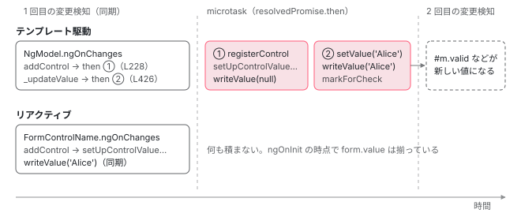

[目次](../README.md) › [フォームの内側](README.md) › 第 13 回 / 全 20 回

# テンプレート駆動：NgModel と NgForm の非同期な登録

> NgModel が自分で値 null の FormControl を作り、NgForm への登録（addControl）と値の書き込み（\_updateValue）をどちらも resolvedPromise.then で 1 拍遅らせる仕組み。遅らせる理由（#m="ngModel" をテンプレートの前で読む式に、markForCheck でもう 1 回の変更検知を届ける。ng\_model.ts のコメント）と、そのせいで ngOnInit で form.value が空・writeValue が null で 1 回多く呼ばれること。ngModelChange が viewToModelUpdate から出る行、name と ngModelOptions（standalone・name・updateOn）、NgModelGroup、\_checkForErrors のエラーと子コンポーネントの警告。リアクティブとの違いを同じ入力で比べる。

angular/angular · 読了 約 14 分 · 発展 · [サイトで読む（デモが動きます）](https://angular-deep-dive-cyan.vercel.app/chapter/forms-ng-model)

---

テンプレート駆動フォーム（`FormsModule`）では、`FormControl` をクラスで作りません。`[(ngModel)]` を書くと `NgModel` ディレクティブが自分で `FormControl` を 1 つ作り、`<form>` に付いた `NgForm` に名前で登録します。この章の中心は、その登録と値の書き込みが**どちらも `resolvedPromise.then` の中、つまり 1 拍（microtask 1 つ分）遅れて**起きることです。なぜ遅らせるのか、遅れるせいで何が起きるのか（ngOnInit で `form.value` が空、`writeValue` が `null` で 1 回多く呼ばれる）を、同じ入力をリアクティブフォームで書いたときと比べながら追います。

読む対象は `packages/forms/src/directives/` の `ng_model.ts`・`ng_form.ts`・`ng_model_group.ts`・`template_driven_errors.ts` です。

1. [1. 全体像](01-forms-overview.md)
2. [2. AbstractControl](02-forms-abstract-control.md)
3. [3. updateValueAndValidity](03-forms-update-value-validity.md)
4. [4. Validators](04-forms-validators.md)
5. [5. 非同期の検証](05-forms-async-validators.md)
6. [6. events](06-forms-control-events.md)
7. [7. FormGroup と FormArray](07-forms-form-group-array.md)
8. [8. 型付きフォームと FormBuilder](08-forms-typed-forms.md)
9. [9. ControlValueAccessor](09-forms-value-accessor.md)
10. [10. 双方向の配線](10-forms-setup-control.md)
11. [11. 組み込みの accessor](11-forms-builtin-accessors.md)
12. [12. リアクティブのディレクティブ](12-forms-reactive-directives.md)
13. **13. NgModel と NgForm**（この章）
14. [14. 検証のディレクティブ](14-forms-validator-directives.md)
15. [15. 状態クラス](15-forms-status-classes.md)
16. [16. Signal Forms のスキーマ](16-forms-sf-schema.md)
17. [17. Signal Forms の検証](17-forms-sf-validation.md)
18. [18. 状態ルールと metadata](18-forms-sf-rules-metadata.md)
19. [19. submit と相互運用](19-forms-sf-submit-compat.md)
20. [20. issue と PR を読む](20-forms-issues.md)

## 0. 全体の流れ

`<form><input name="first" [(ngModel)]="first"></form>` を描画したときに起きることです。

1. **作る**

   `NgForm` が空の `FormGroup` を、`NgModel` が空の `FormControl`（値は `null`）を作る（1・2 節）。
2. **ngOnChanges（同期）**

   `NgModel` が名前と親を確かめ、`NgForm.addControl` と `_updateValue` を呼ぶ。どちらも `resolvedPromise.then` に仕事を積むだけで、すぐには何もしない（3・4 節）。
3. **1 つ目の microtask**

   `NgForm` が `registerControl` で自分の `FormGroup` に入れ、`setUpControlValueAccessor` で入力欄とつなぐ。このとき `writeValue(null)`（5 節）。
4. **2 つ目の microtask**

   `NgModel` が `control.setValue(first)` し、`writeValue(first)` で入力欄に値が入る。`markForCheck` でもう一度変更検知を頼む（4 節）。
5. **入力したとき**

   accessor → `updateControl` → `viewToModelUpdate` → `ngModelChange` → `first = $event`（6 節）。

## 1. NgModel は自分で FormControl を作る

📄 `angular/packages/forms/src/directives/ng_model.ts` L166–186 （▶ の行: 167–169, 173, 185）

```ts
166 │ @Directive({
167 ▶   selector: '[ngModel]:not([formControlName]):not([formControl])',
168 ▶   providers: [formControlBinding, NG_CONTROL_INTEGRATION_PROVIDER],
169 ▶   exportAs: 'ngModel',
170 │   standalone: false,
171 │ })
172 │ export class NgModel extends NgControl implements OnChanges, OnDestroy {
173 ▶   public override readonly control: FormControl = new FormControl();
174 │ 
175 │   // At runtime we coerce arbitrary values assigned to the "disabled" input to a "boolean".
176 │   // This is not reflected in the type of the property because outside of templates, consumers
177 │   // should only deal with booleans. In templates, a string is allowed for convenience and to
178 │   // match the native "disabled attribute" semantics which can be observed on input elements.
179 │   // This static member tells the compiler that values of type "string" can also be assigned
180 │   // to the input in a template.
181 │   /** @docs-private */
182 │   static ngAcceptInputType_isDisabled: boolean | string;
183 │ 
184 │   /** @internal */
185 ▶   _registered = false;
186 │ 
```

173 行目、`NgModel` はフィールドの初期化で `new FormControl()` を作ります。引数が無いので値は `null` です。167 行目のセレクタは `[ngModel]:not([formControlName]):not([formControl])` で、リアクティブのディレクティブと一緒に書いたときは `NgModel` は作られません （そのときの `ngModel` は[第 12 回](12-forms-reactive-directives.md)の非推奨の入力です）。169 行目の `exportAs: 'ngModel'` で `#m="ngModel"` と参照でき、185 行目の `_registered` は「もう親に登録を頼んだか」の印です。

📄 `angular/packages/forms/src/directives/ng_model.ts` L195–237 （▶ の行: 200, 206, 212, 222–223, 226, 230, 237）

```ts
195 │   /**
196 │    * @description
197 │    * Tracks the name bound to the directive. If a parent form exists, it
198 │    * uses this name as a key to retrieve this control's value.
199 │    */
200 ▶   @Input() override name: string = '';
201 │ 
202 │   /**
203 │    * @description
204 │    * Tracks whether the control is disabled.
205 │    */
206 ▶   @Input('disabled') isDisabled!: boolean;
207 │ 
208 │   /**
209 │    * @description
210 │    * Tracks the value bound to this directive.
211 │    */
212 ▶   @Input('ngModel') model: any;
213 │ 
214 │   /**
215 │    * @description
216 │    * Tracks the configuration options for this `ngModel` instance.
217 │    *
218 │    * **name**: An alternative to setting the name attribute on the form control element. See
219 │    * the [example](api/forms/NgModel) for using `NgModel`
220 │    * as a standalone control.
221 │    *
222 ▶    * **standalone**: When set to true, the `ngModel` will not register itself with its parent form,
223 ▶    * and acts as if it's not in the form. Defaults to false. If no parent form exists, this option
224 │    * has no effect.
225 │    *
226 ▶    * **updateOn**: Defines the event upon which the form control value and validity update.
227 │    * Defaults to 'change'. Possible values: `'change'` | `'blur'` | `'submit'`.
228 │    *
229 │    */
230 ▶   @Input('ngModelOptions') options!: {name?: string; standalone?: boolean; updateOn?: FormHooks};
231 │ 
232 │   /**
233 │    * @description
234 │    * Event emitter for producing the `ngModelChange` event after
235 │    * the view model updates.
236 │    */
237 ▶   @Output('ngModelChange') update = new EventEmitter();
```

入力は 4 つです。200 行目 `name`（親の `FormGroup` でのキー）、206 行目 `disabled`、212 行目 `ngModel`（値）、230 行目 `ngModelOptions`。`ngModelOptions` の `standalone: true` は「親のフォームに登録しない」（222〜223 行目）、`updateOn` は値を確定するタイミング（226〜227 行目）、`name` は `name` 属性の代わりです。237 行目の出力が `ngModelChange` で、`[(ngModel)]="x"` は `[ngModel]="x" (ngModelChange)="x = $event"` の略です。

📄 `angular/packages/forms/src/directives/ng_model.ts` L239–262 （▶ の行: 240, 246–247, 255）

```ts
239 │   constructor(
240 ▶     @Optional() @Host() parent: ControlContainer,
241 │     @Optional() @Self() @Inject(NG_VALIDATORS) validators: (Validator | ValidatorFn)[],
242 │     @Optional()
243 │     @Self()
244 │     @Inject(NG_ASYNC_VALIDATORS)
245 │     asyncValidators: (AsyncValidator | AsyncValidatorFn)[],
246 ▶     @Optional() @Self() @Inject(NG_VALUE_ACCESSOR) valueAccessors: ControlValueAccessor[],
247 ▶     @Optional() @Inject(ChangeDetectorRef) private _changeDetectorRef?: ChangeDetectorRef | null,
248 │     @Optional()
249 │     @Inject(CALL_SET_DISABLED_STATE)
250 │     private callSetDisabledState?: SetDisabledStateOption,
251 │     @Optional() injector?: Injector,
252 │     @Optional() renderer?: Renderer2,
253 │   ) {
254 │     super(injector, renderer, valueAccessors);
255 ▶     this._parent = parent;
256 │     if (typeof ngDevMode === 'undefined' || ngDevMode) {
257 │       this._ngModelInjector = injector;
258 │     }
259 │ 
260 │     this._setValidators(validators);
261 │     this._setAsyncValidators(asyncValidators);
262 │   }
```

240 行目、親は `@Optional() @Host() parent: ControlContainer`。[第 12 回](12-forms-reactive-directives.md)の `FormControlName` と違って `@SkipSelf()` がありません（`NgModel` 自身は `ControlContainer` を provide しないので、自分の要素から探し始めても困らない）。`@Optional()` なので、`<form>` の外では `null` になり、そのときは単独（standalone）で動きます。

## 2. NgForm は空の FormGroup を持つ

📄 `angular/packages/forms/src/directives/ng_form.ts` L48–53 （▶ の行: 49–50, 53）

```ts
48 │ const formDirectiveProvider: Provider = {
49 ▶   provide: ControlContainer,
50 ▶   useExisting: forwardRef(() => NgForm),
51 │ };
52 │ 
53 ▶ const resolvedPromise = (() => Promise.resolve())();
```

📄 `angular/packages/forms/src/directives/ng_form.ts` L119–139 （▶ の行: 120–122, 124, 133, 137, 139）

```ts
119 │ @Directive({
120 ▶   selector: 'form:not([ngNoForm]):not([formGroup]):not([formArray]),ng-form,[ngForm]',
121 ▶   providers: [formDirectiveProvider],
122 ▶   host: {'(submit)': 'onSubmit($event)', '(reset)': 'onReset()'},
123 │   outputs: ['ngSubmit'],
124 ▶   exportAs: 'ngForm',
125 │   standalone: false,
126 │ })
127 │ export class NgForm extends ControlContainer implements Form, AfterViewInit {
128 │   /**
129 │    * @description
130 │    * Returns whether the form submission has been triggered.
131 │    */
132 │   get submitted(): boolean {
133 ▶     return untracked(this.submittedReactive);
134 │   }
135 │   /** @internal */
136 │   readonly _submitted = computed(() => this.submittedReactive());
137 ▶   private readonly submittedReactive = signal(false);
138 │ 
139 ▶   private _directives = new Set<NgModel>();
```

📄 `angular/packages/forms/src/directives/ng_form.ts` L164–185 （▶ の行: 175–178, 183–184）

```ts
164 │   constructor(
165 │     @Optional() @Self() @Inject(NG_VALIDATORS) validators: (Validator | ValidatorFn)[],
166 │     @Optional()
167 │     @Self()
168 │     @Inject(NG_ASYNC_VALIDATORS)
169 │     asyncValidators: (AsyncValidator | AsyncValidatorFn)[],
170 │     @Optional()
171 │     @Inject(CALL_SET_DISABLED_STATE)
172 │     private callSetDisabledState?: SetDisabledStateOption,
173 │   ) {
174 │     super();
175 ▶     this.form = new FormGroup(
176 ▶       {},
177 ▶       composeValidators(validators),
178 ▶       composeAsyncValidators(asyncValidators),
179 │     );
180 │   }
181 │ 
182 │   /** @docs-private */
183 ▶   ngAfterViewInit() {
184 ▶     this._setUpdateStrategy();
185 │   }
```

- **120 行目のセレクタ**：`form:not([ngNoForm]):not([formGroup]):not([formArray])`。`FormsModule` を import すると、ただの `<form>` にも `NgForm` が付きます。`ngNoForm` 属性か、リアクティブの `[formGroup]` / `[formArray]` があれば付きません。
- **49〜50 行目**：`ControlContainer` として自分を provide。`NgModel` の 240 行目はこれを受け取ります。
- **175〜179 行目**：コンストラクタで `new FormGroup({})`。子は 1 つもありません。`<form>` に付いた検証ディレクティブは、ここで直接 `FormGroup` の検証になります。
- **183〜184 行目**：`ngFormOptions` の `updateOn` は `ngAfterViewInit` で `FormGroup` に入れます。
- **137・139 行目**：`submitted` は signal（[第 12 回](12-forms-reactive-directives.md)の AbstractFormDirective と同じ形）。`_directives` は登録された `NgModel` の Set です。

## 3. ngOnChanges：確かめて、登録を頼む

📄 `angular/packages/forms/src/directives/ng_model.ts` L264–285 （▶ の行: 267, 269–270, 272, 282, 285）

```ts
264 │   /** @docs-private */
265 │   ngOnChanges(changes: SimpleChanges) {
266 │     if (
267 ▶       !this._registered &&
268 │       (typeof ngDevMode === 'undefined' || ngDevMode) &&
269 ▶       this._parent === null &&
270 ▶       !this.options?.standalone
271 │     ) {
272 ▶       const parentContainer = this._ngModelInjector?.get(ControlContainer, null);
273 │       if (parentContainer != null) {
274 │         const typeName =
275 │           parentContainer instanceof NgForm
276 │             ? 'NgForm'
277 │             : parentContainer instanceof FormGroupDirective
278 │               ? 'FormGroupDirective'
279 │               : parentContainer instanceof NgModelGroup
280 │                 ? 'NgModelGroup'
281 │                 : parentContainer.constructor.name || 'ControlContainer';
282 ▶         console.warn(ngModelInChildComponentWarning(typeName));
283 │       }
284 │     }
285 ▶     this._checkForErrors();
```

266〜284 行目は開発モードだけの警告です。269 行目、親が見つからず（`@Host()` で止まった）、`standalone` でもないのに、272 行目で `@Host()` を付けずに探すと `ControlContainer` が見つかる。これは「子コンポーネントのテンプレートの `ngModel` が、親コンポーネントの `<form>` に届いていない」状態なので、282 行目で警告します（7 節）。285 行目の `_checkForErrors` が本当の確認です。

📄 `angular/packages/forms/src/directives/ng_model.ts` L410–446 （▶ の行: 411–412, 414, 418, 420–421, 425–428, 437）

```ts
410 │   private _checkForErrors(): void {
411 ▶     if ((typeof ngDevMode === 'undefined' || ngDevMode) && !this._isStandalone()) {
412 ▶       checkParentType(this._parent);
413 │     }
414 ▶     this._checkName();
415 │   }
416 │ 
417 │   private _checkName(): void {
418 ▶     if (this.options && this.options.name) this.name = this.options.name;
419 │ 
420 ▶     if (!this._isStandalone() && !this.name && (typeof ngDevMode === 'undefined' || ngDevMode)) {
421 ▶       throw missingNameException();
422 │     }
423 │   }
424 │ 
425 ▶   private _updateValue(value: any): void {
426 ▶     resolvedPromise.then(() => {
427 ▶       this.control.setValue(value, {emitViewToModelChange: false});
428 ▶       this._changeDetectorRef?.markForCheck();
429 │     });
430 │   }
431 │ 
432 │   private _updateDisabled(changes: SimpleChanges) {
433 │     const disabledValue = changes['isDisabled'].currentValue;
434 │     // checking for 0 to avoid breaking change
435 │     const isDisabled = disabledValue !== 0 && booleanAttribute(disabledValue);
436 │ 
437 ▶     resolvedPromise.then(() => {
438 │       if (isDisabled && !this.control.disabled) {
439 │         this.control.disable();
440 │       } else if (!isDisabled && this.control.disabled) {
441 │         this.control.enable();
442 │       }
443 │ 
444 │       this._changeDetectorRef?.markForCheck();
445 │     });
446 │   }
```

📄 `angular/packages/forms/src/directives/ng_model.ts` L448–459 （▶ の行: 454–457）

```ts
448 │   private _getPath(controlName: string): string[] {
449 │     return this._parent ? controlPath(controlName, this._parent) : [controlName];
450 │   }
451 │ }
452 │ 
453 │ function checkParentType(parent: ControlContainer | null) {
454 ▶   if (!(parent instanceof NgModelGroup) && parent instanceof AbstractFormGroupDirective) {
455 ▶     throw formGroupNameException();
456 ▶   } else if (!(parent instanceof NgModelGroup) && !(parent instanceof NgForm)) {
457 ▶     throw modelParentException();
458 │   }
459 │ }
```

1. **411〜412 行目：親の種類**

   standalone でなければ `checkParentType`。親が `formGroupName` などリアクティブの `AbstractFormGroupDirective` なら 455 行目 `formGroupNameException`、`NgModelGroup` でも `NgForm` でもなければ（`[formGroup]` の中など）457 行目 `modelParentException`。
2. **418 行目：ngModelOptions.name**

   `options.name` があれば `name` を上書きします。
3. **420〜421 行目：name が無い**

   親のフォームの中で standalone でもないのに `name` が空なら `missingNameException`（NG01352）。これも開発モードだけです（本番ではキー `''` で登録されます）。

📄 `angular/packages/forms/src/directives/ng_model.ts` L286–313 （▶ の行: 286, 288, 294–295, 298, 300–301, 304–306, 312）

```ts
286 ▶     if (!this._registered || 'name' in changes) {
287 │       if (this._registered) {
288 ▶         this._checkName();
289 │         if (this.formDirective) {
290 │           // We can't call `formDirective.removeControl(this)`, because the `name` has already been
291 │           // changed. We also can't reset the name temporarily since the logic in `removeControl`
292 │           // is inside a promise and it won't run immediately. We work around it by giving it an
293 │           // object with the same shape instead.
294 ▶           const oldName = changes['name'].previousValue;
295 ▶           this.formDirective.removeControl({name: oldName, path: this._getPath(oldName)});
296 │         }
297 │       }
298 ▶       this._setUpControl();
299 │     }
300 ▶     if ('isDisabled' in changes) {
301 ▶       this._updateDisabled(changes);
302 │     }
303 │ 
304 ▶     if (isPropertyUpdated(changes, this.viewModel)) {
305 ▶       this._updateValue(this.model);
306 ▶       this.viewModel = this.model;
307 │     }
308 │   }
309 │ 
310 │   /** @docs-private */
311 │   ngOnDestroy(): void {
312 ▶     this.formDirective?.removeControl(this);
313 │   }
```

1. **286 行目：初回か、name が変わったとき**

   初回は 298 行目の `_setUpControl`。2 回目以降でも `name` が変わったら、295 行目で古い名前で `removeControl` してから登録し直します。`removeControl` の中身が後で（microtask で）走るため、今の `this` ではなく古い名前の path を持った「同じ形の物」を渡している、と 290〜293 行目のコメントにあります。名前が変わっても何もしない `formControlName`（第 12 回）とは、ここが違います。
2. **300〜302 行目：disabled**

   437 行目、これも `resolvedPromise.then` の中で `disable()` / `enable()` します。
3. **304〜306 行目：値**

   `isPropertyUpdated`（第 12 回）が `true` なら `_updateValue(this.model)`。425〜430 行目、**すぐには入れません**。426 行目の `resolvedPromise.then` の中で、427 行目 `setValue(value, { emitViewToModelChange: false })`（model から来た値を `ngModelChange` で model に返さない）、428 行目 `markForCheck()`。

## 4. なぜ 1 拍遅らせるのか：resolvedPromise

📄 `angular/packages/forms/src/directives/ng_model.ts` L62–79 （▶ の行: 63, 66–67, 70–73, 76, 79）

````ts
62 │ /**
63 ▶  * `ngModel` forces an additional change detection run when its inputs change:
64 │  * E.g.:
65 │  * ```html
66 ▶  * <div>{{myModel.valid}}</div>
67 ▶  * <input [(ngModel)]="myValue" #myModel="ngModel">
68 │  * ```
69 │  * I.e. `ngModel` can export itself on the element and then be used in the template.
70 ▶  * Normally, this would result in expressions before the `input` that use the exported directive
71 ▶  * to have an old value as they have been
72 ▶  * dirty checked before. As this is a very common case for `ngModel`, we added this second change
73 ▶  * detection run.
74 │  *
75 │  * Notes:
76 ▶  * - this is just one extra run no matter how many `ngModel`s have been changed.
77 │  * - this is a general problem when using `exportAs` for directives!
78 │  */
79 ▶ const resolvedPromise = (() => Promise.resolve())();
````

79 行目、`resolvedPromise` はファイルを読み込んだときに 1 回だけ作る、解決済みの Promise です。`.then(fn)` は `fn` を microtask として積むだけで、今の同期の処理（変更検知）が終わってから呼びます。理由は 62〜78 行目のコメントにあります。

- 66〜67 行目の例のように、`#myModel="ngModel"` で参照した `myModel.valid` を、**入力欄より前**のテンプレートに書くことがよくある。
- 変更検知はテンプレートを上から順に評価するので、`{{ myModel.valid }}` の評価は、入力欄の `NgModel` の `ngOnChanges` より先に終わっている。その `ngOnChanges` の中で同期に値を入れると、前の式は古い値のまま残る（70〜73 行目）。開発モードの確認の 2 周目（checkNoChanges）では値が変わっているので、ExpressionChangedAfterItHasBeenChecked（NG0100）になる。
- そこで値の書き込みを microtask に送り、書き込んだあとに `markForCheck()`（428 行目）で**もう 1 回**変更検知を起こす。63 行目の「ngModel forces an additional change detection run」がこれで、76 行目のとおり、`ngModel` がいくつあっても追加は 1 回です。

> [!NOTE]
> **ポイント**
>
> zoneless（v22 の既定）では、Promise が解決しただけでは変更検知は走りません。2 回目を起こしているのは 428 行目の `markForCheck()` で、これがスケジューラに通知します（[zoneless-notify](../zoneless/03-zoneless-notify.md)）。`_changeDetectorRef` は 247 行目で `@Optional()` に受け取っているので、無い場合は通知されません。

## 5. NgForm.addControl も microtask の中

📄 `angular/packages/forms/src/directives/ng_model.ts` L369–408 （▶ の行: 370–372, 376–377, 382, 386–388, 393, 401, 404）

```ts
369 │   private _setUpControl(): void {
370 ▶     this._setUpdateStrategy();
371 ▶     this._isStandalone() ? this._setUpStandalone() : this.formDirective.addControl(this);
372 ▶     this._registered = true;
373 │   }
374 │ 
375 │   private _setUpdateStrategy(): void {
376 ▶     if (this.options && this.options.updateOn != null) {
377 ▶       this.control._updateOn = this.options.updateOn;
378 │     }
379 │   }
380 │ 
381 │   private _isStandalone(): boolean {
382 ▶     return !this._parent || !!(this.options && this.options.standalone);
383 │   }
384 │ 
385 │   private _setUpStandalone(): void {
386 ▶     if (!this.isCustomControlBased) {
387 ▶       this.valueAccessor ??= this.selectedValueAccessor;
388 ▶       setUpControlValueAccessor(this.control, this, this.callSetDisabledState);
389 │     } else {
390 │       // FVC path - set up subscriptions for value/status sync
391 │       this.setupCustomControl();
392 │     }
393 ▶     this.control.updateValueAndValidity({emitEvent: false});
394 │   }
395 │ 
396 │   /**
397 │    * Sets up the control with the form, handling FVC vs CVA branching.
398 │    * Called by NgForm.addControl.
399 │    * @internal
400 │    */
401 ▶   _setupWithForm(callSetDisabledState?: SetDisabledStateOption): void {
402 │     if (!this.isCustomControlBased) {
403 │       this.valueAccessor ??= this.selectedValueAccessor;
404 ▶       setUpControlValueAccessor(this.control, this, callSetDisabledState);
405 │     } else {
406 │       this.setupCustomControl();
407 │     }
408 │   }
```

371 行目で道が 2 つに分かれます。382 行目の `_isStandalone()` は「親が無い」か「`standalone: true`」。

- **standalone**：385〜394 行目 `_setUpStandalone`。388 行目で**その場で**`setUpControlValueAccessor` を呼び、入力欄とつなぎます。
- **フォームの中**：`this.formDirective.addControl(this)`。下の `NgForm.addControl` です。

370 行目の `_setUpdateStrategy` は、登録の前に自分の `FormControl` の `updateOn` を書き換えます（377 行目）。

📄 `angular/packages/forms/src/directives/ng_form.ts` L227–263 （▶ の行: 228–231, 233–235, 256, 259, 261）

```ts
227 │   addControl(dir: NgModel): void {
228 ▶     resolvedPromise.then(() => {
229 ▶       const container = this._findContainer(dir.path);
230 ▶       (dir as Writable<NgModel>).control = <FormControl>(
231 ▶         container.registerControl(dir.name, dir.control)
232 │       );
233 ▶       dir._setupWithForm(this.callSetDisabledState);
234 ▶       dir.control.updateValueAndValidity({emitEvent: false});
235 ▶       this._directives.add(dir);
236 │     });
237 │   }
238 │ 
239 │   /**
240 │    * @description
241 │    * Retrieves the `FormControl` instance from the provided `NgModel` directive.
242 │    *
243 │    * @param dir The `NgModel` directive instance.
244 │    */
245 │   getControl(dir: NgModel): FormControl {
246 │     return <FormControl>this.form.get(dir.path);
247 │   }
248 │ 
249 │   /**
250 │    * @description
251 │    * Removes the `NgModel` instance from the internal list of directives
252 │    *
253 │    * @param dir The `NgModel` directive instance.
254 │    */
255 │   removeControl(dir: NgModel): void {
256 ▶     resolvedPromise.then(() => {
257 │       const container = this._findContainer(dir.path);
258 │ 
259 ▶       container?.removeControl(dir.name);
260 │ 
261 ▶       this._directives.delete(dir);
262 │     });
263 │   }
```

1. **228 行目：microtask に送る**

   `addControl` が呼ばれた時点（`NgModel` の `ngOnChanges` の中）では何もせず、仕事を `resolvedPromise.then` に積みます。
2. **229〜232 行目：入れ物を探して登録**

   `_findContainer(path)`（下の 369〜372 行目）は path の最後を落とした場所の `FormGroup`。そこに `registerControl(name, dir.control)`。`registerControl` は同じ名前が既にあればその control を返すので（[第 7 回](07-forms-form-group-array.md)）、230 行目で `dir.control` を戻り値で**置き換えています**。同じ `name` の `ngModel` が 2 つあると、2 つ目は 1 つ目の `FormControl` を共有します（ラジオボタンがこの形）。
3. **233 行目：入力欄とつなぐ**

   `_setupWithForm`（setUpControl の 401〜404 行目）→ `setUpControlValueAccessor`。最初に `writeValue(control.value)` が呼ばれますが、この時点の値は 173 行目の `new FormControl()` の `null` です。本当の値は、同じ `resolvedPromise` に**あとから**積まれた 4 節の 427 行目で入ります。だから accessor の `writeValue` は `null` → 本当の値、の 2 回呼ばれます。
4. **234〜235 行目**

   状態を計算し直し（`emitEvent: false`）、`_directives` に入れます（submit の `syncPendingControls` が使う）。

📄 `angular/packages/forms/src/directives/ng_form.ts` L271–292 （▶ の行: 272, 274–276, 290）

```ts
271 │   addFormGroup(dir: NgModelGroup): void {
272 ▶     resolvedPromise.then(() => {
273 │       const container = this._findContainer(dir.path);
274 ▶       const group = new FormGroup({});
275 ▶       setUpFormContainer(group, dir);
276 ▶       container.registerControl(dir.name, group);
277 │       group.updateValueAndValidity({emitEvent: false});
278 │     });
279 │   }
280 │ 
281 │   /**
282 │    * @description
283 │    * Removes the `NgModelGroup` directive instance from the form.
284 │    *
285 │    * @param dir The `NgModelGroup` directive instance.
286 │    */
287 │   removeFormGroup(dir: NgModelGroup): void {
288 │     resolvedPromise.then(() => {
289 │       const container = this._findContainer(dir.path);
290 ▶       container?.removeControl?.(dir.name);
291 │     });
292 │   }
```

`ngModelGroup` の登録も同じく microtask の中で、274 行目でここで初めて `new FormGroup({})` を作り、276 行目で親に入れます。removeControl（261 行目）と removeFormGroup（290 行目）は `?.` で入れ物が無い場合を許していますが、追加の 231・276 行目には `?.` がありません。この非対称は open の issue #69440 になっています（[第 20 回](20-forms-issues.md)）。



*同じ「値 Alice を持つ入力欄」を、テンプレート駆動（上）とリアクティブ（下）で描画したときの時間の流れ。*

> **🧪 DEMO — 登録と writeValue がいつ起きるか**
>
> 本物の `FormsModule` と `ReactiveFormsModule`（@angular/forms 22.1.6）です。「作る」を押すと、下の 2 つのフォームを作り、その変更検知を `detectChanges()` で同期に走らせます。`detectChanges()` の中で起きたことを「同期」、返ったあと（microtask 以降）に起きたことを「microtask 以降」と記録します。入力欄はどちらも、呼ばれた `writeValue` をログに出す自作の accessor です。最後の行の probe は `<form>` の最後の子に置いたディレクティブで、`ngOnInit` の時点と、そこから `Promise.then` 1 つ後に `NgForm` を読みます。
>
> 切り替えたら「作る」を押し直す（登録済みの NgModel は options の変化を見ません。286 行目）
>
> standalone がオフなら、ngModel の `writeValue` は 2 回とも「microtask 以降」、`null` が先です（5 節の 233 行目 → 4 節の 427 行目）。probe の `ngOnInit` ではキーが 0 個です。オンにすると 1 回目の `writeValue(null)` が「同期」に移り（388 行目）、`NgForm` には登録されません。リアクティブは `writeValue("Alice")` が 1 回だけ、「同期」です。（この並びは、同じコンポーネントを vitest + jsdom で動かして確かめました。）
>
> ▶ [このデモはサイトで動かせます](https://angular-deep-dive-cyan.vercel.app/chapter/forms-ng-model)

## 6. 入力したとき：viewToModelUpdate → ngModelChange

📄 `angular/packages/forms/src/directives/ng_model.ts` L341–367 （▶ の行: 347, 355, 364–366）

```ts
341 │   /**
342 │    * @description
343 │    * Returns an array that represents the path from the top-level form to this control.
344 │    * Each index is the string name of the control on that level.
345 │    */
346 │   override get path(): string[] {
347 ▶     return this._getPath(this.name);
348 │   }
349 │ 
350 │   /**
351 │    * @description
352 │    * The top-level directive for this control if present, otherwise null.
353 │    */
354 │   get formDirective(): any {
355 ▶     return this._parent ? this._parent.formDirective : null;
356 │   }
357 │ 
358 │   /**
359 │    * @description
360 │    * Sets the new value for the view model and emits an `ngModelChange` event.
361 │    *
362 │    * @param newValue The new value emitted by `ngModelChange`.
363 │    */
364 ▶   override viewToModelUpdate(newValue: any): void {
365 ▶     this.viewModel = newValue;
366 ▶     this.update.emit(newValue);
367 │   }
```

入力欄で値が変わると、[第 10 回](10-forms-setup-control.md)の `updateControl` が `control.setValue` のあとに `dir.viewToModelUpdate(値)` を呼びます。365 行目で `viewModel` に覚え、366 行目で `ngModelChange` を出し、`[(ngModel)]` の右辺が書き換わります。次の変更検知で `ngModel` 入力が「変わった」と見えますが、`isPropertyUpdated` が `viewModel` と比べて同じなので、3 節の 304 行目で `_updateValue` は呼ばれません。347 行目の `path` は親が無ければ `[name]`、355 行目の `formDirective` は親の `formDirective`（`NgForm`）です。

## 7. NgModelGroup と、子コンポーネントの ngModel

📄 `angular/packages/forms/src/directives/ng_model_group.ts` L61–98 （▶ の行: 62–63, 67, 73, 76, 91–92, 96）

```ts
61 │ @Directive({
62 ▶   selector: '[ngModelGroup]',
63 ▶   providers: [modelGroupProvider],
64 │   exportAs: 'ngModelGroup',
65 │   standalone: false,
66 │ })
67 ▶ export class NgModelGroup extends AbstractFormGroupDirective implements OnInit, OnDestroy {
68 │   /**
69 │    * @description
70 │    * Tracks the name of the `NgModelGroup` bound to the directive. The name corresponds
71 │    * to a key in the parent `NgForm`.
72 │    */
73 ▶   @Input('ngModelGroup') override name: string = '';
74 │ 
75 │   constructor(
76 ▶     @Host() @SkipSelf() parent: ControlContainer,
77 │     @Optional() @Self() @Inject(NG_VALIDATORS) validators: (Validator | ValidatorFn)[],
78 │     @Optional()
79 │     @Self()
80 │     @Inject(NG_ASYNC_VALIDATORS)
81 │     asyncValidators: (AsyncValidator | AsyncValidatorFn)[],
82 │   ) {
83 │     super();
84 │     this._parent = parent;
85 │     this._setValidators(validators);
86 │     this._setAsyncValidators(asyncValidators);
87 │   }
88 │ 
89 │   /** @internal */
90 │   override _checkParentType(): void {
91 ▶     if (
92 ▶       !(this._parent instanceof NgModelGroup) &&
93 │       !(this._parent instanceof NgForm) &&
94 │       (typeof ngDevMode === 'undefined' || ngDevMode)
95 │     ) {
96 ▶       throw modelGroupParentException();
97 │     }
98 │   }
```

`NgModelGroup` は [第 12 回](12-forms-reactive-directives.md)の `FormGroupName` と同じ親 `AbstractFormGroupDirective` を継承し（67 行目）、`ngOnInit` で `formDirective.addFormGroup(this)` を呼びます。その中身が 5 節の 271〜279 行目です。76 行目の親は `@Host() @SkipSelf()` で、`@Optional()` がありません。`<form>` の外に書くと注入で失敗します。91〜92 行目、親は `NgModelGroup` か `NgForm` でなければなりません。

📄 `angular/packages/forms/src/directives/template_driven_errors.ts` L56–76 （▶ の行: 57–59, 62–63, 69, 73–74）

```ts
56 │ export function ngModelInChildComponentWarning(containerTypeName: string): string {
57 ▶   return formatRuntimeError(
58 ▶     RuntimeErrorCode.NGMODEL_IN_CHILD_COMPONENT,
59 ▶     `ngModel on a form control inside a child component cannot register with the ${containerTypeName} in the ` +
60 │       `parent component because @Host() stops injection at the component boundary. ` +
61 │       `To register this control with the parent form, add viewProviders to the child component: ` +
62 ▶       `@Component({ ..., viewProviders: [{ provide: ControlContainer, useExisting: ${containerTypeName} }] }). ` +
63 ▶       `Or, to opt out of form registration, use [ngModelOptions]="{standalone: true}".`,
64 │   );
65 │ }
66 │ 
67 │ export function missingNameException(): Error {
68 │   return new RuntimeError(
69 ▶     RuntimeErrorCode.NGMODEL_WITHOUT_NAME,
70 │     `If ngModel is used within a form tag, either the name attribute must be set or the form
71 │     control must be defined as 'standalone' in ngModelOptions.
72 │ 
73 ▶     Example 1: <input [(ngModel)]="person.firstName" name="first">
74 ▶     Example 2: <input [(ngModel)]="person.firstName" [ngModelOptions]="{standalone: true}">`,
75 │   );
76 │ }
```

56〜65 行目が 3 節の 282 行目の警告の文面です。子コンポーネントのテンプレートに `<input name="x" ngModel>` を書いても、`@Host()` は 子コンポーネントの境界で止まるので、親コンポーネントの `<form>` の `NgForm` は見えません。62 行目のとおり、子コンポーネントに `viewProviders: [{ provide: ControlContainer, useExisting: NgForm }]` を書くと、親の `NgForm` が子のテンプレートの `@Host()` から見えるようになります。58 行目のコードは `NGMODEL_IN_CHILD_COMPONENT`（-1354。負の値は、メッセージの最後に angular.dev のエラーの説明ページへのリンクを付ける印です。core の errors.ts の `formatRuntimeError`）で、2026-08-17 のコミット 38d093232c6 で足された警告です（インストール済みの 22.1.6 にも入っています）。67〜76 行目が NG01352、name が無いときのエラーです。

📄 `angular/packages/forms/src/directives/template_driven_errors.ts` L23–38 （▶ の行: 25, 27–28, 32）

```ts
23 │ export function modelParentException(): Error {
24 │   return new RuntimeError(
25 ▶     RuntimeErrorCode.NGMODEL_IN_FORM_GROUP,
26 │     `
27 ▶     ngModel cannot be used to register form controls with a parent formGroup directive.  Try using
28 ▶     formGroup's partner directive "formControlName" instead.  Example:
29 │ 
30 │     ${formControlNameExample}
31 │ 
32 ▶     Or, if you'd like to avoid registering this form control, indicate that it's standalone in ngModelOptions:
33 │ 
34 │     Example:
35 │ 
36 │     ${ngModelWithFormGroupExample}`,
37 │   );
38 │ }
```

`[formGroup]` の中に `ngModel` を書いたときのエラー（NG01350）です。32 行目のとおり、登録しないなら `standalone` にする、が逃げ道です。

> **🧪 DEMO — name を書き忘れた ngModel**
>
> `<form><input [(ngModel)]="value" /></form>` を `createComponent` で作り、`detectChanges()` を try/catch で囲みます。このページは `isDevMode()` = **false** で動いています。420 行目の確認は開発モードだけなので、本番ビルドでは何も投げません。
>
> ▶ [このデモはサイトで動かせます](https://angular-deep-dive-cyan.vercel.app/chapter/forms-ng-model)

## 8. submit

📄 `angular/packages/forms/src/directives/ng_form.ts` L334–372 （▶ の行: 335–338, 341, 359–360, 370–371）

```ts
334 │   onSubmit($event: Event): boolean {
335 ▶     this.submittedReactive.set(true);
336 ▶     syncPendingControls(this.form, this._directives);
337 ▶     this.ngSubmit.emit($event);
338 ▶     this.form._events.next(new FormSubmittedEvent(this.control));
339 │     // Forms with `method="dialog"` have some special behavior
340 │     // that won't reload the page and that shouldn't be prevented.
341 ▶     return ($event?.target as HTMLFormElement | null)?.method === 'dialog';
342 │   }
343 │ 
344 │   /**
345 │    * @description
346 │    * Method called when the "reset" event is triggered on the form.
347 │    */
348 │   onReset(): void {
349 │     this.resetForm();
350 │   }
351 │ 
352 │   /**
353 │    * @description
354 │    * Resets the form to an initial value and resets its submitted status.
355 │    *
356 │    * @param value The new value for the form.
357 │    */
358 │   resetForm(value: any = undefined): void {
359 ▶     this.form.reset(value);
360 ▶     this.submittedReactive.set(false);
361 │   }
362 │ 
363 │   private _setUpdateStrategy() {
364 │     if (this.options && this.options.updateOn != null) {
365 │       this.form._updateOn = this.options.updateOn;
366 │     }
367 │   }
368 │ 
369 │   private _findContainer(path: string[]): FormGroup {
370 ▶     path.pop();
371 ▶     return path.length ? <FormGroup>this.form.get(path) : this.form;
372 │   }
```

流れは[第 12 回の 8 節](12-forms-reactive-directives.md)と同じです。335 行目で `submitted` を立て、336 行目で `updateOn: 'submit'` の値を流し、337 行目 `ngSubmit`、338 行目 `FormSubmittedEvent`。違いは `_directives` が配列ではなく Set であることだけです。370 行目の `path.pop()` は配列を書き換えますが、`dir.path` は読むたびに新しい配列を作る getter（347 行目）なので、`NgModel` 側には影響しません。

## ここまでの呼び出し

- 👤 `<form><input name="first" [(ngModel)]="first">` — あなたのテンプレート
  - `new NgForm() → new FormGroup({})` — ng\_form.ts L175
  - `new NgModel(parent = NgForm) → control = new FormControl()` — ng\_model.ts L173 / L240 — *値は null*
  - `NgModel.ngOnChanges` — L265 — *同期*
    - `_checkForErrors → checkParentType / _checkName` — L410〜423 — *開発モードだけ*
    - `_setUpControl → NgForm.addControl(this)` — L369 / ng\_form.ts L227 — *then に積むだけ*
    - `_updateValue(model)` — L425 — *then に積むだけ*
- `（microtask ①）registerControl → _setupWithForm → setUpControlValueAccessor` — ng\_form.ts L228〜234 — *writeValue(null)*
- `（microtask ②）control.setValue(model) → markForCheck()` — ng\_model.ts L426〜428 — *writeValue(model)*
- `（2 回目の変更検知）` — *#m.valid などが新しい値で描かれる*
- 👤 `入力` — ユーザー
  - `updateControl → viewToModelUpdate → ngModelChange.emit` — L364 — *first = $event*

## テストと直し方

spec は `packages/forms/test/template_integration_spec.ts`（一番外の describe は 46 行目の `'template-driven forms integration tests'`）です。この spec のテストは、値を読む前に必ず `await fixture.whenStable()` で microtask を待っています。

| 行 | describe / it | 確かめていること |
| --- | --- | --- |
| 76 | `basic functionality` › `should support ngModel registration with a parent form` | whenStable のあとで `form.value` が `{name: 'Nancy'}`（5 節） |
| 460 | `name and ngModelOptions` | name / standalone / ngModelOptions.name。中に 4 本 |
| 461 | `should throw if ngModel has a parent form but no name attr or standalone label` | NG01352（3 節の 420〜421 行目） |
| 473 | `should not register standalone ngModels with parent form` | standalone は NgForm に入らない（5 節の 371 行目） |
| 2612 | `ngModel corner cases` | 境目の振る舞い。子コンポーネントの警告（2645 行目）もここ |

📄 `ターミナル（../angular で実行）`

```
cd ~/angular-research/angular
pnpm bazel test //packages/forms/test:test \
  --test_arg=--filter="template-driven forms integration tests name and ngModelOptions" \
  --test_output=all
```

📄 `出力（抜粋。2026-11-01）`

```
ERROR RuntimeError: NG01352: If ngModel is used within a form tag, either the name attribute must be set or the form
    control must be defined as 'standalone' in ngModelOptions.
    ...
    at missingNameException (./packages/forms/src/directives/template_driven_errors.ts:68:10)
    at NgModel._checkName (./packages/forms/src/directives/ng_model.ts:421:13)
    at NgModel._checkForErrors (./packages/forms/src/directives/ng_model.ts:414:10)
    at NgModel.ngOnChanges (./packages/forms/src/directives/ng_model.ts:285:10)
    at NgModel.rememberChangeHistoryAndInvokeOnChangesHook (./packages/core/src/render3/features/ng_onchanges_feature.ts:93:10)
    at callHookInternal (./packages/core/src/render3/hooks.ts:290:10)
    ...
    at refreshView (./packages/core/src/render3/instructions/change_detection.ts:259:11) {
  code: 1352
}
....

Ran 4 of 1153 specs
4 specs, 0 failures
//packages/forms/test:test                                               PASSED in 0.9s
```

`ERROR RuntimeError: NG01352` が出ているのに `0 failures` なのは、461 行目の it が「投げること」を期待しているからです。スタックの下から読むと、`refreshView` → フックの実行 → `NgModel.ngOnChanges`（285 行目）→ `_checkForErrors`（414 行目）→ `_checkName`（421 行目）と、3 節で読んだ順にそのまま並んでいます。

- **直すとしたら**：登録は `ng_form.ts` の `addControl`（227 行目）と `addFormGroup`（271 行目）、値の書き込みは `ng_model.ts` の `_updateValue`（425 行目）です。
- **spec を足す場所**：登録の境目なら `describe('ngModel corner cases')`（2612 行目）、名前や options なら `describe('name and ngModelOptions')`（460 行目）。
- **触る前に**：`resolvedPromise` のタイミングは、テンプレート駆動フォームを使うすべてのアプリの `writeValue` の回数と順番に関わります。手元で spec を書いて今の振る舞いを確かめるところまでにして、変えたいときは issue で議論されている内容を先に読みます（[第 20 回](20-forms-issues.md)）。

## 聞かれそうな質問

**Q. ngOnInit で form.value を読むと空です。なぜですか？**

`NgModel` の登録が、`ngOnChanges` から呼ばれた `NgForm.addControl` の中で `resolvedPromise.then` に送られているからです（ng\_form.ts 228 行目）。`ngOnInit` も `ngAfterViewInit` も同じ変更検知の同期の流れの中なので、まだ `registerControl`（231 行目）は走っていません。値も 427 行目でさらに後に入ります。読むなら microtask を 1 つ待つ（`await Promise.resolve()`）か、`f.form.valueChanges` を購読します（427 行目の `setValue` は `emitEvent` を止めていないので、親の `valueChanges` まで届きます）。リアクティブフォームは `FormGroup` を自分で作っているので、この問題がありません。

**Q. ngModel の値が 1 拍遅れるのはなぜですか？自作の accessor の writeValue に null が来ます。**

値の書き込み自体が 426 行目の `resolvedPromise.then` の中だからです。理由は 62〜78 行目のコメントのとおり、`#m="ngModel"` をテンプレートの前の方で読む式に、変更検知をもう 1 回走らせて新しい値を届けるためです（428 行目の `markForCheck`）。`writeValue(null)` は、173 行目で作った値 `null` の `FormControl` を、本当の値が入る前に `setUpControlValueAccessor` がつなぐときに呼ばれます （フォームの中なら ng\_form.ts 233 行目、standalone なら 388 行目）。`formControlName` では `FormControl` にもう値があるので起きません。この振る舞いは 2017 年からの issue #14988 で議論されています（[第 20 回](20-forms-issues.md)）。

**Q. name を付けるのと \[ngModelOptions\]="{standalone: true}" の違いは何ですか？**

`name` は親の `NgForm` の `FormGroup` でのキーです。`<form>` の中の `ngModel` は、standalone でない限り name が必須です（420〜421 行目）。`standalone: true` にすると 382 行目の `_isStandalone()` が `true` になり、371 行目で `addControl` ではなく `_setUpStandalone` に進みます。`NgForm` の `value` にも `valid` にも入らず、親の検証や submit の対象からも外れます。検索欄のように「フォームの中にあるが送らない」入力に使います。`ngModelOptions.name` は `name` 属性の代わりで、418 行目で `name` を上書きします（子コンポーネントの入力で `name` 属性が別の意味を持つとき用）。

**Q. name を描画のあとで変えるとどうなりますか？**

286 行目の `'name' in changes` で、古い名前で `removeControl`（295 行目）してから、新しい名前で `_setUpControl`（298 行目）し直します。どちらも microtask の中で行われます。`formControlName` は名前が変わっても付け直さないので（[第 12 回](12-forms-reactive-directives.md)）、ここは逆の振る舞いです。

**Q. \[formGroup\] の中で ngModel を使えますか？**

登録はできません。親が `FormGroupDirective` だと 456〜457 行目で `modelParentException`（NG01350）、`formGroupName` の中だと 454〜455 行目で `formGroupNameException` です。`standalone: true` にすれば 411 行目の確認を飛ばし、親に登録しない単独の `ngModel` として動きます。

## 読み終えて

- `NgModel` は自分で値 `null` の `FormControl` を作り、`NgForm` は空の `FormGroup` から始まる。
- 登録（`addControl`）も値の書き込み（`_updateValue`）も `resolvedPromise.then`。ngOnInit / ngAfterViewInit ではまだ空。
- 遅らせるのは、前に書いた `#m="ngModel"` の式に新しい値を届ける 2 回目の変更検知のため。zoneless では `markForCheck` がそれを起こす。
- そのせいで accessor の `writeValue` は `null` → 本当の値の 2 回。リアクティブは同期で 1 回。
- name と親の種類の確認は開発モードだけ。子コンポーネントの `ngModel` は `@Host()` で親の form に届かない（viewProviders で渡す）。

---

← 前: [リアクティブのディレクティブ：formControl・formGroup・formControlName](12-forms-reactive-directives.md)  
次: [検証のディレクティブ：required 属性が Validators になるまで](14-forms-validator-directives.md) →
