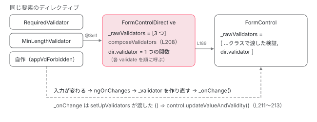

[目次](../README.md) › [フォームの内側](README.md) › 第 14 回 / 全 20 回

# 検証のディレクティブ：required 属性が Validators になるまで

> RequiredValidator・MinLengthValidator・PatternValidator などが NG\_VALIDATORS に multi で自分を足し、setUpValidators で control の検証関数に合成される流れ。AbstractValidatorDirective の ngOnChanges と \_onChange（入力が変わると検証をやり直す）、enabled、自作の Validator と registerOnValidatorChange。

angular/angular · 読了 約 13 分 · 中核 · [サイトで読む（デモが動きます）](https://angular-deep-dive-cyan.vercel.app/chapter/forms-validator-directives)

---

テンプレートに `<input [formControl]="c" required minlength="3">` と書くと、`c.errors` に `required` や `minlength` が出ます。`FormControl` には何も渡していないのに、です。この章では、`required` 属性に反応する `RequiredValidator` などのディレクティブが `NG_VALIDATORS` に自分を足し、`[formControl]` のディレクティブがそれを集めて 1 つの関数にし、`setUpValidators` で `FormControl` の検証に合成するまでを追います。後半は、`[minlength]="n"` の `n` が変わったときに検証がやり直される仕組み（`registerOnValidatorChange`）です。

読む対象は `packages/forms/src/directives/validators.ts`（ディレクティブの側。検証関数そのものの `src/validators.ts` は[第 4 回](04-forms-validators.md)）、`shared.ts` の `setUpValidators`・`cleanUpValidators`、`abstract_control_directive.ts` の検証の部分です。

1. [1. 全体像](01-forms-overview.md)
2. [2. AbstractControl](02-forms-abstract-control.md)
3. [3. updateValueAndValidity](03-forms-update-value-validity.md)
4. [4. Validators](04-forms-validators.md)
5. [5. 非同期の検証](05-forms-async-validators.md)
6. [6. events](06-forms-control-events.md)
7. [7. FormGroup と FormArray](07-forms-form-group-array.md)
8. [8. 型付きフォームと FormBuilder](08-forms-typed-forms.md)
9. [9. ControlValueAccessor](09-forms-value-accessor.md)
10. [10. 双方向の配線](10-forms-setup-control.md)
11. [11. 組み込みの accessor](11-forms-builtin-accessors.md)
12. [12. リアクティブのディレクティブ](12-forms-reactive-directives.md)
13. [13. NgModel と NgForm](13-forms-ng-model.md)
14. **14. 検証のディレクティブ**（この章）
15. [15. 状態クラス](15-forms-status-classes.md)
16. [16. Signal Forms のスキーマ](16-forms-sf-schema.md)
17. [17. Signal Forms の検証](17-forms-sf-validation.md)
18. [18. 状態ルールと metadata](18-forms-sf-rules-metadata.md)
19. [19. submit と相互運用](19-forms-sf-submit-compat.md)
20. [20. issue と PR を読む](20-forms-issues.md)

## 0. 全体の流れ

1. **属性でディレクティブが付く**

   `required` と `formControl` の両方がある要素に `RequiredValidator` が付き、`NG_VALIDATORS` に自分を足す（1 節）。
2. **集めて 1 つにする**

   同じ要素の `FormControlDirective` がコンストラクタで `NG_VALIDATORS` の配列を受け取り、1 つの関数 `dir.validator` にまとめる（2 節）。
3. **control に足す**

   `setUpControlValueAccessor` の最初で `setUpValidators` が、`FormControl` の検証の配列の後ろに `dir.validator` を足す（3 節）。
4. **やり直しの合図を配る**

   同じ `setUpValidators` が、各ディレクティブに「入力が変わったら呼んで」という関数を `registerOnValidatorChange` で渡す（3 節）。
5. **入力が変わる**

   `[minlength]` が変わると、ディレクティブの `ngOnChanges` が中の検証関数を作り直し、渡された関数で `control.updateValueAndValidity()` を呼ぶ（4 節）。

## 1. Validator インターフェイスと NG\_VALIDATORS

📄 `angular/packages/forms/src/directives/validators.ts` L77–110 （▶ の行: 80, 83, 91, 101, 109）

````ts
 77 │  * ```ts
 78 │  * @Directive({
 79 │  *   selector: '[customValidator]',
 80 ▶  *   providers: [{provide: NG_VALIDATORS, useExisting: forwardRef(() => CustomValidatorDirective), multi: true}]
 81 │  * })
 82 │  * class CustomValidatorDirective implements Validator {
 83 ▶  *   validate(control: AbstractControl): ValidationErrors|null {
 84 │  *     return {'custom': true};
 85 │  *   }
 86 │  * }
 87 │  * ```
 88 │  *
 89 │  * @publicApi
 90 │  */
 91 ▶ export interface Validator {
 92 │   /**
 93 │    * @description
 94 │    * Method that performs synchronous validation against the provided control.
 95 │    *
 96 │    * @param control The control to validate against.
 97 │    *
 98 │    * @returns A map of validation errors if validation fails,
 99 │    * otherwise null.
100 │    */
101 ▶   validate(control: AbstractControl): ValidationErrors | null;
102 │ 
103 │   /**
104 │    * @description
105 │    * Registers a callback function to call when the validator inputs change.
106 │    *
107 │    * @param fn The callback function
108 │    */
109 ▶   registerOnValidatorChange?(fn: () => void): void;
110 │ }
````

検証のディレクティブが満たす約束は 2 つだけです。101 行目の `validate(control)`（エラーの object か `null` を返す）と、109 行目の任意の `registerOnValidatorChange(fn)`。78〜86 行目のドキュメントの例のとおり、80 行目で `NG_VALIDATORS` に `multi: true`、`useExisting` で **ディレクティブのインスタンス自身**を足します。組み込みのディレクティブも同じ形です。

📄 `angular/packages/forms/src/directives/validators.ts` L534–541 （▶ の行: 538–540）

```ts
534 │  * @description
535 │  * Provider which adds `MinLengthValidator` to the `NG_VALIDATORS` multi-provider list.
536 │  */
537 │ export const MIN_LENGTH_VALIDATOR: any = {
538 ▶   provide: NG_VALIDATORS,
539 ▶   useExisting: forwardRef(() => MinLengthValidator),
540 ▶   multi: true,
541 │ };
```

`MIN_LENGTH_VALIDATOR` がその provider です。`multi: true` なので、同じ要素に `required` と `minlength` があれば、`NG_VALIDATORS` を注入した側には `[RequiredValidator のインスタンス, MinLengthValidator のインスタンス]` の配列が届きます。multi provider と `useExisting` の仕組みそのものは [di-multi-providers](../di/09-di-multi-providers.md) で、`REQUIRED_VALIDATOR` を例に読んでいます。

## 2. \[formControl\] が集めて 1 つの関数にする

📄 `angular/packages/forms/src/directives/reactive_directives/form_control_directive.ts` L133–152 （▶ の行: 134, 138, 150–151）

```ts
133 │   constructor(
134 ▶     @Optional() @Self() @Inject(NG_VALIDATORS) validators: (Validator | ValidatorFn)[],
135 │     @Optional()
136 │     @Self()
137 │     @Inject(NG_ASYNC_VALIDATORS)
138 ▶     asyncValidators: (AsyncValidator | AsyncValidatorFn)[],
139 │     @Optional() @Self() @Inject(NG_VALUE_ACCESSOR) valueAccessors: ControlValueAccessor[],
140 │     @Optional()
141 │     @Inject(NG_MODEL_WITH_FORM_CONTROL_WARNING)
142 │     private _ngModelWarningConfig: string | null,
143 │     @Optional()
144 │     @Inject(CALL_SET_DISABLED_STATE)
145 │     private callSetDisabledState?: SetDisabledStateOption,
146 │     @Optional() renderer?: Renderer2,
147 │     @Optional() injector?: Injector,
148 │   ) {
149 │     super(injector, renderer, valueAccessors);
150 ▶     this._setValidators(validators);
151 ▶     this._setAsyncValidators(asyncValidators);
152 │   }
```

134 行目、`FormControlDirective` は `@Optional() @Self() @Inject(NG_VALIDATORS)` で受け取ります。`@Self()` なので、**同じ要素**に付いた検証ディレクティブだけが集まります（親の `<form>` に付いたものは入りません）。`FormControlName`・`NgModel`・`FormGroupDirective`・`FormGroupName`・`NgForm` のコンストラクタも同じ受け取り方です。150 行目で `_setValidators` に渡します。

📄 `angular/packages/forms/src/directives/abstract_control_directive.ts` L189–227 （▶ の行: 193, 200, 207–208, 225–226）

```ts
189 │   /**
190 │    * Set of synchronous validators as they were provided while calling `setValidators` function.
191 │    * @internal
192 │    */
193 ▶   _rawValidators: Array<Validator | ValidatorFn> = [];
194 │ 
195 │   /**
196 │    * Set of asynchronous validators as they were provided while calling `setAsyncValidators`
197 │    * function.
198 │    * @internal
199 │    */
200 ▶   _rawAsyncValidators: Array<AsyncValidator | AsyncValidatorFn> = [];
201 │ 
202 │   /**
203 │    * Sets synchronous validators for this directive.
204 │    * @internal
205 │    */
206 │   _setValidators(validators: Array<Validator | ValidatorFn> | undefined): void {
207 ▶     this._rawValidators = validators || [];
208 ▶     this._composedValidatorFn = composeValidators(this._rawValidators);
209 │   }
210 │ 
211 │   /**
212 │    * Sets asynchronous validators for this directive.
213 │    * @internal
214 │    */
215 │   _setAsyncValidators(validators: Array<AsyncValidator | AsyncValidatorFn> | undefined): void {
216 │     this._rawAsyncValidators = validators || [];
217 │     this._composedAsyncValidatorFn = composeAsyncValidators(this._rawAsyncValidators);
218 │   }
219 │ 
220 │   /**
221 │    * @description
222 │    * Synchronous validator function composed of all the synchronous validators registered with this
223 │    * directive.
224 │    */
225 ▶   get validator(): ValidatorFn | null {
226 ▶     return this._composedValidatorFn || null;
227 │   }
```

207 行目、受け取った配列はそのまま `_rawValidators` に残し（3 節で `registerOnValidatorChange` を配るのに使う）、208 行目で `composeValidators` により**1 つの関数**にまとめます。`composeValidators` は、`validate` を持つ object を `(c) => v.validate(c)` という関数に包んでから合成します（[第 4 回](04-forms-validators.md)の `normalizeValidators`）。225〜227 行目の `validator` getter がこの合成済みの関数を返します。以後、この関数は**同じ参照のまま**で、入力が変わっても作り直されません（4 節）。

## 3. setUpValidators：control に足して、合図を配る

📄 `angular/packages/forms/src/directives/shared.ts` L179–214 （▶ の行: 186–190, 198, 211–213）

```ts
179 │ /**
180 │  * Sets up sync and async directive validators on provided form control.
181 │  * This function merges validators from the directive into the validators of the control.
182 │  *
183 │  * @param control Form control where directive validators should be setup.
184 │  * @param dir Directive instance that contains validators to be setup.
185 │  */
186 ▶ export function setUpValidators(control: AbstractControl, dir: AbstractControlDirective): void {
187 ▶   const validators = getControlValidators(control);
188 ▶   if (dir.validator !== null) {
189 ▶     control.setValidators(mergeValidators<ValidatorFn>(validators, dir.validator));
190 ▶   } else if (typeof validators === 'function') {
191 │     // If sync validators are represented by a single validator function, we force the
192 │     // `Validators.compose` call to happen by executing the `setValidators` function with
193 │     // an array that contains that function. We need this to avoid possible discrepancies in
194 │     // validators behavior, so sync validators are always processed by the `Validators.compose`.
195 │     // Note: we should consider moving this logic inside the `setValidators` function itself, so we
196 │     // have consistent behavior on AbstractControl API level. The same applies to the async
197 │     // validators logic below.
198 ▶     control.setValidators([validators]);
199 │   }
200 │ 
201 │   const asyncValidators = getControlAsyncValidators(control);
202 │   if (dir.asyncValidator !== null) {
203 │     control.setAsyncValidators(
204 │       mergeValidators<AsyncValidatorFn>(asyncValidators, dir.asyncValidator),
205 │     );
206 │   } else if (typeof asyncValidators === 'function') {
207 │     control.setAsyncValidators([asyncValidators]);
208 │   }
209 │ 
210 │   // Re-run validation when validator binding changes, e.g. minlength=3 -> minlength=4
211 ▶   const onValidatorChange = () => control.updateValueAndValidity();
212 ▶   registerOnValidatorChange<ValidatorFn>(dir._rawValidators, onValidatorChange);
213 ▶   registerOnValidatorChange<AsyncValidatorFn>(dir._rawAsyncValidators, onValidatorChange);
214 │ }
```

📄 `angular/packages/forms/src/directives/shared.ts` L150–155 （▶ の行: 151–153）

```ts
150 │ function registerOnValidatorChange<V>(validators: (V | Validator)[], onChange: () => void): void {
151 ▶   validators.forEach((validator: V | Validator) => {
152 ▶     if ((<Validator>validator).registerOnValidatorChange)
153 ▶       (<Validator>validator).registerOnValidatorChange!(onChange);
154 │   });
155 │ }
```

1. **187 行目：control が今持っている検証**

   `getControlValidators` は `control._rawValidators`（`new FormControl('', Validators.required)` で渡したもの）を返します。関数 1 つのこともあれば配列のことも、`null` のこともあります。
2. **188〜189 行目：後ろに足す**

   ディレクティブ側に検証があれば、`mergeValidators(control の検証, dir.validator)` で `[...control の検証, dir.validator]` を作り、`setValidators` で入れ直します。control の検証を**置き換えるのではなく足す**ので、クラスで書いた `Validators.required` とテンプレートの `required` は両方残ります。
3. **190〜198 行目：ディレクティブ側に何も無いとき**

   control の検証が関数 1 つなら `[validators]` と配列にして入れ直します。コメントのとおり、いつも `Validators.compose` を通す形に揃えるためです。
4. **211〜213 行目：合図を配る**

   211 行目の `onValidatorChange` は `control.updateValueAndValidity()` を呼ぶだけの関数です。212 行目、2 節で残した `_rawValidators` の 1 つずつに、152 行目で `registerOnValidatorChange` を持っているものにだけ渡します。関数で書いた検証（`Validators.required` など）は持っていないので飛ばされます。

`setUpValidators` を呼ぶのは `setUpControlValueAccessor` の最初の 1 行で（[第 10 回](10-forms-setup-control.md)）、`[formControl]` なら `ngOnChanges`、`formControlName` なら親の `addControl`、`ngModel` なら microtask の中（[第 13 回](13-forms-ng-model.md)）です。`[formGroup]` や `formGroupName` に付いた検証は、[第 12 回](12-forms-reactive-directives.md)の `_updateValidators` と `setUpFormContainer` から同じ関数で足されます。



*テンプレートの属性から FormControl の検証の配列まで。ディレクティブ側は 1 つの関数（dir.validator）にまとめてから、control の配列の最後に入る。*

## 4. AbstractValidatorDirective：入力が変わったらやり直す

📄 `angular/packages/forms/src/directives/validators.ts` L118–147 （▶ の行: 119–121, 130, 140, 147）

```ts
118 │ @Directive()
119 ▶ abstract class AbstractValidatorDirective implements Validator, OnChanges {
120 ▶   private _validator: ValidatorFn = nullValidator;
121 ▶   private _onChange!: () => void;
122 │ 
123 │   /**
124 │    * A flag that tracks whether this validator is enabled.
125 │    *
126 │    * Marking it `internal` (vs `protected`), so that this flag can be used in host bindings of
127 │    * directive classes that extend this base class.
128 │    * @internal
129 │    */
130 ▶   _enabled?: boolean;
131 │ 
132 │   /**
133 │    * Name of an input that matches directive selector attribute (e.g. `minlength` for
134 │    * `MinLengthDirective`). An input with a given name might contain configuration information (like
135 │    * `minlength='10'`) or a flag that indicates whether validator should be enabled (like
136 │    * `[required]='false'`).
137 │    *
138 │    * @internal
139 │    */
140 ▶   abstract inputName: string;
141 │ 
142 │   /**
143 │    * Creates an instance of a validator (specific to a directive that extends this base class).
144 │    *
145 │    * @internal
146 │    */
147 ▶   abstract createValidator(input: unknown): ValidatorFn;
```

📄 `angular/packages/forms/src/directives/validators.ts` L157–189 （▶ の行: 160–165, 170–171, 175–176, 186–187）

```ts
157 │   abstract normalizeInput(input: unknown): unknown;
158 │ 
159 │   /** @docs-private */
160 ▶   ngOnChanges(changes: SimpleChanges): void {
161 ▶     if (this.inputName in changes) {
162 ▶       const input = this.normalizeInput(changes[this.inputName].currentValue);
163 ▶       this._enabled = this.enabled(input);
164 ▶       this._validator = this._enabled ? this.createValidator(input) : nullValidator;
165 ▶       this._onChange?.();
166 │     }
167 │   }
168 │ 
169 │   /** @docs-private */
170 ▶   validate(control: AbstractControl): ValidationErrors | null {
171 ▶     return this._validator(control);
172 │   }
173 │ 
174 │   /** @docs-private */
175 ▶   registerOnValidatorChange(fn: () => void): void {
176 ▶     this._onChange = fn;
177 │   }
178 │ 
179 │   /**
180 │    * @description
181 │    * Determines whether this validator should be active or not based on an input.
182 │    * Base class implementation checks whether an input is defined (if the value is different from
183 │    * `null` and `undefined`). Validator classes that extend this base class can override this
184 │    * function with the logic specific to a particular validator directive.
185 │    */
186 ▶   enabled(input: unknown): boolean {
187 ▶     return input != null /* both `null` and `undefined` */;
188 │   }
189 │ }
```

組み込みの検証ディレクティブは、この内部用の抽象クラス（119 行目。公開 API ではありません）を継承しています。子クラスが決めるのは 3 つだけです。140 行目 `inputName`（セレクタと同じ名前の入力。`'minlength'` など）、157 行目 `normalizeInput`（文字列を数にするなど）、147 行目 `createValidator`。

1. **161 行目：自分の入力が変わったときだけ**

   `changes` に `inputName` のキーがあるかを見ます。
2. **162〜163 行目：正規化して、有効か決める**

   186〜188 行目の既定の `enabled` は「`null` でも `undefined` でもない」。`[minlength]="null"` にすると検証が外れます。
3. **164 行目：中の関数を作り直す**

   有効なら `createValidator(input)`（`minLengthValidator(4)` など）、無効なら何も返さない `nullValidator`。2 節の `dir.validator` は 170〜172 行目の `validate` を経由して、この `_validator` を毎回読みにくるので、作り直しはこれで伝わります。
4. **165 行目：やり直しの合図**

   3 節で渡された `onValidatorChange` を呼び、`control.updateValueAndValidity()` が走って `errors` が変わります。`?.` なのは、最初の `ngOnChanges` がまだ `setUpValidators` より前のことがあるからです。そのときは呼ばなくても、このあと `setUpControlValueAccessor` の中の `updateValueAndValidity` で新しい `_validator` が使われます。どちらの順でも同じ結果になります。

## 5. 組み込みのディレクティブ

📄 `angular/packages/forms/src/directives/validators.ts` L379–406 （▶ の行: 381–383, 391, 394, 397, 400, 403–404）

```ts
379 │ @Directive({
380 │   selector:
381 ▶     ':not([type=checkbox])[required][formControlName],:not([type=checkbox])[required][formControl],:not([type=checkbox])[required][ngModel]',
382 ▶   providers: [REQUIRED_VALIDATOR],
383 ▶   host: {'[attr.required]': '_enabled ? "" : null'},
384 │   standalone: false,
385 │ })
386 │ export class RequiredValidator extends AbstractValidatorDirective {
387 │   /**
388 │    * @description
389 │    * Tracks changes to the required attribute bound to this directive.
390 │    */
391 ▶   @Input() required!: boolean | string;
392 │ 
393 │   /** @internal */
394 ▶   override inputName = 'required';
395 │ 
396 │   /** @internal */
397 ▶   override normalizeInput = booleanAttribute;
398 │ 
399 │   /** @internal */
400 ▶   override createValidator = (input: boolean): ValidatorFn => requiredValidator;
401 │ 
402 │   /** @docs-private */
403 ▶   override enabled(input: boolean): boolean {
404 ▶     return input;
405 │   }
406 │ }
```

- **381 行目のセレクタ**：`required` 属性に加えて `formControlName` / `formControl` / `ngModel` のどれかが要ります。どれも無いただの `<input required>` には付きません（ブラウザの検証だけが働きます）。`:not([type=checkbox])` でチェックボックスを外しています。
- **397 行目 `booleanAttribute`**：`required`（値なしの属性 `''`）や `"true"` は `true`、`"false"` の文字列は `false` です。403〜405 行目で `enabled` を上書きし、`true` のときだけ有効にします。
- **383 行目の host バインディング**：有効なら DOM に `required=""` を付け、無効なら外します（`[required]="false"` で属性が消える）。`RequiredValidator`・`MinLengthValidator` などは DOM の属性も今の状態に合わせます。

📄 `angular/packages/forms/src/directives/validators.ts` L429–439 （▶ の行: 431, 436, 438）

```ts
429 │ @Directive({
430 │   selector:
431 ▶     'input[type=checkbox][required][formControlName],input[type=checkbox][required][formControl],input[type=checkbox][required][ngModel]',
432 │   providers: [CHECKBOX_REQUIRED_VALIDATOR],
433 │   host: {'[attr.required]': '_enabled ? "" : null'},
434 │   standalone: false,
435 │ })
436 ▶ export class CheckboxRequiredValidator extends RequiredValidator {
437 │   /** @internal */
438 ▶   override createValidator = (input: unknown): ValidatorFn => requiredTrueValidator;
439 │ }
```

チェックボックスは 431 行目の別のセレクタで `CheckboxRequiredValidator` になり、438 行目で `requiredTrueValidator`（値が `true` でなければエラー）を使います。`false` は「値がある」ので、ふつうの required では空と見なされないためです（空の判定は[第 4 回](04-forms-validators.md)）。

📄 `angular/packages/forms/src/directives/validators.ts` L564–585 （▶ の行: 565, 567, 578, 581, 584）

```ts
564 │ @Directive({
565 ▶   selector: '[minlength][formControlName],[minlength][formControl],[minlength][ngModel]',
566 │   providers: [MIN_LENGTH_VALIDATOR],
567 ▶   host: {'[attr.minlength]': '_enabled ? minlength : null'},
568 │   standalone: false,
569 │ })
570 │ export class MinLengthValidator extends AbstractValidatorDirective {
571 │   /**
572 │    * @description
573 │    * Tracks changes to the minimum length bound to this directive.
574 │    */
575 │   @Input() minlength!: string | number | null;
576 │ 
577 │   /** @internal */
578 ▶   override inputName = 'minlength';
579 │ 
580 │   /** @internal */
581 ▶   override normalizeInput = (input: string | number): number => toInteger(input);
582 │ 
583 │   /** @internal */
584 ▶   override createValidator = (minlength: number): ValidatorFn => minLengthValidator(minlength);
585 │ }
```

📄 `angular/packages/forms/src/directives/validators.ts` L674–696 （▶ の行: 675, 677, 692, 695）

```ts
674 │ @Directive({
675 ▶   selector: '[pattern][formControlName],[pattern][formControl],[pattern][ngModel]',
676 │   providers: [PATTERN_VALIDATOR],
677 ▶   host: {'[attr.pattern]': '_enabled ? pattern : null'},
678 │   standalone: false,
679 │ })
680 │ export class PatternValidator extends AbstractValidatorDirective {
681 │   /**
682 │    * @description
683 │    * Tracks changes to the pattern bound to this directive.
684 │    */
685 │   @Input()
686 │   pattern!: string | RegExp; // This input is always defined, since the name matches selector.
687 │ 
688 │   /** @internal */
689 │   override inputName = 'pattern';
690 │ 
691 │   /** @internal */
692 ▶   override normalizeInput = (input: string | RegExp): string | RegExp => input;
693 │ 
694 │   /** @internal */
695 ▶   override createValidator = (input: string | RegExp): ValidatorFn => patternValidator(input);
696 │ }
```

📄 `angular/packages/forms/src/directives/validators.ts` L274–293 （▶ の行: 276, 278, 290）

```ts
274 │ @Directive({
275 │   selector:
276 ▶     'input[type=number][min][formControlName],input[type=number][min][formControl],input[type=number][min][ngModel]',
277 │   providers: [MIN_VALIDATOR],
278 ▶   host: {'[attr.min]': '_enabled ? min : null'},
279 │   standalone: false,
280 │ })
281 │ export class MinValidator extends AbstractValidatorDirective {
282 │   /**
283 │    * @description
284 │    * Tracks changes to the min bound to this directive.
285 │    */
286 │   @Input() min!: string | number | null;
287 │   /** @internal */
288 │   override inputName = 'min';
289 │   /** @internal */
290 ▶   override normalizeInput = (input: string | number): number => toFloat(input);
291 │   /** @internal */
292 │   override createValidator = (min: number): ValidatorFn => minValidator(min);
293 │ }
```

📄 `angular/packages/forms/src/directives/validators.ts` L478–503 （▶ の行: 479–480, 494, 500–501）

```ts
478 │ @Directive({
479 ▶   selector: '[email][formControlName],[email][formControl],[email][ngModel]',
480 ▶   providers: [EMAIL_VALIDATOR],
481 │   standalone: false,
482 │ })
483 │ export class EmailValidator extends AbstractValidatorDirective {
484 │   /**
485 │    * @description
486 │    * Tracks changes to the email attribute bound to this directive.
487 │    */
488 │   @Input() email!: boolean | string;
489 │ 
490 │   /** @internal */
491 │   override inputName = 'email';
492 │ 
493 │   /** @internal */
494 ▶   override normalizeInput = booleanAttribute;
495 │ 
496 │   /** @internal */
497 │   override createValidator = (input: number): ValidatorFn => emailValidator;
498 │ 
499 │   /** @docs-private */
500 ▶   override enabled(input: boolean): boolean {
501 ▶     return input;
502 │   }
503 │ }
```

| ディレクティブ | セレクタの条件 | normalizeInput | host の属性 |
| --- | --- | --- | --- |
| `MinLengthValidator` | どの要素でも（565 行目） | 整数（581 行目） | `attr.minlength`（567 行目） |
| `PatternValidator` | どの要素でも（675 行目） | そのまま（692 行目） | `attr.pattern`（677 行目） |
| `MinValidator` | **`input[type=number]` だけ**（276 行目） | 小数（290 行目） | `attr.min`（278 行目） |
| `EmailValidator` | どの要素でも（479 行目） | `booleanAttribute`（494 行目） | **無し**（480 行目の次に host が無い） |

`MinValidator`（と同じ形の `MaxValidator`）はセレクタが `input[type=number]` に限られているので、`<input type="text" min="3" formControlName="x">` では付きません。`EmailValidator` は host バインディングを持たないので、DOM の `email` 属性を付けも外しもしません。テンプレートに `email` 属性を書けばそのまま残り、`[email]="flag"` と書けば DOM には何も付きません。検証の有無は 500〜502 行目の `enabled` だけで決まります。

> **🧪 DEMO — \[required\]・\[minlength\] と自作の検証ディレクティブ**
>
> 本物の `ReactiveFormsModule`（@angular/forms 22.1.6）です。`ctrl = new FormControl('ab')`（検証は何も渡していない）を `<input [formControl]="ctrl" [required]="required()" [minlength]="minlength()" [appVdForbidden]="word()">` に付けています。`appVdForbidden` は、値に禁止語が含まれると `{ forbidden: 語 }` を返す自作のディレクティブで、`registerOnValidatorChange` を実装し、入力が変わったら受け取った関数を呼びます（4 節の 165 行目と同じ形）。
>
> `registerOnValidatorChange` は最初の描画で 1 回だけ呼ばれ、そのあと何を変えても増えません（3 節の 212 行目は setUp のときだけ）。禁止語を変えると、自作の `ngOnChanges` → 受け取った関数 → `updateValueAndValidity` → 全部の `validate`、の順にログが出ます。`[required]` や `[minlength]` を変えたときも自作の `validate` が呼ばれるのは、組み込みのディレクティブも同じ `updateValueAndValidity` を起こすからです。
>
> ▶ [このデモはサイトで動かせます](https://angular-deep-dive-cyan.vercel.app/chapter/forms-validator-directives)

## 6. 外すとき：cleanUpValidators

📄 `angular/packages/forms/src/directives/shared.ts` L225–264 （▶ の行: 231–232, 235–236, 238, 259–261）

```ts
225 │ export function cleanUpValidators(
226 │   control: AbstractControl | null,
227 │   dir: AbstractControlDirective,
228 │ ): boolean {
229 │   let isControlUpdated = false;
230 │   if (control !== null) {
231 ▶     if (dir.validator !== null) {
232 ▶       const validators = getControlValidators(control);
233 │       if (Array.isArray(validators) && validators.length > 0) {
234 │         // Filter out directive validator function.
235 ▶         const updatedValidators = validators.filter((validator) => validator !== dir.validator);
236 ▶         if (updatedValidators.length !== validators.length) {
237 │           isControlUpdated = true;
238 ▶           control.setValidators(updatedValidators);
239 │         }
240 │       }
241 │     }
242 │ 
243 │     if (dir.asyncValidator !== null) {
244 │       const asyncValidators = getControlAsyncValidators(control);
245 │       if (Array.isArray(asyncValidators) && asyncValidators.length > 0) {
246 │         // Filter out directive async validator function.
247 │         const updatedAsyncValidators = asyncValidators.filter(
248 │           (asyncValidator) => asyncValidator !== dir.asyncValidator,
249 │         );
250 │         if (updatedAsyncValidators.length !== asyncValidators.length) {
251 │           isControlUpdated = true;
252 │           control.setAsyncValidators(updatedAsyncValidators);
253 │         }
254 │       }
255 │     }
256 │   }
257 │ 
258 │   // Clear onValidatorChange callbacks by providing a noop function.
259 ▶   const noop = () => {};
260 ▶   registerOnValidatorChange<ValidatorFn>(dir._rawValidators, noop);
261 ▶   registerOnValidatorChange<AsyncValidatorFn>(dir._rawAsyncValidators, noop);
262 │ 
263 │   return isControlUpdated;
264 │ }
```

ディレクティブが破棄されるときや、`[formControl]` に別の `FormControl` が来たとき（[第 12 回](12-forms-reactive-directives.md)の 159 行目）に呼ばれます。235 行目、control の検証の配列から `dir.validator` と**同じ参照**のものだけを除きます。2 節で `dir.validator` を同じ参照のまま持ち続けているのは、ここで見つけるためでもあります。259〜261 行目、各ディレクティブには空の関数を渡し直し、古い control の `updateValueAndValidity` を呼ばないようにします。

> [!WARNING]
> **ハマりどころ**
>
> [第 12 回](12-forms-reactive-directives.md)の `ngControlCreate` で「Signal Forms のカスタムコントロール」と判定された要素では、`[formControl]` / `ngModel` は `setUpControlValueAccessor` ではなく `setupCustomControl` に進みます。ng\_control.ts の `setupCustomControl` は `setUpValidators` を呼ばないので、この章の仕組み（テンプレートの `required` などを control に足す）が働きません。これは open の issue #70721 で報告されています（[第 20 回](20-forms-issues.md)）。

## ここまでの呼び出し

- 👤 `<input [formControl]="c" [minlength]="n" required>` — あなたのテンプレート
  - `new MinLengthValidator() / new RequiredValidator()` — validators.ts L570 / L386 — *NG\_VALIDATORS に multi で自分を足す*
  - `new FormControlDirective(validators = [Required, MinLength])` — form\_control\_directive.ts L134 — *@Self*
    - `_setValidators → composeValidators` — abstract\_control\_directive.ts L206〜208 — *dir.validator は 1 つの関数*
  - `MinLengthValidator.ngOnChanges` — validators.ts L160 — *\_validator = minLengthValidator(n)*
  - `FormControlDirective.ngOnChanges → setUpControlValueAccessor` — 第 12 回 / 第 10 回
    - `setUpValidators(control, dir)` — shared.ts L186
      - `control.setValidators([...control の検証, dir.validator])` — L189
      - `registerOnValidatorChange(dir._rawValidators, () => control.updateValueAndValidity())` — L211〜213 / L150
- 👤 `n が 3 → 4` — あなたのコード
  - `MinLengthValidator.ngOnChanges → _validator を作り直す → _onChange()` — validators.ts L161〜165
    - `control.updateValueAndValidity() → dir.validator → validate → _validator` — L170 — *errors が変わる*

## テストと直し方

| ファイル・行 | describe / it | 確かめていること |
| --- | --- | --- |
| template\_integration\_spec.ts 1422 | `template-driven forms integration tests validation directives` | ngModel と検証ディレクティブ。中に 29 本 |
| 同 2342 | `should re-validate if min/max changes` | 入力が変わると検証をやり直す（4 節の 165 行目） |
| 同 2445 | `should call registerOnValidatorChange as a part of a formGroup setup` | registerOnValidatorChange は setUp で 1 回、入力が変わっても増えない（デモと同じ） |
| reactive\_integration\_spec.ts 3307 | `reactive forms integration tests validations changes on bound properties should change the validation state of the form` | リアクティブでの同じこと |
| 同 3612 | `enabling validators conditionally` | `[minlength]="null"` で外れる（4 節の 186〜188 行目） |

📄 `ターミナル（../angular で実行）`

```
cd ~/angular-research/angular
pnpm bazel test //packages/forms/test:test \
  --test_arg=--filter="template-driven forms integration tests validation directives" \
  --test_output=all

# 出力（抜粋。2026-11-01 に手元で実行）
# Ran 29 of 1153 specs
# 29 specs, 0 failures
# //packages/forms/test:test    PASSED in 0.9s
```

- **直すとしたら**：ディレクティブ側の振る舞いは `directives/validators.ts` の `AbstractValidatorDirective`（119 行目）と各ディレクティブのセレクタ・host、control への合成は `shared.ts` の `setUpValidators`（186 行目）と `cleanUpValidators`（225 行目）です。
- **spec を足す場所**：テンプレート駆動なら `template_integration_spec.ts` の `describe('validation directives')`（1422 行目）、リアクティブなら `reactive_integration_spec.ts` の `describe('validations')`（3163 行目）。2445 行目の spec は、自作のディレクティブで呼ばれた回数を数える書き方の手本になります。
- 手元のブランチで足して走らせ、壊して落ちることを確かめる手順は [contrib-writing-a-test](../contrib/07-contrib-writing-a-test.md) です。

## 聞かれそうな質問

**Q. required 属性を外したのに、required のエラーが残ります。**

原因は 3 通りあります。

- **クラスでも書いている**：`new FormControl('', Validators.required)` の分は control 自身の検証で、3 節の 189 行目で残したまま後ろに足しているだけなので、テンプレート側を外しても残ります。
- **DOM から消した**：ディレクティブはコンパイル時にセレクタで付くので、実行中に `removeAttribute('required')` しても `RequiredValidator` はそのままです。切り替えたいときは `[required]="flag"` で入力を変えます（4 節の 163〜165 行目で `nullValidator` に替わり、やり直しが走る）。
- **`required="false"` と `[required]="'false'"`**：どちらも 397 行目の `booleanAttribute` で `false` になり外れます。外れないのは `[required]="someString"` で空でない文字列（`'false'` 以外）を渡したときです。

**Q. FormControl に Validators.required を書き、テンプレートにも required を書くとどうなりますか？**

control の検証は `[Validators.required, dir.validator]` になり（189 行目）、両方が走ります。どちらもキー `required` のエラーを返すので、合成された結果の `errors` は `{ required: true }` の 1 つです。片方を外しても、もう片方が残ります。また `control.hasValidator(Validators.required)` はクラスで書いた分しか見つけません。テンプレートの分は `dir.validator`（2 節の合成済みの関数）に包まれているからです （`hasValidator` は参照で比べる。[第 4 回](04-forms-validators.md)）。

**Q. 自作の検証ディレクティブで、入力が変わったときに再検証させるには？**

`registerOnValidatorChange(fn)` を実装して `fn` を覚え、入力が変わった `ngOnChanges` で `fn()` を呼びます。組み込みの 175〜177 行目と 165 行目がその形で、デモの `appVdForbidden` も同じです。`fn` の中身は 211 行目の `control.updateValueAndValidity()` です。実装しなければ 152 行目で飛ばされ、入力を変えても、次に値が変わるまで古い条件の `errors` のままです。`validate` の中で入力の値を毎回読むように書いていれば（デモの禁止語）、作り直す関数は要りません。

**Q. &lt;form&gt; に付けた検証ディレクティブはどこに入りますか？**

`[formGroup]` なら `FormGroupDirective` のコンストラクタが同じく `@Self()` で受け取り、`ngOnChanges` の `_updateValidators` で 同じ `setUpValidators` から `FormGroup` に足されます（[第 12 回](12-forms-reactive-directives.md)の 4 節）。`NgForm` はコンストラクタで `new FormGroup({}, composeValidators(validators))` と直接渡します（[第 13 回](13-forms-ng-model.md)の 2 節）。

## 読み終えて

- 検証のディレクティブは `NG_VALIDATORS` に `multi` + `useExisting` で自分を足す。集めるのは同じ要素（`@Self`）の NgControl。
- 集めた配列は `_rawValidators` に残し、`composeValidators` で 1 つの `dir.validator` にまとめる。参照は変わらない。
- `setUpValidators` は control の検証を置き換えず、後ろに `dir.validator` を足す。外すときは参照で探して抜く。
- 入力が変わると `ngOnChanges` が中の `_validator` を作り直し、`registerOnValidatorChange` で受け取った関数で `updateValueAndValidity` を呼ぶ。
- セレクタの細部に注意：`MinValidator` は number の input だけ、`EmailValidator` は DOM の属性を書かない。

---

← 前: [テンプレート駆動：NgModel と NgForm の非同期な登録](13-forms-ng-model.md)  
次: [状態クラス：ng-valid・ng-touched・ng-submitted が付くまで](15-forms-status-classes.md) →
