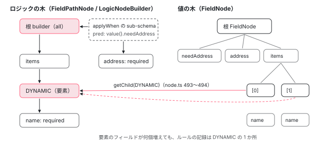

[目次](../README.md) › [フォームの内側](README.md) › 第 16 回 / 全 20 回

# Signal Forms のスキーマ：schema・apply・applyWhen が作るロジックの木

> form(model, schemaFn) に渡した関数が schema / path を通して何を記録するか。FieldPathNode と LogicNode（schema/logic\_node.ts・path\_node.ts）がルールを木として持ち、apply・applyEach・applyWhen・applyWhenValue が子や条件付きのロジックを継ぎ足す仕組み、値の木（FieldNode）とロジックの木が出会う場所。

angular/angular · 読了 約 14 分 · 発展 · [サイトで読む（デモが動きます）](https://angular-deep-dive-cyan.vercel.app/chapter/forms-sf-schema)

---

`form(model, (p) => { required(p.name) })` の第 2 引数（schema 関数）は、検証を実行する関数ではありません。**ルールを記録する関数**で、form を作るときに 1 回だけ呼ばれます。この章では、その 1 回で `p.name` の `p`（path）が何者で、`required` や `applyWhen` が何をどこに書き込み、その記録（ロジックの木）が、値から作られるフィールドの木（`FieldNode`）とどこで出会うかを、行で追います。

読む対象は `packages/forms/signals/src/` の `schema/schema.ts`・`schema/path_node.ts`・`schema/logic_node.ts`・`schema/logic.ts`、`api/structure.ts` の `schema`・`apply`・`applyEach`・`applyWhen`・`applyWhenValue`、それに `field/node.ts`・`field/structure.ts`・`field/context.ts`・`field/resolution.ts` です。`form()` が model を根にする仕組みと `FieldNode` の部品は [signal-forms（signals シリーズ）](../signals/17-signal-forms.md)で読んだので、ここでは繰り返しません。

1. [1. 全体像](01-forms-overview.md)
2. [2. AbstractControl](02-forms-abstract-control.md)
3. [3. updateValueAndValidity](03-forms-update-value-validity.md)
4. [4. Validators](04-forms-validators.md)
5. [5. 非同期の検証](05-forms-async-validators.md)
6. [6. events](06-forms-control-events.md)
7. [7. FormGroup と FormArray](07-forms-form-group-array.md)
8. [8. 型付きフォームと FormBuilder](08-forms-typed-forms.md)
9. [9. ControlValueAccessor](09-forms-value-accessor.md)
10. [10. 双方向の配線](10-forms-setup-control.md)
11. [11. 組み込みの accessor](11-forms-builtin-accessors.md)
12. [12. リアクティブのディレクティブ](12-forms-reactive-directives.md)
13. [13. NgModel と NgForm](13-forms-ng-model.md)
14. [14. 検証のディレクティブ](14-forms-validator-directives.md)
15. [15. 状態クラス](15-forms-status-classes.md)
16. **16. Signal Forms のスキーマ**（この章）
17. [17. Signal Forms の検証](17-forms-sf-validation.md)
18. [18. 状態ルールと metadata](18-forms-sf-rules-metadata.md)
19. [19. submit と相互運用](19-forms-sf-submit-compat.md)
20. [20. issue と PR を読む](20-forms-issues.md)

## 0. 全体の流れ

登場する木は 2 本です。1 本目は schema 関数が書き込む**ロジックの木**（path ごとのルール。`FieldPathNode` と `LogicNodeBuilder`）。2 本目は model の値から作られる**値の木**（`FieldNode`）。2 本目のノードは、作られるときに 1 本目の同じ位置からルールを受け取ります。

1. **コンパイル**

   `form()` が `SchemaImpl.rootCompile` を呼び、空の根 path を作って schema 関数に渡す（1 節）。
2. **path をたどる**

   `p.address` と書くと Proxy の `get` が子の path を作って返す。値は持たない（2 節）。
3. **ルールを記録**

   `required(p.address)` などが、その path の `LogicNodeBuilder` に関数を積む（3 節）。
4. **schema を継ぎ足す**

   `apply` / `applyWhen` は別の schema をコンパイルし、その builder を「条件つき」で自分の builder に足す。`applyEach` は `DYNAMIC` という特別な子に足す（4・5 節）。
5. **木を組む**

   根の `FieldNode` が `builder.build()` で `LogicNode` を受け取り、子のノードは作られるたびに `logic.getChild(key)` で自分の分を取り出す（6・7 節）。
6. **評価**

   ルールの中の `valueOf(p.x)` は、そのとき path から値の木のフィールドを探す（8 節）。条件（predicate）もこのとき評価される。

## 1. schema() と SchemaImpl：関数を 1 回だけ呼ぶ

📄 `angular/packages/forms/signals/src/api/structure.ts` L498–511 （▶ の行: 500, 509–510）

```ts
498 │ /**
499 │  * Creates a `Schema` that adds logic rules to a form.
500 ▶  * @param fn A **non-reactive** function that sets up reactive logic rules for the form.
501 │  * @returns A schema object that implements the given logic.
502 │  * @template TValue The value type of a `FieldTree` that this schema binds to.
503 │  *
504 │  * @see [Create reusable schemas with schema](guide/forms/signals/schemas#create-reusable-schemas-with-schema)
505 │  *
506 │  * @category structure
507 │  * @publicApi 22.0
508 │  */
509 ▶ export function schema<TValue>(fn: SchemaFn<TValue>): Schema<TValue> {
510 ▶   return SchemaImpl.create(fn) as unknown as Schema<TValue>;
511 │ }
```

`schema(fn)` は 510 行目で `SchemaImpl.create(fn)` を返すだけです。この時点では `fn` を呼びません。500 行目の doc コメントが「**non-reactive** な関数」と強調しているのは、この関数が signal の依存を追跡しない場所で 1 回呼ばれるだけだからです。リアクティブなのは、この関数の中で登録した*ルール*（`({value}) => ...`）の方です。

📄 `angular/packages/forms/signals/src/schema/schema.ts` L40–69 （▶ の行: 40, 54–55, 57–58, 61–62, 66）

```ts
40 ▶ const compiledSchemas = new Map<SchemaImpl, FieldPathNode>();
41 │ 
42 │ /**
43 │  * Implements the `Schema` concept.
44 │  */
45 │ export class SchemaImpl {
46 │   constructor(private schemaFn: SchemaFn<unknown>) {}
47 │ 
48 │   /**
49 │    * Compiles this schema within the current root compilation context. If the schema was previously
50 │    * compiled within this context, we reuse the cached FieldPathNode, otherwise we create a new one
51 │    * and cache it in the compilation context.
52 │    */
53 │   compile(): FieldPathNode {
54 ▶     if (compiledSchemas.has(this)) {
55 ▶       return compiledSchemas.get(this)!;
56 │     }
57 ▶     const path = FieldPathNode.newRoot();
58 ▶     compiledSchemas.set(this, path);
59 │     let prevCompilingNode = currentCompilingNode;
60 │     try {
61 ▶       currentCompilingNode = path;
62 ▶       this.schemaFn(path.fieldPathProxy);
63 │     } finally {
64 │       // Use a try/finally to ensure we restore the previous root upon completion,
65 │       // even if there are errors while compiling the schema.
66 ▶       currentCompilingNode = prevCompilingNode;
67 │     }
68 │     return path;
69 │   }
```

1. **54〜56 行目：コンパイル済みならキャッシュを返す**

   40 行目の `compiledSchemas` は、いまのコンパイル 1 回分の「SchemaImpl → 根の path」の表です。同じ sub-schema を 2 か所で `apply` しても、関数は 1 回しか呼ばれません。
2. **57〜58 行目：根の path を作り、呼ぶ前に表に入れる**

   呼ぶ*前*に入れるのが要点です。schema が自分自身を `apply` する再帰的な schema では、62 行目の途中で同じ `SchemaImpl` の `compile()` が呼ばれます。そのとき 54 行目で、いま作っている最中の path が返るので、無限に再帰しません（Q&A の 3 問目）。
3. **61〜62 行目：「いまコンパイル中の根」を立てて、schema 関数を呼ぶ**

   渡すのは `path.fieldPathProxy`（2 節）。これが schema 関数の引数 `p` です。66 行目で、例外が出ても元に戻します。

📄 `angular/packages/forms/signals/src/schema/schema.ts` L81–100 （▶ の行: 85, 87–89, 91–92, 94, 98）

```ts
 81 │   /**
 82 │    * Compiles the given schema in a fresh compilation context. This clears the cached results of any
 83 │    * previous compilations.
 84 │    */
 85 ▶   static rootCompile(schema: SchemaImpl | SchemaOrSchemaFn<any> | undefined): FieldPathNode {
 86 │     try {
 87 ▶       compiledSchemas.clear();
 88 ▶       if (schema === undefined) {
 89 ▶         return FieldPathNode.newRoot();
 90 │       }
 91 ▶       if (schema instanceof SchemaImpl) {
 92 ▶         return schema.compile();
 93 │       }
 94 ▶       return new SchemaImpl(schema as SchemaFn<unknown>).compile();
 95 │     } finally {
 96 │       // Use a try/finally to ensure we properly reset the compilation context upon completion,
 97 │       // even if there are errors while compiling the schema.
 98 ▶       compiledSchemas.clear();
 99 │     }
100 │   }
```

`form()` から呼ばれる入口です（[signal-forms](../signals/17-signal-forms.md) の 2 節で読んだ `form()` の中から呼ばれます）。87 行目と 98 行目でキャッシュを空にするので、キャッシュが効くのは **1 回の `form()` の中だけ**です。同じ `schema(...)` オブジェクトを 2 つの `form()` に渡せば、2 回呼ばれます。88〜89 行目、schema を渡さなければ空の根 path、94 行目、関数を直接渡したならその場で `SchemaImpl` に包みます。

## 2. path は値ではない：FieldPathNode と Proxy

📄 `angular/packages/forms/signals/src/schema/path_node.ts` L13–44 （▶ の行: 16, 18–19, 22, 24, 30, 35–37, 44）

```ts
13 │ /**
14 │  * Special key which is used to retrieve the `FieldPathNode` instance from its `FieldPath` proxy wrapper.
15 │  */
16 ▶ const PATH = Symbol('PATH');
17 │ 
18 ▶ /**
19 ▶  * A path in the schema on which logic is stored so that it can be added to the corresponding field
20 │  * when the field is created.
21 │  */
22 ▶ export class FieldPathNode {
23 │   /** The root path node from which this path node is descended. */
24 ▶   readonly root: FieldPathNode;
25 │ 
26 │   /**
27 │    * A map containing all child path nodes that have been created on this path.
28 │    * Child path nodes are created automatically on first access if they do not exist already.
29 │    */
30 ▶   private readonly children = new Map<PropertyKey, FieldPathNode>();
31 │ 
32 │   /**
33 │    * A proxy that wraps the path node, allowing navigation to its child paths via property access.
34 │    */
35 ▶   readonly fieldPathProxy: SchemaPath<any> = new Proxy(
36 ▶     this,
37 ▶     FIELD_PATH_PROXY_HANDLER,
38 │   ) as unknown as SchemaPath<any>;
39 │ 
40 │   /**
41 │    * For a root path node this will contain the root logic builder. For non-root nodes,
42 │    * they determine their logic builder from their parent so this is undefined.
43 │    */
44 ▶   private readonly logicBuilder: LogicNodeBuilder | undefined;
```

18〜19 行目の doc コメントのとおり、`FieldPathNode` は「ロジックを置いておく場所」で、フィールドが作られたときにそのロジックを渡します。30 行目の `children` は子の path の表、35〜38 行目の `fieldPathProxy` は自分を包んだ Proxy で、schema 関数に渡る `p` はこれです。持っているのは表と builder だけで、**値を読む手段を持っていません**。

📄 `angular/packages/forms/signals/src/schema/path_node.ts` L46–78 （▶ の行: 48, 55–57, 62–63, 66, 73–75, 77）

```ts
46 │   protected constructor(
47 │     /** The property keys used to navigate from the root path to this path. */
48 ▶     readonly keys: PropertyKey[],
49 │     root: FieldPathNode | undefined,
50 │     /** The parent of this path node. */
51 │     private readonly parent: FieldPathNode | undefined,
52 │     /** The key of this node in its parent. */
53 │     private readonly keyInParent: PropertyKey | undefined,
54 │   ) {
55 ▶     this.root = root ?? this;
56 ▶     if (!parent) {
57 ▶       this.logicBuilder = LogicNodeBuilder.newRoot();
58 │     }
59 │   }
60 │ 
61 │   /** The logic builder used to accumulate logic on this path node. */
62 ▶   get builder(): LogicNodeBuilder {
63 ▶     if (this.logicBuilder) {
64 │       return this.logicBuilder;
65 │     }
66 ▶     return this.parent!.builder.getChild(this.keyInParent!);
67 │   }
68 │ 
69 │   /**
70 │    * Gets the path node for the given child property key.
71 │    * Child paths are created automatically on first access if they do not exist already.
72 │    */
73 ▶   getChild(key: PropertyKey): FieldPathNode {
74 ▶     if (!this.children.has(key)) {
75 ▶       this.children.set(key, new FieldPathNode([...this.keys, key], this.root, this, key));
76 │     }
77 ▶     return this.children.get(key)!;
78 │   }
```

- 48 行目の `keys` は根からのキーの列です（`p.address` なら `['address']`）。8 節で、値の木をたどるときにこれを使います。
- 56〜58 行目、builder を自分で持つのは**根の path だけ**です。
- 62〜67 行目、子の path の builder は「親の builder の子」を毎回たどって取ります。つまり path の木と builder の木は同じ形で、本体は builder の方です。
- 73〜77 行目、子の path は初めて触ったときに作られ、以後は同じものが返ります。

📄 `angular/packages/forms/signals/src/schema/path_node.ts` L80–110 （▶ の行: 85–87, 91–92, 104–105, 108）

```ts
 80 │   /**
 81 │    * Merges in logic from another schema to this one.
 82 │    * @param other The other schema to merge in the logic from
 83 │    * @param predicate A predicate indicating when the merged in logic should be active.
 84 │    */
 85 ▶   mergeIn(other: SchemaImpl, predicate?: Predicate) {
 86 ▶     const path = other.compile();
 87 ▶     this.builder.mergeIn(path.builder, predicate);
 88 │   }
 89 │ 
 90 │   /** Extracts the underlying path node from the given path proxy. */
 91 ▶   static unwrapFieldPath(formPath: SchemaPath<unknown, SchemaPathRules>): FieldPathNode {
 92 ▶     return (formPath as any)[PATH] as FieldPathNode;
 93 │   }
 94 │ 
 95 │   /** Creates a new root path node to be passed in to a schema function. */
 96 │   static newRoot() {
 97 │     return new FieldPathNode([], undefined, undefined, undefined);
 98 │   }
 99 │ }
100 │ 
101 │ /** Proxy handler which implements `FieldPath` on top of a `FieldPathNode`. */
102 │ export const FIELD_PATH_PROXY_HANDLER: ProxyHandler<FieldPathNode> = {
103 │   get(node: FieldPathNode, property: string | symbol) {
104 ▶     if (property === PATH) {
105 ▶       return node;
106 │     }
107 │ 
108 ▶     return node.getChild(property).fieldPathProxy;
109 │   },
110 │ };
```

108 行目が `p.address` の正体です。どんなプロパティ名でも `getChild(property)` で子の path を作り、その Proxy を返します。だから `p.addres`（打ち間違い）でも実行時には path ができます（防ぐのは TypeScript の型）。104〜105 行目、16 行目の非公開シンボル `PATH` を聞かれたときだけ、包んでいる `FieldPathNode` 自身を返します。91〜92 行目の `unwrapFieldPath` がそれを使い、`required` などのルール関数は必ずここから builder にたどり着きます。

📄 `angular/packages/forms/signals/src/schema/schema.ts` L103–117 （▶ の行: 109–111）

```ts
103 │ /** Checks if the given value is a schema or schema function. */
104 │ export function isSchemaOrSchemaFn(value: unknown): value is SchemaOrSchemaFn<unknown> {
105 │   return value instanceof SchemaImpl || typeof value === 'function';
106 │ }
107 │ 
108 │ /** Checks that a path node belongs to the schema function currently being compiled. */
109 ▶ export function assertPathIsCurrent(path: SchemaPath<unknown>): void {
110 ▶   if (currentCompilingNode !== FieldPathNode.unwrapFieldPath(path).root) {
111 ▶     throw new RuntimeError(
112 │       RuntimeErrorCode.PATH_OUTSIDE_SCHEMA,
113 │       ngDevMode &&
114 │         `A FieldPath can only be used directly within the Schema that owns it, **not** outside of it or within a sub-schema.`,
115 │     );
116 │   }
117 │ }
```

ルール関数はどれも先頭でこれを呼びます。110 行目、渡された path の根が「いまコンパイル中の根」（1 節 61 行目）でなければ例外です。`applyWhen(p, cond, (inner) => { required(p.last) })` のように、sub-schema の中で外側の `p` を使うと、そのときコンパイル中なのは sub-schema の根なので 111 行目に来ます。中では必ず `inner.last` を使います。

## 3. ルールを記録する：LogicNodeBuilder と LogicContainer

📄 `angular/packages/forms/signals/src/schema/logic_node.ts` L90–117 （▶ の行: 100, 105, 107–108）

```ts
 90 │ export class LogicNodeBuilder extends AbstractLogicNodeBuilder {
 91 │   constructor(depth: number) {
 92 │     super(depth);
 93 │   }
 94 │ 
 95 │   /**
 96 │    * The current `NonMergeableLogicNodeBuilder` being used to add rules directly to this
 97 │    * `LogicNodeBuilder`. Do not use this directly, call `getCurrent()` which will create a current
 98 │    * builder if there is none.
 99 │    */
100 ▶   private current: NonMergeableLogicNodeBuilder | undefined;
101 │   /**
102 │    * Stores all builders that contribute to this node, along with any predicates
103 │    * that gate their application.
104 │    */
105 ▶   readonly all: {builder: AbstractLogicNodeBuilder; predicate?: Predicate}[] = [];
106 │ 
107 ▶   override addHiddenRule(logic: LogicFn<any, boolean>): void {
108 ▶     this.getCurrent().addHiddenRule(logic);
109 │   }
110 │ 
111 │   override addDisabledReasonRule(logic: LogicFn<any, DisabledReason | undefined>): void {
112 │     this.getCurrent().addDisabledReasonRule(logic);
113 │   }
114 │ 
115 │   override addReadonlyRule(logic: LogicFn<any, boolean>): void {
116 │     this.getCurrent().addReadonlyRule(logic);
117 │   }
```

`LogicNodeBuilder` 自身はルールを持ちません。105 行目の `all` に「部品の builder（と条件）」を順番に並べ、直接足されたルールは 107〜108 行目のように `getCurrent()` が返す部品に渡します。部品が 2 種類ある理由は 4 節で分かります。

📄 `angular/packages/forms/signals/src/schema/logic_node.ts` L228–261 （▶ の行: 232, 234, 239, 245–246, 257, 260）

```ts
228 │ /**
229 │  * A type of `AbstractLogicNodeBuilder` used internally by the `LogicNodeBuilder` to record "pure"
230 │  * chunks of logic that do not require merging in other builders.
231 │  */
232 ▶ class NonMergeableLogicNodeBuilder extends AbstractLogicNodeBuilder {
233 │   /** The collection of logic rules directly added to this builder. */
234 ▶   readonly logic = new LogicContainer([]);
235 │   /**
236 │    * A map of child property keys to their corresponding `LogicNodeBuilder` instances.
237 │    * This allows for building a tree of logic.
238 │    */
239 ▶   readonly children = new Map<PropertyKey, LogicNodeBuilder>();
240 │ 
241 │   constructor(depth: number) {
242 │     super(depth);
243 │   }
244 │ 
245 ▶   override addHiddenRule(logic: LogicFn<any, boolean>): void {
246 ▶     this.logic.hidden.push(setBoundPathDepthForResolution(logic, this.depth));
247 │   }
248 │ 
249 │   override addDisabledReasonRule(logic: LogicFn<any, DisabledReason | undefined>): void {
250 │     this.logic.disabledReasons.push(setBoundPathDepthForResolution(logic, this.depth));
251 │   }
252 │ 
253 │   override addReadonlyRule(logic: LogicFn<any, boolean>): void {
254 │     this.logic.readonly.push(setBoundPathDepthForResolution(logic, this.depth));
255 │   }
256 │ 
257 ▶   override addSyncErrorRule(
258 │     logic: LogicFn<any, ValidationResult<ValidationError.WithFieldTree>>,
259 │   ): void {
260 ▶     this.logic.syncErrors.push(setBoundPathDepthForResolution(logic, this.depth));
261 │   }
```

📄 `angular/packages/forms/signals/src/schema/logic_node.ts` L275–284 （▶ の行: 276, 279, 281）

```ts
275 │   override addMetadataRule<T>(key: MetadataKey<unknown, T, unknown>, logic: LogicFn<any, T>): void {
276 ▶     this.logic.getMetadata(key).push(setBoundPathDepthForResolution(logic, this.depth));
277 │   }
278 │ 
279 ▶   override getChild(key: PropertyKey): LogicNodeBuilder {
280 │     if (!this.children.has(key)) {
281 ▶       this.children.set(key, new LogicNodeBuilder(this.depth + 1));
282 │     }
283 │     return this.children.get(key)!;
284 │   }
```

部品の正体が 232 行目の `NonMergeableLogicNodeBuilder` です。234 行目の `LogicContainer` にルールの関数を種類別に積み、239 行目の `children` に子の builder を持ちます（281 行目、子は深さ +1 の `LogicNodeBuilder`）。246・260 行目のとおり、積むときに関数を `setBoundPathDepthForResolution` で包みます（8 節）。

📄 `angular/packages/forms/signals/src/schema/logic.ts` L249–288 （▶ の行: 256, 258, 260, 262, 264, 266, 268, 278–279, 282）

```ts
249 │ /**
250 │  * Container for all the different types of logic that can be applied to a field
251 │  * (disabled, hidden, errors, etc.)
252 │  */
253 │ 
254 │ export class LogicContainer {
255 │   /** Logic that determines if the field is hidden. */
256 ▶   readonly hidden: BooleanOrLogic;
257 │   /** Logic that determines reasons for the field being disabled. */
258 ▶   readonly disabledReasons: ArrayMergeLogic<DisabledReason>;
259 │   /** Logic that determines if the field is read-only. */
260 ▶   readonly readonly: BooleanOrLogic;
261 │   /** Logic that produces synchronous validation errors for the field. */
262 ▶   readonly syncErrors: ArrayMergeIgnoreLogic<ValidationError.WithFieldTree, null>;
263 │   /** Logic that produces synchronous validation errors for the field's subtree. */
264 ▶   readonly syncTreeErrors: ArrayMergeIgnoreLogic<ValidationError.WithFieldTree, null>;
265 │   /** Logic that produces asynchronous validation results (errors or 'pending'). */
266 ▶   readonly asyncErrors: ArrayMergeIgnoreLogic<ValidationError.WithFieldTree | 'pending', null>;
267 │   /** A map of metadata keys to the `AbstractLogic` instances that compute their values. */
268 ▶   private readonly metadata = new Map<
269 │     MetadataKey<unknown, unknown, unknown>,
270 │     AbstractLogic<unknown>
271 │   >();
272 │ 
273 │   /**
274 │    * Constructs a new `Logic` container.
275 │    * @param predicates An array of predicates that must all be true for the logic
276 │    *   functions within this container to be active.
277 │    */
278 ▶   constructor(private predicates: ReadonlyArray<BoundPredicate>) {
279 ▶     this.hidden = new BooleanOrLogic(predicates);
280 │     this.disabledReasons = new ArrayMergeLogic(predicates);
281 │     this.readonly = new BooleanOrLogic(predicates);
282 ▶     this.syncErrors = ArrayMergeIgnoreLogic.ignoreNull<ValidationError.WithFieldTree>(predicates);
283 │     this.syncTreeErrors =
284 │       ArrayMergeIgnoreLogic.ignoreNull<ValidationError.WithFieldTree>(predicates);
285 │     this.asyncErrors = ArrayMergeIgnoreLogic.ignoreNull<ValidationError.WithFieldTree | 'pending'>(
286 │       predicates,
287 │     );
288 │   }
```

`LogicContainer` が 1 つのフィールドのルールの全種類です。hidden・disabledReasons・readonly（256〜260 行目）、同期エラー・ツリーエラー・非同期エラー（262〜266 行目）、metadata（268 行目）。278 行目、全部に同じ `predicates`（条件の列）を渡します。種類ごとの「結果の混ぜ方」は、hidden は OR、エラーは配列の連結です （[第 18 回](18-forms-sf-rules-metadata.md)と[第 17 回](17-forms-sf-validation.md)）。

📄 `angular/packages/forms/signals/src/schema/logic.ts` L100–114 （▶ の行: 101–102, 109–111, 113）

```ts
100 │   /** Registers a logic function with this logic instance. */
101 ▶   push(logicFn: LogicFn<any, TValue>) {
102 ▶     this.fns.push(wrapWithPredicates(this.predicates, logicFn));
103 │   }
104 │ 
105 │   /**
106 │    * Merges in the logic from another logic instance, subject to the predicates of both the other
107 │    * instance and this instance.
108 │    */
109 ▶   mergeIn(other: AbstractLogic<TReturn, TValue>) {
110 ▶     const fns = this.predicates
111 ▶       ? other.fns.map((fn) => wrapWithPredicates(this.predicates, fn))
112 │       : other.fns;
113 ▶     this.fns.push(...fns);
114 │   }
```

102 行目、ルールの関数は積むときに条件で包まれます。109〜114 行目の `mergeIn` は別のコンテナの関数を、**こちらの条件で包み直してから**足します。条件つきの schema の中身は、組み立てのときにこの 2 か所を通って「条件を満たさなければ無視される関数」になります。

📄 `angular/packages/forms/signals/src/schema/logic.ts` L213–247 （▶ の行: 225–226, 228, 230, 235–237, 241–242, 245）

```ts
213 │ /**
214 │  * Wraps a logic function such that it returns the special `IGNORED` sentinel value if any of the
215 │  * given predicates evaluates to false.
216 │  *
217 │  * @param predicates A list of bound predicates to apply to the logic function
218 │  * @param logicFn The logic function to wrap
219 │  * @returns A wrapped version of the logic function that may return `IGNORED`.
220 │  */
221 │ function wrapWithPredicates<TValue, TReturn>(
222 │   predicates: ReadonlyArray<BoundPredicate>,
223 │   logicFn: LogicFn<TValue, TReturn>,
224 │ ): LogicFn<TValue, TReturn | typeof IGNORED> {
225 ▶   if (predicates.length === 0) {
226 ▶     return logicFn;
227 │   }
228 ▶   return (arg: FieldContext<any>): TReturn | typeof IGNORED => {
229 │     for (const predicate of predicates) {
230 ▶       let predicateField = arg.stateOf(predicate.path) as FieldNode;
231 │       // Check the depth of the current field vs the depth this predicate is supposed to be
232 │       // evaluated at. If necessary, walk up the field tree to grab the correct context field.
233 │       // We can check the pathKeys as an untracked read since we know the structure of our fields
234 │       // doesn't change.
235 ▶       const depthDiff = untracked(predicateField.structure.pathKeys).length - predicate.depth;
236 ▶       for (let i = 0; i < depthDiff; i++) {
237 ▶         predicateField = predicateField.structure.parent!;
238 │       }
239 │       // If any of the predicates don't match, don't actually run the logic function, just return
240 │       // the default value.
241 ▶       if (!predicate.fn(predicateField.context)) {
242 ▶         return IGNORED;
243 │       }
244 │     }
245 ▶     return logicFn(arg);
246 │   };
247 │ }
```

1. **225〜227 行目**

   条件が無ければ関数をそのまま返します。ふつうの `required(p.name)` はこちらで、包みのコストはありません。
2. **230 行目**

   条件の `path`（`applyWhen` に渡した path）から、値の木のフィールドを探します（8 節の `stateOf`）。
3. **235〜238 行目**

   条件が「どの深さで付けられたか」と比べて、必要なら親へ上ります。再帰的な schema で、同じ条件が深さごとに別々に評価されるための行です。
4. **241〜243 行目**

   条件が偽なら、ルールを呼ばずに `IGNORED` を返します。

📄 `angular/packages/forms/signals/src/schema/logic.ts` L17–28 （▶ の行: 22, 25, 28）

```ts
17 │ /**
18 │  * Special key which is used to represent a dynamic logic property in a `FieldPathNode` path.
19 │  * This property is used to represent logic that applies to every element of some dynamic form data
20 │  * (i.e. an array).
21 │  *
22 ▶  * For example, a rule like `applyEach(p.myArray, () => { ... })` will add logic to the `DYNAMIC`
23 │  * property of `p.myArray`.
24 │  */
25 ▶ export const DYNAMIC: unique symbol = Symbol();
26 │ 
27 │ /** Represents a result that should be ignored because its predicate indicates it is not active. */
28 ▶ const IGNORED = Symbol();
```

28 行目の `IGNORED` は外に出ない番兵の値です。各ロジックの `compute` はこれを「無かったこと」として扱います。25 行目の `DYNAMIC` は次の節の `applyEach` で使う「配列のどの要素にも当たるキー」です（22 行目の例のとおり）。

## 4. apply と applyWhen：別の schema を継ぎ足す

📄 `angular/packages/forms/signals/src/api/structure.ts` L315–347 （▶ の行: 319, 321–322, 343, 345–346）

```ts
315 │ export function apply<TValue>(
316 │   path: SchemaPath<TValue>,
317 │   schema: NoInfer<SchemaOrSchemaFn<TValue>>,
318 │ ): void {
319 ▶   assertPathIsCurrent(path);
320 │ 
321 ▶   const pathNode = FieldPathNode.unwrapFieldPath(path);
322 ▶   pathNode.mergeIn(SchemaImpl.create(schema));
323 │ }
324 │ 
325 │ /**
326 │  * Conditionally applies a predefined schema to a given `FieldPath`.
327 │  *
328 │  * @param path The target path to apply the schema to.
329 │  * @param logic A `LogicFn<T, boolean>` that returns `true` when the schema should be applied.
330 │  * @param schema The schema to apply to the field when the `logic` function returns `true`.
331 │  * @template TValue The data type of the field to apply the schema to.
332 │  *
333 │  * @see [Conditional schemas with applyWhen](guide/forms/signals/schemas#conditional-schemas-with-applywhen)
334 │  *
335 │  * @category structure
336 │  * @publicApi 22.0
337 │  */
338 │ export function applyWhen<TValue>(
339 │   path: SchemaPath<TValue>,
340 │   logic: LogicFn<TValue, boolean>,
341 │   schema: NoInfer<SchemaOrSchemaFn<TValue>>,
342 │ ): void {
343 ▶   assertPathIsCurrent(path);
344 │ 
345 ▶   const pathNode = FieldPathNode.unwrapFieldPath(path);
346 ▶   pathNode.mergeIn(SchemaImpl.create(schema), {fn: logic, path});
347 │ }
```

2 つの違いは 322 行目と 346 行目の第 2 引数だけです。どちらも 2 節 85〜88 行目の `FieldPathNode.mergeIn` に行き、86 行目で相手の schema をコンパイル（= sub-schema の関数を 1 回呼ぶ）して、87 行目でその根の builder を自分の builder に足します。`applyWhen` は 346 行目で `{fn: logic, path}`、つまり「条件の関数」と「条件をどの path の文脈で評価するか」を添えます。

📄 `angular/packages/forms/signals/src/schema/logic_node.ts` L178–217 （▶ の行: 186–192, 194, 199, 201, 212–214）

```ts
178 │   /**
179 │    * Merges logic from another `LogicNodeBuilder` into this one.
180 │    * If a `predicate` is provided, all logic from the `other` builder will only apply
181 │    * when the predicate evaluates to true.
182 │    * @param other The `LogicNodeBuilder` to merge in.
183 │    * @param predicate An optional predicate to gate the merged logic.
184 │    */
185 │   mergeIn(other: LogicNodeBuilder, predicate?: Predicate): void {
186 ▶     // Add the other builder to our collection, we'll defer the actual merging of the logic until
187 ▶     // the logic node is requested to be created. In order to preserve the original ordering of the
188 ▶     // rules, we close off the current builder to any further edits. If additional logic is added,
189 ▶     // a new current builder will be created to capture it.
190 ▶     if (predicate) {
191 ▶       this.all.push({
192 ▶         builder: other,
193 │         predicate: {
194 ▶           fn: setBoundPathDepthForResolution(predicate.fn, this.depth),
195 │           path: predicate.path,
196 │         },
197 │       });
198 │     } else {
199 ▶       this.all.push({builder: other});
200 │     }
201 ▶     this.current = undefined;
202 │   }
203 │ 
204 │   /**
205 │    * Gets the current `NonMergeableLogicNodeBuilder` for adding rules directly to this
206 │    * `LogicNodeBuilder`. If no current builder exists, a new one is created.
207 │    * The current builder is cleared whenever `mergeIn` is called to preserve the order
208 │    * of rules when merging separate builder trees.
209 │    * @returns The current `NonMergeableLogicNodeBuilder`.
210 │    */
211 │   private getCurrent(): NonMergeableLogicNodeBuilder {
212 ▶     if (this.current === undefined) {
213 ▶       this.current = new NonMergeableLogicNodeBuilder(this.depth);
214 ▶       this.all.push({builder: this.current});
215 │     }
216 │     return this.current;
217 │   }
```

1. **191〜199 行目：相手の builder を all に並べるだけ**

   中身をコピーしません。組み立てを後回しにする（186〜187 行目のコメント）ので、ここは配列への push 1 回です。条件があれば 194 行目で深さを覚えさせます。
2. **201 行目：いまの部品を閉じる**

   このあと `required(...)` が来ると、212〜214 行目で**新しい**部品が作られて all の末尾に入ります。こうして all は「直接のルール → 継ぎ足した schema → 直接のルール」と、書いた順に並びます（188 行目のコメント）。エラーの並び順が書いた順になるのはこのためです。

📄 `angular/packages/forms/signals/src/api/structure.ts` L364–396 （▶ の行: 366, 395）

```ts
364 │ export function applyWhenValue<TValue, TNarrowed extends TValue>(
365 │   path: SchemaPath<TValue>,
366 ▶   predicate: (value: TValue) => value is TNarrowed,
367 │   schema: SchemaOrSchemaFn<TNarrowed>,
368 │ ): void;
369 │ 
370 │ /**
371 │  * Conditionally applies a predefined schema to a given `FieldPath`.
372 │  *
373 │  * @param path The target path to apply the schema to.
374 │  * @param predicate A function that accepts a value `T` and returns `true` when the schema
375 │  *   should be applied.
376 │  * @param schema The schema to apply to the field when `predicate` returns `true`.
377 │  * @template TValue The data type of the field to apply the schema to.
378 │  *
379 │  * @see [Type-narrowing with applyWhenValue](guide/forms/signals/schemas#type-narrowing-with-applywhenvalue)
380 │  *
381 │  * @category structure
382 │  * @publicApi 22.0
383 │  */
384 │ export function applyWhenValue<TValue>(
385 │   path: SchemaPath<TValue>,
386 │   predicate: (value: TValue) => boolean,
387 │   schema: NoInfer<SchemaOrSchemaFn<TValue>>,
388 │ ): void;
389 │ 
390 │ export function applyWhenValue(
391 │   path: SchemaPath<unknown>,
392 │   predicate: (value: unknown) => boolean,
393 │   schema: SchemaOrSchemaFn<unknown>,
394 │ ) {
395 ▶   applyWhen(path, ({value}) => predicate(value()), schema);
396 │ }
```

`applyWhenValue` は 395 行目の 1 行で、`applyWhen` に「値を読んで predicate に渡す関数」を渡しているだけです。型の上では、364〜368 行目のオーバーロードのとおり、型ガード（`value is TNarrowed`）を渡すと sub-schema の型を狭められるのが違いです。

## 5. applyEach：配列の「どの要素にも」当たる子

📄 `angular/packages/forms/signals/src/api/structure.ts` L274–290 （▶ の行: 286, 288–289）

```ts
274 │ export function applyEach<TValue extends ReadonlyArray<any>>(
275 │   path: SchemaPath<TValue>,
276 │   schema: NoInfer<SchemaOrSchemaFn<TValue[number], PathKind.Item>>,
277 │ ): void;
278 │ export function applyEach<TValue extends Object>(
279 │   path: SchemaPath<TValue>,
280 │   schema: NoInfer<SchemaOrSchemaFn<ItemType<TValue>, PathKind.Child>>,
281 │ ): void;
282 │ export function applyEach<TValue extends Object>(
283 │   path: SchemaPath<TValue>,
284 │   schema: NoInfer<SchemaOrSchemaFn<ItemType<TValue>, PathKind.Item>>,
285 │ ): void {
286 ▶   assertPathIsCurrent(path);
287 │ 
288 ▶   const elementPath = FieldPathNode.unwrapFieldPath(path).getChild(DYNAMIC).fieldPathProxy;
289 ▶   apply(elementPath, schema as Schema<TValue>);
290 │ }
```

288 行目で、配列の path の子として、キー `'0'` や `'1'` ではなく 3 節の `DYNAMIC` を取り、289 行目でそこに `apply` します。要素の数だけ schema を呼ぶのではありません。**要素の schema は 1 回コンパイルされ、DYNAMIC の 1 か所に記録される**だけです。行を足しても schema 関数は呼ばれません（10 節のデモで回数を数えます）。

📄 `angular/packages/forms/signals/src/schema/logic_node.ts` L141–161 （▶ の行: 147–148, 156–157, 160）

```ts
141 │   override getChild(key: PropertyKey): LogicNodeBuilder {
142 │     // Close off the current builder if the key is DYNAMIC and the current builder already has logic
143 │     // for some non-DYNAMIC key. This guarantees that all of the DYNAMIC logic always comes before
144 │     // all of the specific-key logic for any given instance of `NonMergeableLogicNodeBuilder`.
145 │     // We rely on this fact in `getAllChildBuilder` to know that we can return the DYNAMIC logic,
146 │     // followed by the property-specific logic, in that order.
147 ▶     if (key === DYNAMIC) {
148 ▶       const children = this.getCurrent().children;
149 │       // Use the children size to determine if there is logic registered for a property other than
150 │       // the DYNAMIC property.
151 │       // - If the children map doesn't have DYNAMIC logic, but the size is still >0 then we know it
152 │       //   has logic for some other property.
153 │       // - If the children map does have DYNAMIC logic then its size is going to be at least 1,
154 │       //   because it has the DYNAMIC key. However if it is >1, then we again know it contains other
155 │       //   keys.
156 ▶       if (children.size > (children.has(DYNAMIC) ? 1 : 0)) {
157 ▶         this.current = undefined;
158 │       }
159 │     }
160 ▶     return this.getCurrent().getChild(key);
161 │   }
```

`DYNAMIC` の子を取るときだけ、156〜157 行目で部品を閉じることがあります。いまの部品にすでに `'0'` のような具体的なキーの子があれば、DYNAMIC は新しい部品に入ります。これで 1 つの部品の中では「DYNAMIC が必ず具体的なキーより前」になり、7 節の `getAllChildBuilders` が DYNAMIC → 具体キーの順で返せます（142〜146 行目のコメント）。



*左がロジックの木（schema 関数が 1 回で作る）、右が値の木（model から作られる）。items の要素のフィールドは何個あっても、ロジックの木の DYNAMIC の 1 か所からルールを受け取る。applyWhen の中身は条件つきで根の builder に足される。*

## 6. ロジックの木を組む：build と LeafLogicNode

コンパイルが終わると、根の `FieldNode` を作るときに `pathNode.builder.build()` が呼ばれます （[signal-forms](../signals/17-signal-forms.md) の 2 節で読んだ `BasicFieldAdapter.newRoot` の中）。

📄 `angular/packages/forms/signals/src/schema/logic_node.ts` L70–83 （▶ の行: 80–81）

```ts
70 │   /**
71 │    * Checks whether any of the children of this builder have any logic rules defined.
72 │    * @returns True if rules exist on any child, false otherwise.
73 │    */
74 │   abstract anyChildHasLogic(): boolean;
75 │ 
76 │   /**
77 │    * Builds the `LogicNode` from the accumulated rules and child builders.
78 │    * @returns The constructed `LogicNode`.
79 │    */
80 ▶   build(): LogicNode {
81 ▶     return new LeafLogicNode(this, [], 0);
82 │   }
83 │ }
```

81 行目、`build()` は根の深さ 0・条件なしの `LeafLogicNode` を作るだけです。

📄 `angular/packages/forms/signals/src/schema/logic_node.ts` L341–363 （▶ の行: 346, 358, 360, 362）

```ts
341 │ /**
342 │  * A tree structure of `Logic` corresponding to a tree of fields.
343 │  * This implementation represents a leaf in the sense that its logic is derived
344 │  * from a single builder.
345 │  */
346 ▶ class LeafLogicNode implements LogicNode {
347 │   /** The computed logic for this node. */
348 │   readonly logic: LogicContainer;
349 │ 
350 │   /**
351 │    * Constructs a `LeafLogicNode`.
352 │    * @param builder The `AbstractLogicNodeBuilder` from which to derive the logic.
353 │    *   If undefined, an empty `Logic` instance is created.
354 │    * @param predicates An array of predicates that gate the logic from the builder.
355 │    */
356 │   constructor(
357 │     private builder: AbstractLogicNodeBuilder | undefined,
358 ▶     private predicates: BoundPredicate[],
359 │     /** The depth of this node in the field tree. */
360 ▶     private depth: number,
361 │   ) {
362 ▶     this.logic = builder ? createLogic(builder, predicates, depth) : new LogicContainer([]);
363 │   }
```

📄 `angular/packages/forms/signals/src/schema/logic_node.ts` L512–539 （▶ の行: 517–519, 521, 523, 527–528, 530–531）

```ts
512 │ function createLogic(
513 │   builder: AbstractLogicNodeBuilder,
514 │   predicates: BoundPredicate[],
515 │   depth: number,
516 │ ): LogicContainer {
517 ▶   const logic = new LogicContainer(predicates);
518 ▶   if (builder instanceof LogicNodeBuilder) {
519 ▶     const builtNodes = builder.all.map(
520 │       ({builder, predicate}) =>
521 ▶         new LeafLogicNode(
522 │           builder,
523 ▶           predicate ? [...predicates, bindLevel(predicate, depth)] : predicates,
524 │           depth,
525 │         ),
526 │     );
527 ▶     for (const node of builtNodes) {
528 ▶       logic.mergeIn(node.logic);
529 │     }
530 ▶   } else if (builder instanceof NonMergeableLogicNodeBuilder) {
531 ▶     logic.mergeIn(builder.logic);
532 │   } else {
533 │     throw new RuntimeError(
534 │       RuntimeErrorCode.UNKNOWN_BUILDER_TYPE,
535 │       ngDevMode && 'Unknown LogicNodeBuilder type',
536 │     );
537 │   }
538 │   return logic;
539 │ }
```

1. **362 行目**

   `LeafLogicNode` は作られた瞬間に、自分のフィールド 1 つ分の `LogicContainer` を作ります。
2. **517 行目**

   受け取った条件の列（祖先から引き継いだ分）で空のコンテナを作ります。
3. **518〜529 行目**

   `LogicNodeBuilder` なら `all` の 1 件ずつを `LeafLogicNode` にし（その件に条件があれば 523 行目で深さを付けて足す）、結果を 528 行目で順に混ぜます。`all` の中の builder がまた `LogicNodeBuilder` なら、同じことが再帰します。
4. **530〜531 行目**

   部品（`NonMergeable`）なら、積んであった関数をそのまま混ぜます。3 節の `mergeIn` がここで条件を巻き付けます。

作るのは**そのフィールド自身の分だけ**です。子の分は、子のフィールドができるまで作りません。次の節です。

## 7. 子のロジックを取り出す：getChild と getAllChildBuilders

📄 `angular/packages/forms/signals/src/schema/logic_node.ts` L365–395 （▶ の行: 365, 374–377, 381, 384, 393）

```ts
365 ▶   // TODO: cache here, or just rely on the user of this API to do caching?
366 │   /**
367 │    * Retrieves the `LogicNode` for a child identified by the given property key.
368 │    * @param key The property key of the child.
369 │    * @returns The `LogicNode` for the specified child.
370 │    */
371 │   getChild(key: PropertyKey): LogicNode {
372 │     // The logic for a particular child may be spread across multiple builders. We lazily combine
373 │     // this logic at the time the child logic node is requested to be created.
374 ▶     const childBuilders = this.builder ? getAllChildBuilders(this.builder, key) : [];
375 ▶     if (childBuilders.length === 0) {
376 ▶       return new LeafLogicNode(undefined, [], this.depth + 1);
377 ▶     } else if (childBuilders.length === 1) {
378 │       const {builder, predicates} = childBuilders[0];
379 │       return new LeafLogicNode(
380 │         builder,
381 ▶         [...this.predicates, ...predicates.map((p) => bindLevel(p, this.depth))],
382 │         this.depth + 1,
383 │       );
384 ▶     } else {
385 │       const builtNodes = childBuilders.map(
386 │         ({builder, predicates}) =>
387 │           new LeafLogicNode(
388 │             builder,
389 │             [...this.predicates, ...predicates.map((p) => bindLevel(p, this.depth))],
390 │             this.depth + 1,
391 │           ),
392 │       );
393 ▶       return new CompositeLogicNode(builtNodes);
394 │     }
395 │   }
```

📄 `angular/packages/forms/signals/src/schema/logic_node.ts` L469–494 （▶ の行: 473–476, 479, 484, 490–491, 493）

```ts
469 │ function getAllChildBuilders(
470 │   builder: AbstractLogicNodeBuilder,
471 │   key: PropertyKey,
472 │ ): {builder: LogicNodeBuilder; predicates: Predicate[]}[] {
473 ▶   if (builder instanceof LogicNodeBuilder) {
474 ▶     return builder.all.flatMap(({builder, predicate}) => {
475 ▶       const children = getAllChildBuilders(builder, key);
476 ▶       if (predicate) {
477 │         return children.map(({builder, predicates}) => ({
478 │           builder,
479 ▶           predicates: [...predicates, predicate],
480 │         }));
481 │       }
482 │       return children;
483 │     });
484 ▶   } else if (builder instanceof NonMergeableLogicNodeBuilder) {
485 │     return [
486 │       // DYNAMIC logic always comes first for any individual `NonMergeableLogicNodeBuilder`.
487 │       // This assumption is guaranteed by the behavior of `LogicNodeBuilder.getChild`.
488 │       // Therefore we can return all of the DYNAMIC logic, followed by all of the property-specific
489 │       // logic.
490 ▶       ...(key !== DYNAMIC && builder.children.has(DYNAMIC)
491 ▶         ? [{builder: builder.getChild(DYNAMIC), predicates: []}]
492 │         : []),
493 ▶       ...(builder.children.has(key) ? [{builder: builder.getChild(key), predicates: []}] : []),
494 │     ];
```

1. **374 行目：子のキーに効く builder を全部集める**

   473〜483 行目、`LogicNodeBuilder` なら `all` の各件を再帰的にたどり、条件つきで足された件なら 479 行目でその条件を子に引き継ぎます。484〜494 行目、部品にたどり着いたら、`DYNAMIC` の子（490〜492 行目）と、そのキーの子（493 行目）を返します。配列の要素なら `key` が `DYNAMIC` なので後者だけ、オブジェクトのキーなら「DYNAMIC と具体キーの両方」です（5 節の `applyEach` を*オブジェクト*に使うと、全プロパティに効くのはこのためです）。
2. **375〜383 行目：0 件なら空、1 件ならその builder の LeafLogicNode**

   381 行目で、親が持っている条件に、集めた条件を足して子に渡します。`applyWhen` の条件が子孫のルールにまで効くのはこの行です。
3. **384〜393 行目：複数件なら CompositeLogicNode**

   それぞれの `LeafLogicNode` のコンテナを 1 つに混ぜたノードです。

> [!NOTE]
> **さらに深く**
>
> 365 行目の TODO「ここでキャッシュするか、使う側に任せるか」のとおり、`getChild` は呼ぶたびに新しい `LogicNode` を作ります。キャッシュしているのは使う側で、値の木の子ノードが 1 度作られたら、その `FieldNode` が `LogicNode` を持ち続けます（次の節）。

## 8. 2 本の木が出会う場所

📄 `angular/packages/forms/signals/src/field/node.ts` L486–510 （▶ の行: 490, 493–494, 497–498, 504–505）

```ts
486 │   private newChild(key: string, trackingId: TrackingKey | undefined, isArray: boolean): FieldNode {
487 │     // Determine the logic for the field that we're defining.
488 │     let childPath: FieldPathNode | undefined;
489 │     let childLogic: LogicNode;
490 ▶     if (isArray) {
491 │       // Fields for array elements have their logic defined by the `element` mechanism.
492 │       // TODO: other dynamic data
493 ▶       childPath = this.pathNode.getChild(DYNAMIC);
494 ▶       childLogic = this.structure.logic.getChild(DYNAMIC);
495 │     } else {
496 │       // Fields for plain properties exist in our logic node's child map.
497 ▶       childPath = this.pathNode.getChild(key);
498 ▶       childLogic = this.structure.logic.getChild(key);
499 │     }
500 │ 
501 │     return this.fieldAdapter.newChild({
502 │       kind: 'child',
503 │       parent: this as ParentFieldNode,
504 ▶       pathNode: childPath,
505 ▶       logic: childLogic,
506 │       initialKeyInParent: key,
507 │       identityInParent: trackingId,
508 │       fieldAdapter: this.fieldAdapter,
509 │     });
510 │   }
```

子の `FieldNode` を作る唯一の場所です。490〜494 行目、親の値が配列なら path も logic も `DYNAMIC` の子、497〜498 行目、そうでなければキーの子を取ります。504〜505 行目で、それを新しいノードに渡します。`items[0]` と `items[1]` は別の `FieldNode` ですが、7 節 374 行目から同じ builder の `LeafLogicNode` を別々に受け取り、別々の `context` でルールが評価されます。

📄 `angular/packages/forms/signals/src/field/structure.ts` L312–322 （▶ の行: 316, 319–320）

```ts
312 │     // Determine if we actually need to materialize children right now.
313 │     // If not forced, and NO child has any logic rules, we can safely return `undefined`
314 │     // to keep instantiation lazy. However, if `prevData` is already defined, we MUST
315 │     // NOT return `undefined` or we will orphan the already instantiated children.
316 ▶     if (!forceMaterialize && prevData === undefined) {
317 │       // Check if any child of this field has logic rules. This check only needs to run once per
318 │       // structure since the presence of schema logic rules is static across value changes.
319 ▶       if (!(this._anyChildHasLogic ??= this.logic.anyChildHasLogic())) {
320 ▶         return undefined;
321 │       }
322 │     }
```

子のノードがそもそも作られるかどうかにも、ロジックの木が効いています。319 行目、子のどこにもルールが無ければ（`anyChildHasLogic`）、320 行目で子を作りません。ルールのある子が 1 つでもあれば、検証の結果を集めるために子を先に作ります。

### ルールの中の path：評価のときに値の木を探す

📄 `angular/packages/forms/signals/src/field/context.ts` L62–90 （▶ の行: 67, 69–70, 78–80, 82, 85）

```ts
62 │   /**
63 │    * Resolves a target path relative to this context.
64 │    * @param target The path to resolve
65 │    * @returns The field corresponding to the target path.
66 │    */
67 ▶   private resolve<U>(target: SchemaPath<U, SchemaPathRules>): ReadonlyFieldTree<U> {
68 │     if (!this.cache.has(target)) {
69 ▶       const resolver = computed<ReadonlyFieldTree<unknown>>(() => {
70 ▶         const targetPathNode = FieldPathNode.unwrapFieldPath(target);
71 │ 
72 │         // First, find the field where the root our target path was merged in.
73 │         // We determine this by walking up the field tree from the current field and looking for
74 │         // the place where the LogicNodeBuilder from the target path's root was merged in.
75 │         // We always make sure to walk up at least as far as the depth of the path we were bound to.
76 │         // This ensures that we do not accidentally match on the wrong application of a recursively
77 │         // applied schema.
78 ▶         let field: FieldNode | undefined = this.node;
79 ▶         let stepsRemaining = getBoundPathDepth();
80 ▶         while (stepsRemaining > 0 || !field.structure.logic.hasLogic(targetPathNode.root.builder)) {
81 │           stepsRemaining--;
82 ▶           field = field.structure.parent;
83 │           if (field === undefined) {
84 │             throw new RuntimeError(
85 ▶               RuntimeErrorCode.PATH_NOT_IN_FIELD_TREE,
86 │               ngDevMode && 'Path is not part of this field tree.',
87 │             );
88 │           }
89 │         }
90 │ 
```

📄 `angular/packages/forms/signals/src/field/context.ts` L91–113 （▶ の行: 93–94, 107, 110, 112）

```ts
 91 │         // Now, we can navigate to the target field using the relative path in the target path node
 92 │         // to traverse down from the field we just found.
 93 ▶         for (let key of targetPathNode.keys) {
 94 ▶           field = field.structure.getChild(key);
 95 │           if (field === undefined) {
 96 │             throw new RuntimeError(
 97 │               RuntimeErrorCode.PATH_RESOLUTION_FAILED,
 98 │               ngDevMode &&
 99 │                 `Cannot resolve path .${targetPathNode.keys.join('.')} relative to field ${[
100 │                   '<root>',
101 │                   ...this.node.structure.pathKeys(),
102 │                 ].join('.')}.`,
103 │             );
104 │           }
105 │         }
106 │ 
107 ▶         return field.fieldTree;
108 │       });
109 │ 
110 ▶       this.cache.set(target, resolver);
111 │     }
112 ▶     return this.cache.get(target)!() as ReadonlyFieldTree<U>;
113 │   }
```

1. **80〜89 行目：上る**

   ルールが付いているフィールドから親へ上り、`logic.hasLogic(targetPathNode.root.builder)`、つまり「その path の根の builder が足されたフィールド」を探します。`valueOf(p.needAddress)` の `p` は schema の根なので、根のフィールドで止まります。`apply(p.a, sub)` の中の path なら、`a` のフィールドで止まります。
2. **93〜105 行目：下る**

   見つけたフィールドから、2 節 48 行目の `keys` を順に `getChild` します。
3. **69・110 行目：結果は computed でキャッシュ**

   同じ文脈で同じ path を何度読んでも、探すのは 1 回です。

path が値を持たない理由はここにあります。同じ `p.name` という path でも、`applyEach` の要素の中なら「どの要素の name か」は評価する文脈で決まります。path は「どの schema の根から、どのキーをたどるか」だけを持ち、値は評価のたびにこの 2 段で探します。

📄 `angular/packages/forms/signals/src/field/resolution.ts` L49–61 （▶ の行: 53, 55–56, 58）

```ts
49 │ export function setBoundPathDepthForResolution<A extends any[], R>(
50 │   fn: (...args: A) => R,
51 │   depth: number,
52 │ ): (...args: A) => R {
53 ▶   return (...args: A) => {
54 │     try {
55 ▶       boundPathDepth = depth;
56 ▶       return fn(...args);
57 │     } finally {
58 ▶       boundPathDepth = 0;
59 │     }
60 │   };
61 │ }
```

79 行目の `getBoundPathDepth()` の出どころです。3 節で積んだルールは、呼ばれる間だけ 55 行目で「付けられた深さ」をグローバルに立てます。再帰的な schema では同じ `LogicNodeBuilder` が深さ 0・1・2… の全部で使われるので、80 行目の `hasLogic` だけでは「自分より下の適用」で止まってしまいます。81 行目で最低この深さまでは上る、という補正です（この関数の doc コメントに、`disabled(p.next, ...)` と `apply(p.next, s)` を組み合わせた例があります）。

## 9. ここまでを 1 本に

- 👤 `form(model, (p) => { applyWhen(...); applyEach(p.items, ...) })`
  - `SchemaImpl.rootCompile(fn)` — schema.ts 85 — *キャッシュを空に*
    - `compile()` → `FieldPathNode.newRoot()` — schema.ts 57 — *根だけが LogicNodeBuilder を持つ*
    - `schemaFn(path.fieldPathProxy)` — schema.ts 62 — *1 回だけ*
      - `p.items` → Proxy get → `getChild('items')` — path\_node.ts 108
      - `applyEach` → `getChild(DYNAMIC)` → `apply` — structure.ts 288
        - `mergeIn(sub)` → `sub.compile()` → `builder.mergeIn` — path\_node.ts 86–87 — *all に push、部品を閉じる*
        - `required(item.name)` → `addSyncErrorRule` — logic\_node.ts 260 — *LogicContainer に関数を積む*
  - `pathNode.builder.build()` → `LeafLogicNode` — logic\_node.ts 81 / 362 — *根の分だけ組む*
  - `newChild('items')` → `logic.getChild('items')` — node.ts 498 — *子ができるときに取り出す*
    - `newChild('0')` → `logic.getChild(DYNAMIC)` — node.ts 494 — *要素ごとに別の LeafLogicNode*
  - `syncErrors.compute(context)` — 読まれたとき — *条件は wrapWithPredicates で評価（logic.ts 241）*

## 10. DEMO：applyWhen と applyEach

> **🧪 DEMO — schema は 1 回、ルールは行ごとに効く**
>
> `applyWhen(p, ({value}) => value().needAddress, (w) => required(w.address))` と `applyEach(p.items, (item) => required(item.name))` です（本物の `@angular/forms/signals` 22.1.6）。schema 関数と applyEach に渡した関数の中で、呼ばれた回数を数えています。
>
> ▶ [このデモはサイトで動かせます](https://angular-deep-dive-cyan.vercel.app/chapter/forms-sf-schema)

チェックを入れると、`f.address().required()` が `true` になり、address の入力欄に `required` 属性が付き、空なら `required` エラーが出ます。`required` が登録した metadata と検証の両方が、3 節 102 行目で条件に包まれているからです。条件を外すと 241 行目で `IGNORED` になり、どちらも消えます。「行を足す」と、新しい行にもすぐ `required` エラーが付きますが、2 つの回数は 1 のままです。新しい行の `FieldNode` が 8 節 494 行目で DYNAMIC の記録を受け取るだけで、schema 関数は呼ばれません。

## テストと直し方

この章の仕組みを確かめている spec は `packages/forms/signals/test/node/` にあります。

| spec | describe / it | 確かめていること |
| --- | --- | --- |
| `logic_node.spec.ts` | 28 行目 `describe('LogicNodeBuilder')`、97 行目 `it('should build logic with predicate')`、321 行目 `it('should preserve ordering across merges')`、373 行目 `it('should support circular logic structures')` | builder を直接組んで `build()` した結果。4 節の順序と条件、再帰 |
| `path.spec.ts` | 13 行目 `describe('path')` › 14 行目 `describe('Active path')` › 15 行目 `it('Disallows using parent paths for applyWhen')` | 2 節の `assertPathIsCurrent` |
| `recursive_logic.spec.ts` | 34 行目 `describe('recursive schema logic')` › 35 行目 `it('should support recursive logic')` | 自分を `applyWhenValue` する schema。深さごとに条件が別に評価される（8 節） |
| `api/when.spec.ts` | 29 行目 `describe('when')` › 142 行目 `it('supports array schema')` | `applyWhen` の中の `applyEach` |
| `api/structure.spec.ts` | 88 行目 `describe('lazy materialization')` | 8 節 319 行目の、ルールが無い子を作らない動き |

`logic_node.spec.ts` の 97〜118 行目は、`applyWhen` の仕組みを、Proxy も `form()` も使わずに確かめています。`builder.mergeIn(builder2, {fn: () => pred(), path: undefined!})` と 4 節 190 行目の形をそのまま呼び、`pred` を `false` にすると `syncErrors.compute` が `[]` になること（3 節 241 行目）を見ます。この章の 2 つの describe だけを走らせるコマンドと、実際の出力です（`--filter` は正規表現として describe と it をつないだ名前に当たります）。

📄 `ターミナル（../angular で実行）`

```
cd ~/angular-research/angular
pnpm bazel test //packages/forms/signals/test/node:test \
  --test_arg=--filter="LogicNodeBuilder|recursive schema logic" \
  --test_output=all
```

📄 `出力（抜粋。scratchpad/forms-logs/e-forms-sf-schema.log）`

```
==================== Test output for //packages/forms/signals/test/node:test:
Randomized with seed 09807
Started
.................

Ran 17 of 539 specs
17 specs, 0 failures
Finished in 0.024 seconds
================================================================================
//packages/forms/signals/test/node:test                                  PASSED in 0.9s
```

`LogicNodeBuilder` の 14 本と `recursive schema logic` の 3 本で 17 本です。`Ran 0 of 539` と出たら、名前が当たっていません（それでも PASSED と出ます）。

- **ルールの順番や条件の付き方**がおかしいなら、`schema/logic_node.ts` の `LogicNodeBuilder.mergeIn`・`getChild`・`getAllChildBuilders`・`createLogic`。足す先は `logic_node.spec.ts`（builder を直接組む形で書ける）。
- **条件の評価や path の解決**がおかしいなら、`schema/logic.ts` の `wrapWithPredicates` と `field/context.ts` の `resolve`。足す先は `recursive_logic.spec.ts` か `api/when.spec.ts`（`form()` を作って値を変える形）。
- **schema 関数の呼ばれ方**（キャッシュ・`assertPathIsCurrent`）なら `schema/schema.ts`。足す先は `path.spec.ts`。

どれも本家に PR を出す前提ではありません。手元で 1 行壊して（たとえば 201 行目の `this.current = undefined` を消して）`should preserve ordering across merges` が落ちるのを見る、issue の再現コードを読むときに「これは builder の順番の話か、path の解決の話か」を切り分ける手がかりにする、までにします。issue の探し方は[第 20 回](20-forms-issues.md)です。

## 聞かれそうな質問

**Q. schema 関数はいつ、何回呼ばれますか？**

`form()` 1 回につき 1 回です。`form()` の中の `SchemaImpl.rootCompile`（`schema.ts` 85 行目）が `compile()` を呼び、62 行目で 1 回呼びます。同じ `form()` の中で同じ sub-schema を何度 `apply` しても、54〜56 行目のキャッシュで 1 回です。キャッシュは 87・98 行目で消えるので、別の `form()` ではまた呼ばれます。値が変わっても、配列の行が増えても呼ばれません（10 節のデモ）。値に応じて変わるのはルールの関数の方で、それは computed の中で評価されます。

**Q. path（`p.name`）から値を読めないのはなぜですか？**

path は値の木ではなくロジックの木の位置だからです。`FieldPathNode` が持つのは根からのキーの列（`path_node.ts` 48 行目）と builder だけで、`p.name` は Proxy の `get` が子の path を返しているだけです（108 行目）。schema 関数が呼ばれるのはフィールドが 1 つも無いときで、`applyEach` の中の path は「何番目の要素か」も決まっていません。値は、ルールが評価されるときに `ctx.value()` や `valueOf(path)` で読みます。`valueOf` は `context.ts` 80〜105 行目で、その時点の値の木を上って下りて探します。

**Q. 自分自身を apply する再帰的な schema は、無限ループになりませんか？**

なりません。理由は 2 つです。コンパイルでは、`schema.ts` 58 行目で関数を呼ぶ前に自分をキャッシュに入れるので、中で自分を `apply` すると 54 行目で作りかけの path が返り、builder が自分を含む循環になるだけで止まります。組み立ては、`LeafLogicNode.getChild`（`logic_node.ts` 371 行目）が子のフィールドができたときに 1 段ずつ行うので、値の深さの分しか進みません。深さごとに条件を正しく評価するのが `bindLevel`（523 行目）と `logic.ts` 235〜238 行目、path の解決では `resolution.ts` 55 行目の深さです。spec は `recursive_logic.spec.ts` です。

**Q. applyWhen の中で外側の path を使うとエラーになるのはなぜですか？**

`assertPathIsCurrent`（`schema.ts` 110 行目）が、path の根と「いまコンパイル中の根」を比べているからです。sub-schema の関数が呼ばれている間は、61 行目で sub-schema の根がコンパイル中になっています。ルールは builder に書き込むので、書き込む先を取り違えないための検査です。sub-schema の引数の path を使えば、それは同じフィールドを指します（`applyWhen(p, ...)` なら sub-schema の根は `p` と同じ位置）。

**Q. applyWhen の条件は、いつ評価されますか？**

中のルールが評価されるたびです。条件は `mergeIn`（`logic_node.ts` 191〜197 行目）で builder に添えられ、組み立てのときに中のルールの関数を包みます（`logic.ts` 102・111 行目）。ルールが computed の中で呼ばれると、241 行目で先に条件を呼び、偽なら `IGNORED` を返します。条件の中で読んだ signal も同じ computed の依存になるので、チェックボックスを切り替えると再評価されます。

## 読み終えて

- schema 関数は `form()` 1 回につき 1 回、`SchemaImpl.compile` の中で呼ばれる。ルールを*記録*するだけで、検証はしない
- path は値を持たない Proxy で、根からのキーと builder への道筋だけを持つ。値は評価のときに `context.resolve` が値の木から探す
- `apply` / `applyWhen` は sub-schema の builder を `all` に並べるだけ（条件つき）。`applyEach` はそれを `DYNAMIC` の子に置く
- ロジックの木は、値の木の子ノードができるたびに `logic.getChild(key)` で 1 段ずつ組まれる。配列の要素はどれも DYNAMIC の同じ記録を受け取る
- 条件は `wrapWithPredicates` でルールの関数に巻き付き、偽なら `IGNORED`。だから metadata（required 属性）も検証も同時に消える

---

← 前: [状態クラス：ng-valid・ng-touched・ng-submitted が付くまで](15-forms-status-classes.md)  
次: [Signal Forms の検証：validate・validateAsync・Standard Schema](17-forms-sf-validation.md) →
