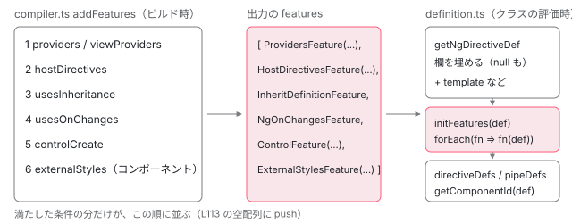

[目次](../README.md) › [hostDirectives と継承（features）](README.md) › 第 1 回 / 全 6 回

# features とは何か：コンパイラが並べ、defineComponent が順に呼ぶ

> コンパイラの addFeatures が ProvidersFeature・HostDirectivesFeature・InheritDefinitionFeature・NgOnChangesFeature・ControlFeature・ExternalStylesFeature をどの条件でどの順に並べるか、ɵɵdefineComponent が def を作ったあとで features を 1 つずつ呼ぶ行、各 feature が def に書く欄。v22.1 の ɵɵNgOnChangesFeature は def に何も書かず、ngOnChanges の仕組みは最初の作成パスで作られること、そのために mixin の ngOnChanges が本番ビルドで落ちる再現。本物の @angular/compiler で features の配列を出し、ページの上で順を入れ替えた def を作る。

angular/angular · 読了 約 12 分 · 中核 · [サイトで読む（デモが動きます）](https://angular-deep-dive-cyan.vercel.app/chapter/hdi-features-pipeline)

---

コンパイラは、コンポーネントやディレクティブの定義（`ɵcmp` / `ɵdir`）に `features` という関数の配列を付けることがあります。この章では、その配列をコンパイラのどの関数が、どの条件で、どの順に並べるのか、実行時の `ɵɵdefineComponent` がそれをいつ呼ぶのか、呼ばれた 1 つ 1 つの feature が def のどの欄を書き換えるのかを、行番号を根拠に確かめます。並びの順が変わると何が変わるのかも、ページの上で def を作って見ます。

読む対象は `packages/compiler/src/render3/view/compiler.ts`（`addFeatures`）、`packages/core/src/render3/definition.ts`（`initFeatures`）、`packages/core/src/render3/features/` の `ng_onchanges_feature.ts`・`external_styles_feature.ts` です。6 つの feature のうち `ɵɵHostDirectivesFeature` の中身は [hostDirectives が standalone 限定である理由](../standalone/10-standalone-host-directives.md)、`ɵɵProvidersFeature` は [providers の 2 つの行き先](../standalone/08-standalone-providers-two-injectors.md)、`ɵɵInheritDefinitionFeature` は[次の回](02-hdi-inherit-runtime.md)で読みます。

1. **1. features の並びと実行**（この章）
2. [2. 継承の実行時](02-hdi-inherit-runtime.md)
3. [3. 継承のコンパイル](03-hdi-inherit-compile.md)
4. [4. host directive の重複の解消](04-hdi-host-dedupe.md)
5. [5. providers と入出力](05-hdi-host-providers-bindings.md)
6. [6. spec と issue](06-hdi-tests-issues.md)

> [!TIP]
> **新卒エンジニアへ**
>
> 「feature」は、def を作り終えたあとで def に手を加える小さな関数です。`(def) => void` という形をしています。def は「このクラスを Angular としてどう扱うか」を書いた 1 つのオブジェクトで、`static ɵcmp = ɵɵdefineComponent({...})` の戻り値です（[Ivy の全体像](../ivy/02-ivy-overview.md)）。

## 1. コンパイラが並べる：addFeatures

ngtsc も JIT も、最後は compiler パッケージの `compileDirectiveFromMetadata` / `compileComponentFromMetadata` で def の式を作ります。どちらも `baseDirectiveFields` で欄を埋めた直後に `addFeatures` を呼びます（呼ぶ行は [ngtsc の @Directive ハンドラ](../ngtsc/09-ngtsc-directive-handler.md)で引用済み）。

📄 `angular/packages/compiler/src/render3/view/compiler.ts` L105–117 （▶ の行: 108, 110, 113, 115–116）

```ts
105 │ /**
106 │  * Add features to the definition map.
107 │  */
108 ▶ function addFeatures(
109 │   definitionMap: DefinitionMap,
110 ▶   meta: R3DirectiveMetadata | R3ComponentMetadata<R3TemplateDependency>,
111 │ ) {
112 │   // e.g. `features: [NgOnChangesFeature]`
113 ▶   const features: o.Expression[] = [];
114 │ 
115 ▶   const providers = meta.providers;
116 ▶   const viewProviders = (meta as R3ComponentMetadata<R3TemplateDependency>).viewProviders;
117 │ 
```

110 行目、`meta` はディレクティブのメタデータかコンポーネントのメタデータです。113 行目の `features` は空の配列から始まり、このあとの `if` を**上から順に**通るたびに 1 つずつ `push` されます。115〜116 行目で `providers` と `viewProviders` を取り出し、どちらかがあれば `ɵɵProvidersFeature(providers, viewProviders)` の呼び出しを積みます。その次が `hostDirectives` で、`ɵɵHostDirectivesFeature([...])` の呼び出しを積みます。この 2 つの `if` は上の 2 つの章で引用しています。

📄 `angular/packages/compiler/src/render3/view/compiler.ts` L130–137 （▶ の行: 130–131, 134–135）

```ts
130 ▶         .importExpr(R3.HostDirectivesFeature)
131 ▶         .callFn([createHostDirectivesFeatureArg(meta.hostDirectives)]),
132 │     );
133 │   }
134 ▶   if (meta.usesInheritance) {
135 ▶     features.push(o.importExpr(R3.InheritDefinitionFeature));
136 │   }
137 │   if (meta.lifecycle.usesOnChanges) {
```

130〜131 行目が hostDirectives の分の終わりです。134〜135 行目、`meta.usesInheritance` が真なら `ɵɵInheritDefinitionFeature` を積みます。ここは `.callFn(...)` が無く、**関数そのもの**を置きます。`usesInheritance` は「クラスに `extends` がある」という意味で、ngtsc が決める行は[第 3 回](03-hdi-inherit-compile.md)で読みます。

📄 `angular/packages/compiler/src/render3/view/compiler.ts` L137–156 （▶ の行: 137–140, 142, 144–145, 148, 150, 152–154）

```ts
137 ▶   if (meta.lifecycle.usesOnChanges) {
138 ▶     features.push(o.importExpr(R3.NgOnChangesFeature));
139 ▶   }
140 ▶   if (meta.controlCreate !== null) {
141 │     features.push(
142 ▶       o.importExpr(R3.ControlFeature).callFn([o.literal(meta.controlCreate.passThroughInput)]),
143 │     );
144 ▶   }
145 ▶   if ('externalStyles' in meta && meta.externalStyles?.length) {
146 │     const externalStyleNodes = meta.externalStyles.map((externalStyle) => o.literal(externalStyle));
147 │     features.push(
148 ▶       o.importExpr(R3.ExternalStylesFeature).callFn([o.literalArr(externalStyleNodes)]),
149 │     );
150 ▶   }
151 │ 
152 ▶   if (features.length) {
153 ▶     definitionMap.set('features', o.literalArr(features));
154 ▶   }
155 │ }
156 │ 
```

1. **137〜139 行目：ngOnChanges を持てば ɵɵNgOnChangesFeature**

   ここも 138 行目で関数そのものを置きます（呼び出しではありません）。`usesOnChanges` は ngtsc では「クラス自身に `ngOnChanges` というメソッドがある」です（[ngtsc の @Directive ハンドラ](../ngtsc/09-ngtsc-directive-handler.md)）。
2. **140〜144 行目：ɵngControlCreate を持てば ɵɵControlFeature(passThroughInput)**

   signal forms の `[formField]` のための内部の仕組みです（[signal forms](../signals/17-signal-forms.md)）。
3. **145〜150 行目：外部のスタイルがあれば ɵɵExternalStylesFeature(\[...\])**

   145 行目の `'externalStyles' in meta` で、**コンポーネントのメタデータのときだけ**通ります。ディレクティブにはスタイルが無いからです。2 節で、いつ `externalStyles` が入るかを見ます。
4. **152〜154 行目：1 つでもあれば features という欄にする**

   何も積まれなければ、def の式に `features` の欄そのものが出ません。

並びの順をまとめます。条件は全部独立していて、満たしたものだけがこの順に並びます。

| 順 | 出る feature | 条件（meta の欄） | 出る形 |
| --- | --- | --- | --- |
| 1 | `ɵɵProvidersFeature` | `providers` か `viewProviders` | 呼び出し `(providers, viewProviders?)` |
| 2 | `ɵɵHostDirectivesFeature` | `hostDirectives` が 1 つ以上 | 呼び出し `([...])` か `(function () { return [...] })` |
| 3 | `ɵɵInheritDefinitionFeature` | `usesInheritance` | 関数そのもの（134〜135 行目） |
| 4 | `ɵɵNgOnChangesFeature` | `lifecycle.usesOnChanges` | 関数そのもの（138 行目） |
| 5 | `ɵɵControlFeature` | `controlCreate !== null` | 呼び出し `(passThroughInput)` |
| 6 | `ɵɵExternalStylesFeature` | コンポーネントで `externalStyles` が 1 つ以上 | 呼び出し `([url, ...])` |



*コンパイラの addFeatures が if の順に積んだ配列を、実行時の initFeatures が同じ順に呼ぶ。id はそのあと。*

コンパイラのテストの期待値でも、`ɵɵNgOnChangesFeature` は呼び出しの括弧なしで並んでいます。

📄 `angular/packages/compiler-cli/test/compliance/test_cases/r3_compiler_compliance/components_and_directives/lifecycle_hooks/lifecycle_hooks_lifecycle_comp_def.js` L1–14 （▶ の行: 8）

```js
 1 │ export class LifecycleComp {
 2 │   // ...
 3 │   static ɵcmp = /*@__PURE__*/ $r3$.ɵɵdefineComponent({
 4 │     type: LifecycleComp,
 5 │     selectors: [["lifecycle-comp"]],
 6 │     inputs: {nameMin: [0, "name", "nameMin"]},
 7 │     standalone: false,
 8 ▶     features: [$r3$.ɵɵNgOnChangesFeature],
 9 │     decls: 0,
10 │     vars: 0,
11 │     template:  function LifecycleComp_Template(rf, ctx) {},
12 │     encapsulation: 2
13 │   });
14 │ }
```
*compliance テストの期待値。2 行目の // ... は期待値の側の省略です。*

## 2. 外部のスタイルが features に出るとき

6 番目の `ɵɵExternalStylesFeature` は、普通の `ng build` では出ません。ngtsc のオプション `externalRuntimeStyles` が真のときだけです。

📄 `angular/packages/compiler-cli/src/ngtsc/core/api/src/options.ts` L82–91 （▶ の行: 84, 86–87, 89, 91）

```ts
82 │ 
83 │   /**
84 ▶    * Enables the use of `<link>` elements for component styleUrls instead of inlining the file
85 │    * content.
86 ▶    * This option is intended to be used with a development server that processes and serves
87 ▶    * the files on-demand for an application.
88 │    *
89 ▶    * @internal
90 │    */
91 ▶   externalRuntimeStyles?: boolean;
```

📄 `angular/packages/compiler-cli/src/ngtsc/annotations/component/src/handler.ts` L868–889 （▶ の行: 872, 876, 883–884, 886–887）

```ts
868 │     // Figure out the set of styles. The ordering here is important: external resources (styleUrls)
869 │     // precede inline styles, and styles defined in the template override styles defined in the
870 │     // component.
871 │     let styles: string[] = [];
872 ▶     const externalStyles: string[] = [];
873 │ 
874 │     const hostBindingResources = extractHostBindingResources(directiveResult.hostBindingNodes);
875 │     const styleResources = extractInlineStyleResources(component);
876 ▶     const styleUrls: StyleUrlMeta[] = [
877 │       ...extractComponentStyleUrls(this.evaluator, component),
878 │       ..._extractTemplateStyleUrls(template),
879 │     ];
880 │ 
881 │     for (const styleUrl of styleUrls) {
882 │       try {
883 ▶         const resourceUrl = this.resourceLoader.resolve(styleUrl.url, containingFile);
884 ▶         if (this.externalRuntimeStyles) {
885 │           // External runtime styles are not considered disk-based and may not actually exist on disk
886 ▶           externalStyles.push(resourceUrl);
887 ▶           continue;
888 │         }
889 │         if (
```

84〜87 行目のとおり、このオプションは「`styleUrls` の中身を埋め込む代わりに `<link>` 要素で読む」ためのもので、89 行目のとおり内部向け（`@internal`）です。コンポーネントのハンドラは 876 行目でスタイルの URL を集め、884 行目でこのオプションが真なら、883 行目で解決した URL を 886 行目で `externalStyles` に入れて、887 行目でファイルの読み込みを飛ばします。Angular CLI の開発サーバーは、コンポーネントの HMR が使えるときにこのオプションを立てます（[CLI の HMR](../cli/11-cli-hmr.md)）。

## 3. 実行時：def ができあがってから、配列の順に呼ぶ

📄 `angular/packages/core/src/render3/definition.ts` L641–652 （▶ の行: 641–645, 649–651）

```ts
641 ▶     controlDef: null,
642 ▶     signalFormsInputPresence: null,
643 ▶     inputs: parseAndConvertInputsForDefinition(directiveDefinition.inputs, declaredInputs),
644 ▶     outputs: parseAndConvertOutputsForDefinition(directiveDefinition.outputs),
645 ▶     debugInfo: null,
646 │   };
647 │ }
648 │ 
649 ▶ function initFeatures<T>(definition: DirectiveDef<T> | ComponentDef<T>): void {
650 ▶   definition.features?.forEach((fn) => fn(definition));
651 ▶ }
652 │ 
```

649〜651 行目が全部です。`definition.features` があれば、`forEach` で**配列の順に**`fn(definition)` を呼びます。戻り値は使いません。641〜645 行目は、その直前で `getNgDirectiveDef` が作る def の最後の欄です。641 行目の `controlDef` のように、feature が書く欄はここで `null` として作られ、feature があとで書き換えます。

📄 `angular/packages/core/src/render3/definition.ts` L566–576 （▶ の行: 570–571, 573）

```ts
566 │ export function ɵɵdefineDirective<T>(
567 │   directiveDefinition: DirectiveDefinition<T>,
568 │ ): DirectiveDef<any> {
569 │   return noSideEffects(() => {
570 ▶     const def = getNgDirectiveDef(directiveDefinition);
571 ▶     initFeatures(def);
572 │ 
573 ▶     return def;
574 │   });
575 │ }
576 │ 
```

📄 `angular/packages/core/src/render3/definition.ts` L371–378 （▶ の行: 377–378）

```ts
371 │ 
372 │     // TODO: Do we still need/want this ?
373 │     if (baseDef.standalone) {
374 │       performanceMarkFeature('NgStandalone');
375 │     }
376 │ 
377 ▶     initFeatures(def);
378 ▶     const dependencies = componentDefinition.dependencies;
```

1. **ディレクティブ：570〜571 行目**

   `getNgDirectiveDef` で def の欄を全部埋めた直後に `initFeatures(def)`。573 行目でそのまま返します。
2. **コンポーネント：377 行目**

   `ɵɵdefineComponent` は、`getNgDirectiveDef` の結果に `template`・`styles`・`encapsulation` などを足した def を作り（[Ivy の全体像](../ivy/02-ivy-overview.md)で引用済み）、377 行目で `initFeatures(def)` を呼びます。**そのあとで** 378 行目から `directiveDefs`・`pipeDefs` を作り、最後に `def.id` を計算します。

📄 `angular/packages/core/src/render3/definition.ts` L705–724 （▶ の行: 705, 708–709, 717–718）

```ts
705 ▶   const hashSelectors = [
706 │     componentDef.selectors,
707 │     componentDef.ngContentSelectors,
708 ▶     componentDef.hostVars,
709 ▶     componentDef.hostAttrs,
710 │     componentDefConsts,
711 │     componentDef.vars,
712 │     componentDef.decls,
713 │     componentDef.encapsulation,
714 │     componentDef.standalone,
715 │     componentDef.signals,
716 │     componentDef.exportAs,
717 ▶     JSON.stringify(componentDef.inputs),
718 ▶     JSON.stringify(componentDef.outputs),
719 │     // We cannot use 'componentDef.type.name' as the name of the symbol will change and will not
720 │     // match in the server and browser bundles.
721 │     Object.getOwnPropertyNames(componentDef.type.prototype),
722 │     !!componentDef.contentQueries,
723 │     !!componentDef.viewQuery,
724 │   ];
```

`getComponentId` は 705 行目からの値を並べてハッシュにします。708 行目の `hostVars`、709 行目の `hostAttrs`、717〜718 行目の `inputs` / `outputs` は、継承の feature が親の分を足す欄です（第 2 回）。id の計算が `initFeatures` のあとなので、親から混ぜた分も id に入ります。

> [!NOTE]
> **ポイント**
>
> feature は「クラスの static フィールドを初期化するとき」、つまりそのクラスの定義が評価された瞬間に、1 回だけ呼ばれます。テンプレートを描くたびには呼ばれません。描くときに使われるのは、feature が def に書いた欄（関数やデータ）のほうです。

## 4. feature の型と ngInherit

📄 `angular/packages/core/src/render3/interfaces/definition.ts` L466–477 （▶ の行: 467, 469–470, 472–474, 476）

```ts
466 │ export interface DirectiveDefFeature {
467 ▶   <T>(directiveDef: DirectiveDef<T>): void;
468 │   /**
469 ▶    * Marks a feature as something that {@link InheritDefinitionFeature} will execute
470 ▶    * during inheritance.
471 │    *
472 ▶    * NOTE: DO NOT SET IN ROOT OF MODULE! Doing so will result in tree-shakers/bundlers
473 ▶    * identifying the change as a side effect, and the feature will be included in
474 ▶    * every bundle.
475 │    */
476 ▶   ngInherit?: true;
477 │ }
```

467 行目が呼び出しの形、476 行目の `ngInherit` が印です。469〜470 行目、この印が付いた feature は、**子クラスの継承の feature が親の def から拾い直して、子の def に対してもう一度呼びます**（第 2 回）。472〜474 行目の注意は、「この印をモジュールの一番外側で付けると、バンドラーがそれを副作用と見て、その feature を全部のバンドルに残してしまう」です。そこで印は、feature を作る関数の中で付けます。

## 5. 6 つの feature が def に書くもの

| feature | def に書く欄 | ngInherit | 読む章 |
| --- | --- | --- | --- |
| `ɵɵProvidersFeature` | `providersResolver`・`viewProvidersResolver`（関数） | なし | [providers の 2 つの行き先](../standalone/08-standalone-providers-two-injectors.md) |
| `ɵɵHostDirectivesFeature` | `resolveHostDirectives`（関数）・`hostDirectives`（配列） | true | [hostDirectives](../standalone/10-standalone-host-directives.md) |
| `ɵɵInheritDefinitionFeature` | `inputs`・`declaredInputs`・`outputs`・`hostBindings`・`viewQuery`・`contentQueries`・`hostVars`・`hostAttrs`・`data.animation` | なし（参照で見分けられる） | [第 2 回](02-hdi-inherit-runtime.md) |
| `ɵɵNgOnChangesFeature` | **何も書かない**（下の節） | true | この章 |
| `ɵɵControlFeature` | `controlDef` | なし | [signal forms](../signals/17-signal-forms.md) |
| `ɵɵExternalStylesFeature` | `getExternalStyles`（関数） | なし | この章 |

### ɵɵExternalStylesFeature

📄 `angular/packages/core/src/render3/features/external_styles_feature.ts` L11–42 （▶ の行: 21–23, 27, 30, 33–34, 36）

```ts
11 │ /**
12 │  * A feature that adds support for external runtime styles for a component.
13 │  * An external runtime style is a URL to a CSS stylesheet that contains the styles
14 │  * for a given component. For browsers, this URL will be used in an appended `link` element
15 │  * when the component is rendered. This feature is typically used for Hot Module Replacement
16 │  * (HMR) of component stylesheets by leveraging preexisting global stylesheet HMR available
17 │  * in most development servers.
18 │  *
19 │  * @codeGenApi
20 │  */
21 ▶ export function ɵɵExternalStylesFeature(styleUrls: string[]): ComponentDefFeature {
22 ▶   return (definition: ComponentDef<unknown>) => {
23 ▶     if (styleUrls.length < 1) {
24 │       return;
25 │     }
26 │ 
27 ▶     definition.getExternalStyles = (encapsulationId) => {
28 │       // Add encapsulation ID search parameter `ngcomp` to support external style encapsulation as well as the encapsulation mode
29 │       // for usage tracking.
30 ▶       const urls = styleUrls.map(
31 │         (value) =>
32 │           value +
33 ▶           '?ngcomp' +
34 ▶           (encapsulationId ? '=' + encodeURIComponent(encapsulationId) : '') +
35 │           '&e=' +
36 ▶           definition.encapsulation,
37 │       );
38 │ 
39 │       return urls;
40 │     };
41 │   };
42 │ }
```

21〜22 行目、URL の配列を受け取って feature を返します。23 行目、空なら何もしません。27 行目で def に `getExternalStyles` を貼ります。これは**呼ばれたときに** 30〜37 行目で各 URL に `?ngcomp=`（カプセル化の id）と `&e=`（36 行目の `definition.encapsulation`）を付けて返す関数です。36 行目は feature が呼ばれた時点ではなく、`getExternalStyles` が呼ばれた時点の `encapsulation` を読みます。描画のときに、platform-browser のレンダラーがこれを呼んで `<link>` を足します（[カプセル化](../domr/06-domr-encapsulation.md)）。

### ɵɵNgOnChangesFeature：def には何も書かない

📄 `angular/packages/core/src/render3/features/ng_onchanges_feature.ts` L17–56 （▶ の行: 17, 24–27, 41–43, 48, 50, 53–54）

````ts
17 ▶ let _ngOnChangesFeatureImpl: typeof NgOnChangesFeatureImpl | null = null;
18 │ 
19 │ /**
20 │  * The NgOnChangesFeature decorates a component with support for the ngOnChanges
21 │  * lifecycle hook, so it should be included in any component that implements
22 │  * that hook.
23 │  *
24 ▶  * If the component or directive uses inheritance, the NgOnChangesFeature MUST
25 ▶  * be included as a feature AFTER {@link InheritDefinitionFeature}, otherwise
26 ▶  * inherited properties will not be propagated to the ngOnChanges lifecycle
27 ▶  * hook.
28 │  *
29 │  * Example usage:
30 │  *
31 │  * ```ts
32 │  * static ɵcmp = defineComponent({
33 │  *   ...
34 │  *   inputs: {name: 'publicName'},
35 │  *   features: [NgOnChangesFeature]
36 │  * });
37 │  * ```
38 │  *
39 │  * @codeGenApi
40 │  */
41 ▶ export const ɵɵNgOnChangesFeature: () => DirectiveDefFeature = /* @__PURE__ */ (() => {
42 ▶   _ngOnChangesFeatureImpl = NgOnChangesFeatureImpl;
43 ▶   const ɵɵNgOnChangesFeatureImpl = () => NgOnChangesFeatureImpl;
44 │ 
45 │   // This option ensures that the ngOnChanges lifecycle hook will be inherited
46 │   // from superclasses (in InheritDefinitionFeature).
47 │   /** @nocollapse */
48 ▶   ɵɵNgOnChangesFeatureImpl.ngInherit = true;
49 │ 
50 ▶   return ɵɵNgOnChangesFeatureImpl;
51 │ })();
52 │ 
53 ▶ export function getNgOnChangesFeatureImpl(): typeof NgOnChangesFeatureImpl {
54 ▶   return _ngOnChangesFeatureImpl!;
55 │ }
56 │ 
````

1. **41 行目：ɵɵNgOnChangesFeature は「関数を作る関数」ではなく、即時に実行した結果**

   `/* @__PURE__ */ (() => { ... })()` の戻り値、つまり 43 行目の `ɵɵNgOnChangesFeatureImpl = () => NgOnChangesFeatureImpl` です。コンパイラは 1 節 138 行目でこれをそのまま配列に置くので、def を作るとき `initFeatures` が呼ぶのはこの矢印関数です。**引数（def）を受け取らず、`NgOnChangesFeatureImpl` を返すだけで、def には何も書きません。**
2. **48 行目：ngInherit を関数の中で付ける**

   4 節の注意どおり、モジュールの一番外側ではなく、即時実行の中で付けています。
3. **17・42・53〜55 行目：モジュールの変数に覚えておき、あとで渡す**

   42 行目で 17 行目の `_ngOnChangesFeatureImpl` に実装を入れ、53〜55 行目の `getNgOnChangesFeatureImpl()` で返します。本物の仕事（def の `setInput` を差し替える・`SimpleChanges` を貯めて `ngOnChanges` を呼ぶ関数を返す）は、この引用のすぐ下の `NgOnChangesFeatureImpl` にあります（[elements の入力と変更検知](../elements/05-elements-inputs-cd.md)で引用済み）。

では `NgOnChangesFeatureImpl` は誰が呼ぶのか。`hooks.ts` の `registerPreOrderHooks` です。ディレクティブを作った直後の、最初の作成パスで、`directiveDef.type.prototype` に `ngOnChanges` があれば呼びます（関数の全体は [ライフサイクルフック](../ivy/13-ivy-hooks.md)）。この形になったのは 2026-04-12 のコミット 4744bab38ef（refactor(core): Tree shake the \`SimpleChanges\` & co.、v22.1.0 から）で、差分は次のとおりです。

📄 `git show 4744bab38ef -- packages/core/src/render3/features/ng_onchanges_feature.ts（後半）`

```
@@ -37,6 +39,7 @@ import {DirectiveDef, DirectiveDefFeature} from '../interfaces/definition';
  * @codeGenApi
  */
 export const ɵɵNgOnChangesFeature: () => DirectiveDefFeature = /* @__PURE__ */ (() => {
+  _ngOnChangesFeatureImpl = NgOnChangesFeatureImpl;
   const ɵɵNgOnChangesFeatureImpl = () => NgOnChangesFeatureImpl;
 
   // This option ensures that the ngOnChanges lifecycle hook will be inherited
@@ -47,7 +50,14 @@ export const ɵɵNgOnChangesFeature: () => DirectiveDefFeature = /* @__PURE__ */
   return ɵɵNgOnChangesFeatureImpl;
 })();
 
-export function NgOnChangesFeatureImpl<T>(definition: DirectiveDef<T>) {
+export function getNgOnChangesFeatureImpl(): typeof NgOnChangesFeatureImpl {
+  return _ngOnChangesFeatureImpl!;
+}
+
+/**
+ * We don't expose the feature implementation directly in order to tree shake it when `ngOnChanges` isn't used.
+ */
+function NgOnChangesFeatureImpl<T>(definition: DirectiveDef<T>) {
   if (definition.type.prototype.ngOnChanges) {
     definition.setInput = ngOnChangesSetInput;
   }
```

📄 `git show 4744bab38ef -- packages/core/src/render3/hooks.ts`

```ts
@@ -61,7 +61,7 @@ export function registerPreOrderHooks(
     DoCheck;
 
   if (ngOnChanges as Function | undefined) {
-    const wrappedOnChanges = NgOnChangesFeatureImpl(directiveDef);
+    const wrappedOnChanges = getNgOnChangesFeatureImpl()(directiveDef);
     (tView.preOrderHooks ??= []).push(directiveIndex, wrappedOnChanges);
     (tView.preOrderCheckHooks ??= []).push(directiveIndex, wrappedOnChanges);
   }
```

前は `hooks.ts` が `NgOnChangesFeatureImpl` を直接 import していたので、`ngOnChanges` を使わないアプリにも `SimpleChanges` まわりのコードが残りました。いまは実装への参照が `ɵɵNgOnChangesFeature` の即時実行の中にしか無いので、**どの def も `ɵɵNgOnChangesFeature` を参照しなければ、即時実行ごと消えます**。つまり def の `features` に入った `ɵɵNgOnChangesFeature` の役目は、いまは「実装をバンドルに残し、17 行目の変数に入れさせる」ことと、`ngInherit` の印だけです。

> [!WARNING]
> **ハマりどころ**
>
> **再現した事実。**`registerPreOrderHooks` が見るのは**プロトタイプ**の `ngOnChanges` で、コンパイラが `usesOnChanges` を立てたかどうかではありません。そこで、`ngOnChanges` をクラス式（mixin）で足し、ngtsc にはそれが見えないコンポーネントを、ほかに `ngOnChanges` を持つ def が 1 つも無いアプリで本番ビルドしました（@angular/cli・@angular/build・@angular/core 22.1.6（このサイトの node\_modules））。

📄 `src/main.ts（再現に使った全文）`

```
import {Component, Input, SimpleChanges} from '@angular/core';
import {bootstrapApplication} from '@angular/platform-browser';

type Ctor = new (...args: any[]) => {};
// mixin: ngOnChanges をクラス式で足す（ngtsc はクラス式を解析しない）
function withChanges<T extends Ctor>(Base: T) {
  return class extends Base {
    seen: string[] = [];
    ngOnChanges(changes: SimpleChanges) {
      this.seen.push(Object.keys(changes).join(','));
    }
  };
}
class Plain {}

@Component({selector: 'x-child', template: '{{ value }}'})
export class Child extends withChanges(Plain) {
  @Input() value = '';
}

@Component({selector: 'app-root', imports: [Child], template: '<x-child value="a" />'})
export class App {}

bootstrapApplication(App).then(
  (ref) => {
    (window as any).__result = 'ok: ' + document.querySelector('x-child')!.textContent;
  },
  (e) => {
    (window as any).__result = 'error: ' + String(e);
  },
);

```

| ビルド | アプリ | bootstrap の結果 | コンソール | x-child の中身 |
| --- | --- | --- | --- | --- |
| ng build（本番。optimization あり） | main.ts のまま | `error: TypeError: _l(...) is not a function` | ERROR TypeError: \_l(...) is not a function（registerPreOrderHooks の中） | （空） |
| ng build --optimization=false | main.ts のまま | `ok: a` | なし | a |
| ng build（本番） | Other を足す | `ok: a` | なし | a |

表の 1 番目のバンドルには、17 行目の変数と 53〜55 行目の関数は残り（`var Ml=null;function _l(){return Ml} … let{ngOnChanges:r,ngOnInit:o,ngDoCheck:i}=t.type.prototype;if(r){let s=_l()(t);`）、変数に入れる即時実行は残っていません。表の 3 番目は、`ngOnChanges` を自分で持つ `Other` を `imports` に足しただけ（テンプレートでは使わない）で、バンドルに即時実行が戻ります（`var Hs=null,To=(()=>{Hs=ps;let e=()=>ps;return e.ngInherit=!0,e})();function kl(){return Hs}`）。最適化なし（表の 2 番目）では即時実行が消えないので動きます。

📄 `表の 3 番目で足したコンポーネント`

```
@Component({selector: 'x-other', template: ''})
export class Other {
  @Input() v = '';
  ngOnChanges() {}
}
// App の imports を [Child, Other] にする（テンプレートでは使わない）

```

## 6. 並びの順が意味を持つところ

1. **HostDirectives → Inherit**

   1 節の表の 2 番と 3 番です。この順なら、まず自分の hostDirectives が def に入り、そのあと継承の feature が親の `ɵɵHostDirectivesFeature`（`ngInherit` 付き）を呼んで、親の分を `unshift` で**前に**足します（[hostDirectives](../standalone/10-standalone-host-directives.md) の 3 節）。結果は「親の host directive → 自分の host directive」の順で、この順にインスタンスが作られます。逆の順だと、自分の分が前に来ます。下の DEMO ② で両方の順の def を作って比べます。
2. **Inherit → NgOnChanges**

   `ng_onchanges_feature.ts` 24〜27 行目のコメントは「継承するなら `NgOnChangesFeature` は `InheritDefinitionFeature` の**あと**でなければならない。そうしないと継承したプロパティが `ngOnChanges` に伝わらない」と言います。ただ 5 節で見たとおり、v22 の `ɵɵNgOnChangesFeature` は def に何も書かないので、def を作る時点では順で結果は変わりません。`setInput` を差し替えるのは最初の作成パスの `registerPreOrderHooks` で、そのときには継承の feature はもう終わっています。DEMO ② で、逆の順でも `setInput` が `null` のままで、作ったあとに初めて関数になることを見ます。
3. **features → id**

   3 節のとおり、`getComponentId` は全部の feature のあとです。継承で増えた `hostVars` や `inputs` も id に入ります。

> **🧪 DEMO ① — 本物の @angular/compiler で features を出す**
>
> 「コンパイルする」を押したときに `@angular/compiler`（このサイトの 22.1.6）を読み込み、選んだ書き方のメタデータを `compileComponentFromMetadata` / `compileDirectiveFromMetadata` に渡します。中で 1 節の `addFeatures` が動きます。出てきた式は文字列にするだけで、評価はしません。
>
> ▶ [このデモはサイトで動かせます](https://angular-deep-dive-cyan.vercel.app/chapter/hdi-features-pipeline)

> **🧪 DEMO ② — このページの本物の def を読み、順を入れ替えて def を作る**
>
> この章には AOT でコンパイルされた `FpChild`（`@Component`）があります。`FpChild` は、`hostDirectives: [FpHostA]`・`@Input() label`・`ngOnChanges` を持つセレクタの無い `FpParent` を継承し、自分も `hostDirectives: [FpHostB]`・`providers`・`@Input() size`・`ngOnChanges` を持ちます。「def を読む」は、`FpChild.ɵcmp.features` の 1 つ 1 つを、欄がすべて `null` の空の def に当てて、書き換わった欄を表にします。
>
> 次の 2 つのボタンは、その場で `class extends FpParent {}` を作り、`ɵɵdefineDirective({ type, features })` を手で呼びます。features には `ɵɵHostDirectivesFeature([FpHostB])`・`ɵɵInheritDefinitionFeature`・`ɵɵNgOnChangesFeature` を、コンパイラの順と逆の順で入れます。
>
> 最後に、`FpChild` を `createComponent`（`@angular/core` の関数）で本当に作り、`setInput` してから変更検知を 1 回走らせます。作る前と後で `FpChild.ɵcmp.setInput` を読みます。
>
> ▶ [このデモはサイトで動かせます](https://angular-deep-dive-cyan.vercel.app/chapter/hdi-features-pipeline)

本番ビルドをヘッドレスの Chrome で開き、全部のボタンを押した結果は次のとおりです（2026-11-15）。① の初期値（@Component・providers・\[Tooltip\]・extends・ngOnChanges）では `ɵɵProvidersFeature([Svc])`・`ɵɵHostDirectivesFeature([Tooltip])`・`ɵɵInheritDefinitionFeature`・`ɵɵNgOnChangesFeature` の 4 つがこの順に出ます。② の表では、`ɵɵNgOnChangesFeature` を当てても何も書き換わらず（戻り値は関数）、コンパイラの順の def は `[FpHostA, FpHostB]`、逆の順の def は `[FpHostB, FpHostA]` になり、どちらも `setInput` は `null` です。「FpChild を作る」を押すと、`FpChild.ɵcmp.setInput` が `null` から関数に変わります。

## ここまでの呼び出し

- 👤 `@Component({ providers, hostDirectives }) class C extends Base { ngOnChanges() {} }` — あなたのコード
  - `compileComponentFromMetadata(meta)` — compiler/src/render3/view/compiler.ts — *baseDirectiveFields のあと*
    - `addFeatures(definitionMap, meta)` — compiler.ts L108 — *Providers → HostDirectives → Inherit → NgOnChanges → Control → ExternalStyles*
- `static ɵcmp = ɵɵdefineComponent({ ..., features: [...] })` — クラスの定義を評価した瞬間
  - `initFeatures(def)` — core/src/render3/definition.ts L377 → L649 — *配列の順に fn(def)*
    - `ɵɵProvidersFeature(...)(def)` — features/providers\_feature.ts — *providersResolver*
    - `ɵɵHostDirectivesFeature(...)(def)` — features/host\_directives\_feature.ts — *resolveHostDirectives・hostDirectives*
    - `ɵɵInheritDefinitionFeature(def)` — features/inherit\_definition\_feature.ts — *親の def を混ぜ、親の ngInherit の feature を呼ぶ（第 2 回）*
    - `ɵɵNgOnChangesFeature(def)` — ng\_onchanges\_feature.ts L43 — *何も書かない*
  - `getComponentId(def)` — definition.ts L705 — *feature のあとの欄でハッシュ*
- `ɵɵelementStart → … → registerPreOrderHooks(i, def, tView)` — core/src/render3/hooks.ts — *最初の作成パス*
  - `getNgOnChangesFeatureImpl()(def)` — ng\_onchanges\_feature.ts L53 — *prototype に ngOnChanges があれば def.setInput を差し替える*

## テストと直し方

### spec と it

| ファイル | テスト | 行 | この章のどこ |
| --- | --- | --- | --- |
| compliance/test\_cases/r3\_view\_compiler\_providers/TEST\_CASES.json | `should emit the ProvidersFeature feature when providers and viewProviders are used` ほか 3 つ（providers だけ・viewProviders だけ・どちらも無い） | 5・22・39・56 | 1 節の 1 番 |
| compliance/test\_cases/r3\_view\_compiler\_styling/component\_styles/TEST\_CASES.json | `should emit external runtime styles component feature for file-based styles when 'externalRuntimeStyles' option is enabled` | 61 | 2 節 |
| compliance/test\_cases/r3\_compiler\_compliance/components\_and\_directives/lifecycle\_hooks/TEST\_CASES.json | `should gen hooks with a few simple components`（期待値の 1 つが 1 節の lifecycle\_hooks\_lifecycle\_comp\_def.js） | 53 | 1 節の 4 番 |
| compliance/test\_cases/r3\_compiler\_compliance/components\_and\_directives/TEST\_CASES.json | `should support abstract directives`（`features: [i0.ɵɵInheritDefinitionFeature]`） | 168 | 1 節の 3 番 |
| core/test/acceptance/inherit\_definition\_feature\_spec.ts | `inheritance` › `ngOnChanges` の 7 つ（`should be inherited when super is a directive` など） | 230〜506 | 6 節の 2 番 |

compliance テストは、TEST\_CASES.json の `description` がそのまま it の名前になります。feature の**並び**を確かめる期待値はありません。compiler-cli・compiler・core の test を grep すると、1 つの `features` の配列に 2 種類以上の feature が並ぶ期待値は 0 件でした。順は addFeatures の if の順だけで決まっていて、テストでは固められていません。

### 手元で走らせた結果

📄 `走らせたコマンド`

```
cd ~/angular-research/angular
pnpm bazel test //packages/compiler-cli/test/compliance/full:full --nocache_test_results --test_output=all \
  "--test_arg=--filter=ProvidersFeature feature|external runtime styles component feature|should gen hooks with a few simple components|should support abstract directives"
pnpm bazel test //packages/core/test/acceptance:acceptance --nocache_test_results --test_output=all \
  "--test_arg=--filter=inheritance ngOnChanges"
```

../angular（22.2.0-next.7）で、compliance（full compile）は 2 つのシャードに分かれて「4 specs, 0 failures」と「3 specs, 0 failures」、合わせて 7 specs でした。acceptance は「7 specs, 0 failures」でした（2026-11-15）。この 7 つの ngOnChanges の it は JIT（TestBed）で動くので、5 節の「本番ビルドで即時実行が消える」は通りません。Node のテストは tree shaking をしないからです。

### 直すとしたら

- 5 節の再現は、`hooks.ts` の `registerPreOrderHooks` が `getNgOnChangesFeatureImpl()` の戻り値を確かめずに呼んでいるところで落ちます。関係するのは `ng_onchanges_feature.ts` の 17・42・53〜55 行目と、`registerPreOrderHooks` の 1 行です。tree shaking のあとで起きるので、確かめる場所は Node の acceptance ではなく、本番と同じ最適化でバンドルする `packages/core/test/bundling` の側になります（このディレクトリの golden の記号の一覧を、4744bab38ef 自身も書き換えています）。
- 並びの順を固める it を足すなら、compliance の `r3_view_compiler_providers` に、providers・hostDirectives・`extends`・`ngOnChanges` を全部持つコンポーネントの期待値を足す形です。

## 聞かれそうな質問

**Q. features はいつ呼ばれますか？テンプレートを描くたびですか？**

クラスの定義を評価して `static ɵcmp` を初期化するときに 1 回だけです。`ɵɵdefineComponent` が def を作った直後、definition.ts 377 行目の `initFeatures(def)` が、649〜651 行目で配列の順に呼びます。描くときに使うのは、feature が def に書いた `providersResolver` や `hostDirectives` などの欄です。

**Q. features の順はどこで決まっていますか？**

compiler.ts の `addFeatures` の `if` の順だけです。Providers → HostDirectives（130〜131 行目まで）→ Inherit（134〜135 行目）→ NgOnChanges（137〜139 行目）→ Control（140〜144 行目）→ ExternalStyles（145〜150 行目）。実行時は 650 行目の `forEach` がその順に呼ぶので、並び替える仕組みはありません。

**Q. ɵɵNgOnChangesFeature を外すと ngOnChanges は呼ばれなくなりますか？**

def を作る時点では、ng\_onchanges\_feature.ts 43 行目の関数は def に何も書かないので、features から外しても def は同じです。`ngOnChanges` を呼ぶ仕組みは、最初の作成パスの `registerPreOrderHooks` がプロトタイプを見て作ります。ただし、バンドルに `ɵɵNgOnChangesFeature` への参照が 1 つも無いと、42 行目の代入が消え、53〜55 行目が `null` を返して、5 節の再現のとおり `TypeError` になります。

**Q. ngInherit は何のための印ですか？**

子クラスの `ɵɵInheritDefinitionFeature` が、親の def の features の中からこの印の付いたものだけを選んで、子の def に対してもう一度呼ぶための印です（interfaces/definition.ts 469〜470・476 行目）。v22 で付いているのは `ɵɵHostDirectivesFeature` と `ɵɵNgOnChangesFeature`（48 行目）の 2 つで、providers は継承されません。

**Q. ExternalStylesFeature が出るのはどんなときですか？**

コンポーネントで、ngtsc の内部向けオプション `externalRuntimeStyles` が真のときです（options.ts 89〜91 行目、handler.ts 884〜887 行目）。CLI の開発サーバーがコンポーネントの HMR を使うときに立てます。普通の `ng build` では出ません。compiler.ts 145 行目の `'externalStyles' in meta` により、ディレクティブには出ません。

## 読み終えて

- features は compiler.ts の `addFeatures` が if の順に積む配列で、Providers → HostDirectives → Inherit → NgOnChanges → Control → ExternalStyles の順。Inherit と NgOnChanges だけは関数そのもの、ほかは呼び出しの結果
- 実行時は `ɵɵdefineComponent` / `ɵɵdefineDirective` が def の欄を埋めた直後に `initFeatures` が配列の順に呼ぶ（definition.ts 377・571・650 行目）。コンポーネントの id はそのあとで計算される
- `ngInherit` の付いた feature（HostDirectives・NgOnChanges）だけが、子クラスの継承の feature から子の def に対して呼び直される
- v22.1 以降の `ɵɵNgOnChangesFeature` は def に何も書かない。`setInput` を差し替えるのは最初の作成パスの `registerPreOrderHooks` で、feature の役目は実装をバンドルに残すこと
- HostDirectives が Inherit より前にあるから、親の host directive が前に並ぶ。逆にすると自分の分が前に来る

---

← 前: [spec と issue を読む：resource の振る舞いを決めているテスト](../resx/06-resx-tests-issues.md)  
次: [継承の実行時：ɵɵInheritDefinitionFeature が親の def を混ぜる](02-hdi-inherit-runtime.md) →
