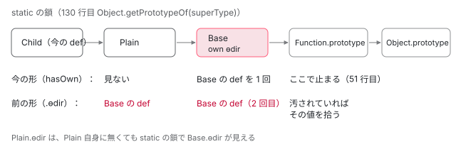

[目次](../README.md) › [hostDirectives と継承（features）](README.md) › 第 2 回 / 全 6 回

# 継承の実行時：ɵɵInheritDefinitionFeature が親の def を混ぜる

> ɵɵInheritDefinitionFeature が static の鎖を上がり、Object.hasOwn で親自身の def だけを拾う行、inputs・outputs・hostBindings・クエリ・hostAttrs・hostVars・アニメーションの合わせ方、親の features のうち ngInherit を持つものだけを子に呼び直す行、同じ祖先を 2 回混ぜないための shouldInheritFields。汚された prototype への対策（e6953793542）を作業木で前の形に戻し、飾りのない中間のクラスで同じ def が 2 回混ざっていたことも確かめる。ページの上の本物の 3 段の継承で、混ぜられた def を読む。

angular/angular · 読了 約 14 分 · 発展 · [サイトで読む（デモが動きます）](https://angular-deep-dive-cyan.vercel.app/chapter/hdi-inherit-runtime)

---

`class Child extends Parent` と書いたディレクティブやコンポーネントには、コンパイラが `features: [ɵɵInheritDefinitionFeature]` を付けます（[第 1 回](01-hdi-features-pipeline.md)）。この章では、その 1 つの関数が、親のクラスをどうたどり、親の def の inputs・outputs・host バインディング・クエリ・host の属性をどの規則で子の def に混ぜ、親の features のうちどれを子に呼び直すのかを、1 ステップずつ読みます。2026 年 6 月に入った「汚された prototype への対策」（e6953793542）が何を変えたのかも、作業木で前の形に戻して確かめます。

読む対象は `packages/core/src/render3/features/inherit_definition_feature.ts`（228 行）と、そこから呼ぶ `util/property.ts` の `fillProperties`・`render3/util/attrs_utils.ts` の `mergeHostAttrs`、テストは `packages/core/test/acceptance/inherit_definition_feature_spec.ts` です。クエリの関数をつなぐ `inheritViewQuery` / `inheritContentQueries` は [コンテンツの投影とクエリ](../qry/06-qry-content-projection.md)で読んだので、ここでは繰り返しません。

1. [1. features の並びと実行](01-hdi-features-pipeline.md)
2. **2. 継承の実行時**（この章）
3. [3. 継承のコンパイル](03-hdi-inherit-compile.md)
4. [4. host directive の重複の解消](04-hdi-host-dedupe.md)
5. [5. providers と入出力](05-hdi-host-providers-bindings.md)
6. [6. spec と issue](06-hdi-tests-issues.md)

> [!TIP]
> **新卒エンジニアへ**
>
> JavaScript のクラスには 2 本の鎖があります。インスタンスのメソッドが乗る `Child.prototype → Parent.prototype → Object.prototype` と、`static` のフィールドが乗る `Child → Parent → Function.prototype → Object.prototype` です。`static ɵdir` は後ろの鎖に乗るので、`Child.ɵdir` と読むと、`Child` 自身に無くても `Parent.ɵdir` が見えます。この章の話の半分は、この「見えてしまう」をどう扱うかです。

## 1. 入口：親のクラスを取る

📄 `angular/packages/core/src/render3/features/inherit_definition_feature.ts` L28–47 （▶ の行: 28, 31, 42–43, 45–47）

```ts
28 ▶ export function getSuperType(
29 │   type: Type<any> | AbstractType<any>,
30 │ ): (Type<any> | AbstractType<any>) & {ɵcmp?: ComponentDef<any>; ɵdir?: DirectiveDef<any>} {
31 ▶   return Object.getPrototypeOf(type.prototype).constructor;
32 │ }
33 │ 
34 │ type WritableDef = Writable<DirectiveDef<any> | ComponentDef<any>>;
35 │ 
36 │ /**
37 │  * Merges the definition from a super class to a sub class.
38 │  * @param definition The definition that is a SubClass of another directive of component
39 │  *
40 │  * @codeGenApi
41 │  */
42 ▶ export function ɵɵInheritDefinitionFeature(
43 ▶   definition: DirectiveDef<any> | ComponentDef<any>,
44 │ ): void {
45 ▶   let superType = getSuperType(definition.type);
46 ▶   let shouldInheritFields = true;
47 ▶   const inheritanceChain: WritableDef[] = [definition];
```

31 行目、`getSuperType` は `Object.getPrototypeOf(type.prototype).constructor`、つまりインスタンスの鎖を 1 つ上がって、そこの `constructor` を返します。`extends` した親のクラスです。43 行目、引数は今作っている def だけで、戻り値はありません（def をその場で書き換えます）。46 行目の `shouldInheritFields` は「まだ欄を混ぜるか」、47 行目の `inheritanceChain` は「混ぜた def を子から順に並べた配列」で、6 節で使います。

## 2. 鎖を上がる：自分のフィールドとしての def だけを拾う

📄 `angular/packages/core/src/render3/features/inherit_definition_feature.ts` L49–83 （▶ の行: 49–51, 53–54, 56–57, 59–60, 62–63, 71, 74–76, 79–82）

```ts
49 ▶   // Only accept defs declared on the current type to avoid polluted prototype members.
50 ▶   // Don't use getComponentDef/getDirectiveDef. This logic relies on inheritance.
51 ▶   while (superType && superType !== Function.prototype && superType !== Object.prototype) {
52 │     let superDef: DirectiveDef<any> | ComponentDef<any> | undefined = undefined;
53 ▶     const cmpDef = Object.hasOwn(superType, NG_COMP_DEF)
54 ▶       ? ((superType as any)[NG_COMP_DEF] as ComponentDef<any>)
55 │       : undefined;
56 ▶     const dirDef = Object.hasOwn(superType, NG_DIR_DEF)
57 ▶       ? ((superType as any)[NG_DIR_DEF] as DirectiveDef<any>)
58 │       : undefined;
59 ▶     if (isComponentDef(definition)) {
60 ▶       superDef = cmpDef ?? dirDef;
61 │     } else {
62 ▶       if (cmpDef) {
63 ▶         throw new RuntimeError(
64 │           RuntimeErrorCode.INVALID_INHERITANCE,
65 │           ngDevMode &&
66 │             `Directives cannot inherit Components. Directive ${stringifyForError(
67 │               definition.type,
68 │             )} is attempting to extend component ${stringifyForError(superType)}`,
69 │         );
70 │       }
71 ▶       superDef = dirDef;
72 │     }
73 │ 
74 ▶     if (superDef) {
75 ▶       if (shouldInheritFields) {
76 ▶         inheritanceChain.push(superDef);
77 │         // Some fields in the definition may be empty, if there were no values to put in them that
78 │         // would've justified object creation. Unwrap them if necessary.
79 ▶         const writeableDef = definition as WritableDef;
80 ▶         writeableDef.inputs = maybeUnwrapEmpty(definition.inputs);
81 ▶         writeableDef.declaredInputs = maybeUnwrapEmpty(definition.declaredInputs);
82 ▶         writeableDef.outputs = maybeUnwrapEmpty(definition.outputs);
83 │ 
```

1. **51 行目：どこまで上がるか**

   `superType` が `Function.prototype` か `Object.prototype` になったら止まります。次に上がる行は 4 節の 130 行目 `Object.getPrototypeOf(superType)` で、これは static の鎖（クラス → 親のクラス → `Function.prototype`）です。
2. **53〜58 行目：Object.hasOwn で、そのクラス自身の def だけを読む**

   `NG_COMP_DEF` は `'ɵcmp'`、`NG_DIR_DEF` は `'ɵdir'` です。`superType.ɵdir` と読むと、tip のとおり祖先の def まで見えてしまうので、`Object.hasOwn` が真のときだけ値を取ります。49〜50 行目のコメントは「汚された prototype のメンバーを避けるため、今の型に宣言された def だけを受け入れる」です。
3. **59〜60 行目：子がコンポーネントなら、親はコンポーネントでもディレクティブでもよい**

   `cmpDef ?? dirDef`。コンポーネントがコンポーネントを継承すると、テンプレートは子のものだけが使われ、親の `ɵcmp` からは 3〜6 節の欄だけが混ざります。
4. **62〜71 行目：子がディレクティブなら、親がコンポーネントのとき例外**

   63 行目の `RuntimeError(INVALID_INHERITANCE)`（NG0903）、メッセージは「Directives cannot inherit Components」。そうでなければ 71 行目で `dirDef` だけを見ます。新しい本家（74961c66242）ではこの条件が「セレクタのあるディレクティブのときだけ」に変わっています（[第 3 回](03-hdi-inherit-compile.md)で読む 2adfdf0f73b）。
5. **74〜82 行目：def が見つかったら、空の欄をほどいてから混ぜる**

   76 行目で `inheritanceChain` に親の def を足します。80〜82 行目の `maybeUnwrapEmpty` は、子の `inputs`・`declaredInputs`・`outputs` が共有の空オブジェクト `EMPTY_OBJ` なら、新しい `{}` に取り替えます。共有の空オブジェクトに親の入力を書き込むと、入力を持たない全部の def に混ざってしまうからです。

📄 `angular/packages/core/src/render3/features/inherit_definition_feature.ts` L176–186 （▶ の行: 179–182）

```ts
176 │ function maybeUnwrapEmpty<T>(value: T[]): T[];
177 │ function maybeUnwrapEmpty<T>(value: T): T;
178 │ function maybeUnwrapEmpty(value: any): any {
179 ▶   if (value === EMPTY_OBJ) {
180 ▶     return {};
181 ▶   } else if (value === EMPTY_ARRAY) {
182 ▶     return [];
183 │   } else {
184 │     return value;
185 │   }
186 │ }
```

## 3. 欄を混ぜる：host バインディング・クエリ・入出力・アニメーション

2 節の引用のすぐ下（3 節の引用の上）は、親に `hostBindings` / `viewQuery` / `contentQueries` があれば子の同じ欄とつなぐ 3 行で、[コンテンツの投影とクエリ](../qry/06-qry-content-projection.md)で引用済みです。つなぎ方は 3 つとも同じなので、host バインディングの関数を引きます。

📄 `angular/packages/core/src/render3/features/inherit_definition_feature.ts` L215–228 （▶ の行: 219–223, 226）

```ts
215 │ function inheritHostBindings(
216 │   definition: WritableDef,
217 │   superHostBindings: HostBindingsFunction<any>,
218 │ ) {
219 ▶   const prevHostBindings = definition.hostBindings;
220 ▶   if (prevHostBindings) {
221 ▶     definition.hostBindings = (rf: RenderFlags, ctx: any) => {
222 ▶       superHostBindings(rf, ctx);
223 ▶       prevHostBindings(rf, ctx);
224 │     };
225 │   } else {
226 ▶     definition.hostBindings = superHostBindings;
227 │   }
228 │ }
```

220〜224 行目、子が自分の `hostBindings` を持っていれば、**親の関数を先に、子の関数をあとに**呼ぶ新しい関数で包みます。226 行目、持っていなければ親の関数をそのまま使います。子のほうがあとなので、同じ属性に両方が書くと子の値が残ります。

📄 `angular/packages/core/src/render3/features/inherit_definition_feature.ts` L94–106 （▶ の行: 95–96, 100, 103–104）

```ts
 94 │         // Merge inputs and outputs
 95 ▶         mergeInputsWithTransforms(definition, superDef);
 96 ▶         fillProperties(definition.outputs, superDef.outputs);
 97 │ 
 98 │         // Merge animations metadata.
 99 │         // If `superDef` is a Component, the `data` field is present (defaults to an empty object).
100 ▶         if (isComponentDef(superDef) && superDef.data.animation) {
101 │           // If super def is a Component, the `definition` is also a Component, since Directives can
102 │           // not inherit Components (we throw an error above and cannot reach this code).
103 ▶           const defData = (definition as ComponentDef<any>).data;
104 ▶           defData.animation = (defData.animation || []).concat(superDef.data.animation);
105 │         }
106 │       }
```

1. **95 行目：inputs は mergeInputsWithTransforms**

   次の引用です。
2. **96 行目：outputs は fillProperties**

   下の引用の 32〜33 行目のとおり、**子にまだ無いキーだけ**を親から写します。同じ名前の output は子のものが残ります。
3. **100〜104 行目：アニメーションは足し算**

   親がコンポーネントで `data.animation` を持てば、子の配列の後ろに**つなげます**。入出力と違い、上書きではありません。

📄 `angular/packages/core/src/util/property.ts` L24–36 （▶ の行: 30, 32–33）

```ts
24 │ /**
25 │  * Sets properties on a target object from a source object, but only if
26 │  * the property doesn't already exist on the target object.
27 │  * @param target The target to set properties on
28 │  * @param source The source of the property keys and values to set
29 │  */
30 ▶ export function fillProperties(target: Record<string, unknown>, source: Record<string, unknown>) {
31 │   for (const key in source) {
32 ▶     if (Object.hasOwn(source, key) && !Object.hasOwn(target, key)) {
33 ▶       target[key] = source[key];
34 │     }
35 │   }
36 │ }
```

📄 `angular/packages/core/src/render3/features/inherit_definition_feature.ts` L135–151 （▶ の行: 136–137, 140–141, 144, 146–148）

```ts
135 │ function mergeInputsWithTransforms<T>(target: WritableDef, source: DirectiveDef<any>) {
136 ▶   for (const key in source.inputs) {
137 ▶     if (!Object.hasOwn(source.inputs, key)) {
138 │       continue;
139 │     }
140 ▶     if (Object.hasOwn(target.inputs, key)) {
141 ▶       continue;
142 │     }
143 │ 
144 ▶     const value = source.inputs[key];
145 │ 
146 ▶     if (value !== undefined) {
147 ▶       target.inputs[key] = value;
148 ▶       target.declaredInputs[key] = source.declaredInputs[key];
149 │     }
150 │   }
151 │ }
```

136 行目、親の `inputs` のキー（公開名）を 1 つずつ見ます。140〜141 行目、**子がもう同じ公開名を持っていれば飛ばします**。146〜148 行目、そうでなければ親の値（`[クラスのプロパティ名, フラグ, transform]`）と、`declaredInputs`（公開名 → 宣言した名前）を写します。値の 3 つ目に transform が入っているので、入力を写すと transform も一緒に来ます。逆に、子が同じ入力を宣言し直すと、親の transform は来ません。名前のとおり、この関数はもともと transform を別の欄で持っていたころに 32f908ab70f（#53571、2023 年）で「上書きした入力に親の transform を混ぜない」ために作られ、86086604f42（#59980）で transform が `inputs` の値に入ったので今の短い形になりました。

## 4. 親の features を呼び直す

📄 `angular/packages/core/src/render3/features/inherit_definition_feature.ts` L107–133 （▶ の行: 109, 111, 113–114, 123–124, 130, 132）

```ts
107 │ 
108 │       // Run parent features
109 ▶       const features = superDef.features;
110 │       if (features) {
111 ▶         for (let i = 0; i < features.length; i++) {
112 │           const feature = features[i];
113 ▶           if (feature && feature.ngInherit) {
114 ▶             (feature as DirectiveDefFeature)(definition);
115 │           }
116 │           // If `InheritDefinitionFeature` is a part of the current `superDef`, it means that this
117 │           // def already has all the necessary information inherited from its super class(es), so we
118 │           // can stop merging fields from super classes. However we need to iterate through the
119 │           // prototype chain to look for classes that might contain other "features" (like
120 │           // NgOnChanges), which we should invoke for the original `definition`. We set the
121 │           // `shouldInheritFields` flag to indicate that, essentially skipping fields inheritance
122 │           // logic and only invoking functions from the "features" list.
123 ▶           if (feature === ɵɵInheritDefinitionFeature) {
124 ▶             shouldInheritFields = false;
125 │           }
126 │         }
127 │       }
128 │     }
129 │ 
130 ▶     superType = Object.getPrototypeOf(superType);
131 │   }
132 ▶   mergeHostAttrsAcrossInheritance(inheritanceChain);
133 │ }
```

1. **109〜115 行目：ngInherit の付いた feature だけ、子の def に対して呼ぶ**

   親の def の `features`（コンパイラが出した配列そのもの）を見て、`ngInherit` が真の feature を `feature(definition)`、つまり**子の def を渡して**呼びます。v22 では `ɵɵHostDirectivesFeature` と `ɵɵNgOnChangesFeature` の 2 つです（[第 1 回](01-hdi-features-pipeline.md)）。hostDirectives の feature は、親の設定を子の `hostDirectives` の**前に**`unshift` します。
2. **123〜125 行目：親も継承していたら、そこから先は欄を混ぜない**

   親の features に `ɵɵInheritDefinitionFeature` があれば、その親の def はもう祖父母の分を混ぜ終えています（親の def が作られたとき、同じ関数が親に対して動いたからです）。そこで `shouldInheritFields` を偽にして、上がり続けても 3 節の混ぜ方は飛ばします。それでも 130 行目で鎖を上がり続けるのは、祖父母の `ngInherit` の feature を**子に対して**呼ぶためです。親の def に呼んだ結果は、子の def には入っていないからです（116〜122 行目のコメント）。
3. **132 行目：最後に host の属性と hostVars を合わせる**

   次の節です。

> [!NOTE]
> **ポイント**
>
> `ɵɵProvidersFeature` と `ɵɵControlFeature` と `ɵɵExternalStylesFeature` には `ngInherit` が無いので、109〜115 行目で呼ばれません。親の `providers` は子に継承されません。`packages/core/test/acceptance/providers_spec.ts` の `should NOT inherit providers`（29 行目）が、これを確かめています。

## 5. 同じ親を 2 回たどらない：shouldInheritFields

📄 `angular/packages/core/test/acceptance/inherit_definition_feature_spec.ts` L133–150 （▶ の行: 134–139, 142–143, 145–148）

```ts
133 │     it("should ensure that multiple child classes don't cause multiple parent execution", () => {
134 ▶       // Assume this inheritance:
135 ▶       //         Base
136 ▶       //           |
137 ▶       //         Super
138 ▶       //        /     \
139 ▶       //     Sub1    Sub2
140 │       //
141 │       // In the above case:
142 ▶       //  1.  Sub1 as will walk the inheritance Sub1, Super, Base
143 ▶       //  2.  Sub2 as will walk the inheritance Sub2, Super, Base
144 │       //
145 ▶       // Notice that Super, Base will get walked twice. Because inheritance works by wrapping parent
146 ▶       // hostBindings function in a delegate which calls the hostBindings of the directive as well
147 ▶       // as super, we need to ensure that we don't double wrap the hostBindings function. Doing so
148 ▶       // would result in calling the hostBindings multiple times (unnecessarily). This would be
149 │       // especially an issue if we have a lot of sub-classes (as is common in component libraries)
150 │       const log: string[] = [];
```

📄 `angular/packages/core/test/acceptance/inherit_definition_feature_spec.ts` L214–227 （▶ の行: 215–218, 223–226）

```ts
214 │ 
215 ▶       expect(log).toEqual([
216 ▶         'Base.backgroundColor',
217 ▶         'Super.color',
218 ▶         'Sub1.height', //
219 │         'Base.backgroundColor',
220 │         'Super.color',
221 │         'Sub2.width', //
222 │       ]);
223 ▶       expect(getDirectiveDef(BaseDirective)!.hostVars).toEqual(2);
224 ▶       expect(getDirectiveDef(SuperDirective)!.hostVars).toEqual(4);
225 ▶       expect(getDirectiveDef(Sub1Directive)!.hostVars).toEqual(6);
226 ▶       expect(getDirectiveDef(Sub2Directive)!.hostVars).toEqual(6);
227 │     });
```

134〜139 行目の図は `Base ← Super ← Sub1 / Sub2` で、142〜143 行目のとおり Sub1 も Sub2 も Super と Base をたどります。145〜148 行目、「継承は親の `hostBindings` を包むので、二重に包むと host バインディングが余計に呼ばれる」。215〜222 行目、1 回の変更検知で `Base.backgroundColor` は Sub1 と Sub2 のそれぞれで 1 回ずつ、合わせて 2 回です。223〜226 行目、`hostVars` は Base 2・Super 4・Sub 6 と、1 段ごとに 2 つずつ増えます。`Sub1` の def を作るとき、`Super` の features に継承の feature があるので 123〜124 行目で `shouldInheritFields` が偽になり、`Base` の欄は `Super` を通した 1 回分しか入りません。

## 6. host の属性と hostVars は、根から順に足す

📄 `angular/packages/core/src/render3/features/inherit_definition_feature.ts` L153–174 （▶ の行: 160, 164–165, 167, 169–171）

```ts
153 │ /**
154 │  * Merge the `hostAttrs` and `hostVars` from the inherited parent to the base class.
155 │  *
156 │  * @param inheritanceChain A list of `WritableDefs` starting at the top most type and listing
157 │  * sub-types in order. For each type take the `hostAttrs` and `hostVars` and merge it with the child
158 │  * type.
159 │  */
160 ▶ function mergeHostAttrsAcrossInheritance(inheritanceChain: WritableDef[]) {
161 │   let hostVars: number = 0;
162 │   let hostAttrs: TAttributes | null = null;
163 │   // We process the inheritance order from the base to the leaves here.
164 ▶   for (let i = inheritanceChain.length - 1; i >= 0; i--) {
165 ▶     const def = inheritanceChain[i];
166 │     // For each `hostVars`, we need to add the superclass amount.
167 ▶     def.hostVars = hostVars += def.hostVars;
168 │     // for each `hostAttrs` we need to merge it with superclass.
169 ▶     def.hostAttrs = mergeHostAttrs(
170 ▶       def.hostAttrs,
171 ▶       (hostAttrs = mergeHostAttrs(hostAttrs, def.hostAttrs)),
172 │     );
173 │   }
174 │ }
```

1. **164 行目：inheritanceChain を後ろから、つまり一番上の親から**

   `inheritanceChain` は 47 行目で子、76 行目で見つけた順に親が足されたので、後ろからたどると根 → 子の順です。
2. **167 行目：hostVars は累計を書く**

   `hostVars` は host バインディングが使う LView の枠の数です（[slots と vars](../compiler/12-compiler-slots-vars.md)）。子の hostBindings は 3 節で親の関数を中に含むので、子の def は親の分まで枠を取っておく必要があります。
3. **169〜171 行目：hostAttrs は 2 回 mergeHostAttrs する**

   内側の `hostAttrs = mergeHostAttrs(hostAttrs, def.hostAttrs)` で、これまでの累計に今の def の属性を足します。外側で、今の def の属性の配列に、その累計を足したものを def に書きます。

📄 `angular/packages/core/src/render3/util/attrs_utils.ts` L104–121 （▶ の行: 105, 107, 109–110, 116, 118, 120）

```ts
104 │ /**
105 ▶  * Merges `src` `TAttributes` into `dst` `TAttributes` removing any duplicates in the process.
106 │  *
107 ▶  * This merge function keeps the order of attrs same.
108 │  *
109 ▶  * @param dst Location of where the merged `TAttributes` should end up.
110 ▶  * @param src `TAttributes` which should be appended to `dst`
111 │  */
112 │ export function mergeHostAttrs(
113 │   dst: TAttributes | null,
114 │   src: TAttributes | null,
115 │ ): TAttributes | null {
116 ▶   if (src === null || src.length === 0) {
117 │     // do nothing
118 ▶   } else if (dst === null || dst.length === 0) {
119 │     // We have source, but dst is empty, just make a copy.
120 ▶     dst = src.slice();
121 │   } else {
```

105 行目「`src` を `dst` に混ぜ、重複を取り除く」、107 行目「順は保つ」。118〜120 行目、`dst` が空なら `src` の写しです。重複したときは、`src` の値で `dst` の値を書き換えます（この下の `mergeHostAttribute`）。内側では今の def が `src` なので子の値が勝ち、外側でもその累計が `src` なので、結果は「子の属性が前・子の値が勝つ・親にしか無い属性は後ろに足される」です。DEMO で `title` と `class` の結果を見ます。

## 7. 汚された prototype への対策（e6953793542）

2026-06-01 のコミット e6953793542（fix(core): harden inherit definition feature against polluted prototypes、#69058、v22.1.0 から）が、2 節の 49〜58 行目を今の形にしました。差分です。

📄 `git show e6953793542 -- packages/core/src/render3/features/inherit_definition_feature.ts`

```ts
@@ -45,13 +46,20 @@ export function ɵɵInheritDefinitionFeature(
   let shouldInheritFields = true;
   const inheritanceChain: WritableDef[] = [definition];
 
-  while (superType) {
+  // Only accept defs declared on the current type to avoid polluted prototype members.
+  // Don't use getComponentDef/getDirectiveDef. This logic relies on inheritance.
+  while (superType && superType !== Function.prototype && superType !== Object.prototype) {
     let superDef: DirectiveDef<any> | ComponentDef<any> | undefined = undefined;
+    const cmpDef = Object.hasOwn(superType, NG_COMP_DEF)
+      ? ((superType as any)[NG_COMP_DEF] as ComponentDef<any>)
+      : undefined;
+    const dirDef = Object.hasOwn(superType, NG_DIR_DEF)
+      ? ((superType as any)[NG_DIR_DEF] as DirectiveDef<any>)
+      : undefined;
     if (isComponentDef(definition)) {
-      // Don't use getComponentDef/getDirectiveDef. This logic relies on inheritance.
-      superDef = superType.ɵcmp || superType.ɵdir;
+      superDef = cmpDef ?? dirDef;
     } else {
-      if (superType.ɵcmp) {
+      if (cmpDef) {
         throw new RuntimeError(
           RuntimeErrorCode.INVALID_INHERITANCE,
           ngDevMode &&
@@ -60,8 +68,7 @@ export function ɵɵInheritDefinitionFeature(
             )} is attempting to extend component ${stringifyForError(superType)}`,
         );
       }
-      // Don't use getComponentDef/getDirectiveDef. This logic relies on inheritance.
-      superDef = superType.ɵdir;
+      superDef = dirDef;
     }
 
     if (superDef) {
```

前は `while (superType)` で、`superType.ɵcmp || superType.ɵdir` と**普通に読んで**いました（消えたコメント「This logic relies on inheritance」）。鎖の終わりは `Function.prototype` → `Object.prototype` → `null` なので、誰かが `Object.prototype.ɵdir` に値を入れていると、どのクラスの `.ɵdir` もそれを返し、親の def として混ざります。このコミットが足した spec がそれを確かめています。

📄 `angular/packages/core/test/acceptance/inherit_definition_feature_spec.ts` L71–98 （▶ の行: 76–78, 81, 87, 89–90, 92–93, 95）

```ts
71 │   it('should ignore inherited ɵdir from polluted Object.prototype', () => {
72 │     const originalDir = (Object.prototype as any).ɵdir;
73 │     let hadOwnDir = false;
74 │ 
75 │     try {
76 ▶       hadOwnDir = Object.hasOwn(Object.prototype, 'ɵdir');
77 ▶       (Object.prototype as any).ɵdir = {
78 ▶         hostAttrs: ['data-pwned', 'yes'],
79 │       };
80 │ 
81 ▶       class BareBase {}
82 │ 
83 │       @Directive({
84 │         selector: '[childDir]',
85 │         standalone: false,
86 │       })
87 ▶       class ChildDirective extends BareBase {}
88 │ 
89 ▶       const dirDef = getDirectiveDef(ChildDirective)!;
90 ▶       expect(dirDef.hostAttrs).toBe(null);
91 │     } finally {
92 ▶       if (hadOwnDir) {
93 ▶         (Object.prototype as any).ɵdir = originalDir;
94 │       } else {
95 ▶         delete (Object.prototype as any).ɵdir;
96 │       }
97 │     }
98 │   });
```

77〜79 行目で `Object.prototype.ɵdir` に `hostAttrs: ['data-pwned', 'yes']` を入れ、81・87 行目で飾りのない `BareBase` を継承したディレクティブを作り、90 行目で子の `hostAttrs` が `null` のままであることを確かめます。92〜96 行目で、元の状態に必ず戻します。同じ形の `ɵcmp` 版の it もあります（テストと直し方の表）。

### 前の形に戻すと、もう 1 つ変わること

`superType.ɵdir` と普通に読む前の形では、汚されていなくても、**飾りのない中間のクラス**が親の def を「自分の def」として返します（tip の static の鎖）。その形のコードを読むと、同じ親の def を中間のクラスのところで 1 回、親自身のところで 1 回、合わせて 2 回混ぜる流れになります。本当にそうなるかを確かめるため、angular-fix の作業木（8576f161ae4）に次の it を足し、49〜72 行目だけを前の形に戻して走らせました。

📄 `作業木に足した it`

```
// packages/core/test/acceptance/hdi_a_experiments_spec.ts（作業木に足した spec。import は inherit_definition_feature_spec.ts と同じ）
  it('host bindings of a decorated grand parent run once through a plain parent', () => {
    const log: string[] = [];
    @Directive({selector: '[base-dir]'})
    class BaseDirective {
      @HostBinding('title')
      get title() {
        log.push('Base.title');
        return 'base';
      }
    }
    class Plain extends BaseDirective {}
    @Directive({selector: '[child-dir]'})
    class ChildDirective extends Plain {}
    @Component({template: `<p child-dir></p>`, imports: [ChildDirective]})
    class App {}
    const fixture = TestBed.createComponent(App);
    fixture.detectChanges(false);
    expect(getDirectiveDef(ChildDirective)!.hostVars).toBe(1);
    expect(log).toEqual(['Base.title']);
  });
```

| 作業木の src | 結果 | 中身 |
| --- | --- | --- |
| 8576f161ae4 のまま（e6953793542 を含む） | この it は成功（同じ実行の残り 2 つは第 3 回の JIT の it） | `hostVars 1、log ['Base.title']` |
| 49〜72 行目だけを e6953793542 の前の形に戻す | FAILED | `Expected 2 to be 1.（hostVars）／ Unexpected $[1] = 'Base.title' in array.（log が 2 つ）` |
| 同上（既存の 2 つの it） | FAILED（2 specs） | `should ignore inherited ɵdir / ɵcmp from polluted Object.prototype: Expected [ 'data-pwned', 'yes' ] to be null.` |

前の形では、`Plain` を通して `BaseDirective` の def が 2 回混ざり、`hostVars` が 2、`title` の getter が 1 回の変更検知で 2 回呼ばれました。e6953793542 のコミットの説明は汚された prototype のことだけを書いていますが、`Object.hasOwn` にしたことで、この二重の混ぜ方も起きなくなっています。なお、このコミットは 21.2.x・22.0.x にも入り、22.0.x では #69092 で差し戻されています（PR に理由の記述はありません）。



*Child extends Plain extends Base で、static の鎖をたどったときに def がどこで見つかるか。前の形は Plain でも Base の def を拾っていた。*

> **🧪 DEMO ① — 親と子の def を並べる**
>
> この章には、AOT でコンパイルされた 3 段のクラスがあります。`IrBase` はセレクタの無い `@Directive` で、signal の入力 `tag`・デコレーターの入力 `@Input('irNote') note`・`@Output() pinged`・`viewChild('marker')`・ host の `class: 'ir-base'`・`title: 'from IrBase'`・`[attr.data-ir-tag]`・`(click)` を持ちます。`IrPlain` は Angular の機能を使わない飾りのないクラス、`IrChild` は `@Component` で、入力 `size`・host の `class: 'ir-child'`・`title: 'from IrChild'`・`[attr.data-ir-size]` と、`#marker` のあるテンプレートを持ちます。
>
> ▶ [このデモはサイトで動かせます](https://angular-deep-dive-cyan.vercel.app/chapter/hdi-inherit-runtime)

> **🧪 DEMO ② — 子を作って、入力と host の値を見る**
>
> `createComponent(IrChild)` で作り、`setInput('tag')`・`setInput('irNote')`・`setInput('size')` をしてから変更検知を 1 回走らせます。作った要素（下の枠の中）を押すか、「ホストを押す」で、親の `(click)` が親の `@Output` を出します。
>
> ▶ [このデモはサイトで動かせます](https://angular-deep-dive-cyan.vercel.app/chapter/hdi-inherit-runtime)

> **🧪 DEMO ③ — Object.prototype を汚して def を作る／ディレクティブがコンポーネントを継承する**
>
> 「汚して作る」は、`Object.prototype.ɵdir` に `{ hostAttrs: ['data-pwned', 'yes'], hostVars: 7 }` を入れ、その場で `class Bare {}` と `class extends Bare {}` を作って `ɵɵdefineDirective({ features: [ɵɵInheritDefinitionFeature] })` を呼び、`finally` で必ず元に戻します。「継承させる」は、`class extends IrSomeComponent {}`（`ɵcmp` を持つ）をディレクティブとして定義し、セレクタのある場合と無い場合の例外を捕まえて出します。
>
> ▶ [このデモはサイトで動かせます](https://angular-deep-dive-cyan.vercel.app/chapter/hdi-inherit-runtime)

本番ビルドをヘッドレスの Chrome で開き、全部のボタンを押した結果です（2026-11-15、コンソールのエラーと警告は 0 件）。① では `IrChild.ɵcmp` の inputs が `size, tag, irNote`、`hostVars` が 1 → 2、`hostAttrs` が `["title","from IrChild",1,"ir-child","ir-base"]`（子の属性が前、`title` は子の値、class は両方）、`hostBindings` は新しい関数、`viewQuery` は親と同じ関数で、`IrPlain.ɵdir === IrBase.ɵdir` が true なのに `Object.hasOwn(IrPlain, 'ɵdir')` は false でした。② では `data-ir-tag`（親の host バインディング）と `data-ir-size`（子）の両方が付き、親の `viewChild` が子のテンプレートの `<span class="ir-marker">` を見つけ、押すと親の `@Output` が出ました。③ では、汚したあとの `Bare.ɵdir` は汚した値を返すのに、継承の feature を通した def の `hostAttrs` は `null`・`hostVars` は 0 でした。ディレクティブがコンポーネントを継承すると、セレクタがあっても無くても例外の code は 903 で、本番ビルドではメッセージが `NG0903` だけになります（開発ビルドでは「Directives cannot inherit Components. …」まで出ます）。

## ここまでの呼び出し

- 👤 `@Component(...) class IrChild extends IrPlain`（`IrPlain extends IrBase`） — あなたのコード
- `static ɵcmp = ɵɵdefineComponent({ features: [ɵɵInheritDefinitionFeature] })` — クラスの評価時
  - `initFeatures(def)` — definition.ts — *第 1 回*
    - `ɵɵInheritDefinitionFeature(def)` — inherit\_definition\_feature.ts L42 — *getSuperType で IrPlain から*
      - `Object.hasOwn(IrPlain, 'ɵdir')` → false — L56 — *飛ばして L130 で上がる*
      - `Object.hasOwn(IrBase, 'ɵdir')` → true — L56 — *superDef = IrBase.ɵdir*
        - `inheritHostBindings / inheritViewQuery / inheritContentQueries` — L215 ほか — *親を先に呼ぶ関数で包む*
        - `mergeInputsWithTransforms(def, superDef)` — L135 — *子に無い公開名だけ*
        - `fillProperties(def.outputs, superDef.outputs)` — util/property.ts L30 — *子に無いキーだけ*
        - `feature(def)`（親の ngInherit の feature） — L113-114 — *HostDirectives・NgOnChanges*
      - `Function.prototype` で止まる — L51
      - `mergeHostAttrsAcrossInheritance([IrChild の def, IrBase の def])` — L160 — *根から hostVars と hostAttrs を足す*

## テストと直し方

### spec と it

`inherit_definition_feature_spec.ts`（6028 行、it は 117 個）は、継承の組み合わせごとの describe に分かれています。

| describe | 行 | この章のどこ |
| --- | --- | --- |
| `inheritance` › `should throw when trying to inherit a component from a directive` | 36 | 2 節の 63 行目（NG0903） |
| `should ignore inherited ɵdir / ɵcmp from polluted Object.prototype` | 71・100 | 7 節（e6953793542 が足した） |
| `multiple children` | 132 | 5 節 |
| `ngOnChanges` | 230 | 4 節（ngInherit） |
| `of bare super class by a directive` / `of a directive by another directive` / `of a directive by a bare class then by another directive` | 508・1149・1750 | 3・6 節（ディレクティブの継承） |
| `of bare super class by a component` / `of a directive inherited by a component` / `of a directive inherited by a bare class and then by a component` | 2395・2989・3661 | 2 節の 59〜60 行目 |
| `of a component inherited by a component` / `of a component inherited by a bare class then by a component`（`animations` を含む） | 4353・5234 | 3 節の 100〜104 行目 |

各 describe の中は `lifecycle hooks`・`inputs`・`outputs`・`host bindings (style related)`・`host bindings (non-style related)` の同じ並びです。これらは TestBed の JIT で動くので、「bare class」（飾りのないクラス）は JIT の `addDirectiveDefToUndecoratedParents` が def を付けた状態で試されます（[第 3 回](03-hdi-inherit-compile.md)）。

### 手元で走らせた結果

📄 `走らせたコマンド`

```
cd ~/angular-research/angular
pnpm bazel test //packages/core/test/acceptance:acceptance --nocache_test_results --test_output=all \
  "--test_arg=--filter=^inheritance "
```

../angular（22.2.0-next.7）で「Ran 117 of 2693 specs」「117 specs, 0 failures」、PASSED in 1.7s でした（2026-11-15）。filter は jasmine の正規表現で、`^inheritance ` は describe の名前が `inheritance` で始まる it だけに当たります（`providers` › `inheritance` の it は外れます）。7 節の作業木の実行は a-wt-run1.log（そのまま）と a-wt-run3.log（前の形）です。

### 直すとしたら

- 継承で混ぜる欄を 1 つ足すときは、3 節の 94〜105 行目に足し、上書きか足し算かを決めます（入出力は子が勝ち、アニメーションは足し算）。spec はこのファイルの describe ごとに同じ並びの it があるので、足した欄の it を各 describe に置く形になります。
- 7 節の「中間のクラスで同じ def を 2 回混ぜる」は、e6953793542 で起きなくなりましたが、それを直接確かめる it はまだありません。足すなら `multiple children`（132 行目）の隣に、上の作業木の it の形で置けます。
- 親の features を呼び直すのは `ngInherit` の付いたものだけ（113 行目）なので、新しい feature を継承させたいときは、feature を作る関数の中で `ngInherit = true` を付けます（第 1 回の 4 節の注意）。

## 聞かれそうな質問

**Q. 親と子が同じ名前の input を持っていたら、どちらが使われますか？**

子です。`mergeInputsWithTransforms` の 140〜141 行目が、子がもう同じ公開名を持っていれば飛ばします。値の中の transform も子のものだけになります。outputs も `fillProperties` の 32 行目で同じく子が勝ちます。

**Q. 親と子の host バインディングは、どちらが先に動きますか？**

親が先です。`inheritHostBindings` の 221〜224 行目が「親の関数 → 子の関数」の順に呼ぶ関数で包むので、同じ属性に書けば子の値が残ります。静的な host の属性（`title` など）も、169〜171 行目の 2 回の `mergeHostAttrs` で子の値が勝ちます。

**Q. 親の providers は子に継承されますか？**

されません。109〜115 行目で呼び直すのは `ngInherit` の付いた feature だけで、`ɵɵProvidersFeature` には付いていません。子の def の `providersResolver` は、子の `providers` から作られたものだけです。

**Q. 3 段の継承で、祖父母の def は何回混ざりますか？**

親が `ɵɵInheritDefinitionFeature` を持っていれば、欄は親を通した 1 回だけです。123〜124 行目で `shouldInheritFields` が偽になり、祖父母では 3 節を飛ばすからです。ただし祖父母の `ngInherit` の feature は、子の def に対してもう一度呼ばれます（130 行目で上がり続けるため）。間に飾りのないクラスがあっても、53〜58 行目の `Object.hasOwn` で、そのクラスは def を持たないものとして飛ばされます。

**Q. ディレクティブがコンポーネントを継承するとどうなりますか？**

v22.1・22.2 では、def を作るときに 63 行目で NG0903（Directives cannot inherit Components）が投げられます。DEMO ③ で、セレクタの有無にかかわらず投げられることを確かめられます。新しい本家の 2adfdf0f73b では、セレクタの無いディレクティブ（飾りのない中間のクラスに JIT が付けた def を含む）は投げずに、コンポーネントの def を混ぜるようになっています。

## 読み終えて

- `ɵɵInheritDefinitionFeature` は static の鎖を上がり、`Object.hasOwn` でそのクラス自身の `ɵcmp` / `ɵdir` だけを親の def として拾う（53〜58 行目）。`Function.prototype` で止まる（51 行目）
- inputs と outputs は子に無いキーだけを写し、host バインディングとクエリは「親が先・子があと」の関数で包み、アニメーションはつなげる
- 親の features のうち `ngInherit` の付いた HostDirectives と NgOnChanges だけを、子の def に対して呼び直す。providers は継承されない
- 親が継承済みなら、そこから上は欄を混ぜずに features だけを探す（`shouldInheritFields`）。hostVars と hostAttrs は最後に根から足す
- e6953793542 は汚された `Object.prototype` を拾わないための修正で、同時に、飾りのない中間のクラスで同じ親の def を 2 回混ぜることも無くした（作業木で確かめた）

---

← 前: [features とは何か：コンパイラが並べ、defineComponent が順に呼ぶ](01-hdi-features-pipeline.md)  
次: [継承のコンパイル：usesInheritance、飾りのない親、ɵfac の受け継ぎ](03-hdi-inherit-compile.md) →
