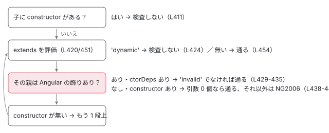

[目次](../README.md) › [hostDirectives と継承（features）](README.md) › 第 3 回 / 全 6 回

# 継承のコンパイル：usesInheritance、飾りのない親、ɵfac の受け継ぎ

> ngtsc・部分コンパイル・リンカー・JIT が usesInheritance を「extends がある」だけで決める行、飾りのない親が Angular の機能を使うときの NG2007 と、findInheritedCtor が親のコンストラクタをたどって NG2006 を出す行、子にコンストラクタが無いときの ɵfac、JIT が飾りのない親に def を付ける addDirectiveDefToUndecoratedParents と、新しい本家の修正 2adfdf0f73b（作業木で前後を走らせる）。compiler-cli 22.1.6 で 9 つの書き方をコンパイルした記録を再生する。

angular/angular · 読了 約 13 分 · 発展 · [サイトで読む（デモが動きます）](https://angular-deep-dive-cyan.vercel.app/chapter/hdi-inherit-compile)

---

[第 2 回](02-hdi-inherit-runtime.md)の `ɵɵInheritDefinitionFeature` は、コンパイラが `usesInheritance` を立てたときだけ出ます。この章では、ngtsc・部分コンパイル・JIT のそれぞれが `usesInheritance` をどの行で決めるか、飾りのない親が原因で出る 2 つの診断（NG2007 と NG2006）がどの行で出るか、子にコンストラクタが無いときの `ɵfac` の形、そして新しい本家に入った JIT の修正 2adfdf0f73b を、作業木で前後を走らせて確かめます。

読む対象は `packages/compiler-cli/src/ngtsc/annotations/directive/src/shared.ts`・`annotations/common/src/diagnostics.ts`、`packages/compiler/src/render3/partial/directive.ts`・`jit_compiler_facade.ts`、リンカーの `partial_directive_linker_1.ts`、`packages/core/src/render3/jit/directive.ts` です。ngtsc が @Directive を解析する流れ全体は [ngtsc の @Directive ハンドラ](../ngtsc/09-ngtsc-directive-handler.md)で読んだので、ここでは継承に関係する行だけを読みます。

1. [1. features の並びと実行](01-hdi-features-pipeline.md)
2. [2. 継承の実行時](02-hdi-inherit-runtime.md)
3. **3. 継承のコンパイル**（この章）
4. [4. host directive の重複の解消](04-hdi-host-dedupe.md)
5. [5. providers と入出力](05-hdi-host-providers-bindings.md)
6. [6. spec と issue](06-hdi-tests-issues.md)

> [!TIP]
> **新卒エンジニアへ**
>
> 「飾りのない（undecorated）クラス」は、`@Directive` も `@Component` も `@Injectable` も付いていないクラスです。Angular はそのクラスの def も `ɵfac` も作りません。継承の話で問題になるのは、いつもこの「def の無い親」です。

## 1. usesInheritance は「extends がある」だけ

📄 `angular/packages/compiler-cli/src/ngtsc/annotations/directive/src/shared.ts` L405–416 （▶ の行: 410–411）

```ts
405 │       throw createValueHasWrongTypeError(expr, resolved, `signals flag must be a boolean`);
406 │     }
407 │     isSignal = resolved;
408 │   }
409 │ 
410 ▶   // Detect if the component inherits from another class
411 ▶   const usesInheritance = reflector.hasBaseClass(clazz);
412 │   const sourceFile = clazz.getSourceFile();
413 │   const type = wrapTypeReference(clazz);
414 │ 
415 │   const rawHostDirectives = directive.get('hostDirectives') || null;
416 │   const hostDirectives =
```

411 行目、`reflector.hasBaseClass(clazz)`。これは `extends` の句があるかどうかだけを見ます（[ngtsc の反射](../ngtsc/04-ngtsc-reflection.md)で引用済みの `getBaseClassExpression`）。親が何であるか（def を持つか、そもそもクラスか）は見ません。だから `extends withChanges(Plain)` のように関数の呼び出しを継承しても、`usesInheritance` は真になり、`ɵɵInheritDefinitionFeature` が出ます（DEMO の 8 番目）。親の def の有無は、実行時に第 2 回で読んだ `Object.hasOwn` の行が確かめます。

### 部分コンパイルとリンカー

ライブラリを `compilationMode: 'partial'` でビルドすると、def の代わりに `ɵɵngDeclareDirective({...})` という宣言を出し、アプリのビルドでリンカーが def に直します。

📄 `angular/packages/compiler/src/render3/partial/directive.ts` L85–96 （▶ の行: 89–90, 93–94）

```ts
85 │   if (meta.exportAs !== null) {
86 │     definitionMap.set('exportAs', asLiteral(meta.exportAs));
87 │   }
88 │ 
89 ▶   if (meta.usesInheritance) {
90 ▶     definitionMap.set('usesInheritance', o.literal(true));
91 │   }
92 │ 
93 ▶   if (meta.lifecycle.usesOnChanges) {
94 ▶     definitionMap.set('usesOnChanges', o.literal(true));
95 │   }
96 │ 
```

📄 `angular/packages/compiler-cli/linker/src/file_linker/partial_linkers/partial_directive_linker_1.ts` L98–112 （▶ の行: 101–102, 108）

```ts
 98 │     exportAs: metaObj.has('exportAs')
 99 │       ? metaObj.getArray('exportAs').map((entry) => entry.getString())
100 │       : null,
101 ▶     lifecycle: {
102 ▶       usesOnChanges: metaObj.has('usesOnChanges') ? metaObj.getBoolean('usesOnChanges') : false,
103 │     },
104 │     controlCreate: metaObj.has('controlCreate')
105 │       ? toControlCreate(metaObj.getObject('controlCreate'))
106 │       : null,
107 │     name: typeName,
108 ▶     usesInheritance: metaObj.has('usesInheritance') ? metaObj.getBoolean('usesInheritance') : false,
109 │     isStandalone: metaObj.has('isStandalone')
110 │       ? metaObj.getBoolean('isStandalone')
111 │       : getDefaultStandaloneValue(version),
112 │     isSignal: metaObj.has('isSignal') ? metaObj.getBoolean('isSignal') : false,
```

📄 `angular/packages/compiler/src/jit_compiler_facade.ts` L600–614 （▶ の行: 608, 610–611）

```ts
600 │     inputs: declaration.inputs ? inputsPartialMetadataToInputMetadata(declaration.inputs) : {},
601 │     outputs: declaration.outputs ?? {},
602 │     host: convertHostDeclarationToMetadata(declaration.host),
603 │     queries: (declaration.queries ?? []).map(convertQueryDeclarationToMetadata),
604 │     viewQueries: (declaration.viewQueries ?? []).map(convertQueryDeclarationToMetadata),
605 │     providers:
606 │       declaration.providers !== undefined ? new WrappedNodeExpr(declaration.providers) : null,
607 │     exportAs: declaration.exportAs ?? null,
608 ▶     usesInheritance: declaration.usesInheritance ?? false,
609 │     controlCreate: declaration.controlCreate ?? null,
610 ▶     lifecycle: {usesOnChanges: declaration.usesOnChanges ?? false},
611 ▶     deps: null,
612 │     typeArgumentCount: 0,
613 │     isStandalone:
614 │       declaration.isStandalone ?? getJitStandaloneDefaultForVersion(declaration.version),
```

1. **partial/directive.ts 89〜91 行目：真のときだけ書く**

   `usesInheritance: true` を宣言に入れ、偽なら書きません。93〜95 行目の `usesOnChanges` も同じ形です。
2. **リンカー 108 行目：無ければ false**

   宣言から `usesInheritance` を読み直し、`R3DirectiveMetadata` に戻します。102 行目の `usesOnChanges` も同じです。あとは [第 1 回](01-hdi-features-pipeline.md)の `addFeatures` が features を積みます。
3. **jit\_compiler\_facade.ts 608 行目：JIT で宣言を読むときも同じ**

   宣言を実行時に JIT で直すとき（リンカーを通さなかったとき）も、608 行目で同じ規則です。611 行目の `deps: null` はディレクティブのメタデータの欄で、`ɵfac` は別の宣言（`ɵɵngDeclareFactory`）から作られます。

## 2. 飾りのない親が Angular の機能を使う：NG2007

親が飾りのないまま `@Input` などのデコレーターや `ngOnChanges` などのフックを使うと、**親のクラスの名前の位置に** NG2007（Class is using Angular features but is not decorated）が出ます。ハンドラがデコレーターの無いクラスも「8 つのデコレーターか 8 つのフックを使っていれば」拾い、解析の代わりにこの診断だけを返す仕組みは、[ngtsc の @Directive ハンドラ](../ngtsc/09-ngtsc-directive-handler.md)の 2 節で読みました。DEMO の 6 番目で、診断が親の 3 行目に付くことを見ます。

この診断が見るのは**クラスの宣言**だけです。関数の中で `return class extends Base { ngOnChanges() {} }` と書くクラス式は拾われないので、DEMO の 8 番目のとおり診断は 0 件で、子の `usesOnChanges`（子自身のメソッドだけを見る）も偽になり、features は `ɵɵInheritDefinitionFeature` だけです。この形が本番ビルドで何を起こすかは[第 1 回](01-hdi-features-pipeline.md)の 5 節に書きました。

## 3. 親のコンストラクタを受け継ぐ：NG2006

もう 1 つは、**子にコンストラクタが無く**、受け継ぐコンストラクタが飾りのない親にあるときです。ディレクティブとコンポーネントのハンドラは、解析を終えたあとで `getDirectiveDiagnostics` を呼びます。

📄 `angular/packages/compiler-cli/src/ngtsc/annotations/common/src/diagnostics.ts` L186–201 （▶ の行: 187–188, 191–192, 197–198）

```ts
186 │ 
187 ▶   if (duplicateDeclarations !== null) {
188 ▶     addDiagnostics(makeDuplicateDeclarationError(node, duplicateDeclarations, kind));
189 │   }
190 │ 
191 ▶   addDiagnostics(
192 ▶     checkInheritanceOfInjectable(
193 │       node,
194 │       injectableRegistry,
195 │       reflector,
196 │       evaluator,
197 ▶       strictInjectionParameters,
198 ▶       kind,
199 │     ),
200 │   );
201 │   return diagnostics;
```

187〜189 行目は同じクラスが 2 つの NgModule で宣言されたときの診断で、継承とは関係ありません。191〜200 行目の `checkInheritanceOfInjectable` が継承の検査で、その本体（「受け継ぐコンストラクタが無ければ何もしない」「飾りのない親なら NG2006」「.d.ts の親なら見逃す」「`strictInjectionParameters` が偽なら見逃す」）は [ngtsc の @Directive ハンドラ](../ngtsc/09-ngtsc-directive-handler.md)の 5 節で読みました。ここでは、その最初に呼ばれる `findInheritedCtor` を読みます。

📄 `angular/packages/compiler-cli/src/ngtsc/annotations/common/src/diagnostics.ts` L399–425 （▶ の行: 399–402, 411, 414, 420, 422–424）

```ts
399 ▶ interface ClassWithCtor {
400 ▶   ref: Reference<ClassDeclaration>;
401 ▶   isCtorValid: boolean;
402 ▶   isDecorated: boolean;
403 │ }
404 │ 
405 │ export function findInheritedCtor(
406 │   node: ClassDeclaration,
407 │   injectableRegistry: InjectableClassRegistry,
408 │   reflector: ReflectionHost,
409 │   evaluator: PartialEvaluator,
410 │ ): ClassWithCtor | null {
411 ▶   if (!reflector.isClass(node) || reflector.getConstructorParameters(node) !== null) {
412 │     // We should skip nodes that aren't classes. If a constructor exists, then no base class
413 │     // definition is required on the runtime side - it's legal to inherit from any class.
414 ▶     return null;
415 │   }
416 │ 
417 │   // The extends clause is an expression which can be as dynamic as the user wants. Try to
418 │   // evaluate it, but fall back on ignoring the clause if it can't be understood. This is a View
419 │   // Engine compatibility hack: View Engine ignores 'extends' expressions that it cannot understand.
420 ▶   let baseClass = readBaseClass(node, reflector, evaluator);
421 │ 
422 ▶   while (baseClass !== null) {
423 ▶     if (baseClass === 'dynamic') {
424 ▶       return null;
425 │     }
```

📄 `angular/packages/compiler-cli/src/ngtsc/annotations/common/src/diagnostics.ts` L426–455 （▶ の行: 427–429, 433–434, 438–439, 444–445, 451, 454）

```ts
426 │ 
427 ▶     const injectableMeta = injectableRegistry.getInjectableMeta(baseClass.node);
428 ▶     if (injectableMeta !== null) {
429 ▶       if (injectableMeta.ctorDeps !== null) {
430 │         // The class has an Angular decorator with a constructor.
431 │         return {
432 │           ref: baseClass,
433 ▶           isCtorValid: injectableMeta.ctorDeps !== 'invalid',
434 ▶           isDecorated: true,
435 │         };
436 │       }
437 │     } else {
438 ▶       const baseClassConstructorParams = reflector.getConstructorParameters(baseClass.node);
439 ▶       if (baseClassConstructorParams !== null) {
440 │         // The class is not decorated, but it does have constructor. An undecorated class is only
441 │         // allowed to have a constructor without parameters, otherwise it is invalid.
442 │         return {
443 │           ref: baseClass,
444 ▶           isCtorValid: baseClassConstructorParams.length === 0,
445 ▶           isDecorated: false,
446 │         };
447 │       }
448 │     }
449 │ 
450 │     // Go up the chain and continue
451 ▶     baseClass = readBaseClass(baseClass.node, reflector, evaluator);
452 │   }
453 │ 
454 ▶   return null;
455 │ }
```

1. **411〜415 行目：子が自分のコンストラクタを持てば、何も調べない**

   `getConstructorParameters(node) !== null`、つまり子に `constructor` が書いてあれば `null`。412〜413 行目のコメント「コンストラクタがあれば、実行時に親の定義は要らない。どんなクラスを継承してもよい」。DEMO の 5 番目です。
2. **420・422〜425 行目：extends を評価して、たどれなければあきらめる**

   `readBaseClass`（[同じ章](../ngtsc/09-ngtsc-directive-handler.md)で引用済み）が、`extends` の式を部分評価して、クラスへの参照か `'dynamic'` を返します。`'dynamic'`（関数の呼び出しの結果など）なら 424 行目で `null`、つまり検査をしません。mixin の子が NG2006 にならないのはこのためです。
3. **427〜436 行目：Angular のデコレーターが付いた親で、コンストラクタの情報があれば、そこで止まる**

   `injectableRegistry` は、`@Injectable`・`@Directive`・`@Component`・`@Pipe` の付いたクラスを覚えています。433 行目、コンストラクタの依存が `'invalid'`（注入できない引数）でなければ正しい、434 行目で「飾りあり」。
4. **438〜447 行目：飾りのない親にコンストラクタがあれば、そこで止まる**

   444 行目、**引数が 0 個のときだけ**正しい、445 行目で「飾りなし」。引数が 0 個なら、親の ɵfac が無くても `new` できるからです（DEMO の 4 番目）。
5. **451 行目：どちらでもなければ、もう 1 つ上へ**

   コンストラクタを持たない飾りのないクラスは素通りします。祖父母のコンストラクタも見つかります（DEMO の 3 番目）。454 行目、根まで無ければ `null` です。



*findInheritedCtor の判断。子にコンストラクタが無いときだけ、extends を 1 段ずつ上がり、最初にコンストラクタを持つクラスで止まる。*

📄 `angular/packages/compiler-cli/src/ngtsc/annotations/common/src/diagnostics.ts` L474–491 （▶ の行: 480–481, 484–489）

```ts
474 │ function getInheritedUndecoratedCtorDiagnostic(
475 │   node: ClassDeclaration,
476 │   baseClass: Reference,
477 │   kind: 'Directive' | 'Component' | 'Pipe' | 'Injectable',
478 │ ) {
479 │   const baseClassName = baseClass.debugName;
480 ▶   const baseNeedsDecorator =
481 ▶     kind === 'Component' || kind === 'Directive' ? 'Directive' : 'Injectable';
482 │ 
483 │   return makeDiagnostic(
484 ▶     ErrorCode.DIRECTIVE_INHERITS_UNDECORATED_CTOR,
485 ▶     node.name,
486 ▶     `The ${kind.toLowerCase()} ${node.name.text} inherits its constructor from ${baseClassName}, ` +
487 ▶       `but the latter does not have an Angular decorator of its own. Dependency injection will not be able to ` +
488 ▶       `resolve the parameters of ${baseClassName}'s constructor. Either add a @${baseNeedsDecorator} decorator ` +
489 ▶       `to ${baseClassName}, or add an explicit constructor to ${node.name.text}.`,
490 │   );
491 │ }
```

`isDecorated: false` で `isCtorValid: false` なら、この関数の診断です。484 行目の `DIRECTIVE_INHERITS_UNDECORATED_CTOR` が NG2006、485 行目のとおり診断は**子のクラスの名前**に付きます。480〜481 行目、ディレクティブとコンポーネントには「親に @Directive を付けよ」、それ以外には「@Injectable を付けよ」と書き分けます。488〜489 行目、直し方は「親にデコレーターを付ける」か「子にコンストラクタを書く」の 2 つです。

## 4. 子にコンストラクタが無いときの ɵfac

NG2006 にならずに通った場合、子の `ɵfac` は、子にコンストラクタが無ければ `ɵɵgetInheritedFactory(Child)` を 1 回だけ呼んで覚える形、あれば自分の引数を `ɵɵdirectiveInject` する形になります。ngtsc がコンストラクタの無い子の依存を `null` にし、compiler がそれを見て `ɵɵgetInheritedFactory` を出し、実行時にそれが親の `ɵfac` を探す流れは [ɵfac の作られ方](../di/04-di-factory.md)の 1 節と 6 節で読みました。DEMO の 1・4・7・8 番目が前の形、5 番目が後の形です。部分コンパイル（9 番目）では `ɵɵngDeclareFactory({ deps: null })` と書かれます。

## 5. JIT：extendsDirectlyFromObject と、飾りのない親に def を付ける

JIT（`TestBed` や、AOT を使わないビルド）では、`@Directive` のデコレーターが実行時に `compileDirective` を呼び、`ɵdir` と `ɵfac` の getter をクラスに付けます（[@Component 実行の瞬間](../standalone/02-standalone-decorator.md)）。継承に関係するのは次の行です。

📄 `angular/packages/core/src/render3/jit/directive.ts` L344–373 （▶ の行: 347–348, 350, 356, 360, 371–372）

```ts
344 │ function addDirectiveFactoryDef(type: Type<any>, metadata: Directive | Component) {
345 │   let ngFactoryDef: any = null;
346 │ 
347 ▶   Object.defineProperty(type, NG_FACTORY_DEF, {
348 ▶     get: () => {
349 │       if (ngFactoryDef === null) {
350 ▶         const meta = getDirectiveMetadata(type, metadata);
351 │         const compiler = getCompilerFacade({
352 │           usage: JitCompilerUsage.Decorator,
353 │           kind: 'directive',
354 │           type,
355 │         });
356 ▶         ngFactoryDef = compiler.compileFactory(angularCoreEnv, `ng:///${type.name}/ɵfac.js`, {
357 │           name: meta.metadata.name,
358 │           type: meta.metadata.type,
359 │           typeArgumentCount: 0,
360 ▶           deps: reflectDependencies(type),
361 │           target: compiler.FactoryTarget.Directive,
362 │         });
363 │       }
364 │       return ngFactoryDef;
365 │     },
366 │     // Make the property configurable in dev mode to allow overriding in tests
367 │     configurable: !!ngDevMode,
368 │   });
369 │ }
370 │ 
371 ▶ export function extendsDirectlyFromObject(type: Type<any>): boolean {
372 ▶   return Object.getPrototypeOf(type.prototype) === Object.prototype;
373 │ }
```

📄 `angular/packages/core/src/render3/jit/directive.ts` L332–342 （▶ の行: 336, 338–339）

```ts
332 │ function getDirectiveMetadata(type: Type<any>, metadata: Directive) {
333 │   const name = type && type.name;
334 │   const sourceMapUrl = `ng:///${name}/ɵdir.js`;
335 │   const compiler = getCompilerFacade({usage: JitCompilerUsage.Decorator, kind: 'directive', type});
336 ▶   const facade = directiveMetadata(type as ComponentType<any>, metadata);
337 │   facade.typeSourceSpan = compiler.createParseSourceSpan('Directive', name, sourceMapUrl);
338 ▶   if (facade.usesInheritance) {
339 ▶     addDirectiveDefToUndecoratedParents(type);
340 │   }
341 │   return {metadata: facade, sourceMapUrl};
342 │ }
```

1. **371〜373 行目：extendsDirectlyFromObject**

   `Object.getPrototypeOf(type.prototype) === Object.prototype`、つまり「`extends` していない」。`directiveMetadata` は `usesInheritance: !extendsDirectlyFromObject(type)` とします（[NgModule の概観](../ngmodule/01-ngmodule.md)で引用済みの行）。ngtsc の 411 行目と同じく、親が何かは見ません。
2. **338〜339 行目：継承していれば、飾りのない親に def を付けに行く**

   `getDirectiveMetadata` は `ɵdir` の getter からも、348〜350 行目の `ɵfac` の getter からも呼ばれます。ɵfac の依存は 360 行目で `reflectDependencies(type)`、つまり実行時に反射で集めます（[パイプの def](../pipe/02-pipe-class-def.md)の JIT と同じ形）。AOT の `ɵɵgetInheritedFactory` は使いません。

📄 `angular/packages/core/src/render3/jit/directive.ts` L414–434 （▶ の行: 415, 419, 422, 425–428, 430, 432）

```ts
414 │ /**
415 ▶  * Adds a directive definition to all parent classes of a type that don't have an Angular decorator.
416 │  */
417 │ function addDirectiveDefToUndecoratedParents(type: Type<any>) {
418 │   const objPrototype = Object.prototype;
419 ▶   let parent = Object.getPrototypeOf(type.prototype).constructor;
420 │ 
421 │   // Go up the prototype until we hit `Object`.
422 ▶   while (parent && parent !== objPrototype) {
423 │     // Since inheritance works if the class was annotated already, we only need to add
424 │     // the def if there are no annotations and the def hasn't been created already.
425 ▶     if (
426 ▶       !getDirectiveDef(parent) &&
427 ▶       !getComponentDef(parent) &&
428 ▶       shouldAddAbstractDirective(parent)
429 │     ) {
430 ▶       compileDirective(parent, null);
431 │     }
432 ▶     parent = Object.getPrototypeOf(parent);
433 │   }
434 │ }
```

📄 `angular/packages/core/src/render3/jit/directive.ts` L521–551 （▶ の行: 524–525, 528, 537–543, 545, 550）

```ts
521 │ function shouldAddAbstractDirective(type: Type<any>): boolean {
522 │   const reflect = getReflect();
523 │ 
524 ▶   if (LIFECYCLE_HOOKS.some((hookName) => reflect.hasLifecycleHook(type, hookName))) {
525 ▶     return true;
526 │   }
527 │ 
528 ▶   const propMetadata = reflect.propMetadata(type);
529 │ 
530 │   for (const field in propMetadata) {
531 │     const annotations = propMetadata[field];
532 │ 
533 │     for (let i = 0; i < annotations.length; i++) {
534 │       const current = annotations[i];
535 │       const metadataName = current.ngMetadataName;
536 │ 
537 ▶       if (
538 ▶         isInputAnnotation(current) ||
539 ▶         isContentQuery(current) ||
540 ▶         isViewQuery(current) ||
541 ▶         metadataName === 'Output' ||
542 ▶         metadataName === 'HostBinding' ||
543 ▶         metadataName === 'HostListener'
544 │       ) {
545 ▶         return true;
546 │       }
547 │     }
548 │   }
549 │ 
550 ▶   return false;
551 │ }
```

1. **419・422・432 行目：親をたどる**

   419 行目で `extends` した親のクラスを取り、432 行目で static の鎖を上がります（第 2 回の tip）。
2. **425〜428 行目：def が無く、Angular の機能を使っている親だけ**

   `shouldAddAbstractDirective` は、524 行目でフックを持つか、528〜545 行目で `@Input`・クエリ・`@Output`・`@HostBinding`・`@HostListener` のメタデータを持つかを見ます。AOT の NG2007 の条件とほぼ同じです。当てはまれば 430 行目の `compileDirective(parent, null)` で、**セレクタの無いディレクティブ**として def を付けます。AOT ならエラーにする親を、JIT は黙って直すわけです。
3. **426〜427 行目：getDirectiveDef / getComponentDef で「def が無い」を判定している**

   この 2 つの関数は `type[NG_DIR_DEF] || null` と普通に読むので、第 2 回の tip のとおり、**親の親の def が static の鎖で見えてしまいます**。`Middle extends Base`（Base に def あり）の `Middle` は「def あり」と判定され、430 行目に来ません。`Middle` の `@Input` は def に入りません。

## 6. 新しい本家の修正：2adfdf0f73b

2026-10-07 のコミット 2adfdf0f73b（fix(core): correctly inherit component metadata in JIT undecorated base classes）は、../angular-main（74961c66242）にだけあり、../angular（22.2.0-next.7）にはありません。差分は 2 つです。

📄 `git -C ../angular-main show 2adfdf0f73b -- packages/core/src/render3/jit/directive.ts`

```ts
@@ -423,8 +423,8 @@ function addDirectiveDefToUndecoratedParents(type: Type<any>) {
     // Since inheritance works if the class was annotated already, we only need to add
     // the def if there are no annotations and the def hasn't been created already.
     if (
-      !getDirectiveDef(parent) &&
-      !getComponentDef(parent) &&
+      !Object.hasOwn(parent, NG_DIR_DEF) &&
+      !Object.hasOwn(parent, NG_COMP_DEF) &&
       shouldAddAbstractDirective(parent)
     ) {
       compileDirective(parent, null);
```

📄 `git -C ../angular-main show 2adfdf0f73b -- packages/core/src/render3/features/inherit_definition_feature.ts`

```ts
@@ -59,7 +59,9 @@ export function ɵɵInheritDefinitionFeature(
     if (isComponentDef(definition)) {
       superDef = cmpDef ?? dirDef;
     } else {
-      if (cmpDef) {
+      // Abstract directives (and undecorated base classes compiled as such)
+      // may extend components without throwing.
+      if (cmpDef && definition.selectors && definition.selectors.length > 0) {
         throw new RuntimeError(
           RuntimeErrorCode.INVALID_INHERITANCE,
           ngDevMode &&
@@ -68,7 +70,7 @@ export function ɵɵInheritDefinitionFeature(
             )} is attempting to extend component ${stringifyForError(superType)}`,
         );
       }
-      superDef = dirDef;
+      superDef = cmpDef ?? dirDef;
     }
 
     if (superDef) {
@@ -96,12 +98,10 @@ export function ɵɵInheritDefinitionFeature(
         fillProperties(definition.outputs, superDef.outputs);
 
         // Merge animations metadata.
-        // If `superDef` is a Component, the `data` field is present (defaults to an empty object).
-        if (isComponentDef(superDef) && superDef.data.animation) {
-          // If super def is a Component, the `definition` is also a Component, since Directives can
-          // not inherit Components (we throw an error above and cannot reach this code).
-          const defData = (definition as ComponentDef<any>).data;
-          defData.animation = (defData.animation || []).concat(superDef.data.animation);
+        const superAnimation = (superDef as ComponentDef<any>).data?.animation;
+        if (superAnimation) {
+          const defData = ((definition as Writable<ComponentDef<any>>).data ??= {});
+          defData.animation = (defData.animation || []).concat(superAnimation);
         }
       }
```

1. **jit/directive.ts：Object.hasOwn で「その親自身の def」を見る**

   5 節の 426〜427 行目を `Object.hasOwn(parent, NG_DIR_DEF)` / `NG_COMP_DEF` に替えます。第 2 回の e6953793542 と同じ考え方を、JIT の側にも入れたものです。
2. **inherit\_definition\_feature.ts：セレクタの無いディレクティブはコンポーネントを継承してよい**

   飾りのない `Middle` が `Base`（コンポーネント）を継承していると、JIT が `Middle` に付けるのは**ディレクティブ**の def なので、第 2 回で読んだ NG0903（Directives cannot inherit Components）になります。そこで例外の条件に `definition.selectors.length > 0` を足し、`superDef = cmpDef ?? dirDef` にします。アニメーションの行も、子がディレクティブの def のときに `data` を作るよう書き換わっています。

このコミットが spec に足した it は 1 つだけで、`should inherit animations when intermediate class is an abstract directive`（`@Directive()` の中間のクラスがコンポーネントを継承し、その子のコンポーネントに親のアニメーションが届く）です。ほかは `inherit_definition_feature_spec.ts` の既存の it の書き換えで、`standalone: false` と `TestBed.configureTestingModule({ declarations: [...] })` を `imports: [...]` にしています。../angular-main ではその直前のテストの書き直し（ecbc89b465c）で、standalone にすると落ちる it に「TODO: Investigate why making this test standalone is breaking it.」が 12 か所付いていて、このコミットがそれを全部消しました。../angular の同じ it は、declarations に飾りのない中間のクラスまで並べる NgModule の形で、第 2 回の実行（117 specs, 0 failures）で通っています。

### 作業木で前後を走らせる

../angular と同じ 8576f161ae4 の作業木に、standalone の形の it を 2 つ足して走らせ、次に 2adfdf0f73b の src の差分（上の 2 つ）だけを当てて、もう一度走らせました。

📄 `作業木に足した it（前半の 2 つ）`

```
// packages/core/test/acceptance/hdi_a_experiments_spec.ts（作業木に足した spec の前半）
  it('jit: bare class between two directives keeps its @Input (standalone)', () => {
    @Directive({selector: '[super-dir]'})
    class SuperSuperDirective {
      @Input() foo = '';
    }
    class SuperDirective extends SuperSuperDirective {
      @Input() bar = '';
    }
    @Directive({selector: '[sub-dir]'})
    class SubDirective extends SuperDirective {
      @Input() qux = '';
    }
    @Component({template: `<p sub-dir [foo]="'a'" [bar]="'b'" [qux]="'d'"></p>`, imports: [SubDirective]})
    class App {}
    const fixture = TestBed.createComponent(App);
    fixture.detectChanges();
    const sub = fixture.debugElement.query(By.directive(SubDirective)).injector.get(SubDirective);
    expect(Object.hasOwn(SuperDirective, 'ɵdir')).withContext('own ɵdir on bare class').toBe(true);
    expect(Object.keys(getDirectiveDef(SubDirective)!.inputs).sort()).toEqual(['bar', 'foo', 'qux']);
    expect([sub.foo, sub.bar, sub.qux]).toEqual(['a', 'b', 'd']);
  });

  it('jit: bare class extending a component keeps its @Input', () => {
    @Component({selector: 'base-cmp', template: 'base'})
    class BaseComponent {
      @Input() foo = '';
    }
    class Middle extends BaseComponent {
      @Input() bar = '';
    }
    @Component({selector: 'child-cmp', template: '{{ foo }}/{{ bar }}'})
    class ChildComponent extends Middle {}
    @Component({template: `<child-cmp [foo]="'a'" [bar]="'b'" />`, imports: [ChildComponent]})
    class App {}
    const fixture = TestBed.createComponent(App);
    fixture.detectChanges();
    expect(Object.keys(getComponentDef(ChildComponent)!.inputs).sort()).toEqual(['bar', 'foo']);
    expect(fixture.nativeElement.textContent).toBe('a/b');
  });
```

| 作業木の src | 結果 | 中身 |
| --- | --- | --- |
| 8576f161ae4 のまま | 2 specs, 2 failures | `bare class between two directives: own ɵdir on bare class: Expected false to be true. ／ Expected $[1] = '' to equal 'b'. bare class extending a component: Expected $.length = 1 to equal 2. ／ Expected 'a/' to be 'a/b'.` |
| 2adfdf0f73b の src の差分（上の 2 つ）を当てる | 0 failures | `3 specs, 0 failures（3 つ目は第 2 回の it）` |

1 つ目の it は、`SuperDirective` に自分の `ɵdir` が付かず（`own ɵdir on bare class: Expected false to be true`）、`bar` が入力にならずに `''` のままでした。2 つ目の it は、`ChildComponent` の入力が `foo` だけで、画面は `a/` でした。差分を当てると両方とも通りました。このサイトの @angular/core 22.1.6 の JIT でも同じで、DEMO の下の表の 2 つの結果がそれです（TestBed なしで、getter を読むだけ）。

> **🧪 DEMO — 継承の書き方を変えてコンパイルした結果（記録の再生）**
>
> これは記録です。@angular/compiler-cli 22.1.6 / TypeScript 6.0.3 を Node で動かし、[ngtsc の全体像](../ngtsc/01-ngtsc-overview.md)と同じ `readConfiguration` → `performCompilation` の順に、9 つの小さなプロジェクトを 1 つずつコンパイルしました。`angularCompilerOptions` は `strictInjectionParameters: true`（このサイトと同じ）です。ブラウザでは何もコンパイルしません。
>
> 「記録を再生する」を押すと、書き方ごとのボタンが出ます。
>
> ▶ [このデモはサイトで動かせます](https://angular-deep-dive-cyan.vercel.app/chapter/hdi-inherit-compile)

記録の 9 つを表にまとめます（本番ビルドで再生し、9 つのボタンを全部押して、コンソールのエラーは 0 件でした）。

| # | 書き方 | 診断 | 子の ɵfac |
| --- | --- | --- | --- |
| 1 | 親が `@Directive()`・コンストラクタに引数、子はコンストラクタなし | なし | `ɵɵgetInheritedFactory` |
| 2 | 親は飾りなし・コンストラクタに引数 | NG2006（子の 9 行目） | emit されない |
| 3 | 祖父母が飾りなし・引数あり、親は飾りなし・コンストラクタなし | NG2006（子の 11 行目、メッセージは GrandParent） | emit されない |
| 4 | 親は飾りなし・引数 0 個のコンストラクタ | なし（444 行目） | `ɵɵgetInheritedFactory` |
| 5 | 親は飾りなし・引数あり、子が自分のコンストラクタ | なし（411 行目） | `new (...)(ɵɵdirectiveInject(Svc))` |
| 6 | 親は飾りなしで `@Input` | NG2007（親の 3 行目） | emit されない |
| 7 | 親は飾りなし・機能もコンストラクタも無い | なし | `ɵɵgetInheritedFactory` |
| 8 | `extends withChanges(Plain)`（クラス式） | なし（424 行目） | `ɵɵgetInheritedFactory`、features は Inherit だけ |
| 9 | 1 を部分コンパイル | なし | `ɵɵngDeclareFactory({ deps: null })`、宣言に `usesInheritance: true` |

## ここまでの呼び出し

- 👤 `@Directive({ selector: '[child]' }) class Child extends Parent {}` — あなたのコード
  - `extractDirectiveMetadata()` — annotations/directive/src/shared.ts L411 — *usesInheritance = hasBaseClass*
  - `DirectiveDecoratorHandler.analyze()` — annotations/directive/src/handler.ts — *親が飾りなしで機能を使えば、親に NG2007*
  - `getDirectiveDiagnostics()` — annotations/common/src/diagnostics.ts L191
    - `checkInheritanceOfInjectable() → findInheritedCtor()` — diagnostics.ts L405 — *子にコンストラクタが無ければ親をたどる*
      - `getInheritedUndecoratedCtorDiagnostic()` — diagnostics.ts L474 — *NG2006、子に付く*
  - `compileFactoryFunction()` — compiler/src/render3/r3\_factory.ts — *deps が null なら ɵɵgetInheritedFactory（di-factory）*
  - `addFeatures()` — compiler/src/render3/view/compiler.ts — *ɵɵInheritDefinitionFeature（第 1 回）*
  - `compileDeclareDirectiveFromMetadata()` — compiler/src/render3/partial/directive.ts L89 — *部分コンパイルなら usesInheritance: true → リンカー L108*
- 👤 `JIT：@Directive(...) が実行される` — core/src/render3/jit/directive.ts
  - `getDirectiveMetadata()` — jit/directive.ts L332 — *usesInheritance = !extendsDirectlyFromObject*
    - `addDirectiveDefToUndecoratedParents()` — jit/directive.ts L417 — *def が無く機能を使う親に compileDirective(parent, null)*

## テストと直し方

### spec と it

| ファイル | describe / it | 行 | この章のどこ |
| --- | --- | --- | --- |
| compiler-cli/test/ngtsc/ngtsc\_spec.ts | `inherited directives` の 11 個（`should error when inheriting a constructor from an undecorated class` など） | 9159〜9517 | 3 節 |
| 同上 | `should give a compile-time error when a derived Directive inherits from a non-decorated class`（`strictInjectionParameters` が真と偽） | 4299・4527 | 3 節 |
| 同上 | `should give a compile-time error when a derived Directive / Injectable inherits an invalid constructor` ほか | 4157・4215・4440・4476 | 3 節の 433 行目 |
| 同上 | `undecorated classes using Angular features` | 1745 | 2 節（ngtsc-directive-handler で表にした） |
| compliance/test\_cases/r3\_compiler\_compliance/components\_and\_directives | `should support abstract directives`（abstract\_directive.js の 19 行目が `ɵɵgetInheritedFactory`、GOLDEN\_PARTIAL.js の 753 行目が `usesInheritance: true`） | TEST\_CASES.json 168 | 1・4 節 |

📄 `angular/packages/compiler-cli/test/ngtsc/ngtsc_spec.ts` L9287–9313 （▶ の行: 9293, 9298, 9304, 9307–9312）

```ts
9287 │       it('should error when inheriting a constructor from an undecorated class', () => {
9288 │         env.tsconfig();
9289 │         env.write(
9290 │           'test.ts',
9291 │           `
9292 │           import {Directive, Component} from '@angular/core';
9293 ▶           import {BasePlainWithConstructorParameters} from './local';
9294 │ 
9295 │           @Directive({
9296 │             selector: '[dir]',
9297 │           })
9298 ▶           export class Dir extends BasePlainWithConstructorParameters {}
9299 │ 
9300 │           @Component({
9301 │             selector: 'test-cmp',
9302 │             template: 'TestCmp',
9303 │           })
9304 ▶           export class Cmp extends BasePlainWithConstructorParameters {}
9305 │         `,
9306 │         );
9307 ▶         const diags = env.driveDiagnostics();
9308 ▶         expect(diags.length).toBe(2);
9309 ▶         expect(diags[0].messageText).toContain('Dir');
9310 ▶         expect(diags[0].messageText).toContain('BasePlainWithConstructorParameters');
9311 ▶         expect(diags[1].messageText).toContain('Cmp');
9312 ▶         expect(diags[1].messageText).toContain('BasePlainWithConstructorParameters');
9313 │       });
```

9293 行目の `BasePlainWithConstructorParameters` は、この describe の `beforeEach` が `local.ts` に書く「飾りのない・引数のあるコンストラクタを持つ」クラスです。9298 行目のディレクティブと 9304 行目のコンポーネントの両方が受け継ぐので、9308 行目で診断は 2 件、9309〜9312 行目でそれぞれのメッセージに子と親の名前が入ることを確かめます。

### 手元で走らせた結果

📄 `走らせたコマンド`

```
cd ~/angular-research/angular
pnpm bazel test //packages/compiler-cli/test/ngtsc:ngtsc --nocache_test_results --test_output=all \
  "--test_arg=--filter=inherited directives|inherits from a non-decorated class|inherits an invalid constructor"
pnpm bazel test //packages/compiler-cli/test/compliance/full:full --nocache_test_results --test_output=all \
  "--test_arg=--filter=should support abstract directives"
```

../angular（22.2.0-next.7）で、ngtsc は 4 つのシャードで「16 / 19 / 19 / 22 specs, 0 failures」、合わせて 76 specs でした（2026-11-15）。ngtsc\_spec.ts は全体が `runInEachFileSystem`（63 行目）の中にあり、同じ it を OS X・Windows・Unix・本物の 4 つのファイルシステムで 1 回ずつ走らせます。名前に当たる it は ngtsc\_spec.ts の 17 個と template\_typecheck\_spec.ts の 2 個（`should properly type-check inherited directives`…）で、19 × 4 = 76 です。compliance の `should support abstract directives` は第 1 回の実行に含まれていて、通っています。6 節の作業木の実行は a-wt-run1.log と a-wt-run2.log です。

### 直すとしたら

- 5 節の JIT の不具合は、../angular-main では 2adfdf0f73b で直っています。../angular の側で同じことを確かめる it は、6 節の作業木の 2 つの形（standalone で、declarations に中間のクラスを並べない）です。
- `usesInheritance` は「`extends` がある」だけなので、親の def の有無で features を変えたいなら、ngtsc の 411 行目ではなく、`readBaseClass` と `MetadataReader` で親を調べる側（[ngtsc のメタデータ](../ngtsc/10-ngtsc-metadata-registry.md)の `flattenInheritedDirectiveMetadata`）の話になります。
- 2 節のクラス式（mixin）は、NG2007 にも NG2006 にもなりません（424 行目で `'dynamic'`）。これを診断にするなら `findInheritedCtor` と handler の検出の両方で、spec は ngtsc\_spec.ts の `inherited directives` に置く形です。

## 聞かれそうな質問

**Q. 親に @Directive() を付けずに継承すると、必ずエラーになりますか？**

なりません。親が Angular の機能（8 つのデコレーターか 8 つのフック）を使わず、子が受け継ぐコンストラクタも無いか引数 0 個なら通ります（DEMO の 4・7 番目、diagnostics.ts 444 行目）。親が機能を使えば親に NG2007、子が引数のあるコンストラクタを飾りのない親から受け継げば子に NG2006 です（DEMO の 6・2 番目）。

**Q. NG2006 を消すには、どうすればよいですか？**

メッセージ（488〜489 行目）のとおり、親に `@Directive()` を付けるか、子に自分のコンストラクタを書くかです。前者なら 427〜436 行目で「飾りあり」として止まり、後者なら 411 行目で検査そのものが行われません（DEMO の 1・5 番目）。

**Q. usesInheritance は、親に def があるときだけ真になりますか？**

いいえ。ngtsc は shared.ts 411 行目の `hasBaseClass`、JIT は `!extendsDirectlyFromObject`（jit/directive.ts 371〜373 行目）で、どちらも `extends` があるかだけを見ます。親に def が無くても `ɵɵInheritDefinitionFeature` は出て、実行時に何も混ぜずに終わります（DEMO の 7・8 番目）。

**Q. JIT では、飾りのない親の @Input も効くのですか？**

親が `Object` を直接継承していれば効きます。jit/directive.ts 425〜430 行目が、その親にセレクタの無いディレクティブの def を付けるからです。ただし ../angular（22.2.0-next.7）と 22.1.6 では、親のさらに上に def があると 426〜427 行目の判定が static の鎖でその def を見てしまい、親の @Input が入りません。新しい本家の 2adfdf0f73b で `Object.hasOwn` に替わりました（6 節）。

**Q. 子にコンストラクタが無いとき、ɵfac はどうなりますか？**

AOT では `ɵɵgetInheritedFactory(Child)` を 1 回だけ呼んで覚える ɵfac になり、実行時に親の ɵfac を探して子を作ります（[ɵfac の作られ方](../di/04-di-factory.md)）。部分コンパイルでは `ɵɵngDeclareFactory({ deps: null })` です。JIT は jit/directive.ts 360 行目の `reflectDependencies` で依存を集めます。

## 読み終えて

- `usesInheritance` は ngtsc でも JIT でも部分コンパイルでも「`extends` がある」だけ（shared.ts 411 行目・jit/directive.ts 371〜373 行目・partial/directive.ts 89 行目・リンカー 108 行目）
- 飾りのない親が Angular の機能を使えば親に NG2007。飾りのない親の引数のあるコンストラクタを子が受け継げば子に NG2006（`findInheritedCtor` の 438〜447 行目と 484 行目）
- 子が自分のコンストラクタを持てば NG2006 の検査はされず、`extends` の式がたどれない（mixin など）ときも検査されない（411・424 行目）
- JIT は飾りのない親にセレクタの無い def を付けて救うが、22.2.0-next.7 までは判定が static の鎖を見てしまい、中間の親の @Input が落ちる。新しい本家の 2adfdf0f73b で直った（作業木で前後を確かめた）

---

← 前: [継承の実行時：ɵɵInheritDefinitionFeature が親の def を混ぜる](02-hdi-inherit-runtime.md)  
次: [host directive の重複の解消：同じディレクティブが何度も当たるとき](04-hdi-host-dedupe.md) →
