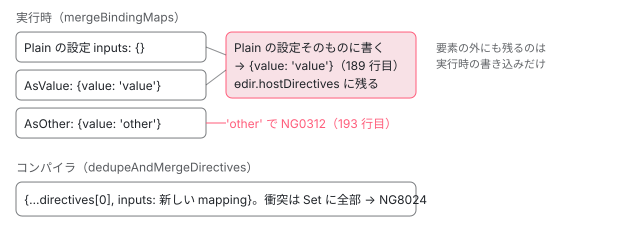

[目次](../README.md) › [hostDirectives と継承（features）](README.md) › 第 4 回 / 全 6 回

# host directive の重複の解消：同じディレクティブが何度も当たるとき

> 同じディレクティブが 1 つの要素に何度も当たるとき、テンプレートで当たったものを残して host directive の分を捨て、host directive どうしは入出力の露出を 1 つに合わせる仕組み（コンパイラは 57432f1b6a8、実行時は 9c55fcb3e65。#57846）。合わせられないときの NG8024（型チェックが降りた要素だけ）と NG0312（開発モードの実行時だけ）の違いと、実行時の合わせた結果が def に残ること。ページの上の本物で作って数え、コンパイラの診断は記録で見る。

angular/angular · 読了 約 13 分 · 発展 · [サイトで読む（デモが動きます）](https://angular-deep-dive-cyan.vercel.app/chapter/hdi-host-dedupe)

---

同じディレクティブが 1 つの要素に何度も当たると、以前は NG0309 で止まっていました。2026 年 4 月の 9c55fcb3e65（実行時）と 57432f1b6a8（コンパイラ）から、Angular は重複を 1 つにまとめます。この章では、「テンプレートで当たったものが勝つ」規則と「host directive どうしは入出力の対応を合わせる」規則が、実行時とコンパイラのどの行にあるかを読み、合わせられないときの 2 つのエラー（NG0312 と NG8024）の出方の違いをページの上の本物と記録で確かめます。

読む対象は `packages/core/src/render3/features/host_directives_feature.ts`（実行時の重複の解消）、`packages/compiler/src/render3/view/t2_binder.ts`（コンパイラの重複の解消）、`packages/compiler/src/typecheck/ops/scope.ts` と `packages/compiler-cli/src/ngtsc/typecheck/src/oob.ts`（NG8024 を出す場所）、`packages/core/test/acceptance/host_directives_spec.ts` の `describe('de-duplication')` です。hostDirectives の大筋（並べ直しの順、`trackHostDirectiveDef` の全体）は [standalone-host-directives](../standalone/10-standalone-host-directives.md) にあり、ここでは繰り返しません。

1. [1. features の並びと実行](01-hdi-features-pipeline.md)
2. [2. 継承の実行時](02-hdi-inherit-runtime.md)
3. [3. 継承のコンパイル](03-hdi-inherit-compile.md)
4. **4. host directive の重複の解消**（この章）
5. [5. providers と入出力](05-hdi-host-providers-bindings.md)
6. [6. spec と issue](06-hdi-tests-issues.md)

## 1. 以前は NG0309 で止まっていた

issue #57846（2024-09-17、「`hostDirectives` should auto-resolve double matching」）は、ライブラリの作者からの要望でした。ボタンの見た目を決める host directive を、ボタンにもドロップダウンの項目にも持たせると、両方を兼ねる部品で同じ host directive が 2 回当たり、「`NG0309: Directives can only match an element once.`」になる、という話です。コメントは 28 件付き、2026-04-03 に PR #67996 の取り込みで閉じられました。PR は 6 つのコミットからなり、そのうち 57432f1b6a8 がコンパイラ、9c55fcb3e65 が実行時です。

NG0309 を投げる関数は、いまも `view/directives.ts` に残っています。

📄 `angular/packages/core/src/render3/view/directives.ts` L568–586 （▶ の行: 570, 574, 577, 579–580）

```ts
568 │ function assertNoDuplicateDirectives(directives: DirectiveDef<unknown>[]): void {
569 │   // The array needs at least two elements in order to have duplicates.
570 ▶   if (directives.length < 2) {
571 │     return;
572 │   }
573 │ 
574 ▶   const seenDirectives = new Set<DirectiveDef<unknown>>();
575 │ 
576 │   for (const current of directives) {
577 ▶     if (seenDirectives.has(current)) {
578 │       throw new RuntimeError(
579 ▶         RuntimeErrorCode.DUPLICATE_DIRECTIVE,
580 ▶         `Directive ${current.type.name} matches multiple times on the same element. ` +
581 │           `Directives can only match an element once.`,
582 │       );
583 │     }
584 │     seenDirectives.add(current);
585 │   }
586 │ }
```

570 行目、2 つ未満なら何もしません。574 行目の `Set` に def を入れていき、577 行目で同じ def が 2 度目に来たら、579 行目の `DUPLICATE_DIRECTIVE`（NG0309）を投げます。この関数は `resolveDirectives` が、`resolveHostDirectives` で並べ直した**あとの**配列に開発モードで呼びます（[ivy-first-create-pass](../ivy/08-ivy-first-create-pass.md) の `resolveDirectives` の引用）。9c55fcb3e65 は `render3/assert.ts` にあった同じ名前の関数（どこからも呼ばれていなかった写し）を消しただけで、こちらは消していません。並べ直しの段階で重複が取り除かれるようになったので、ここに重複が届かなくなった、というのが今の形です。

コミットの本文に書かれた規則は 2 つです。

1. **テンプレートで当たったものが勝つ**

   テンプレートで 1 回当たり、host directive としても当たったディレクティブは、host directive の分を捨てて、テンプレートの 1 つだけを使います。本文の言い方では「host directive として当たったものは `Partial<YourDirective>`、テンプレートで当たったものは `YourDirective` 全体」です。
2. **host directive どうしは入出力の対応を合わせる**

   host directive として何度も当たったものは、各回の inputs / outputs の露出（どの名前で外に見せるか）を 1 つに合わせます。合わせる途中で、同じ入出力が別々の名前で露出されていたら、コンパイラも実行時もエラーにします。

spec から 2 つ見ます。インスタンスの数を数える形です。

📄 `angular/packages/core/test/acceptance/host_directives_spec.ts` L3501–3523 （▶ の行: 3505, 3508, 3512, 3514, 3518, 3522）

```ts
3501 │   describe('de-duplication', () => {
3502 │     it('should de-duplicate a host directive that matches multiple times in a template', () => {
3503 │       let creationCount = 0;
3504 │ 
3505 ▶       @Directive({selector: '[dir]'})
3506 │       class HostDir {
3507 │         constructor() {
3508 ▶           creationCount++;
3509 │         }
3510 │       }
3511 │ 
3512 ▶       @Directive({
3513 │         selector: '[dir]',
3514 ▶         hostDirectives: [HostDir],
3515 │       })
3516 │       class Dir {}
3517 │ 
3518 ▶       @Component({template: '<div dir></div>', imports: [HostDir, Dir]})
3519 │       class App {}
3520 │ 
3521 │       TestBed.createComponent(App);
3522 ▶       expect(creationCount).toBe(1);
3523 │     });
```

3505 行目の `HostDir` は `selector: '[dir]'` を持ち、3512〜3514 行目の `Dir` も `[dir]` で当たって `hostDirectives: [HostDir]` を持ちます。3518 行目の `<div dir>` には、`HostDir` がテンプレートで 1 回、`Dir` の host directive として 1 回当たります。3522 行目、コンストラクタは 1 回しか呼ばれません。

📄 `angular/packages/core/test/acceptance/host_directives_spec.ts` L3560–3589 （▶ の行: 3571, 3575, 3588）

```ts
3560 │     it('should de-duplicate a host directive appears multiple times in a chain', () => {
3561 │       let creationCount = 0;
3562 │ 
3563 │       @Directive()
3564 │       class DuplicateHostDir {
3565 │         constructor() {
3566 │           creationCount++;
3567 │         }
3568 │       }
3569 │ 
3570 │       @Directive({hostDirectives: [DuplicateHostDir]})
3571 ▶       class HostDir {}
3572 │ 
3573 │       @Directive({
3574 │         selector: '[dir]',
3575 ▶         hostDirectives: [HostDir, DuplicateHostDir],
3576 │         standalone: false,
3577 │       })
3578 │       class Dir {}
3579 │ 
3580 │       @Component({
3581 │         template: '<div dir></div>',
3582 │         standalone: false,
3583 │       })
3584 │       class App {}
3585 │ 
3586 │       TestBed.configureTestingModule({declarations: [App, Dir]});
3587 │       TestBed.createComponent(App);
3588 ▶       expect(creationCount).toBe(1);
3589 │     });
```

こちらはテンプレートが絡まない場合です。3571 行目の `HostDir` が `DuplicateHostDir` を持ち、3575 行目の `Dir` が `[HostDir, DuplicateHostDir]` を持つので、`DuplicateHostDir` は鎖の奥と手前の 2 か所から来ます。3588 行目、それでも 1 つです。継承で親の hostDirectives が子に足されて重なる場合（すぐ下の it「should de-duplicate inherited host directives」）も同じ道を通ります。親の hostDirectives が子の def に足される仕組みは[第 2 回](02-hdi-inherit-runtime.md)です。

## 2. 実行時：mergeBindingMaps で露出を合わせる

重複かどうかを決めるのは `trackHostDirectiveDef` の最後の `if` / `else if` です（[standalone-host-directives](../standalone/10-standalone-host-directives.md) の 5 節で引用した範囲）。`hostDirectiveDefs`（この要素で見つかった host directive の def → 露出の設定 の Map）に既にあれば合わせ、テンプレートで当たった def の一覧（`templateMatches`、セレクタ照合の結果そのもの）に入っていれば何もしない、どちらでもなければ Map に登録して並びに足します。合わせる関数が 9c55fcb3e65 で足された `mergeBindingMaps` です。

📄 `angular/packages/core/src/render3/features/host_directives_feature.ts` L177–198 （▶ の行: 182–183, 185, 188–190, 193, 195）

```ts
177 │ function mergeBindingMaps(
178 │   existingDef: HostDirectiveDef,
179 │   newMap: HostDirectiveBindingMap,
180 │   kind: 'input' | 'output',
181 │ ) {
182 ▶   // Note: we don't do something like `existingDef[kind]` to avoid property renaming issues.
183 ▶   const targetMap = kind === 'input' ? existingDef.inputs : existingDef.outputs;
184 │ 
185 ▶   Object.keys(newMap).forEach((publicName) => {
186 │     const alias = newMap[publicName];
187 │ 
188 ▶     if (!Object.hasOwn(targetMap, publicName) || targetMap[publicName] === alias) {
189 ▶       targetMap[publicName] = alias;
190 ▶     } else if (typeof ngDevMode === 'undefined' || ngDevMode) {
191 │       const message =
192 │         `${kind === 'input' ? 'Input' : 'Output'} "${publicName}" from ${existingDef.directive.name} ` +
193 ▶         `is exposed under the following conflicting names: "${targetMap[publicName]}" and "${alias}". ` +
194 │         `An ${kind} can only be exposed under a single name.`;
195 ▶       throw new RuntimeError(RuntimeErrorCode.HOST_DIRECTIVE_CONFLICTING_ALIAS, message);
196 │     }
197 │   });
198 │ }
```

1. **183 行目：書き込む先を選ぶ**

   `existingDef.inputs` か `existingDef.outputs`。182 行目のコメントのとおり、`existingDef[kind]` と書かないのは、本番ビルドのプロパティ名の短縮で `inputs` という名前が残らない場合に備えるためです。
2. **185〜189 行目：まだ無いか、同じ名前なら書く**

   `newMap` のキーは host directive 自身の公開名、値はホストで見せる名前（別名）です。`existing` に無いキーは足し、同じ別名ならそのまま。たとえば片方が何も露出せず（`{}`）、もう片方が `value` を露出していれば、合わせた結果は `{value: 'value'}` です。
3. **190〜195 行目：別の名前なら、開発モードでだけ NG0312**

   193 行目の文は「exposed under the following conflicting names: "A" and "B"」で、2 つの名前だけを挙げます。190 行目の条件に `ngDevMode` が入っているので、**本番ビルドでは投げず、何も書きません**。先に登録された名前がそのまま残ります。

合わせる先の `existing` は、`hostDirectiveDefs` に最初に登録された値です。登録される値は `findHostDirectiveDefs` が渡した設定そのもので、配列で書いた hostDirectives なら `ɵɵHostDirectivesFeature` が def を作るときに作ったオブジェクト（[standalone-host-directives](../standalone/10-standalone-host-directives.md) の 3 節の、配列を `createHostDirectiveDef` に通す行）です。そのため 189 行目の書き込みは、**この要素の間だけでなく、そのディレクティブの `ɵdir.hostDirectives` にも残ります**。4 節の DEMO でこれを数えます。

### 9c55fcb3e65 が一緒に変えた 2 か所

📄 `angular/packages/core/src/util/empty.ts` L17–28 （▶ の行: 17, 21, 25）

```ts
17 ▶ export const EMPTY_OBJ: never = {} as never;
18 │ export const EMPTY_ARRAY: any[] = [];
19 │ 
20 │ // freezing the values prevents any code from accidentally inserting new values in
21 ▶ if ((typeof ngDevMode === 'undefined' || ngDevMode) && initNgDevMode()) {
22 │   // These property accesses can be ignored because ngDevMode will be set to false
23 │   // when optimizing code and the whole if statement will be dropped.
24 │   // tslint:disable-next-line:no-toplevel-property-access
25 ▶   Object.freeze(EMPTY_OBJ);
26 │   // tslint:disable-next-line:no-toplevel-property-access
27 │   Object.freeze(EMPTY_ARRAY);
28 │ }
```

📄 `angular/packages/core/src/render3/features/host_directives_feature.ts` L211–225 （▶ の行: 216, 218, 220, 224）

```ts
211 │ /**
212 │  * Converts an array in the form of `['publicName', 'alias', 'otherPublicName', 'otherAlias']` into
213 │  * a map in the form of `{publicName: 'alias', otherPublicName: 'otherAlias'}`.
214 │  */
215 │ function bindingArrayToMap(bindings: string[] | undefined): HostDirectiveBindingMap {
216 ▶   const result: HostDirectiveBindingMap = {};
217 │ 
218 ▶   if (bindings !== undefined && bindings.length > 0) {
219 │     for (let i = 0; i < bindings.length; i += 2) {
220 ▶       result[bindings[i]] = bindings[i + 1];
221 │     }
222 │   }
223 │ 
224 ▶   return result;
225 │ }
```

以前の `bindingArrayToMap` は、露出が無いとき共有の `EMPTY_OBJ`（empty.ts 17 行目）を返していました。`EMPTY_OBJ` は開発モードでは 25 行目で凍結されているので、`mergeBindingMaps` が書き込むと例外になり、本番では全部の def が 1 つのオブジェクトを共有して書き込みが混ざります。そこで 216 行目で毎回新しい `{}` を作り、218〜222 行目で詰めるように変えました。`createHostDirectiveDef` のクラス参照だけの分岐も、`EMPTY_OBJ` から `{}` に変わっています。

📄 `angular/packages/core/src/render3/features/host_directives_feature.ts` L246–273 （▶ の行: 250, 252–253, 255, 258–259, 261, 263, 270）

```ts
246 │ function patchDeclaredInputs(
247 │   declaredInputs: Record<string, string>,
248 │   exposedInputs: HostDirectiveBindingMap,
249 │ ): void {
250 ▶   for (const publicName in exposedInputs) {
251 │     if (Object.hasOwn(exposedInputs, publicName)) {
252 ▶       const remappedPublicName = exposedInputs[publicName];
253 ▶       const privateName = declaredInputs[publicName];
254 │ 
255 ▶       // We *technically* shouldn't be able to hit this case because we can't have multiple
256 │       // inputs on the same property and we have validations against conflicting aliases in
257 │       // `validateMappings`. If we somehow did, it would lead to `ngOnChanges` being invoked
258 ▶       // with the wrong name so we have a non-user-friendly assertion here just in case.
259 ▶       if (
260 │         (typeof ngDevMode === 'undefined' || ngDevMode) &&
261 ▶         Object.hasOwn(declaredInputs, remappedPublicName)
262 │       ) {
263 ▶         assertEqual(
264 │           declaredInputs[remappedPublicName],
265 │           declaredInputs[publicName],
266 │           `Conflicting host directive input alias ${publicName}.`,
267 │         );
268 │       }
269 │ 
270 ▶       declaredInputs[remappedPublicName] = privateName;
271 │     }
272 │   }
273 │ }
```

`patchDeclaredInputs` は、別名で書き込まれた入力を `ngOnChanges` の `SimpleChanges` のキー（宣言した名前）に戻せるよう、270 行目で `declaredInputs[別名] = 宣言名` を足します。以前は `trackHostDirectiveDef` の中で 1 回ごとに呼んでいましたが、9c55fcb3e65 は呼ぶ場所を `resolveHostDirectives` の最後のループ（[standalone-host-directives](../standalone/10-standalone-host-directives.md) の 4 節の引用の、`hostDirectiveDefs.forEach`）に移しました。コメントは「全部の host directive の入力が合わさってからやる」。合わせる前に呼ぶと、あとで足される別名が漏れるからです。`NgOnChangesFeature` が `declaredInputs` を読む側は[elements-inputs-cd](../elements/05-elements-inputs-cd.md) にあります。

> [!NOTE]
> **さらに深く**
>
> 255〜258 行目のコメントは「同じプロパティに入力は 1 つしか無く、`validateMappings` で別名の衝突も検査しているので、本来ここには来ない」と書いています。ところが、1 つの別名を host directive の**2 つの入力**に当てると来ます。`inputs: ['value: foo', 'second: foo']` と 1 つの設定に書く場合と、`['value: foo']` と `['second: foo']` の 2 つの設定が重複の解消で合わさる場合です。`mergeBindingMaps` も t2 の `mergeMapping` も、鍵が host directive 側の名前（`value` と `second`）なので衝突と見なしません。5 節の記録のとおりコンパイラは診断を出さずに `ɵɵproperty("foo", …)` を出し、実行時は開発モードで 263 行目の `assertEqual` が「ASSERTION ERROR: Conflicting host directive input alias …」を投げます（下の記録。JIT で `a` と `b` の 2 つの入力を `foo` に当てたもの）。本番ビルドでは assert が無いので、270 行目が 2 回目の書き込みで `declaredInputs.foo` を上書きします。この形を使えるようにしてほしいという要望が、開いている #48925（2023-02-02）です。

📄 `手元の記録スクリプト（two-inputs.mjs。@angular/* 22.1.6 の JIT を Node と jsdom で動かす）`

```
// 1 つの別名を host directive の 2 つの入力に当てられるか（#48925 の形）を、1 つの設定と、重複の解消の 2 通りで確かめる
// 使い方: node two-inputs.mjs <angular-deep-dive のディレクトリ>（@angular/* 22.1.6 の JIT と jsdom を使う）
import {createRequire} from 'node:module';
const ROOT = process.argv[2]; // angular-deep-dive のディレクトリ
const require = createRequire(ROOT + '/package.json');
const {JSDOM} = require('jsdom');
const dom = new JSDOM('<!doctype html><body></body>');
Object.assign(globalThis, {window: dom.window, document: dom.window.document, Node: dom.window.Node, Element: dom.window.Element, HTMLElement: dom.window.HTMLElement});
const imp = (s) => import(require.resolve(s));
await imp('@angular/compiler');
const {Directive, Component, createComponent, provideZonelessChangeDetection} = await imp('@angular/core');
const {createApplication} = await imp('@angular/platform-browser');
class X { a = 'init'; b = 'init'; }
Directive({inputs: ['a', 'b']})(X);
class One {}
Component({selector: 'one', template: '', hostDirectives: [{directive: X, inputs: ['a: foo', 'b: foo']}]})(One);
class HA {} Directive({hostDirectives: [{directive: X, inputs: ['a: foo']}]})(HA);
class HB {} Directive({hostDirectives: [{directive: X, inputs: ['b: foo']}]})(HB);
class Two {}
Component({selector: 'two', template: '', hostDirectives: [HA, HB]})(Two);
const app = await createApplication({providers: [provideZonelessChangeDetection()]});
for (const T of [One, Two]) {
  try {
    const ref = createComponent(T, {environmentInjector: app.injector});
    ref.setInput('foo', 'v');
    const x = ref.injector.get(X);
    console.log(T.name, 'a =', x.a, 'b =', x.b, 'hostDirectiveInputs =', JSON.stringify(ref._tNode.hostDirectiveInputs));
  } catch (e) { console.log(T.name, e.message.split('\n')[0]); }
}

```

📄 `two-inputs.mjs の出力`

```
One ASSERTION ERROR: Conflicting host directive input alias b. [Expected=> b == a <=Actual]
Two ASSERTION ERROR: Conflicting host directive input alias b. [Expected=> b == a <=Actual]

```

### テンプレートで当たると、別名は消える

📄 `angular/packages/core/test/acceptance/host_directives_spec.ts` L3651–3690 （▶ の行: 3655–3657, 3665–3666, 3673, 3683–3687）

```ts
3651 │     it('should expose original inputs if a directive matches both as a host directive and through the template', () => {
3652 │       const instances: HostDir[] = [];
3653 │ 
3654 │       @Directive({selector: '[dir]'})
3655 ▶       class HostDir {
3656 ▶         @Input() value = '';
3657 ▶         @Input({alias: 'otherAlias'}) other = '';
3658 │ 
3659 │         constructor() {
3660 │           instances.push(this);
3661 │         }
3662 │       }
3663 │ 
3664 │       @Directive({
3665 ▶         selector: '[dir]',
3666 ▶         hostDirectives: [{directive: HostDir, inputs: ['value: valueAlias']}],
3667 │       })
3668 │       class Dir {}
3669 │ 
3670 │       @Component({
3671 │         selector: 'my-comp',
3672 │         template:
3673 ▶           '<div dir [value]="greeting" [valueAlias]="greeting" [otherAlias]="greeting"></div>',
3674 │         imports: [HostDir, Dir],
3675 │       })
3676 │       class App {
3677 │         greeting = 'hello';
3678 │       }
3679 │ 
3680 │       const spy = spyOn(console, 'error');
3681 │       const fixture = TestBed.createComponent(App);
3682 │       fixture.detectChanges();
3683 ▶ 
3684 ▶       expect(instances.length).toBe(1);
3685 ▶       expect(instances[0].value).toBe('hello');
3686 ▶       expect(instances[0].other).toBe('hello');
3687 ▶       expect(spy.calls.mostRecent().args[0]).toMatch(
3688 │         /Can't bind to 'valueAlias' since it isn't a known property of 'div'/,
3689 │       );
3690 │     });
```

3665〜3666 行目で `Dir` は `HostDir` の `value` を `valueAlias` として露出しますが、3655 行目のとおり `HostDir` 自身も `[dir]` で当たります。テンプレートの 1 つが勝つので、ノードに登録される入力は `HostDir` の def の公開名（`value` と `otherAlias`）です。3683〜3685 行目、インスタンスは 1 つで、`[value]` と `[otherAlias]` は届きます。3686〜3688 行目、`[valueAlias]` は「Can't bind to 'valueAlias'」になります（この spec は JIT なので実行時の `console.error`。AOT ではコンパイルのエラーになります。5 節の記録の「shared がテンプレートでも当たる」）。

### 鎖の中の衝突

📄 `angular/packages/core/test/acceptance/host_directives_spec.ts` L4345–4372 （▶ の行: 4351, 4354, 4358, 4369–4370）

```ts
4345 │     it('should throw an error if an input is exposed under multiple names in a chain of host directives', () => {
4346 │       @Directive()
4347 │       class DuplicateHostDir {
4348 │         @Input() inp: any;
4349 │       }
4350 │ 
4351 ▶       @Directive({hostDirectives: [{directive: DuplicateHostDir, inputs: ['inp: alias']}]})
4352 │       class HostOne {}
4353 │ 
4354 ▶       @Directive({hostDirectives: [HostOne, {directive: DuplicateHostDir, inputs: ['inp']}]})
4355 │       class HostTwo {}
4356 │ 
4357 │       @Directive({
4358 ▶         selector: '[dir]',
4359 │         hostDirectives: [HostTwo, {directive: DuplicateHostDir, inputs: ['inp: alias2']}],
4360 │       })
4361 │       class Dir {}
4362 │ 
4363 │       @Component({
4364 │         template: '<div dir></div>',
4365 │         imports: [Dir],
4366 │       })
4367 │       class App {}
4368 │ 
4369 ▶       expect(() => TestBed.createComponent(App).detectChanges()).toThrowError(
4370 ▶         /Input "inp" from DuplicateHostDir is exposed under the following conflicting names: "alias" and "inp"/,
4371 │       );
4372 │     });
```

`DuplicateHostDir.inp` は、4351 行目で `alias`、4354 行目で `inp`、4358 行目で `alias2` と 3 つの名前で露出されます。鎖の奥から順に登録されるので（[standalone-host-directives](../standalone/10-standalone-host-directives.md) の 5 節、自分を足す前に鎖の奥を処理する再帰）、最初に `alias`、次の `inp` で衝突し、4370 行目のとおり `"alias" and "inp"` の 2 つで投げます。3 つ目の `alias2` は文に出ません。

## 3. コンパイラ：t2 の binder が先に重複をまとめる

コンパイラ側で要素ごとの照合をするのは t2 の `DirectiveBinder` です（[compiler-binder](../compiler/09-compiler-binder.md)）。ngtsc の `HostDirectivesResolver` は、host directive を「露出した名前だけを持つ `DirectiveMeta`」にして照合の結果に足し、`matchSource` に `HostDirective` を書きます（[ngtsc-metadata-registry](../ngtsc/10-ngtsc-metadata-registry.md)）。57432f1b6a8 は、その結果を記録する `trackMatchedDirectives` の中で `dedupeAndMergeDirectives` を呼ぶようにしました。

📄 `angular/packages/compiler/src/render3/view/t2_binder.ts` L777–800 （▶ の行: 778–779, 782–783, 786–788, 790, 793）

```ts
777 │   private dedupeAndMergeDirectives(node: DirectiveOwner, matches: DirectiveT[]): DirectiveT[] {
778 ▶     if (matches.length === 0 || matches.every((dir) => dir.matchSource === MatchSource.Selector)) {
779 ▶       return matches;
780 │     }
781 │ 
782 ▶     const selectorMatches = new Set<string>();
783 ▶     const hostDirectives = new Map<string, DirectiveT[]>();
784 │     const mergedHostDirectives = new Map<string, DirectiveT>();
785 │ 
786 ▶     for (const dir of matches) {
787 ▶       if (dir.matchSource === MatchSource.Selector) {
788 ▶         selectorMatches.add(dir.ref.key);
789 │       } else {
790 ▶         if (!hostDirectives.has(dir.ref.key)) {
791 │           hostDirectives.set(dir.ref.key, []);
792 │         }
793 ▶         hostDirectives.get(dir.ref.key)!.push(dir);
794 │       }
795 │     }
796 │ 
797 │     for (const [key, directives] of hostDirectives.entries()) {
798 │       // Filter out host directives that also matched through the template.
799 │       if (selectorMatches.has(key)) {
800 │         continue;
```

📄 `angular/packages/compiler/src/render3/view/t2_binder.ts` L801–834 （▶ の行: 801–802, 806, 808, 812, 815–816, 821–823, 828, 830–831）

```ts
801 ▶       }
802 ▶ 
803 │       if (directives.length === 1) {
804 │         // Based on the prior loop, we should always have at least one directive.
805 │         mergedHostDirectives.set(key, directives[0]);
806 ▶         continue;
807 │       }
808 ▶ 
809 │       const inputs: Record<ClassPropertyName, InputOrOutput> = {};
810 │       const outputs: Record<ClassPropertyName, InputOrOutput> = {};
811 │ 
812 ▶       // Merge the bindings for all duplicate host directives.
813 │       for (const dir of directives) {
814 │         this.mergeMapping(node, dir, 'input', inputs, dir.inputs);
815 ▶         this.mergeMapping(node, dir, 'output', outputs, dir.outputs);
816 ▶       }
817 │ 
818 │       mergedHostDirectives.set(key, {
819 │         ...directives[0],
820 │         inputs: ClassPropertyMapping.fromMappedObject(inputs),
821 ▶         outputs: ClassPropertyMapping.fromMappedObject(outputs),
822 ▶       });
823 ▶     }
824 │ 
825 │     return matches.reduce((result, dir) => {
826 │       if (dir.matchSource === MatchSource.Selector) {
827 │         result.push(dir);
828 ▶       } else if (mergedHostDirectives.has(dir.ref.key)) {
829 │         result.push(mergedHostDirectives.get(dir.ref.key)!);
830 ▶         mergedHostDirectives.delete(dir.ref.key);
831 ▶       }
832 │       return result;
833 │     }, [] as DirectiveT[]);
834 │   }
```

1. **778〜780 行目：全部がセレクタで当たったものなら、そのまま返す**

   host directive が 1 つも無い要素は、ここで終わります。
2. **786〜795 行目：2 つに分ける**

   `matchSource === MatchSource.Selector` なら `selectorMatches`（キーの集合）、そうでなければ `hostDirectives`（キー → 同じクラスの DirectiveMeta の配列）へ。キーの `dir.ref.key` はクラスの参照から作った文字列です（同じ PR の 4651b93a92a「pre-compute key」で前もって計算するようになった）。
3. **801〜804 行目：テンプレートでも当たったものは捨てる**

   規則 1 です。実行時の `trackHostDirectiveDef` の `!templateMatches.includes(…)` と同じ判断です。
4. **806〜810 行目と 812〜825 行目：1 つならそのまま、複数なら合わせる**

   複数あれば 815〜816 行目の `mergeMapping` で inputs と outputs を集め、821〜825 行目で **新しいオブジェクト**を作ります。`...directives[0]` を広げてから inputs / outputs だけ差し替えるので、元の DirectiveMeta は書き換えません。
5. **828〜833 行目：元の順のまま、最初に出た位置に 1 つだけ置く**

   `reduce` で元の並びをたどり、セレクタのものはそのまま、host directive は最初に出た位置で合わせた 1 つを置いて Map から消します。2 回目以降は何も置きません。

📄 `angular/packages/compiler/src/render3/view/t2_binder.ts` L836–858 （▶ の行: 843–844, 847–848, 853–856）

```ts
836 │   private mergeMapping(
837 │     node: DirectiveOwner,
838 │     directive: DirectiveT,
839 │     kind: 'input' | 'output',
840 │     accumulator: Record<ClassPropertyName, InputOrOutput>,
841 │     bindings: ClassPropertyMapping,
842 │   ) {
843 ▶     for (const binding of bindings) {
844 ▶       const existing = accumulator[binding.classPropertyName];
845 │ 
846 │       // Untracked binding, track it.
847 ▶       if (!existing) {
848 ▶         accumulator[binding.classPropertyName] = binding;
849 │         continue;
850 │       }
851 │ 
852 │       // If the binding is already tracked, but is equivalent to the existing binding, we can keep it.
853 ▶       if (
854 ▶         existing.bindingPropertyName === binding.bindingPropertyName &&
855 ▶         existing.classPropertyName === binding.classPropertyName &&
856 ▶         existing.isSignal === binding.isSignal
857 │       ) {
858 │         continue;
```

📄 `angular/packages/compiler/src/render3/view/t2_binder.ts` L859–884 （▶ の行: 862–863, 867, 869–871, 874, 879, 881, 884）

```ts
859 │       }
860 │ 
861 │       // Otherwise track the binding as conflicting so it can be reported later.
862 ▶       if (!this.conflictingHostDirectiveBindings.has(node)) {
863 ▶         this.conflictingHostDirectiveBindings.set(node, []);
864 │       }
865 │ 
866 │       const conflictsForNode = this.conflictingHostDirectiveBindings.get(node)!;
867 ▶       let conflict = conflictsForNode.find(
868 │         (current) =>
869 ▶           current.directive.ref.key === directive.ref.key &&
870 ▶           current.kind === kind &&
871 ▶           current.classPropertyName === binding.classPropertyName,
872 │       );
873 │ 
874 ▶       if (!conflict) {
875 │         conflict = {
876 │           directive,
877 │           kind,
878 │           classPropertyName: existing.classPropertyName,
879 ▶           conflictingAliases: new Set([existing.bindingPropertyName]),
880 │         };
881 ▶         conflictsForNode.push(conflict);
882 │       }
883 │ 
884 ▶       conflict.conflictingAliases.add(binding.bindingPropertyName);
```

844 行目、集める鍵は **クラスのプロパティ名**（`classPropertyName`）です。実行時は host directive の公開名を鍵にしますが、1 つのプロパティに公開名は 1 つなので同じことです。853〜856 行目、別名・プロパティ名・`isSignal` の 3 つが同じなら同じものと見なします。違えば 862〜884 行目で、要素（`node`）ごとに衝突を集めます。867〜872 行目で同じディレクティブ・同じ種類・同じプロパティの衝突が既にあればそれに、無ければ 874〜882 行目で作り、884 行目で名前を**全部**`Set` に足していきます。実行時は最初の衝突で止まって 2 つの名前を出しますが、コンパイラは見つかった名前を全部持ちます。

### NG8024 は型チェックの中で出る

📄 `angular/packages/compiler/src/typecheck/ops/scope.ts` L1096–1111 （▶ の行: 1097, 1099, 1101, 1107）

```ts
1096 │   private reportConflictingBindings(node: Element | Template | Component | Directive): void {
1097 ▶     const conflictingBindings = this.tcb.boundTarget.getConflictingHostDirectiveBindings(node);
1098 │ 
1099 ▶     if (conflictingBindings !== null) {
1100 │       for (const binding of conflictingBindings) {
1101 ▶         this.tcb.oobRecorder.conflictingHostDirectiveBinding(
1102 │           this.tcb.id,
1103 │           node,
1104 │           binding.directive.name,
1105 │           binding.kind,
1106 │           binding.classPropertyName,
1107 ▶           Array.from(binding.conflictingAliases),
1108 │         );
1109 │       }
1110 │     }
1111 │   }
```

📄 `angular/packages/compiler-cli/src/ngtsc/typecheck/src/oob.ts` L712–735 （▶ の行: 721–722, 729, 731）

```ts
712 │   conflictingHostDirectiveBinding(
713 │     id: TypeCheckId,
714 │     node: TmplAstElement | TmplAstTemplate | TmplAstComponent | TmplAstDirective,
715 │     directiveName: string,
716 │     kind: 'input' | 'output',
717 │     classPropertyName: string,
718 │     aliases: string[],
719 │   ): void {
720 │     const message =
721 ▶       `${kind === 'input' ? 'Input' : 'Output'} declared in ${directiveName}.${classPropertyName} ` +
722 ▶       `is exposed under the following conflicting names: ${aliases.map((a) => `"${a}"`).join(', ')}. ` +
723 │       `An ${kind} can only be exposed under a single name.`;
724 │ 
725 │     this._diagnostics.push(
726 │       makeTemplateDiagnostic(
727 │         id,
728 │         this.resolver.getTemplateSourceMapping(id),
729 ▶         this.getTagNameSpan(node),
730 │         ts.DiagnosticCategory.Error,
731 ▶         ngErrorCode(ErrorCode.CONFLICTING_HOST_DIRECTIVE_BINDING),
732 │         message,
733 │       ),
734 │     );
735 │   }
```

📄 `angular/packages/compiler-cli/src/ngtsc/diagnostics/src/error_code.ts` L452–461 （▶ の行: 460）

```ts
452 │   /**
453 │    * Raised when multiple components in the compilation scope match a given element in a template.
454 │    */
455 │   MULTIPLE_MATCHING_COMPONENTS = -8023,
456 │ 
457 │   /**
458 │    * Raised when a host directive input/output is exposed multiple times under the same name.
459 │    */
460 ▶   CONFLICTING_HOST_DIRECTIVE_BINDING = -8024,
461 │ 
```

binder が集めた衝突を読むのは、型チェックのコード（TCB）を組み立てる `Scope` です。1097 行目で `getConflictingHostDirectiveBindings(node)` を引き、1101 行目で 1 件ずつ `oobRecorder`（型チェックの外で見つかった問題を記録するもの。[typecheck-oob](../typecheck/17-typecheck-oob.md)）に渡します。1107 行目の `Array.from` で、集めた名前が全部メッセージに入ります。722 行目の `"value", "other"` の形です。729 行目、診断の位置は要素のタグ名です。460 行目の `CONFLICTING_HOST_DIRECTIVE_BINDING = -8024` は負の数です。負の値はエラーの説明のページがある印で、メッセージの最後に「Find more at …/errors/NG8024」が付きます（[typecheck-oob](../typecheck/17-typecheck-oob.md) の `ngErrorCode`）。57432f1b6a8 の時点では 8024 で、説明のページを足した 307723a352b（2026-04-16）で負の値になりました。

`reportConflictingBindings` を呼ぶのは、要素や `ng-template` のディレクティブと入力を TCB に積む `Scope` のメソッドです。つまり **型チェックがその要素まで降りたときだけ** NG8024 が出ます。基本モード（`strictTemplates: false` と `fullTemplateTypeCheck: false`）では `checkTemplateBodies` と `checkControlFlowBodies` が `false` になり（[typecheck-config](../typecheck/02-typecheck-config.md)）、`@if` の中や `ng-template` の中は TCB に積まれません。5 節の記録の「@if の中の衝突」で、基本モードだけ診断が 0 件になるのを見ます。そのときは実行時の `mergeBindingMaps` が開発モードで NG0312 を投げ、本番では先の名前が残ります。

📄 `angular/packages/compiler-cli/test/ngtsc/host_directives_spec.ts` L1343–1379 （▶ の行: 1354, 1357, 1361, 1376–1378）

```ts
1343 │       it('should produce a diagnostic if an input is exposed under multiple names in a chain of host directives', () => {
1344 │         env.write(
1345 │           'test.ts',
1346 │           `
1347 │           import {Directive, Component, Input} from '@angular/core';
1348 │ 
1349 │           @Directive()
1350 │           class DuplicateHostDir {
1351 │             @Input() inp: any;
1352 │           }
1353 │ 
1354 ▶           @Directive({hostDirectives: [{directive: DuplicateHostDir, inputs: ['inp: alias']}]})
1355 │           class HostOne {}
1356 │ 
1357 ▶           @Directive({hostDirectives: [HostOne, {directive: DuplicateHostDir, inputs: ['inp']}]})
1358 │           class HostTwo {}
1359 │ 
1360 │           @Directive({
1361 ▶             selector: '[dir]',
1362 │             hostDirectives: [HostTwo, {directive: DuplicateHostDir, inputs: ['inp: alias2']}],
1363 │           })
1364 │           class Dir {}
1365 │ 
1366 │           @Component({
1367 │             template: '<div dir></div>',
1368 │             imports: [Dir],
1369 │           })
1370 │           class App {}
1371 │         `,
1372 │         );
1373 │ 
1374 │         const diags = env.driveDiagnostics();
1375 │         expect(diags.length).toBe(1);
1376 ▶         expect(diags[0].messageText).toContain(
1377 ▶           'Input declared in DuplicateHostDir.inp is exposed under the following conflicting names: "alias", "inp", "alias2"',
1378 ▶         );
1379 │       });
```

2 節の実行時の spec（4345 行目）と同じ 3 つのディレクティブを、ngtsc の spec でコンパイルしています。1376 行目、診断は 1 件で、1378 行目の文には `"alias", "inp", "alias2"` の 3 つが並びます。実行時の文（2 つ）との違いは、884 行目で全部を集めるか、193 行目で最初の衝突で投げるかの違いです。

|   | コンパイラ（57432f1b6a8） | 実行時（9c55fcb3e65） |
| --- | --- | --- |
| どこで | t2\_binder.ts `dedupeAndMergeDirectives`（777 行目） | host\_directives\_feature.ts `trackHostDirectiveDef` と `mergeBindingMaps`（177 行目） |
| いつ | テンプレートの要素ごと。テンプレートに出てこない使い方（`createComponent`、ルートのコンポーネント）は見ない | その要素の TView の最初の作成（firstCreatePass）のとき |
| 合わせ方 | 新しい DirectiveMeta を作る（821〜825 行目） | 最初に登録した設定のオブジェクトに書き込む（189 行目） |
| 衝突の文 | 名前を全部（884 行目、`Set`） | 最初の 2 つ（193 行目） |
| エラー | NG8024（型チェックがその要素まで降りたときだけ） | NG0312（開発モードだけ。本番は先の名前が残る） |



*同じ要素に Plain・AsValue・AsOther（どれも Shared を持つ）が当たったとき。実行時は最初に登録した設定に書き足し、コンパイラは新しいメタデータを作る。*

## 4. DEMO：ページの上の本物で、作って数える

> **🧪 DEMO — 同じ host directive を 2 つの経路で持つコンポーネントを作る（ライブ）**
>
> この章の隣のファイルに、入力 `value` を 1 つ持つ `HdiDdShared` と、それを hostDirectives に持つ 3 つのディレクティブを置いています。`Plain` は何も露出せず、`AsValue` は `value` のまま、`AsOther` は `other` という名前で露出します。ボタンで `createComponent` を呼び、作られた `HdiDdShared` の数、ホストの TNode の `hostDirectiveInputs` のキー（ノードに登録された別名）、`setInput` で届いた値、`HdiDdPlain.ɵdir.hostDirectives[0].inputs` を表に積みます。このページは `ngDevMode` が **無効（本番ビルド）** です。
>
> どの行でも「増えた Shared」は 1 です（作るのに失敗した行は 0）。Tpl は `<span hdiDdShared hdiDdAsOtherSel [value]="…">` で、テンプレートの 1 つが勝つので `other` の別名は登録されず、`[value]` がそのまま届きます。「Plain の def を手で戻す」は、この DEMO のために def のキーを消すだけのボタンで、Angular の API ではありません。
>
> ▶ [このデモはサイトで動かせます](https://angular-deep-dive-cyan.vercel.app/chapter/hdi-host-dedupe)

読み取れることです。最初に読み込んだ状態から、One → Three → Two の順に押した場合です。

1. **One：2 回当たっても 1 つ。露出は合わさる**

   `Plain` の設定（`{}`）が先に登録され、`AsValue` の `{value: 'value'}` が 189 行目でそこに書き足されます。`hostDirectiveInputs` のキーは `value`、`setInput('value', …)` が届きます。直後の Plain の inputs は `{"value":"value"}` に変わっています。
2. **Three：One のあとだと、合わせられない**

   `Plain` と `AsOther` だけなら衝突しません（読み込み直後に Three だけを押すと作れて、キーは `other` です）。ところが One のあとでは、`Plain` の設定に `value: 'value'` が残っているので、`AsOther` の `'other'` とぶつかります。開発ビルドでは NG0312（「"value" and "other"」）で作れず、本番ビルドでは作れますがキーは `value` のままで、`other` は露出されず `setInput` も呼べません。
3. **Two：Plain しか持たないのに、value が見える**

   `Plain` は何も露出しない設定ですが、One のあとではキーに `value` があり、`setInput('value', …)` が `HdiDdShared` に届きます。押す順を変えて Three → One にすると、今度は One が開発ビルドでは NG0312 になり（本番ビルドでは作れるがキーは `other` のままで、One の `value` は露出されない）、Two には `other` が見えます。

> [!WARNING]
> **ハマりどころ**
>
> どれも、2 節の「189 行目の書き込みが `ɵdir.hostDirectives` に残る」ことから来ています。コンパイラ側は 821〜825 行目で新しいオブジェクトを作るので、One と Three のどちらも、テンプレートに置けばそれぞれ単独でコンパイルが通ります（この DEMO の部品も `ng build` で警告なくコンパイルされています）。同じ形の it は host\_directives\_spec.ts に無く、テストと直し方の節で作業木に足して走らせた結果を書きます。

## 5. DEMO：コンパイラの診断（記録の再生）

> **🧪 DEMO — 4 つのテンプレートを 2 つのモードでコンパイルした診断（記録の再生）**
>
> これは記録です。@angular/compiler-cli 22.1.6（TypeScript 6.0.3）を Node で動かし、`readConfiguration` → `performCompilation` で 1 つずつコンパイルしました。部品の 4 つのディレクティブは下のスクリプトの `parts` にあります。ブラウザでは何もコンパイルしません。
>
> 「記録を再生する」を押してください。
>
> ▶ [このデモはサイトで動かせます](https://angular-deep-dive-cyan.vercel.app/chapter/hdi-host-dedupe)

1. **plain と asValue：診断なし**

   合わせた結果 `value` が露出され、`[value]` は `ɵɵproperty("value", "v")` になります。
2. **asValue と asOther：NG8024**

   文は oob.ts 721〜723 行目の形で、診断の位置（`~~~`）は `div` のタグ名です（729 行目）。両方のモードで出ます。
3. **shared がテンプレートでも当たる：NG8002**

   801〜804 行目で `asOther` 経由の分が捨てられるので、`[other]` は誰の入力でもなく「Can't bind to 'other'」です。`[value]` は通ります。
4. **@if の中の衝突：基本モードだけ 0 件**

   基本モードでは @if の中身が TCB に積まれず、`reportConflictingBindings` が呼ばれません。出力の `App_Template` が emit され、`ɵɵconditionalCreate` の中で、実行時の `mergeBindingMaps` の判定に任されます。
5. **1 つの別名を 2 つの入力に（1 つの設定・2 つの設定）：診断なし**

   どちらも `ɵɵproperty("foo", "v")` が emit されます。2 節の囲みのとおり、実行時は開発モードで `patchDeclaredInputs` の assert に当たります。

📄 `手元の記録スクリプト（dedupe-ngtsc.mjs、angular-deep-dive を cwd にして node で実行）`

```
// hdi-host-dedupe の記録: 同じ host directive が 1 つの要素に何度も当たるテンプレートを ngc の道でコンパイルし、診断を集める。
// 使い方: cd angular-deep-dive && node <このファイル> > dedupe-ngtsc.json
import {mkdirSync, rmSync, symlinkSync, writeFileSync} from 'node:fs';
import {createRequire} from 'node:module';
import {dirname, join} from 'node:path';
import {fileURLToPath, pathToFileURL} from 'node:url';

// パッケージは cwd（angular-deep-dive）の node_modules から読む
const req = createRequire(join(process.cwd(), 'package.json'));
const load = (id) => import(pathToFileURL(req.resolve(id)).href);
const {NodeJSFileSystem, setFileSystem, readConfiguration, createCompilerHost, performCompilation, formatDiagnostics, VERSION} =
  await load('@angular/compiler-cli');
const ts = (await load('typescript')).default;

// 共通の部品: Shared を露出の仕方を変えて持つディレクティブ
const parts = `import {Component, Directive, input} from '@angular/core';

@Directive({selector: '[shared]'})
export class Shared {
  readonly value = input('');
  readonly second = input('');
}

@Directive({selector: '[plain]', hostDirectives: [Shared]})
export class Plain {}

@Directive({selector: '[asValue]', hostDirectives: [{directive: Shared, inputs: ['value']}]})
export class AsValue {}

@Directive({selector: '[asOther]', hostDirectives: [{directive: Shared, inputs: ['value: other']}]})
export class AsOther {}

@Directive({selector: '[both]', hostDirectives: [{directive: Shared, inputs: ['value: foo', 'second: foo']}]})
export class Both {}

@Directive({selector: '[secondAsFoo]', hostDirectives: [{directive: Shared, inputs: ['second: foo']}]})
export class SecondAsFoo {}

@Directive({selector: '[valueAsFoo]', hostDirectives: [{directive: Shared, inputs: ['value: foo']}]})
export class ValueAsFoo {}
`;

// 場合ごとのテンプレート
const cases = [
  {id: 'merge', title: 'plain と asValue（合わせられる）', imports: ['Plain', 'AsValue'], template: `<div plain asValue [value]="'v'"></div>`},
  {id: 'conflict', title: 'asValue と asOther（同じ入力を 2 つの名前で）', imports: ['AsValue', 'AsOther'], template: `<div asValue asOther></div>`},
  {id: 'template-wins', title: 'shared がテンプレートでも当たる', imports: ['Shared', 'AsOther'], template: `<div shared asOther [value]="'v'" [other]="'o'"></div>`},
  {id: 'conflict-in-if', title: '@if の中の衝突', imports: ['AsValue', 'AsOther'], template: `@if (on) { <div asValue asOther></div> }`},
  {id: 'one-config', title: '1 つの設定で 2 つの入力を foo に', imports: ['Both'], template: `<div both [foo]="'v'"></div>`},
  {id: 'two-configs', title: '2 つの設定で 2 つの入力を foo に', imports: ['ValueAsFoo', 'SecondAsFoo'], template: `<div valueAsFoo secondAsFoo [foo]="'v'"></div>`},
];
const modes = [
  {id: 'strict', options: {strictTemplates: true}},
  {id: 'basic', options: {strictTemplates: false, fullTemplateTypeCheck: false}},
];

const tmp = join(dirname(fileURLToPath(import.meta.url)), 'tmp-dedupe');
setFileSystem(new NodeJSFileSystem());
const results = [];
for (const mode of modes) {
  for (const c of cases) {
    rmSync(tmp, {recursive: true, force: true});
    mkdirSync(join(tmp, 'src'), {recursive: true});
    symlinkSync(join(process.cwd(), 'node_modules'), join(tmp, 'node_modules'), 'dir');
    const app = `import {Component} from '@angular/core';
import {${c.imports.join(', ')}} from './parts';

@Component({
  selector: 'app-root',
  imports: [${c.imports.join(', ')}],
  template: \`${c.template}\`,
})
export class App {
  on = true;
}
`;
    writeFileSync(join(tmp, 'src/parts.ts'), parts);
    writeFileSync(join(tmp, 'src/app.ts'), app);
    writeFileSync(join(tmp, 'tsconfig.json'), JSON.stringify({
      compilerOptions: {strict: true, target: 'ES2022', module: 'ES2022', moduleResolution: 'bundler', skipLibCheck: true, rootDir: 'src', outDir: 'out'},
      files: ['src/parts.ts', 'src/app.ts'],
      angularCompilerOptions: mode.options,
    }));
    const config = readConfiguration(join(tmp, 'tsconfig.json'));
    const host = createCompilerHost({options: config.options});
    let appJs = '';
    const write = host.writeFile;
    host.writeFile = (fileName, data, ...rest) => {
      if (fileName.endsWith('app.js')) appJs = data;
      write.call(host, fileName, data, ...rest);
    };
    const {diagnostics} = performCompilation({rootNames: config.rootNames, options: config.options, host});
    const text = formatDiagnostics(diagnostics, {getCurrentDirectory: () => tmp, getCanonicalFileName: (f) => f, getNewLine: () => '\n'})
      .replaceAll(tmp, '<tmp>')
      // 端末の色づけの制御文字を外す
      .replace(/\u001b\[\d+m/g, '')
      .trim();
    const tpl = /template: function App_Template[\s\S]*?\} \}/.exec(appJs)?.[0] ?? '';
    results.push({mode: mode.id, angularCompilerOptions: mode.options, id: c.id, title: c.title, template: c.template, app,
      codes: diagnostics.map((d) => 'NG' + String(Math.abs(d.code)).replace(/^99/, '')), diagnostics: text, templateFn: tpl});
  }
}
rmSync(tmp, {recursive: true, force: true});
console.log(JSON.stringify({compilerCli: VERSION.full, typescript: ts.version, parts, results}, null, 2));

```

## ここまでの呼び出し

- 👤 `@Component({ hostDirectives: [Plain, AsValue] })` — あなたのコード
  - `DirectiveBinder.trackMatchedDirectives()` — compiler/src/render3/view/t2\_binder.ts L767 — *コンパイル時、テンプレートの要素ごと*
    - `dedupeAndMergeDirectives()` — t2\_binder.ts L777 — *テンプレートのものが勝つ。host directive どうしは新しい DirectiveMeta に合わせる*
      - `mergeMapping()` — t2\_binder.ts L836 — *衝突を要素ごとに集める*
  - `Scope.reportConflictingBindings()` — compiler/src/typecheck/ops/scope.ts L1096 — *型チェックがその要素まで降りたときだけ*
    - `conflictingHostDirectiveBinding()` — compiler-cli/.../typecheck/src/oob.ts L712 — *NG8024*
- `resolveDirectives() → def.resolveHostDirectives(matches)` — 実行時、firstCreatePass — *standalone-host-directives の 4 節*
  - `trackHostDirectiveDef()` — host\_directives\_feature.ts L152 — *テンプレートで当たっていれば足さない。2 回目なら合わせる*
    - `mergeBindingMaps()` — host\_directives\_feature.ts L177 — *最初の設定に書き足す。衝突は開発モードで NG0312*
  - `patchDeclaredInputs()` — host\_directives\_feature.ts L246 — *全部合わせたあとで 1 回ずつ*
  - `assertNoDuplicateDirectives()` — view/directives.ts L568 — *並べ直したあとの配列に。もう重複は届かない*

## テストと直し方

重複の解消を固めている spec です（8576f161ae4 で grep した行）。

| ファイル | describe / it（行） | 固めていること |
| --- | --- | --- |
| core/test/acceptance/host\_directives\_spec.ts | `describe('de-duplication')`（3501）の it 11 個（3502〜3872） | インスタンスが 1 つ（3502・3525・3560・3591・3625）、テンプレートが勝つ（3651・3692）、露出の合わせ方（3739・3781・3821・3872） |
| `describe('invalid usage validations')`（3922）の 4345・4374・4400・4426 | 鎖の中の衝突で NG0312（入力・別名の入力・出力・別名の出力） |   |
| 3525 の it の中のコメント | `imports` の順で照合の順が変わるので、両方の順で作る |   |
| compiler/test/render3/view/binding\_spec.ts | `describe('directive de-duplication')`（1394）の it 10 個のうち 8 個（1399〜1638）。残りの 2 個（1673・1688）は d596d8bd0ac が足した foreign component の it で、同じ describe の中に入っている | binder の結果（`名前:MatchSource` の並び）と、衝突を集めること・同じものは集めないこと |
| compiler-cli/test/ngtsc/host\_directives\_spec.ts | `describe('de-duplication')`（522）の it 6 個、`describe('validations')`（782）の 1343・1381・1416・1451 | emit される def と、NG8024 の文 |

📄 `走らせたコマンド（2026-11-15、8576f161ae4）`

```
cd ~/angular-research/angular
pnpm bazel test //packages/core/test/acceptance:acceptance --nocache_test_results --test_output=all '--test_arg=--filter=^host directives '
pnpm bazel test //packages/compiler/test/render3:test --nocache_test_results --test_output=all '--test_arg=--filter=directive de-duplication'
pnpm bazel test //packages/compiler-cli/test/ngtsc:ngtsc --nocache_test_results --test_output=all '--test_arg=--filter=ngtsc host directives compilation'
```

📄 `結果`

```
//packages/core/test/acceptance:acceptance   Ran 103 of 2693 specs / 103 specs, 0 failures
//packages/compiler/test/render3:test        Ran 10 of 499 specs / 10 specs, 0 failures（うち 2 件は foreign component の it）
//packages/compiler-cli/test/ngtsc:ngtsc     4 つの shard のそれぞれで Ran 42 of 6628 specs / 42 specs, 0 failures（合わせて 168 件。spec のファイル全体が runInEachFileSystem で包まれている）
```

4 節の DEMO の「One のあとの Three」と、第 5 回の 4 節の入力の届き方を、作業木（8576f161ae4 から作り、終わったら消した）の host\_directives\_spec.ts に it として足して走らせました。1 つ目の it は「`TestBed.createComponent(One)` のあと `TestBed.createComponent(Three)` が投げない」ことを確かめるもので、元のコードでは NG0312 で落ちます。

📄 `作業木での結果（ログは hd-logs/b-wt-*.log）`

```
# 作業木（8576f161ae4）に it を 2 つ足して走らせた
Ran 105 of 2695 specs / 105 specs, 2 failures
  NG0312: Input "value" from Shared is exposed under the following conflicting names: "value" and "other".
  NG0315: DirB does not have an input with a public name of "value".   ← 第 5 回の 4 節
# trackHostDirectiveDef で写しを Map に入れる修正のあと
Ran 105 of 2695 specs / 105 specs, 1 failure（残りは NG0315 の it）
# acceptance 全体
2695 specs, 1 failure, 3 pending specs（同じ NG0315 の it だけ）
```

直すとしたら、次の場所です。

1. **`trackHostDirectiveDef`（host\_directives\_feature.ts）**

   `hostDirectiveDefs.set(hostDirectiveDef, def)` で設定そのものを登録せず、`{directive, inputs: {...def.inputs}, outputs: {...def.outputs}}` の写しを登録します。`mergeBindingMaps` はその写しに書くので、`ɵdir.hostDirectives` は変わりません。作業木ではこの 6 行の変更で 1 つ目の it が通り、acceptance 全体（2695 件）で落ちたのは 2 つ目の it（第 5 回）だけでした。
2. **足す spec**

   host\_directives\_spec.ts の `describe('de-duplication')` に、「露出の違う設定で同じ host directive を共有する 2 つのホストを、続けて作る」it を足します。コンパイラ側は 821〜825 行目で写しを作っているので、binding\_spec.ts には足すものがありません。

## 聞かれそうな質問

**Q. 同じディレクティブをテンプレートと hostDirectives の両方で付けたら、どちらの設定が使われますか？**

テンプレートのほうです。実行時は trackHostDirectiveDef の `!templateMatches.includes(…)`（[standalone-host-directives](../standalone/10-standalone-host-directives.md) の 5 節の引用）、コンパイラは t2\_binder.ts 801〜804 行目で host directive の分を捨てます。ノードに登録される入出力はそのディレクティブの def の公開名で、hostDirectives で付けた別名は消えます（host\_directives\_spec.ts 3686〜3688 行目、記録の NG8002）。

**Q. 2 つの hostDirectives が同じディレクティブを別々の名前で露出したら？**

コンパイラは型チェックで NG8024（oob.ts 712 行目）、実行時は開発モードで NG0312（host\_directives\_feature.ts 190〜195 行目）です。本番ビルドでは実行時は投げず、先に登録された名前が残ります。同じ名前どうし、または片方が露出しないだけなら、合わせて 1 つになります（188〜189 行目、853〜856 行目）。

**Q. NG8024 が出ないのに、実行すると NG0312 になることはありますか？**

あります。NG8024 は型チェックの `Scope` がその要素を積んだときだけ出るので（scope.ts 1096 行目）、基本モードの `@if` の中は見ません（5 節の記録）。テンプレートに出てこない使い方（`createComponent`、ルート）も見ません。また 4 節のとおり、先に作った別の要素が def の設定を書き換えていると、その要素だけを見れば合わせられる組み合わせでも NG0312 になります。

**Q. 重複をまとめると、ライフサイクルフックや host binding の順はどうなりますか？**

最初に出た位置に 1 つだけ置かれます。実行時は 2 回目の trackHostDirectiveDef で並びに足さないので（`mergeBindingMaps` を呼ぶだけの分岐）、最初に登録された位置のまま、コンパイラも 828〜833 行目で最初の位置に置きます。テンプレートで当たった場合は host directive の位置ではなく、セレクタで当たったディレクティブの位置です。並びの規則は [standalone-host-directives](../standalone/10-standalone-host-directives.md) の 4 節です。

**Q. NG0309 はもう出ないのですか？**

投げる関数（view/directives.ts 568〜586 行目）と呼ぶ行は残っていますが、host directive の重複は並べ直しの段階で取り除かれるので、そこには届きません。9c55fcb3e65 が消したのは render3/assert.ts の、呼ばれていなかった同じ名前の関数です。

## 読み終えて

- 規則は 2 つ。テンプレートで当たったものが勝ち、host directive どうしは inputs / outputs の露出を 1 つに合わせる（9c55fcb3e65 の本文）
- 実行時は `mergeBindingMaps`（177 行目）が最初に登録した設定に書き足し、衝突は開発モードでだけ NG0312。本番は先の名前が残る
- コンパイラは `dedupeAndMergeDirectives`（777 行目）で新しい DirectiveMeta を作り、衝突の名前を全部集めて、型チェックの中で NG8024 にする
- NG8024 は型チェックが降りた要素だけ。基本モードの `@if` の中や、テンプレートに出てこない使い方は実行時に任される
- 実行時の書き込みは `ɵdir.hostDirectives` に残り、作る順で結果が変わる。DEMO と作業木の it で確かめられる

---

← 前: [継承のコンパイル：usesInheritance、飾りのない親、ɵfac の受け継ぎ](03-hdi-inherit-compile.md)  
次: [host directive の providers と入出力：注入器と配線の細部](05-hdi-host-providers-bindings.md) →
