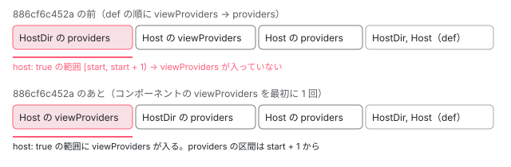

[目次](../README.md) › [hostDirectives と継承（features）](README.md) › 第 5 回 / 全 6 回

# host directive の providers と入出力：注入器と配線の細部

> host directive の providers があると viewProviders が host: true で取れなかった不具合の修正（886cf6c452a）、host directive の入力の別名と静的な属性の初期値の配線（setupHostDirectiveInputsOrOutputs・setupInitialInputs）、特定のディレクティブに届ける inputBinding / outputBinding の範囲の判定、ホストと host directive の host バインディングとライフサイクルの順。ページの上の本物で、子から inject した値とノードの上の並びを読む。

angular/angular · 読了 約 13 分 · 発展 · [サイトで読む（デモが動きます）](https://angular-deep-dive-cyan.vercel.app/chapter/hdi-host-providers-bindings)

---

host directive は、ホストと同じ要素の注入器と入出力の表を共有します。そのため「どの順で登録するか」が、そのまま「何が見えるか」になります。この章では、host directive が `providers` を持つとホストの `viewProviders` が `host: true` で取れなくなっていた不具合の修正（886cf6c452a）を差分と spec で読み、host directive の入力の別名と静的な属性の初期値がノードにどう登録されるか、host binding とライフサイクルフックがどの順で走るかを、ページの上の本物で確かめます。

読む対象は `packages/core/src/render3/view/directives.ts`（`initializeDirectives` と入出力の表）、`packages/core/src/render3/features/providers_feature.ts` と `di_setup.ts`（providers の登録）、`packages/core/src/render3/instructions/shared.ts` と `view/directive_outputs.ts`（特定のディレクティブへの入出力）、`packages/core/testing/src/test_bed_compiler.ts`、`packages/core/test/acceptance/host_directives_spec.ts` です。providers と viewProviders が 1 つのノードの上でどう並び、子からどう見えるかの大筋は [standalone-providers-two-injectors](../standalone/08-standalone-providers-two-injectors.md)、`host: true` の範囲は [di-resolution-flags](../di/12-di-resolution-flags.md) にあります。

1. [1. features の並びと実行](01-hdi-features-pipeline.md)
2. [2. 継承の実行時](02-hdi-inherit-runtime.md)
3. [3. 継承のコンパイル](03-hdi-inherit-compile.md)
4. [4. host directive の重複の解消](04-hdi-host-dedupe.md)
5. **5. providers と入出力**（この章）
6. [6. spec と issue](06-hdi-tests-issues.md)

## 1. 886cf6c452a：viewProviders が先、という前提が崩れていた

issue #65724（2025-11-30、「Host directive with provider breaks viewProviders」）は、`formControlName` を入れ子のコンポーネントで使うために `viewProviders: [{ provide: ControlContainer, useExisting: FormGroupDirective }]` を書いたところ、そのコンポーネントの host directive のどれかが provider を 1 つでも持つと「NG01050: formControlName must be used with a parent formGroup directive」になる、という報告です。`formControlName` は親の `ControlContainer` を `host: true` で探します。2025-12-02 に 886cf6c452a が書かれ、PR #65778 として 12-03 に取り込まれて issue が閉じました。

コミットの本文の要点は 3 つです。

1. **前提**

   DI は「`viewProviders` が普通の `providers` より先に登録される」ことを前提にしている。これまでは、照合の結果でコンポーネントが常に先頭にあり、1 つのノードにコンポーネントは 1 つで、`viewProviders` を持てるのはコンポーネントだけ、という 3 つで守られていた。
2. **崩れ方**

   コンポーネントに `providers` を持つ host directive があると、host directive がコンポーネントより先に並ぶ（[standalone-host-directives](../standalone/10-standalone-host-directives.md) の 4 節の順 1 → 2）ので、その `providers` が先に登録されてしまう。
3. **直し方**

   `viewProviders` と `providers` の resolver（登録する関数）を分け、コンポーネントの `viewProviders` の resolver を、ほかの全部より先に明示的に呼ぶ。ついでに、`viewProviders` を持ちえないディレクティブで `viewProviders` を解決しようとしなくなる。

差分は 7 ファイルです。`ɵɵProvidersFeature` が `definition.providersResolver` と `definition.viewProvidersResolver` の 2 つを別々に貼るようになり（providers\_feature.ts）、`initializeDirectives` が `componentDef?.viewProvidersResolver` を最初に 1 回だけ呼んでから、全部の def の `providersResolver` を順に呼ぶようになりました（directives.ts の `initializeDirectives`）。どちらも [standalone-providers-two-injectors](../standalone/08-standalone-providers-two-injectors.md) の 2 節と 3 節で引用しているので、ここでは型と、TestBed の側の変更を読みます。

📄 `angular/packages/core/src/render3/interfaces/definition.ts` L35–42 （▶ の行: 37–41）

```ts
35 │ export type ViewQueriesFunction<T> = <U extends T>(rf: RenderFlags, ctx: U) => void;
36 │ 
37 ▶ /** Function that resolves providers and publishes them to the DI system. */
38 ▶ export type ProvidersResolver = (
39 ▶   def: DirectiveDef<unknown>,
40 ▶   processProvidersFn?: ProcessProvidersFunction,
41 ▶ ) => void;
42 │ 
```

38〜41 行目の `ProvidersResolver` が、2 つのフィールド（interfaces/definition.ts の `providersResolver` と `viewProvidersResolver`）の共通の型です。41 行目の戻り値は `void` で、37 行目のコメントどおり「解決して DI に公開する」関数です。呼ぶ側の `initializeDirectives` は戻り値を使いません。配列を返すだけの関数を入れても、何も登録されません（4 節の最後で、TestBed がこれをしている場所を読みます）。



*同じホストの要素の上の並び（tView.data の providers の区間）。cptViewProvidersCount = 1 のとき、host: true で見えるのは先頭の 1 つだけ。*

なぜ順番が効くのかは、区間の数え方にあります。`resolveProvider` は登録した数を `tNode.providerIndexes` の上位ビット（`cptViewProvidersCount`）に数えるだけで、「viewProviders の区間は先頭から `cptViewProvidersCount` 個」とみなします（[standalone-providers-two-injectors](../standalone/08-standalone-providers-two-injectors.md) の 2 節の `resolveProvider`）。`host: true` でホストの要素を調べるときは、その先頭の区間とコンポーネント自身だけを見ます（[di-resolution-flags](../di/12-di-resolution-flags.md) の `locateDirectiveOrProvider`）。host directive の providers が先に入ると、その「先頭の区間」に入っているのが host directive の provider になり、本物の viewProviders は区間の外にはみ出します。

### 足された spec

📄 `angular/packages/core/test/acceptance/host_directives_spec.ts` L1295–1318 （▶ の行: 1300–1301, 1308, 1312–1313）

```ts
1295 │     it('should be able to inject host tokens defined through `viewProviders` in a component using host directives', () => {
1296 │       const token = new InjectionToken<ProvidesExisting>('token');
1297 │       let value: ProvidesExisting | undefined | null;
1298 │ 
1299 │       @Directive({
1300 ▶         // These providers aren't injected, but they help hit the relevant code path.
1301 ▶         providers: [{provide: new InjectionToken('unusedToken'), useValue: true}],
1302 │       })
1303 │       class HostDirective {}
1304 │ 
1305 │       @Directive({selector: '[injectsExisting]'})
1306 │       class InjectsExisting {
1307 │         constructor() {
1308 ▶           value = inject(token, {host: true, optional: true});
1309 │         }
1310 │       }
1311 │ 
1312 ▶       @Directive({selector: '[providesExisting]'})
1313 ▶       class ProvidesExisting {}
1314 │ 
1315 │       @Component({
1316 │         selector: 'comp-with-host-directive',
1317 │         template: '<div injectsExisting></div>',
1318 │         imports: [InjectsExisting],
```

📄 `angular/packages/core/test/acceptance/host_directives_spec.ts` L1319–1339 （▶ の行: 1319–1320, 1328, 1336–1337）

```ts
1319 ▶         hostDirectives: [HostDirective],
1320 ▶         viewProviders: [{provide: token, useExisting: ProvidesExisting}],
1321 │         changeDetection: ChangeDetectionStrategy.Eager,
1322 │       })
1323 │       class CompWithHostDirective {}
1324 │ 
1325 │       @Component({
1326 │         selector: 'app-root',
1327 │         template: '<comp-with-host-directive providesExisting/>',
1328 ▶         imports: [ProvidesExisting, CompWithHostDirective],
1329 │         changeDetection: ChangeDetectionStrategy.Eager,
1330 │       })
1331 │       class App {}
1332 │ 
1333 │       const fixture = TestBed.createComponent(App);
1334 │       fixture.detectChanges();
1335 │ 
1336 ▶       expect(value).toBeTruthy();
1337 ▶       expect(value instanceof ProvidesExisting).toBe(true);
1338 │     });
1339 │   });
```

1300〜1301 行目のコメント、host directive の providers は「注入されないが、該当の道を通すために置く」。1301 行目のトークンは誰も使いません。1308 行目、子の `InjectsExisting` が `inject(token, {host: true, optional: true})` で探し、1319〜1320 行目のホストが、host directive を持ちながら `viewProviders` で `useExisting: ProvidesExisting`（ホストの要素にテンプレートで当たる別のディレクティブ）を出します。issue の `FormGroupDirective` と同じ形です。1336〜1337 行目、`ProvidesExisting` のインスタンスが取れること。作業木で `initializeDirectives` を修正の前の順（def ごとに viewProviders → providers）に戻すと、この it が「Expected null to be truthy.」で落ちました（テストと直し方の節）。

### host directive とホストが同じトークンを出したら

📄 `angular/packages/core/test/acceptance/host_directives_spec.ts` L1142–1181 （▶ の行: 1142, 1146, 1152, 1165, 1180）

```ts
1142 ▶     it('should not give precedence to tokens from host directives over ones in viewProviders', () => {
1143 │       const token = new InjectionToken<string>('token');
1144 │       let tokenValue: string | undefined;
1145 │ 
1146 ▶       @Directive({providers: [{provide: token, useValue: 'host-dir'}]})
1147 │       class HostDir {}
1148 │ 
1149 │       @Component({
1150 │         selector: 'host',
1151 │         hostDirectives: [HostDir],
1152 ▶         providers: [{provide: token, useValue: 'host'}],
1153 │         template: '<span child></span>',
1154 │         standalone: false,
1155 │         changeDetection: ChangeDetectionStrategy.Eager,
1156 │       })
1157 │       class Host {}
1158 │ 
1159 │       @Directive({
1160 │         selector: '[child]',
1161 │         standalone: false,
1162 │       })
1163 │       class Child {
1164 │         constructor() {
1165 ▶           tokenValue = inject(token);
1166 │         }
1167 │       }
1168 │ 
1169 │       @Component({
1170 │         template: '<host></host>',
1171 │         standalone: false,
1172 │         changeDetection: ChangeDetectionStrategy.Eager,
1173 │       })
1174 │       class App {}
1175 │ 
1176 │       TestBed.configureTestingModule({declarations: [App, Host, Child]});
1177 │       const fixture = TestBed.createComponent(App);
1178 │       fixture.detectChanges();
1179 │ 
1180 ▶       expect(tokenValue).toBe('host');
1181 │     });
```

1146 行目の host directive と 1152 行目のホストが、同じ `token` を `providers` で出します。1180 行目、子に見えるのはホストの `'host'` です。host directive の resolver が先に走って登録し、ホストの resolver があとから同じトークンを見つけて factory を差し替えるからです（`resolveProvider` が同じ区間で同じトークンを見つけたら factory を上書きする。[standalone-providers-two-injectors](../standalone/08-standalone-providers-two-injectors.md) の 2 節）。なお、この it の名前（1142 行目）は「viewProviders より優先しない」ですが、ホストが出しているのは 1152 行目の `providers` で、`viewProviders` は出てきません。名前と中身がずれています。

### TestBed の側

📄 `angular/packages/core/testing/src/test_bed_compiler.ts` L1124–1150 （▶ の行: 1131, 1133, 1135–1136, 1139, 1143–1144, 1148–1149）

```ts
1124 │   private patchDefWithProviderOverrides(declaration: Type<any>, field: string): void {
1125 │     const def = (declaration as any)[field];
1126 │ 
1127 │     if (!def) {
1128 │       return;
1129 │     }
1130 │ 
1131 ▶     if (def.viewProvidersResolver) {
1132 │       this.maybeStoreNgDef(field, declaration);
1133 ▶       const viewProvidersResolver = def.viewProvidersResolver;
1134 │       this.storeFieldOfDefOnType(declaration, field, 'viewProvidersResolver');
1135 ▶       def.viewProvidersResolver = (ngDef: DirectiveDef<any>) =>
1136 ▶         viewProvidersResolver(ngDef, this.processProviderOverrides);
1137 │     }
1138 │ 
1139 ▶     if (def.providersResolver) {
1140 │       this.maybeStoreNgDef(field, declaration);
1141 │       const providersResolver = def.providersResolver;
1142 │       this.storeFieldOfDefOnType(declaration, field, 'providersResolver');
1143 ▶       def.providersResolver = (ngDef: DirectiveDef<any>) =>
1144 ▶         providersResolver(ngDef, this.processProviderOverrides);
1145 │     }
1146 │   }
1147 │ 
1148 ▶   private processProviderOverrides = (providers: Provider[]) =>
1149 ▶     this.getOverriddenProviders(providers);
1150 │ }
```

`TestBed.overrideProvider` が効くのは、def の resolver を「差し替えたトークンに置き換えてから登録する」関数で包むからです。修正の前は `providersResolver` 1 つを包めばよかったのが、886cf6c452a で 1131〜1137 行目の `viewProvidersResolver` の分が足されました。どちらも 1136・1144 行目で元の resolver に `this.processProviderOverrides`（1148〜1149 行目）を第 2 引数として渡し、元の resolver が `processProvidersFn(providers)` を通してから登録します（providers\_feature.ts の 2 つの resolver）。

## 2. 入力の表：セレクタで当たったものと host directive

要素に付いた def を全部並べたあと、`initializeInputAndOutputAliases` が def ごとに 2 つの関数のどちらかを呼びます（[standalone-host-directives](../standalone/10-standalone-host-directives.md) の 7 節）。

📄 `angular/packages/core/src/render3/view/directives.ts` L290–311 （▶ の行: 296, 298, 302, 306–308）

```ts
290 │ function setupSelectorMatchedInputsOrOutputs<T>(
291 │   mode: BindingType,
292 │   tNode: TNode,
293 │   def: DirectiveDef<T>,
294 │   directiveIndex: number,
295 │ ): void {
296 ▶   const aliasMap = mode === BindingType.Inputs ? def.inputs : def.outputs;
297 │ 
298 ▶   for (const publicName in aliasMap) {
299 │     if (Object.hasOwn(aliasMap, publicName)) {
300 │       let bindings: NodeInputBindings | NodeOutputBindings;
301 │       if (mode === BindingType.Inputs) {
302 ▶         bindings = tNode.inputs ??= {};
303 │       } else {
304 │         bindings = tNode.outputs ??= {};
305 │       }
306 ▶       bindings[publicName] ??= [];
307 ▶       bindings[publicName].push(directiveIndex);
308 ▶       setShadowStylingInputFlags(tNode, publicName);
309 │     }
310 │   }
311 │ }
```

📄 `angular/packages/core/src/render3/view/directives.ts` L320–350 （▶ の行: 326, 328, 330, 333, 337–339, 344–348）

```ts
320 │ function setupHostDirectiveInputsOrOutputs(
321 │   mode: BindingType,
322 │   tNode: TNode,
323 │   config: HostDirectiveDef,
324 │   directiveIndex: number,
325 │ ): void {
326 ▶   const aliasMap = mode === BindingType.Inputs ? config.inputs : config.outputs;
327 │ 
328 ▶   for (const initialName in aliasMap) {
329 │     if (Object.hasOwn(aliasMap, initialName)) {
330 ▶       const publicName = aliasMap[initialName];
331 │       let bindings: HostDirectiveInputs | HostDirectiveOutputs;
332 │       if (mode === BindingType.Inputs) {
333 ▶         bindings = tNode.hostDirectiveInputs ??= {};
334 │       } else {
335 │         bindings = tNode.hostDirectiveOutputs ??= {};
336 │       }
337 ▶       bindings[publicName] ??= [];
338 ▶       bindings[publicName].push(directiveIndex, initialName);
339 ▶       setShadowStylingInputFlags(tNode, publicName);
340 │     }
341 │   }
342 │ }
343 │ 
344 ▶ function setShadowStylingInputFlags(tNode: TNode, publicName: string): void {
345 ▶   if (publicName === 'class') {
346 ▶     tNode.flags |= TNodeFlags.hasClassInput;
347 ▶   } else if (publicName === 'style') {
348 ▶     tNode.flags |= TNodeFlags.hasStyleInput;
349 │   }
350 │ }
```

1. **セレクタで当たったもの（290 行目）：`tNode.inputs[公開名] = [index, …]`**

   296 行目、def 自身の `inputs`（公開名 → \[プロパティ名, …\]）を全部回し、306〜307 行目でノードの表 `tNode.inputs` に、その公開名で「ディレクティブの位置」を足します。
2. **host directive（320 行目）：`tNode.hostDirectiveInputs[別名] = [index, 元の公開名, …]`**

   326 行目で回すのは def ではなく**露出の設定**（`{label: 'hdLabel'}` の形）です。330 行目で別名を取り、333 行目の別の表 `tNode.hostDirectiveInputs` の、別名のキーに、338 行目で「位置」と「host directive 自身の公開名」の 2 つを組で足します。書き込むときに、別名から元の名前へ戻すためです。同じ別名に 2 つの host directive が露出すれば、組が 2 つ並び、1 回の書き込みで両方に届きます（host\_directives\_spec.ts の it「should set inputs from different host directives that have been aliased to the same name」）。
3. **308・339 行目：`class` と `style` の印**

   344〜350 行目の `setShadowStylingInputFlags` は、公開名が `class` か `style` なら、ノードに「ディレクティブが class / style を入力として受け取る」印を立てます。この印があると `[class]` の束縛は要素ではなくディレクティブの入力へ送られます（[domr-styling-overview](../domr/09-domr-styling-overview.md)）。8576f161ae4 では、この呼び出しが inputs と outputs の両方の分岐のあと（308・339 行目）にあり、**出力**の名前が `class` でも印が立ちます。angular-main の 5fb2b68847d（2026-10-29、issue #71660）は、呼び出しを inputs の分岐の中へ移しました。host directive が `class` という出力を露出したときも同じで、コミットの本文に「host directives that expose such an output were affected as well」とあります。

### 静的な属性から入る初期値

📄 `angular/packages/core/src/render3/view/directives.ts` L366–381 （▶ の行: 366–367, 371–372, 377–378）

```ts
366 ▶ function setupInitialInputs(tNode: TNode, directiveIndex: number, isHostDirective: boolean): void {
367 ▶   const {attrs, inputs, hostDirectiveInputs} = tNode;
368 │ 
369 │   if (
370 │     attrs === null ||
371 ▶     (!isHostDirective && inputs === null) ||
372 ▶     (isHostDirective && hostDirectiveInputs === null) ||
373 │     // Do not use unbound attributes as inputs to structural directives, since structural
374 │     // directive inputs can only be set using microsyntax (e.g. `<div *dir="exp">`).
375 │     isInlineTemplate(tNode)
376 │   ) {
377 ▶     tNode.initialInputs ??= [];
378 ▶     tNode.initialInputs.push(null);
379 │     return;
380 │   }
381 │ 
```

📄 `angular/packages/core/src/render3/view/directives.ts` L413–423 （▶ の行: 413–416, 418）

```ts
413 ▶     } else if (isHostDirective && Object.hasOwn(hostDirectiveInputs!, attrName as string)) {
414 ▶       const config = hostDirectiveInputs![attrName as string];
415 ▶       for (let j = 0; j < config.length; j += 2) {
416 ▶         if (config[j] === directiveIndex) {
417 │           inputsToStore ??= [];
418 ▶           inputsToStore.push(config[j + 1] as string, attrs[i + 1] as string);
419 │           break;
420 │         }
421 │       }
422 │     }
423 │ 
```

`<hdi-pb-host hdLabel="…">` のように属性で書いた値は、作成のときに 1 回だけ入力に入ります。その表を作るのが `setupInitialInputs` です（ループの大部分は [ivy-directives](../ivy/14-ivy-directives.md) で引用）。366 行目の第 3 引数 `isHostDirective` で見る表が変わり、372 行目、host directive なのに `hostDirectiveInputs` が無ければ、377〜378 行目でこの def の分として `null` を積みます。413〜421 行目が host directive の分岐です。属性の名前（ホストでの別名）で `hostDirectiveInputs` を引き、組の 1 つ目が自分の位置なら、418 行目で **組の 2 つ目（host directive 自身の公開名）**と属性の値を積みます。つまり `initialInputs` には `hdLabel` ではなく `label` が入ります。DEMO の表で確かめます。

📄 `angular/packages/core/test/acceptance/host_directives_spec.ts` L2214–2240 （▶ の行: 2214, 2222, 2228, 2239）

```ts
2214 ▶     it('should set a static input of a host directive that has been exposed', () => {
2215 │       @Directive()
2216 │       class HostDir {
2217 │         @Input() color?: string;
2218 │       }
2219 │ 
2220 │       @Directive({
2221 │         selector: '[dir]',
2222 ▶         hostDirectives: [{directive: HostDir, inputs: ['color']}],
2223 │         standalone: false,
2224 │       })
2225 │       class Dir {}
2226 │ 
2227 │       @Component({
2228 ▶         template: '<button dir color="red"></button>',
2229 │         standalone: false,
2230 │         changeDetection: ChangeDetectionStrategy.Eager,
2231 │       })
2232 │       class App {
2233 │         @ViewChild(HostDir) hostDir!: HostDir;
2234 │       }
2235 │ 
2236 │       TestBed.configureTestingModule({declarations: [App, Dir]});
2237 │       const fixture = TestBed.createComponent(App);
2238 │       fixture.detectChanges();
2239 ▶       expect(fixture.componentInstance.hostDir.color).toBe('red');
2240 │     });
```

2222 行目で `color` を露出し、2228 行目の静的な属性 `color="red"` が、2239 行目で host directive に入っています。露出しない場合（1 つ前の it）は `undefined` のままです。

## 3. DEMO：注入、並び、入力の表、フックの順

> **🧪 DEMO — providers を持つ host directive と、viewProviders を持つホスト（ライブ）**
>
> `<hdi-pb-host>` は `providers`（`HDI_PB_P`・`HDI_PB_SAME`）と `viewProviders`（`HDI_PB_VP`）を持ち、host directive の `HdiPbHostDir` は `providers`（`HDI_PB_HD`・`HDI_PB_SAME`）と入力 `label` を持ちます。`label` は `hdLabel` として露出しています。ホストのテンプレートに 1 つ（ビューの子）、#1 の中身に 1 つ（投影された子）、`<hdi-pb-probe>` を置き、コンストラクタで 4 つのトークンを `inject(t, {optional: true})` と `inject(t, {optional: true, host: true})` で取ります。#1 には静的な属性 `hdLabel="静的な属性の値"`、#2 には `[hdLabel]` の束縛を書いています。
>
> 「描く」を押してください。
>
> ▶ [このデモはサイトで動かせます](https://angular-deep-dive-cyan.vercel.app/chapter/hdi-host-providers-bindings)

読み取れることです（「描く」を押したあと）。

1. **並び：viewProviders が先頭、次に host directive、最後にホストの providers**

   `cptViewProvidersCount` は 1 で、providers の区間の先頭が `HDI_PB_VP` です。そのあとに `HdiPbHostDir` の `HDI_PB_HD`・`HDI_PB_SAME`、最後にホストの `HDI_PB_P` が並びます。ホストの `HDI_PB_SAME` は新しい位置を取らず、host directive が先に作った位置の factory を差し替えたので、位置は 3 つではなく 1 つです。ディレクティブの区間は `HdiPbHostDir`、`HdiPbHost` の順です。
2. **ビューの子と `host: true`：viewProviders だけ**

   ビューの子は、印なしなら 4 つ全部が取れ、`HDI_PB_SAME` はホストの値です。`host: true` では `HDI_PB_VP` だけが取れ、ほかは null です。ホストの要素の上で見るのが「先頭の `cptViewProvidersCount` 個」だけだからで、886cf6c452a の前はここに `HDI_PB_HD` が入っていました。
3. **投影された子：viewProviders は見えない**

   投影された子は、ホストと同じ TView（章のテンプレート）の中で親へ登るので、viewProviders の区間を飛ばします（[standalone-providers-two-injectors](../standalone/08-standalone-providers-two-injectors.md) の 4 節、`canAccessViewProviders`）。`HDI_PB_VP` は印なしでも `host: true` でも null、残りの 3 つは取れます。`host: true` の止まる先は章のコンポーネントのホストで、`<hdi-pb-host>` はその手前でふつうに調べられるからです。
4. **入力の表：別名で引き、元の名前で書く**

   `hostDirectiveInputs` は `{"hdLabel":[位置,"label"]}`、#1 の `initialInputs` は host directive の位置に `["label","静的な属性の値"]`、ホストの位置に `null` です（418 行目と 377〜378 行目）。`inputs` は `null`（ホストには入力が無い）です。
5. **host の属性とフック：host directive が先、ホストが上書き**

   `data-static` も `data-bound` も `HdiPbHost` です。`ngOnInit` は各ホストで `HdiPbHostDir` → `HdiPbHost` の順、`ngOnDestroy` も同じ順です。5 節で、spec がこの 2 つを固めている行を読みます。

## 4. 特定のディレクティブに届ける道：範囲で探す

テンプレートの `[hdLabel]="…"` は、要素の全ディレクティブに配る `setAllInputsForProperty`（[ivy-update-instructions](../ivy/10-ivy-update-instructions.md)）を通り、`hostDirectiveInputs` と `inputs` の両方を引きます。`ComponentRef.setInput` も同じ関数です。一方、`createComponent` の `bindings` や `directives: [{type, bindings}]` の `inputBinding`（[testing-component-bindings](../testing/06-testing-component-bindings.md)）は、**あるディレクティブとその host directive だけ**に届ける `setDirectiveInput` を通ります。

📄 `angular/packages/core/src/render3/instructions/shared.ts` L798–830 （▶ の行: 800–801, 803, 805, 810, 813–814, 816, 818, 823, 825, 829）

```ts
798 │ 
799 │   if (
800 ▶     hostDirectivesStart !== null &&
801 ▶     hostDirectivesEnd !== null &&
802 │     tNode.hostDirectiveInputs &&
803 ▶     Object.hasOwn(tNode.hostDirectiveInputs, publicName)
804 │   ) {
805 ▶     const hostDirectiveInputs = tNode.hostDirectiveInputs[publicName];
806 │ 
807 │     for (let i = 0; i < hostDirectiveInputs.length; i += 2) {
808 │       const index = hostDirectiveInputs[i] as number;
809 │ 
810 ▶       if (index >= hostDirectivesStart && index <= hostDirectivesEnd) {
811 │         ngDevMode && assertIndexInRange(lView, index);
812 │         const def = tView.data[index] as DirectiveDef<unknown>;
813 ▶         const hostDirectivePublicName = hostDirectiveInputs[i + 1] as string;
814 ▶         writeToDirectiveInput(def, lView[index], hostDirectivePublicName, value);
815 │         hasSet = true;
816 ▶       } else if (index > hostDirectivesEnd) {
817 │         // Directives here are in ascending order so we can stop looking once we're past the range.
818 ▶         break;
819 │       }
820 │     }
821 │   }
822 │ 
823 ▶   if (hostIndex !== null && Object.hasOwn(target.inputs, publicName)) {
824 │     ngDevMode && assertIndexInRange(lView, hostIndex);
825 ▶     writeToDirectiveInput(target, lView[hostIndex], publicName, value);
826 │     hasSet = true;
827 │   }
828 │ 
829 ▶   return hasSet;
830 │ }
```

その上の行で、`tNode.directiveToIndex` から対象の `[自分の位置, host directive の始まり, 終わり]` を取ります（[ivy-directives](../ivy/14-ivy-directives.md) の `setDirectiveInput` の前半。範囲を書くのは `initializeDirectives` で、元は `resolveHostDirectives` の `hostDirectiveRanges`）。810 行目、`hostDirectiveInputs` の組のうち、位置がその範囲に入るものにだけ、813〜814 行目で元の名前で書きます。816〜818 行目、位置は昇順なので範囲を過ぎたら止めます。823〜826 行目は対象そのものの入力です。829 行目の `hasSet` が `false` なら、`inputBinding` の側が開発モードで NG0315（「does not have an input with a public name of」）を投げます。

📄 `angular/packages/core/src/render3/view/directive_outputs.ts` L69–104 （▶ の行: 72, 80, 87, 91, 97, 103）

```ts
 69 │   if (
 70 │     hostDirectivesStart !== null &&
 71 │     hostDirectivesEnd !== null &&
 72 ▶     tNode.hostDirectiveOutputs &&
 73 │     Object.hasOwn(tNode.hostDirectiveOutputs, eventName)
 74 │   ) {
 75 │     const hostDirectiveOutputs = tNode.hostDirectiveOutputs[eventName];
 76 │ 
 77 │     for (let i = 0; i < hostDirectiveOutputs.length; i += 2) {
 78 │       const index = hostDirectiveOutputs[i] as number;
 79 │ 
 80 ▶       if (index >= hostDirectivesStart && index <= hostDirectivesEnd) {
 81 │         ngDevMode && assertIndexInRange(lView, index);
 82 │         hasOutput = true;
 83 │         listenToOutput(
 84 │           tNode,
 85 │           lView,
 86 │           index,
 87 ▶           hostDirectiveOutputs[i + 1] as string,
 88 │           eventName,
 89 │           listenerFn,
 90 │         );
 91 ▶       } else if (index > hostDirectivesEnd) {
 92 │         break;
 93 │       }
 94 │     }
 95 │   }
 96 │ 
 97 ▶   if (Object.hasOwn(target.outputs, eventName)) {
 98 │     ngDevMode && assertIndexInRange(lView, hostIndex);
 99 │     hasOutput = true;
100 │     listenToOutput(tNode, lView, hostIndex, eventName, eventName, listenerFn);
101 │   }
102 │ 
103 ▶   return hasOutput;
104 │ }
```

出力の `outputBinding` も、80 行目で同じ範囲の判定をします。97〜101 行目が対象そのものの出力、103 行目の `false` で呼ぶ側が開発モードで投げます。

範囲は「ホストの host directive が並びのどこからどこまでか」で、`resolveHostDirectives` が `findHostDirectiveDefs` の前後の配列の長さで決めます（[standalone-host-directives](../standalone/10-standalone-host-directives.md) の 4 節）。[第 4 回](04-hdi-host-dedupe.md)の重複の解消で、2 つ目のホストの host directive が 1 つ目のホストの分としてすでに並んでいると、2 つ目のホストの範囲には入りません。その host directive の露出はホストの `hostDirectiveInputs` に合わさって登録されているのに、810 行目の範囲の判定で外れます。次の DEMO で確かめます。

> **🧪 DEMO — 同じ host directive を持つ 2 つのディレクティブに inputBinding（ライブ）**
>
> `HdiPbDirA` は `HdiPbShared` を何も露出せずに、`HdiPbDirB` は `value` を露出して持ちます。`createComponent(HdiPbBare, {directives: [...]})` に 2 つを渡し、`HdiPbDirB` に `inputBinding('value', () => 'inputBinding の値')` を付けて、`detectChanges()` します。このページは `ngDevMode` が **無効（本番ビルド）** です。
>
> ▶ [このデモはサイトで動かせます](https://angular-deep-dive-cyan.vercel.app/chapter/hdi-host-providers-bindings)

「HdiPbDirB → HdiPbDirA」では、`HdiPbShared` は `HdiPbDirB` の範囲に入り、値が届きます。`HdiPbDirA` の範囲は始まりが終わりより大きい（空の）範囲です。「HdiPbDirA → HdiPbDirB」では、`HdiPbShared` は `HdiPbDirA` の範囲に入り、`HdiPbDirB` の範囲が空になります。`hostDirectiveInputs` には `value` があるのに、開発ビルドでは NG0315、本番ビルドでは投げずに値が届きません（初期値のまま）。テンプレートの `[value]` や `setInput` なら、範囲を見ない `setAllInputsForProperty` を通るので届きます。

### TestBed の AOT の分岐

1 節の `ProvidersResolver` の約束（登録して `void` を返す）を守っていない場所が、test\_bed\_compiler.ts にもう 1 つあります。デコレータの情報を持たない AOT のコンポーネントに `overrideComponent` で `providers` / `viewProviders` を積んだときの分岐で、[standalone-testbed-override](../standalone/12-standalone-testbed-override.md) の 7 節が引用しています（2026-04-27 の 4ad3a1fe379 で入った行）。そこで `componentDef.providersResolver` と `componentDef.viewProvidersResolver` に入れる関数は、override 後の配列を**返すだけ**で、`providersResolver`（di\_setup.ts）を呼びません。作業木の test\_bed\_spec.ts に「AOT の def に `set: {providers: [{provide: TOKEN, useValue: 'override'}]}` を積み、`fixture.debugElement.injector.get(TOKEN, null)` を見る」it を足すと、「Expected null to be 'override'.」で落ちました。元の def が持っていた providers も消えます（Node で 22.1.6 を動かすと、override しなければ `'orig'`、override すると `null`）。

## 5. host binding とライフサイクルの順を固めている it

📄 `angular/packages/core/test/acceptance/host_directives_spec.ts` L856–884 （▶ の行: 857, 860, 865–866, 882）

```ts
856 │     it('should have the host bindings take precedence over the ones from the host directives', () => {
857 ▶       @Directive({host: {'id': 'host-dir'}})
858 │       class HostDir {}
859 │ 
860 ▶       @Directive({host: {'id': 'other-host-dir'}})
861 │       class OtherHostDir {}
862 │ 
863 │       @Directive({
864 │         selector: '[dir]',
865 ▶         host: {'id': 'host'},
866 ▶         hostDirectives: [HostDir, OtherHostDir],
867 │         standalone: false,
868 │       })
869 │       class Dir {}
870 │ 
871 │       @Component({
872 │         template: '<div dir></div>',
873 │         standalone: false,
874 │         changeDetection: ChangeDetectionStrategy.Eager,
875 │       })
876 │       class App {}
877 │ 
878 │       TestBed.configureTestingModule({declarations: [App, Dir]});
879 │       const fixture = TestBed.createComponent(App);
880 │       fixture.detectChanges();
881 │ 
882 ▶       expect(fixture.nativeElement.querySelector('[dir]').getAttribute('id')).toBe('host');
883 │     });
884 │   });
```

857・860 行目の 2 つの host directive と 865 行目のホストが、どれも静的な `id` を持ちます。882 行目、残るのはホストの `'host'` です。`initializeDirectives` は並んだ順に `mergeHostAttrs` で属性を重ね、あとのものが勝ちます（[ivy-directives](../ivy/14-ivy-directives.md) の `initializeDirectives`）。host directive はホストより前に並ぶので、ホストが上書きします。束縛した host の値（`[attr.data-bound]`）も、hostBindings が並んだ順に実行されるので同じ結果です（DEMO の `data-bound`）。

📄 `angular/packages/core/test/acceptance/host_directives_spec.ts` L699–721 （▶ の行: 704–708, 710, 712, 714, 716, 718）

```ts
699 │       TestBed.configureTestingModule({declarations: [App, Parent, Child, PlainDir]});
700 │       const fixture = TestBed.createComponent(App);
701 │       fixture.detectChanges();
702 │ 
703 │       expect(logs).toEqual([
704 ▶         'ParentHostDir - ngOnInit',
705 ▶         'OtherParentHostDir - ngOnInit',
706 ▶         'Parent - ngOnInit',
707 ▶         'PlainDir on parent - ngOnInit',
708 ▶         'ChildHostDir - ngOnInit',
709 │         'OtherChildHostDir - ngOnInit',
710 ▶         'Child - ngOnInit',
711 │         'PlainDir on child - ngOnInit',
712 ▶         'ChildHostDir - ngAfterViewInit',
713 │         'OtherChildHostDir - ngAfterViewInit',
714 ▶         'Child - ngAfterViewInit',
715 │         'PlainDir on child - ngAfterViewInit',
716 ▶         'ParentHostDir - ngAfterViewInit',
717 │         'OtherParentHostDir - ngAfterViewInit',
718 ▶         'Parent - ngAfterViewInit',
719 │         'PlainDir on parent - ngAfterViewInit',
720 │       ]);
721 │     });
```

`describe('lifecycle hooks')` の 2 つ目の it「should invoke host directive lifecycle hooks before the host component hooks」の期待値です。`Parent` は host directive を 2 つ持ち、テンプレートで `PlainDir` も当たります。704〜707 行目、`ngOnInit` は「`Parent` の 2 つの host directive → `Parent` → `PlainDir`」の順で、並べ直しの順（コンポーネントの host directive → コンポーネント → ディレクティブ）そのものです。712〜719 行目、`ngAfterViewInit` は子のビュー（`Child` の側）が先に終わり、それぞれの中では同じ順です。フックの登録と呼び出しの仕組みは [ivy-hooks](../ivy/13-ivy-hooks.md) です。

## ここまでの呼び出し

- 👤 `@Component({ hostDirectives: [{directive: HostDir, inputs: ['label: hdLabel']}], providers, viewProviders })` — あなたのコード
- `ɵɵProvidersFeature(providers, viewProviders)` — providers\_feature.ts L44 — *providersResolver と viewProvidersResolver を別々に貼る（886cf6c452a）*
- `resolveDirectives() → initializeDirectives()` — view/directives.ts L136 — *並びは HostDir → Host*
  - `componentDef.viewProvidersResolver(componentDef)` — directives.ts L172 — *先頭の区間に viewProviders*
  - `def.providersResolver(def)` — directives.ts L178 — *HostDir → Host の順。同じトークンはあとのものが差し替える*
    - `providersResolver() → resolveProvider()` — di\_setup.ts L56 / L70 — *cptViewProvidersCount を数える*
  - `initializeInputAndOutputAliases()` — directives.ts L252
    - `setupHostDirectiveInputsOrOutputs()` — directives.ts L320 — *hostDirectiveInputs\[別名\] = \[位置, 元の名前\]*
    - `setupInitialInputs(tNode, index, true)` — directives.ts L366 — *属性の値を元の名前で積む*
- `ɵɵproperty('hdLabel', …) / ComponentRef.setInput()` — shared.ts L736 — *setAllInputsForProperty。範囲を見ない*
- `inputBinding() → setDirectiveInput()` — shared.ts L774 — *directiveToIndex の範囲の中だけ（L810）*
- `outputBinding() → listenToDirectiveOutput()` — directive\_outputs.ts L45 — *同じ範囲の判定（L80）*

## テストと直し方

| describe（行） | it（行） | 固めていること |
| --- | --- | --- |
| `dependency injection`（886） | 1041 | ホストのトークンが host directive のトークンより優先 |
| 1142 | 同じ（名前は viewProviders だが、中身は providers） |   |
| 1183 | host directive はホストの viewProviders を見られない |   |
| 1295 | 886cf6c452a：host directive の providers があっても、子が host: true でホストの viewProviders を取れる |   |
| `inputs`（1803） | 1834〜2138、2185〜2418 | 露出・別名・同じ別名に 2 つ・静的な属性 |
| `outputs`（1341） | 1342〜1760 | 出力の露出と別名 |
| `host bindings`（801） | 802・856 | 全部の host directive の host binding が付き、ホストが勝つ |
| `lifecycle hooks`（546） | 547・626・723 | host directive のフックがホストより先 |
| `root component with host directives`（2909）› `inputs`（3271） | 3272〜3447 | `setInput` が host directive に届く |

`inputBinding` / `outputBinding` で host directive に届けるときの範囲（4 節）を、2 つのホストが同じ host directive を共有する形で確かめる it はありません。TestBed の AOT の分岐で override した providers が注入できることを確かめる it もありません（test\_bed\_spec.ts の 4ad3a1fe379 の it は、例外にならないことだけを見ています）。

📄 `走らせたコマンド（2026-11-15、8576f161ae4）`

```
cd ~/angular-research/angular
pnpm bazel test //packages/core/test/acceptance:acceptance --nocache_test_results --test_output=all '--test_arg=--filter=^host directives '
pnpm bazel test //packages/core/test/acceptance:acceptance --nocache_test_results --test_output=all '--test_arg=--filter=^host directives dependency injection'
```

📄 `結果`

```
^host directives                         Ran 103 of 2693 specs / 103 specs, 0 failures
^host directives dependency injection    （上の 103 件のうちの 10 件）
```

📄 `作業木（8576f161ae4 から作り、終わったら消した）での結果（ログは hd-logs/b-wt-*.log）`

```
# 作業木（8576f161ae4）で initializeDirectives を 886cf6c452a の前の順（def ごとに viewProviders → providers）に戻した
1) host directives dependency injection should be able to inject host tokens defined through `viewProviders` ...
   Expected null to be truthy. / Expected false to be true.
# 4 節の it（DirA のあとの DirB への inputBinding）
   NG0315: DirB does not have an input with a public name of "value".
# TestBed: AOT の def に providers を override する it を test_bed_spec.ts に足した
   Expected null to be 'override'.
# test_bed_compiler.ts の 2 つの resolver を ɵɵProvidersFeature で作るように変えたあと
   //packages/core/test:test  351 + 350 + 351 + 350 = 1402 specs, 0 failures
```

直すとしたら、次の場所です。

1. **範囲（4 節）：`resolveHostDirectives` の `hostDirectiveRanges`、または `setDirectiveInput` と `listenToDirectiveOutput`**

   重複の解消で共有された host directive は、どちらのホストの範囲にも入りうるので、「連続した範囲」の形では表せません。`hostDirectiveRanges` にホストごとの位置の一覧を持たせるか、範囲の判定の代わりに「このホストの hostDirectives にこのクラスがあるか」で決めるかのどちらかです。spec は host\_directives\_spec.ts に、作業木で足した it（`createComponent` の `directives` に 2 つの順で渡す形）を置き、出力の側も `outputBinding` で同じものを足します。
2. **TestBed の AOT の分岐：test\_bed\_compiler.ts の `compileTypesSync` の中、`componentDef.providersResolver` を入れる所**

   手で書いた 2 つの resolver の代わりに、コンパイラが出すのと同じ `ɵɵProvidersFeature(providers ?? [], viewProviders)` を一時のオブジェクトに当てて resolver を作り、指定されたほうだけを def に入れます。作業木ではこの変更で足した it が通り、`//packages/core/test:test` の 1402 件がすべて通りました。spec は test\_bed\_spec.ts の `describe('defer blocks')` の中の、AOT の it の隣に足します。

## 聞かれそうな質問

**Q. host directive に providers を書けますか？ホストの providers とぶつかったら？**

書けます。host directive の `providersResolver` はホストより先に呼ばれ（`initializeDirectives` は並んだ順に呼び、host directive が先に並ぶ）、同じトークンはホストの分があとから差し替えます（host\_directives\_spec.ts 1180 行目）。host directive の providers を**使う側で**書き換える方法（hostDirectives の設定に providers を足す）は今はなく、開いている #65750 がその要望です。

**Q. host directive からホストの viewProviders は見えますか？**

見えません。host directive はホストと同じ要素の上で作られ、ビューの中の子ではないからです（host\_directives\_spec.ts の it「should not be able to access viewProviders from the host in the host directives」、`canAccessViewProviders` は [standalone-providers-two-injectors](../standalone/08-standalone-providers-two-injectors.md) の 4 節）。

**Q. 886cf6c452a の前は、何がずれていたのですか？**

viewProviders の区間が「先頭から cptViewProvidersCount 個」と数えだけで決まるのに、host directive の providers が先頭に入っていました。`host: true` で見る先頭の区間に host directive の provider が入り、本物の viewProviders が外れます（1 節の図）。修正はコンポーネントの `viewProvidersResolver` を最初に呼ぶことで、区間の先頭を viewProviders にしました。作業木で元の順に戻すと 1295 行目の it が落ちます。

**Q. 露出した入力に静的な属性で値を書くと、どの名前で入りますか？**

host directive 自身の公開名です。`setupInitialInputs` の host directive の分岐が、`hostDirectiveInputs` の組の 2 つ目を積むからです（directives.ts 418 行目）。DEMO の `initialInputs` が `["label", …]` になっています。

**Q. setInput と inputBinding で、host directive への届き方は違いますか？**

違います。`setInput` とテンプレートの束縛は `setAllInputsForProperty` で、別名の組を全部引きます。`inputBinding` は `setDirectiveInput` で、対象のホストの範囲に入る host directive だけに書きます（shared.ts 810 行目）。重複の解消で範囲が空になると、`inputBinding` だけが届きません（4 節の DEMO）。

## 読み終えて

- viewProviders の区間は「先頭から cptViewProvidersCount 個」と数えるだけなので、登録の順がそのまま見え方になる。886cf6c452a はコンポーネントの viewProviders を最初に 1 回呼ぶことで、host directive の providers を後ろに回した
- 同じトークンは、あとから登録したホストが差し替える。host directive はホストの viewProviders を見られない
- host directive の入力は `hostDirectiveInputs[別名] = [位置, 元の名前]` に入り、静的な属性の初期値も元の名前で積まれる（directives.ts 338・418 行目）
- 特定のディレクティブに届ける `inputBinding` / `outputBinding` は範囲で探すので、重複の解消で共有された host directive に届かないことがある
- TestBed の AOT の分岐の resolver は配列を返すだけで、override した providers が登録されない

---

← 前: [host directive の重複の解消：同じディレクティブが何度も当たるとき](04-hdi-host-dedupe.md)  
次: [spec と issue を読む：hostDirectives と継承を固めているテスト](06-hdi-tests-issues.md) →
