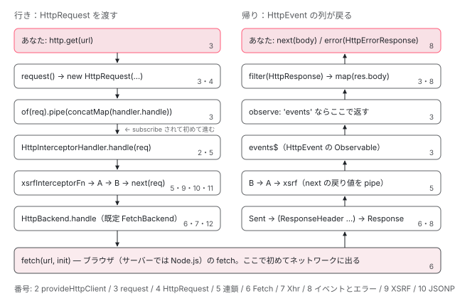

[目次](../README.md) › [HttpClient の内側](README.md) › 第 1 回 / 全 12 回

# HttpClient の概観：get() から fetch() まで、関数 6 つの 1 本道

> HttpClient.request が HttpRequest を作って of(req).pipe(concatMap(...)) で包み、HttpHandler（= HttpInterceptorHandler）→ インターセプタの連鎖 → HttpBackend（FetchBackend）→ HttpEvent の列 → observe / responseType に合わせた取り出し、と進む全体図。どの回がどこを扱うかの地図と、登場するクラス・トークンの表。

angular/angular · 読了 約 12 分 · 基礎 · [サイトで読む（デモが動きます）](https://angular-deep-dive-cyan.vercel.app/chapter/http-overview)

---

`this.http.get('/api/hero').subscribe(...)` の 1 行は、Angular の中で決まった順に 6 つの関数を通ってネットワークに出ます。この章ではその 1 本道を地図にして、どの区間をシリーズの何回目で読むかを示します。あわせて、登場するクラスとトークンが「どのファイルの何か」を表にまとめ、入口・中継・出口の 3 つの抽象クラスの定義だけを実物で確かめます。

読む対象は `packages/common/http/src/` の `client.ts`・`backend.ts` です。個々の関数の中身は次回以降に 1 つずつ読みます。

1. **1. 概観**（この章）
2. [2. provideHttpClient と features](02-http-provide.md)
3. [3. HttpClient.request](03-http-client-request.md)
4. [4. 不変なリクエスト](04-http-request-immutable.md)
5. [5. インターセプタの連鎖](05-http.md)
6. [6. FetchBackend](06-http-backend-fetch.md)
7. [7. HttpXhrBackend](07-http-backend-xhr.md)
8. [8. HttpEvent とエラー](08-http-response-errors.md)
9. [9. XSRF 対策](09-http-xsrf.md)
10. [10. JSONP](10-http-jsonp.md)
11. [11. SSR の転送キャッシュ](11-http-transfer-cache.md)
12. [12. テスト用バックエンド](12-http-testing.md)

## 1. 全体図：行きは HttpRequest、帰りは HttpEvent の列

HttpClient の仕事は 2 方向に分かれます。行きは **`HttpRequest`**（送る内容を詰めた 1 つのオブジェクト）が上から下へ渡されていき、帰りは **`HttpEvent`**（「送った」「ヘッダーが来た」「本文が来た」などの出来事）が 1 つずつ下から上へ流れてきます。下の図の右下の数字が、その区間を読む回です。



*http.get() から fetch() までの行きと、イベントの列が戻ってくる帰り。四角の右端の数字はシリーズの回。*

図のポイントは 2 つです。1 つ目は、**左列の 3 段目（`of(req).pipe(concatMap(...))`）で止まる**こと。`get()` は Observable を返すだけで、購読されるまで 4 段目以降は動きません（[第 3 回](03-http-client-request.md)）。2 つ目は、**インターセプタは行きと帰りの両方に立っている**こと。インターセプタは `next(req)` の戻り値（帰りのイベントの Observable）を `pipe` して返すので、同じ関数の中で行きのリクエストも帰りのイベントも触れます（[第 5 回](05-http.md)）。

## 2. 入口・中継・出口の 3 つの抽象

図の左列には「何かを受け取って `handle(req)` する」役が 3 つ出てきます。どれも `handle(req): Observable<HttpEvent>` という同じ形をしています。まず入口の `HttpClient` です。

📄 `angular/packages/common/http/src/client.ts` L95–104 （▶ の行: 95–97, 104）

```ts
 95 ▶ @Injectable({providedIn: 'root'})
 96 ▶ export class HttpClient {
 97 ▶   constructor(private handler: HttpHandler) {}
 98 │ 
 99 │   /**
100 │    * Sends an `HttpRequest` and returns a stream of `HttpEvent`s.
101 │    *
102 │    * @return An `Observable` of the response, with the response body as a stream of `HttpEvent`s.
103 │    */
104 ▶   request<R>(req: HttpRequest<any>): Observable<HttpEvent<R>>;
```

95 行目、`HttpClient` は `providedIn: 'root'` です。97 行目、コンストラクタで受け取るのは `HttpHandler` 1 つだけ。`HttpClient` 自身はインターセプタもバックエンドも知りません。104 行目は 17 個ある `request` のオーバーロードの最初の 1 つで、作り済みの `HttpRequest` を渡すと `HttpEvent` の列が返る形です（オーバーロードの山は [第 3 回](03-http-client-request.md)）。

📄 `angular/packages/common/http/src/backend.ts` L138–153 （▶ の行: 142–144, 150, 152）

```ts
138 │ /**
139 │  * Transforms an `HttpRequest` into a stream of `HttpEvent`s, one of which will likely be a
140 │  * `HttpResponse`.
141 │  *
142 ▶  * `HttpHandler` is injectable. When injected, the handler instance dispatches requests to the
143 ▶  * first interceptor in the chain, which dispatches to the second, etc, eventually reaching the
144 ▶  * `HttpBackend`.
145 │  *
146 │  * In an `HttpInterceptor`, the `HttpHandler` parameter is the next interceptor in the chain.
147 │  *
148 │  * @publicApi
149 │  */
150 ▶ @Injectable({providedIn: 'root', useExisting: HttpInterceptorHandler})
151 │ export abstract class HttpHandler {
152 ▶   abstract handle(req: HttpRequest<any>): Observable<HttpEvent<any>>;
153 │ }
```

中継役の `HttpHandler` は抽象クラスで、150 行目で `useExisting: HttpInterceptorHandler` を既定にしています。つまり `HttpClient` が受け取る `handler` の実体は `HttpInterceptorHandler` です。142〜144 行目のコメントのとおり、これを注入すると「連鎖の最初のインターセプタ → 2 番目 → … → `HttpBackend`」の順に渡されます。

📄 `angular/packages/common/http/src/backend.ts` L35–48 （▶ の行: 38, 40–41, 45–46）

```ts
35 │ /**
36 │  * A final `HttpHandler` which will dispatch the request via browser HTTP APIs to a backend.
37 │  *
38 ▶  * Interceptors sit between the `HttpClient` interface and the `HttpBackend`.
39 │  *
40 ▶  * When injected, `HttpBackend` dispatches requests directly to the backend, without going
41 ▶  * through the interceptor chain.
42 │  *
43 │  * @publicApi
44 │  */
45 ▶ @Injectable({providedIn: 'root', useExisting: FetchBackend})
46 ▶ export abstract class HttpBackend implements HttpHandler {
47 │   abstract handle(req: HttpRequest<any>): Observable<HttpEvent<any>>;
48 │ }
```

出口の `HttpBackend` も抽象クラスで、45 行目の既定は `useExisting: FetchBackend` です。46 行目で `HttpHandler` を `implements` しているので、形は中継役と同じです。違いは 40〜41 行目。**`HttpBackend` を直接注入して `handle` を呼ぶと、インターセプタの連鎖を通らずにブラウザの API に渡る**、と書かれています。

> [!TIP]
> **新卒エンジニアへ**
>
> 「`useExisting`」は「このトークンを頼まれたら、別のトークンで作った同じインスタンスを返す」という DI の指定です。`@Injectable({ providedIn: 'root', useExisting: ... })` と書くと、誰も provide しなくてもルートの注入器でこの対応が使われます（[DI シリーズ第 5 回](../di/05-di-injectable-compile.md)）。通常は `provideHttpClient()` が同じ対応を providers として明示的に並べます（[第 2 回](02-http-provide.md)）。

1. **入口：`HttpClient`（client.ts 96 行目）**

   引数を `HttpRequest` に詰め、97 行目で受け取った `handler` に渡す Observable を作る。使う人が触るのはここだけ。
2. **中継：`HttpHandler` = `HttpInterceptorHandler`（backend.ts 150 行目）**

   登録されたインターセプタ関数を 1 本の関数に組み立て、順に呼ぶ。最後の `next` が出口につながる。
3. **出口：`HttpBackend` = `FetchBackend`（backend.ts 45 行目）**

   `fetch`（`withXhr()` なら `XMLHttpRequest`）を呼び、結果を `HttpEvent` の列にして流す。テストではここが差し替わる（[第 12 回](12-http-testing.md)）。

## 3. 登場するクラスとトークン

シリーズを通して出てくる名前です。「トークン」は DI で値を引くための鍵（`InjectionToken`）のことです。パスはすべて `packages/common/http/src/` からの相対です。

| 名前 | 種類 | ファイル | 役割 | 回 |
| --- | --- | --- | --- | --- |
| `HttpClient` | クラス（root） | client.ts L96 | 入口。get / post などがすべて `request` に集まる | 3 |
| `HttpHandler` | 抽象クラス | backend.ts L151 | 「req を受けて HttpEvent の列を返す」役の型。既定は `HttpInterceptorHandler` | 1・5 |
| `HttpInterceptorHandler` | クラス（root） | backend.ts L58 | インターセプタの連鎖を作って呼び、最後に `HttpBackend` へ渡す | 5 |
| `HttpBackend` | 抽象クラス | backend.ts L46 | 出口の型。既定は `FetchBackend`。直接使うとインターセプタを通らない | 1・2 |
| `FetchBackend` | クラス（@Service） | fetch.ts L74 | `fetch` を呼ぶ出口。v22 の既定 | 6 |
| `HttpXhrBackend` | クラス（root） | xhr.ts L108 | `XMLHttpRequest` を使う出口。`withXhr()` と `HttpClientModule` で使われる | 7 |
| `HTTP_INTERCEPTOR_FNS` | multi トークン | interceptor.ts L202 | 関数インターセプタの配列。`withInterceptors` と `xsrfInterceptorFn` がここに入る | 2・5 |
| `HTTP_INTERCEPTORS` | multi トークン | interceptor.ts L195 | クラスのインターセプタの配列。`withInterceptorsFromDi()` を書いたときだけ読まれる | 2・5 |
| `HttpRequest` | クラス | request.ts L153 | 送る内容。不変で、変えるときは `clone` | 4 |
| `HttpEvent` | 型（union） | response.ts L156 | Sent / ResponseHeader / DownloadProgress / UploadProgress / Response / User のどれか | 8 |
| `HttpResponse` | クラス | response.ts L319 | 本文まで届いた最後のイベント。`observe: 'body'` はこれの `body` を返す | 3・8 |
| `HttpErrorResponse` | クラス | response.ts L401 | 失敗したときに `error` で流れる。ステータス 0 もこれ | 8 |

## 4. 関数 6 つの 1 本道

図の左列を、実際に呼ばれる関数の名前で並べ直すと次の 6 つになります。行番号は読むべき場所の目印です。中身はそれぞれの回で引用して読みます。

- 👤 `this.http.get(url)` — あなたのコンポーネント
  - `① HttpClient.get(url, options)` — client.ts L1167 — *request('GET', url, options) を返すだけ*
  - `② HttpClient.request('GET', url, options)` — client.ts L457 — *new HttpRequest → of(req).pipe(concatMap(...))。ここで一度止まる*
- 👤 `.subscribe(...)` — あなたのコンポーネント — *ここから下が動き出す*
  - `③ HttpInterceptorHandler.handle(req)` — backend.ts L100 — *初回だけ連鎖を組み立てる*
    - `④ chain(req, finalHandler)` — interceptor.ts L174 chainedInterceptorFn — *xsrfInterceptorFn → あなたのインターセプタ … の順に呼ぶ*
      - `⑤ FetchBackend.handle(req)` — fetch.ts L84 — *new Observable の中で doRequest を呼ぶ*
        - `⑥ FetchBackend.doRequest(req, signal, observer)` — fetch.ts L133 — *L145 で fetch を呼び、L154 で Sent、本文を読み終えたら Response を next*

> **🧪 DEMO — 本物の HttpClient に、ネットワークに出ないバックエンドをつなぐ**
>
> 章の中だけの注入器を `createEnvironmentInjector([provideHttpClient(withInterceptors([A, B])), { provide: HttpBackend, useValue: 自作 }], ...)` で作っています。`provideHttpClient` の後ろに書いた `HttpBackend` が勝つので、`FetchBackend` の代わりに自作のバックエンドが呼ばれ、`Sent` と `Response` を同期的に流します。インターセプタ A と B は、行きで 1 行、帰りでイベントごとに 1 行ログを出します（`xsrfInterceptorFn` は GET では何もしないので出てきません）。
>
> ▶ [このデモはサイトで動かせます](https://angular-deep-dive-cyan.vercel.app/chapter/http-overview)

どちらのボタンでも、`get()` を呼んだ時点ではインターセプタもバックエンドも動いていません。`subscribe()` の後に、行きは A → B → backend、帰りは B → A の順にログが出ます。違いは最後の購読者です。`observe` を書かない（= `'body'`）と、`Sent` は購読者に届かず、`Response` の本文だけが 1 回届きます。`observe: 'events'` にすると、インターセプタが見たのと同じ 2 つのイベントがそのまま届きます。この振り分けの行は [第 3 回](03-http-client-request.md)で読みます。

## 聞かれそうな質問

**Q. HttpClient は fetch を使っているのですか？XMLHttpRequest ですか？**

v22 の既定は `fetch` です。`HttpBackend` 自体の既定（backend.ts 45 行目の `useExisting: FetchBackend`）も、`provideHttpClient()` が並べる providers（[第 2 回](02-http-provide.md)）も `FetchBackend` を指します。`XMLHttpRequest` になるのは `withXhr()` を足したときと、`HttpClientModule` を使ったときです（`HttpClientModule` は中で `withXhr()` を呼んでいます。第 2 回）。

**Q. http.get() を呼んだだけでリクエストは送られますか？**

送られません。`get()` が返すのは「購読されたら `handler.handle(req)` を呼ぶ」Observable で、図の左列 3 段目で止まっています。上の DEMO でも、`get()` の直後にはインターセプタのログが 1 行も出ません。なぜ止まるのか、2 回購読すると 2 回送られるのはなぜかは、`of(req).pipe(concatMap(...))` の行と一緒に [第 3 回](03-http-client-request.md)で読みます。

**Q. HttpHandler と HttpBackend は何が違うのですか？どちらも handle(req) を持っています。**

形は同じ（backend.ts 46 行目で `HttpBackend implements HttpHandler`）ですが、指している実体が違います。`HttpHandler` は 150 行目で `HttpInterceptorHandler`、つまり**インターセプタの連鎖の入口**。`HttpBackend` は 45 行目で `FetchBackend`、つまり**連鎖の後ろにある出口**です。40〜41 行目のコメントどおり、`HttpBackend` を直接使うとインターセプタを通りません。`HttpClient` のコンストラクタ（client.ts 97 行目）は `HttpHandler` を受け取るだけなので、`new HttpClient(inject(HttpBackend))` と書けば、`request` が呼ぶ `handler.handle` が `FetchBackend.handle` そのものになり、「インターセプタを 1 つも通らない HttpClient」になります。

**Q. provideHttpClient が足す XSRF のインターセプタは、自分のインターセプタより前に動きますか？**

前です。`provideHttpClient()` は providers 配列を作るときに `xsrfInterceptorFn` を `HTTP_INTERCEPTOR_FNS` に入れ、そのあとで features の providers を足します（[第 2 回](02-http-provide.md)）。multi トークンは登録順に配列になり、連鎖は配列の先頭から順に呼ばれる（[第 5 回](05-http.md)）ので、`xsrfInterceptorFn` → `withInterceptors` に書いた順（ルートだけに置く `HTTP_ROOT_INTERCEPTOR_FNS` があればその後ろ）→ バックエンド、になります。`xsrfInterceptorFn` が実際にヘッダーを付ける条件は [第 9 回](09-http-xsrf.md)です。

**Q. レスポンスはなぜ 1 つの値ではなく「イベントの列」なのですか？**

1 回のリクエストの間に、知らせたい出来事が複数あるからです。`FetchBackend` は `fetch` を呼んだ直後に `Sent` を流し、`reportProgress` が有効ならヘッダー到着（`ResponseHeader`）と受信の途中経過（`DownloadProgress`）を流し、最後に `Response` を流します（[第 6 回](06-http-backend-fetch.md)）。普段は `HttpClient.request` が `HttpResponse` 以外を捨てて本文だけにしてくれるので、列であることに気付きません。

## 読み終えて

- 行きは `HttpRequest` が `HttpClient` → `HttpHandler`（= `HttpInterceptorHandler`）→ インターセプタ → `HttpBackend`（= `FetchBackend`）と渡され、帰りは `HttpEvent` の列が逆向きに戻る
- 3 つの役はどれも `handle(req): Observable<HttpEvent>` の形。`HttpHandler` は連鎖の入口、`HttpBackend` は連鎖の後ろの出口
- `get()` は購読されるまで何もしない。インターセプタもバックエンドも `subscribe()` の後に動く
- v22 の既定の出口は `FetchBackend`。`XMLHttpRequest` は `withXhr()` か `HttpClientModule` のときだけ

---

← 前: [| async が面倒をみている 3 つのこと](../template/08-async-pipe.md)  
次: [provideHttpClient と features：HttpFeatureKind、既定の FetchBackend、withXhr](02-http-provide.md) →
