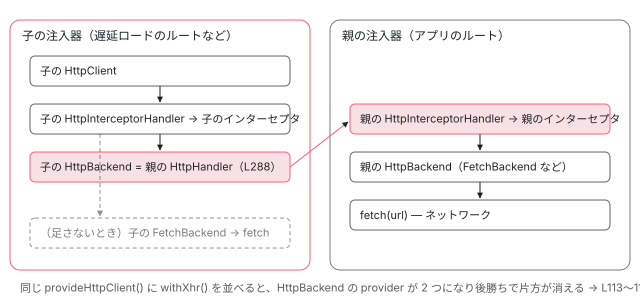

[目次](../README.md) › [HttpClient の内側](README.md) › 第 2 回 / 全 12 回

# provideHttpClient と features：HttpFeatureKind、既定の FetchBackend、withXhr

> provideHttpClient が HttpClient・FetchBackend・HttpInterceptorHandler と xsrfInterceptorFn を並べ、features の ɵproviders を後ろに足す行。v22 で HttpBackend の既定が FetchBackend になったこと、withXhr / withFetch / withInterceptors / withInterceptorsFromDi / withRequestsMadeViaParent / withJsonpSupport / withXsrfConfiguration が何を足すか、矛盾する組み合わせを開発ビルドで止める行、HttpClientModule が provideHttpClient(withInterceptorsFromDi(), withXhr()) を包むだけで出口は HttpXhrBackend になること、v22 では provideHttpClient が無くても HttpClient が root で使えること。

angular/angular · 読了 約 13 分 · 中核 · [サイトで読む（デモが動きます）](https://angular-deep-dive-cyan.vercel.app/chapter/http-provide)

---

`provideHttpClient(withInterceptors([auth]), withXhr())` と書いたとき、注入器には具体的に何が並ぶのでしょうか。この章では `provideHttpClient` が最初に並べる 6 つの provider と、features（`withXxx()` の戻り値）が後ろに足す provider を 1 行ずつ読み、v22 で既定のバックエンドが `FetchBackend` になっていること、矛盾する組み合わせを開発ビルドで止める行、`HttpClientModule` が同じ部品を包んでいるだけであることを確かめます。

読む対象は `packages/common/http/src/provider.ts`・`module.ts` と、挙動の根拠として `test/provider_spec.ts` です。

1. [1. 概観](01-http-overview.md)
2. **2. provideHttpClient と features**（この章）
3. [3. HttpClient.request](03-http-client-request.md)
4. [4. 不変なリクエスト](04-http-request-immutable.md)
5. [5. インターセプタの連鎖](05-http.md)
6. [6. FetchBackend](06-http-backend-fetch.md)
7. [7. HttpXhrBackend](07-http-backend-xhr.md)
8. [8. HttpEvent とエラー](08-http-response-errors.md)
9. [9. XSRF 対策](09-http-xsrf.md)
10. [10. JSONP](10-http-jsonp.md)
11. [11. SSR の転送キャッシュ](11-http-transfer-cache.md)
12. [12. テスト用バックエンド](12-http-testing.md)

## 1. HttpFeature は「種類の印」と「providers の配列」の組

📄 `angular/packages/common/http/src/provider.ts` L30–64 （▶ の行: 35, 44, 51–54, 56, 61–62, 64）

```ts
30 │ /**
31 │  * Identifies a particular kind of `HttpFeature`.
32 │  *
33 │  * @publicApi
34 │  */
35 ▶ export enum HttpFeatureKind {
36 │   Interceptors,
37 │   LegacyInterceptors,
38 │   CustomXsrfConfiguration,
39 │   NoXsrfProtection,
40 │   JsonpSupport,
41 │   RequestsMadeViaParent,
42 │   Fetch,
43 │   Xhr,
44 ▶ }
45 │ 
46 │ /**
47 │  * A feature for use when configuring `provideHttpClient`.
48 │  *
49 │  * @publicApi
50 │  */
51 ▶ export interface HttpFeature<KindT extends HttpFeatureKind> {
52 ▶   ɵkind: KindT;
53 ▶   ɵproviders: Provider[];
54 ▶ }
55 │ 
56 ▶ function makeHttpFeature<KindT extends HttpFeatureKind>(
57 │   kind: KindT,
58 │   providers: Provider[],
59 │ ): HttpFeature<KindT> {
60 │   return {
61 ▶     ɵkind: kind,
62 ▶     ɵproviders: providers,
63 │   };
64 ▶ }
```

35〜44 行目の `HttpFeatureKind` は 8 種類の列挙です。51〜54 行目、feature の中身は `ɵkind`（どの種類か）と `ɵproviders`（足す provider の配列）の 2 つだけです。56〜64 行目の `makeHttpFeature` はその 2 つを 1 つのオブジェクトにして返すだけの関数です。

つまり `withXhr()` などを呼んでも、その場では何も起きません。**provider の配列を作って返すだけ**です。`ɵkind` は次の節の矛盾チェックにだけ使われ、注入器には入りません。

## 2. provideHttpClient の本体

### 開発ビルドだけの矛盾チェック

📄 `angular/packages/common/http/src/provider.ts` L99–120 （▶ の行: 102–103, 105–106, 108, 110, 113–116）

```ts
 99 │ export function provideHttpClient(
100 │   ...features: HttpFeature<HttpFeatureKind>[]
101 │ ): EnvironmentProviders {
102 ▶   if (ngDevMode) {
103 ▶     const featureKinds = new Set(features.map((f) => f.ɵkind));
104 │     if (
105 ▶       featureKinds.has(HttpFeatureKind.NoXsrfProtection) &&
106 ▶       featureKinds.has(HttpFeatureKind.CustomXsrfConfiguration)
107 │     ) {
108 ▶       throw new Error(
109 │         `Configuration error: found both withXsrfConfiguration() and withNoXsrfProtection() in the same call to provideHttpClient(), which is a contradiction.`,
110 ▶       );
111 │     }
112 │ 
113 ▶     const hasBackendOverride =
114 ▶       featureKinds.has(HttpFeatureKind.Fetch) || featureKinds.has(HttpFeatureKind.Xhr);
115 ▶     if (featureKinds.has(HttpFeatureKind.RequestsMadeViaParent) && hasBackendOverride) {
116 ▶       throw new Error(
117 │         `Configuration error: withRequestsMadeViaParent() cannot be combined with withFetch() or withXhr() in the same call to provideHttpClient().`,
118 │       );
119 │     }
120 │   }
```

102 行目の `if (ngDevMode)` の中だけで検査します。`ngDevMode` は開発ビルドでは真、本番ビルドではビルド時に `false` に置き換わる定数なので、本番ではこの if ごと消えます。103 行目で渡された features の `ɵkind` を `Set` にし、105〜106 行目で `NoXsrfProtection` と `CustomXsrfConfiguration` が両方あれば 108 行目で `Error` を投げます（「XSRF を無効にする」と「XSRF の設定を変える」は同時に成り立たない）。113〜116 行目は、`withRequestsMadeViaParent()` と `withFetch()` / `withXhr()` の同時指定です。理由は 6 節で分かります。

### 最初に並べる 6 つ

📄 `angular/packages/common/http/src/provider.ts` L121–145 （▶ の行: 123–128, 130, 132–137, 140–142, 144）

```ts
121 │ 
122 │   const providers: Provider[] = [
123 ▶     HttpClient,
124 ▶     FetchBackend,
125 ▶     HttpInterceptorHandler,
126 ▶     {provide: HttpHandler, useExisting: HttpInterceptorHandler},
127 ▶     {
128 ▶       provide: HttpBackend,
129 │       useFactory: () => {
130 ▶         return inject(FetchBackend);
131 │       },
132 ▶     },
133 ▶     {
134 ▶       provide: HTTP_INTERCEPTOR_FNS,
135 ▶       useValue: xsrfInterceptorFn,
136 ▶       multi: true,
137 ▶     },
138 │   ];
139 │ 
140 ▶   for (const feature of features) {
141 ▶     providers.push(...feature.ɵproviders);
142 ▶   }
143 │ 
144 ▶   return makeEnvironmentProviders(providers);
145 │ }
```

1. **123 行目：`HttpClient`**

   クラスをそのまま書くと「そのクラスを new する」provider になります。この注入器専用の `HttpClient` が 1 つ作られます。
2. **124 行目：`FetchBackend`**

   出口のクラスそのもの。これもこの注入器で 1 つ作られます。
3. **125〜126 行目：`HttpInterceptorHandler` と `HttpHandler` → それ**

   `HttpClient` のコンストラクタが求める `HttpHandler` を、`useExisting` でインターセプタの連鎖を作るクラスに結びます（[第 1 回](01-http-overview.md)で見た抽象クラスの既定と同じ対応を、この注入器に明示的に置いています）。
4. **127〜132 行目：`HttpBackend` → `inject(FetchBackend)`**

   **既定の出口はここで決まります**。130 行目、`HttpBackend` を頼まれたら 124 行目の `FetchBackend` を返します。v22 では何も足さなければ `fetch` を使います。
5. **133〜137 行目：`HTTP_INTERCEPTOR_FNS` に `xsrfInterceptorFn`**

   136 行目の `multi: true` は「上書きせず配列に足す」指定です（[DI シリーズ第 9 回](../di/09-di-multi-providers.md)）。features より先に並ぶので、XSRF のインターセプタは `withInterceptors` で足した関数より前、連鎖の先頭になります。何をするかは [第 9 回](09-http-xsrf.md)。
6. **140〜142 行目：features の `ɵproviders` を後ろに足す**

   書いた順に、配列の末尾へ展開します。同じトークンを provide していれば、後ろにあるほうが勝ちます（`R3Injector` の `records.set` は後勝ち。[zoneless-default](../zoneless/01-zoneless-default.md) の 4 節）。`withXhr()` が 127 行目の `HttpBackend` を上書きできるのはこのためです。
7. **144 行目：`makeEnvironmentProviders(providers)`**

   戻り値は `EnvironmentProviders`。環境注入器（`bootstrapApplication` の providers、ルートの `providers`、`createEnvironmentInjector`）にしか置けず、コンポーネントの `providers` に書くとエラーになる型です。

### 書かなくても HttpClient は注入できる

では `provideHttpClient()` を 1 回も書かなかったらどうなるか。`HttpClient`・`HttpHandler`・`HttpBackend` はどれも `providedIn: 'root'` でした（[第 1 回](01-http-overview.md)）。残るインターセプタのトークンも、自分で既定値を持っています。

📄 `angular/packages/common/http/src/interceptor.ts` L199–205 （▶ の行: 204）

```ts
199 │ /**
200 │  * A multi-provided token of `HttpInterceptorFn`s.
201 │  */
202 │ export const HTTP_INTERCEPTOR_FNS = new InjectionToken<readonly HttpInterceptorFn[]>(
203 │   typeof ngDevMode !== 'undefined' && ngDevMode ? 'HTTP_INTERCEPTOR_FNS' : '',
204 ▶   {factory: () => [xsrfInterceptorFn]},
205 │ );
```

204 行目、誰も provide しなければ `factory` が `[xsrfInterceptorFn]` を返します。133〜137 行目と同じ中身です。その結果をテストが確かめています。

📄 `angular/packages/common/http/test/provider_spec.ts` L767–773 （▶ の行: 767–769, 772）

```ts
767 ▶   it('should work without providers', () => {
768 ▶     const client = TestBed.inject(HttpClient);
769 ▶     const backend = TestBed.inject(HttpBackend);
770 │ 
771 │     expect(client).toBeInstanceOf(HttpClient);
772 ▶     expect(backend).toBeInstanceOf(FetchBackend);
773 │   });
```

providers を 1 つも書かない TestBed で、768 行目の `HttpClient` も取れ、772 行目で `HttpBackend` は `FetchBackend` です。**v22 の `provideHttpClient()` は「使えるようにする」ためではなく、「features を足す」「この注入器に独立した一式を置く」ために書くもの**になっています。

## 3. features ごとに足される provider

| feature | ɵkind | 足す provider | 読む回 |
| --- | --- | --- | --- |
| `withInterceptors(fns)` | Interceptors | 関数ごとに `{HTTP_INTERCEPTOR_FNS, useValue: fn, multi}` | 5 |
| `withInterceptorsFromDi()` | LegacyInterceptors | `LEGACY_INTERCEPTOR_FN`（`legacyInterceptorFnFactory`）と、それを指す `HTTP_INTERCEPTOR_FNS` の multi | 5 |
| `withXsrfConfiguration({…})` | CustomXsrfConfiguration | 渡した分だけ `XSRF_COOKIE_NAME` / `XSRF_HEADER_NAME` | 9 |
| `withNoXsrfProtection()` | NoXsrfProtection | `XSRF_ENABLED` = `false` | 9 |
| `withJsonpSupport()` | JsonpSupport | `JsonpClientBackend`、`JsonpCallbackContext`、`jsonpInterceptorFn`（multi） | 10 |
| `withRequestsMadeViaParent()` | RequestsMadeViaParent | `HttpBackend` = 親の `HttpHandler` | 2（この章） |
| `withFetch()`（非推奨） | Fetch | `FetchBackend`、`HttpBackend` → `FetchBackend` | 6 |
| `withXhr()` | Xhr | `HttpXhrBackend`、`HttpBackend` → `HttpXhrBackend` | 7 |

表の 8 行がそのまま `HttpFeatureKind` の 8 種類です。1 行ずつ実物を見ます。`withInterceptorsFromDi()` の 2 つの provider は [DI シリーズ第 9 回](../di/09-di-multi-providers.md)で引用したので、ここでは省きます。

## 4. withInterceptors・XSRF・JSONP

📄 `angular/packages/common/http/src/provider.ts` L147–168 （▶ の行: 160, 162–164）

```ts
147 │ /**
148 │  * Adds one or more functional-style HTTP interceptors to the configuration of the `HttpClient`
149 │  * instance.
150 │  *
151 │  * @see {@link HttpInterceptorFn}
152 │  * @see {@link provideHttpClient}
153 │  * @publicApi
154 │  */
155 │ export function withInterceptors(
156 │   interceptorFns: HttpInterceptorFn[],
157 │ ): HttpFeature<HttpFeatureKind.Interceptors> {
158 │   return makeHttpFeature(
159 │     HttpFeatureKind.Interceptors,
160 ▶     interceptorFns.map((interceptorFn) => {
161 │       return {
162 ▶         provide: HTTP_INTERCEPTOR_FNS,
163 ▶         useValue: interceptorFn,
164 ▶         multi: true,
165 │       };
166 │     }),
167 │   );
168 │ }
```

160 行目、渡した関数の配列を `map` して、1 つの関数につき 1 つの multi provider にします。`withInterceptors` を 2 回書いても、どちらも `HTTP_INTERCEPTOR_FNS` の配列に積まれるだけです。並んだ配列から連鎖を組み立てる手順は [第 5 回](05-http.md)です。

📄 `angular/packages/common/http/src/provider.ts` L211–243 （▶ の行: 219–220, 222–224, 226, 239–240）

```ts
211 │ export function withXsrfConfiguration({
212 │   cookieName,
213 │   headerName,
214 │ }: {
215 │   cookieName?: string;
216 │   headerName?: string;
217 │ }): HttpFeature<HttpFeatureKind.CustomXsrfConfiguration> {
218 │   const providers: Provider[] = [];
219 ▶   if (cookieName !== undefined) {
220 ▶     providers.push({provide: XSRF_COOKIE_NAME, useValue: cookieName});
221 │   }
222 ▶   if (headerName !== undefined) {
223 ▶     providers.push({provide: XSRF_HEADER_NAME, useValue: headerName});
224 ▶   }
225 │ 
226 ▶   return makeHttpFeature(HttpFeatureKind.CustomXsrfConfiguration, providers);
227 │ }
228 │ 
229 │ /**
230 │  * Disables XSRF protection in the configuration of the current `HttpClient` instance.
231 │  *
232 │  * This feature is incompatible with the `withXsrfConfiguration` feature.
233 │  *
234 │  * @see {@link provideHttpClient}
235 │  */
236 │ export function withNoXsrfProtection(): HttpFeature<HttpFeatureKind.NoXsrfProtection> {
237 │   return makeHttpFeature(HttpFeatureKind.NoXsrfProtection, [
238 │     {
239 ▶       provide: XSRF_ENABLED,
240 ▶       useValue: false,
241 │     },
242 │   ]);
243 │ }
```

`withXsrfConfiguration` は 219〜224 行目で、**渡した名前だけ**をトークンにします。どちらも渡さなければ providers は空で、既定の名前（クッキー `XSRF-TOKEN`、ヘッダー `X-XSRF-TOKEN`）のままです。`withNoXsrfProtection` は 239〜240 行目で `XSRF_ENABLED` を `false` にするだけ。`xsrfInterceptorFn` 自体は連鎖に残り、中でこの値を見て何もせず次に渡します（[第 9 回](09-http-xsrf.md)）。

📄 `angular/packages/common/http/src/provider.ts` L245–257 （▶ の行: 249, 253–255）

```ts
245 │ /**
246 │  * Add JSONP support to the configuration of the current `HttpClient` instance.
247 │  *
248 │  * @see {@link provideHttpClient}
249 ▶  * @deprecated 22.1 JSONP is deprecated as it can cause XSS vulnerabilities. Use standard HTTP requests instead. Intent to remove in future versions of Angular.
250 │  */
251 │ export function withJsonpSupport(): HttpFeature<HttpFeatureKind.JsonpSupport> {
252 │   return makeHttpFeature(HttpFeatureKind.JsonpSupport, [
253 ▶     JsonpClientBackend,
254 ▶     {provide: JsonpCallbackContext, useFactory: jsonpCallbackContext},
255 ▶     {provide: HTTP_INTERCEPTOR_FNS, useValue: jsonpInterceptorFn, multi: true},
256 │   ]);
257 │ }
```

253〜255 行目、JSONP 用のバックエンドとコールバックの置き場と、インターセプタを 1 つ足します。`HttpBackend` は差し替えず、**インターセプタが `JSONP` メソッドのリクエストだけを横取りして `JsonpClientBackend` に回す**形です（[第 10 回](10-http-jsonp.md)）。249 行目のとおり 22.1 で非推奨になりました。

## 5. withFetch と withXhr：出口を差し替える

📄 `angular/packages/common/http/src/provider.ts` L305–339 （▶ の行: 308, 312–313, 324–325, 336–337）

```ts
305 │  * @see [Advanced fetch Options](guide/http/making-requests#advanced-fetch-options)
306 │  *
307 │  * @publicApi
308 ▶  * @deprecated `withFetch` is not required anymore. `FetchBackend` is the default `HttpBackend`.
309 │  */
310 │ export function withFetch(): HttpFeature<HttpFeatureKind.Fetch> {
311 │   return makeHttpFeature(HttpFeatureKind.Fetch, [
312 ▶     FetchBackend,
313 ▶     {provide: HttpBackend, useExisting: FetchBackend},
314 │   ]);
315 │ }
316 │ 
317 │ /**
318 │  * Configures the current `HttpClient` instance to make requests using the Xhr API.
319 │  *
320 │  * Use this feature if you want to report progress on uploads as the Xhr API supports it.
321 │  *
322 │  * <div class="docs-alert docs-alert-critical">
323 │  *
324 ▶  * Do not use {@link withXhr} in server-side rendering (SSR) environments. XHR support on the
325 ▶  * server is **deprecated** and is intended to be removed in Angular 23 because the underlying `xhr2`
326 │  * library does not safely handle redirects (e.g. it can forward `Authorization` headers on
327 │  * cross-origin redirects and is susceptible to denial-of-service via redirect loops).
328 │  *
329 │  * </div>
330 │  *
331 │  * @see {@link provideHttpClient}
332 │  * @publicApi
333 │  */
334 │ export function withXhr(): HttpFeature<HttpFeatureKind.Xhr> {
335 │   return makeHttpFeature(HttpFeatureKind.Xhr, [
336 ▶     HttpXhrBackend,
337 ▶     {provide: HttpBackend, useExisting: HttpXhrBackend},
338 │   ]);
339 │ }
```

312〜313 行目と 336〜337 行目は同じ形です。クラスを provide し、`HttpBackend` を `useExisting` でそれに向けます。2 節の 140〜142 行目で features は後ろに足されるので、127 行目の既定の `HttpBackend` はこれで上書きされます。

308 行目、`withFetch` は「もう要らない。`FetchBackend` が既定」として非推奨です。書いても 124・130 行目と同じ結果になります。324〜325 行目、`withXhr` を SSR で使うのは非推奨で、サーバー側の XHR は Angular 23 で削除予定と書かれています。アップロードの進捗が欲しいときに `withXhr` を選ぶ理由は [第 7 回](07-http-backend-xhr.md)で比べます。

## 6. withRequestsMadeViaParent：出口を「親の入口」にする

子の注入器（遅延ロードしたルートなど）でもう一度 `provideHttpClient()` を書くと、何が起きるでしょうか。2 節の 6 つが子にも並ぶので、子には**子専用の `HttpClient`・`HttpInterceptorHandler`・`FetchBackend`** ができます。テストがそれを確かめています。

📄 `angular/packages/common/http/test/provider_spec.ts` L395–420 （▶ の行: 397, 402, 415–418）

```ts
395 │         it('should have independent HTTP setups if not explicitly specified', async () => {
396 │           TestBed.configureTestingModule({
397 ▶             providers: [provideHttpClient(...commonHttpFeatures), provideHttpClientTesting()],
398 │           });
399 │ 
400 │           const child = createEnvironmentInjector(
401 │             [
402 ▶               provideHttpClient(),
403 │               {
404 │                 provide: XhrFactory,
405 │                 useValue: {
406 │                   build: () => {
407 │                     throw new Error('Request reached the "backend".');
408 │                   },
409 │                 },
410 │               },
411 │             ],
412 │             TestBed.inject(EnvironmentInjector),
413 │           );
414 │ 
415 ▶           // Because `child` is an entirely independent HTTP context, it is not connected to the
416 ▶           // HTTP testing backend from the parent injector, and requests attempted via the child's
417 ▶           // `HttpClient` will fail.
418 ▶           await expectAsync(child.get(HttpClient).get('/test').toPromise()).toBeRejected();
419 │         });
420 │ 
```

397 行目、親は `provideHttpClientTesting()` でテスト用のバックエンドに差し替えています。402 行目で子にもう一度 `provideHttpClient()` を書くと、415〜417 行目のコメントのとおり、子は親のテスト用バックエンドに**つながらない**独立した一式になり、418 行目で子からのリクエストは失敗します。次に引用する provider.ts 263〜265 行目のコメントにも、親でインターセプタを設定していても子の `HttpClient` のリクエストには効かない、と書かれています。

子のインターセプタを通したあと、親の連鎖にも通したいときに使うのが `withRequestsMadeViaParent()` です。

📄 `angular/packages/common/http/src/provider.ts` L259–298 （▶ の行: 263–265, 267–269, 286, 288–289, 293–294）

```ts
259 │ /**
260 │  * Configures the current `HttpClient` instance to make requests via the parent injector's
261 │  * `HttpClient` instead of directly.
262 │  *
263 ▶  * By default, `provideHttpClient` configures `HttpClient` in its injector to be an independent
264 ▶  * instance. For example, even if `HttpClient` is configured in the parent injector with
265 ▶  * one or more interceptors, they will not intercept requests made via this instance.
266 │  *
267 ▶  * With this option enabled, once the request has passed through the current injector's
268 ▶  * interceptors, it will be delegated to the parent injector's `HttpClient` chain instead of
269 ▶  * dispatched directly, and interceptors in the parent configuration will be applied to the request.
270 │  *
271 │  * If there are several `HttpClient` instances in the injector hierarchy, it's possible for
272 │  * `withRequestsMadeViaParent` to be used at multiple levels, which will cause the request to
273 │  * "bubble up" until either reaching the root level or an `HttpClient` which was not configured with
274 │  * this option.
275 │  *
276 │  * This feature cannot be combined with `withFetch` or `withXhr` in the same
277 │  * `provideHttpClient()` call.
278 │  *
279 │  * @see [HTTP client setup](guide/http/setup#withrequestsmadeviaparent)
280 │  * @see {@link provideHttpClient}
281 │  * @publicApi 19.0
282 │  */
283 │ export function withRequestsMadeViaParent(): HttpFeature<HttpFeatureKind.RequestsMadeViaParent> {
284 │   return makeHttpFeature(HttpFeatureKind.RequestsMadeViaParent, [
285 │     {
286 ▶       provide: HttpBackend,
287 │       useFactory: () => {
288 ▶         const handlerFromParent = inject(HttpHandler, {skipSelf: true, optional: true});
289 ▶         if (ngDevMode && handlerFromParent === null) {
290 │           throw new Error(
291 │             'withRequestsMadeViaParent() can only be used when the parent injector also configures HttpClient',
292 │           );
293 ▶         }
294 ▶         return handlerFromParent;
295 │       },
296 │     },
297 │   ]);
298 │ }
```

263〜265 行目が既定の振る舞い（独立）、267〜269 行目がこの feature を足したときの振る舞い（子のインターセプタを通ったあと、親の `HttpClient` の連鎖に渡す）です。

1. **286 行目：差し替えるのは `HttpBackend` だけ**

   子の `HttpClient`・`HttpInterceptorHandler`・子のインターセプタは 2 節のとおり子に作られます。変わるのは連鎖の「出口」だけです。
2. **288 行目：`inject(HttpHandler, {skipSelf: true, optional: true})`**

   `skipSelf` は「自分の注入器を飛ばして親から探す」指定です（[DI シリーズ第 12 回](../di/12-di-resolution-flags.md)）。親の `HttpHandler`、つまり**親の `HttpInterceptorHandler`**（親の連鎖の入口）が取れます。
3. **289〜293 行目：親に HttpClient の設定が無ければ開発ビルドで Error**

   `optional: true` なので見つからなければ `null`。開発ビルドではそれを Error にします。
4. **294 行目：それを子の `HttpBackend` として返す**

   子の連鎖の最後の `next` は `this.backend.handle(req)` を呼ぶので、その先は親の連鎖の入口です。リクエストは「子のインターセプタ → 親のインターセプタ → 親の `HttpBackend`」と**泡のように上へ**のぼります。



*withRequestsMadeViaParent() を足した子の注入器。子の連鎖の出口（HttpBackend）が、親の連鎖の入口（親の HttpInterceptorHandler）になる。足さなければ点線のとおり子の FetchBackend に出る。*

これで 2 節の 113〜116 行目の理由が分かります。`withRequestsMadeViaParent()` と `withXhr()` はどちらも `HttpBackend` を provide するので、同じ呼び出しに並べると後ろのほうが勝って、片方の指定が黙って消えます。それを開発ビルドで止めているのです。root の注入器だけに置くインターセプタ（`HTTP_ROOT_INTERCEPTOR_FNS`）が親子で 2 回走らないようにする判定は、`HttpInterceptorHandler.handle` の中にあります（[第 5 回](05-http.md)）。

## 7. HttpClientModule と仲間たち：同じ部品の包み直し

📄 `angular/packages/common/http/src/module.ts` L87–99 （▶ の行: 91–92, 94–95, 98）

```ts
87 │ /**
88 │  * Configures the dependency injector for `HttpClient`
89 │  * with supporting services for XSRF. Automatically imported by `HttpClientModule`.
90 │  *
91 ▶  * You can add interceptors to the chain behind `HttpClient` by binding them to the
92 ▶  * multiprovider for built-in DI token `HTTP_INTERCEPTORS`.
93 │  *
94 ▶  * When importing the `HttpClientModule`, the `HttpBackend` is set to using the `HttpXhrBackend`.
95 ▶  * If you want to use the `FetchBackend`, use `provideHttpClient` instead.
96 │  *
97 │  * @publicApi
98 ▶  * @deprecated use `provideHttpClient(withInterceptorsFromDi())` as providers instead
99 │  */
```

`HttpClientModule` の `providers` は `provideHttpClient(withInterceptorsFromDi(), withXhr())` の 1 行だけです（その行は [NgModule シリーズの importProvidersFrom の章](../ngmodule/14-ngmodule-import-providers-from.md)で引用しています）。つまり 94〜95 行目のコメントのとおり、**`HttpClientModule` を使うと出口は `HttpXhrBackend`** で、91〜92 行目のとおりクラスのインターセプタ（`HTTP_INTERCEPTORS`）も読まれます。98 行目で非推奨になっており、代わりは `provideHttpClient(withInterceptorsFromDi())` と書かれています。この書き換えをすると出口が `FetchBackend` に変わる点に注意してください。

📄 `angular/packages/common/http/src/module.ts` L43–64 （▶ の行: 45–46, 48, 51–52, 62）

```ts
43 │ @NgModule({
44 │   providers: [
45 ▶     HttpXsrfInterceptor,
46 ▶     {provide: HTTP_INTERCEPTORS, useExisting: HttpXsrfInterceptor, multi: true},
47 │     {provide: HttpXsrfTokenExtractor, useClass: HttpXsrfCookieExtractor},
48 ▶     withXsrfConfiguration({
49 │       cookieName: XSRF_DEFAULT_COOKIE_NAME,
50 │       headerName: XSRF_DEFAULT_HEADER_NAME,
51 ▶     }).ɵproviders,
52 ▶     {provide: XSRF_ENABLED, useValue: true},
53 │   ],
54 │ })
55 │ export class HttpClientXsrfModule {
56 │   /**
57 │    * Disable the default XSRF protection.
58 │    */
59 │   static disable(): ModuleWithProviders<HttpClientXsrfModule> {
60 │     return {
61 │       ngModule: HttpClientXsrfModule,
62 ▶       providers: [withNoXsrfProtection().ɵproviders],
63 │     };
64 │   }
```

`HttpClientXsrfModule` は少し違います。45〜46 行目でクラス版の `HttpXsrfInterceptor` を `HTTP_INTERCEPTORS` に登録し、48〜51 行目で `withXsrfConfiguration(...)` の `.ɵproviders` を**取り出して**自分の providers に入れています。62 行目の `disable()` も `withNoXsrfProtection().ɵproviders` です。feature 関数が「provider の配列を返すだけ」（1 節）だから、NgModule の中でも部品として使い回せます。

📄 `angular/packages/common/http/src/module.ts` L109–121 （▶ の行: 119）

```ts
109 │ /**
110 │  * Configures the dependency injector for `HttpClient`
111 │  * with supporting services for JSONP.
112 │  * Without this module, Jsonp requests reach the backend
113 │  * with method JSONP, where they are rejected.
114 │  *
115 │  * @publicApi
116 │  * @deprecated 22.1 JSONP is deprecated as it can cause XSS vulnerabilities. Intent to remove in future versions of Angular.
117 │  */
118 │ @NgModule({
119 ▶   providers: [withJsonpSupport().ɵproviders],
120 │ })
121 │ export class HttpClientJsonpModule {}
```

119 行目、`HttpClientJsonpModule` も `withJsonpSupport().ɵproviders` をそのまま並べるだけです。

> **🧪 DEMO — 子の環境注入器を作って inject(HttpBackend) の正体を調べる**
>
> ボタンを押すと `createEnvironmentInjector([...], 章の注入器)` で子の注入器を作り、`get(HttpBackend)` を `instanceof` で調べます。リクエストは送りません。本番ビルドではクラス名が短くなるので、名前ではなく `instanceof` の結果を表示しています。
>
> ▶ [このデモはサイトで動かせます](https://angular-deep-dive-cyan.vercel.app/chapter/http-provide)

「何も書かない」と `provideHttpClient()` はどちらも `FetchBackend`（2 節の 130 行目と、ルートの既定）。`withXhr()` と `HttpClientModule` は `HttpXhrBackend`（5 節の 337 行目。モジュールは中で `withXhr()` を呼ぶ）。`withRequestsMadeViaParent()` は、どちらのバックエンドでもなく**親の `HttpHandler` と同じインスタンス**です（6 節の 288・294 行目）。矛盾する組み合わせのボタンは、このページを開発ビルド（`ng serve`）で見ていれば 108 行目と 116 行目の Error の文面を表示し、本番ビルドなら「例外なし」を表示します。102 行目の `if (ngDevMode)` が本番では消えるからです。

## ここまでの呼び出し

- 👤 `provideHttpClient(withInterceptors([auth]), withXhr())` — app.config.ts
  - `withInterceptors([auth])` — provider.ts L155 — *{HTTP\_INTERCEPTOR\_FNS, useValue: auth, multi} を 1 つ持つ feature*
  - `withXhr()` — provider.ts L334 — *HttpXhrBackend と HttpBackend → HttpXhrBackend*
  - `provideHttpClient(...features)` — provider.ts L99 — *ngDevMode なら ɵkind の矛盾を検査*
    - `[HttpClient, FetchBackend, HttpInterceptorHandler, HttpHandler, HttpBackend, xsrfInterceptorFn]` — provider.ts L122
    - `providers.push(...feature.ɵproviders)` — provider.ts L141 — *auth の multi と、HttpBackend の上書きが後ろに並ぶ*
    - `makeEnvironmentProviders(providers)` — provider.ts L144
  - `R3Injector.processProvider` × 件数 — core/src/di/r3\_injector.ts — *HttpBackend は後勝ちで HttpXhrBackend。HTTP\_INTERCEPTOR\_FNS は \[xsrfInterceptorFn, auth\]*

## 聞かれそうな質問

**Q. provideHttpClient を 2 回書くとどうなりますか？**

**同じ注入器に 2 回**なら、2 つの配列がつながって 1 つの注入器に入ります。`HttpClient` や `HttpBackend` のような普通のトークンは後勝ちなので、たとえば `provideHttpClient(withXhr())` の後ろに `provideHttpClient()` を書くと、後ろの 127〜132 行目が勝って出口は `FetchBackend` に戻ります。`withInterceptors` の関数は multi なので両方の分が積まれます。`xsrfInterceptorFn` も 2 回積まれますが、連鎖を組み立てるときに `Set` で重複が除かれます（[第 5 回](05-http.md)）。

**子の注入器に**もう一度書いたなら、子には独立した一式ができます（provider\_spec.ts 415〜418 行目）。親のインターセプタは効きません。親の連鎖も通したいなら子の側に `withRequestsMadeViaParent()` を足します（288 行目）。

**Q. HttpClientModule はまだ使えますか？provideHttpClient と何が違いますか？**

使えますが非推奨です（module.ts 98 行目）。中身は `provideHttpClient(withInterceptorsFromDi(), withXhr())` なので、違いは 2 つ。出口が `HttpXhrBackend` であること（94〜95 行目）と、クラスのインターセプタ（`HTTP_INTERCEPTORS`）が有効なこと（91〜92 行目）です。`provideHttpClient()` だけに置き換えると、`fetch` に変わり、クラスのインターセプタは読まれなくなります。挙動を変えたくなければ `withInterceptorsFromDi()` と `withXhr()` を足します。

**Q. withFetch() はもう書かなくていいのですか？**

書かなくて構いません。308 行目で非推奨になっており、中身（312〜313 行目）は既定の 124・130 行目と同じく `FetchBackend` を出口にするだけです。書いたまま `withRequestsMadeViaParent()` と同じ呼び出しに並べると、113〜116 行目の検査で開発ビルドが止まる点だけ注意してください。

**Q. provideHttpClient を書かずに inject(HttpClient) したらエラーになりますか？**

なりません。`HttpClient`・`HttpHandler`・`HttpBackend` はルートに既定があり、`HTTP_INTERCEPTOR_FNS` も 204 行目の factory で `[xsrfInterceptorFn]` を返すので、provider\_spec.ts 767〜772 行目のとおり `FetchBackend` を使う `HttpClient` が取れます。インターセプタを足すなど features を使いたいときに `provideHttpClient(...)` を書きます。

**Q. withXsrfConfiguration と withNoXsrfProtection を両方書くとどうなりますか？**

開発ビルドでは 105〜110 行目で `provideHttpClient(...)` を呼んだ瞬間に Error になります。本番ビルドでは 102 行目の検査が消えるので Error にはならず、両方の provider が並びます。そのとき `XSRF_ENABLED` は `false`（240 行目）なので、XSRF のヘッダーは付きません。

## 読み終えて

- feature は `{ɵkind, ɵproviders}` の組。`withXxx()` は provider の配列を作って返すだけ
- `provideHttpClient` は 6 つの provider を先に並べ、features を後ろに足す。同じトークンは後勝ちなので `withXhr()` が出口を上書きできる
- v22 の既定の出口は `FetchBackend`（130 行目）。`withFetch()` は非推奨、`HttpClientModule` は中で `withXhr()` を使う
- 子の注入器の `provideHttpClient()` は独立した一式。`withRequestsMadeViaParent()` は子の出口を親の `HttpHandler` にする
- 矛盾する組み合わせの検査は `if (ngDevMode)` の中だけ。本番ビルドでは止まらない

---

← 前: [HttpClient の概観：get() から fetch() まで、関数 6 つの 1 本道](01-http-overview.md)  
次: [HttpClient.request：オーバーロードの山と、冷たい Observable と observe](03-http-client-request.md) →
