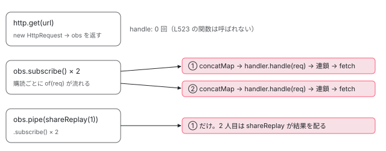

[目次](../README.md) › [HttpClient の内側](README.md) › 第 3 回 / 全 12 回

# HttpClient.request：オーバーロードの山と、冷たい Observable と observe

> get / post などがすべて request に集まり、request が HttpRequest を作って of(req).pipe(concatMap((req) =&gt; this.handler.handle(req))) にする行。購読するまで送られない理由、2 回購読すると 2 回送られる理由、observe が events / response / body のときの filter と map、responseType ごとの型の付け方（オーバーロード）と実行時のチェック。

angular/angular · 読了 約 13 分 · 中核 · [サイトで読む（デモが動きます）](https://angular-deep-dive-cyan.vercel.app/chapter/http-client-request)

---

`HttpClient` の `get`・`post`・`put` などは、どれも最後は `request` という 1 つのメソッドを呼びます。この章では `request` の本体を最初の行から最後の行まで読み、**購読するまで何も送られない理由**、**2 回購読すると 2 回送られる理由**、`observe` と `responseType` によって返ってくるものが変わる仕組み（型はオーバーロード、実行時は `filter` と `map`）を確かめます。

読む対象は `packages/common/http/src/client.ts`（2667 行の大半がオーバーロードの宣言です）と `errors.ts` です。

1. [1. 概観](01-http-overview.md)
2. [2. provideHttpClient と features](02-http-provide.md)
3. **3. HttpClient.request**（この章）
4. [4. 不変なリクエスト](04-http-request-immutable.md)
5. [5. インターセプタの連鎖](05-http.md)
6. [6. FetchBackend](06-http-backend-fetch.md)
7. [7. HttpXhrBackend](07-http-backend-xhr.md)
8. [8. HttpEvent とエラー](08-http-response-errors.md)
9. [9. XSRF 対策](09-http-xsrf.md)
10. [10. JSONP](10-http-jsonp.md)
11. [11. SSR の転送キャッシュ](11-http-transfer-cache.md)
12. [12. テスト用バックエンド](12-http-testing.md)

## 1. オーバーロードの山：型だけを決める宣言

client.ts の大部分は、中身の無いメソッド宣言の繰り返しです。数えると `request` が 17 個、`get`・`post`・`put`・`patch`・`delete`・`head`・`options` が 15 個ずつ並び、その後ろに 1 つだけ本体があります。TypeScript の**オーバーロード**（同じ名前で引数の形ごとに戻り値の型を書き分ける仕組み）です。1 つだけ例を見ます。

📄 `angular/packages/common/http/src/client.ts` L935–950 （▶ の行: 944, 947–948, 950）

```ts
935 │   /**
936 │    * Constructs a `GET` request that interprets the body as a text string
937 │    * and returns the response as a string value.
938 │    *
939 │    * @param url     The endpoint URL.
940 │    * @param options The HTTP options to send with the request.
941 │    *
942 │    * @return An `Observable` of the response, with the response body of type string.
943 │    */
944 ▶   get(
945 │     url: string,
946 │     options: {
947 ▶       observe?: 'body';
948 ▶       responseType: 'text';
949 │     } & HttpClientCommonOptions,
950 ▶   ): Observable<string>;
```

948 行目、`responseType: 'text'` は `?` の付かない**必須のプロパティ**で、型は文字列そのもの（リテラル型）です。呼び出しで `{ responseType: 'text' }` と書いたときだけこの宣言に当てはまり、950 行目の `Observable<string>` が戻り値の型になります。`'arraybuffer'`・`'blob'` も同じ形の宣言がその直前にあります。

📄 `angular/packages/common/http/src/client.ts` L1145–1175 （▶ の行: 1154, 1157–1158, 1160, 1167, 1173–1175）

```ts
1145 │   /**
1146 │    * Constructs a `GET` request that interprets the body as JSON and returns
1147 │    * the response body in a given type.
1148 │    *
1149 │    * @param url     The endpoint URL.
1150 │    * @param options The HTTP options to send with the request.
1151 │    *
1152 │    * @return An `Observable` of the `HttpResponse`, with a response body in the requested type.
1153 │    */
1154 ▶   get<T>(
1155 │     url: string,
1156 │     options?: {
1157 ▶       observe?: 'body';
1158 ▶       responseType?: 'json';
1159 │     } & HttpClientCommonOptions,
1160 ▶   ): Observable<T>;
1161 │ 
1162 │   /**
1163 │    * Constructs an observable that, when subscribed, causes the configured
1164 │    * `GET` request to execute on the server. See the individual overloads for
1165 │    * details on the return type.
1166 │    */
1167 ▶   get(
1168 │     url: string,
1169 │     options: {
1170 │       observe?: 'body' | 'events' | 'response';
1171 │       responseType?: 'arraybuffer' | 'blob' | 'json' | 'text';
1172 │     } & HttpClientCommonOptions = {},
1173 ▶   ): Observable<any> {
1174 ▶     return this.request<any>('GET', url, options as any);
1175 ▶   }
```

1154〜1160 行目は `http.get<Hero[]>(url)` と書いたときに選ばれる宣言です。`observe` も `responseType` も省略可能で、戻り値は 1160 行目の `Observable<T>`。**`T` は実行時に何も確かめません**。型を名乗っているだけです。

1167〜1175 行目が `get` の本体（実装シグネチャ）です。外からは見えず、1174 行目で `'GET'` を付けて `request` を呼ぶだけ。`options as any` で、ここまでに付けた型を一度捨てています。

### body を持つメソッドは addBody を通る

📄 `angular/packages/common/http/src/client.ts` L2353–2368 （▶ の行: 2359, 2361, 2367）

```ts
2353 │   /**
2354 │    * Constructs an observable that, when subscribed, causes the configured
2355 │    * `POST` request to execute on the server. The server responds with the location of
2356 │    * the replaced resource. See the individual overloads for
2357 │    * details on the return type.
2358 │    */
2359 ▶   post(
2360 │     url: string,
2361 ▶     body: any | null,
2362 │     options: {
2363 │       observe?: 'body' | 'events' | 'response';
2364 │       responseType?: 'arraybuffer' | 'blob' | 'json' | 'text';
2365 │     } & HttpClientCommonOptions = {},
2366 │   ): Observable<any> {
2367 ▶     return this.request<any>('POST', url, addBody(options, body));
2368 │   }
```

📄 `angular/packages/common/http/src/client.ts` L33–48 （▶ の行: 43, 45–46）

```ts
33 │ /**
34 │  * Constructs an instance of `HttpRequestOptions<T>` from a source `HttpMethodOptions` and
35 │  * the given `body`. This function clones the object and adds the body.
36 │  *
37 │  * Note that the `responseType` *options* value is a String that identifies the
38 │  * single data type of the response.
39 │  * A single overload version of the method handles each response type.
40 │  * The value of `responseType` cannot be a union, as the combined signature could imply.
41 │  *
42 │  */
43 ▶ function addBody<T>(options: HttpClientCommonOptions, body: T | null): any {
44 │   return {
45 ▶     body,
46 ▶     ...options,
47 │   };
48 │ }
```

`post` は 2361 行目で `body` を別の引数で受け取り、2367 行目で `addBody(options, body)` を通してから `request` に渡します。`addBody` は 45〜46 行目で `{ body, ...options }` を作るだけです。`put`・`patch` も同じ形で、`get`・`delete`・`head`・`options` は `options` をそのまま渡します。つまり **`request` から見ると、どのメソッドも「メソッド名・URL・options（body 入り）」の 3 つ**です。

## 2. request の本体：引数を HttpRequest にする

📄 `angular/packages/common/http/src/client.ts` L457–477 （▶ の行: 458, 464, 468, 471）

```ts
457 │   request(
458 ▶     first: string | HttpRequest<any>,
459 │     url?: string,
460 │     options: {
461 │       body?: any;
462 │       observe?: 'body' | 'events' | 'response';
463 │       responseType?: 'arraybuffer' | 'blob' | 'json' | 'text';
464 ▶     } & HttpClientCommonOptions = {},
465 │   ): Observable<any> {
466 │     let req: HttpRequest<any>;
467 │     // First, check whether the primary argument is an instance of `HttpRequest`.
468 ▶     if (first instanceof HttpRequest) {
469 │       // It is. The other arguments must be undefined (per the signatures) and can be
470 │       // ignored.
471 ▶       req = first;
472 │     } else {
473 │       // It's a string, so it represents a URL. Construct a request based on it,
474 │       // and incorporate the remaining arguments (assuming `GET` unless a method is
475 │       // provided.
476 │ 
477 │       // Figure out the headers.
```

458 行目、第 1 引数は文字列（メソッド名）か、作り済みの `HttpRequest` のどちらかです。468〜471 行目、`HttpRequest` ならそれをそのまま使います。464 行目の `= {}` で `options` が省略されても空オブジェクトになります。

📄 `angular/packages/common/http/src/client.ts` L478–511 （▶ の行: 479, 482–483, 487–488, 491–492, 495, 503）

```ts
478 │       let headers: HttpHeaders | undefined = undefined;
479 ▶       if (options.headers instanceof HttpHeaders) {
480 │         headers = options.headers;
481 │       } else {
482 ▶         headers = new HttpHeaders(options.headers);
483 ▶       }
484 │ 
485 │       // Sort out parameters.
486 │       let params: HttpParams | undefined = undefined;
487 ▶       if (!!options.params) {
488 ▶         if (options.params instanceof HttpParams) {
489 │           params = options.params;
490 │         } else {
491 ▶           params = new HttpParams({fromObject: options.params} as HttpParamsOptions);
492 ▶         }
493 │       }
494 │       // Construct the request.
495 ▶       req = new HttpRequest(first, url!, options.body !== undefined ? options.body : null, {
496 │         headers,
497 │         context: options.context,
498 │         params,
499 │         reportProgress: options.reportProgress,
500 │         reportUploadProgress: options.reportUploadProgress,
501 │         reportDownloadProgress: options.reportDownloadProgress,
502 │         // By default, JSON is assumed to be returned for all calls.
503 ▶         responseType: options.responseType || 'json',
504 │         withCredentials: options.withCredentials,
505 │         transferCache: options.transferCache,
506 │         keepalive: options.keepalive,
507 │         priority: options.priority,
508 │         cache: options.cache,
509 │         mode: options.mode,
510 │         redirect: options.redirect,
511 │         credentials: options.credentials,
```

1. **479〜483 行目：ヘッダーを `HttpHeaders` にする**

   すでに `HttpHeaders` ならそのまま、ただのオブジェクト（または省略）なら 482 行目で `new HttpHeaders(...)`。省略しても空の `HttpHeaders` ができます。
2. **487〜492 行目：クエリパラメータを `HttpParams` にする**

   こちらは 487 行目の `!!options.params` で、省略されたら `undefined` のままです。オブジェクトなら 491 行目で `fromObject` として包みます。
3. **495 行目：`new HttpRequest(first, url!, body, {...})`**

   `body` が `undefined` なら `null` にし、残りの options を 1 つずつ写します。503 行目、**`responseType` を省略すると `'json'`**。コンストラクタの中身と、作ったあとに変えられない理由は [第 4 回](04-http-request-immutable.md)です。

ここまでは `get()` を呼んだ時点で同期的に実行されます。`HttpRequest` はできあがりますが、まだどこにも渡していません。

## 3. 冷たい Observable：of(req).pipe(concatMap(...))

📄 `angular/packages/common/http/src/client.ts` L512–524 （▶ の行: 518–524）

```ts
512 │         referrer: options.referrer,
513 │         referrerPolicy: options.referrerPolicy,
514 │         integrity: options.integrity,
515 │         timeout: options.timeout,
516 │       });
517 │     }
518 ▶     // Start with an Observable.of() the initial request, and run the handler (which
519 ▶     // includes all interceptors) inside a concatMap(). This way, the handler runs
520 ▶     // inside an Observable chain, which causes interceptors to be re-run on every
521 ▶     // subscription (this also makes retries re-run the handler, including interceptors).
522 ▶     const events$: Observable<HttpEvent<any>> = of(req).pipe(
523 ▶       concatMap((req: HttpRequest<any>) => this.handler.handle(req)),
524 ▶     );
```

522〜524 行目がこの章の中心です（同じ行は [httpResource の章](../signals/16-signals-http-resource.md)でも引用しています）。`of(req)` は「購読されたら `req` を 1 つ流して完了する」Observable、`concatMap(fn)` は「流れてきた値ごとに `fn` を呼び、`fn` が返した Observable を購読してその値を流す」演算子です。

1. **`get()` の戻り値は、組み立てただけの Observable**

   `of` も `pipe` も、呼んだだけでは何も流しません。523 行目の `this.handler.handle(req)` は `concatMap` に渡した関数の*中*にあるので、この時点では呼ばれていません。購読者が現れるまで何もしない Observable を「冷たい（cold）」と呼びます。
2. **`subscribe()` した瞬間に `of(req)` が `req` を流す**

   それを受けた `concatMap` が 523 行目の関数を呼び、`HttpInterceptorHandler.handle(req)`（[第 1 回](01-http-overview.md)の中継役）が初めて動きます。インターセプタの連鎖 → `FetchBackend` の順に進むのはここからです。
3. **もう 1 回 `subscribe()` すると、もう 1 回 `of(req)` が流れる**

   `of` は購読ごとに最初から値を流すので、523 行目の関数も購読ごとに呼ばれます。**2 回購読すれば `handler.handle` が 2 回呼ばれ、リクエストは 2 回送られます**。518〜521 行目のコメントのとおり、これはわざとで、購読のたびにインターセプタが走り直し、`retry`（エラーのとき購読し直す演算子）でもインターセプタから再実行されます。



*get() は Observable を組み立てて返すだけ。購読のたびに of(req) が req を流し、concatMap が handler.handle(req) を呼ぶ。shareReplay(1) を挟むと元の Observable への購読は 1 本になる。*

> [!WARNING]
> **ハマりどころ**
>
> テンプレートで `async` パイプを 2 か所に書く、`subscribe` の中でもう一度同じ Observable を `subscribe` する、といった書き方をすると、気付かないうちに同じリクエストが 2 回出ます。1 回の通信を何か所かで使いたいときは `shareReplay(1)` などで 1 つの購読を共有するか、`toSignal` や [`httpResource`](../signals/16-signals-http-resource.md) で値として持ちます。

## 4. observe：イベントの列から何を取り出すか

📄 `angular/packages/common/http/src/client.ts` L529–547 （▶ の行: 529–530, 536–538, 541, 543–547）

```ts
529 ▶     if (first instanceof HttpRequest || options.observe === 'events') {
530 ▶       return events$;
531 │     }
532 │ 
533 │     // The requested stream contains either the full response or the body. In either
534 │     // case, the first step is to filter the event stream to extract a stream of
535 │     // responses(s).
536 ▶     const res$: Observable<HttpResponse<any>> = <Observable<HttpResponse<any>>>(
537 ▶       events$.pipe(filter((event: HttpEvent<any>) => event instanceof HttpResponse))
538 ▶     );
539 │ 
540 │     // Decide which stream to return.
541 ▶     switch (options.observe || 'body') {
542 │       case 'body':
543 ▶         // The requested stream is the body. Map the response stream to the response
544 ▶         // body. This could be done more simply, but a misbehaving interceptor might
545 ▶         // transform the response body into a different format and ignore the requested
546 ▶         // responseType. Guard against this by validating that the response is of the
547 ▶         // requested type.
```

1. **529〜530 行目：`observe: 'events'`（または `HttpRequest` を渡した）ならそのまま返す**

   3 節の `events$`、つまり `Sent`・`ResponseHeader`・`DownloadProgress`・`Response` などすべての `HttpEvent` が購読者に届きます。
2. **536〜538 行目：それ以外はまず `HttpResponse` だけに絞る**

   537 行目の `filter(event => event instanceof HttpResponse)` で、`Sent` も途中経過も捨てます。インターセプタが自分で流した `User` イベントもここで落ちます。
3. **541 行目：`observe` を省略したら `'body'`**

   `'response'` なら絞った `HttpResponse` をそのまま返し（次の引用の 593〜595 行目）、`'body'` なら `responseType` ごとに本文を取り出します。

## 5. responseType：実行時にもう一度確かめる

📄 `angular/packages/common/http/src/client.ts` L548–574 （▶ の行: 548, 553–554, 559, 566）

```ts
548 ▶         switch (req.responseType) {
549 │           case 'arraybuffer':
550 │             return res$.pipe(
551 │               map((res: HttpResponse<any>) => {
552 │                 // Validate that the body is an ArrayBuffer.
553 ▶                 if (res.body !== null && !(res.body instanceof ArrayBuffer)) {
554 ▶                   throw new RuntimeError(
555 │                     RuntimeErrorCode.RESPONSE_IS_NOT_AN_ARRAY_BUFFER,
556 │                     ngDevMode && 'Response is not an ArrayBuffer.',
557 │                   );
558 │                 }
559 ▶                 return res.body;
560 │               }),
561 │             );
562 │           case 'blob':
563 │             return res$.pipe(
564 │               map((res: HttpResponse<any>) => {
565 │                 // Validate that the body is a Blob.
566 ▶                 if (res.body !== null && !(res.body instanceof Blob)) {
567 │                   throw new RuntimeError(
568 │                     RuntimeErrorCode.RESPONSE_IS_NOT_A_BLOB,
569 │                     ngDevMode && 'Response is not a Blob.',
570 │                   );
571 │                 }
572 │                 return res.body;
573 │               }),
574 │             );
```

📄 `angular/packages/common/http/src/client.ts` L575–603 （▶ の行: 579–581, 583, 585, 590–591, 593, 595, 598）

```ts
575 │           case 'text':
576 │             return res$.pipe(
577 │               map((res: HttpResponse<any>) => {
578 │                 // Validate that the body is a string.
579 ▶                 if (res.body !== null && typeof res.body !== 'string') {
580 ▶                   throw new RuntimeError(
581 ▶                     RuntimeErrorCode.RESPONSE_IS_NOT_A_STRING,
582 │                     ngDevMode && 'Response is not a string.',
583 ▶                   );
584 │                 }
585 ▶                 return res.body;
586 │               }),
587 │             );
588 │           case 'json':
589 │           default:
590 ▶             // No validation needed for JSON responses, as they can be of any type.
591 ▶             return res$.pipe(map((res: HttpResponse<any>) => res.body));
592 │         }
593 ▶       case 'response':
594 │         // The response stream was requested directly, so return it.
595 ▶         return res$;
596 │       default:
597 │         // Guard against new future observe types being added.
598 ▶         throw new RuntimeError(
599 │           RuntimeErrorCode.UNHANDLED_OBSERVE_TYPE,
600 │           ngDevMode && `Unreachable: unhandled observe type ${options.observe}}`,
601 │         );
602 │     }
603 │   }
```

548 行目は `options.responseType` ではなく、2 節で作った `req.responseType` を見ています（省略なら `'json'`）。`'arraybuffer'`・`'blob'`・`'text'` のときは、本文を返す前に 553・566・579 行目で**本当にその型か**を確かめ、違えば `RuntimeError` を投げます。543〜547 行目（4 節の引用）のコメントが理由です。「行儀の悪いインターセプタが本文を別の形に変えて、頼んだ `responseType` を無視するかもしれないので、それを防ぐ」。1 節のオーバーロードが付けた `Observable<string>` という型を、ここで実行時にも守っているわけです。

590〜591 行目、`'json'` だけは確かめません。JSON はどんな値にもなりうるので、確かめようがないからです（コメントのとおり）。`get<Hero[]>` の `T` を実行時に誰も確かめないのはこのためです。598 行目は、将来 `observe` の種類が増えたときのための保険です。

📄 `angular/packages/common/http/src/errors.ts` L13–23 （▶ の行: 20–23）

```ts
13 │ export const enum RuntimeErrorCode {
14 │   MISSING_JSONP_MODULE = -2800,
15 │   NOT_USING_FETCH_BACKEND_IN_SSR = 2801,
16 │   HEADERS_ALTERED_BY_TRANSFER_CACHE = -2802,
17 │   HTTP_ORIGIN_MAP_USED_IN_CLIENT = 2803,
18 │   HTTP_ORIGIN_MAP_CONTAINS_PATH = 2804,
19 │   CANNOT_SPECIFY_BOTH_FROM_STRING_AND_FROM_OBJECT = 2805,
20 ▶   RESPONSE_IS_NOT_AN_ARRAY_BUFFER = 2806,
21 ▶   RESPONSE_IS_NOT_A_BLOB = 2807,
22 ▶   RESPONSE_IS_NOT_A_STRING = 2808,
23 ▶   UNHANDLED_OBSERVE_TYPE = 2809,
```

20〜23 行目、それぞれのエラーコードです。画面やコンソールでは `NG02808` のように「NG + 4 桁」で表示されます。`null` の本文（204 No Content など）は 553・566・579 行目の `res.body !== null` で検査から外れるので、エラーにはなりません。

## 6. DEMO：送られる回数と、届くもの

> **🧪 DEMO — 自作バックエンドの呼ばれた回数を数える**
>
> 本物の `HttpClient` に、ネットワークに出ないバックエンドをつないでいます（`provideHttpClient(...)` の後ろに `{ provide: HttpBackend, useValue: ... }`。後勝ちで差し替わる）。バックエンドの `handle` が返した Observable が購読されるたびに 1 を足し、`Sent` と `Response` を同期的に流します。
>
> ▶ [このデモはサイトで動かせます](https://angular-deep-dive-cyan.vercel.app/chapter/http-client-request)

「get() だけ」は 0 回です。2 節までは走っても、523 行目の関数が呼ばれていません。「2 回 subscribe」は 2 回。購読ごとに `of(req)` が流れ、`handler.handle` がそれぞれ呼ばれたからです。`shareReplay(1)` を挟むと、`shareReplay` が元の Observable を 1 回だけ購読して結果を配るので 1 回になります。

`observe` の 3 つは、バックエンドが流したものは同じ（`Sent` → `Response`）で、購読者に届くものだけが違います。`'events'` は 2 つとも（529〜530 行目）、`'response'` は `HttpResponse` 1 つ（537・595 行目）、`'body'` はその `body` だけ（591 行目）です。最後のボタンは 579〜583 行目の検査に引っかかり、`error` に `NG02808` の `RuntimeError` が届きます（開発ビルドでは「Response is not a string.」も付きます。581 行目の 2 つ目の引数が `ngDevMode && ...` なので本番ビルドではコードだけです）。

## ここまでの呼び出し

- 👤 `http.get<Hero[]>('/api/heroes')` — あなたのコンポーネント — *型は L1154 の宣言で Observable&lt;Hero\[\]&gt;*
  - `HttpClient.get(url, options = {})` — client.ts L1167
    - `this.request('GET', url, options)` — client.ts L457
      - `new HttpHeaders(undefined)` — client.ts L482
      - `new HttpRequest('GET', url, null, { responseType: 'json', ... })` — client.ts L495
      - `of(req).pipe(concatMap(...))` — client.ts L522 — *ここで組み立てて返す。何も送らない*
      - `events$.pipe(filter(HttpResponse)).pipe(map(res => res.body))` — client.ts L537・L591
- 👤 `.subscribe(heroes => ...)` — あなたのコンポーネント
  - `of(req)` が req を流す → `concatMap` が関数を呼ぶ — client.ts L523
    - `this.handler.handle(req)` — backend.ts L100 HttpInterceptorHandler — *連鎖 → FetchBackend（第 5・6 回）*
  - `filter` が Sent を捨て、Response だけ通す → `map` が body を取り出す — client.ts L537・L591 — *購読者の next(heroes)*

## 聞かれそうな質問

**Q. なぜ Promise ではなく Observable なのですか？**

ソースから読み取れる理由は 3 つです。1 つ目、1 回のリクエストで複数の値を流すため。529〜530 行目の `observe: 'events'` では `Sent` や途中経過を含むイベントの列がそのまま届きます。Promise は 1 回しか解決できません。2 つ目、購読するまで始まらず、購読し直すとやり直せるため。518〜521 行目のコメントのとおり、`retry` で購読し直すとインターセプタから再実行されます。Promise は作った瞬間に始まり、やり直せません。3 つ目、購読を解除すると通信を中断できるため。`FetchBackend` は購読解除で `AbortController.abort()` を呼びます（[第 6 回](06-http-backend-fetch.md)）。

**Q. 同じ Observable を 2 回 subscribe すると、リクエストが 2 回出るのはなぜですか？**

522〜524 行目が `of(req).pipe(concatMap((req) => this.handler.handle(req)))` だからです。`of(req)` は購読のたびに `req` を流し直し、そのたびに `concatMap` が 523 行目の関数を呼んで `handler.handle(req)` を実行します。`HttpRequest` は 1 つ（get() のときに 1 回だけ作られる）ですが、それを使ってインターセプタの連鎖とバックエンドが購読の数だけ走ります。共有したいときは `shareReplay(1)` などを挟みます（DEMO で 1 回になる）。

**Q. responseType: 'text' と書くと、戻り値の型が string になるのはどういう仕組みですか？**

型は 944〜950 行目のオーバーロード宣言が決めています。948 行目の `responseType: 'text'` は必須のリテラル型なので、`{ responseType: 'text' }` と書いたときだけこの宣言が選ばれ、950 行目の `Observable<string>` になります。実行時には 548 行目で `req.responseType` を見て 579 行目で本文が本当に文字列か確かめ、違えば `NG02808` を投げます。なお、`const opts = { responseType: 'text' }` のように変数に入れてから渡すと、TypeScript はプロパティの型を `string` に広げるので 948 行目の `'text'` に当てはまらず、コンパイルエラーになります。`as const` を付けるか、呼び出しの引数に直接書きます。

**Q. get&lt;Hero\[\]&gt;() と書けば、本文が Hero\[\] であることを確かめてくれますか？**

確かめません。`T` は 1160 行目の戻り値の型に使われるだけで、実行時の `'json'` の分岐（590〜591 行目）は検査無しで `res.body` を返します。サーバーが違う形を返しても、エラーにはならずにそのまま届きます。形を保証したいなら、受け取ったあとに自分で検査します。

**Q. observe: 'response' と 'events' はどう使い分けますか？**

ステータスコードやレスポンスヘッダーが欲しいだけなら `'response'`。537 行目で `HttpResponse` だけに絞られるので、届くのは 1 つです。送信や受信の途中経過（`reportProgress: true` と組み合わせる）まで見たいなら `'events'`。529〜530 行目で何も絞らずに返るので、イベントの種類を自分で見分けます（[第 8 回](08-http-response-errors.md)）。

## 読み終えて

- client.ts の大半はオーバーロード宣言。`observe` と `responseType` のリテラル型で戻り値の型を書き分け、本体は 1 つの `request` に集まる
- `request` は引数から `HttpRequest` を作り（`responseType` の既定は `'json'`）、`of(req).pipe(concatMap(req => handler.handle(req)))` で包んで返す
- `handler.handle` は `concatMap` の関数の中なので、購読するまで送られず、購読の数だけ送られる
- `observe` が `'events'` ならそのまま、それ以外は `filter(HttpResponse)`。`'body'` なら `responseType` ごとに型を確かめて `body` を取り出す（JSON だけは確かめない）

---

← 前: [provideHttpClient と features：HttpFeatureKind、既定の FetchBackend、withXhr](02-http-provide.md)  
次: [不変な HttpRequest・HttpHeaders・HttpParams・HttpContext と clone](04-http-request-immutable.md) →
