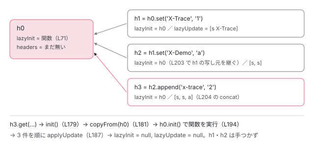

[目次](../README.md) › [HttpClient の内側](README.md) › 第 4 回 / 全 12 回

# 不変な HttpRequest・HttpHeaders・HttpParams・HttpContext と clone

> HttpRequest のコンストラクタが method ごとに body を許すか決める行、clone が変更点だけを差し替えた新しいインスタンスを作る行。HttpHeaders は変更を lazyUpdate に、HttpParams は updates に積み、clone は最初のインスタンスを写し元にして、読まれたときに初めて init する仕組み、名前の大小文字の正規化、HttpUrlEncodingCodec の符号化、HttpContext と HttpContextToken（HttpContext だけは変更可能で clone 間で共有される）。

angular/angular · 読了 約 13 分 · 中核 · [サイトで読む（デモが動きます）](https://angular-deep-dive-cyan.vercel.app/chapter/http-request-immutable)

---

インターセプタでヘッダーを足すとき、`req.headers.set(...)` ではなく `req.clone({ setHeaders })` と書くように言われます。この章では、`HttpRequest` のコンストラクタが method ごとに body を受け取るか決める行、`clone` が変更点だけを差し替えて `new HttpRequest` する行、`HttpHeaders` と `HttpParams` が変更をすぐ適用せず「あとでやる一覧」に積み、最初に読まれたときに 1 回だけ適用する仕組み、`HttpUrlEncodingCodec` の符号化、そして**不変ではない**`HttpContext` を、行番号を指して読みます。

読む対象は `packages/common/http/src/` の `request.ts`・`headers.ts`・`params.ts`・`context.ts` です。インターセプタの連鎖そのものは[次の回](05-http.md)で読みます。

1. [1. 概観](01-http-overview.md)
2. [2. provideHttpClient と features](02-http-provide.md)
3. [3. HttpClient.request](03-http-client-request.md)
4. **4. 不変なリクエスト**（この章）
5. [5. インターセプタの連鎖](05-http.md)
6. [6. FetchBackend](06-http-backend-fetch.md)
7. [7. HttpXhrBackend](07-http-backend-xhr.md)
8. [8. HttpEvent とエラー](08-http-response-errors.md)
9. [9. XSRF 対策](09-http-xsrf.md)
10. [10. JSONP](10-http-jsonp.md)
11. [11. SSR の転送キャッシュ](11-http-transfer-cache.md)
12. [12. テスト用バックエンド](12-http-testing.md)

## 1. HttpRequest のフィールドは readonly

📄 `angular/packages/common/http/src/request.ts` L154–171 （▶ の行: 157–159, 161, 166, 169, 171）

```ts
154 │   /**
155 │    * The request body, or `null` if one isn't set.
156 │    *
157 ▶    * Bodies are not enforced to be immutable, as they can include a reference to any
158 ▶    * user-defined data type. However, interceptors should take care to preserve
159 ▶    * idempotence by treating them as such.
160 │    */
161 ▶   readonly body: T | null = null;
162 │ 
163 │   /**
164 │    * Outgoing headers for this request.
165 │    */
166 ▶   readonly headers!: HttpHeaders;
167 │ 
168 │   /**
169 ▶    * Shared and mutable context that can be used by interceptors
170 │    */
171 ▶   readonly context!: HttpContext;
```

161・166・171 行目、フィールドはすべて `readonly` です。ただしこれは TypeScript の型検査だけの印で、実行時に `Object.freeze` しているわけではありません。**「書き換えない」という約束**をコンパイラに守らせているだけです。

157〜159 行目、body はその約束の外です。「任意の型を参照できるので不変を強制しない。ただしインターセプタは不変として扱うこと」。169 行目、`context` は「共有されていて、変更可能」とはっきり書いてあります（7 節）。

## 2. コンストラクタ：第 3 引数が body か options かは method で決まる

📄 `angular/packages/common/http/src/request.ts` L14–28 （▶ の行: 17, 19–24, 26）

```ts
14 │ /**
15 │  * Determine whether the given HTTP method may include a body.
16 │  */
17 ▶ function mightHaveBody(method: string): boolean {
18 │   switch (method) {
19 ▶     case 'DELETE':
20 ▶     case 'GET':
21 ▶     case 'HEAD':
22 ▶     case 'OPTIONS':
23 ▶     case 'JSONP':
24 ▶       return false;
25 │     default:
26 ▶       return true;
27 │   }
28 │ }
```

📄 `angular/packages/common/http/src/request.ts` L291–317 （▶ の行: 291, 293, 302, 309, 311–312, 315）

```ts
291 ▶   constructor(method: 'GET' | 'HEAD', url: string, init?: HttpRequestOptions);
292 │   constructor(method: 'DELETE' | 'JSONP' | 'OPTIONS', url: string, init?: HttpRequestOptions);
293 ▶   constructor(method: 'POST', url: string, body: T | null, init?: HttpRequestOptions);
294 │   constructor(method: 'PUT' | 'PATCH', url: string, body: T | null, init?: HttpRequestOptions);
295 │   constructor(method: string, url: string, body: T | null, init?: HttpRequestOptions);
296 │   constructor(
297 │     method: string,
298 │     readonly url: string,
299 │     third?: T | HttpRequestOptions | null,
300 │     fourth?: HttpRequestOptions,
301 │   ) {
302 ▶     this.method = method.toUpperCase();
303 │     // Next, need to figure out which argument holds the HttpRequestOptions
304 │     // options, if any.
305 │     let options: HttpRequestOptions | undefined;
306 │ 
307 │     // Check whether a body argument is expected. The only valid way to omit
308 │     // the body argument is to use a known no-body method like GET.
309 ▶     if (mightHaveBody(this.method) || !!fourth) {
310 │       // Body is the third argument, options are the fourth.
311 ▶       this.body = third !== undefined ? (third as T) : null;
312 ▶       options = fourth;
313 │     } else {
314 │       // No body required, options are the third argument. The body stays null.
315 ▶       options = third as HttpRequestOptions;
316 │     }
317 │ 
```

1. **302 行目：method を大文字にそろえる**

   `'post'` と書いても `'POST'` として扱われます。
2. **309 行目：body を持ちうる method か、第 4 引数があるか**

   17〜27 行目の `mightHaveBody` は DELETE・GET・HEAD・OPTIONS・JSONP で `false`、それ以外で `true` を返します。291 行目と 293 行目のオーバーロードのとおり、GET は `(method, url, init)`、POST は `(method, url, body, init)` の形です。
3. **311〜312 行目：第 3 引数が body、第 4 引数が options**

   POST・PUT・PATCH など。または第 4 引数を渡したとき（DELETE に body を付けたいときはこちら）。
4. **315 行目：第 3 引数が options、body は null のまま**

   GET などで第 4 引数が無いとき。**GET に第 3 引数で body を渡しても、それは options として読まれます**（デモ 3 で確かめます）。

このあと options の各項目を読む部分は「渡されていれば代入する」の繰り返しなので省きます。その後ろで既定値を埋めます。

📄 `angular/packages/common/http/src/request.ts` L394–410 （▶ の行: 395, 398, 401–403, 406–407, 409）

```ts
394 │     // If no headers have been passed in, construct a new HttpHeaders instance.
395 ▶     this.headers ??= new HttpHeaders();
396 │ 
397 │     // If no context have been passed in, construct a new HttpContext instance.
398 ▶     this.context ??= new HttpContext();
399 │ 
400 │     // If no parameters have been passed in, construct a new HttpUrlEncodedParams instance.
401 ▶     if (!this.params) {
402 ▶       this.params = new HttpParams();
403 ▶       this.urlWithParams = url;
404 │     } else {
405 │       // Encode the parameters to a string in preparation for inclusion in the URL.
406 ▶       const params = this.params.toString();
407 ▶       if (params.length === 0) {
408 │         // No parameters, the visible URL is just the URL given at creation time.
409 ▶         this.urlWithParams = url;
410 │       } else {
```

395 行目と 398 行目、headers と context が無ければ新しく作ります。401〜403 行目、params が無ければ `urlWithParams`（実際に送る URL）は渡された URL そのまま。406 行目、params があれば **ここで 1 回だけ**`toString()` して、文字列が空なら 409 行目で URL そのままにします。

📄 `angular/packages/common/http/src/request.ts` L411–435 （▶ の行: 411, 417–420, 424, 432–433）

```ts
411 ▶         // Strip the fragment (e.g. #bypass) from the URL before checking for existing query parameters.
412 │         // This ensures that new query parameters are inserted before the fragment, preventing
413 │         // situations where parameters are mistakenly appended after the fragment and thus
414 │         // only exposed to the frontend, which could bypass security checks.
415 │         let urlWithoutFragment = url;
416 │         let fragment = '';
417 ▶         const hashIdx = url.indexOf('#');
418 ▶         if (hashIdx !== -1) {
419 ▶           fragment = url.substring(hashIdx);
420 ▶           urlWithoutFragment = url.substring(0, hashIdx);
421 │         }
422 │ 
423 │         // Does the URL already have query parameters? Look for '?'.
424 ▶         const qIdx = urlWithoutFragment.indexOf('?');
425 │         // There are 3 cases to handle:
426 │         // 1) No existing parameters -> append '?' followed by params.
427 │         // 2) '?' exists and is followed by existing query string ->
428 │         //    append '&' followed by params.
429 │         // 3) '?' exists at the end of the url -> append params directly.
430 │         // This basically amounts to determining the character, if any, with
431 │         // which to join the URL and parameters.
432 ▶         const sep: string = qIdx === -1 ? '?' : qIdx < urlWithoutFragment.length - 1 ? '&' : '';
433 ▶         this.urlWithParams = urlWithoutFragment + sep + params + fragment;
434 │       }
435 │     }
```

417〜421 行目、URL の `#` 以降（フラグメント）をいったん外します。411〜414 行目のコメントのとおり、パラメータが `#` の後ろに付くとサーバーに届かないからです。424 行目で既存の `?` を探し、432 行目で区切り文字を「`?` が無ければ `?`、途中にあれば `&`、末尾なら何も足さない」の 3 通りから選び、433 行目で「URL + 区切り + パラメータ + フラグメント」をつなぎます。`urlWithParams` は readonly のフィールドなので、コンストラクタで 1 回決まったら変わりません。params を変えたいときは `clone` で作り直すことになります。

## 3. body の自動直列化と Content-Type の推測

`HttpClient.post(url, { a: 1 })` と書くだけで JSON が送られるのは、バックエンドが送信直前にこの 2 つのメソッドを呼ぶからです （呼んでいる行は [第 6 回](06-http-backend-fetch.md)・[第 7 回](07-http-backend-xhr.md)）。

📄 `angular/packages/common/http/src/request.ts` L442–472 （▶ の行: 444, 450–454, 456, 459–460, 464–466, 468, 471）

```ts
442 │   serializeBody(): ArrayBuffer | Blob | FormData | URLSearchParams | string | null {
443 │     // If no body is present, no need to serialize it.
444 ▶     if (this.body === null) {
445 │       return null;
446 │     }
447 │     // Check whether the body is already in a serialized form. If so,
448 │     // it can just be returned directly.
449 │     if (
450 ▶       typeof this.body === 'string' ||
451 ▶       isArrayBuffer(this.body) ||
452 ▶       isBlob(this.body) ||
453 ▶       isFormData(this.body) ||
454 ▶       isUrlSearchParams(this.body)
455 │     ) {
456 ▶       return this.body;
457 │     }
458 │     // Check whether the body is an instance of HttpUrlEncodedParams.
459 ▶     if (this.body instanceof HttpParams) {
460 ▶       return this.body.toString();
461 │     }
462 │     // Check whether the body is an object or array, and serialize with JSON if so.
463 │     if (
464 ▶       typeof this.body === 'object' ||
465 ▶       typeof this.body === 'boolean' ||
466 ▶       Array.isArray(this.body)
467 │     ) {
468 ▶       return JSON.stringify(this.body);
469 │     }
470 │     // Fall back on toString() for everything else.
471 ▶     return (this.body as any).toString();
472 │   }
```

📄 `angular/packages/common/http/src/request.ts` L480–517 （▶ の行: 486–487, 491–492, 500–501, 504–505, 510, 513）

```ts
480 │   detectContentTypeHeader(): string | null {
481 │     // An empty body has no content type.
482 │     if (this.body === null) {
483 │       return null;
484 │     }
485 │     // FormData bodies rely on the browser's content type assignment.
486 ▶     if (isFormData(this.body)) {
487 ▶       return null;
488 │     }
489 │     // Blobs usually have their own content type. If it doesn't, then
490 │     // no type can be inferred.
491 ▶     if (isBlob(this.body)) {
492 ▶       return this.body.type || null;
493 │     }
494 │     // Array buffers have unknown contents and thus no type can be inferred.
495 │     if (isArrayBuffer(this.body)) {
496 │       return null;
497 │     }
498 │     // Technically, strings could be a form of JSON data, but it's safe enough
499 │     // to assume they're plain strings.
500 ▶     if (typeof this.body === 'string') {
501 ▶       return TEXT_CONTENT_TYPE;
502 │     }
503 │     // `HttpUrlEncodedParams` has its own content-type.
504 ▶     if (this.body instanceof HttpParams) {
505 ▶       return 'application/x-www-form-urlencoded;charset=UTF-8';
506 │     }
507 │     // Arrays, objects, boolean and numbers will be encoded as JSON.
508 │     if (
509 │       typeof this.body === 'object' ||
510 ▶       typeof this.body === 'number' ||
511 │       typeof this.body === 'boolean'
512 │     ) {
513 ▶       return JSON_CONTENT_TYPE;
514 │     }
515 │     // No type could be inferred.
516 │     return null;
517 │   }
```

| body | serializeBody() | detectContentTypeHeader() |
| --- | --- | --- |
| 文字列 | そのまま（450 行目） | `text/plain`（500〜501 行目） |
| Blob | そのまま（452 行目） | Blob 自身の `type`、無ければ `null`（491〜492 行目） |
| FormData | そのまま（453 行目） | `null`。境界文字列付きの型はブラウザが付ける（486〜487 行目） |
| HttpParams | `toString()`（459〜460 行目） | `application/x-www-form-urlencoded;charset=UTF-8`（504〜505 行目） |
| オブジェクト・配列・boolean | `JSON.stringify`（464〜468 行目） | `application/json`（508〜513 行目） |
| number | `toString()`（471 行目。464〜466 行目の条件に number は無い） | `application/json`（510 行目） |

number だけは 2 つのメソッドで扱いが分かれていますが、`42` の `toString()` は `"42"` で、これは正しい JSON なので結果は同じです。推測した型は、リクエストに Content-Type ヘッダーが無いときにだけバックエンドが使います（その判定も第 6・7 回の行です）。

## 4. clone：変更点だけ差し替えて new HttpRequest

📄 `angular/packages/common/http/src/request.ts` L538–572 （▶ の行: 545, 549–552, 564, 572）

```ts
538 │   clone(
539 │     update: HttpRequestOptions & {
540 │       body?: any | null;
541 │       method?: string;
542 │       url?: string;
543 │       setHeaders?: {[name: string]: string | string[]};
544 │       setParams?: {[param: string]: string};
545 ▶     } = {},
546 │   ): HttpRequest<any> {
547 │     // For method, url, and responseType, take the current value unless
548 │     // it is overridden in the update hash.
549 ▶     const method = update.method || this.method;
550 ▶     const url = update.url || this.url;
551 ▶     const responseType = update.responseType || this.responseType;
552 ▶     const keepalive = update.keepalive ?? this.keepalive;
553 │     const priority = update.priority || this.priority;
554 │     const cache = update.cache || this.cache;
555 │     const mode = update.mode || this.mode;
556 │     const redirect = update.redirect || this.redirect;
557 │     const credentials = update.credentials || this.credentials;
558 │ 
559 │     const referrer = update.referrer ?? this.referrer;
560 │     const integrity = update.integrity || this.integrity;
561 │     const referrerPolicy = update.referrerPolicy || this.referrerPolicy;
562 │     // Carefully handle the transferCache to differentiate between
563 │     // `false` and `undefined` in the update args.
564 ▶     const transferCache = update.transferCache ?? this.transferCache;
565 │ 
566 │     const timeout = update.timeout ?? this.timeout;
567 │ 
568 │     // The body is somewhat special - a `null` value in update.body means
569 │     // whatever current body is present is being overridden with an empty
570 │     // body, whereas an `undefined` value in update.body implies no
571 │     // override.
572 ▶     const body = update.body !== undefined ? update.body : this.body;
```

549〜551 行目、`update.method || this.method`。**渡されたものだけ差し替え、残りは今の値を引き継ぐ**のが clone の基本形です。ただし boolean など `false` が意味を持つ項目は `||` だと `false` が無視されるので、552 行目や 564 行目は `??` を使っています。572 行目、body は `undefined`（指定なし）と `null`（空にする）を区別します。

📄 `angular/packages/common/http/src/request.ts` L581–608 （▶ の行: 583–584, 587, 590, 592–593, 599, 601–602, 608）

```ts
581 │     // Headers and params may be appended to if `setHeaders` or
582 │     // `setParams` are used.
583 ▶     let headers = update.headers || this.headers;
584 ▶     let params = update.params || this.params;
585 │ 
586 │     // Pass on context if needed
587 ▶     const context = update.context ?? this.context;
588 │ 
589 │     // Check whether the caller has asked to add headers.
590 ▶     if (update.setHeaders !== undefined) {
591 │       // Set every requested header.
592 ▶       headers = Object.keys(update.setHeaders).reduce(
593 ▶         (headers, name) => headers.set(name, update.setHeaders![name]),
594 │         headers,
595 │       );
596 │     }
597 │ 
598 │     // Check whether the caller has asked to set params.
599 ▶     if (update.setParams) {
600 │       // Set every requested param.
601 ▶       params = Object.keys(update.setParams).reduce(
602 ▶         (params, param) => params.set(param, update.setParams![param]),
603 │         params,
604 │       );
605 │     }
606 │ 
607 │     // Finally, construct the new HttpRequest using the pieces from above.
608 ▶     return new HttpRequest(method, url, body, {
```

1. **583〜584 行目：headers / params を丸ごと差し替えるなら update のもの**

   渡さなければ元の `HttpHeaders` インスタンスをそのまま使います（不変なので共有して安全）。
2. **587 行目：context は元と同じオブジェクト**

   `update.context` を渡さない限り、clone しても**同じ `HttpContext`** を指します（7 節で効いてきます）。
3. **590〜595 行目：`setHeaders` は `headers.set` を 1 つずつ**

   593 行目の `headers.set(name, ...)` は、次の節で見るとおり毎回新しい `HttpHeaders` を返します。それを `reduce` でつないでいます。
4. **599〜604 行目：`setParams` も同じ形で `params.set`**

   デフォルトの `update = {}`（545 行目）なので、引数無しの `req.clone()` も動きます。
5. **608 行目：4 引数で `new HttpRequest`**

   第 4 引数に options を必ず渡すので、2 節 309 行目の `!!fourth` が真になり、method が GET でも body はそのまま引き継がれます。コンストラクタを通り直すので、`urlWithParams` もここで計算し直されます。

## 5. HttpHeaders：変更は lazyUpdate に積み、読むときに 1 回だけ適用する

📄 `angular/packages/common/http/src/headers.ts` L15–44 （▶ の行: 17–18, 28, 34, 39, 44）

```ts
15 │ /**
16 │  * Represents the header configuration options for an HTTP request.
17 ▶  * Instances are immutable. Modifying methods return a cloned
18 ▶  * instance with the change. The original object is never changed.
19 │  *
20 │  * @see [Setting request headers](guide/http/making-requests#setting-request-headers)
21 │  *
22 │  * @publicApi
23 │  */
24 │ export class HttpHeaders {
25 │   /**
26 │    * Internal map of lowercase header names to values.
27 │    */
28 ▶   private headers!: Map<string, string[]>;
29 │ 
30 │   /**
31 │    * Internal map of lowercased header names to the normalized
32 │    * form of the name (the form seen first).
33 │    */
34 ▶   private normalizedNames: Map<string, string> = new Map();
35 │ 
36 │   /**
37 │    * Complete the lazy initialization of this object (needed before reading).
38 │    */
39 ▶   private lazyInit!: HttpHeaders | Function | null;
40 │ 
41 │   /**
42 │    * Queued updates to be materialized the next initialization.
43 │    */
44 ▶   private lazyUpdate: Update[] | null = null;
```

17〜18 行目の doc が「インスタンスは不変。変更するメソッドは変更済みの複製を返し、元のオブジェクトは決して変えない」と約束しています。それを支える内部の状態は 4 つです。

- 28 行目 `headers`：小文字の名前 → 値の配列。読むときはここを見る
- 34 行目 `normalizedNames`：小文字の名前 → 最初に見た書き方の名前（`keys()` が返すのはこちら）
- 39 行目 `lazyInit`：まだ済んでいない初期化。関数か、写し元の `HttpHeaders` か、`null`
- 44 行目 `lazyUpdate`：まだ適用していない変更の一覧

📄 `angular/packages/common/http/src/headers.ts` L48–81 （▶ の行: 51–54, 65–66, 70–71, 73）

```ts
48 │   constructor(
49 │     headers?: string | {[name: string]: string | number | (string | number)[]} | Headers,
50 │   ) {
51 ▶     if (!headers) {
52 ▶       this.headers = new Map<string, string[]>();
53 ▶     } else if (typeof headers === 'string') {
54 ▶       this.lazyInit = () => {
55 │         this.headers = new Map<string, string[]>();
56 │         headers.split('\n').forEach((line) => {
57 │           const index = line.indexOf(':');
58 │           if (index > 0) {
59 │             const name = line.slice(0, index);
60 │             const value = line.slice(index + 1).trim();
61 │             this.addHeaderEntry(name, value);
62 │           }
63 │         });
64 │       };
65 ▶     } else if (typeof Headers !== 'undefined' && headers instanceof Headers) {
66 ▶       this.headers = new Map<string, string[]>();
67 │       headers.forEach((value: string, name: string) => {
68 │         this.addHeaderEntry(name, value);
69 │       });
70 ▶     } else {
71 ▶       this.lazyInit = () => {
72 │         if (typeof ngDevMode === 'undefined' || ngDevMode) {
73 ▶           assertValidHeaders(headers);
74 │         }
75 │         this.headers = new Map<string, string[]>();
76 │         Object.entries(headers).forEach(([name, values]) => {
77 │           this.setHeaderEntries(name, values);
78 │         });
79 │       };
80 │     }
81 │   }
```

51〜52 行目、引数無しなら空の Map をすぐ作ります。65〜69 行目、fetch の `Headers` ならその場で写します。**53〜54 行目（文字列）と 70〜71 行目（オブジェクト）は、解析を関数にして `lazyInit` に入れるだけ**で、まだ何もしません。73 行目の値の検査（開発モードのみ）も、その関数が呼ばれるまで走りません。

📄 `angular/packages/common/http/src/headers.ts` L144–176 （▶ の行: 145, 158, 169, 173–174）

```ts
144 │   append(name: string, value: string | string[]): HttpHeaders {
145 ▶     return this.clone({name, value, op: 'a'});
146 │   }
147 │   /**
148 │    * Sets or modifies a value for a given header in a clone of the original instance.
149 │    * If the header already exists, its value is replaced with the given value
150 │    * in the returned object.
151 │    *
152 │    * @param name The header name.
153 │    * @param value The value or values to set or override for the given header.
154 │    *
155 │    * @returns A clone of the HTTP headers object with the newly set header value.
156 │    */
157 │   set(name: string, value: string | string[]): HttpHeaders {
158 ▶     return this.clone({name, value, op: 's'});
159 │   }
160 │   /**
161 │    * Deletes values for a given header in a clone of the original instance.
162 │    *
163 │    * @param name The header name.
164 │    * @param value The value or values to delete for the given header.
165 │    *
166 │    * @returns A clone of the HTTP headers object with the given value deleted.
167 │    */
168 │   delete(name: string, value?: string | string[]): HttpHeaders {
169 ▶     return this.clone({name, value, op: 'd'});
170 │   }
171 │ 
172 │   private maybeSetNormalizedName(name: string, lcName: string): void {
173 ▶     if (!this.normalizedNames.has(lcName)) {
174 ▶       this.normalizedNames.set(lcName, name);
175 │     }
176 │   }
```

145・158・169 行目、`append`・`set`・`delete` は**どれも `this.clone(...)` を返すだけ**で、自分（`this`）には触りません。違いは `op` が `'a'`・`'s'`・`'d'` のどれかだけです。

📄 `angular/packages/common/http/src/headers.ts` L178–206 （▶ の行: 179–181, 183, 185–188, 194, 196, 202–204）

```ts
178 │   private init(): void {
179 ▶     if (!!this.lazyInit) {
180 ▶       if (this.lazyInit instanceof HttpHeaders) {
181 ▶         this.copyFrom(this.lazyInit);
182 │       } else {
183 ▶         this.lazyInit();
184 │       }
185 ▶       this.lazyInit = null;
186 ▶       if (!!this.lazyUpdate) {
187 ▶         this.lazyUpdate.forEach((update) => this.applyUpdate(update));
188 ▶         this.lazyUpdate = null;
189 │       }
190 │     }
191 │   }
192 │ 
193 │   private copyFrom(other: HttpHeaders) {
194 ▶     other.init();
195 │     for (const [key, values] of other.headers.entries()) {
196 ▶       this.headers.set(key, values);
197 │       this.normalizedNames.set(key, other.normalizedNames.get(key)!);
198 │     }
199 │   }
200 │ 
201 │   private clone(update: Update): HttpHeaders {
202 ▶     const clone = new HttpHeaders();
203 ▶     clone.lazyInit = !!this.lazyInit && this.lazyInit instanceof HttpHeaders ? this.lazyInit : this;
204 ▶     clone.lazyUpdate = (this.lazyUpdate || []).concat([update]);
205 │     return clone;
206 │   }
```

1. **202 行目：clone は空の `HttpHeaders` を作る**

   引数無しなので 52 行目で空の Map を持った状態です。
2. **203 行目：写し元を決める**

   自分の `lazyInit` が `HttpHeaders` なら（つまり自分もまだ写していない clone なら）**その写し元をそのまま引き継ぎ**、そうでなければ自分（`this`）を写し元にします。そのため `set().set().set()` と続けても、写し元は鎖のように 1 つずつたどるのではなく、**全員が最初のインスタンスを指します**。
3. **204 行目：変更の一覧をコピーして 1 件足す**

   `concat` は新しい配列を返すので、元のインスタンスの `lazyUpdate` は変わりません。
4. **179 行目：読むとき（`get`・`has`・`keys` など）に `init()`**

   `lazyInit` が残っていれば、180〜181 行目で写し元から `copyFrom`（194 行目で写し元にも `init()` させてから、196 行目で値の配列を写す）、または 183 行目で関数を実行します。185 行目で `lazyInit` を消し、186〜188 行目で積んでおいた変更を順に適用して `lazyUpdate` も消します。2 回目からは 179 行目の条件が偽になり、何もしません。

📄 `angular/packages/common/http/src/headers.ts` L103–119 （▶ の行: 104, 106, 116, 118）

```ts
103 │   get(name: string): string | null {
104 ▶     this.init();
105 │ 
106 ▶     const values = this.headers.get(name.toLowerCase());
107 │     return values && values.length > 0 ? values[0] : null;
108 │   }
109 │ 
110 │   /**
111 │    * Retrieves the names of the headers.
112 │    *
113 │    * @returns A list of header names.
114 │    */
115 │   keys(): string[] {
116 ▶     this.init();
117 │ 
118 ▶     return Array.from(this.normalizedNames.values());
119 │   }
```

📄 `angular/packages/common/http/src/headers.ts` L208–224 （▶ の行: 209, 220–221, 223）

```ts
208 │   private applyUpdate(update: Update): void {
209 ▶     const key = update.name.toLowerCase();
210 │     switch (update.op) {
211 │       case 'a':
212 │       case 's':
213 │         let value = update.value!;
214 │         if (typeof value === 'string') {
215 │           value = [value];
216 │         }
217 │         if (value.length === 0) {
218 │           return;
219 │         }
220 ▶         this.maybeSetNormalizedName(update.name, key);
221 ▶         const base = update.op === 'a' ? (this.headers.get(key) || []).slice() : [];
222 │         base.push(...value);
223 ▶         this.headers.set(key, base);
224 │         break;
```

209 行目と 106 行目、書くときも読むときも名前を `toLowerCase()` するので、`Content-Type` と `content-type` は同じヘッダーです。220 行目の `maybeSetNormalizedName`（173〜174 行目）は、まだ記録が無いときだけ書き方を残すので、`keys()`（118 行目）には**最初に使った書き方**が出ます。221 行目、`append` のときは既存の配列を `slice()` で複製してから足します。196 行目で写し元と同じ配列を共有しているので、複製しないと写し元まで書き換わってしまうからです。

> [!NOTE]
> **さらに深く**
>
> 221 行目の `slice()` は 2026 年 7 月のコミット `ff02a167495`（「preserve immutability of materialized clones」）で入った修正です。それ以前は、写し元が先に読まれていた場合に `append` が写し元の配列に値を足してしまい、次のリクエストにヘッダーが漏れることがありました。このサイトが使っている 22.1.6 の配布物（`@angular/common` の fesm2022）にも同じ `slice()` が入っていることを確かめてあります。



*h0.set().set().append() の 3 つの clone は、どれも h0 を写し元にし、変更の一覧だけを伸ばしていく。最初に h3 を読んだときに、h0 の初期化 → 3 件の適用が 1 回だけ走る。h1・h2 は読まれるまで未適用のまま。*

> **🧪 DEMO 1 — HttpHeaders の中を覗く（学習用に private フィールドを読んでいます）**
>
> `h0 = new HttpHeaders({ 'Content-Type': 'text/plain' })` から 3 回つなぎます。「作る」のあとと「h3 を読む」のあとで、`lazyInit`・`lazyUpdate`・`headers` を比べてください。
>
> ▶ [このデモはサイトで動かせます](https://angular-deep-dive-cyan.vercel.app/chapter/http-request-immutable)

「作る」の直後、h1〜h3 の `headers` は「空の Map」です（202 行目の `new HttpHeaders()` が 52 行目を通るため）。値はまだ Map に入っていません。「h3 を読む」と、h0 の関数が実行されて h0 も読める状態になり、h3 には 3 件が適用されます。`append('x-trace', ...)` は小文字で書いても `X-Trace` と同じヘッダーに足され、`keys()` は最初の書き方 `X-Trace` を返します。

## 6. HttpParams と HttpUrlEncodingCodec

📄 `angular/packages/common/http/src/params.ts` L165–192 （▶ の行: 166, 168–169, 172, 174, 180–181, 186, 190）

```ts
165 │ export class HttpParams {
166 ▶   private map: Map<string, string[]> | null;
167 │   private encoder: HttpParameterCodec;
168 ▶   private updates: Update[] | null = null;
169 ▶   private cloneFrom: HttpParams | null = null;
170 │ 
171 │   constructor(options: HttpParamsOptions = {} as HttpParamsOptions) {
172 ▶     this.encoder = options.encoder || new HttpUrlEncodingCodec();
173 │     if (options.fromString) {
174 ▶       if (options.fromObject) {
175 │         throw new RuntimeError(
176 │           RuntimeErrorCode.CANNOT_SPECIFY_BOTH_FROM_STRING_AND_FROM_OBJECT,
177 │           ngDevMode && 'Cannot specify both fromString and fromObject.',
178 │         );
179 │       }
180 ▶       this.map = paramParser(options.fromString, this.encoder);
181 ▶     } else if (!!options.fromObject) {
182 │       this.map = new Map<string, string[]>();
183 │       Object.keys(options.fromObject).forEach((key) => {
184 │         const value = (options.fromObject as any)[key];
185 │         // convert the values to strings
186 ▶         const values = Array.isArray(value) ? value.map(valueToString) : [valueToString(value)];
187 │         this.map!.set(key, values);
188 │       });
189 │     } else {
190 ▶       this.map = null;
191 │     }
192 │   }
```

`HttpParams` は `HttpHeaders` と同じ考え方ですが、名前が違います。166 行目の `map` が値、168 行目の `updates` が積んだ変更、169 行目の `cloneFrom` が写し元です。172 行目、符号化の方法（codec）は指定が無ければ `HttpUrlEncodingCodec`。174 行目、`fromString` と `fromObject` を両方渡すとエラー。180 行目、`fromString` は**コンストラクタでその場で解析**し、181〜188 行目の `fromObject` も 186 行目で値を文字列にしてその場で Map に入れます。遅延するのは clone の側だけです。

📄 `angular/packages/common/http/src/params.ts` L314–339 （▶ の行: 315–317, 322, 325–326, 328–329, 336）

```ts
314 │   private clone(update: Update | Update[]): HttpParams {
315 ▶     const clone = new HttpParams({encoder: this.encoder} as HttpParamsOptions);
316 ▶     clone.cloneFrom = this.cloneFrom || this;
317 ▶     clone.updates = (this.updates || []).concat(update);
318 │     return clone;
319 │   }
320 │ 
321 │   private init() {
322 ▶     if (this.map === null) {
323 │       this.map = new Map<string, string[]>();
324 │     }
325 ▶     if (this.cloneFrom !== null) {
326 ▶       this.cloneFrom.init();
327 │ 
328 ▶       for (const [key, values] of this.cloneFrom.map!.entries()) {
329 ▶         this.map!.set(key, values);
330 │       }
331 │ 
332 │       this.updates!.forEach((update) => {
333 │         switch (update.op) {
334 │           case 'a':
335 │           case 's':
336 ▶             const base = update.op === 'a' ? (this.map!.get(update.param) || []).slice() : [];
337 │             base.push(valueToString(update.value!));
338 │             this.map!.set(update.param, base);
339 │             break;
```

316 行目、`this.cloneFrom || this`。`HttpHeaders` の 203 行目と同じく、写し元はいちばん最初のインスタンスに固定されます。317 行目で変更一覧をコピーして足し、読むときの 325〜329 行目で写し元を `init()` してから値を写し、336 行目で `append` のときは `slice()` で複製してから足します。

📄 `angular/packages/common/http/src/params.ts` L40–57 （▶ の行: 46–47, 55–56）

```ts
40 │ export class HttpUrlEncodingCodec implements HttpParameterCodec {
41 │   /**
42 │    * Encodes a key name for a URL parameter or query-string.
43 │    * @param key The key name.
44 │    * @returns The encoded key name.
45 │    */
46 ▶   encodeKey(key: string): string {
47 ▶     return standardEncoding(key);
48 │   }
49 │ 
50 │   /**
51 │    * Encodes the value of a URL parameter or query-string.
52 │    * @param value The value.
53 │    * @returns The encoded value.
54 │    */
55 ▶   encodeValue(value: string): string {
56 ▶     return standardEncoding(value);
57 │   }
```

📄 `angular/packages/common/http/src/params.ts` L99–119 （▶ の行: 102, 104–111, 115–117）

```ts
 99 │ /**
100 │  * Encode input string with standard encodeURIComponent and then un-encode specific characters.
101 │  */
102 ▶ const STANDARD_ENCODING_REGEX = /%(\d[a-f0-9])/gi;
103 │ const STANDARD_ENCODING_REPLACEMENTS: {[x: string]: string} = {
104 ▶   '40': '@',
105 ▶   '3A': ':',
106 ▶   '24': '$',
107 ▶   '2C': ',',
108 ▶   '3B': ';',
109 ▶   '3D': '=',
110 ▶   '3F': '?',
111 ▶   '2F': '/',
112 │ };
113 │ 
114 │ function standardEncoding(v: string): string {
115 ▶   return encodeURIComponent(v).replace(
116 ▶     STANDARD_ENCODING_REGEX,
117 ▶     (s, t) => STANDARD_ENCODING_REPLACEMENTS[t] ?? s,
118 │   );
119 │ }
```

1. **115 行目：まず `encodeURIComponent`**

   JavaScript 標準の関数で、英数字と `- _ . ! ~ * ' ( )` 以外をすべて `%XX` にします。
2. **102 行目の正規表現で `%XX` を 1 つずつ見る**

   `%` の後ろの 2 文字が `t` として 117 行目に渡ります。
3. **104〜111 行目にある 8 つだけ元の文字に戻す**

   `@`・`:`・`$`・`,`・`;`・`=`・`?`・`/`。クエリ文字列の値の中にあってもサーバーが誤解しない文字なので、読みやすさのために戻しています。117 行目、表に無いもの（`%20` の空白、`%26` の `&`、`%2B` の `+` など）は `s` のまま、符号化されたまま残ります。

📄 `angular/packages/common/http/src/params.ts` L294–312 （▶ の行: 299, 304, 309）

```ts
294 │   toString(): string {
295 │     this.init();
296 │     return (
297 │       this.keys()
298 │         .map((key) => {
299 ▶           const eKey = this.encoder.encodeKey(key);
300 │           // `a: ['1']` produces `'a=1'`
301 │           // `b: []` produces `''`
302 │           // `c: ['1', '2']` produces `'c=1&c=2'`
303 │           return this.map!.get(key)!
304 ▶             .map((value) => eKey + '=' + this.encoder.encodeValue(value))
305 │             .join('&');
306 │         })
307 │         // filter out empty values because `b: []` produces `''`
308 │         // which results in `a=1&&c=1&c=2` instead of `a=1&c=1&c=2` if we don't
309 ▶         .filter((param) => param !== '')
310 │         .join('&')
311 │     );
312 │   }
```

299 行目でキーを、304 行目で値を codec で符号化して `key=value` を作り、同じキーの複数の値は `&` でつなぎます。309 行目、値が 0 個のキーは消します。2 節 406 行目で呼ばれるのがこの `toString()` です。

📄 `angular/packages/common/http/src/params.ts` L78–97 （▶ の行: 84, 89–93）

```ts
78 │ function paramParser(rawParams: string, codec: HttpParameterCodec): Map<string, string[]> {
79 │   const map = new Map<string, string[]>();
80 │   if (rawParams.length > 0) {
81 │     // The `window.location.search` can be used while creating an instance of the `HttpParams` class
82 │     // (e.g. `new HttpParams({ fromString: window.location.search })`). The `window.location.search`
83 │     // may start with the `?` char, so we strip it if it's present.
84 ▶     const params: string[] = rawParams.replace(/^\?/, '').split('&');
85 │     params.forEach((param: string) => {
86 │       const eqIdx = param.indexOf('=');
87 │       const [key, val]: string[] =
88 │         eqIdx == -1
89 ▶           ? [codec.decodeKey(param), '']
90 ▶           : [codec.decodeKey(param.slice(0, eqIdx)), codec.decodeValue(param.slice(eqIdx + 1))];
91 ▶       const list = map.get(key) || [];
92 ▶       list.push(val);
93 ▶       map.set(key, list);
94 │     });
95 │   }
96 │   return map;
97 │ }
```

逆向きの `fromString` は 84 行目で先頭の `?` を外して `&` で分け、89〜90 行目で `decodeURIComponent` します。`decodeURIComponent` は `+` を空白に戻しません。HTML フォーム形式（`+` を空白とみなす形式）の文字列を渡すと、`+` は `+` のまま値になります。91〜93 行目、同じキーが何度出ても配列に積みます。

📄 `angular/packages/common/http/test/params_spec.ts` L194–201 （▶ の行: 198–199）

```ts
194 │   describe('encoding', () => {
195 │     it('should encode parameters', () => {
196 │       const body = new HttpParams({fromString: 'a=standard_chars'});
197 │       expect(body.toString()).toEqual('a=standard_chars');
198 ▶       const body2 = new HttpParams({fromString: 'a=1 2 3&b=mail@test&c=3_^[]$&d=eq=1&e=1+1'});
199 ▶       expect(body2.toString()).toEqual('a=1%202%203&b=mail@test&c=3_%5E%5B%5D$&d=eq=1&e=1%2B1');
200 │     });
201 │   });
```

198〜199 行目のテストが両方をまとめて確かめています。空白は `%20`、`@` と `$` と `=` は戻され、`e=1+1` の `+` は `%2B` になります。

> **🧪 DEMO 2 — 値の符号化と urlWithParams**
>
> `new HttpParams().set('q', 値)` を `new HttpRequest('GET', '/api/search?lang=ja#top', { params })` に渡します。
>
> ▶ [このデモはサイトで動かせます](https://angular-deep-dive-cyan.vercel.app/chapter/http-request-immutable)

`urlWithParams` では、パラメータが既存の `?lang=ja` の後ろに `&` でつながり、`#top` はいちばん後ろに残ります（2 節 432〜433 行目）。最後の行は、`+` は `+` のまま、`%20` は空白に戻り、同じキー `q` の 2 つの値が配列になることを示しています。

> **🧪 DEMO 3 — コンストラクタ・serializeBody・clone の結果**
>
> ページを開いた時点で計算した値です（通信はしていません）。
>
> ▶ [このデモはサイトで動かせます](https://angular-deep-dive-cyan.vercel.app/chapter/http-request-immutable)

同じ `{ reportProgress: true }` でも、GET では options（body は `null`・`reportProgress` は `true`）、POST では body として読まれます（2 節 309〜315 行目）。clone では `headers` は別物、`context` は同じものになっています（4 節 587・590 行目）。

## 7. HttpContext と HttpContextToken：これだけは変更可能

📄 `angular/packages/common/http/src/context.ts` L9–18 （▶ の行: 16–17）

```ts
 9 │ /**
10 │  * A token used to manipulate and access values stored in `HttpContext`.
11 │  *
12 │  * @see [Request and response metadata](guide/http/interceptors#request-and-response-metadata)
13 │  *
14 │  * @publicApi
15 │  */
16 ▶ export class HttpContextToken<T> {
17 ▶   constructor(public readonly defaultValue: () => T) {}
18 │ }
```

📄 `angular/packages/common/http/src/context.ts` L55–83 （▶ の行: 56, 66–68, 79–80, 82）

```ts
55 │ export class HttpContext {
56 ▶   private readonly map = new Map<HttpContextToken<unknown>, unknown>();
57 │ 
58 │   /**
59 │    * Store a value in the context. If a value is already present it will be overwritten.
60 │    *
61 │    * @param token The reference to an instance of `HttpContextToken`.
62 │    * @param value The value to store.
63 │    *
64 │    * @returns A reference to itself for easy chaining.
65 │    */
66 ▶   set<T>(token: HttpContextToken<T>, value: T): HttpContext {
67 ▶     this.map.set(token, value);
68 ▶     return this;
69 │   }
70 │ 
71 │   /**
72 │    * Retrieve the value associated with the given token.
73 │    *
74 │    * @param token The reference to an instance of `HttpContextToken`.
75 │    *
76 │    * @returns The stored value or default if one is defined.
77 │    */
78 │   get<T>(token: HttpContextToken<T>): T {
79 ▶     if (!this.map.has(token)) {
80 ▶       this.map.set(token, token.defaultValue());
81 │     }
82 ▶     return this.map.get(token) as T;
83 │   }
```

1. **17 行目：トークンは「既定値を作る関数」だけを持つ**

   キーはトークンのインスタンスそのもの（56 行目の `Map` のキー）なので、名前が同じでも別の `new HttpContextToken` とは衝突しません。
2. **66〜68 行目：`set` は自分を書き換えて `this` を返す**

   `HttpHeaders.set` と違い、**clone しません**。`new HttpContext().set(A, 1).set(B, 2)` とつなげるのは、同じインスタンスに書き込んでいるからです。
3. **79〜80 行目：`get` は、無ければ既定値を作って保存する**

   1 回目の `get` で `defaultValue()` が呼ばれ、その結果が Map に残ります。82 行目で返すのはその保存した値なので、既定値が配列のとき、返ってきた配列に `push` すると次の `get` にも残ります。

4 節 587 行目のとおり context は clone で共有され、`HttpClient` は渡された `context` をそのまま `HttpRequest` の options に入れ、コンストラクタはそれを代入するだけです（2 節で省いた options の部分）。つまり**呼び出し側・すべてのインターセプタ・バックエンドが 1 つの `HttpContext` を見ています**。「このリクエストだけキャッシュを使う」「このリクエストは認証を付けない」のような、**URL やヘッダーに出したくないリクエストごとの印**をインターセプタに伝えるのが用途です。

> **🧪 DEMO 4 — HttpContextToken でインターセプタを分岐させる**
>
> 子の環境注入器に `provideHttpClient(withInterceptors([cacheInterceptor]))` と、呼ばれた回数を数える自作の `HttpBackend` を置いています（ネットワークには出ません）。`cacheInterceptor` は `USE_CACHE` が `true` で前回の応答があれば `next` を呼ばずに返し、どちらの場合も `TRACE`（既定値は空配列）に足跡を `push` します。
>
> ▶ [このデモはサイトで動かせます](https://angular-deep-dive-cyan.vercel.app/chapter/http-request-immutable)

1 回目は true でもキャッシュが空なので backend に行きます。2 回目以降の true では backend の回数が増えません。そして呼び出し側が作った `context` の `TRACE` に、インターセプタの足跡が見えています。インターセプタの書き込みが呼び出し側に見える、これが「共有され、変更可能」の意味です。

## 聞かれそうな質問

**Q. `req.headers.set('Authorization', ...)` したのに、ヘッダーが付いていません。**

headers.ts 158 行目の `set` は `this.clone(...)` を返すだけで、`req.headers` 自身は変わりません（202〜205 行目で新しいインスタンスを作る）。戻り値を捨てると何も起きません（デモ 1 の「戻り値を捨てた set」）。さらに `HttpRequest` の `headers` も readonly なので、`next(req.clone({ setHeaders: { Authorization: ... } }))` のように 新しいリクエストを作って `next` に渡します（request.ts 590〜595 行目）。

**Q. クエリパラメータの `+` がサーバーで空白になります。**

v22 の `HttpUrlEncodingCodec` は `+` を `%2B` に符号化します。params.ts 104〜111 行目の「元に戻す 8 文字」に `2B` が無いので、117 行目で `%2B` のまま残ります（テスト 198〜199 行目）。古い Angular はこの表に `+` を含めていて、生の `+` がサーバーで空白と解釈されていました。v14.0.0 で入ったコミット `76a9a24cdcb`（#45111）で表から外されています。いま空白になるなら、URL を文字列で自分で組み立てているか、172 行目の `encoder` に独自の codec を渡していないかを確かめます。逆に、`fromString` に `+` を空白の意味で書いた文字列を渡すと、89〜90 行目の `decodeURIComponent` は `+` を戻さないので `+` のまま送られます。

**Q. HttpContext は何に使うのですか？ヘッダーと何が違いますか？**

**サーバーには送られない、リクエストごとの印**をインターセプタに渡すためのものです。ヘッダーは送信されますが、context はブラウザの中だけです。context.ts 66〜68 行目の `set` は自分を書き換え、request.ts 587 行目で clone しても同じオブジェクトが引き継がれるので、インターセプタが書いた値を後ろのインターセプタや呼び出し側が読めます（デモ 4）。トークンの既定値は 17 行目の関数で、79〜80 行目で最初の `get` のときに作って保存されます。

**Q. readonly なら、`(req as any).url = '...'` と書いたら止められますか？**

止められません。request.ts 161 行目などの `readonly` は TypeScript の型検査だけで、`Object.freeze` はしていません。ただし 2 節の 433 行目で `urlWithParams` はコンストラクタのときに計算済みなので、`url` を書き換えても送られる URL は変わらない、といった食い違いが起きます。157〜159 行目のとおり body も「不変として扱うこと」という約束です。必ず `clone` を使います。

**Q. GET に body を付けたいのですが、`new HttpRequest('GET', url, body)` では消えます。**

request.ts 309 行目で、GET は `mightHaveBody` が `false`（20 行目）なので、第 4 引数が無ければ 315 行目で第 3 引数は options として読まれます。`new HttpRequest('GET', url, body, {})` と第 4 引数を渡すか、`req.clone({ body })`（608 行目で 4 引数になる）にすれば body は残ります。その body をどう送るかはバックエンドの仕事です（[第 6 回](06-http-backend-fetch.md)）。

## 読み終えて

- `HttpRequest` の第 3 引数は、`mightHaveBody(method)` か第 4 引数の有無で body か options かが決まる（request.ts 309 行目）
- `clone` は渡された項目だけ差し替えて 4 引数で `new HttpRequest` する。`urlWithParams` もそこで作り直される
- `HttpHeaders` / `HttpParams` の set・append・delete は clone を返すだけ。変更は一覧に積まれ、全員が最初のインスタンスを写し元にし、最初に読まれたとき 1 回だけ適用される
- codec は `encodeURIComponent` のあと 8 文字だけ戻す。`+` は `%2B` になる
- `HttpContext` だけは変更可能で、clone しても共有される。リクエストごとの印をインターセプタに渡すのに使う

---

← 前: [HttpClient.request：オーバーロードの山と、冷たい Observable と observe](03-http-client-request.md)  
次: [インターセプタの連鎖：reduceRight で関数を入れ子にする](05-http.md) →
