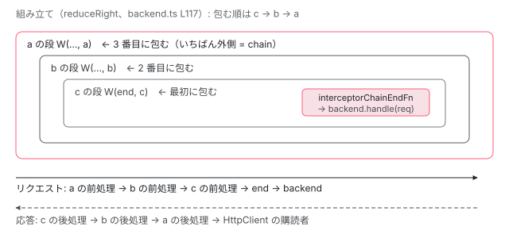

[目次](../README.md) › [HttpClient の内側](README.md) › 第 5 回 / 全 12 回

# インターセプタの連鎖：reduceRight で関数を入れ子にする

> reduceRight の 1 行で登録順の入れ子を作り、各段を runInInjectionContext で呼ぶ。xsrf が先頭、クラスのインターセプタは withInterceptorsFromDi の位置に 1 つの関数として入る。

angular/angular · 読了 約 13 分 · 中核 · [サイトで読む（デモが動きます）](https://angular-deep-dive-cyan.vercel.app/chapter/http)

---

`HttpClient` のインターセプタ（送信の前後に処理を挟む関数）は「登録した順に実行される」と説明されます。この章では、その順番を作っているのが `HttpInterceptorHandler.handle` の中の **`reduceRight` の 1 行**であること、1 段ずつ関数を包む部品 `chainedInterceptorFn` が `runInInjectionContext` で関数を呼ぶので中で `inject()` が使えること、関数インターセプタとクラスインターセプタを混ぜたときの順番が何で決まるかを、行番号を指して追います。

読む対象は `packages/common/http/src/backend.ts` と `interceptor.ts`、それに `provider.ts` の数行と、挙動の根拠として `test/provider_spec.ts` です。リクエストを書き換えるときの `req.clone(...)` の中身は前の回 [不変なリクエスト](04-http-request-immutable.md)で読みました。

1. [1. 概観](01-http-overview.md)
2. [2. provideHttpClient と features](02-http-provide.md)
3. [3. HttpClient.request](03-http-client-request.md)
4. [4. 不変なリクエスト](04-http-request-immutable.md)
5. **5. インターセプタの連鎖**（この章）
6. [6. FetchBackend](06-http-backend-fetch.md)
7. [7. HttpXhrBackend](07-http-backend-xhr.md)
8. [8. HttpEvent とエラー](08-http-response-errors.md)
9. [9. XSRF 対策](09-http-xsrf.md)
10. [10. JSONP](10-http-jsonp.md)
11. [11. SSR の転送キャッシュ](11-http-transfer-cache.md)
12. [12. テスト用バックエンド](12-http-testing.md)

## 1. 登場する 2 つの関数型と、いちばん奥の関数

📄 `angular/packages/common/http/src/interceptor.ts` L127–154 （▶ の行: 127–130, 144–147, 149, 153）

```ts
127 ▶ export type HttpInterceptorFn = (
128 ▶   req: HttpRequest<unknown>,
129 ▶   next: HttpHandlerFn,
130 ▶ ) => Observable<HttpEvent<unknown>>;
131 │ 
132 │ /**
133 │  * Function which invokes an HTTP interceptor chain.
134 │  *
135 │  * Each interceptor in the interceptor chain is turned into a `ChainedInterceptorFn` which closes
136 │  * over the rest of the chain (represented by another `ChainedInterceptorFn`). The last such
137 │  * function in the chain will instead delegate to the `finalHandlerFn`, which is passed down when
138 │  * the chain is invoked.
139 │  *
140 │  * This pattern allows for a chain of many interceptors to be composed and wrapped in a single
141 │  * `HttpInterceptorFn`, which is a useful abstraction for including different kinds of interceptors
142 │  * (e.g. legacy class-based interceptors) in the same chain.
143 │  */
144 ▶ export type ChainedInterceptorFn<RequestT> = (
145 ▶   req: HttpRequest<RequestT>,
146 ▶   finalHandlerFn: HttpHandlerFn,
147 ▶ ) => Observable<HttpEvent<RequestT>>;
148 │ 
149 ▶ export function interceptorChainEndFn(
150 │   req: HttpRequest<any>,
151 │   finalHandlerFn: HttpHandlerFn,
152 │ ): Observable<HttpEvent<any>> {
153 ▶   return finalHandlerFn(req);
154 │ }
```

127〜130 行目の `HttpInterceptorFn` が、あなたが `withInterceptors([...])` に渡す関数の型です。引数は「リクエスト」と「次へ進む関数 `next`」の 2 つで、戻り値は `HttpEvent` の Observable です。

144〜147 行目の `ChainedInterceptorFn` は内部用の型で、2 つ目の引数が `finalHandlerFn`（連鎖を抜けたあとに呼ぶ最後の関数）になっています。連鎖の各段はこの形に変換されて、**`finalHandlerFn` をバケツリレーのように奥へ手渡していきます**。

149〜154 行目の `interceptorChainEndFn` が連鎖のいちばん奥です。153 行目、受け取った `finalHandlerFn(req)` を呼ぶだけです。何が `finalHandlerFn` として渡されるかは 3 節で見ます（答えは `HttpBackend.handle`）。

## 2. 1 段を包む部品：chainedInterceptorFn と adaptLegacyInterceptorToChain

📄 `angular/packages/common/http/src/interceptor.ts` L156–185 （▶ の行: 160, 165–166, 174, 179–182）

```ts
156 │ /**
157 │  * Constructs a `ChainedInterceptorFn` which adapts a legacy `HttpInterceptor` to the
158 │  * `ChainedInterceptorFn` interface.
159 │  */
160 ▶ export function adaptLegacyInterceptorToChain(
161 │   chainTailFn: ChainedInterceptorFn<any>,
162 │   interceptor: HttpInterceptor,
163 │ ): ChainedInterceptorFn<any> {
164 │   return (initialRequest, finalHandlerFn) =>
165 ▶     interceptor.intercept(initialRequest, {
166 ▶       handle: (downstreamRequest) => chainTailFn(downstreamRequest, finalHandlerFn),
167 │     });
168 │ }
169 │ 
170 │ /**
171 │  * Constructs a `ChainedInterceptorFn` which wraps and invokes a functional interceptor in the given
172 │  * injector.
173 │  */
174 ▶ export function chainedInterceptorFn(
175 │   chainTailFn: ChainedInterceptorFn<unknown>,
176 │   interceptorFn: HttpInterceptorFn,
177 │   injector: EnvironmentInjector,
178 │ ): ChainedInterceptorFn<unknown> {
179 ▶   return (initialRequest, finalHandlerFn) =>
180 ▶     runInInjectionContext(injector, () =>
181 ▶       interceptorFn(initialRequest, (downstreamRequest) =>
182 ▶         chainTailFn(downstreamRequest, finalHandlerFn),
183 │       ),
184 │     );
185 │ }
```

174 行目の `chainedInterceptorFn(chainTailFn, interceptorFn, injector)` は、「自分より奥の連鎖（`chainTailFn`）」と「この段のインターセプタ」を受け取り、新しい `ChainedInterceptorFn` を返します。返された関数が呼ばれたときの動きを 1 ステップずつ書きます。

1. **179 行目：`(initialRequest, finalHandlerFn)` で呼ばれる**

   外側の段（または 3 節の `handle`）から、リクエストと最後の関数が渡されます。
2. **180 行目：`runInInjectionContext(injector, ...)` に入る**

   `injector` を「いまの注入コンテキスト」（`inject()` が引く先）にしてから中の関数を実行します。**インターセプタの中で `inject()` が使えるのはこの行のおかげです**。渡される `injector` が誰かは 3 節で確かめます。
3. **181 行目：あなたのインターセプタを呼ぶ**

   第 2 引数（あなたが `next` と呼んでいるもの）は、この場で作るアロー関数 `(downstreamRequest) => chainTailFn(downstreamRequest, finalHandlerFn)` です。
4. **182 行目：`next(req)` を呼んだら、1 つ奥の段へ**

   `next` に渡したリクエスト（`clone` したものでもよい）が `chainTailFn` に入り、`finalHandlerFn` はそのまま奥へ引き継がれます。**`next` を呼ばなければ、奥の段もバックエンドも実行されません**。

160〜168 行目の `adaptLegacyInterceptorToChain` は同じことをクラスのインターセプタ（`HttpInterceptor` の `intercept(req, next)`）向けにしたものです。165 行目で `intercept` を呼び、166 行目で `next` として `{ handle: ... }` という **`HttpHandler` の形をしたオブジェクト**を渡します。クラス版で `next.handle(req)` と書くのはこのためです。こちらには `runInInjectionContext` がありません。クラスはコンストラクタ（またはフィールド初期化子）で `inject()` するからです。

## 3. HttpInterceptorHandler.handle が reduceRight で連鎖を組む

`HttpClient` は `HttpHandler` を inject して `handle(req)` を呼びます （[第 3 回](03-http-client-request.md)）。`provideHttpClient` はその `HttpHandler` を `HttpInterceptorHandler` に結びつけています（[第 2 回](02-http-provide.md)）。

📄 `angular/packages/common/http/src/backend.ts` L58–66 （▶ の行: 59, 64–65）

```ts
58 │ export class HttpInterceptorHandler implements HttpHandler {
59 ▶   private chain: ChainedInterceptorFn<unknown> | null = null;
60 │   private readonly pendingTasks = inject(PendingTasks);
61 │   private readonly contributeToStability = inject(REQUESTS_CONTRIBUTE_TO_STABILITY);
62 │ 
63 │   constructor(
64 ▶     private backend: HttpBackend,
65 ▶     private injector: EnvironmentInjector,
66 │   ) {
```

59 行目、`chain` は最初 `null`。64 行目で `HttpBackend`、65 行目で `EnvironmentInjector`（環境注入器）を受け取ります。`HttpInterceptorHandler` は `provideHttpClient` を書いた環境注入器の中で作られるので、この `injector` は**その環境注入器そのもの**です。

📄 `angular/packages/common/http/src/backend.ts` L100–129 （▶ の行: 101–103, 107, 110, 113, 117, 119–120, 125–128）

```ts
100 │   handle(initialRequest: HttpRequest<any>): Observable<HttpEvent<any>> {
101 ▶     if (this.chain === null) {
102 ▶       const parentHandler = this.injector.get(HttpHandler, null, {skipSelf: true});
103 ▶       const isDelegating = parentHandler !== null && this.backend === parentHandler;
104 │       const rootInterceptorFns = this.injector.get(
105 │         HTTP_ROOT_INTERCEPTOR_FNS,
106 │         [],
107 ▶         isDelegating ? {self: true} : undefined,
108 │       );
109 │       const dedupedInterceptorFns = Array.from(
110 ▶         new Set([...this.injector.get(HTTP_INTERCEPTOR_FNS), ...rootInterceptorFns]),
111 │       );
112 │ 
113 ▶       // Note: interceptors are wrapped right-to-left so that final execution order is
114 │       // left-to-right. That is, if `dedupedInterceptorFns` is the array `[a, b, c]`, we want to
115 │       // produce a chain that is conceptually `c(b(a(end)))`, which we build from the inside
116 │       // out.
117 ▶       this.chain = dedupedInterceptorFns.reduceRight(
118 │         (nextSequencedFn, interceptorFn) =>
119 ▶           chainedInterceptorFn(nextSequencedFn, interceptorFn, this.injector),
120 ▶         interceptorChainEndFn as ChainedInterceptorFn<unknown>,
121 │       );
122 │     }
123 │ 
124 │     const chain = this.chain;
125 ▶     if (this.contributeToStability) {
126 ▶       const removeTask = this.pendingTasks.add();
127 ▶       return untracked(() =>
128 ▶         chain(initialRequest, (downstreamRequest) => this.backend.handle(downstreamRequest)),
129 │       ).pipe(finalize(removeTask));
```

1. **101 行目：連鎖は最初の 1 回だけ作る**

   `this.chain === null` のときだけ組み立て、以後は保存した `chain` を使い回します。インスタンスが生きている間、連鎖は作り直されません。
2. **102〜108 行目：親に委ねているかを調べる**

   102 行目で親の注入器の `HttpHandler` を取り、103 行目で「自分の `backend` が親の `HttpHandler` そのもの」かを判定します。これは `withRequestsMadeViaParent()` を使ったときの形です。そのとき 107 行目の `{self: true}` で、`HTTP_ROOT_INTERCEPTOR_FNS` を自分の注入器からだけ探します（親側でも実行されるので、子で二重に足さないため。6 節）。
3. **109〜111 行目：配列を 1 本にして重複を消す**

   110 行目、`HTTP_INTERCEPTOR_FNS` の配列の**後ろに**`HTTP_ROOT_INTERCEPTOR_FNS` をつなぎ、`new Set(...)` に通します。`Set` は同じ関数オブジェクトを 1 つにまとめるので、同じ関数が 2 回登録されていても 1 回しか実行されません。
4. **117〜121 行目：右から左へ包む**

   120 行目の `interceptorChainEndFn` を初期値にして、配列を**右端から**順に 119 行目の `chainedInterceptorFn(nextSequencedFn, interceptorFn, this.injector)` で包みます。第 3 引数が 65 行目の `this.injector` なので、2 節の 180 行目で注入コンテキストになるのは**`provideHttpClient` を書いた環境注入器**です。
5. **128 行目：最後の関数として backend.handle を渡して呼ぶ**

   `chain(initialRequest, (downstreamRequest) => this.backend.handle(downstreamRequest))`。これが 1 節 153 行目の `finalHandlerFn` の正体です。125〜126 行目の `PendingTasks` と、127 行目の `untracked` の役割は [PendingTasks の章](../zoneless/09-zoneless-pending-tasks.md)で読みました。

### reduceRight が組み上げる形

配列が `[a, b, c]` のとき、117 行目の `reduceRight` は次の順に動きます。`W(tail, x)` は `chainedInterceptorFn(tail, x, injector)` の略です。

1. **初期値**

   `acc = interceptorChainEndFn`
2. **右端の c を包む**

   `acc = W(end, c)` ── c の `next` は end を呼ぶ
3. **b を包む**

   `acc = W(W(end, c), b)` ── b の `next` は c の段を呼ぶ
4. **左端の a を包む**

   `chain = W(W(W(end, c), b), a)` ── **いちばん外側が a**

呼ぶときは外側から入るので、実行順は **a → b → c → end → `backend.handle`**、応答は逆に c → b → a の順で戻ってきます。右から包むのは、「最後に包んだものが最初に実行される」性質を打ち消して、配列の順をそのまま実行順にするためです。

> [!WARNING]
> **ハマりどころ**
>
> 113〜116 行目のコメントは完成形を `c(b(a(end)))` と書いていますが、上の手順のとおり、コードが組み上げるのは **a が外側・c が end のすぐ外側**の入れ子です。関数呼び出しの記法で書くなら `a(b(c(end)))` のほうが実物に合います。記法に迷ったら、5 節のデモと 4 節のテストの期待値 `'functional,legacy'` で確かめてください。



*\[a, b, c\].reduceRight は c → b → a の順に包む。できあがった chain は a が外側。リクエストは外から内へ、応答は内から外へ流れる。*

## 4. 配列 \[a, b, c\] の中身は誰が決めるのか

📄 `angular/packages/common/http/src/interceptor.ts` L187–212 （▶ の行: 195, 202, 204, 210）

```ts
187 │ /**
188 │  * A multi-provider token that represents the array of registered
189 │  * `HttpInterceptor` objects.
190 │  *
191 │  * @see [HTTP Guide](guide/http/interceptors)
192 │  *
193 │  * @publicApi
194 │  */
195 ▶ export const HTTP_INTERCEPTORS = new InjectionToken<readonly HttpInterceptor[]>(
196 │   typeof ngDevMode !== 'undefined' && ngDevMode ? 'HTTP_INTERCEPTORS' : '',
197 │ );
198 │ 
199 │ /**
200 │  * A multi-provided token of `HttpInterceptorFn`s.
201 │  */
202 ▶ export const HTTP_INTERCEPTOR_FNS = new InjectionToken<readonly HttpInterceptorFn[]>(
203 │   typeof ngDevMode !== 'undefined' && ngDevMode ? 'HTTP_INTERCEPTOR_FNS' : '',
204 ▶   {factory: () => [xsrfInterceptorFn]},
205 │ );
206 │ 
207 │ /**
208 │  * A multi-provided token of `HttpInterceptorFn`s that are only set in root.
209 │  */
210 ▶ export const HTTP_ROOT_INTERCEPTOR_FNS = new InjectionToken<readonly HttpInterceptorFn[]>(
211 │   typeof ngDevMode !== 'undefined' && ngDevMode ? 'HTTP_ROOT_INTERCEPTOR_FNS' : '',
212 │ );
```

トークン（DI で値を引くための鍵）が 3 つあります。

| トークン | 中身 | 誰が積むか |
| --- | --- | --- |
| `HTTP_INTERCEPTORS`（195 行目） | クラスのインターセプタのインスタンス | あなたが `{provide: HTTP_INTERCEPTORS, useClass, multi: true}` で |
| `HTTP_INTERCEPTOR_FNS`（202 行目） | 関数のインターセプタ。3 節 110 行目が読むのはこちら | `provideHttpClient` 本体と `withInterceptors` / `withInterceptorsFromDi` / `withJsonpSupport` |
| `HTTP_ROOT_INTERCEPTOR_FNS`（210 行目） | 常に連鎖の最後尾に足す関数 | フレームワーク内部（`withHttpTransferCache`、platform-server） |

204 行目、`HTTP_INTERCEPTOR_FNS` は誰も provide しなくても `[xsrfInterceptorFn]` を返します。`provideHttpClient` を使う場合は、本体が自分で先頭に積んでいます。

📄 `angular/packages/common/http/src/provider.ts` L133–137 （▶ の行: 134–136）

```ts
133 │     {
134 ▶       provide: HTTP_INTERCEPTOR_FNS,
135 ▶       useValue: xsrfInterceptorFn,
136 ▶       multi: true,
137 │     },
```

134〜136 行目。この `multi: true` の行は、features の providers より**前に**配列に入ります（features を後ろに push する行は [第 2 回](02-http-provide.md)で読みます）。multi のトークンは登録順に配列へ積まれる（[multi プロバイダの章](../di/09-di-multi-providers.md)）ので、3 節 110 行目で得られる配列は次の形になります。

`[xsrfInterceptorFn, (features に書いた順の各インターセプタ…), (HTTP_ROOT_INTERCEPTOR_FNS…)]`

つまり**あなたのどのインターセプタよりも先に `xsrfInterceptorFn` が実行されます**。POST に XSRF トークンのヘッダーが付くのは、あなたのインターセプタに届く前です（中身は [第 9 回](09-http-xsrf.md)）。

### クラスのインターセプタは「1 つの関数」として並ぶ

`withInterceptorsFromDi()` は `HTTP_INTERCEPTOR_FNS` に `legacyInterceptorFnFactory()` が作る関数を**1 つだけ**積みます。その関数は初回に `HTTP_INTERCEPTORS` を inject し、同じ `reduceRight` で 2 節の `adaptLegacyInterceptorToChain` を使ってクラスだけの連鎖を作ります （その前半と、同じ関数を重複させない `LEGACY_INTERCEPTOR_FN` の工夫は [multi プロバイダの章](../di/09-di-multi-providers.md)で読みました）。後半はこうです。

📄 `angular/packages/common/http/src/interceptor.ts` L242–251 （▶ の行: 247, 249）

```ts
242 │ 
243 │     const pendingTasks = inject(PendingTasks);
244 │     const contributeToStability = inject(REQUESTS_CONTRIBUTE_TO_STABILITY);
245 │     if (contributeToStability) {
246 │       const removeTask = pendingTasks.add();
247 ▶       return chain(req, handler).pipe(finalize(removeTask));
248 │     } else {
249 ▶       return chain(req, handler);
250 │     }
251 │   };
```

247 行目・249 行目、クラスの連鎖 `chain` に、外側の連鎖から受け取った `handler`（＝自分より奥の段へ進む `next`）を `finalHandlerFn` として渡します。クラスの連鎖を抜けると、外側の連鎖の続きに戻るわけです。したがって**クラスのインターセプタ全体の位置は、`withInterceptorsFromDi()` を features のどこに書いたかで決まります**。テストがそれを確かめています。

📄 `angular/packages/common/http/test/provider_spec.ts` L234–268 （▶ の行: 238–239, 248, 256–257, 266）

```ts
234 │     it('should allow combination with legacy interceptors, before the legacy stack', () => {
235 │       TestBed.configureTestingModule({
236 │         providers: [
237 │           provideHttpClient(
238 ▶             withInterceptors([makeLiteralTagInterceptorFn('functional')]),
239 ▶             withInterceptorsFromDi(),
240 │           ),
241 │           provideHttpClientTesting(),
242 │           provideLegacyInterceptor('legacy'),
243 │         ],
244 │       });
245 │ 
246 │       TestBed.inject(HttpClient).get('/test', {responseType: 'text'}).subscribe();
247 │       const req = TestBed.inject(HttpTestingController).expectOne('/test');
248 ▶       expect(req.request.headers.get('X-Tag')).toEqual('functional,legacy');
249 │       req.flush('');
250 │     });
251 │ 
252 │     it('should allow combination with legacy interceptors, after the legacy stack', () => {
253 │       TestBed.configureTestingModule({
254 │         providers: [
255 │           provideHttpClient(
256 ▶             withInterceptorsFromDi(),
257 ▶             withInterceptors([makeLiteralTagInterceptorFn('functional')]),
258 │           ),
259 │           provideHttpClientTesting(),
260 │           provideLegacyInterceptor('legacy'),
261 │         ],
262 │       });
263 │ 
264 │       TestBed.inject(HttpClient).get('/test', {responseType: 'text'}).subscribe();
265 │       const req = TestBed.inject(HttpTestingController).expectOne('/test');
266 ▶       expect(req.request.headers.get('X-Tag')).toEqual('legacy,functional');
267 │       req.flush('');
268 │     });
```

238〜239 行目のように `withInterceptors` を先に書けば 248 行目のとおり `'functional,legacy'`、256〜257 行目のように逆に書けば 266 行目のとおり `'legacy,functional'`。タグはリクエストに前処理で足されるので、タグの並びがそのまま前処理の実行順です。

> **🧪 DEMO — 本物の HttpClient で、実行順・打ち切り・inject() を見る**
>
> 章の中だけの子の環境注入器に `provideHttpClient` と、すぐ 200 を返す自作の `HttpBackend` を置いています（ネットワークには出ません）。関数インターセプタ a・b・c とクラスのインターセプタ 1 つが前処理と後処理でログを出します。a は `inject(WHERE)` の結果も出します。`WHERE` はコンポーネントの `providers` と子の環境注入器の両方に別の値で置いてあります。`HttpXsrfTokenExtractor` は cookie を読まずに固定の値を返すものに差し替えています。
>
> ▶ [このデモはサイトで動かせます](https://angular-deep-dive-cyan.vercel.app/chapter/http)

見てほしい点は 4 つです。

- 前処理は登録順（a → b → c）、後処理は逆順（c → b → a）。3 節の入れ子のとおりです。
- 「クラスが先」にすると、legacy の前処理が a より前に来ます（4 節のテストと同じ）。
- POST にすると a の時点で `X-XSRF-TOKEN` が「あり」。`xsrfInterceptorFn` が配列の先頭にいる証拠です。GET では付きません。
- 打ち切りを「する」にすると、c・legacy・backend のログが消え、購読者には b が作った値が届きます。2 節 182 行目の `chainTailFn` が呼ばれないからです。

a のログの `inject(WHERE)` は「子の環境注入器」になり、コンポーネントの `providers` の値は見えません。3 節 119 行目で渡される `this.injector` が環境注入器だからです。

## 5. 親子の注入器と、最後尾に足される root インターセプタ

3 節 102〜108 行目の分岐がどう効くかは、テストを読むのが早道です。

📄 `angular/packages/common/http/test/provider_spec.ts` L498–535 （▶ の行: 505–506, 516–517, 525–526, 529–534）

```ts
498 │           TestBed.configureTestingModule({
499 │             providers: [
500 │               provideHttpClient(
501 │                 ...commonHttpFeatures,
502 │                 withInterceptors([makeOrderedTagInterceptorFn('parent', order)]),
503 │               ),
504 │               {
505 ▶                 provide: HTTP_ROOT_INTERCEPTOR_FNS,
506 ▶                 useValue: makeOrderedTagInterceptorFn('root', order),
507 │                 multi: true,
508 │               },
509 │               provideHttpClientTesting(),
510 │             ],
511 │           });
512 │ 
513 │           const child = createEnvironmentInjector(
514 │             [
515 │               provideHttpClient(
516 ▶                 withRequestsMadeViaParent(),
517 ▶                 withInterceptors([makeOrderedTagInterceptorFn('child', order)]),
518 │               ),
519 │             ],
520 │             TestBed.inject(EnvironmentInjector),
521 │           );
522 │ 
523 │           child.get(HttpClient).get('/test', {responseType: 'text'}).subscribe();
524 │           const req = TestBed.inject(HttpTestingController).expectOne('/test');
525 ▶           expect(req.request.headers.get('X-Tag')).toEqual('child,parent,root');
526 ▶           expect(order).toEqual(['child:request', 'parent:request', 'root:request']);
527 │           req.flush('');
528 │           expect(order).toEqual([
529 ▶             'child:request',
530 ▶             'parent:request',
531 ▶             'root:request',
532 ▶             'root:response',
533 ▶             'parent:response',
534 ▶             'child:response',
535 │           ]);
```

📄 `angular/packages/common/http/test/provider_spec.ts` L821–832 （▶ の行: 823, 826–827）

```ts
821 │ function makeOrderedTagInterceptorFn(tag: string, order: string[]): HttpInterceptorFn {
822 │   return (req, next) => {
823 ▶     order.push(`${tag}:request`);
824 │     return next(addTagToRequest(req, tag)).pipe(
825 │       tap((event) => {
826 ▶         if (event instanceof HttpResponse) {
827 ▶           order.push(`${tag}:response`);
828 │         }
829 │       }),
830 │     );
831 │   };
832 │ }
```

1. **505〜506 行目：親（TestBed の環境注入器）に root インターセプタを置く**

   823 行目で前処理のときに `tag:request`、826〜827 行目で `HttpResponse` が通ったときに `tag:response` を記録する関数です。
2. **516 行目：子は `withRequestsMadeViaParent()`**

   子の `HttpBackend` は親の `HttpHandler` になります（[第 2 回](02-http-provide.md)）。子の `HttpInterceptorHandler` では 103 行目の `isDelegating` が `true` になり、107 行目の `{self: true}` で子の注入器だけを探すので、親に置いた root インターセプタは**子の連鎖には入りません**。
3. **525〜526 行目：前処理は child → parent → root**

   子の連鎖を抜けた `finalHandlerFn` が「親の `HttpHandler.handle`」なので、そこから親の連鎖が始まります。親の連鎖では 110 行目のとおり root インターセプタが最後尾です。525 行目のヘッダーのタグも 526 行目の記録も、root は 1 回だけです。
4. **529〜534 行目：後処理は逆順の root → parent → child**

   入れ子を内側から外側へ戻るからです。

## 6. 実務で効くこと

| やりたいこと | どう書くか | 根拠 |
| --- | --- | --- |
| ヘッダーを足す | `next(req.clone({ setHeaders }))` | 182 行目：`next` に渡したリクエストが奥へ進む |
| 応答を加工する | `next(req).pipe(map(...))` | 181 行目：インターセプタの戻り値がそのまま外側の段の戻り値になる |
| キャッシュを返して通信しない | `next` を呼ばずに `of(new HttpResponse(...))` を返す | 182 行目が実行されないので、奥の段もバックエンドも呼ばれない |
| サービスを使う | インターセプタの中で `inject(AuthService)` | 180 行目：環境注入器の注入コンテキストで呼ばれる |

> [!WARNING]
> **ハマりどころ**
>
> 登録順が前処理の実行順なので、**順番に意味があります**。認証ヘッダーを足すインターセプタをログ用より**前に**置けば、ログ用はヘッダー付きのリクエストを見ます（ログにトークンが出ます）。**後ろに**置けば、ログ用はヘッダーを足す前のリクエストを見ます。

## ここまでの呼び出し

- 👤 `http.get('/api')` を subscribe — あなたのコード
  - `HttpInterceptorHandler.handle(req)` — common/http/src/backend.ts L100 — *初回だけ 117 行目の reduceRight で chain を作る*
    - `chain(req, backendFn)` — backend.ts L128 — *backendFn = (r) =&gt; this.backend.handle(r)*
      - `runInInjectionContext(injector, ...)` — interceptor.ts L180 — *xsrfInterceptorFn の段*
        - 👤 `a(req, next)` — withInterceptors の 1 番目 — *next(req) → interceptor.ts L182*
          - 👤 `b(req, next)` → `c(req, next)` — 同じ形で 1 段ずつ奥へ
            - `legacyInterceptorFn(req, handler)` — interceptor.ts L247 — *withInterceptorsFromDi を最後に書いた場合。クラスの連鎖を通って handler に戻る*
              - `interceptorChainEndFn(req, finalHandlerFn)` — interceptor.ts L153
                - `backend.handle(req)` — FetchBackend など — *ここで初めて送信（[第 6 回](06-http-backend-fetch.md)）*

## 聞かれそうな質問

**Q. インターセプタは登録した順に実行されるのですか？逆ですか？**

前処理（`next` を呼ぶ前の処理）は登録順、後処理（`next(req).pipe(...)` の中）は逆順です。backend.ts 117 行目の `reduceRight` が配列の右端から包むので、左端のインターセプタが一番外側になり、最初に呼ばれます。応答は入れ子の内側から外へ戻るので逆順になります。provider\_spec.ts 526 行目（前処理）と 529〜534 行目（後処理）の期待値がそのとおりです。

**Q. 関数インターセプタとクラスインターセプタを混ぜたら、どちらが先ですか？**

`provideHttpClient(...)` の features に `withInterceptors` と `withInterceptorsFromDi` を書いた順です。`withInterceptorsFromDi()` はクラス全体を 1 つの関数として `HTTP_INTERCEPTOR_FNS` に積むので、その位置にクラスの連鎖がまとめて入ります （provider\_spec.ts 248 行目と 266 行目）。どちらの場合も先頭は `xsrfInterceptorFn`（provider.ts 134〜136 行目）です。

**Q. インターセプタの中で inject() できるのはなぜですか？どの注入器から引かれますか？**

interceptor.ts 180 行目で `runInInjectionContext(injector, ...)` の中から呼ばれるからです。その `injector` は backend.ts 119 行目で渡される `this.injector`、つまり 65 行目で `HttpInterceptorHandler` が受け取った `EnvironmentInjector` で、`provideHttpClient` を書いた環境注入器です。コンポーネントの `providers` は見えません（デモの `WHERE`）。また、`runInInjectionContext` は `fn()` を同期的に呼び終えたら元の注入器に戻す（[注入コンテキストの章](../di/03-di-injection-context.md)）ので、`next(req).pipe(...)` の中の非同期のコールバックでは `inject()` は使えません。必要なものは関数の最初に inject しておきます。

**Q. 同じインターセプタを 2 回登録したら 2 回実行されますか？**

同じ関数オブジェクトなら 1 回です。backend.ts 110 行目で `new Set(...)` に通して重複を消しています。ただし `withInterceptors([() => ...])` のように書くたびに別のアロー関数を作っていれば、別物として 2 回実行されます。

**Q. アプリの途中でインターセプタを追加できますか？**

同じ `HttpInterceptorHandler` に対してはできません。backend.ts 101 行目で、連鎖は最初の `handle` のときに 1 回だけ作られ、以後は保存したものを使うからです。遅延読み込みのルートなどで別の環境注入器に `provideHttpClient` を書くと、そこには別の `HttpInterceptorHandler` と別の連鎖ができます（親の連鎖を通すかは 5 節の `withRequestsMadeViaParent`）。

## 読み終えて

- 連鎖は `HttpInterceptorHandler.handle` の初回に、backend.ts 117 行目の `reduceRight` で 1 回だけ作られる
- 右から包むので左端が外側になり、前処理は登録順・後処理は逆順。`next` を呼ばなければ奥は動かない
- 配列は `[xsrfInterceptorFn, features の順…, root インターセプタ…]`。クラスのインターセプタは `withInterceptorsFromDi()` の位置に 1 つの関数として入る
- 各段は `runInInjectionContext` で、`provideHttpClient` を書いた環境注入器を注入コンテキストにして呼ばれる
- 連鎖のいちばん奥の `finalHandlerFn` が `backend.handle`。次の回からはその中身を読む

---

← 前: [不変な HttpRequest・HttpHeaders・HttpParams・HttpContext と clone](04-http-request-immutable.md)  
次: [FetchBackend：fetch の呼び出し、本文のストリーム読み、中断とサイズ上限](06-http-backend-fetch.md) →
