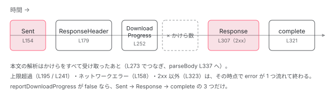

[目次](../README.md) › [HttpClient の内側](README.md) › 第 6 回 / 全 12 回

# FetchBackend：fetch の呼び出し、本文のストリーム読み、中断とサイズ上限

> FetchBackend.handle が Observable の中で doRequest を呼び、fetch に AbortController の signal を渡す行、レスポンスの本文を reader で少しずつ読んで DownloadProgress を流す行、HTTP\_FETCH\_MAX\_RESPONSE\_SIZE の上限、responseType ごとの変換と JSON の解析失敗、ステータス 0 やネットワークエラーの扱い、PendingTasks は手前の HttpInterceptorHandler が持つこと、購読解除で abort する行。

angular/angular · 読了 約 14 分 · 発展 · [サイトで読む（デモが動きます）](https://angular-deep-dive-cyan.vercel.app/chapter/http-backend-fetch)

---

インターセプタの連鎖をくぐり抜けたリクエストは、最後に `HttpBackend` の `handle` に渡ります。v22 の既定の `HttpBackend` は `FetchBackend` で、ブラウザの `fetch()` を 1 回呼ぶクラスです。この章では `FetchBackend.handle` が返す Observable の中身を最初から最後まで追います。`fetch` に `AbortController` の signal を渡す行、本文を reader で少しずつ読みながら `DownloadProgress` を流す行、`HTTP_FETCH_MAX_RESPONSE_SIZE` の上限で読むのをやめる行、`responseType` ごとの変換、ステータス 0 とネットワークエラーの扱いです。

読む対象は `packages/common/http/src/fetch.ts`（497 行）の 1 ファイルです。

1. [1. 概観](01-http-overview.md)
2. [2. provideHttpClient と features](02-http-provide.md)
3. [3. HttpClient.request](03-http-client-request.md)
4. [4. 不変なリクエスト](04-http-request-immutable.md)
5. [5. インターセプタの連鎖](05-http.md)
6. **6. FetchBackend**（この章）
7. [7. HttpXhrBackend](07-http-backend-xhr.md)
8. [8. HttpEvent とエラー](08-http-response-errors.md)
9. [9. XSRF 対策](09-http-xsrf.md)
10. [10. JSONP](10-http-jsonp.md)
11. [11. SSR の転送キャッシュ](11-http-transfer-cache.md)
12. [12. テスト用バックエンド](12-http-testing.md)

## 1. FetchBackend が注入で受け取る 4 つ

`provideHttpClient()` が `HttpBackend` を `inject(FetchBackend)` で埋めることは[第 2 回](02-http-provide.md)で読みました。ここではそのクラスの側を見ます。

📄 `angular/packages/common/http/src/fetch.ts` L73–83 （▶ の行: 73, 78–82）

```ts
73 ▶ @Service()
74 │ export class FetchBackend implements HttpBackend {
75 │   // We use an arrow function to always reference the current global implementation of `fetch`.
76 │   // This is helpful for cases when the global `fetch` implementation is modified by external code,
77 │   // see https://github.com/angular/angular/issues/57527.
78 ▶   private readonly fetchImpl =
79 ▶     inject(FetchFactory, {optional: true})?.fetch ?? ((...args) => globalThis.fetch(...args));
80 ▶   private readonly ngZone = inject(NgZone);
81 ▶   private readonly destroyRef = inject(DestroyRef);
82 ▶   private readonly maxResponseSize = inject(HTTP_FETCH_MAX_RESPONSE_SIZE);
83 │ 
```

1. **73 行目：`@Service()`**

   v22 の新しいデコレータです（`core/src/di/service.ts`）。引数なしなら「自動で DI に登録されるサービス」になり、`providedIn: 'root'` の `@Injectable` と同じく、どこかの `providers` に書かなくても注入できます。
2. **78〜79 行目：`fetchImpl`**

   `FetchFactory` が提供されていればその `fetch`、無ければ `(...args) => globalThis.fetch(...args)` という**矢印関数**です。75〜77 行目のコメントのとおり、`globalThis.fetch` を作った時点で掴まず、**呼ぶたびに読み直す**ためです。あとから外部のコードが `fetch` を差し替えても、その新しい実装が使われます（この章の DEMO はこれを利用して、`fetch` に渡った引数を覗きます）。
3. **80〜82 行目：`NgZone`・`DestroyRef`・上限値**

   `NgZone` は 3・6 節で zone の外で走らせるため（zoneless の既定では `NoopNgZone` なので、ただ関数を呼ぶだけになります）。`DestroyRef` は 6 節で「アプリが壊れたら読むのをやめる」ため。`maxResponseSize` は 5・6 節の上限です。

📄 `angular/packages/common/http/src/fetch.ts` L440–447 （▶ の行: 443–444）

```ts
440 │ /**
441 │  * Abstract class to provide a mocked implementation of `fetch()`
442 │  */
443 ▶ export abstract class FetchFactory {
444 ▶   abstract fetch: typeof fetch;
445 │ }
446 │ 
447 │ function noop(): void {}
```

443〜444 行目の `FetchFactory` は `fetch` を 1 つ持つだけの抽象クラスです。`@angular/common/http` の公開 API には出ておらず、`fetch_spec.ts` の `MockFetchFactory` のように、テストで偽の `fetch` を入れるために使われています。

📄 `angular/packages/common/http/src/fetch.ts` L37–60 （▶ の行: 37, 42, 52, 55–58）

```ts
37 ▶ const XSSI_PREFIX = /^\)\]\}',?\n/;
38 │ 
39 │ let uploadProgressWarningLogged = false;
40 │ 
41 │ // 1 MB by default
42 ▶ const DEFAULT_SSR_MAX_RESPONSE_BODY_SIZE = 1024 * 1024;
43 │ 
44 │ /**
45 │  * Configures the maximum buffered response body size for `FetchBackend`.
46 │  *
47 │  * The limit is only enabled by default in SSR mode to prevent unbounded buffering
48 │  * when a response stream never terminates.
49 │  *
50 │  * Set to `null` to disable the limit.
51 │  */
52 ▶ export const HTTP_FETCH_MAX_RESPONSE_SIZE = new InjectionToken<number | null>(
53 │   typeof ngDevMode !== 'undefined' && ngDevMode ? 'HTTP_FETCH_MAX_RESPONSE_SIZE' : '',
54 │   {
55 ▶     factory: () =>
56 ▶       typeof ngServerMode !== 'undefined' && ngServerMode
57 ▶         ? DEFAULT_SSR_MAX_RESPONSE_BODY_SIZE
58 ▶         : null,
59 │   },
60 │ );
```

52 行目の `HTTP_FETCH_MAX_RESPONSE_SIZE` は、本文をメモリにためる量の上限です。55〜58 行目の factory が既定値を決めます。`ngServerMode`（サーバーで動くビルドで `true` になる大域定数）なら 42 行目の 1 MB、ブラウザでは `null`（上限なし）です。47〜48 行目のコメントのとおり、サーバーで「終わらないレスポンス」をためこみ続けないための仕組みです。公開 API では `ɵHTTP_FETCH_MAX_RESPONSE_SIZE` という内部向けの名前で出ています。

## 2. handle：subscribe されたら AbortController を作る

📄 `angular/packages/common/http/src/fetch.ts` L84–121 （▶ の行: 85–87, 90–91, 96, 100, 105–106, 110, 113, 116）

```ts
 84 │   handle(request: HttpRequest<any>): Observable<HttpEvent<any>> {
 85 ▶     return new Observable((observer) => {
 86 ▶       const aborter = new AbortController();
 87 ▶       let done = false;
 88 │       const wrappedObserver: Observer<HttpEvent<any>> = {
 89 │         next: (val) => {
 90 ▶           if (val.type === HttpEventType.Response) {
 91 ▶             done = true;
 92 │           }
 93 │           observer.next(val);
 94 │         },
 95 │         error: (err) => {
 96 ▶           done = true;
 97 │           observer.error(err);
 98 │         },
 99 │         complete: () => {
100 ▶           done = true;
101 │           observer.complete();
102 │         },
103 │       };
104 │ 
105 ▶       this.doRequest(request, aborter.signal, wrappedObserver).then(noop, (error) =>
106 ▶         wrappedObserver.error(new HttpErrorResponse({error})),
107 │       );
108 │ 
109 │       let timeoutId: ReturnType<typeof setTimeout> | undefined;
110 ▶       if (request.timeout) {
111 │         // TODO: Replace with AbortSignal.any([aborter.signal, AbortSignal.timeout(request.timeout)])
112 │         // when AbortSignal.any support is Baseline widely available (NET nov. 2026)
113 ▶         timeoutId = this.ngZone.runOutsideAngular(() =>
114 │           setTimeout(() => {
115 │             if (!aborter.signal.aborted) {
116 ▶               aborter.abort(new DOMException('signal timed out', 'TimeoutError'));
117 │             }
118 │           }, request.timeout),
119 │         );
120 │       }
121 │ 
```

1. **85 行目：`new Observable(...)`**

   `handle` を呼んだだけでは何も起きません。85 行目の関数は **subscribe されたときに**動きます。`HttpClient.request` が `of(req).pipe(concatMap(...))` でこれを包んでいる理由は[第 3 回](03-http-client-request.md)で読みます。`fetch_spec.ts` にも「subscribe しないと fetch は呼ばれない」というテスト（`should not call fetch without a subscribe`）があります。
2. **86 行目：購読 1 回につき `AbortController` を 1 つ**

   `AbortController` はブラウザの API で、`abort()` を呼ぶと、その `signal` を渡した `fetch` が中断されます。
3. **87〜103 行目：`done` を立てる観測者で包む**

   90〜91 行目、`Response` イベントを流したら `done = true`。96・100 行目、error か complete でも `true`。購読解除のときに返す teardown 関数は、この `done` が `false` で、まだ中断していなければ `aborter.abort()` を呼びます（teardown の行は [httpResource の章](../signals/16-signals-http-resource.md)で引用済み）。つまり **応答を受け取り終える前に unsubscribe されたときだけ**`fetch` が止まります。
4. **105〜106 行目：`doRequest` を呼び、失敗は `HttpErrorResponse` に**

   `doRequest` は `async` 関数で、本体は 3 節以降です。中で投げられた例外（5・6 節の上限超過など）は Promise の reject になり、106 行目で `new HttpErrorResponse({error})` に包まれて error として流れます。status を渡していないので 0 です。
5. **109〜120 行目：`timeout` は `setTimeout` + `abort`**

   110 行目、`HttpRequest.timeout`（ミリ秒）があれば、113 行目で zone の外に `setTimeout` を置き、時間が来たら 116 行目で `TimeoutError` という名前の `DOMException` を理由に `abort` します。`fetch` 自体にタイムアウトの引数は無いので、中断の仕組みで作っています（111〜112 行目の TODO は、将来 `AbortSignal.any` と `AbortSignal.timeout` に置き換える予定）。

## 3. doRequest（前半）：fetch を呼び、Sent を流し、待つ

📄 `angular/packages/common/http/src/fetch.ts` L133–168 （▶ の行: 138, 144–145, 151, 154, 156–158, 161, 163）

```ts
133 │   private async doRequest(
134 │     request: HttpRequest<any>,
135 │     signal: AbortSignal,
136 │     observer: Observer<HttpEvent<any>>,
137 │   ): Promise<void> {
138 ▶     const init = this.createRequestInit(request);
139 │     let response;
140 │     try {
141 │       // Run fetch outside of Angular zone.
142 │       // This is due to Node.js fetch implementation (Undici) which uses a number of setTimeouts to check if
143 │       // the response should eventually timeout which causes extra CD cycles every 500ms
144 ▶       const fetchPromise = this.ngZone.runOutsideAngular(() =>
145 ▶         this.fetchImpl(request.urlWithParams, {signal, ...init}),
146 │       );
147 │ 
148 │       // Make sure Zone.js doesn't trigger false-positive unhandled promise
149 │       // error in case the Promise is rejected synchronously. See function
150 │       // description for additional information.
151 ▶       silenceSuperfluousUnhandledPromiseRejection(fetchPromise);
152 │ 
153 │       // Send the `Sent` event before awaiting the response.
154 ▶       observer.next({type: HttpEventType.Sent});
155 │ 
156 ▶       response = await fetchPromise;
157 ▶     } catch (error: any) {
158 ▶       observer.error(
159 │         new HttpErrorResponse({
160 │           error,
161 ▶           status: error.status ?? 0,
162 │           statusText: error.statusText,
163 ▶           url: request.urlWithParams,
164 │           headers: error.headers,
165 │         }),
166 │       );
167 │       return;
168 │     }
```

1. **138 行目：`createRequestInit` で `RequestInit` を作る**

   `RequestInit` は `fetch` の第 2 引数の型です。中身は 4 節で読みます。
2. **144〜145 行目：zone の外で `fetch(url, {signal, ...init})`**

   URL は `urlWithParams`（`params` を付けた URL）です。2 節の `aborter.signal` をここで渡します。141〜143 行目のコメントのとおり、Node.js の fetch 実装（Undici）は内部で何度も `setTimeout` を使うので、zone.js があるアプリでは 500 ms ごとに余計な変更検知が走ってしまいます。それを避けるために `runOutsideAngular` で包んでいます。
3. **151 行目：reject を黙らせる**

   下の helpers の 466〜468 行目で、何もしない `.then(noop, noop)` を付けます。待つ前に reject されたとき、zone.js が「処理されない reject」として報告しないためです（460〜465 行目のコメント）。
4. **154 行目：`Sent` を流す**

   `fetch` を呼んだ直後、応答を待つ前に `{type: HttpEventType.Sent}` を流します。subscribe の中で同期に流れる最初のイベントです。
5. **156 行目：`await`**

   ここで初めて非同期になります。**subscribe からここまでは同期**なので、subscribe が返った時点で `fetch` はもう呼ばれています。
6. **157〜167 行目：ヘッダーすら来なかった失敗**

   `fetch` の Promise が reject されるのは、ネットワークに届かなかったとき（オフライン、DNS 失敗、CORS で拒否）と、`abort` されたときです。161 行目、エラーに `status` があればそれ、無ければ **0**。ブラウザの `TypeError` や `DOMException` は `status` を持たないので、ネットワークエラーとタイムアウトは status 0 の `HttpErrorResponse` になります。

📄 `angular/packages/common/http/src/fetch.ts` L460–476 （▶ の行: 466–467, 470–472）

```ts
460 │ /**
461 │  * Zone.js treats a rejected promise that has not yet been awaited
462 │  * as an unhandled error. This function adds a noop `.then` to make
463 │  * sure that Zone.js doesn't throw an error if the Promise is rejected
464 │  * synchronously.
465 │  */
466 ▶ function silenceSuperfluousUnhandledPromiseRejection(promise: Promise<unknown>) {
467 ▶   promise.then(noop, noop);
468 │ }
469 │ 
470 ▶ function throwBodyTooLargeError(maxResponseSize: number): never {
471 ▶   throw new RuntimeError(
472 ▶     RuntimeErrorCode.FETCH_RESPONSE_BODY_TOO_LARGE,
473 │     ngDevMode &&
474 │       `Fetch response body exceeded the configured buffer limit (${maxResponseSize} bytes).`,
475 │   );
476 │ }
```

470〜476 行目の `throwBodyTooLargeError` は 5・6 節で使います。472 行目のエラーコードは `RuntimeErrorCode.FETCH_RESPONSE_BODY_TOO_LARGE`（-2825）で、画面には `NG02825` と出ます。

## 4. createRequestInit：HttpRequest を RequestInit に写す

📄 `angular/packages/common/http/src/fetch.ts` L371–394 （▶ の行: 372–374, 386, 389, 391–392）

```ts
371 │   private createRequestInit(req: HttpRequest<any>): RequestInit {
372 ▶     if (req.reportUploadProgress) {
373 ▶       throw new RuntimeError(
374 ▶         RuntimeErrorCode.FETCH_UPLOAD_PROGRESS_NOT_SUPPORTED,
375 │         ngDevMode &&
376 │           'The FetchBackend does not support upload progress reporting. Please use `withXhr()` on your `provideHttpClient()` configuration if you want to report upload progress.',
377 │       );
378 │     }
379 │ 
380 │     // We could share some of this logic with the XhrBackend
381 │     const headers: Record<string, string> = {};
382 │     let credentials: RequestCredentials | undefined;
383 │ 
384 │     // If the request has a credentials property, use it.
385 │     // Otherwise, if the request has withCredentials set to true, use 'include'.
386 ▶     credentials = req.credentials;
387 │ 
388 │     // If withCredentials is true should be set to 'include', for compatibility
389 ▶     if (req.withCredentials) {
390 │       // A warning is logged in development mode if the request has both
391 ▶       (typeof ngDevMode === 'undefined' || ngDevMode) && warningOptionsMessage(req);
392 ▶       credentials = 'include';
393 │     }
394 │ 
```

1. **372〜377 行目：アップロードの進捗は取れない**

   `reportUploadProgress: true` なら、`fetch` を呼ぶ前に `RuntimeError`（`FETCH_UPLOAD_PROGRESS_NOT_SUPPORTED`）を投げます。`fetch` には送信中のバイト数を知らせる仕組みが無いからです。メッセージは「`withXhr()` を使え」と案内します（376 行目）。この例外は `async` の `doRequest` の中で起きるので、2 節 106 行目で `HttpErrorResponse` になって error に流れます。
2. **386〜393 行目：`credentials`**

   386 行目でまず `req.credentials`（`'omit' | 'same-origin' | 'include'`）をそのまま使い、389 行目、古い `withCredentials: true` があれば 392 行目で `'include'` に上書きします。両方指定していると、開発ビルドでは 391 行目の `warningOptionsMessage` が「`withCredentials` が `credentials` を上書きした」と警告します。

📄 `angular/packages/common/http/src/fetch.ts` L395–426 （▶ の行: 396, 399–400, 404–405, 408, 413, 417–419）

```ts
395 │     // Setting all the requested headers.
396 ▶     req.headers.forEach((name, values) => (headers[name] = values.join(',')));
397 │ 
398 │     // Add an Accept header if one isn't present already.
399 ▶     if (!req.headers.has(ACCEPT_HEADER)) {
400 ▶       headers[ACCEPT_HEADER] = ACCEPT_HEADER_VALUE;
401 │     }
402 │ 
403 │     // Auto-detect the Content-Type header if one isn't present already.
404 ▶     if (!req.headers.has(CONTENT_TYPE_HEADER)) {
405 ▶       const detectedType = req.detectContentTypeHeader();
406 │       // Sometimes Content-Type detection fails.
407 │       if (detectedType !== null) {
408 ▶         headers[CONTENT_TYPE_HEADER] = detectedType;
409 │       }
410 │     }
411 │ 
412 │     return {
413 ▶       body: req.serializeBody(),
414 │       method: req.method,
415 │       headers,
416 │       credentials,
417 ▶       keepalive: req.keepalive,
418 ▶       cache: req.cache,
419 ▶       priority: req.priority,
420 │       mode: req.mode,
421 │       redirect: req.redirect,
422 │       referrer: req.referrer,
423 │       integrity: req.integrity,
424 │       referrerPolicy: req.referrerPolicy,
425 │     };
426 │   }
```

1. **396 行目：ヘッダーを平らなオブジェクトに**

   `HttpHeaders` は 1 つの名前に複数の値を持てます。`fetch` に渡すため、値を `,` でつないだ 1 つの文字列にします。
2. **399〜401 行目：`Accept` が無ければ足す**

   値は `request.ts` の `ACCEPT_HEADER_VALUE` で、`application/json, text/plain, */*` です（DEMO の init に出ます）。
3. **404〜410 行目：`Content-Type` が無ければ本文から推測**

   `detectContentTypeHeader()` が本文の型（文字列、`FormData`、オブジェクトなど）から決めます。決まらなければ `null` で、付けません。
4. **412〜425 行目：残りはそのまま渡す**

   413 行目の `serializeBody()` で本文を文字列などにし、417〜424 行目で `keepalive`・`cache`・`priority`・`mode`・`redirect`・`referrer`・`integrity`・`referrerPolicy` を `HttpRequest` から写します。どれも `fetch` にしかない機能で、`HttpXhrBackend` では警告を出して無視されます（[第 7 回](07-http-backend-xhr.md)）。

## 5. doRequest（中盤）：ヘッダーが届いた

📄 `angular/packages/common/http/src/fetch.ts` L170–197 （▶ の行: 170, 172, 177, 179, 182, 186–187, 190–192, 194–195）

```ts
170 ▶     const headers = new HttpHeaders(response.headers);
171 │     const statusText = response.statusText;
172 ▶     const url = response.url || request.urlWithParams;
173 │ 
174 │     let status = response.status;
175 │     let body: string | ArrayBuffer | Blob | object | null = null;
176 │ 
177 ▶     const reportDownloadProgress = request.reportProgress || request.reportDownloadProgress;
178 │     if (reportDownloadProgress) {
179 ▶       observer.next(new HttpHeaderResponse({headers, status, statusText, url}));
180 │     }
181 │ 
182 ▶     if (response.body) {
183 │       const contentType = response.headers.get(CONTENT_TYPE_HEADER) ?? '';
184 │ 
185 │       // Read Progress
186 ▶       const contentLength = response.headers.get('content-length');
187 ▶       const contentLengthValue = contentLength !== null ? Number(contentLength) : NaN;
188 │ 
189 │       if (
190 ▶         this.maxResponseSize !== null &&
191 ▶         Number.isFinite(contentLengthValue) &&
192 ▶         contentLengthValue > this.maxResponseSize
193 │       ) {
194 ▶         await response.body.cancel();
195 ▶         throwBodyTooLargeError(this.maxResponseSize);
196 │       }
197 │ 
```

1. **170 行目：`Response.headers` を `HttpHeaders` に**

   `fetch` の `Headers` オブジェクトをそのまま渡します。`HttpHeaders` のコンストラクタは `Headers` を受け取るとその場で 1 つずつ写します（[第 4 回](04-http-request-immutable.md)）。
2. **172 行目：URL はリダイレクト後のもの**

   `response.url` はリダイレクトを追ったあとの最終的な URL です。空なら送った `urlWithParams` を使います。
3. **177〜180 行目：進捗が欲しいなら、まず `ResponseHeader`**

   177 行目、`reportProgress`（v22 で非推奨）か `reportDownloadProgress` が `true` なら、179 行目で本文を読む前に `HttpHeaderResponse`（ステータスとヘッダーだけのイベント）を流します。
4. **182 行目：本文があるときだけ読む**

   `response.body` は `ReadableStream`（少しずつ読める流れ）です。HEAD や 204 では `null` で、このブロックを飛ばします。
5. **186〜196 行目：`content-length` で先に断る**

   186〜187 行目、`content-length` を数にします（無ければ `NaN`）。190〜192 行目、上限があり、宣言された長さが上限を超えていれば、194 行目で本文を 1 バイトも読まずに `cancel()` し、195 行目で投げます。投げた例外は 2 節 106 行目で status 0 の `HttpErrorResponse` になります。

## 6. 本文を reader で読むループ

📄 `angular/packages/common/http/src/fetch.ts` L198–234 （▶ の行: 198–199, 207, 214–215, 220, 225–226, 230, 232–233）

```ts
198 ▶       const chunks: Uint8Array[] = [];
199 ▶       const reader = response.body.getReader();
200 │       let receivedLength = 0;
201 │ 
202 │       let decoder: TextDecoder;
203 │       let partialText: string | undefined;
204 │ 
205 │       // We have to check whether the Zone is defined in the global scope because this may be called
206 │       // when the zone is nooped.
207 ▶       const reqZone = typeof Zone !== 'undefined' && Zone.current;
208 │ 
209 │       let canceled = false;
210 │ 
211 │       // Perform response processing outside of Angular zone to
212 │       // ensure no excessive change detection runs are executed
213 │       // Here calling the async ReadableStreamDefaultReader.read() is responsible for triggering CD
214 ▶       await this.ngZone.runOutsideAngular(async () => {
215 ▶         while (true) {
216 │           // Prevent reading chunks if the app is destroyed. Otherwise, we risk doing
217 │           // unnecessary work or triggering side effects after teardown.
218 │           // This may happen if the app was explicitly destroyed before
219 │           // the response returned entirely.
220 ▶           if (this.destroyRef.destroyed) {
221 │             // Streams left in a pending state (due to `break` without cancel) may
222 │             // continue consuming or holding onto data behind the scenes.
223 │             // Calling `reader.cancel()` allows the browser or the underlying
224 │             // system to release any network or memory resources associated with the stream.
225 ▶             await reader.cancel();
226 ▶             canceled = true;
227 │             break;
228 │           }
229 │ 
230 ▶           const {done, value} = await reader.read();
231 │ 
232 ▶           if (done) {
233 ▶             break;
234 │           }
```

1. **198〜199 行目：受け取ったかけらをためる配列と reader**

   `getReader()` で `ReadableStream` から 1 つずつ `Uint8Array`（バイト列）を取り出す reader を作ります。
2. **207 行目：今の Zone を覚える**

   zone.js が無いアプリ（このサイト）では `Zone` が定義されていないので `false` です。zone.js があるときは、あとで進捗イベントをこの Zone に戻して流すために使います（258 行目）。
3. **214 行目：ループ全体を zone の外で**

   211〜213 行目のコメントのとおり、`reader.read()` は 1 回ごとに Promise を返すので、zone の中で回すとかけらの数だけ変更検知が走ります。
4. **220〜228 行目：アプリが破棄されていたら読むのをやめる**

   81 行目の `DestroyRef` が破棄済みなら、225 行目で `reader.cancel()` して通信の資源を返し、226 行目で `canceled` を立てて抜けます。
5. **230〜234 行目：1 かけら読む。終わりなら抜ける**

   `done` が `true` になったら本文はすべて届いています。

📄 `angular/packages/common/http/src/fetch.ts` L235–273 （▶ の行: 236–237, 239–241, 244, 246, 248, 253–255, 258, 267–268, 273）

```ts
235 │ 
236 ▶           chunks.push(value);
237 ▶           receivedLength += value.length;
238 │ 
239 ▶           if (this.maxResponseSize !== null && receivedLength > this.maxResponseSize) {
240 ▶             await reader.cancel();
241 ▶             throwBodyTooLargeError(this.maxResponseSize);
242 │           }
243 │ 
244 ▶           if (reportDownloadProgress) {
245 │             partialText =
246 ▶               request.responseType === 'text'
247 │                 ? (partialText ?? '') +
248 ▶                   (decoder ??= getTextDecoder(contentType)).decode(value, {stream: true})
249 │                 : undefined;
250 │ 
251 │             const reportProgress = () =>
252 │               observer.next({
253 ▶                 type: HttpEventType.DownloadProgress,
254 ▶                 total: Number.isFinite(contentLengthValue) ? contentLengthValue : undefined,
255 ▶                 loaded: receivedLength,
256 │                 partialText,
257 │               } as HttpDownloadProgressEvent);
258 ▶             reqZone ? reqZone.run(reportProgress) : reportProgress();
259 │           }
260 │         }
261 │       });
262 │ 
263 │       // We need to manage the canceled state — because the Streams API does not
264 │       // expose a direct `.state` property on the reader.
265 │       // We need to `return` because `parseBody` may not be able to parse chunks
266 │       // that were only partially read (due to cancellation caused by app destruction).
267 ▶       if (canceled) {
268 ▶         observer.complete();
269 │         return;
270 │       }
271 │ 
272 │       // Combine all chunks.
273 ▶       const chunksAll = this.concatChunks(chunks, receivedLength);
```

1. **236〜237 行目：ためて、数える**

   `receivedLength` がここまでに受け取ったバイト数です。
2. **239〜242 行目：読みながらでも上限を見る**

   5 節は「宣言された長さ」の検査でした。`content-length` が無い応答や、終わらないストリームはそこを通り抜けます。そこで、かけらを足すたびに 239 行目で比べ、超えたら 240 行目で `cancel()`、241 行目で投げます。例外は 214 行目の `await` を通って `doRequest` から外へ出ます。
3. **244〜259 行目：`DownloadProgress` を流す**

   246 行目、`responseType` が `'text'` のときだけ、248 行目の `TextDecoder`（`{stream: true}` で、かけらの境目で切れた文字を次に持ち越す）で途中までの文字列 `partialText` を作ります。253〜255 行目、`total` は `content-length` が数のときだけ、`loaded` は 237 行目の累計です。**かけら 1 つにつきイベント 1 つ**なので、イベントの数はネットワークやブラウザがどう区切ったかで変わります。258 行目、207 行目で覚えた Zone があればその中で流します。
4. **267〜270 行目：途中でやめたなら complete だけ**

   220 行目で抜けたときは、本文が途中までしか無いので解析せず、`Response` を流さずに complete します。
5. **273 行目：かけらを 1 本につなぐ**

   次の `concatChunks` で、ためた配列を 1 つの `Uint8Array` にします。

📄 `angular/packages/common/http/src/fetch.ts` L428–437 （▶ の行: 429, 432–433）

```ts
428 │   private concatChunks(chunks: Uint8Array[], totalLength: number): Uint8Array<ArrayBuffer> {
429 ▶     const chunksAll = new Uint8Array(totalLength);
430 │     let position = 0;
431 │     for (const chunk of chunks) {
432 ▶       chunksAll.set(chunk, position);
433 ▶       position += chunk.length;
434 │     }
435 │ 
436 │     return chunksAll;
437 │   }
```

429 行目で合計の長さの `Uint8Array` を 1 回だけ確保し、432〜433 行目で順に書き写します。つまり **本文は最後まで全部メモリにたまってから**解析されます。1 節の上限が要るのはこのためです。



*FetchBackend が 1 回の購読で流すイベント（reportDownloadProgress: true のとき）。上限を超えたら、その時点で error。*

## 7. parseBody：responseType ごとの変換

📄 `angular/packages/common/http/src/fetch.ts` L337–369 （▶ の行: 343, 346–348, 351, 357–358, 360, 363, 365, 367）

```ts
337 │   private parseBody(
338 │     request: HttpRequest<any>,
339 │     binContent: Uint8Array<ArrayBuffer>,
340 │     contentType: string,
341 │     status: number,
342 │   ): string | ArrayBuffer | Blob | object | null {
343 ▶     switch (request.responseType) {
344 │       case 'json':
345 │         // stripping the XSSI when present
346 ▶         const text = new TextDecoder().decode(binContent).replace(XSSI_PREFIX, '');
347 ▶         if (text === '') {
348 ▶           return null;
349 │         }
350 │         try {
351 ▶           return JSON.parse(text) as object;
352 │         } catch (e: unknown) {
353 │           // Allow handling non-JSON errors (!) as plain text, same as the XHR
354 │           // backend. Without this special sauce, any non-JSON error would be
355 │           // completely inaccessible downstream as the `HttpErrorResponse.error`
356 │           // would be set to the `SyntaxError` from then failing `JSON.parse`.
357 ▶           if (status < 200 || status >= 300) {
358 ▶             return text;
359 │           }
360 ▶           throw e;
361 │         }
362 │       case 'text':
363 ▶         return getTextDecoder(contentType).decode(binContent);
364 │       case 'blob':
365 ▶         return new Blob([binContent], {type: contentType});
366 │       case 'arraybuffer':
367 ▶         return binContent.buffer;
368 │     }
369 │   }
```

1. **344〜361 行目：`'json'`**

   346 行目で UTF-8 として文字列にし、先頭の `)]}',` と改行（XSSI 対策の接頭辞。[第 7 回](07-http-backend-xhr.md)で詳しく）を、1 節の引用の 37 行目の正規表現で剥がします。347〜348 行目、空なら `null`。351 行目で `JSON.parse`。失敗したとき、ステータスが 2xx でなければ 357〜358 行目で**文字列のまま返します**（サーバーの HTML のエラーページなどを読めるように）。2xx なら 360 行目で投げ直します。投げた例外を受け取って status 200 の `HttpErrorResponse` にする行は [httpResource の章](../signals/16-signals-http-resource.md)で引用済みです。
2. **362〜363 行目：`'text'`**

   `Content-Type` の `charset` を読む `getTextDecoder` で文字列にします（JSON は 346 行目のとおり常に UTF-8）。
3. **364〜367 行目：`'blob'` と `'arraybuffer'`**

   365 行目、`Content-Type` を型にした `Blob`。367 行目、6 節でつないだバイト列の `ArrayBuffer` をそのまま返します。

## 8. ステータス 0、ok、Response と error の分かれ道

📄 `angular/packages/common/http/src/fetch.ts` L291–321 （▶ の行: 292–293, 300, 302, 304, 307, 314–315, 321）

```ts
291 │     // Same behavior as the XhrBackend
292 ▶     if (status === 0) {
293 ▶       status = body ? HTTP_STATUS_CODE_OK : 0;
294 │     }
295 │ 
296 │     // ok determines whether the response will be transmitted on the event or
297 │     // error channel. Unsuccessful status codes (not 2xx) will always be errors,
298 │     // but a successful status code can still result in an error if the user
299 │     // asked for JSON data and the body cannot be parsed as such.
300 ▶     const ok = status >= 200 && status < 300;
301 │ 
302 ▶     const redirected = response.redirected;
303 │ 
304 ▶     const responseType = response.type;
305 │ 
306 │     if (ok) {
307 ▶       observer.next(
308 │         new HttpResponse({
309 │           body,
310 │           headers,
311 │           status,
312 │           statusText,
313 │           url,
314 ▶           redirected,
315 ▶           responseType,
316 │         }),
317 │       );
318 │ 
319 │       // The full body has been received and delivered, no further events
320 │       // are possible. This request is complete.
321 ▶       observer.complete();
```

1. **292〜294 行目：status 0 でも本文があれば 200**

   291 行目のコメントのとおり XHR 版と同じ振る舞いです。ステータスが 0 でも本文が取れていれば成功として扱います。本文も無ければ 0 のままで、300 行目で失敗になります。
2. **300 行目：`ok` は 2xx だけ**

   3xx はブラウザの `fetch` がリダイレクトを追ってしまうので、ふつうここには来ません。追った事実は 302 行目の `response.redirected` に残ります。
3. **306〜321 行目：成功なら `HttpResponse` と complete**

   314〜315 行目の `redirected` と `responseType`（`Response.type`。`'basic'`・`'cors'` など）は fetch 版だけが入れる項目です。

📄 `angular/packages/common/http/src/fetch.ts` L322–335 （▶ の行: 323, 325, 327）

```ts
322 │     } else {
323 ▶       observer.error(
324 │         new HttpErrorResponse({
325 ▶           error: body,
326 │           headers,
327 ▶           status,
328 │           statusText,
329 │           url,
330 │           redirected,
331 │           responseType,
332 │         }),
333 │       );
334 │     }
335 │   }
```

2xx 以外は 323 行目で error です。325 行目、`error` にはサーバーが返した本文（7 節で解析したもの）が入ります。404 の JSON でも、HTML のエラーページの文字列でも、ここで読めます。`HttpErrorResponse` の中身は[第 8 回](08-http-response-errors.md)で読みます。

> [!NOTE]
> **ポイント**
>
> **PendingTasks との関係。**`fetch.ts` は `PendingTasks` を import していません。「通信中はアプリが安定していない」と数えるのは、`FetchBackend.handle` を呼ぶ手前の `HttpInterceptorHandler` で、`pendingTasks.add()` して `finalize` で外します（[PendingTasks の章](../zoneless/09-zoneless-pending-tasks.md)）。そのためバックエンドを `HttpXhrBackend` やテスト用に替えても、SSR の「全部の通信が終わるまで待つ」は同じように効きます。

## 9. ここまでの呼び出しを 1 本に

- 👤 `http.get('favicon.ico', { reportDownloadProgress: true, observe: 'events' }).subscribe()` — あなたのコード
  - `HttpInterceptorHandler.handle(req)` — backend.ts L100 — *PendingTasks を 1 つ足し、インターセプタの連鎖の最後で backend.handle*
    - `FetchBackend.handle(req)` — fetch.ts L84 — *new Observable。subscribe で AbortController を作る*
      - `doRequest(req, aborter.signal, observer)` — fetch.ts L133
        - `createRequestInit(req)` — fetch.ts L371 — *headers / credentials / keepalive …*
        - `fetchImpl(urlWithParams, {signal, ...init})` — fetch.ts L145 — *zone の外。ここまで同期*
        - `observer.next(Sent)` → `await fetchPromise` — fetch.ts L154–156
        - `observer.next(HttpHeaderResponse)` — fetch.ts L179
        - `reader.read()` × n → `DownloadProgress` × n — fetch.ts L230–258 — *上限を超えたら cancel して throw*
        - `concatChunks` → `parseBody` — fetch.ts L273 / L337
        - `observer.next(HttpResponse)` → `complete()` — fetch.ts L307–321

> **🧪 DEMO — 本物の FetchBackend で favicon.ico を取る**
>
> 章の中で `createEnvironmentInjector([provideHttpClient()], ...)` を作り、その `HttpClient` で `new HttpRequest('GET', 'favicon.ico', { responseType: 'blob', reportDownloadProgress: true })` を送ります。`fetch` に渡った `RequestInit` は、subscribe している一瞬だけ `globalThis.fetch` を包んで覗いています（78〜79 行目で毎回読み直すので効きます）。「上限 4096 バイト」は `ɵHTTP_FETCH_MAX_RESPONSE_SIZE` を 4096 にした別の注入器です。通信はボタンを押したときだけです。
>
> 流れてきたイベント
>
> fetch に渡った RequestInit（createRequestInit の戻り値 + signal）
>
> ▶ [このデモはサイトで動かせます](https://angular-deep-dive-cyan.vercel.app/chapter/http-backend-fetch)

「取る」では `Sent` → `ResponseHeader` → `DownloadProgress` → `Response` → `complete` の順に流れます。favicon.ico は小さいので、`DownloadProgress` は 1 回か数回です（6 節のとおり、かけらの数で決まります）。「すぐ unsubscribe」では `Sent` だけが届き、`signal.aborted` が `false` から `true` に変わります。理由を渡さない `abort()` なので、理由は `AbortError` です。中断された `fetch` の reject は 157 行目で error にされますが、購読者はもういないので画面には何も出ません。「上限 4096 バイト」は、サーバーが `content-length` を返していれば 194〜195 行目で、返していなければ 239〜241 行目で止まり、status 0・`NG02825` の error になります。「reportUploadProgress」は 372 行目で投げるので `fetch` は呼ばれず、`Sent` も流れません。

## 聞かれそうな質問

**Q. fetch だとアップロードの進捗が取れないのですか？**

取れません。`reportUploadProgress: true` を付けると 372〜377 行目で `FETCH_UPLOAD_PROGRESS_NOT_SUPPORTED` を投げ、通信もしません（DEMO の 4 つ目）。`fetch` の API に送信済みバイト数を知る手段が無いためです。アップロードの進捗が要る画面だけ `provideHttpClient(withXhr())` にします。XHR 側でどう取るかは[第 7 回](07-http-backend-xhr.md)で読みます。ダウンロードの進捗は fetch でも 244〜259 行目で取れます。古い `reportProgress: true` は fetch ではダウンロード側だけに効きます（177 行目）。

**Q. タイムアウトはありますか？**

あります。`http.get(url, { timeout: 5000 })` のように `HttpRequest.timeout` を付けると、113〜119 行目の `setTimeout` が `TimeoutError` を理由に `abort` します。ヘッダーが来る前なら `fetch` の Promise が reject され、161 行目で status 0 の `HttpErrorResponse` になり、その `error` は `name === 'TimeoutError'` の `DOMException` です（`fetch_spec.ts` の `emits an error when a request times out`）。本文を読んでいる途中なら `reader.read()` が reject され、106 行目で同じく status 0 になります。指定しなければタイムアウトは無く、ブラウザ側の制限まで待ちます。

**Q. サーバー（SSR）でも fetch ですか？**

はい。`provideHttpClient()` の既定はブラウザでもサーバーでも `FetchBackend` で、Node.js 18 以降の `globalThis.fetch`（Undici）を 79 行目で呼びます。サーバー向けの違いは 2 つです。55〜58 行目で `ngServerMode` のとき本文の上限が 1 MB になること、141〜146 行目でタイマーの多い Undici を zone の外で動かすことです。`withXhr()` をサーバーで使うと開発ビルドで警告が出て、XHR のサーバー実装は Angular 23 で消える予定です（[第 7 回](07-http-backend-xhr.md)の 9 節）。

**Q. unsubscribe したら、サーバー側の処理も取り消されますか？**

いいえ。取り消されるのはブラウザ側の `fetch` だけです。`Response` が届く前に unsubscribe すると、87〜103 行目の `done` が `false` のままなので teardown が `aborter.abort()` を呼び、ブラウザは接続を切ります。しかし 145 行目の時点でリクエストはもう送られているので、POST の処理がサーバーで終わっている可能性はあります。逆に `Response` を受け取ったあと（91 行目で `done = true`）に unsubscribe しても何も起きません。

**Q. 上限を超えたらどうなり、どう変えますか？**

`content-length` が上限より大きければ本文を読まずに 194 行目で `cancel`、読みながら超えたら 240 行目で `cancel` し、どちらも `NG02825` を投げて 106 行目で status 0 の error になります。値は `{ provide: ɵHTTP_FETCH_MAX_RESPONSE_SIZE, useValue: 10 * 1024 * 1024 }` のように差し替えられ、`null` で無効です（50 行目、`fetch_spec.ts` の `allows disabling the size limit via dependency injection`）。ブラウザでは既定で `null` です。

## 読み終えて

- `FetchBackend.handle` は subscribe ごとに `AbortController` を作り、`Response` を流す前に unsubscribe されたときだけ `abort` する（86〜103 行目）
- subscribe から `fetch` の呼び出しと `Sent` までは同期。最初の `await` は 156 行目
- 本文は `reader.read()` のループで受け取り、かけら 1 つにつき `DownloadProgress` を 1 つ流し、最後に全部つないでから解析する（230〜275 行目）
- `HTTP_FETCH_MAX_RESPONSE_SIZE` は SSR だけ既定 1 MB。`content-length` と読んだ累計の両方で検査する（190・239 行目）
- ネットワークエラー・タイムアウト・上限超過は status 0、2xx 以外は本文を `error` に入れた error（161・323 行目）

---

← 前: [インターセプタの連鎖：reduceRight で関数を入れ子にする](05-http.md)  
次: [HttpXhrBackend：XMLHttpRequest のイベントと、アップロードの進捗](07-http-backend-xhr.md) →
