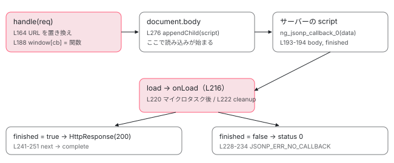

[目次](../README.md) › [HttpClient の内側](README.md) › 第 10 回 / 全 12 回

# JSONP：script 要素を差し込んでコールバックを待つバックエンド

> withJsonpSupport が足す jsonpInterceptorFn と JsonpClientBackend。method が JSONP のリクエストだけを横取りし、コールバック名を作って script 要素を差し込み、load / error で後片付けする行、JSONP\_CALLBACK の置き換え、コールバックが呼ばれなかったときのエラー、危険な URL を拒む行。v22.1 で非推奨になったことと、使わない理由。

angular/angular · 読了 約 11 分 · 発展 · [サイトで読む（デモが動きます）](https://angular-deep-dive-cyan.vercel.app/chapter/http-jsonp)

---

JSONP は、`fetch` も XHR も使わずに、**`<script src="...">` を 1 つページに差し込んで**別のドメインからデータを受け取る昔の技法です。サーバーは JSON の代わりに `コールバック名(データ)` という JavaScript を返し、ブラウザがそれを実行すると、こちらが用意した関数が呼ばれます。この章では、`withJsonpSupport()` が足す `jsonpInterceptorFn` と `JsonpClientBackend` を読み、コールバック名を作る行、URL の `JSONP_CALLBACK` を置き換える行、script 要素を作って `load` / `error` で後片付けする行、危険な URL を拒む行を 1 つずつ追います。

読む対象は `packages/common/http/src/jsonp.ts`（349 行）と、`client.ts` の `jsonp` メソッド、`errors.ts`、`test/jsonp_spec.ts` です。`withJsonpSupport()` が provide する 3 つ（`JsonpClientBackend`、`JsonpCallbackContext`、`HTTP_INTERCEPTOR_FNS` への `jsonpInterceptorFn`）は [第 2 回](02-http-provide.md)で読みました。

> [!WARNING]
> **ハマりどころ**
>
> JSONP の API は v22.1 ですべて `@deprecated`（非推奨）になりました。理由はどの doc コメントにも同じ 1 文で書いてあります：「JSONP is deprecated as it can cause XSS vulnerabilities」。この章は「なぜ危ないのか」を行で確かめる章でもあります。

1. [1. 概観](01-http-overview.md)
2. [2. provideHttpClient と features](02-http-provide.md)
3. [3. HttpClient.request](03-http-client-request.md)
4. [4. 不変なリクエスト](04-http-request-immutable.md)
5. [5. インターセプタの連鎖](05-http.md)
6. [6. FetchBackend](06-http-backend-fetch.md)
7. [7. HttpXhrBackend](07-http-backend-xhr.md)
8. [8. HttpEvent とエラー](08-http-response-errors.md)
9. [9. XSRF 対策](09-http-xsrf.md)
10. **10. JSONP**（この章）
11. [11. SSR の転送キャッシュ](11-http-transfer-cache.md)
12. [12. テスト用バックエンド](12-http-testing.md)

## 1. 入口：http.jsonp() は「メソッドが JSONP のリクエスト」を作るだけ

📄 `angular/packages/common/http/src/client.ts` L1476–1499 （▶ の行: 1477–1481, 1487, 1491, 1494–1497）

```ts
1476 │    * Constructs an `Observable` that, when subscribed, causes a request with the special method
1477 ▶    * `JSONP` to be dispatched via the interceptor pipeline.
1478 ▶    * The [JSONP pattern](https://en.wikipedia.org/wiki/JSONP) works around limitations of certain
1479 ▶    * API endpoints that don't support newer,
1480 ▶    * and preferable [CORS](https://developer.mozilla.org/en-US/docs/Web/HTTP/CORS) protocol.
1481 ▶    * JSONP treats the endpoint API as a JavaScript file and tricks the browser to process the
1482 │    * requests even if the API endpoint is not located on the same domain (origin) as the client-side
1483 │    * application making the request.
1484 │    * The endpoint API must support JSONP callback for JSONP requests to work.
1485 │    * The resource API returns the JSON response wrapped in a callback function.
1486 │    * You can pass the callback function name as one of the query parameters.
1487 ▶    * Note that JSONP requests can only be used with `GET` requests.
1488 │    *
1489 │    * @param url The resource URL.
1490 │    * @param callbackParam The callback function name.
1491 ▶    * @deprecated 22.1 JSONP is deprecated as it can cause XSS vulnerabilities. Use standard HTTP requests instead. Intent to remove in future versions of Angular.
1492 │    */
1493 │   jsonp<T>(url: string, callbackParam: string): Observable<T> {
1494 ▶     return this.request<any>('JSONP', url, {
1495 ▶       params: new HttpParams().append(callbackParam, 'JSONP_CALLBACK'),
1496 ▶       observe: 'body',
1497 ▶       responseType: 'json',
1498 │     });
1499 │   }
```

1494 行目、`jsonp` は `this.request('JSONP', ...)` を呼ぶだけです。`'JSONP'` は HTTP のメソッドではなく、Angular の中だけで使う**目印**です（1477 行目の「special method」）。1495 行目で、2 つ目の引数の名前（たとえば `'callback'`）をクエリパラメータにして、値に固定の文字列 `'JSONP_CALLBACK'` を入れます。`http.jsonp('https://api.example.com/users', 'callback')` なら、URL は `...users?callback=JSONP_CALLBACK` になります。1496〜1497 行目、`observe` は `'body'`、`responseType` は `'json'` に固定です。1478〜1481 行目の doc コメントは、JSONP が「新しく、より望ましい CORS」に対応していない API のための回避策で、API を JavaScript ファイルとして扱ってブラウザを「だます」ものだ、と説明しています。

## 2. jsonpInterceptorFn：JSONP だけを横取りする

📄 `angular/packages/common/http/src/jsonp.ts` L307–322 （▶ の行: 312, 316–317, 321）

```ts
307 │ /**
308 │  * Identifies requests with the method JSONP and shifts them to the `JsonpClientBackend`.
309 │  *
310 │  * @deprecated 22.1 JSONP is deprecated as it can cause XSS vulnerabilities. Use standard HTTP requests instead. Intent to remove in future versions of Angular.
311 │  */
312 ▶ export function jsonpInterceptorFn(
313 │   req: HttpRequest<unknown>,
314 │   next: HttpHandlerFn,
315 │ ): Observable<HttpEvent<unknown>> {
316 ▶   if (req.method === 'JSONP') {
317 ▶     return inject(JsonpClientBackend).handle(req as HttpRequest<never>);
318 │   }
319 │ 
320 │   // Fall through for normal HTTP requests.
321 ▶   return next(req);
322 │ }
```

316 行目でメソッドが `'JSONP'` なら、317 行目で `JsonpClientBackend` を inject して `handle` を呼び、**`next` を呼びません**。つまり連鎖のここで終わり、後ろのインターセプタも `FetchBackend` も JSONP のリクエストを見ません。それ以外のメソッドは 321 行目で素通りです。インターセプタは「リクエストを書き換える」ものだけでなく、**バックエンドを選び直す**ものにもなれる、という例です。`withJsonpSupport()` を書き忘れると、`'JSONP'` のリクエストはそのまま `FetchBackend` に届き、ブラウザの `fetch` に `method: 'JSONP'` を渡すことになります。

## 3. 準備：エラー文言、コールバックの置き場所、コンストラクタ

📄 `angular/packages/common/http/src/jsonp.ts` L33–60 （▶ の行: 33, 36–37, 43, 47, 51–52, 56, 59–60）

```ts
33 ▶ // Every request made through JSONP needs a callback name that's unique across the
34 │ // whole page. Each request is assigned an id and the callback name is constructed
35 │ // from that. The next id to be assigned is tracked in a global variable here that
36 ▶ // is shared among all applications on the page.
37 ▶ let nextRequestId: number = 0;
38 │ 
39 │ /**
40 │  * When a pending <script> is unsubscribed we'll move it to this document, so it won't be
41 │  * executed.
42 │  */
43 ▶ let foreignDocument: Document | undefined;
44 │ 
45 │ // Error text given when a JSONP script is injected, but doesn't invoke the callback
46 │ // passed in its URL.
47 ▶ export const JSONP_ERR_NO_CALLBACK = 'JSONP injected script did not invoke callback.';
48 │ 
49 │ // Error text given when a request is passed to the JsonpClientBackend that doesn't
50 │ // have a request method JSONP.
51 ▶ export const JSONP_ERR_WRONG_METHOD = 'JSONP requests must use JSONP request method.';
52 ▶ export const JSONP_ERR_WRONG_RESPONSE_TYPE = 'JSONP requests must use Json response type.';
53 │ 
54 │ // Error text given when a request is passed to the JsonpClientBackend that has
55 │ // headers set
56 ▶ export const JSONP_ERR_HEADERS_NOT_SUPPORTED = 'JSONP requests do not support headers.';
57 │ 
58 │ // Error text given when a JSONP request URL is not absolute HTTP(S).
59 ▶ export const JSONP_ERR_UNSAFE_URL =
60 ▶   'JSONP requests only support absolute URLs with HTTP(S) protocols.';
```

37 行目の `nextRequestId` はモジュールの大域変数です。33〜36 行目のコメントのとおり、**ページ上のすべてのアプリで共有**されるので、同じページに Angular アプリが 2 つあってもコールバック名がぶつかりません。43 行目の `foreignDocument` は 7 節で使います。47〜60 行目がエラー文言で、どれがどこで投げられるかは 4 節と 6 節で見ます。

📄 `angular/packages/common/http/src/jsonp.ts` L62–86 （▶ の行: 69–70, 81–83, 85）

```ts
62 │ /**
63 │  * DI token/abstract type representing a map of JSONP callbacks.
64 │  *
65 │  * In the browser, this should always be the `window` object.
66 │  *
67 │  * @deprecated 22.1 JSONP is deprecated as it can cause XSS vulnerabilities. Use standard HTTP requests instead. Intent to remove in future versions of Angular.
68 │  */
69 ▶ export abstract class JsonpCallbackContext {
70 ▶   [key: string]: (data: any) => void;
71 │ }
72 │ 
73 │ /**
74 │  * Factory function that determines where to store JSONP callbacks.
75 │  *
76 │  * Ordinarily JSONP callbacks are stored on the `window` object, but this may not exist
77 │  * in test environments. In that case, callbacks are stored on an anonymous object instead.
78 │  *
79 │  * @deprecated 22.1 JSONP is deprecated as it can cause XSS vulnerabilities. Use standard HTTP requests instead. Intent to remove in future versions of Angular.
80 │  */
81 ▶ export function jsonpCallbackContext(): Object {
82 ▶   if (typeof window === 'object') {
83 ▶     return window;
84 │   }
85 ▶   return {};
86 │ }
```

`JsonpCallbackContext`（69〜71 行目）は「名前 → 関数」の入れ物を表す型兼 DI トークンです。`withJsonpSupport()` はこれを 81 行目の関数で作ります。ブラウザでは 83 行目で **`window` そのもの**を返します。コールバックは `window.ng_jsonp_callback_0` のような大域関数として置かれます。サーバーから返ってくる script が大域の関数を呼ぶしかないからです。`window` が無い環境では 85 行目の空オブジェクトです。

📄 `angular/packages/common/http/src/jsonp.ts` L97–122 （▶ の行: 102–103, 106–107, 109–111, 120–121）

```ts
 97 │ @Injectable()
 98 │ export class JsonpClientBackend implements HttpBackend {
 99 │   /**
100 │    * A resolved promise that can be used to schedule microtasks in the event handlers.
101 │    */
102 ▶   private readonly resolvedPromise = Promise.resolve();
103 ▶   private readonly nonce = inject(CSP_NONCE, {optional: true});
104 │ 
105 │   constructor(
106 ▶     private callbackMap: JsonpCallbackContext,
107 ▶     @Inject(DOCUMENT) private document: any,
108 │   ) {
109 ▶     if (typeof ngDevMode === 'undefined' || ngDevMode) {
110 ▶       console.warn(
111 ▶         'JSONP support is deprecated as it can cause XSS vulnerabilities, and will be removed ' +
112 │           'in a future version of Angular. Please use standard HTTP requests instead.',
113 │       );
114 │     }
115 │   }
116 │ 
117 │   /**
118 │    * Get the name of the next callback method, by incrementing the global `nextRequestId`.
119 │    */
120 ▶   private nextCallback(): string {
121 ▶     return `ng_jsonp_callback_${nextRequestId++}`;
122 │   }
```

106〜107 行目で 1 つ目の入れ物と `DOCUMENT` を受け取ります。103 行目の `CSP_NONCE` は 5 節で使います。109〜113 行目、開発モードでは**作られた時点で非推奨の警告**を `console.warn` に出します。120〜121 行目の `nextCallback` が、コールバック名 `ng_jsonp_callback_0`、`ng_jsonp_callback_1`… を作ります。37 行目の数を 1 つずつ増やすだけです。

## 4. handle の前半：Observable を作る前に 4 つ確かめる

📄 `angular/packages/common/http/src/jsonp.ts` L130–156 （▶ の行: 133, 138, 145–147, 154–155）

```ts
130 │   handle(req: HttpRequest<never>): Observable<HttpEvent<any>> {
131 │     // Firstly, check both the method and response type. If either doesn't match
132 │     // then the request was improperly routed here and cannot be handled.
133 ▶     if (req.method !== 'JSONP') {
134 │       throw new RuntimeError(
135 │         RuntimeErrorCode.JSONP_WRONG_METHOD,
136 │         ngDevMode && JSONP_ERR_WRONG_METHOD,
137 │       );
138 ▶     } else if (req.responseType !== 'json') {
139 │       throw new RuntimeError(
140 │         RuntimeErrorCode.JSONP_WRONG_RESPONSE_TYPE,
141 │         ngDevMode && JSONP_ERR_WRONG_RESPONSE_TYPE,
142 │       );
143 │     }
144 │ 
145 ▶     // Check the request headers. JSONP doesn't support headers and
146 ▶     // cannot set any that were supplied.
147 ▶     if (req.headers.keys().length > 0) {
148 │       throw new RuntimeError(
149 │         RuntimeErrorCode.JSONP_HEADERS_NOT_SUPPORTED,
150 │         ngDevMode && JSONP_ERR_HEADERS_NOT_SUPPORTED,
151 │       );
152 │     }
153 │ 
154 ▶     if (!this.isAllowedJsonpUrl(req.urlWithParams)) {
155 ▶       throw new RuntimeError(RuntimeErrorCode.JSONP_UNSAFE_URL, ngDevMode && JSONP_ERR_UNSAFE_URL);
156 │     }
```

1. **133 行目：メソッドが JSONP でなければ投げる**

   2 節のインターセプタを通らずに直接呼ばれたときの防御です。
2. **138 行目：`responseType` が `'json'` でなければ投げる**

   script が渡してくるのは JavaScript の値なので、テキストや Blob にはできません。
3. **147 行目：ヘッダーが 1 つでもあれば投げる**

   145〜146 行目のコメントのとおり、`<script src>` の読み込みにはヘッダーを付ける方法がありません。黙って捨てるのではなく、エラーにします。
4. **154〜155 行目：`http://` か `https://` で始まらない URL は投げる**

   判定は 7 節の `isAllowedJsonpUrl` です。`javascript:` や `data:` の URL を script の `src` にすると、それだけで任意のコードが動いてしまうからです。

4 つとも `new Observable`（158 行目）より**前**で投げているので、`handle` を呼んだ時点で同期的に例外になります。`HttpClient` 経由なら、`concatMap` の中で投げられた例外は Observable の `error` として届きます（デモで確かめます）。これらは `HttpErrorResponse` ではなく `RuntimeError` で、メッセージは `NG02810` のようなコードで始まります。

📄 `angular/packages/common/http/src/errors.ts` L24–53 （▶ の行: 27, 31, 35, 53）

```ts
24 │   /**
25 │    * @deprecated 22.1 JSONP is deprecated as it can cause XSS vulnerabilities. Use standard HTTP requests instead. Intent to remove in future versions of Angular.
26 │    */
27 ▶   JSONP_WRONG_METHOD = 2810,
28 │   /**
29 │    * @deprecated 22.1 JSONP is deprecated as it can cause XSS vulnerabilities. Use standard HTTP requests instead. Intent to remove in future versions of Angular.
30 │    */
31 ▶   JSONP_WRONG_RESPONSE_TYPE = 2811,
32 │   /**
33 │    * @deprecated 22.1 JSONP is deprecated as it can cause XSS vulnerabilities. Use standard HTTP requests instead. Intent to remove in future versions of Angular.
34 │    */
35 ▶   JSONP_HEADERS_NOT_SUPPORTED = 2812,
36 │   KEEPALIVE_NOT_SUPPORTED_WITH_XHR = 2813,
37 │   CACHE_NOT_SUPPORTED_WITH_XHR = 2814,
38 │   PRIORITY_NOT_SUPPORTED_WITH_XHR = 2815,
39 │   MODE_NOT_SUPPORTED_WITH_XHR = 2816,
40 │   REDIRECT_NOT_SUPPORTED_WITH_XHR = 2817,
41 │   CREDENTIALS_NOT_SUPPORTED_WITH_XHR = 2818,
42 │   WITH_CREDENTIALS_OVERRIDES_EXPLICIT_CREDENTIALS = 2819,
43 │   INTEGRITY_NOT_SUPPORTED_WITH_XHR = 2820,
44 │   REFERRER_NOT_SUPPORTED_WITH_XHR = 2821,
45 │   INVALID_TIMEOUT_VALUE = 2822,
46 │   REFERRER_POLICY_NOT_SUPPORTED_WITH_XHR = 2823,
47 │ 
48 │   FETCH_UPLOAD_PROGRESS_NOT_SUPPORTED = 2824,
49 │   FETCH_RESPONSE_BODY_TOO_LARGE = -2825,
50 │   /**
51 │    * @deprecated 22.1 JSONP is deprecated as it can cause XSS vulnerabilities. Use standard HTTP requests instead. Intent to remove in future versions of Angular.
52 │    */
53 ▶   JSONP_UNSAFE_URL = 2826,
```

コードの割り当ては `errors.ts` にあり、27・31・35・53 行目の 4 つが JSONP 用です。どれにも v22.1 の `@deprecated` が付いています。

📄 `angular/packages/common/http/test/jsonp_spec.ts` L148–168 （▶ の行: 150–151, 153, 155, 163–164, 166）

```ts
148 │     it('rejects URLs without absolute HTTP(S) protocols before creating a script element', () => {
149 │       const urls = [
150 ▶         '//example.com/test',
151 ▶         '/test',
152 │         'test',
153 ▶         'data:text/javascript,alert(1)',
154 │         'blob:https://example.com/jsonp',
155 ▶         'javascript:alert(1)',
156 │         'file:///tmp/jsonp.js',
157 │         'filesystem:https://example.com/temporary/jsonp.js',
158 │         'ftp://example.com/jsonp.js',
159 │         'custom-scheme://example.com/jsonp.js',
160 │       ];
161 │ 
162 │       for (const url of urls) {
163 ▶         expect(() => backend.handle(SAMPLE_REQ.clone<never>({url}))).toThrowError(
164 ▶           `NG02826: ${JSONP_ERR_UNSAFE_URL}`,
165 │         );
166 ▶         expect(document.mock).toBeUndefined();
167 │       }
168 │     });
```

テストでは 150〜159 行目の 10 種類の URL がすべて拒否されます。プロトコル相対の `//example.com`（150 行目）や相対 URL の `/test`（151 行目）も拒否される点に注意します。166 行目、拒否したときは script 要素が作られていないことまで確かめています。

## 5. handle の後半：URL を作り、script 要素を作り、コールバックを置く

📄 `angular/packages/common/http/src/jsonp.ts` L158–195 （▶ の行: 159–164, 167–168, 170–173, 180, 183, 188, 190, 193–194）

```ts
158 │     // Everything else happens inside the Observable boundary.
159 ▶     return new Observable<HttpEvent<any>>((observer: Observer<HttpEvent<any>>) => {
160 ▶       // The first step to make a request is to generate the callback name, and replace the
161 ▶       // callback placeholder in the URL with the name. Care has to be taken here to ensure
162 ▶       // a trailing &, if matched, gets inserted back into the URL in the correct place.
163 ▶       const callback = this.nextCallback();
164 ▶       const url = req.urlWithParams.replace(/=JSONP_CALLBACK(&|$)/, `=${callback}$1`);
165 │ 
166 │       // Construct the <script> tag and point it at the URL.
167 ▶       const node = this.document.createElement('script');
168 ▶       node.src = url;
169 │ 
170 ▶       // Set the nonce for Content Security Policy compatibility. Without this,
171 ▶       // JSONP requests will be blocked by strict-dynamic CSP policies.
172 ▶       if (this.nonce) {
173 ▶         node.setAttribute('nonce', this.nonce);
174 │       }
175 │ 
176 │       // A JSONP request requires waiting for multiple callbacks. These variables
177 │       // are closed over and track state across those callbacks.
178 │ 
179 │       // The response object, if one has been received, or null otherwise.
180 ▶       let body: any | null = null;
181 │ 
182 │       // Whether the response callback has been called.
183 ▶       let finished: boolean = false;
184 │ 
185 │       // Set the response callback in this.callbackMap (which will be the window
186 │       // object in the browser. The script being loaded via the <script> tag will
187 │       // eventually call this callback.
188 ▶       this.callbackMap[callback] = (data?: any) => {
189 │         // Data has been received from the JSONP script. Firstly, delete this callback.
190 ▶         delete this.callbackMap[callback];
191 │ 
192 │         // Set state to indicate data was received.
193 ▶         body = data;
194 ▶         finished = true;
195 │       };
```

1. **159 行目：ここからは購読されたときに走る**

   Observable の中身なので、購読するまで script は作られません。
2. **163〜164 行目：コールバック名を作り、URL の `=JSONP_CALLBACK` を置き換える**

   正規表現 `/=JSONP_CALLBACK(&|$)/` は「`=JSONP_CALLBACK` の直後が `&` か文字列の終わり」に一致し、`$1` でその `&` を戻します（160〜162 行目のコメント）。`?callback=JSONP_CALLBACK&page=2` は `?callback=ng_jsonp_callback_0&page=2` になります。置き換えるのは最初の 1 つだけです。
3. **167〜168 行目：script 要素を作り、`src` に URL を入れる**

   まだページには入れていないので、読み込みは始まりません。
4. **172〜174 行目：CSP の nonce を付ける**

   CSP（Content Security Policy。読み込んでよい script をサーバーが指定する仕組み）で `strict-dynamic` を使っていると、nonce の無い script は止められるからです（170〜171 行目のコメント）。
5. **180・183 行目：結果を入れる 2 つの変数**

   `body` と、コールバックが呼ばれたかを表す `finished`。どちらも次の関数たちの閉包（関数が外側の変数を覚えている仕組み）で共有されます。
6. **188〜195 行目：`window[コールバック名]` に関数を置く**

   サーバーが返した script が `ng_jsonp_callback_0({...})` を実行すると、この関数が呼ばれます。190 行目で自分を `window` から消し、193〜194 行目で `body` と `finished` を記録します。**ここではまだ Observable に値を流しません**。流すのは次の `onLoad` です。

📄 `angular/packages/common/http/src/jsonp.ts` L197–210 （▶ の行: 200–202, 205, 209）

```ts
197 │       // cleanup() is a utility closure that removes the <script> from the page and
198 │       // the response callback from the window. This logic is used in both the
199 │       // success, error, and cancellation paths, so it's extracted out for convenience.
200 ▶       const cleanup = () => {
201 ▶         node.removeEventListener('load', onLoad);
202 ▶         node.removeEventListener('error', onError);
203 │ 
204 │         // Remove the <script> tag if it's still on the page.
205 ▶         node.remove();
206 │ 
207 │         // Remove the response callback from the callbackMap (window object in the
208 │         // browser).
209 ▶         delete this.callbackMap[callback];
210 │       };
```

成功・失敗・購読解除の 3 つの道すべてで使う後片付けです。201〜202 行目でリスナーを外し、205 行目で script をページから外し、209 行目で `window` のコールバックを消します。

## 6. load と error：コールバックが呼ばれたかで分ける

📄 `angular/packages/common/http/src/jsonp.ts` L216–253 （▶ の行: 216–220, 222, 225, 227–228, 230–233, 241, 243–244, 251）

```ts
216 ▶       const onLoad = () => {
217 ▶         // We wrap it in an extra Promise, to ensure the microtask
218 ▶         // is scheduled after the loaded endpoint has executed any potential microtask itself,
219 ▶         // which is not guaranteed in Internet Explorer and EdgeHTML. See issue #39496
220 ▶         this.resolvedPromise.then(() => {
221 │           // Cleanup the page.
222 ▶           cleanup();
223 │ 
224 │           // Check whether the response callback has run.
225 ▶           if (!finished) {
226 │             // It hasn't, something went wrong with the request. Return an error via
227 ▶             // the Observable error path. All JSONP errors have status 0.
228 ▶             observer.error(
229 │               new HttpErrorResponse({
230 ▶                 url,
231 ▶                 status: 0,
232 ▶                 statusText: 'JSONP Error',
233 ▶                 error: new Error(JSONP_ERR_NO_CALLBACK),
234 │               }),
235 │             );
236 │             return;
237 │           }
238 │ 
239 │           // Success. body either contains the response body or null if none was
240 │           // returned.
241 ▶           observer.next(
242 │             new HttpResponse({
243 ▶               body,
244 ▶               status: HTTP_STATUS_CODE_OK,
245 │               statusText: 'OK',
246 │               url,
247 │             }),
248 │           );
249 │ 
250 │           // Complete the stream, the response is over.
251 ▶           observer.complete();
252 │         });
253 │       };
```

1. **216 行目：`load` は「script を読み込んで実行し終えた」の合図**

   ブラウザは外部 script を実行し終えてから `load` を出すので、正しい応答ならこの時点でコールバックはもう呼ばれています。
2. **220 行目：さらにマイクロタスク 1 つ分待つ**

   217〜219 行目のコメントのとおり、script の中でマイクロタスク（`Promise.then` など）を使ってコールバックを呼ぶ場合に、その後で判定するためです。
3. **222 行目：後片付け**

   script もコールバックも消します。
4. **225〜236 行目：コールバックが呼ばれていなければエラー**

   script は読み込めたのに中身が別物（JSONP に対応していない URL、コールバック名の取り違え）だった場合です。`HttpErrorResponse` の status は 230 行目で 0、statusText は `'JSONP Error'`、`error` は 47 行目の文言を持つ `Error` です。227 行目のコメントのとおり、**JSONP のエラーは全部 status 0**です。script の読み込みからは HTTP のステータスコードを知る方法が無いからです。
5. **241〜251 行目：成功**

   244 行目のステータスは本物の値ではなく、固定の 200 です。`body` はコールバックに渡された値で、251 行目で `complete` します。

📄 `angular/packages/common/http/src/jsonp.ts` L255–291 （▶ の行: 258–259, 262, 265–266, 274–276, 279, 282–284, 288）

```ts
255 │       // onError() is the error callback, which runs if the script returned generates
256 │       // a Javascript error. It emits the error via the Observable error channel as
257 │       // a HttpErrorResponse.
258 ▶       const onError = (error: Error) => {
259 ▶         cleanup();
260 │ 
261 │         // Wrap the error in a HttpErrorResponse.
262 ▶         observer.error(
263 │           new HttpErrorResponse({
264 │             error,
265 ▶             status: 0,
266 ▶             statusText: 'JSONP Error',
267 │             url,
268 │           }),
269 │         );
270 │       };
271 │ 
272 │       // Subscribe to both the success (load) and error events on the <script> tag,
273 │       // and add it to the page.
274 ▶       node.addEventListener('load', onLoad);
275 ▶       node.addEventListener('error', onError);
276 ▶       this.document.body.appendChild(node);
277 │ 
278 │       // The request has now been successfully sent.
279 ▶       observer.next({type: HttpEventType.Sent});
280 │ 
281 │       // Cancellation handler.
282 ▶       return () => {
283 ▶         if (!finished) {
284 ▶           this.removeListeners(node);
285 │         }
286 │ 
287 │         // And finally, clean up the page.
288 ▶         cleanup();
289 │       };
290 │     });
291 │   }
```

1. **258〜270 行目：`error` イベント**

   script を読み込めなかった（404、DNS の失敗など）ときにブラウザが出します。259 行目で後片付けし、265 行目の status 0 で `HttpErrorResponse` を流します。`error` には受け取った `Event` がそのまま入ります。
2. **274〜276 行目：リスナーを付けてから、ページに差し込む**

   276 行目の `appendChild` で初めてブラウザが URL を読み込み始めます。**これが JSONP の「通信」のすべて**です。
3. **279 行目：`Sent` イベント**

   [第 8 回](08-http-response-errors.md)の `HttpEventType.Sent`（0）です。`http.jsonp` は `observe: 'body'` なので、利用者には見えません。
4. **282〜289 行目：購読解除**

   まだコールバックが呼ばれていなければ 284 行目で 7 節の `removeListeners` を呼び、288 行目で後片付けします。



*JsonpClientBackend の 1 回のリクエスト。window にコールバックを置き、script を差し込み、load の時点でコールバックが呼ばれたかで成功と失敗を分ける。*

## 7. 購読解除した script を確実に止める

📄 `angular/packages/common/http/src/jsonp.ts` L293–304 （▶ の行: 293–297, 299, 302–303）

```ts
293 ▶   private removeListeners(script: HTMLScriptElement): void {
294 ▶     // Issue #34818
295 ▶     // Changing <script>'s ownerDocument will prevent it from execution.
296 ▶     // https://html.spec.whatwg.org/multipage/scripting.html#execute-the-script-block
297 ▶     foreignDocument ??= (this.document.implementation as DOMImplementation).createHTMLDocument();
298 │ 
299 ▶     foreignDocument.adoptNode(script);
300 │   }
301 │ 
302 ▶   private isAllowedJsonpUrl(url: string): boolean {
303 ▶     return /^https?:\/\//i.test(url);
304 │   }
```

購読を解除しても、ブラウザがすでに読み込み中の script は止まりません。`remove()` でページから外しても、読み込みが終われば実行されることがあります（294 行目の Issue #34818）。そこで 297 行目で、画面に表示されない別の文書（`createHTMLDocument` で作るもの）を 1 つ作り、299 行目の `adoptNode` で script をその文書に移します。295〜296 行目のコメントのとおり、**script の持ち主の文書が変わると、HTML の仕様上その script は実行されません**。303 行目が 4 節で使った URL の判定で、大文字小文字を区別せず `http://` か `https://` で始まるかだけを見ます。

## 8. DEMO：ネットワークに出さずに JsonpClientBackend を動かす

> **🧪 DEMO — 本物の http.jsonp() と JsonpClientBackend。script はどこにも読み込まれない**
>
> 章の中で `createEnvironmentInjector([provideHttpClient(withJsonpSupport()), {provide: JsonpClientBackend, useFactory: ...}])` を作り、`JsonpClientBackend` だけを `new JsonpClientBackend(callbackMap, inertDoc)` に差し替えています。`callbackMap` は `window` の代わりの空オブジェクト、`inertDoc` は `document.implementation.createHTMLDocument()` で作った**表示されない文書**です。ブラウジングコンテキスト（タブやフレーム）を持たない文書に入れた script は、読み込みも実行もされません。その代わりに「サーバーの script が実行された」ことを、ボタンでコールバックを呼び、`load` イベントを発火してまねます。URL はこのサイト自身のオリジンです。開発ビルドでは最初の 1 回で 109〜113 行目の警告がコンソールに出ます。
>
> ▶ [このデモはサイトで動かせます](https://angular-deep-dive-cyan.vercel.app/chapter/http-jsonp)

1. **jsonp を購読する**

   script が 1 つでき、`src` の `callback=` の後ろが `ng_jsonp_callback_N` に変わっています（164 行目）。`callbackMap` に同じ名前のキーが入ります（188 行目）。もう一度購読すると N が 1 つ増えます（121 行目）。
2. **サーバーの応答をまねる**

   コールバックを呼ぶとキーが消え（190 行目）、`load` の後のマイクロタスクで script も消えて（222 行目）、`next` と `complete` が出ます。
3. **コールバックを呼ばずに load / error を発火**

   どちらも status 0 の `HttpErrorResponse`。前者の `error` は `Error(JSONP injected script did not invoke callback.)`、後者は `Event(type=error)` です。
4. **購読解除**

   キーも script も消えます。script は 299 行目で別の文書に移されたので、`inertDoc` の中には残りません。
5. **相対 URL / ヘッダー付き**

   script は作られず（数は 0 のまま、`ng_jsonp_callback_N` の N も増えません）、`NG02826` / `NG02812` で始まるエラーが `error` に届きます。`HttpErrorResponse` ではないので status はありません。155 行目の `ngDevMode && JSONP_ERR_UNSAFE_URL` のとおり、文言が付くのは開発ビルドだけで、本番ビルドではコードだけになります。

## ここまでの流れ

- 👤 `http.jsonp(url, 'callback').subscribe(...)` — 利用者のコード
  - `this.request('JSONP', url, {params: callback=JSONP_CALLBACK})` — client.ts L1494
    - `xsrfInterceptorFn` → … → `jsonpInterceptorFn(req, next)` — jsonp.ts L312 — *method === 'JSONP' なら next を呼ばない（L316）*
      - `inject(JsonpClientBackend).handle(req)` — jsonp.ts L317 → L130 — *メソッド / responseType / ヘッダー / URL を確かめる（L133〜155）*
        - `nextCallback()` — jsonp.ts L120 — *ng\_jsonp\_callback\_N*
        - `window[callback] = (data) => {...}` — jsonp.ts L188
        - `document.body.appendChild(script)` — jsonp.ts L276 — *ここで読み込みが始まる*
        - `onLoad` → `resolvedPromise.then` → `cleanup()` — jsonp.ts L216〜222 — *finished なら HttpResponse(200)、でなければ status 0*

## 聞かれそうな質問

**Q. JSONP は今使うべきですか？**

使いません。v22.1 で `http.jsonp`（client.ts 1491 行目）も `JsonpClientBackend` もエラーコード（errors.ts 27〜53 行目）も非推奨になり、将来削除すると書かれています。理由は XSS（他人のコードがこちらのページで動くこと）です。JSONP は 276 行目で**相手のサーバーが返したものを、こちらのページの権限で JavaScript として実行**します。相手が乗っ取られたり悪意があったりすれば、データの代わりに任意のコードが動きます。154 行目の URL の制限は `javascript:` などを防ぐだけで、この根本は防げません。別ドメインの API は CORS（サーバーが「このオリジンからの読み取りを許す」とヘッダーで宣言する仕組み）に対応してもらい、普通の `http.get` で読みます。1480 行目の doc コメントも CORS を「preferable（より望ましい）」と書いています。

**Q. コールバック名はどう作られますか？**

121 行目で `ng_jsonp_callback_` に 37 行目の大域カウンタをつなげ、カウンタを 1 増やします。カウンタはページ全体で 1 つなので、同じページの別のアプリとも重なりません。その名前は 164 行目で URL の `=JSONP_CALLBACK` と置き換えられ、188 行目で `window` に関数として置かれます。

**Q. なぜヘッダーを付けられないのですか？**

script 要素の `src` による読み込みは、ブラウザが自分で行う GET で、JavaScript からヘッダーを足す方法がないからです。145〜146 行目のコメントのとおりで、147 行目でヘッダーがあれば `NG02812`（errors.ts 35 行目）を投げます。認証トークンをヘッダーで送る API は JSONP では呼べません。

**Q. status が 0 しか出ないのはなぜですか？**

script の読み込みでは、ブラウザが HTTP のステータスコードを JavaScript に教えないからです。分かるのは「読み込めた（`load`）」か「読み込めなかった（`error`）」かだけで、227 行目のコメントのとおりエラーは全部 status 0（230・265 行目）、成功は固定の 200（244 行目）です。

**Q. JSONP のリクエストに XSRF のヘッダーは付きますか？**

[第 9 回](09-http-xsrf.md)の `xsrfInterceptorFn` は GET と HEAD だけを外すので、メソッドが `'JSONP'` のリクエストも対象です。しかも連鎖の先頭にいるので、`jsonpInterceptorFn` より前に走ります。**同じオリジンの URL に JSONP を送り、`XSRF-TOKEN` クッキーがある**と、ヘッダーが付いた状態で 147 行目に届き、`NG02812` で止まります。別オリジンの URL ならヘッダーは付きません。JSONP は普通別オリジンに使うものなので、ふだんは表に出ません。シリーズを 1 ページで読んでいるときに、第 9 回のデモで `XSRF-TOKEN` を置いたままこの章のデモの 1 つ目のボタンを押すと、実際に `NG02812` になります（このデモの URL は同じオリジンです）。

## 読み終えて

- `http.jsonp` は `'JSONP'` という目印のメソッドと `callback=JSONP_CALLBACK` を付けたリクエストを作るだけ
- `jsonpInterceptorFn` は JSONP のリクエストだけを `JsonpClientBackend` に渡し、`next` を呼ばない。インターセプタがバックエンドを選び直す例
- `JsonpClientBackend` は Observable を作る前にメソッド・responseType・ヘッダー・URL を確かめ、購読されたら `window` にコールバックを置いて script を差し込む
- `load` の時点でコールバックが呼ばれていれば 200、呼ばれていなければ status 0。購読解除した script は別の文書に移して実行を止める
- 相手のサーバーの応答をこちらのページで実行するので XSS の危険があり、v22.1 で非推奨。CORS で普通の HTTP を使う

---

← 前: [XSRF 対策：クッキーを読んでヘッダーに載せるインターセプタ](09-http-xsrf.md)  
次: [SSR の転送キャッシュ：サーバーで取った応答をブラウザで使い回す](11-http-transfer-cache.md) →
