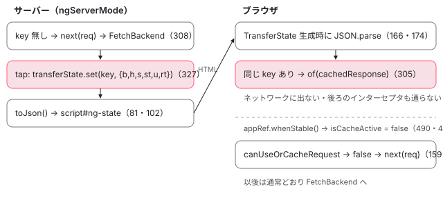

[目次](../README.md) › [HttpClient の内側](README.md) › 第 11 回 / 全 12 回

# SSR の転送キャッシュ：サーバーで取った応答をブラウザで使い回す

> withHttpTransferCache（provideClientHydration が既定で有効にする）が足す transferCacheInterceptorFn。サーバーでは応答を TransferState に書き、ブラウザでは同じキーがあればネットワークに出ずに返す行、キーの作り方（method・responseType・URL・body・並べ替えた params の SHA-256）、GET と HEAD だけが既定の理由と includePostRequests、認証ヘッダー・credentials・Cache-Control・応答の Set-Cookie で外れる条件、filter / includeHeaders、アプリが安定したらキャッシュを止める行、HTTP\_TRANSFER\_CACHE\_ORIGIN\_MAP。

angular/angular · 読了 約 14 分 · 発展 · [サイトで読む（デモが動きます）](https://angular-deep-dive-cyan.vercel.app/chapter/http-transfer-cache)

---

SSR（サーバーで HTML を描画すること）では、同じ `HttpClient.get` がサーバーで 1 回、ブラウザで起動し直したときにもう 1 回走ります。転送キャッシュは、サーバーで受け取った応答を HTML に埋め込み、ブラウザでは同じリクエストを**ネットワークに出さずに**その応答で返す仕組みです。この章では、それを担うインターセプタ `transferCacheInterceptorFn` を 1 行ずつ追い、どのリクエストが対象になるか、キーをどう作るか、いつ止まるかをソースで確かめます。

読む対象は `packages/common/http/src/transfer_cache.ts`、`packages/platform-browser/src/hydration.ts`、`packages/core/src/transfer_state.ts`、`packages/platform-server/src/transfer_state.ts` です。

1. [1. 概観](01-http-overview.md)
2. [2. provideHttpClient と features](02-http-provide.md)
3. [3. HttpClient.request](03-http-client-request.md)
4. [4. 不変なリクエスト](04-http-request-immutable.md)
5. [5. インターセプタの連鎖](05-http.md)
6. [6. FetchBackend](06-http-backend-fetch.md)
7. [7. HttpXhrBackend](07-http-backend-xhr.md)
8. [8. HttpEvent とエラー](08-http-response-errors.md)
9. [9. XSRF 対策](09-http-xsrf.md)
10. [10. JSONP](10-http-jsonp.md)
11. **11. SSR の転送キャッシュ**（この章）
12. [12. テスト用バックエンド](12-http-testing.md)

## 1. 誰が有効にしているのか：provideClientHydration

転送キャッシュを有効にする公開 API はありません。`provideClientHydration()` を書くと、**既定で入ります**。まず features（`withNoHttpTransferCache()` などの引数）の集め方です。

📄 `angular/packages/platform-browser/src/hydration.ts` L244–268 （▶ の行: 250–251, 253–254, 258, 263）

```ts
244 │ export function provideClientHydration(
245 │   ...features: HydrationFeature<HydrationFeatureKind>[]
246 │ ): EnvironmentProviders {
247 │   const providers: Provider[] = [];
248 │   const featuresKind = new Set<HydrationFeatureKind>();
249 │ 
250 ▶   for (const {ɵproviders, ɵkind} of features) {
251 ▶     featuresKind.add(ɵkind);
252 │ 
253 ▶     if (ɵproviders.length) {
254 ▶       providers.push(ɵproviders);
255 │     }
256 │   }
257 │ 
258 ▶   const hasHttpTransferCacheOptions = featuresKind.has(
259 │     HydrationFeatureKind.HttpTransferCacheOptions,
260 │   );
261 │ 
262 │   if (typeof ngDevMode !== 'undefined' && ngDevMode) {
263 ▶     if (featuresKind.has(HydrationFeatureKind.NoHttpTransferCache) && hasHttpTransferCacheOptions) {
264 │       throw new RuntimeError(
265 │         RuntimeErrorCode.HYDRATION_CONFLICTING_FEATURES,
266 │         'Configuration error: found both withHttpTransferCacheOptions() and withNoHttpTransferCache() in the same call to provideClientHydration(), which is a contradiction.',
267 │       );
268 │     }
```

250〜256 行目で、渡された feature の種類（`ɵkind`）を Set に集め、feature が持つプロバイダ（`ɵproviders`）を `providers` に積みます。258 行目で「`withHttpTransferCacheOptions` が来たか」を覚えます。263 行目は開発ビルドだけの検査で、`withHttpTransferCacheOptions()` と `withNoHttpTransferCache()` を同時に渡すと矛盾としてエラーにします。

📄 `angular/packages/platform-browser/src/hydration.ts` L280–296 （▶ の行: 285–288, 292, 294）

```ts
280 │   return makeEnvironmentProviders([
281 │     typeof ngDevMode !== 'undefined' && ngDevMode
282 │       ? provideEnabledBlockingInitialNavigationDetector()
283 │       : [],
284 │     typeof ngDevMode !== 'undefined' && ngDevMode ? provideStabilityDebugging() : [],
285 ▶     withDomHydration(),
286 ▶     featuresKind.has(HydrationFeatureKind.NoHttpTransferCache) || hasHttpTransferCacheOptions
287 ▶       ? []
288 ▶       : ɵwithHttpTransferCache({}),
289 │     featuresKind.has(HydrationFeatureKind.NoIncrementalHydration)
290 │       ? []
291 │       : ɵwithIncrementalHydration(),
292 ▶     providers,
293 │     {
294 ▶       provide: CACHE_ACTIVE,
295 │       useValue: {isActive: true},
296 │     },
```

286〜288 行目が分かれ目です。**「キャッシュ無し」も「オプション付き」も指定されていなければ、`ɵwithHttpTransferCache({})` を足します**。オプション付きのときに空配列になるのは、そのオプション付きのプロバイダが 292 行目の `providers`（feature から集めた分）で入るからです。両方を足さないように、ここで片方を止めています。

294 行目の `CACHE_ACTIVE` は名前が似ていますが別物です。`@angular/core` の `hydration/cache.ts` にあるトークンで、`resource` がハイドレーション中かどうかを見るために使います。HttpClient の転送キャッシュは次に見る `CACHE_OPTIONS` を使います。

📄 `angular/packages/platform-browser/src/hydration.ts` L67–99 （▶ の行: 75, 78, 91, 95–97）

```ts
67 │ /**
68 │  * Disables HTTP transfer cache. Effectively causes HTTP requests to be performed twice: once on the
69 │  * server and other one on the browser.
70 │  *
71 │  * @see [Disabling Caching](guide/ssr#disabling-caching)
72 │  *
73 │  * @publicApi
74 │  */
75 ▶ export function withNoHttpTransferCache(): HydrationFeature<HydrationFeatureKind.NoHttpTransferCache> {
76 │   // This feature has no providers and acts as a flag that turns off
77 │   // HTTP transfer cache (which otherwise is turned on by default).
78 ▶   return hydrationFeature(HydrationFeatureKind.NoHttpTransferCache);
79 │ }
80 │ 
81 │ /**
82 │  * The function accepts an object, which allows to configure cache parameters,
83 │  * such as which headers should be included (no headers are included by default),
84 │  * whether POST requests should be cached or a callback function to determine if a
85 │  * particular request should be cached.
86 │  *
87 │  * @see [Configuring HTTP transfer cache options](guide/ssr#caching-data-when-using-httpclient)
88 │  *
89 │  * @publicApi
90 │  */
91 ▶ export function withHttpTransferCacheOptions(
92 │   options: HttpTransferCacheOptions,
93 │ ): HydrationFeature<HydrationFeatureKind.HttpTransferCacheOptions> {
94 │   // This feature has no providers and acts as a flag to pass options to the HTTP transfer cache.
95 ▶   return hydrationFeature(
96 ▶     HydrationFeatureKind.HttpTransferCacheOptions,
97 ▶     ɵwithHttpTransferCache(options),
98 │   );
99 │ }
```

75〜78 行目、`withNoHttpTransferCache()` はプロバイダを持たない「旗」です。種類だけが 251 行目で Set に入り、287 行目の空配列を選ばせます。91〜97 行目、`withHttpTransferCacheOptions(options)` は同じ `ɵwithHttpTransferCache` を、利用者のオプション付きで呼んだ結果を持ちます。つまり、どの書き方でも最終的に呼ばれるのは `withHttpTransferCache` 1 つです。

## 2. withHttpTransferCache が足す 3 つのプロバイダ

📄 `angular/packages/common/http/src/transfer_cache.ts` L468–497 （▶ の行: 471, 474, 478–479, 483, 490–491）

```ts
468 │ export function withHttpTransferCache(cacheOptions: HttpTransferCacheOptions): Provider[] {
469 │   return [
470 │     {
471 ▶       provide: CACHE_OPTIONS,
472 │       useFactory: (): CacheOptions => {
473 │         performanceMarkFeature('NgHttpTransferCache');
474 ▶         return {isCacheActive: true, ...cacheOptions};
475 │       },
476 │     },
477 │     {
478 ▶       provide: HTTP_ROOT_INTERCEPTOR_FNS,
479 ▶       useValue: transferCacheInterceptorFn,
480 │       multi: true,
481 │     },
482 │     {
483 ▶       provide: APP_BOOTSTRAP_LISTENER,
484 │       multi: true,
485 │       useFactory: () => {
486 │         const appRef = inject(ApplicationRef);
487 │         const cacheState = inject(CACHE_OPTIONS);
488 │ 
489 │         return () => {
490 ▶           appRef.whenStable().then(() => {
491 ▶             cacheState.isCacheActive = false;
492 │           });
493 │         };
494 │       },
495 │     },
496 │   ];
497 │ }
```

1. **471〜475 行目：`CACHE_OPTIONS` を作る**

   474 行目で `{isCacheActive: true, ...cacheOptions}` を返します。`isCacheActive` は「いまキャッシュを使ってよいか」のフラグで、最初は `true` です。この 1 つのオブジェクトを、あとでインターセプタと 3 番目のプロバイダが同じ参照で共有します。
2. **478〜480 行目：`HTTP_ROOT_INTERCEPTOR_FNS` に `transferCacheInterceptorFn` を足す**

   利用者の `withInterceptors` が入る `HTTP_INTERCEPTOR_FNS` とは別のトークンです。`backend.ts` の `HttpInterceptorHandler.handle` は、`HTTP_INTERCEPTOR_FNS` の**後ろに**このトークンの関数を並べて連鎖を作ります （連鎖の作り方は [第 5 回](05-http.md)）。だから転送キャッシュは、利用者のインターセプタを全部通ったあと、バックエンドの直前で動きます。
3. **483〜494 行目：アプリが安定したらキャッシュを止める**

   `APP_BOOTSTRAP_LISTENER` は、ルートコンポーネントをブートストラップしたときに呼ばれる関数の multi トークンです （[ApplicationRef の章](../boot/10-boot-application-ref.md)）。490 行目で `appRef.whenStable()`（保留中のタスクが無くなった時点で解決する Promise）を待ち、491 行目で **`isCacheActive` を `false` に書き換えます**。以後このアプリでは、同じキーが TransferState に残っていても使いません（3 節の 159 行目）。

> [!TIP]
> **新卒エンジニアへ**
>
> 「安定」は HTTP リクエストの完了も含みます。`HttpInterceptorHandler` がリクエストごとに `PendingTasks` を足すからです （[PendingTasks の章](../zoneless/09-zoneless-pending-tasks.md)）。つまり、ハイドレーション中に飛んだリクエストが全部返り、描画が落ち着くまでがキャッシュの使える期間です。

### 保存する形と、トークン

📄 `angular/packages/common/http/src/transfer_cache.ts` L104–140 （▶ の行: 104, 112–117, 134–135, 138）

```ts
104 ▶ export const HTTP_TRANSFER_CACHE_ORIGIN_MAP = new InjectionToken<Record<string, string>>(
105 │   typeof ngDevMode !== 'undefined' && ngDevMode ? 'HTTP_TRANSFER_CACHE_ORIGIN_MAP' : '',
106 │ );
107 │ 
108 │ /**
109 │  * Keys within cached response data structure.
110 │  */
111 │ 
112 ▶ export const BODY = 'b';
113 ▶ export const HEADERS = 'h';
114 ▶ export const STATUS = 's';
115 ▶ export const STATUS_TEXT = 'st';
116 ▶ export const REQ_URL = 'u';
117 ▶ export const RESPONSE_TYPE = 'rt';
118 │ 
119 │ interface TransferHttpResponse {
120 │   /** body */
121 │   [BODY]: any;
122 │   /** headers */
123 │   [HEADERS]: Record<string, string[]>;
124 │   /** status */
125 │   [STATUS]: number;
126 │   /** statusText */
127 │   [STATUS_TEXT]: string;
128 │   /** url */
129 │   [REQ_URL]: string;
130 │   /** responseType */
131 │   [RESPONSE_TYPE]: HttpRequest<unknown>['responseType'];
132 │ }
133 │ 
134 ▶ interface CacheOptions extends HttpTransferCacheOptions {
135 ▶   isCacheActive: boolean;
136 │ }
137 │ 
138 ▶ export const CACHE_OPTIONS = new InjectionToken<CacheOptions>(
139 │   typeof ngDevMode !== 'undefined' && ngDevMode ? 'HTTP_TRANSFER_STATE_CACHE_OPTIONS' : '',
140 │ );
```

112〜117 行目、応答 1 件を保存するときのプロパティ名は `b`（body）・`h`（headers）・`s`（status）・`st`（statusText）・`u`（url）・`rt`（responseType）の 1〜2 文字です。この JSON はそのまま HTML に埋め込まれるので、名前を短くして HTML を軽くしています。134〜136 行目、`CacheOptions` は公開の `HttpTransferCacheOptions` に `isCacheActive` を足しただけの型です。104 行目の `HTTP_TRANSFER_CACHE_ORIGIN_MAP` は 8 節で使います。

## 3. どのリクエストが対象か：canUseOrCacheRequest

まず利用者が渡せるオプションの一覧です。

📄 `angular/packages/common/http/src/transfer_cache.ts` L40–76 （▶ の行: 45, 50, 56, 62, 68, 75）

```ts
40 │ export interface HttpTransferCacheOptions {
41 │   /**
42 │    * A function that receives a request as an argument and returns a boolean to indicate
43 │    * whether a request should be included into the cache.
44 │    */
45 ▶   filter?: (req: HttpRequest<unknown>) => boolean;
46 │ 
47 │   /**
48 │    * Specifies which headers should be included into cached responses. No headers are included by default.
49 │    */
50 ▶   includeHeaders?: string[];
51 │ 
52 │   /**
53 │    * Enables caching for `POST` requests. By default, only `GET` and `HEAD` requests are cached.
54 │    * This option can be enabled if `POST` requests are used to retrieve data (for example using `GraphQL`).
55 │    */
56 ▶   includePostRequests?: boolean;
57 │ 
58 │   /**
59 │    * Enables caching of requests containing `Authorization`, `Proxy-Authorization`, or `Cookie` headers.
60 │    * By default, these requests are excluded from caching.
61 │    */
62 ▶   includeRequestsWithAuthHeaders?: boolean;
63 │ 
64 │   /**
65 │    * Enables caching of requests sent using `withCredentials` or Fetch API `credentials` modes (`include` or `same-origin`).
66 │    * By default, these requests are excluded from caching.
67 │    */
68 ▶   includeRequestsWithCredentials?: boolean;
69 │ 
70 │   /**
71 │    * Enables caching of requests and responses with `Cache-Control` directives that forbid caching
72 │    * (such as `no-cache`, `no-store`, or `private`), responses with a `Set-Cookie` header, or requests using Fetch API `no-cache` or `no-store` modes.
73 │    * By default, these requests/responses are excluded from caching.
74 │    */
75 ▶   includeNonCacheableRequests?: boolean;
76 │ }
```

45 行目 `filter`、50 行目 `includeHeaders`、56 行目 `includePostRequests`、62 行目 `includeRequestsWithAuthHeaders`、68 行目 `includeRequestsWithCredentials`、75 行目 `includeNonCacheableRequests`。すべて省略可能で、省略すると「キャッシュしない側」に倒れます。それを判定するのが次の関数です。

📄 `angular/packages/common/http/src/transfer_cache.ts` L142–178 （▶ の行: 145, 156, 159–160, 162–163, 165, 167, 170–172, 174）

```ts
142 │ /**
143 │  * A list of allowed HTTP methods to cache.
144 │  */
145 ▶ const ALLOWED_METHODS = ['GET', 'HEAD'];
146 │ 
147 │ function canUseOrCacheRequest(req: HttpRequest<unknown>, options: CacheOptions): boolean {
148 │   const {
149 │     isCacheActive,
150 │     filter,
151 │     includePostRequests,
152 │     includeRequestsWithAuthHeaders,
153 │     includeRequestsWithCredentials,
154 │     includeNonCacheableRequests,
155 │   } = options;
156 ▶   const {transferCache: requestOptions, method: requestMethod} = req;
157 │ 
158 │   if (
159 ▶     !isCacheActive ||
160 ▶     requestOptions === false ||
161 │     // POST requests are allowed either globally or at request level
162 ▶     (requestMethod === 'POST' && !includePostRequests && !requestOptions) ||
163 ▶     (requestMethod !== 'POST' && !ALLOWED_METHODS.includes(requestMethod)) ||
164 │     // Do not cache requests with authentication or cookie headers unless explicitly enabled.
165 ▶     (!includeRequestsWithAuthHeaders && hasAuthHeaders(req)) ||
166 │     // Do not cache requests sent with credentials unless explicitly enabled.
167 ▶     (!includeRequestsWithCredentials && hasOutgoingCredentials(req)) ||
168 │     // Do not cache requests that explicitly forbid caching via Cache-Control
169 │     // or Fetch API cache mode unless explicitly enabled.
170 ▶     (!includeNonCacheableRequests &&
171 ▶       (hasUncacheableCacheControl(req.headers) || isNonCacheableRequest(req.cache))) ||
172 ▶     filter?.(req) === false
173 │   ) {
174 ▶     return false;
175 │   }
176 │ 
177 │   return true;
178 │ }
```

158〜173 行目の条件が 1 つでも当てはまると、174 行目で `false`（キャッシュに触らない）です。上から順に読みます。

1. **159 行目：`isCacheActive` が `false`**

   アプリが安定したあと（2 節の 491 行目）。どんなリクエストもここで素通りします。
2. **160 行目：リクエスト単位で `transferCache: false`**

   156 行目で `req.transferCache` を取り出しています。`http.get(url, {transferCache: false})` と書いたリクエストだけを外せます。
3. **162 行目：POST**

   POST は、全体設定の `includePostRequests` も、リクエスト単位の `transferCache` も無ければ対象外です。GraphQL のように「読むために POST する」場合だけ明示的に有効にします。
4. **163 行目：GET・HEAD 以外**

   145 行目の `ALLOWED_METHODS = ['GET', 'HEAD']` に無いメソッド（PUT・DELETE など）は無条件で対象外です。
5. **165 行目・167 行目：認証ヘッダーと credentials**

   下の `hasAuthHeaders` と `hasOutgoingCredentials` で判定します。
6. **170〜171 行目：キャッシュ禁止の指示**

   リクエストの `Cache-Control` ヘッダーか、Fetch API の `cache` モードが「キャッシュするな」なら対象外です。
7. **172 行目：`filter` が `false` を返した**

   `filter?.(req) === false` なので、`filter` を渡していなければこの条件は効きません。

📄 `angular/packages/common/http/src/transfer_cache.ts` L344–381 （▶ の行: 349, 353, 363, 365, 370, 374, 380）

```ts
344 │ /** @returns true when the request contains authentication or cookie headers. */
345 │ function hasAuthHeaders(req: HttpRequest<unknown>): boolean {
346 │   const headers = req.headers;
347 │ 
348 │   return (
349 ▶     headers.has('authorization') || headers.has('proxy-authorization') || headers.has('cookie')
350 │   );
351 │ }
352 │ 
353 ▶ const UNCACHEABLE_CACHE_CONTROL_DIRECTIVES = new Set(['no-store', 'private', 'no-cache']);
354 │ 
355 │ function hasUncacheableCacheControl(headers: HttpHeaders): boolean {
356 │   const cacheControl = headers.get('cache-control');
357 │ 
358 │   if (!cacheControl) {
359 │     return false;
360 │   }
361 │ 
362 │   return cacheControl.split(',').some((directive) => {
363 ▶     const directiveName = directive.split('=', 1)[0].trim().toLowerCase();
364 │ 
365 ▶     return UNCACHEABLE_CACHE_CONTROL_DIRECTIVES.has(directiveName);
366 │   });
367 │ }
368 │ 
369 │ function hasSetCookieHeader(headers: HttpHeaders): boolean {
370 ▶   return headers.has('set-cookie');
371 │ }
372 │ 
373 │ function isNonCacheableRequest(cache: RequestCache): boolean {
374 ▶   return cache === 'no-cache' || cache === 'no-store';
375 │ }
376 │ 
377 │ function hasOutgoingCredentials(req: HttpRequest<unknown>): boolean {
378 │   const {withCredentials, credentials} = req;
379 │ 
380 ▶   return withCredentials || credentials === 'include' || credentials === 'same-origin';
381 │ }
```

349 行目、`authorization`・`proxy-authorization`・`cookie` のどれかがあれば「認証付き」です。ユーザーごとに中身が変わる応答を HTML に埋め込むと、その HTML を別の人に返したときに漏れるからです（CDN が HTML をキャッシュする構成では特に）。353 行目と 362〜365 行目、`Cache-Control` を `,` で分けて、`no-store`・`private`・`no-cache` のどれかがあれば禁止です。374 行目は Fetch の `cache` モード、380 行目は `withCredentials` か `credentials: 'include' / 'same-origin'` です。370 行目の `set-cookie` は応答側の検査で、6 節で使います。

## 4. インターセプタの本体：transferCacheInterceptorFn

📄 `angular/packages/common/http/src/transfer_cache.ts` L278–307 （▶ の行: 282–284, 287–290, 293, 295, 301, 304–305）

```ts
278 │ export function transferCacheInterceptorFn(
279 │   req: HttpRequest<unknown>,
280 │   next: HttpHandlerFn,
281 │ ): Observable<HttpEvent<unknown>> {
282 ▶   const options = inject(CACHE_OPTIONS);
283 ▶   if (!canUseOrCacheRequest(req, options)) {
284 ▶     return next(req);
285 │   }
286 │ 
287 ▶   const transferState = inject(TransferState);
288 ▶   const originMap = inject(HTTP_TRANSFER_CACHE_ORIGIN_MAP, {optional: true});
289 ▶   const requestUrl =
290 ▶     typeof ngServerMode !== 'undefined' && ngServerMode && originMap
291 │       ? mapRequestOriginUrl(req.url, originMap)
292 │       : req.url;
293 ▶   const storeKey = makeCacheKey(req, requestUrl);
294 │ 
295 ▶   const cachedResponse = retrieveStateFromCache(
296 │     req,
297 │     options,
298 │     transferState,
299 │     /** originMap */ null,
300 │     storeKey,
301 ▶     /** skipUseCacheChecks */ true,
302 │   );
303 │ 
304 ▶   if (cachedResponse) {
305 ▶     return of(cachedResponse);
306 │   }
307 │ 
```

1. **282〜285 行目：対象外なら即 `next(req)`**

   3 節の判定です。対象外のリクエストには TransferState を inject すらしません。
2. **287〜292 行目：キーに使う URL を決める**

   サーバー（`ngServerMode` が真）で `HTTP_TRANSFER_CACHE_ORIGIN_MAP` があるときだけ、URL のオリジンを読み替えます（8 節）。ブラウザでは `req.url` をそのまま使います。
3. **293 行目：キーを作る**

   `makeCacheKey`（5 節）。サーバーでもブラウザでも同じ関数で作るので、同じリクエストなら同じキーになります。
4. **295〜302 行目：TransferState を引く**

   301 行目で `skipUseCacheChecks = true` を渡し、283 行目でやった判定を繰り返させません。キーも 300 行目で渡すので、もう一度作りません。
5. **304〜305 行目：見つかったら `of(cachedResponse)`**

   **`next` を呼ばずに返します。これが「ネットワークに出ない」の正体です**。後ろのインターセプタも `FetchBackend` も呼ばれません。`of` は購読した瞬間に同期で値を出します。

## 5. キーの作り方：makeCacheKey と generateHash

📄 `angular/packages/common/http/src/transfer_cache.ts` L402–431 （▶ の行: 403, 406, 415, 417–421, 427–428, 430）

```ts
402 │ function sortAndConcatParams(params: HttpParams | URLSearchParams): string {
403 ▶   const searchParams = new URLSearchParams(
404 │     params instanceof URLSearchParams ? params : params.toString(),
405 │   );
406 ▶   searchParams.sort();
407 │   return searchParams.toString();
408 │ }
409 │ 
410 │ function makeCacheKey(
411 │   request: HttpRequest<any>,
412 │   mappedRequestUrl: string,
413 │ ): StateKey<TransferHttpResponse> {
414 │   const {params, method, responseType} = request;
415 ▶   const encodedParams = sortAndConcatParams(params);
416 │ 
417 ▶   let serializedBody = request.serializeBody();
418 ▶   if (serializedBody instanceof URLSearchParams) {
419 ▶     serializedBody = sortAndConcatParams(serializedBody);
420 ▶   } else if (typeof serializedBody !== 'string') {
421 ▶     serializedBody = '';
422 │   }
423 │ 
424 │   // Joining with `|` lets a shifted field boundary (url `/a` + body `b|c` vs url `/a|b` + body `c`)
425 │   // collapse to the same string and thus the same hash. `\0` cannot occur in a valid url or in
426 │   // encoded params, so the field boundaries can't be forged by field content.
427 ▶   const key = [method, responseType, mappedRequestUrl, serializedBody, encodedParams].join('\0');
428 ▶   const hash = generateHash(key);
429 │ 
430 ▶   return makeStateKey(hash);
431 │ }
```

1. **415 行目：params を並べ替えて文字列にする**

   403〜407 行目の `sortAndConcatParams` は `URLSearchParams` に入れて 406 行目で `sort()` します。`?b=2&a=1` と `?a=1&b=2` は同じキーになります。
2. **417〜422 行目：body を文字列にする**

   `serializeBody()` は JSON なら文字列、フォームなら `URLSearchParams` を返します。`URLSearchParams` は 419 行目で同じく並べ替え、文字列以外（Blob、FormData、body 無しの `null`）は 421 行目で空文字にします。
3. **427 行目：5 つを `\0` でつなぐ**

   method・responseType・URL・body・params の順です。424〜426 行目のコメントのとおり、`|` でつなぐと「URL `/a` + body `b|c`」と「URL `/a|b` + body `c`」が同じ文字列になります。`\0` は正しい URL にもエンコード済みの params にも現れないので、区切りを偽造できません。
4. **428・430 行目：ハッシュにして StateKey にする**

   `makeStateKey(hash)` は文字列に型の印を付けるだけです。TransferState の中では、このハッシュ文字列がそのままオブジェクトのキーになります。

📄 `angular/packages/common/http/src/transfer_cache.ts` L587–603 （▶ の行: 590–592, 594, 597, 600）

```ts
587 │ /**
588 │  * Generates a SHA-256 hash representation of a string.
589 │  *
590 ▶  * Note: A custom synchronous SHA-256 implementation is used here because the Web Crypto API
591 ▶  * (`crypto.subtle.digest`) is strictly asynchronous (Promise-based), whereas the transfer cache
592 ▶  * state lookup and interceptor flow must operate synchronously due to the HttpResource API.
593 │  *
594 ▶  * The previous DJB2 hashing logic was vulnerable to pre-image and second-preimage attacks due to
595 │  * its small 64-bit keyspace and mathematical simplicity. An attacker could craft colliding request
596 │  * inputs to poison the cache, potentially causing a CDN or the application to serve the wrong
597 ▶  * cached response to legitimate users. SHA-256 provides strong cryptographic collision resistance,
598 │  * preventing cache key collision attacks.
599 │  */
600 ▶ export function generateHash(value: string): string {
601 │   textEncoder ??= new TextEncoder();
602 │   const inputBytes = textEncoder.encode(value);
603 │ 
```

600 行目からの `generateHash` は、SHA-256 を手で書いた実装です。結果は 64 文字の 16 進文字列です。590〜592 行目に、Web Crypto の `crypto.subtle.digest` を使わない理由が書いてあります。あちらは Promise を返す非同期 API で、インターセプタと `httpResource` はキャッシュを**同期で**引く必要があるからです （`httpResource` も同じ `retrieveStateFromCache` を同期で呼びます。[httpResource の章](../signals/16-signals-http-resource.md)）。594〜598 行目、以前は DJB2 という 64 ビットの簡単なハッシュで、衝突するリクエストを作ってキャッシュを汚染できたため SHA-256 に替えた、とあります。

計算そのものは標準の SHA-256 なので、Web Crypto で同じ文字列を SHA-256 すると同じ値になります（下の DEMO はそれを使っています）。

## 6. サーバー側：応答を TransferState に書く

📄 `angular/packages/common/http/src/transfer_cache.ts` L308–342 （▶ の行: 308–309, 312–313, 317–319, 327, 329–330, 333–334, 341）

```ts
308 ▶   const event$ = next(req);
309 ▶   if (typeof ngServerMode !== 'undefined' && ngServerMode) {
310 │     // Request not found in cache. Make the request and cache it if on the server.
311 │     return event$.pipe(
312 ▶       tap((event: HttpEvent<unknown>) => {
313 ▶         if (event instanceof HttpResponse) {
314 │           const {headers, body, status, statusText} = event;
315 │ 
316 │           // Only cache successful HTTP responses that are not non-cacheable.
317 ▶           if (
318 ▶             !options.includeNonCacheableRequests &&
319 ▶             (hasUncacheableCacheControl(headers) || hasSetCookieHeader(headers))
320 │           ) {
321 │             return;
322 │           }
323 │ 
324 │           const {transferCache: requestOptions, responseType} = req;
325 │           const headersToInclude = getHeadersToInclude(options, requestOptions);
326 │ 
327 ▶           transferState.set<TransferHttpResponse>(storeKey, {
328 │             [BODY]:
329 ▶               responseType === 'arraybuffer' || responseType === 'blob' ? toBase64(body) : body,
330 ▶             [HEADERS]: getFilteredHeaders(headers, headersToInclude),
331 │             [STATUS]: status,
332 │             [STATUS_TEXT]: statusText,
333 ▶             [REQ_URL]: requestUrl,
334 ▶             [RESPONSE_TYPE]: responseType,
335 │           });
336 │         }
337 │       }),
338 │     );
339 │   }
340 │ 
341 ▶   return event$;
342 │ }
```

1. **308 行目：キャッシュに無かったので `next(req)`**

   ここで初めて後ろ（最終的には `FetchBackend`）にリクエストが流れます。
2. **309 行目：サーバーのときだけ `tap` を付ける**

   ブラウザでは 341 行目でそのまま返します。**ブラウザは読むだけで、書きません**。`tap` は流れてくる値を変えずに横から覗く RxJS の演算子です。
3. **313 行目：`HttpResponse` だけを見る**

   `Sent` や進捗のイベントは無視します。失敗は `HttpErrorResponse` としてエラー側に流れるので、`tap` の next には来ません。つまり保存されるのは成功した応答だけです。
4. **317〜322 行目：応答側の禁止**

   応答の `Cache-Control` が禁止を含むか、`Set-Cookie` があれば保存しません。
5. **327〜335 行目：短いキーで保存**

   329 行目、`arraybuffer` と `blob` は JSON にできないので Base64 文字列にします。330 行目、ヘッダーは `includeHeaders` に挙げたものだけです（下の引用）。333 行目の URL は、読み替え後の `requestUrl` です。

📄 `angular/packages/common/http/src/transfer_cache.ts` L383–400 （▶ の行: 387–388, 392–393）

```ts
383 │ function getFilteredHeaders(
384 │   headers: HttpHeaders,
385 │   includeHeaders: string[] | undefined,
386 │ ): Record<string, string[]> {
387 ▶   if (!includeHeaders) {
388 ▶     return {};
389 │   }
390 │ 
391 │   const headersMap: Record<string, string[]> = {};
392 ▶   for (const key of includeHeaders) {
393 ▶     const values = headers.getAll(key);
394 │     if (values !== null) {
395 │       headersMap[key] = values;
396 │     }
397 │   }
398 │ 
399 │   return headersMap;
400 │ }
```

387〜388 行目、`includeHeaders` が無ければ空のオブジェクトです。**既定ではヘッダーは 1 つも運ばれません**。ブラウザで `res.headers.get('etag')` などと読むコードがあるなら、`includeHeaders` に足す必要があります。

### TransferState から HTML へ

`TransferState` は `@angular/core` の公開クラスで、中身はただの辞書（`store`）です。サーバーで描画が終わると、platform-server がこれを JSON にして HTML の末尾に埋め込みます。

📄 `angular/packages/platform-server/src/transfer_state.ts` L76–108 （▶ の行: 81, 83, 86, 102–103, 108）

```ts
 76 │   return () => {
 77 │     const measuringLabel = 'serializeTransferStateFactory';
 78 │     startMeasuring(measuringLabel);
 79 │     // The `.toJSON` here causes the `onSerialize` callbacks to be called.
 80 │     // These callbacks can be used to provide the value for a given key.
 81 ▶     const content = transferStore.toJson();
 82 │ 
 83 ▶     if (transferStore.isEmpty) {
 84 │       // The state is empty, nothing to transfer,
 85 │       // avoid creating an extra `<script>` tag in this case.
 86 ▶       return;
 87 │     }
 88 │ 
 89 │     if (typeof ngDevMode !== 'undefined' && ngDevMode) {
 90 │       warnIfStateTransferHappened(injector);
 91 │     }
 92 │ 
 93 │     const script = createScript(
 94 │       doc,
 95 │       content,
 96 │       /**
 97 │        * `nonce` is not required for 'application/json'
 98 │        * See: https://html.spec.whatwg.org/multipage/scripting.html#attr-script-type
 99 │        */
100 │       null,
101 │     );
102 ▶     script.id = appId + '-state';
103 ▶     script.setAttribute('type', 'application/json');
104 │ 
105 │     // It is intentional that we add the script at the very bottom. Angular CLI script tags for
106 │     // bundles are always `type="module"`. These are deferred by default and cause the
107 │     // transfer data to be queried only after the browser has finished parsing the DOM.
108 ▶     doc.body.appendChild(script);
```

81 行目で `toJson()`、83〜87 行目で中身が空なら `<script>` を作りません。102 行目で id を `APP_ID + '-state'`（既定の APP\_ID は `ng` なので `ng-state`）、103 行目で `type="application/json"` にして、108 行目で `body` の最後に足します。この関数は `BEFORE_APP_SERIALIZED`（HTML を文字列にする直前に呼ばれる multi トークン）の 1 つとして登録されています。

📄 `angular/packages/core/src/transfer_state.ts` L138–157 （▶ の行: 143, 146, 156）

```ts
138 │   /**
139 │    * Serialize the current state of the store to JSON.
140 │    */
141 │   toJson(): string {
142 │     // Call the onSerialize callbacks and put those values into the store.
143 ▶     for (const key in this.onSerializeCallbacks) {
144 │       if (Object.hasOwn(this.onSerializeCallbacks, key)) {
145 │         try {
146 ▶           this.store[key] = this.onSerializeCallbacks[key]();
147 │         } catch (e) {
148 │           console.warn('Exception in onSerialize callback: ', e);
149 │         }
150 │       }
151 │     }
152 │ 
153 │     // Escape script tag to avoid break out of <script> tag in serialized output.
154 │     // Encoding of `<` is the same behaviour as G3 script_builders.
155 │     // Encoding of `/` prevents crawlers from incorrectly indexing relative URLs in inline JSON.
156 ▶     return JSON.stringify(this.store).replace(/</g, '\\u003C').replace(/\//g, '\\u002F');
157 │   }
```

156 行目、`<` と `/` を `<`・`/` に置き換えます。応答の本文に `</script>` が入っていても、埋め込んだ `<script>` を途中で閉じられないようにするためです。143〜146 行目は、`onSerialize` で「書き出す直前に値を決める」コールバックを登録した人のための処理です。転送キャッシュは 6 節の 327 行目で `set` 済みなので、ここは関係ありません。

## 7. ブラウザ側：HTML から読み、応答に戻す

📄 `angular/packages/core/src/transfer_state.ts` L71–101 （▶ の行: 75–76, 78–79, 94, 99–100）

```ts
 71 │ export class TransferState {
 72 │   /** @nocollapse */
 73 │   static ɵprov = /** @pureOrBreakMyCode */ /* @__PURE__ */ ɵɵdefineInjectable({
 74 │     token: TransferState,
 75 ▶     providedIn: 'root',
 76 ▶     factory: () => {
 77 │       const transferState = new TransferState();
 78 ▶       if (typeof ngServerMode === 'undefined' || !ngServerMode) {
 79 ▶         transferState.store = retrieveTransferredState(inject(DOCUMENT), inject(APP_ID));
 80 │       }
 81 │ 
 82 │       return transferState;
 83 │     },
 84 │   });
 85 │ 
 86 │   /** @internal */
 87 │   store: Record<string, unknown | undefined> = createDictionary();
 88 │ 
 89 │   private onSerializeCallbacks: {[k: string]: () => unknown | undefined} = createDictionary();
 90 │ 
 91 │   /**
 92 │    * Get the value corresponding to a key. Return `defaultValue` if key is not found.
 93 │    */
 94 ▶   get<T>(key: StateKey<T>, defaultValue: T): T {
 95 │     if (!Object.hasOwn(this.store, key)) {
 96 │       return defaultValue;
 97 │     }
 98 │ 
 99 ▶     const value = this.store[key];
100 ▶     return value !== undefined ? (value as T) : defaultValue;
101 │   }
```

75 行目、`TransferState` は `providedIn: 'root'` です。78〜79 行目、ブラウザでは最初に inject された瞬間に `retrieveTransferredState` で HTML から読みます。94〜101 行目の `get` は辞書を引くだけです。

📄 `angular/packages/core/src/transfer_state.ts` L160–182 （▶ の行: 166–167, 172, 174）

```ts
160 │ export function retrieveTransferredState(
161 │   doc: Document,
162 │   appId: string,
163 │ ): Record<string, unknown | undefined> {
164 │   // Locate the script tag with the JSON data transferred from the server.
165 │   // The id of the script tag is set to the Angular appId + 'state'.
166 ▶   const script = doc.getElementById(appId + '-state');
167 ▶   if (script?.tagName === 'SCRIPT' && script.textContent) {
168 │     try {
169 │       // Avoid using any here as it triggers lint errors in google3 (any is not allowed).
170 │       // Decoding of `<` is done of the box by browsers and node.js, same behaviour as G3
171 │       // script_builders.
172 ▶       return Object.assign(
173 │         createDictionary<unknown | undefined>(),
174 ▶         JSON.parse(script.textContent) as {},
175 │       );
176 │     } catch (e) {
177 │       console.warn('Exception while restoring TransferState for app ' + appId, e);
178 │     }
179 │   }
180 │ 
181 │   return createDictionary();
182 │ }
```

166 行目で `document.getElementById(appId + '-state')`、174 行目で `JSON.parse`。サーバーが 102 行目で付けた id と、ここで探す id は同じ式です。

📄 `angular/packages/common/http/src/transfer_cache.ts` L199–234 （▶ の行: 207, 211–212, 221, 227, 230, 232–233）

```ts
199 │ export function retrieveStateFromCache(
200 │   req: HttpRequest<unknown>,
201 │   options: CacheOptions,
202 │   transferState: TransferState,
203 │   originMap: Record<string, string> | null,
204 │   storeKey?: StateKey<TransferHttpResponse>,
205 │   skipUseCacheChecks = false,
206 │ ): HttpResponse<unknown> | null {
207 ▶   if (!skipUseCacheChecks && !canUseOrCacheRequest(req, options)) {
208 │     return null;
209 │   }
210 │ 
211 ▶   if (typeof ngServerMode !== 'undefined' && !ngServerMode && originMap) {
212 ▶     throw new RuntimeError(
213 │       RuntimeErrorCode.HTTP_ORIGIN_MAP_USED_IN_CLIENT,
214 │       ngDevMode &&
215 │         'Angular detected that the `HTTP_TRANSFER_CACHE_ORIGIN_MAP` token is configured and ' +
216 │           'present in the client side code. Please ensure that this token is only provided in the ' +
217 │           'server code of the application.',
218 │     );
219 │   }
220 │ 
221 ▶   if (!storeKey) {
222 │     const requestUrl =
223 │       typeof ngServerMode !== 'undefined' && ngServerMode && originMap
224 │         ? mapRequestOriginUrl(req.url, originMap)
225 │         : req.url;
226 │ 
227 ▶     storeKey = makeCacheKey(req, requestUrl);
228 │   }
229 │ 
230 ▶   const response = transferState.get(storeKey, null);
231 │ 
232 ▶   if (!response) {
233 ▶     return null;
234 │   }
```

インターセプタからは `skipUseCacheChecks` と `storeKey` が渡されるので、207 行目と 221〜228 行目は飛ばされ、230 行目の `transferState.get` から始まります。232〜233 行目、無ければ `null` を返し、インターセプタは 308 行目の `next(req)` に進みます。211〜218 行目は 8 節で見ます。

📄 `angular/packages/common/http/src/transfer_cache.ts` L236–275 （▶ の行: 236, 247, 249, 252, 259–260, 266, 269）

```ts
236 ▶   const {
237 │     [BODY]: undecodedBody,
238 │     [RESPONSE_TYPE]: responseType,
239 │     [HEADERS]: httpHeaders,
240 │     [STATUS]: status,
241 │     [STATUS_TEXT]: statusText,
242 │     [REQ_URL]: url,
243 │   } = response;
244 │   // Request found in cache. Respond using it.
245 │   let body: ArrayBuffer | Blob | string | undefined = undecodedBody;
246 │ 
247 ▶   switch (responseType) {
248 │     case 'arraybuffer':
249 ▶       body = fromBase64(undecodedBody);
250 │       break;
251 │     case 'blob':
252 ▶       body = new Blob([fromBase64(undecodedBody)]);
253 │       break;
254 │   }
255 │ 
256 │   // We want to warn users accessing a header provided from the cache
257 │   // That HttpTransferCache alters the headers
258 │   // The warning will be logged a single time by HttpHeaders instance
259 ▶   let headers = new HttpHeaders(httpHeaders);
260 ▶   if (typeof ngDevMode === 'undefined' || ngDevMode) {
261 │     // Append extra logic in dev mode to produce a warning when a header
262 │     // that was not transferred to the client is accessed in the code via `get`
263 │     // and `has` calls.
264 │     const {transferCache: requestOptions} = req;
265 │     const headersToInclude = getHeadersToInclude(options, requestOptions);
266 ▶     headers = appendMissingHeadersDetection(req.url, headers, headersToInclude ?? []);
267 │   }
268 │ 
269 ▶   return new HttpResponse({
270 │     body,
271 │     headers,
272 │     status,
273 │     statusText,
274 │     url,
275 │   });
```

236〜243 行目で短いキーから取り出し、247〜254 行目でサーバーの 329 行目とは逆に Base64 を `ArrayBuffer` / `Blob` に戻します。260〜266 行目は開発ビルドだけで、ヘッダーを `Proxy` で包みます。運ばれなかったヘッダーを `get` / `has` / `getAll` で読むと、`includeHeaders` に足すよう警告を出します。このあと 269〜275 行目で `new HttpResponse({body, headers, status, statusText, url})` を作って返します。

> [!WARNING]
> **ハマりどころ**
>
> 読んだあと TransferState からキーを消す行はありません（230 行目は `get` だけ）。安定する前に同じリクエストを 2 回送れば、2 回ともキャッシュから返ります。止めるのは 2 節の 491 行目の `isCacheActive = false` だけです。

## 8. サーバーとブラウザで URL が違うとき：HTTP\_TRANSFER\_CACHE\_ORIGIN\_MAP

サーバーは社内向けの `http://api.internal:8080`、ブラウザは公開の `https://api.example.com` を叩く構成では、URL がキーに入るので サーバーで書いたキーとブラウザで探すキーがずれます。それを揃えるのが 2 節の 104 行目のトークンです。

📄 `angular/packages/common/http/src/transfer_cache.ts` L546–569 （▶ の行: 547–550, 557, 561）

```ts
546 │ function mapRequestOriginUrl(url: string, originMap: Record<string, string>): string {
547 ▶   const origin = new URL(url, 'resolve://').origin;
548 ▶   const mappedOrigin = originMap[origin];
549 ▶   if (!mappedOrigin) {
550 ▶     return url;
551 │   }
552 │ 
553 │   if (typeof ngDevMode === 'undefined' || ngDevMode) {
554 │     verifyMappedOrigin(mappedOrigin);
555 │   }
556 │ 
557 ▶   return url.replace(origin, mappedOrigin);
558 │ }
559 │ 
560 │ function verifyMappedOrigin(url: string): void {
561 ▶   if (new URL(url, 'resolve://').pathname !== '/') {
562 │     throw new RuntimeError(
563 │       RuntimeErrorCode.HTTP_ORIGIN_MAP_CONTAINS_PATH,
564 │       'Angular detected a URL with a path segment in the value provided for the ' +
565 │         `\`HTTP_TRANSFER_CACHE_ORIGIN_MAP\` token: ${url}. The map should only contain origins ` +
566 │         'without any other segments.',
567 │     );
568 │   }
569 │ }
```

547 行目でリクエスト URL のオリジン（`scheme://host:port`）を取り、548 行目でマップを引きます。無ければ 549〜551 行目で元の URL のまま、あれば 557 行目でオリジンだけを置き換えます。561 行目、マップの値にパスが付いていると開発ビルドではエラーです。オリジン同士の対応だけを書きます。

読み替えはサーバーでだけ行います（4 節の 289〜292 行目）。サーバーは「ブラウザから見た URL」でキーを作って保存し、ブラウザは自分の URL のまま探すので一致します。逆にブラウザ側でこのトークンが見つかると、7 節の 211〜218 行目で `RuntimeError` を投げます。`app.config.server.ts` にだけ書くトークンです。

## 9. 全体の流れ



*サーバーでは応答を TransferState に書き、HTML の script id=ng-state に埋め込む。ブラウザでは同じキーを引けたら next を呼ばずに返す。安定後は isCacheActive=false で通常の通信に戻る。*

## 10. このサイトの ng-state には何が入っているか

このサイトは `app.config.ts` に `provideClientHydration(withIncrementalHydration())` を書いているので、1 節の 286〜288 行目により転送キャッシュも有効です。一方 `provideHttpClient` は無く、prerender（ビルド時のサーバー描画）中に HttpClient で通信する章もありません。

本番ビルド（`ng build`）の出力 `browser/index.html` を見ると、`<script id="ng-state" type="application/json">` はあり、中身は `{"__nghData__":[...]}`（ハイドレーション用の DOM 情報）だけでした。この章を書いた時点のビルドで prerender された 218 個の HTML のどれにも、64 文字の 16 進キー（転送キャッシュのエントリ）はありません。**このサイトでは転送キャッシュに書くものが無いので、空のまま**です。

## 11. DEMO：サーバー役になって TransferState に書き、ブラウザ側で引く

> **🧪 DEMO — 本物の transferCacheInterceptorFn にキャッシュを引かせる**
>
> 章の中だけの注入器を `createEnvironmentInjector` で 2 つ作っています。どちらも `provideHttpClient()` の後ろに、ネットワークに出ない自作の `HttpBackend`（呼ばれた回数を数える）と、章専用の `new TransferState()` を置いています。左の 5 つのボタンが使う注入器には `ɵwithHttpTransferCache({})` を足しました。この注入器はブートストラップに使われないので 483〜494 行目のリスナーが呼ばれず、`isCacheActive` は `true` のまま（＝安定する前の状態）です。最後のボタンの注入器は何も足さないので、`CACHE_OPTIONS` はこのサイト本体のもの（とっくに安定して `false`）が使われます。キーは 427 行目と同じ並びの文字列を Web Crypto の SHA-256 にかけて作っています。
>
> ▶ [このデモはサイトで動かせます](https://angular-deep-dive-cyan.vercel.app/chapter/http-transfer-cache)

② は 304〜305 行目で返ります。③ は params が 415 行目でキーに入るので別のキーになり、HttpBackend に届きます。④ は 162 行目、⑤ は 165 行目で対象外です。⑥ は同じ TransferState を見ているのに、159 行目の `isCacheActive` が `false` なので届きます。

## 呼び出しの連なり（ブラウザでキャッシュが当たるとき）

- 👤 `http.get('/api/chapters')` — あなたのコンポーネント
  - `HttpInterceptorHandler.handle(req)` — common/http/src/backend.ts — *HTTP\_INTERCEPTOR\_FNS の後ろに HTTP\_ROOT\_INTERCEPTOR\_FNS を並べた連鎖*
    - `あなたのインターセプタ…` — withInterceptors(\[...\])
      - `transferCacheInterceptorFn(req, next)` — transfer\_cache.ts L278
        - `canUseOrCacheRequest(req, options)` — L147 — *isCacheActive / メソッド / 認証 / Cache-Control / filter*
        - `makeCacheKey(req, req.url)` — L410 — *\[method, responseType, url, body, params\].join('\\0') → generateHash*
        - `retrieveStateFromCache(..., storeKey, true)` — L199
          - `transferState.get(storeKey, null)` — core/src/transfer\_state.ts L94 — *store は起動時に script#ng-state から JSON.parse 済み*
          - `new HttpResponse({body, headers, status, statusText, url})` — L269
        - `of(cachedResponse)` — L305 — *next を呼ばない。FetchBackend に行かない*

## 聞かれそうな質問

**Q. POST はなぜキャッシュされないのですか？**

145 行目の `ALLOWED_METHODS` が `['GET', 'HEAD']` で、162 行目が POST を「`includePostRequests` もリクエスト単位の `transferCache` も無ければ対象外」にしているからです。POST は普通「何かを変える」操作なので、サーバーで 1 回実行した結果をブラウザで使い回すと、ブラウザ側の 2 回目の実行が起きなくなり意味が変わります。読むだけの POST（GraphQL など）なら、`withHttpTransferCacheOptions({includePostRequests: true})` か、リクエストごとの `transferCache: true` で有効にできます。そのとき body はキーに入ります（427 行目）。

**Q. Authorization ヘッダー付きのリクエストはどうなりますか？**

既定では対象外です。165 行目が 349 行目の `hasAuthHeaders`（`authorization`・`proxy-authorization`・`cookie`）を見ます。転送キャッシュはバックエンドの直前で動くので（478 行目の `HTTP_ROOT_INTERCEPTOR_FNS`）、トークンを付ける自作インターセプタがあれば、付けたあとのヘッダーで判定されます。ユーザー固有の応答が HTML に入って別の人に配られる事故を防ぐための既定で、`includeRequestsWithAuthHeaders: true` で外せます。`withCredentials` は 167 行目で別に判定するので、こちらは `includeRequestsWithCredentials` が必要です。

**Q. サーバーは内部 URL、ブラウザは公開 URL を叩きます。キャッシュは効きますか？**

そのままでは効きません。URL がキーに入る（427 行目）ので、サーバーで書いたキーとブラウザで探すキーが違うからです。サーバー側の providers に `HTTP_TRANSFER_CACHE_ORIGIN_MAP` を `{'http://api.internal:8080': 'https://api.example.com'}` のように書くと、289〜292 行目でサーバーのときだけ 557 行目の置き換えをしてからキーを作ります。ブラウザ側に書くと 211 行目で `RuntimeError` です。

**Q. ブラウザでキャッシュが使われるのはいつまでですか？**

`ApplicationRef.whenStable()` が解決するまでです。483〜494 行目のリスナーが 491 行目で `isCacheActive = false` にし、以後は 159 行目で全リクエストが素通りします。それまでは、同じキーなら何度でもキャッシュから返ります（エントリを消す行は無い）。

**Q. 応答ヘッダーがブラウザで取れません。**

キャッシュから返った応答には、`includeHeaders` に書いたヘッダーしか入っていません（387〜388 行目、330 行目）。開発ビルドでは、運ばれなかったヘッダーを読むと 260〜266 行目の `Proxy` が警告を出します。全体なら `withHttpTransferCacheOptions({includeHeaders: ['etag']})`、1 件だけなら `transferCache: {includeHeaders: ['etag']}` で足します。

**Q. 転送キャッシュを止めるには？**

アプリ全体なら `provideClientHydration(withNoHttpTransferCache())`。75〜78 行目のとおりプロバイダを持たない旗で、286〜288 行目で `ɵwithHttpTransferCache` が足されなくなります。1 件だけなら `transferCache: false`（160 行目）か、`filter`（172 行目）です。

## 読み終えて

- `provideClientHydration()` は、何も指定しなければ 288 行目で `ɵwithHttpTransferCache({})` を足す。転送キャッシュは既定で有効。
- 実体は `HTTP_ROOT_INTERCEPTOR_FNS` に入る 1 つのインターセプタ。キーが当たれば `next` を呼ばずに `of(cachedResponse)` を返す。
- キーは method・responseType・URL・body・並べ替えた params を `\0` でつないだ文字列の SHA-256。
- 対象は既定で GET / HEAD のみ。認証ヘッダー・credentials・キャッシュ禁止の指示があると外れ、ヘッダーは `includeHeaders` の分しか運ばれない。
- サーバーは書くだけ、ブラウザは読むだけ。`whenStable()` のあとは `isCacheActive = false` で通常の通信に戻る。

TransferState を書く・読む前後で、サーバーの描画とハイドレーション全体がどう進むかは [SSR とハイドレーション](../platform/README.md)のシリーズで追います（provideClientHydration は [第 7 回](../platform/07-hydration-provide.md)）。

---

← 前: [JSONP：script 要素を差し込んでコールバックを待つバックエンド](10-http-jsonp.md)  
次: [テスト用バックエンド：HttpTestingController と TestRequest](12-http-testing.md) →
