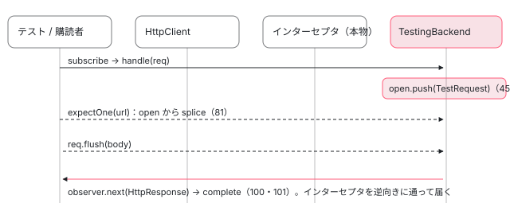

[目次](../README.md) › [HttpClient の内側](README.md) › 第 12 回 / 全 12 回

# テスト用バックエンド：HttpTestingController と TestRequest

> provideHttpClientTesting が HttpBackend を HttpClientTestingBackend に差し替える行、送られたリクエストを open 配列に積み、expectOne / match / verify が探す手順、TestRequest.flush / error / event が Observable にイベントを流す行。インターセプタは本物が通る理由と、provideHttpClient より後に書く必要がある理由。

angular/angular · 読了 約 12 分 · 中核 · [サイトで読む（デモが動きます）](https://angular-deep-dive-cyan.vercel.app/chapter/http-testing)

---

HttpClient を使うサービスのテストでは、`provideHttpClientTesting()` を足し、`HttpTestingController` で「このリクエストが来たはず」と確かめて `flush` で応答を返します。この章では、`provideHttpClientTesting` が差し替える 1 つのトークン、送られたリクエストが積まれる配列 `open`、`expectOne` / `match` / `verify` がその配列をどう探すか、`flush` がどうやって購読者に値を届けるかを、ソースの行で追います。

読む対象は `packages/common/http/testing/src/` の `provider.ts`・`api.ts`・`backend.ts`・`request.ts`・`module.ts` です。全部で 600 行ほどの小さなパッケージです。

1. [1. 概観](01-http-overview.md)
2. [2. provideHttpClient と features](02-http-provide.md)
3. [3. HttpClient.request](03-http-client-request.md)
4. [4. 不変なリクエスト](04-http-request-immutable.md)
5. [5. インターセプタの連鎖](05-http.md)
6. [6. FetchBackend](06-http-backend-fetch.md)
7. [7. HttpXhrBackend](07-http-backend-xhr.md)
8. [8. HttpEvent とエラー](08-http-response-errors.md)
9. [9. XSRF 対策](09-http-xsrf.md)
10. [10. JSONP](10-http-jsonp.md)
11. [11. SSR の転送キャッシュ](11-http-transfer-cache.md)
12. **12. テスト用バックエンド**（この章）

## 1. provideHttpClientTesting は 4 行

📄 `angular/packages/common/http/testing/src/provider.ts` L9–22 （▶ の行: 17–20）

```ts
 9 │ import {HttpBackend, ɵREQUESTS_CONTRIBUTE_TO_STABILITY} from '../../index';
10 │ import {Provider} from '@angular/core';
11 │ 
12 │ import {HttpTestingController} from './api';
13 │ import {HttpClientTestingBackend} from './backend';
14 │ 
15 │ export function provideHttpClientTesting(): Provider[] {
16 │   return [
17 ▶     HttpClientTestingBackend,
18 ▶     {provide: HttpBackend, useExisting: HttpClientTestingBackend},
19 ▶     {provide: HttpTestingController, useExisting: HttpClientTestingBackend},
20 ▶     {provide: ɵREQUESTS_CONTRIBUTE_TO_STABILITY, useValue: false},
21 │   ];
22 │ }
```

1. **17 行目：`HttpClientTestingBackend` そのもの**

   クラスをそのまま並べる書き方は `{provide: X, useClass: X}` と同じです。この注入器にインスタンスが 1 つだけ作られます。
2. **18 行目：`HttpBackend` → 同じインスタンス**

   `useExisting` は「別のトークンで引かれても、指定したトークンの値を返す」です。**この章の中心はこの 1 行です**。`HttpClient` も `HttpInterceptorHandler` もインターセプタも差し替えません。差し替えるのはバックエンドだけです。
3. **19 行目：`HttpTestingController` → 同じインスタンス**

   テストで `TestBed.inject(HttpTestingController)` したときに返るのも、18 行目と同じ `HttpClientTestingBackend` です。リクエストを受け取る側と、それを調べる側が同じオブジェクトです。
4. **20 行目：`REQUESTS_CONTRIBUTE_TO_STABILITY` を `false`**

   通常、`HttpInterceptorHandler` はリクエストごとに `PendingTasks` を足し、応答が返るまでアプリを「不安定」にします （[PendingTasks の章](../zoneless/09-zoneless-pending-tasks.md)）。テストでは `flush` するまで応答が返らないので、これを止めないと `whenStable()` や `fixture.whenStable()` が待ち続けます。

📄 `angular/packages/common/http/testing/src/api.ts` L23–44 （▶ の行: 29, 33, 44）

```ts
23 │ /**
24 │  * Controller to be injected into tests, that allows for mocking and flushing
25 │  * of requests.
26 │  *
27 │  * @publicApi
28 │  */
29 ▶ export abstract class HttpTestingController {
30 │   /**
31 │    * Search for requests that match the given parameter, without any expectations.
32 │    */
33 ▶   abstract match(
34 │     match: string | RequestMatch | ((req: HttpRequest<any>) => boolean),
35 │   ): TestRequest[];
36 │ 
37 │   /**
38 │    * Expect that a single request has been made which matches the given URL, and return its
39 │    * mock.
40 │    *
41 │    * If no such request has been made, or more than one such request has been made, fail with an
42 │    * error message including the given request description, if any.
43 │    */
44 ▶   abstract expectOne(url: string, description?: string): TestRequest;
```

29 行目、`HttpTestingController` は `@Injectable` の付かない抽象クラスです。それ自体には作り方が無いので、provide されるのは 19 行目の `useExisting` だけです。`provideHttpClientTesting()` を書き忘れると、注入時に `NullInjectorError` になります。

📄 `angular/packages/common/http/testing/src/module.ts` L9–27 （▶ の行: 21, 24–25）

```ts
 9 │ import {HttpClientModule} from '../../index';
10 │ import {NgModule} from '@angular/core';
11 │ 
12 │ import {provideHttpClientTesting} from './provider';
13 │ 
14 │ /**
15 │  * Configures `HttpClientTestingBackend` as the `HttpBackend` used by `HttpClient`.
16 │  *
17 │  * Inject `HttpTestingController` to expect and flush requests in your tests.
18 │  *
19 │  * @publicApi
20 │  *
21 ▶  * @deprecated Add `provideHttpClientTesting()` to your providers instead.
22 │  */
23 │ @NgModule({
24 ▶   imports: [HttpClientModule],
25 ▶   providers: [provideHttpClientTesting()],
26 │ })
27 │ export class HttpClientTestingModule {}
```

古い `HttpClientTestingModule` は、24 行目で `HttpClientModule` を import し、25 行目で同じ `provideHttpClientTesting()` を providers に置くだけです。21 行目で非推奨です。NgModule の注入器は import した側のプロバイダを先に、自分の providers を後に集めるので（[プロバイダの木を歩く章](../ngmodule/08-ngmodule-walk-provider-tree.md)）、ここでも `provideHttpClientTesting()` が後ろに来ます。

## 2. なぜ provideHttpClient より後ろに書くのか

`provideHttpClient()` も `HttpBackend` を provide しています。中身は `{provide: HttpBackend, useFactory: () => inject(FetchBackend)}` です （[第 2 回](02-http-provide.md)）。つまり 1 つの注入器の providers に、`HttpBackend` の記録が 2 つ並びます。

`R3Injector` はプロバイダを配列の順に処理し、トークンごとの記録を `records.set(token, record)` で書きます。**`Map.set` なので、同じトークンは後から来たものが前のものを上書きします** （[zoneless-default の 4 節](../zoneless/01-zoneless-default.md)、[provider から factory へ](../di/07-di-provider-to-factory.md)）。

| providers の並び | HttpBackend の記録（後勝ち） | 結果 |
| --- | --- | --- |
| `[provideHttpClient(), provideHttpClientTesting()]` | 18 行目の `useExisting: HttpClientTestingBackend` | リクエストは `open` に積まれる。ネットワークに出ない |
| `[provideHttpClientTesting(), provideHttpClient()]` | `provideHttpClient` の `useFactory: inject(FetchBackend)` | `HttpTestingController` は注入できるが、リクエストは本物の `fetch` に行く。`expectOne` は「found none」で落ちる |

`HttpTestingController`（19 行目）は `provideHttpClient` と衝突しないので、逆順でも注入はできてしまいます。だから逆順はすぐにはエラーにならず、「expectOne が見つからない」という形で表に出ます。DEMO の最後のボタンで、両方の並びの注入器を作って比べられます。

## 3. インターセプタは本物が通る

差し替えたのはバックエンドだけなので、`HttpClient` → `HttpInterceptorHandler` → インターセプタの連鎖 → バックエンド、という道筋は本番と同じです。`HttpInterceptorHandler` は constructor で `HttpBackend` を受け取ります。

📄 `angular/packages/common/http/src/backend.ts` L63–82 （▶ の行: 64, 71–73, 75, 81）

```ts
63 │   constructor(
64 ▶     private backend: HttpBackend,
65 │     private injector: EnvironmentInjector,
66 │   ) {
67 │     // We strongly recommend using fetch backend for HTTP calls when SSR is used
68 │     // for an application. The logic below checks if that's the case and produces
69 │     // a warning otherwise.
70 │     if ((typeof ngDevMode === 'undefined' || ngDevMode) && !fetchBackendWarningDisplayed) {
71 ▶       // This flag is necessary because provideHttpClientTesting() overrides the backend
72 ▶       // even if `withFetch()` is used within the test. When the testing HTTP backend is provided,
73 ▶       // no HTTP calls are actually performed during the test, so producing a warning would be
74 │       // misleading.
75 ▶       const isTestingBackend = (this.backend as any).isTestingBackend;
76 │ 
77 │       if (
78 │         typeof ngServerMode !== 'undefined' &&
79 │         ngServerMode &&
80 │         !(this.backend instanceof FetchBackend) &&
81 ▶         !isTestingBackend
82 │       ) {
```

64 行目の `backend` に入るのが、2 節の後勝ちで決まった `HttpClientTestingBackend` です。連鎖の最後で `this.backend.handle(...)` が呼ばれる行は [PendingTasks の章](../zoneless/09-zoneless-pending-tasks.md)で、連鎖の作り方は [第 5 回](05-http.md)で見ました。

71〜75 行目のコメントがテスト用バックエンドに触れています。SSR で `FetchBackend` 以外を使うと警告を出す処理（77〜82 行目）があり、`provideHttpClientTesting()` は `withFetch()` を書いていてもバックエンドを上書きするので、75 行目で `isTestingBackend` を見て警告を出さないようにしています。その印が、次に見る `HttpClientTestingBackend` の 37 行目です。

## 4. handle：TestRequest を作って open に積む

📄 `angular/packages/common/http/testing/src/backend.ts` L27–51 （▶ の行: 28, 32, 37, 42–48）

```ts
27 │ @Injectable()
28 ▶ export class HttpClientTestingBackend implements HttpBackend, HttpTestingController {
29 │   /**
30 │    * List of pending requests which have not yet been expected.
31 │    */
32 ▶   private open: TestRequest[] = [];
33 │ 
34 │   /**
35 │    * Used when checking if we need to throw the NOT_USING_FETCH_BACKEND_IN_SSR error
36 │    */
37 ▶   private isTestingBackend = true;
38 │ 
39 │   /**
40 │    * Handle an incoming request by queueing it in the list of open requests.
41 │    */
42 ▶   handle(req: HttpRequest<any>): Observable<HttpEvent<any>> {
43 ▶     return new Observable((observer: Observer<any>) => {
44 ▶       const testReq = new TestRequest(req, observer);
45 ▶       this.open.push(testReq);
46 ▶       observer.next({type: HttpEventType.Sent} as HttpEvent<any>);
47 ▶       return () => {
48 ▶         testReq._cancelled = true;
49 │       };
50 │     });
51 │   }
```

1. **28 行目：1 つのクラスが 2 つの役**

   `HttpBackend`（リクエストを受け取る）と `HttpTestingController`（調べる）の両方を implements します。
2. **43 行目：`new Observable` を返すだけ**

   中の関数は**購読されたときに**動きます。HttpClient は購読されるまで連鎖を呼ばない作りなので （[httpResource の章](../signals/16-signals-http-resource.md)で見た `of(req).pipe(concatMap(...))`）、`http.get(url)` を呼んだだけで `subscribe` していなければ、`open` には何も入りません。
3. **44〜45 行目：`TestRequest` を作り、`open` に push**

   `TestRequest` は、リクエスト本体と、**この購読の observer**（値を流す口）を持ちます。32 行目の `open` は「まだ誰も調べていないリクエスト」の配列です。
4. **46 行目：`Sent` イベントだけ先に流す**

   本物のバックエンドも最初に `{type: HttpEventType.Sent}` を流すので、それに合わせています（[第 8 回](08-http-response-errors.md)）。応答はまだ流しません。
5. **47〜49 行目：購読解除で `_cancelled = true`**

   Observable の teardown（購読解除時に呼ばれる関数）です。`open` からは消しません。キャンセル済みの印を付けるだけです。

## 5. \_match と match：open をどう探すか

📄 `angular/packages/common/http/testing/src/backend.ts` L53–85 （▶ の行: 59–62, 64, 66–67, 77, 79, 81）

```ts
53 │   /**
54 │    * Helper function to search for requests in the list of open requests.
55 │    */
56 │   private _match(
57 │     match: string | RequestMatch | ((req: HttpRequest<any>) => boolean),
58 │   ): TestRequest[] {
59 ▶     if (typeof match === 'string') {
60 ▶       return this.open.filter((testReq) => testReq.request.urlWithParams === match);
61 ▶     } else if (typeof match === 'function') {
62 ▶       return this.open.filter((testReq) => match(testReq.request));
63 │     } else {
64 ▶       return this.open.filter(
65 │         (testReq) =>
66 ▶           (!match.method || testReq.request.method === match.method.toUpperCase()) &&
67 ▶           (!match.url || testReq.request.urlWithParams === match.url),
68 │       );
69 │     }
70 │   }
71 │ 
72 │   /**
73 │    * Search for requests in the list of open requests, and return all that match
74 │    * without asserting anything about the number of matches.
75 │    */
76 │   match(match: string | RequestMatch | ((req: HttpRequest<any>) => boolean)): TestRequest[] {
77 ▶     const results = this._match(match);
78 │     results.forEach((result) => {
79 ▶       const index = this.open.indexOf(result);
80 │       if (index !== -1) {
81 ▶         this.open.splice(index, 1);
82 │       }
83 │     });
84 │     return results;
85 │   }
```

1. **59〜60 行目：文字列なら `urlWithParams` と完全一致**

   `urlWithParams` はクエリ文字列まで付けた URL です。`http.get('/api', {params: {q: 'a'}})` は `expectOne('/api')` では見つからず、`expectOne('/api?q=a')` と書きます。前方一致ではありません。
2. **61〜62 行目：関数なら、それが `true` を返したもの**

   ヘッダーや body を見たいときはこれを使います。
3. **64〜67 行目：`{method, url}` なら両方（書いた方だけ）**

   66 行目、method は `toUpperCase()` してから比べるので `'get'` でも構いません。url は 67 行目で文字列と同じく完全一致です。
4. **76〜85 行目：`match` は見つけたものを `open` から取り除く**

   81 行目の `splice` です。**一度取り出したリクエストは二度と一致しません**。`verify` が「未処理」と言わなくなるのも、これで `open` から消えるからです。

## 6. expectOne と expectNone のエラーメッセージ

📄 `angular/packages/common/http/testing/src/backend.ts` L94–132 （▶ の行: 98–100, 102, 105–107, 109–110, 114, 127, 129）

```ts
 94 │   expectOne(
 95 │     match: string | RequestMatch | ((req: HttpRequest<any>) => boolean),
 96 │     description?: string,
 97 │   ): TestRequest {
 98 ▶     description ||= this.descriptionFromMatcher(match);
 99 ▶     const matches = this.match(match);
100 ▶     if (matches.length > 1) {
101 │       throw new Error(
102 ▶         `Expected one matching request for criteria "${description}", found ${matches.length} requests.`,
103 │       );
104 │     }
105 ▶     if (matches.length === 0) {
106 ▶       let message = `Expected one matching request for criteria "${description}", found none.`;
107 ▶       if (this.open.length > 0) {
108 │         // Show the methods and URLs of open requests in the error, for convenience.
109 ▶         const requests = this.open.map(describeRequest).join(', ');
110 ▶         message += ` Requests received are: ${requests}.`;
111 │       }
112 │       throw new Error(message);
113 │     }
114 ▶     return matches[0];
115 │   }
116 │ 
117 │   /**
118 │    * Expect that no outstanding requests match the given matcher, and throw an error
119 │    * if any do.
120 │    */
121 │   expectNone(
122 │     match: string | RequestMatch | ((req: HttpRequest<any>) => boolean),
123 │     description?: string,
124 │   ): void {
125 │     description ||= this.descriptionFromMatcher(match);
126 │     const matches = this.match(match);
127 ▶     if (matches.length > 0) {
128 │       throw new Error(
129 ▶         `Expected zero matching requests for criteria "${description}", found ${matches.length}.`,
130 │       );
131 │     }
132 │   }
```

99 行目で `match` を呼ぶので、`expectOne` も見つけたものを `open` から取り除きます。そのあとで件数を調べます。

- 100〜104 行目：2 件以上なら `Expected one matching request for criteria "…", found 2 requests.`
- 105〜112 行目：0 件なら `… found none.`。`open` に他のリクエストが残っていれば、109〜110 行目で `Requests received are: GET /api/users.` と全部並べます。URL の書き間違いはこの一覧で分かります。
- 114 行目：ちょうど 1 件なら、その `TestRequest` を返します。
- 127〜130 行目：`expectNone` は 1 件でもあれば `Expected zero matching requests …`。

98 行目の `description` は、渡さなければ `descriptionFromMatcher`（次の引用の 151 行目〜）が `Match URL: /api/users` のような説明を作ります。

## 7. verify：open が空かどうか

📄 `angular/packages/common/http/testing/src/backend.ts` L134–170 （▶ の行: 138, 141–142, 144, 147, 151, 167–168）

```ts
134 │   /**
135 │    * Validate that there are no outstanding requests.
136 │    */
137 │   verify(opts: {ignoreCancelled?: boolean} = {}): void {
138 ▶     let open = this.open;
139 │     // It's possible that some requests may be cancelled, and this is expected.
140 │     // The user can ask to ignore open requests which have been cancelled.
141 ▶     if (opts.ignoreCancelled) {
142 ▶       open = open.filter((testReq) => !testReq.cancelled);
143 │     }
144 ▶     if (open.length > 0) {
145 │       // Show the methods and URLs of open requests in the error, for convenience.
146 │       const requests = open.map(describeRequest).join(', ');
147 ▶       throw new Error(`Expected no open requests, found ${open.length}: ${requests}`);
148 │     }
149 │   }
150 │ 
151 ▶   private descriptionFromMatcher(
152 │     matcher: string | RequestMatch | ((req: HttpRequest<any>) => boolean),
153 │   ): string {
154 │     if (typeof matcher === 'string') {
155 │       return `Match URL: ${matcher}`;
156 │     } else if (typeof matcher === 'object') {
157 │       const method = matcher.method || '(any)';
158 │       const url = matcher.url || '(any)';
159 │       return `Match method: ${method}, URL: ${url}`;
160 │     } else {
161 │       return `Match by function: ${matcher.name}`;
162 │     }
163 │   }
164 │ }
165 │ 
166 │ function describeRequest(testRequest: TestRequest): string {
167 ▶   const url = testRequest.request.urlWithParams;
168 ▶   const method = testRequest.request.method;
169 │   return `${method} ${url}`;
170 │ }
```

`verify` がすることは「`open` の長さが 0 か」だけです。138 行目で `open` を取り、144 行目で 1 件でもあれば 147 行目で `Expected no open requests, found 1: GET /api/items` を投げます。並ぶのは 166〜170 行目の `describeRequest` が作る「メソッド URL」です。

141〜142 行目、`ignoreCancelled: true` を渡すと、購読解除されたリクエスト（4 節の 48 行目で印が付いたもの）を除きます。既定では**キャンセル済みも未処理として数えます**。`switchMap` で前のリクエストを捨てるコードをテストすると、ここで引っかかります。

だから `afterEach(() => httpTesting.verify())` は「テストが想定していないリクエストを送っていないか」を確かめます。調べたリクエスト（`expectOne` / `match` で取り出したもの）は `open` から消えているので、flush したかどうかは見ていません。

## 8. TestRequest：observer に値を流す

📄 `angular/packages/common/http/testing/src/request.ts` L37–53 （▶ の行: 41–42, 48, 51–52）

```ts
37 │ export class TestRequest {
38 │   /**
39 │    * Whether the request was cancelled after it was sent.
40 │    */
41 ▶   get cancelled(): boolean {
42 ▶     return this._cancelled;
43 │   }
44 │ 
45 │   /**
46 │    * @internal set by `HttpClientTestingBackend`
47 │    */
48 ▶   _cancelled = false;
49 │ 
50 │   constructor(
51 ▶     public request: HttpRequest<any>,
52 ▶     private observer: Observer<HttpEvent<any>>,
53 │   ) {}
```

51〜52 行目、`TestRequest` が持つのはリクエストと observer の 2 つだけです。以下の `flush` / `error` / `event` は、どれもこの observer の `next` / `error` / `complete` を呼ぶだけです。observer はインターセプタの連鎖を逆にさかのぼってつながっているので、ここで流した値は**インターセプタを通ってから** HttpClient の購読者に届きます。

📄 `angular/packages/common/http/testing/src/request.ts` L78–105 （▶ の行: 79–80, 82, 85, 87, 89–91, 93, 96–97, 99–101, 103）

```ts
 78 │   ): void {
 79 ▶     if (this.cancelled) {
 80 ▶       throw new Error(`Cannot flush a cancelled request.`);
 81 │     }
 82 ▶     const url = this.request.urlWithParams;
 83 │     const headers =
 84 │       opts.headers instanceof HttpHeaders ? opts.headers : new HttpHeaders(opts.headers);
 85 ▶     body = _maybeConvertBody(this.request.responseType, body);
 86 │     let statusText: string | undefined = opts.statusText;
 87 ▶     let status: number = opts.status !== undefined ? opts.status : HttpStatusCode.Ok;
 88 │     if (opts.status === undefined) {
 89 ▶       if (body === null) {
 90 ▶         status = HttpStatusCode.NoContent;
 91 ▶         statusText ||= 'No Content';
 92 │       } else {
 93 ▶         statusText ||= 'OK';
 94 │       }
 95 │     }
 96 ▶     if (statusText === undefined) {
 97 ▶       throw new Error('statusText is required when setting a custom status.');
 98 │     }
 99 ▶     if (status >= 200 && status < 300) {
100 ▶       this.observer.next(new HttpResponse<any>({body, headers, status, statusText, url}));
101 ▶       this.observer.complete();
102 │     } else {
103 ▶       this.observer.error(new HttpErrorResponse({error: body, headers, status, statusText, url}));
104 │     }
105 │   }
```

1. **79〜81 行目：キャンセル済みなら投げる**

   `Cannot flush a cancelled request.` 購読解除したリクエストに応答しようとするテストは、ここで落ちます。
2. **85 行目：body を responseType に合わせて変換**

   9 節で見ます。
3. **87〜95 行目：status の既定値**

   status を省略すると 200（`HttpStatusCode.Ok`）、statusText は `'OK'`。body が `null` なら 90〜91 行目で 204 `No Content` にします。96〜97 行目、status を自分で指定したのに statusText が無ければ `statusText is required when setting a custom status.` です。
4. **99〜101 行目：2xx なら `next(HttpResponse)` → `complete()`**

   **ここで初めて購読者に値が届きます**。observer は 4 節の 43 行目で作られた Observable のものなので、同期で流れます。`fakeAsync` や `await` が無くても、`flush` の次の行では購読者の `next` が終わっています。
5. **102〜103 行目：それ以外は `error(HttpErrorResponse)`**

   `flush(body, {status: 404, statusText: 'Not Found'})` と書けば、サーバーのエラー応答を再現できます。body は `error` プロパティに入ります。

📄 `angular/packages/common/http/testing/src/request.ts` L116–142 （▶ の行: 116–117, 122, 124, 126–127, 137, 141）

```ts
116 ▶   error(error: ProgressEvent | ErrorEvent, opts: TestRequestErrorOptions = {}): void {
117 ▶     if (this.cancelled) {
118 │       throw new Error(`Cannot return an error for a cancelled request.`);
119 │     }
120 │     const headers =
121 │       opts.headers instanceof HttpHeaders ? opts.headers : new HttpHeaders(opts.headers);
122 ▶     this.observer.error(
123 │       new HttpErrorResponse({
124 ▶         error,
125 │         headers,
126 ▶         status: opts.status || 0,
127 ▶         statusText: opts.statusText || '',
128 │         url: this.request.urlWithParams,
129 │       }),
130 │     );
131 │   }
132 │ 
133 │   /**
134 │    * Deliver an arbitrary `HttpEvent` (such as a progress event) on the response stream for this
135 │    * request.
136 │    */
137 ▶   event(event: HttpEvent<any>): void {
138 │     if (this.cancelled) {
139 │       throw new Error(`Cannot send events to a cancelled request.`);
140 │     }
141 ▶     this.observer.next(event);
142 │   }
```

`error()` はネットワーク障害の再現です。124 行目で渡した `ProgressEvent` がそのまま `error` に入り、126 行目で status は既定 0 になります。127 行目の statusText は空文字ですが、`HttpErrorResponse` の constructor が空文字を `'Unknown Error'` に置き換えます。本物のバックエンドもネットワーク障害では status 0 を返します（[第 8 回](08-http-response-errors.md)）。137〜142 行目の `event()` は、進捗などの任意の `HttpEvent` を 141 行目で `next` するだけで、complete しません。最後は `flush` で終わらせます。

## 9. body の型変換

📄 `angular/packages/common/http/testing/src/request.ts` L228–250 （▶ の行: 235–236, 238, 240, 242, 244, 246, 248）

```ts
228 │ /**
229 │  * Convert a response body to the requested type.
230 │  */
231 │ function _maybeConvertBody(
232 │   responseType: string,
233 │   body: ArrayBuffer | Blob | string | number | Object | (string | number | Object | null)[] | null,
234 │ ): ArrayBuffer | Blob | string | number | Object | (string | number | Object | null)[] | null {
235 ▶   if (body === null) {
236 ▶     return null;
237 │   }
238 ▶   switch (responseType) {
239 │     case 'arraybuffer':
240 ▶       return _toArrayBufferBody(body);
241 │     case 'blob':
242 ▶       return _toBlob(body);
243 │     case 'json':
244 ▶       return _toJsonBody(body);
245 │     case 'text':
246 ▶       return _toTextBody(body);
247 │     default:
248 ▶       throw new Error(`Unsupported responseType: ${responseType}`);
249 │   }
250 │ }
```

235〜236 行目、`null` は変換しません。それ以外は、**リクエストの**`responseType` で分けます。`arraybuffer` / `blob` を指定したリクエストに文字列を flush すると、変換関数 `_toArrayBufferBody` / `_toBlob` が「自動変換はできない」（`Automatic conversion to … is not supported`）と投げます。`json` は、ArrayBuffer と Blob 以外ならそのまま通します。

📄 `angular/packages/common/http/testing/src/request.ts` L210–226 （▶ の行: 216–217, 219, 222, 225）

```ts
210 │ /**
211 │  * Helper function to convert a response body to a string.
212 │  */
213 │ function _toTextBody(
214 │   body: ArrayBuffer | Blob | string | number | Object | (string | number | Object | null)[],
215 │ ): string {
216 ▶   if (typeof body === 'string') {
217 ▶     return body;
218 │   }
219 ▶   if (typeof ArrayBuffer !== 'undefined' && body instanceof ArrayBuffer) {
220 │     throw new Error('Automatic conversion to text is not supported for ArrayBuffers.');
221 │   }
222 ▶   if (typeof Blob !== 'undefined' && body instanceof Blob) {
223 │     throw new Error('Automatic conversion to text is not supported for Blobs.');
224 │   }
225 ▶   return JSON.stringify(_toJsonBody(body, 'text'));
226 │ }
```

`responseType: 'text'` のリクエストに `flush({a: 1})` すると、225 行目で `JSON.stringify` した文字列が届きます。逆に、JSON をパースする処理（本物の `FetchBackend` が行うもの）はここにはありません。`flush` に渡したオブジェクトが、そのまま購読者に届きます。

## 10. 全体の流れ



*subscribe でインターセプタを通って HttpClientTestingBackend.handle に届き、TestRequest が open に積まれる。expectOne が open から取り出し、flush が observer.next を呼ぶと、インターセプタを逆向きに通って購読者に値が届く。*

## 11. DEMO：expectOne → flush で購読者に値が届く

> **🧪 DEMO — 本物の HttpClient と HttpClientTestingBackend**
>
> 章の中では `TestBed` を使えないので、`createEnvironmentInjector([provideHttpClient(withInterceptors([log])), provideHttpClientTesting()], ...)` で TestBed と同じ並びの注入器を作り、そこから `HttpClient` と `HttpTestingController` を取り出しています。バックエンドがテスト用なので、どのボタンを押してもネットワークには出ません。「送る」で `http.get(url).subscribe(...)`、ほかのボタンで `HttpTestingController` を呼びます。投げられた例外は画面に出します。
>
> ▶ [このデモはサイトで動かせます](https://angular-deep-dive-cyan.vercel.app/chapter/http-testing)

試すと次のことが確かめられます。

- 「送る」と同時にインターセプタのログが出ます（3 節）。購読者の欄は「待機中」のまま。値は flush するまで来ません。
- 送る前に `expectOne` を押すと `found none.`、別の URL だけ送ってあれば `Requests received are: …` が付きます（105〜112 行目）。
- 同じ URL を 2 回送ってから `expectOne` すると `found 2 requests.`（100〜104 行目）。このとき 2 件とも `open` から消えています（99 行目）。
- unsubscribe したあとに `verify()` は落ち、`verify({ignoreCancelled: true})` は通ります（141〜142 行目）。その 1 件を `expectOne` → flush すると `Cannot flush a cancelled request.`（80 行目）。
- `error(…)` は status 0 の `HttpErrorResponse` になります（126 行目）。

## 呼び出しの連なり（送ってから flush するまで）

- 👤 `service.load().subscribe(...)` — テスト対象のコード
  - `HttpInterceptorHandler.handle(req)` — common/http/src/backend.ts — *this.backend = HttpClientTestingBackend（provider.ts L18 が後勝ち）*
    - `あなたのインターセプタ…` — withInterceptors / withInterceptorsFromDi
      - `HttpClientTestingBackend.handle(req)` — testing/src/backend.ts L42 — *new TestRequest(req, observer) を open に push。Sent だけ流す*
- 👤 `httpTesting.expectOne('/api/users')` — テスト
  - `match(...) → _match(...)` — backend.ts L76 / L56 — *urlWithParams の完全一致。open から splice*
- 👤 `req.flush({...})` — テスト
  - `_maybeConvertBody(responseType, body)` — request.ts L231
  - `observer.next(new HttpResponse(...))` → `complete()` — request.ts L100 — *インターセプタを逆向きに通り、購読者の next が同期で走る*
- 👤 `httpTesting.verify()` — afterEach — *open が空でなければ throw*

## 聞かれそうな質問

**Q. インターセプタはテストでも通りますか？**

通ります。`provideHttpClientTesting()` が差し替えるのは provider.ts 18 行目の `HttpBackend` だけで、`HttpInterceptorHandler` は本物のままです。64 行目の constructor 引数 `backend` にテスト用バックエンドが入るだけで、連鎖はいつもどおり作られます。ただし、インターセプタを登録するのは `provideHttpClient(withInterceptors([...]))` の側なので、テストの providers にそれを書いておく必要があります。

**Q. verify は何を確かめていますか？**

`open` 配列が空かどうかだけです（144 行目）。`expectOne` / `match` で取り出したものは 81 行目で `open` から消えるので、「テストで調べなかったリクエストが残っていないか」を見ています。取り出したあと flush したかどうかは見ません。キャンセル済みも既定では数え、`ignoreCancelled: true` で除けます（141〜142 行目）。

**Q. flush しないと何が起きますか？**

購読者には何も届きません。`handle` は 46 行目で `Sent` を流すだけで、応答を流すのは `flush` の 100 行目か `error` の 122 行目だけだからです。`HttpClient.get` の購読者は body しか受け取らないので、`next` は一度も呼ばれず、Observable は終わりません。`expectOne` もせずに放っておけば、`verify()` が 147 行目で `Expected no open requests` を投げて教えてくれます。なお 20 行目で `REQUESTS_CONTRIBUTE_TO_STABILITY` が `false` なので、flush していないリクエストが `whenStable()` を止めることはありません。

**Q. provideHttpClientTesting() を先に書くとどうなりますか？**

`HttpBackend` の記録が、後から来た `provideHttpClient()` の `inject(FetchBackend)` で上書きされます（`records.set` の後勝ち）。リクエストは本物の `fetch` に出て、`open` には積まれません。`HttpTestingController` は 19 行目で provide されているので注入は成功し、`expectOne` の `found none.` という形で失敗します。DEMO の「並び順を比べる」で確かめられます。

**Q. flush のあと、購読者の結果を確かめるのに await は要りますか？**

要りません。`flush` は 100〜101 行目で observer の `next` と `complete` をその場で呼びます。インターセプタが `delay` などの非同期演算子を挟んでいない限り、`flush` の次の行では購読者の処理が終わっています。

## 読み終えて

- `provideHttpClientTesting()` は `HttpBackend` と `HttpTestingController` を同じ `HttpClientTestingBackend` に向け、安定性への寄与を切るだけ。
- 差し替えはバックエンドだけなので、`HttpClient` もインターセプタの連鎖も本物が通る。
- `provideHttpClient()` の後ろに書くのは、同じ `HttpBackend` トークンを `records.set` の後勝ちで上書きするため。
- 送られたリクエストは購読時に `open` へ積まれ、`expectOne` / `match` が `urlWithParams` の完全一致などで探して取り除き、`verify` は残りが 0 件かを見る。
- `flush` / `error` / `event` は、`TestRequest` が持つ observer を同期で呼ぶだけ。値はインターセプタを通って購読者に届く。

---

← 前: [SSR の転送キャッシュ：サーバーで取った応答をブラウザで使い回す](11-http-transfer-cache.md)  
次: [SSR とハイドレーションの概観：サーバーで 1 回、ブラウザでもう 1 回](../platform/01-ssr-overview.md) →
