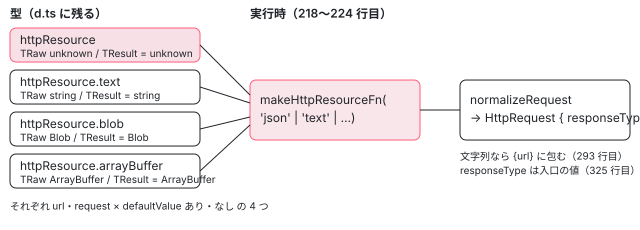

[目次](../README.md) › [HttpClient の細部と issue](README.md) › 第 4 回 / 全 6 回

# httpResource の型：text・blob・arrayBuffer と parse

> resource.ts の HttpResourceFn（httpResource と text・blob・arrayBuffer の入口が、それぞれ url・request × defaultValue の有無の 4 つのシグネチャを持つ）、実行時に違うのは responseType だけであること、parse・defaultValue・equal の型（NoInfer）と TypeScript に聞いた記録、parse が呼ばれる 2 か所（応答と転送キャッシュ）、HttpResourceRef の headers・statusCode・hasValue。本物の httpResource をページで動かすデモと、開いている #66636（parse からヘッダーを読みたい）を行から読む。

angular/angular · 読了 約 12 分 · 発展 · [サイトで読む（デモが動きます）](https://angular-deep-dive-cyan.vercel.app/chapter/httpx-resource-types)

---

`httpResource` は 1 つの関数に見えますが、型としては「呼び出しの形が 4 つある関数」に `text`・`blob`・`arrayBuffer` の 3 つのプロパティ（それぞれ 4 つの形）が付いたものです。この章では、どの書き方でどの形が選ばれ、`value()` の型がどう決まるのかを、型の宣言の行と、TypeScript に実際に聞いた記録で確かめます。そのうえで、`parse` が**実行時にどこで呼ばれ、何を受け取らないのか**を行で見て、開いている #66636（parse からヘッダーを読みたい）を読みます。

読む対象は `packages/common/http/src/resource.ts` の型の宣言（`HttpResourceFn` と `RawRequestType`）と、`resource_api.ts` の `HttpResourceOptions`・`HttpResourceRef` です。`httpResource` が `HttpClient` を購読して `stream` に流す大きな流れは [httpResource の章](../signals/16-signals-http-resource.md)、`ResourceImpl` の状態の移り変わりは [resource の章](../signals/15-resource.md)にあります。ここでは繰り返しません。

1. [1. HttpRequest の options](01-httpx-request-options.md)
2. [2. headers と params の更新](02-httpx-headers-params-updates.md)
3. [3. オーバーロードの型](03-httpx-overload-types.md)
4. **4. httpResource の型**（この章）
5. [5. 転送キャッシュのキー](05-httpx-transfer-cache-key.md)
6. [6. spec と issue](06-httpx-tests-issues.md)

## 1. httpResource の型は interface HttpResourceFn

📄 `angular/packages/common/http/src/resource.ts` L40–78 （▶ の行: 45, 47, 57, 59–62, 75–78）

```ts
40 │ /**
41 │  * Type for the `httpRequest` top-level function, which includes the call signatures for the JSON-
42 │  * based `httpRequest` as well as sub-functions for `ArrayBuffer`, `Blob`, and `string` type
43 │  * requests.
44 │  *
45 ▶  * @publicApi 22.0
46 │  */
47 ▶ export interface HttpResourceFn {
48 │   /**
49 │    * Create a `Resource` that fetches data with an HTTP GET request to the given URL.
50 │    *
51 │    * The resource will update when the URL changes via signals.
52 │    *
53 │    * Uses `HttpClient` to make requests and supports interceptors, testing, and the other features
54 │    * of the `HttpClient` API. Data is parsed as JSON by default - use a sub-function of
55 │    * `httpResource`, such as `httpResource.text()`, to parse the response differently.
56 │    *
57 ▶    * @publicApi 22.0
58 │    */
59 ▶   <TResult = unknown>(
60 ▶     url: (ctx: ResourceParamsContext) => string | undefined,
61 ▶     options: HttpResourceOptions<TResult, unknown> & {defaultValue: NoInfer<TResult>},
62 ▶   ): HttpResourceRef<TResult>;
63 │ 
64 │   /**
65 │    * Create a `Resource` that fetches data with an HTTP GET request to the given URL.
66 │    *
67 │    * The resource will update when the URL changes via signals.
68 │    *
69 │    * Uses `HttpClient` to make requests and supports interceptors, testing, and the other features
70 │    * of the `HttpClient` API. Data is parsed as JSON by default - use a sub-function of
71 │    * `httpResource`, such as `httpResource.text()`, to parse the response differently.
72 │    *
73 │    * @publicApi 22.0
74 │    */
75 ▶   <TResult = unknown>(
76 ▶     url: (ctx: ResourceParamsContext) => string | undefined,
77 ▶     options?: HttpResourceOptions<TResult, unknown>,
78 ▶   ): HttpResourceRef<TResult | undefined>;
```

47 行目の `interface HttpResourceFn` の中に、名前の無いシグネチャ（呼び出しシグネチャ。「この形で呼べる」という宣言）が並びます。1 つの関数に呼び出しシグネチャが複数あると、TypeScript は**上から順に**試して、最初に合ったものを選びます（オーバーロード）。`HttpClient.get` のオーバーロードの選ばれ方は[第 3 回](03-httpx-overload-types.md)にあります。

1. **59〜62 行目：`defaultValue` があれば、戻り値は `HttpResourceRef<TResult>`**

   61 行目の options は `HttpResourceOptions<TResult, unknown> & {defaultValue: NoInfer<TResult>}` です。`&` の右で `defaultValue` を**必須**にしています。だから `defaultValue` を書いたときだけ、この 1 つ目に合います。読み込み中も `value()` は `defaultValue` を返すので、62 行目の戻り値に `undefined` が入りません。
2. **75〜78 行目：`defaultValue` が無ければ、`TResult | undefined`**

   77 行目は options ごと省略できます（`options?`）。読み込み中や `url` が `undefined`（何も送らない）の間、`value()` は `undefined` を返すので、78 行目で `| undefined` が付きます。
3. **59・75 行目の `<TResult = unknown>`：型を何も書かなければ `unknown`**

   JSON の本文は何が入っているか分からないので、既定は `unknown` です。`httpResource<User>(…)` と型引数を書くか、`parse` の戻り値から `TResult` が決まります（3 節）。

### url の形と request の形

📄 `angular/packages/common/http/src/resource.ts` L91–110 （▶ の行: 92–94, 108–110）

```ts
 91 │   <TResult = unknown>(
 92 ▶     request: (ctx: ResourceParamsContext) => HttpResourceRequest | undefined,
 93 ▶     options: HttpResourceOptions<TResult, unknown> & {defaultValue: NoInfer<TResult>},
 94 ▶   ): HttpResourceRef<TResult>;
 95 │ 
 96 │   /**
 97 │    * Create a `Resource` that fetches data with the configured HTTP request.
 98 │    *
 99 │    * The resource will update when the request changes via signals.
100 │    *
101 │    * Uses `HttpClient` to make requests and supports interceptors, testing, and the other features
102 │    * of the `HttpClient` API. Data is parsed as JSON by default - use a sub-function of
103 │    * `httpResource`, such as `httpResource.text()`, to parse the response differently.
104 │    *
105 │    * @publicApi 22.0
106 │    */
107 │   <TResult = unknown>(
108 ▶     request: (ctx: ResourceParamsContext) => HttpResourceRequest | undefined,
109 ▶     options?: HttpResourceOptions<TResult, unknown>,
110 ▶   ): HttpResourceRef<TResult | undefined>;
```

3 つ目と 4 つ目は、1・2 つ目とほとんど同じで、92・108 行目の引数だけが違います。1・2 つ目は「文字列か `undefined` を返す関数」（60・76 行目）、こちらは「`HttpResourceRequest` か `undefined` を返す関数」です。**どちらも関数なので、TypeScript は関数の戻り値の型で 4 つを見分けます。**

60 行目の引数 `ctx: ResourceParamsContext` は、2206efa55fc（2026-02-27、「resource の params に特別な戻りの状態を足す」）で足されました。それまでは `() => string | undefined` でした。

📄 `angular/packages/core/src/resource/api.ts` L42–54 （▶ の行: 47, 53）

```ts
42 │ /**
43 │  * Context received by a resource's `params` or `request` function.
44 │  *
45 │  * @see [Chaining resources](guide/signals/resource#chaining-resources)
46 │  */
47 ▶ export interface ResourceParamsContext {
48 │   /**
49 │    * Chains the current params off of the value of another resource, returning the value
50 │    * of the other resource only when its status is `resolved` or `local`, or propagating status to
51 │    * the current resource by throwing the appropriate status code when the value is not available.
52 │    */
53 ▶   readonly chain: <T>(resource: Resource<T>) => T;
54 │ }
```

53 行目の `chain` は、ほかの resource の値を読み、その resource が読み込み中やエラーなら、こちらの resource も同じ状態にするための関数です。使い方と中身は[resource の章](../signals/15-resource.md)にあります。`httpResource` の型としては「url や request を返す関数は 1 つ引数を受け取れる」とだけ覚えておけば足ります。

## 2. text・blob・arrayBuffer：TRaw と既定の TResult だけが違う

📄 `angular/packages/common/http/src/resource.ts` L176–207 （▶ の行: 186–187, 189–190, 192, 194–195, 198, 203）

```ts
176 │   /**
177 │    * Create a `Resource` that fetches data with the configured HTTP request.
178 │    *
179 │    * The resource will update when the URL or request changes via signals.
180 │    *
181 │    * Uses `HttpClient` to make requests and supports interceptors, testing, and the other features
182 │    * of the `HttpClient` API. Data is parsed as a `string`.
183 │    *
184 │    * @publicApi 22.0
185 │    */
186 ▶   text: {
187 ▶     <TResult = string>(
188 │       url: (ctx: ResourceParamsContext) => string | undefined,
189 ▶       options: HttpResourceOptions<TResult, string> & {defaultValue: NoInfer<TResult>},
190 ▶     ): HttpResourceRef<TResult>;
191 │ 
192 ▶     <TResult = string>(
193 │       url: (ctx: ResourceParamsContext) => string | undefined,
194 ▶       options?: HttpResourceOptions<TResult, string>,
195 ▶     ): HttpResourceRef<TResult | undefined>;
196 │ 
197 │     <TResult = string>(
198 ▶       request: (ctx: ResourceParamsContext) => HttpResourceRequest | undefined,
199 │       options: HttpResourceOptions<TResult, string> & {defaultValue: NoInfer<TResult>},
200 │     ): HttpResourceRef<TResult>;
201 │ 
202 │     <TResult = string>(
203 ▶       request: (ctx: ResourceParamsContext) => HttpResourceRequest | undefined,
204 │       options?: HttpResourceOptions<TResult, string>,
205 │     ): HttpResourceRef<TResult | undefined>;
206 │   };
207 │ }
```

186 行目の `text:` はプロパティで、その型が 4 つの呼び出しシグネチャを持つオブジェクトです。並び（`defaultValue` ありの url → なしの url → ありの request → なしの request）は 1 節と同じです。違うのは 2 か所だけです。

- 187 行目の `<TResult = string>`：何も書かなければ `value()` は `string`（`| undefined`）。
- 189・194 行目の `HttpResourceOptions<TResult, string>`：2 つ目の型引数（`TRaw`、生の本文の型）が `string`。`parse` は文字列を受け取ります（3 節）。

📄 `angular/packages/common/http/src/resource.ts` L122–142 （▶ の行: 122–123, 125, 130）

```ts
122 ▶   arrayBuffer: {
123 ▶     <TResult = ArrayBuffer>(
124 │       url: (ctx: ResourceParamsContext) => string | undefined,
125 ▶       options: HttpResourceOptions<TResult, ArrayBuffer> & {defaultValue: NoInfer<TResult>},
126 │     ): HttpResourceRef<TResult>;
127 │ 
128 │     <TResult = ArrayBuffer>(
129 │       url: (ctx: ResourceParamsContext) => string | undefined,
130 ▶       options?: HttpResourceOptions<TResult, ArrayBuffer>,
131 │     ): HttpResourceRef<TResult | undefined>;
132 │ 
133 │     <TResult = ArrayBuffer>(
134 │       request: (ctx: ResourceParamsContext) => HttpResourceRequest | undefined,
135 │       options: HttpResourceOptions<TResult, ArrayBuffer> & {defaultValue: NoInfer<TResult>},
136 │     ): HttpResourceRef<TResult>;
137 │ 
138 │     <TResult = ArrayBuffer>(
139 │       request: (ctx: ResourceParamsContext) => HttpResourceRequest | undefined,
140 │       options?: HttpResourceOptions<TResult, ArrayBuffer>,
141 │     ): HttpResourceRef<TResult | undefined>;
142 │   };
```

122 行目の `arrayBuffer` は 123 行目の既定が `ArrayBuffer`、125・130 行目の TRaw が `ArrayBuffer` で、同じ形です。`blob` も同じ形で、`Blob` が入ります。つまり 4 つの入口は、型としては **TRaw と TResult の既定**の組み合わせが違うだけです。



*型では 4 つの入口 × 4 つの形。実行時には makeHttpResourceFn が作った 4 つの関数で、違いは responseType だけ*

### 実行時に違うのは responseType だけ

📄 `angular/packages/common/http/src/resource.ts` L225–236 （▶ の行: 232–235）

```ts
225 │ 
226 │ /**
227 │  * The expected response type of the server.
228 │  *
229 │  * This is used to parse the response appropriately before returning it to
230 │  * the requestee.
231 │  */
232 ▶ type ResponseType = 'arraybuffer' | 'blob' | 'json' | 'text';
233 ▶ type RawRequestType =
234 ▶   | ((ctx: ResourceParamsContext) => string | undefined)
235 ▶   | ((ctx: ResourceParamsContext) => HttpResourceRequest | undefined);
236 │ 
```

型の世界で 16 個に分かれたシグネチャは、実装では 1 つにまとまります。233〜235 行目の `RawRequestType` は「url を返す関数」と「request を返す関数」の和です。

📄 `angular/packages/common/http/src/resource.ts` L218–224 （▶ の行: 218–222, 224）

```ts
218 ▶ export const httpResource: HttpResourceFn = (() => {
219 ▶   const jsonFn = makeHttpResourceFn<unknown>('json') as HttpResourceFn;
220 ▶   jsonFn.arrayBuffer = makeHttpResourceFn<ArrayBuffer>('arraybuffer');
221 ▶   jsonFn.blob = makeHttpResourceFn('blob');
222 ▶   jsonFn.text = makeHttpResourceFn('text');
223 │   return jsonFn;
224 ▶ })();
```

`httpResource` 本体と 3 つのプロパティは、219〜222 行目で `makeHttpResourceFn` に 232 行目の `ResponseType` の 1 つ（`'json'`・`'arraybuffer'`・`'blob'`・`'text'`）を渡して作った関数です。218 行目で `as HttpResourceFn` と型を付けるので、16 個のシグネチャは型の宣言だけのものです （`makeHttpResourceFn` の中身は[httpResource の章](../signals/16-signals-http-resource.md)の 1 節）。

📄 `angular/packages/common/http/src/resource.ts` L289–295 （▶ の行: 290–294）

```ts
289 │ ): HttpRequest<unknown> | undefined {
290 ▶   let unwrappedRequest = typeof request === 'function' ? request(ctx) : request;
291 ▶   if (unwrappedRequest === undefined) {
292 ▶     return undefined;
293 ▶   } else if (typeof unwrappedRequest === 'string') {
294 ▶     unwrappedRequest = {url: unwrappedRequest};
295 │   }
```

290 行目で関数を呼び、291〜292 行目で `undefined` なら何も送らず、293〜294 行目で**文字列なら `{url}` に包みます**。url の形と request の形を見分けているのは、型ではなくこの `typeof` です。だから実行時には、文字列とオブジェクトのどちらを返す関数でも動きます。型では、それを 1 つの関数で混ぜると合うシグネチャが無くなります（3 節の記録の l）。

📄 `angular/packages/common/http/src/resource.ts` L323–327 （▶ の行: 325）

```ts
323 │       mode: unwrappedRequest.mode as RequestMode,
324 │       redirect: unwrappedRequest.redirect as RequestRedirect,
325 ▶       responseType,
326 │       context: unwrappedRequest.context,
327 │       transferCache: unwrappedRequest.transferCache,
```

📄 `angular/packages/common/http/src/resource_api.ts` L120–137 （▶ の行: 131, 136–137）

```ts
120 │   /**
121 │    * The integrity metadata of the request, which can be used to ensure the request is made with the expected content.
122 │    * A cryptographic hash of the resource to be fetched by request
123 │    */
124 │   integrity?: string;
125 │ 
126 │   /**
127 │    * Configures the server-side rendering transfer cache for this request.
128 │    *
129 │    * See the documentation on the transfer cache for more information.
130 │    */
131 ▶   transferCache?: {includeHeaders?: string[]} | boolean;
132 │ 
133 │   /**
134 │    * The timeout for the backend HTTP request in ms.
135 │    */
136 ▶   timeout?: number;
137 ▶ }
```

325 行目の `responseType` は、`makeHttpResourceFn` が受け取った値で、request のオブジェクトから読んでいません。`HttpResourceRequest` は 137 行目で終わり、最後の 131 行目 `transferCache`・136 行目 `timeout` まで見ても **`responseType` という欄はありません**（前半は[httpResource の章](../signals/16-signals-http-resource.md)で引いています）。文字列で受け取りたければ、`httpResource.text` を選ぶしかありません。型（TRaw）と実行時（`responseType`）が、入口の選び方 1 つでそろう作りです。

## 3. parse・defaultValue・equal の型

📄 `angular/packages/common/http/src/resource_api.ts` L147–153 （▶ の行: 148, 153）

```ts
147 │    *
148 ▶    * `parse` receives the value from the HTTP layer as its raw type (e.g. as `unknown` for JSON data).
149 │    * It can be used to validate or transform the type of the resource, and return a more specific
150 │    * type. This is also useful for validating backend responses using a runtime schema validation
151 │    * library such as Zod.
152 │    */
153 ▶   parse?: (value: TRaw) => TResult;
```

📄 `angular/packages/common/http/src/resource_api.ts` L155–160 （▶ の行: 160）

```ts
155 │   /**
156 │    * Value that the resource will take when in Idle or Loading states.
157 │    *
158 │    * If not set, the resource will use `undefined` as its default value.
159 │    */
160 ▶   defaultValue?: NoInfer<TResult>;
```

📄 `angular/packages/common/http/src/resource_api.ts` L170–173 （▶ の行: 173）

```ts
170 │   /**
171 │    * A comparison function which defines equality for the response value.
172 │    */
173 ▶   equal?: ValueEqualityFn<NoInfer<TResult>>;
```

1. **153 行目：`parse?: (value: TRaw) => TResult`**

   `parse` は生の本文（TRaw）を受け取って TResult を返します。`parse` の戻り値の型から TResult が推論されるので、`httpResource.text(url, {parse: (s) => s.length})` は `HttpResourceRef<number | undefined>` になります。**受け取るのは本文だけです。**ヘッダーも状態コードも引数にありません（6 節の #66636）。
2. **160 行目：`defaultValue?: NoInfer<TResult>`**

   `NoInfer` は TypeScript 5.4 の組み込みの型で、「ここからは型引数を推論しない」という印です。`defaultValue: []` と書いても、TResult は `never[]` にはならず、ほかの場所（型引数か `parse`）で決まった TResult に `[]` が合うかを調べるだけです。
3. **173 行目：`equal?: ValueEqualityFn<NoInfer<TResult>>`**

   `equal` も推論に参加しません。比べるのは `parse` のあとの値です（実装では `HttpResourceImpl` を通して `ResourceImpl` に渡され、`value` の `computed` の比較に使われます。[httpResource の章](../signals/16-signals-http-resource.md)の 1 節）。

### TypeScript に聞いた記録

型は実行時には見えないので、ページの上では動かせません。代わりに、TypeScript のコンパイラ API で、呼び方ごとに戻り値の型と型のエラーを集めました。これは**記録**です（TypeScript 6.0.3、型はこのサイトの依存の `@angular/common` 22.1.6 の `http.d.ts`。ソースの resource.ts と同じ形であることを確かめました）。スクリプトの全文は表の下にあります。

| # | 書き方 | 選ばれた戻り値の型 | 型のエラー |
| --- | --- | --- | --- |
| a | `httpResource(() => '/api/user')` | `HttpResourceRef<unknown>` | なし |
| b | `httpResource<User>(() => '/api/user')` | `HttpResourceRef<User \| undefined>` | なし |
| c | `httpResource<User>(() => '/api/user', {defaultValue: {name: ''}})` | `HttpResourceRef<User>` | なし |
| d | `httpResource(() => '/api/users', {defaultValue: []})` | `HttpResourceRef<unknown>` | なし |
| e | `httpResource(() => '/api/user', {parse: (v) => v as User})` | `HttpResourceRef<User \| undefined>` | なし |
| f | `httpResource(() => ({url: '/api/user', method: 'POST', body: {id: 1}}))` | `HttpResourceRef<unknown>` | なし |
| g | `httpResource.text(() => '/readme.txt')` | `HttpResourceRef<string \| undefined>` | なし |
| h | `httpResource.text(() => '/readme.txt', {parse: (s) => s.length})` | `HttpResourceRef<number \| undefined>` | なし |
| i | `httpResource.blob(() => '/logo.png', {parse: (b) => b.size, defaultValue: 0})` | `HttpResourceRef<Blob>` | TS2769 No overload matches this call. / The last overload gave the following error. / Type 'string' is not assignable to type 'HttpResourceRequest'. |
| j | `httpResource.arrayBuffer(() => '/data.bin', {parse: (buf) => new Uint8Array(buf)})` | `HttpResourceRef<Uint8Array<ArrayBuffer> \| undefined>` | なし |
| k | `httpResource.text(() => '/readme.txt', {defaultValue: 0})` | `HttpResourceRef<string>` | TS2769 No overload matches this call. / The last overload gave the following error. / Type 'string' is not assignable to type 'HttpResourceRequest'. |
| l | `httpResource(() => (flag ? '/a' : {url: '/b'}))` | `HttpResourceRef<unknown>` | TS2769 No overload matches this call. / Overload 1 of 4, '(url: (ctx: ResourceParamsContext) =&gt; string \| undefined, options?: HttpResourceOptions&lt;unknown, unknown&gt; \| undefined): HttpResourceRef&lt;unknown&gt;', gave the following error. / Type '"/a" \| { url: string; }' is not assignable to type 'string \| undefined'. |
| m | `httpResource(() => '/api/user', opts)` | `HttpResourceRef<unknown>` | なし |
| n1 | `httpResource.text(() => '/readme.txt', {parse: (s) => s.length, defaultValue: 0})` | `HttpResourceRef<string>` | TS2769 No overload matches this call. / The last overload gave the following error. / Type 'string' is not assignable to type 'HttpResourceRequest'. |
| n2 | `httpResource.text(() => '/readme.txt', {parse: (s: string) => s.length, defaultValue: 0})` | `HttpResourceRef<number>` | なし |
| n3 | `httpResource.text<number>(() => '/readme.txt', {parse: (s) => s.length, defaultValue: 0})` | `HttpResourceRef<number>` | なし |
| n4 | `httpResource.blob(() => '/logo.png', {parse: (b: Blob) => b.size, defaultValue: 0})` | `HttpResourceRef<number>` | なし |
| n5 | `httpResource(() => '/api/count', {parse: (v) => Number(v), defaultValue: 0})` | `HttpResourceRef<number>` | なし |
| n6 | `httpResource.blob(() => '/logo.png', {parse: (b) => URL.createObjectURL(b), defaultValue: ''})` | `HttpResourceRef<Blob>` | TS2769 No overload matches this call. / The last overload gave the following error. / Type 'string' is not assignable to type 'HttpResourceRequest'. |
| n7 | `httpResource.blob(() => '/logo.png', {parse: (b: Blob) => URL.createObjectURL(b), defaultValue: ''})` | `HttpResourceRef<string>` | なし |
| n8 | `httpResource.blob<string>(() => '/logo.png', {parse: (b) => URL.createObjectURL(b), defaultValue: ''})` | `HttpResourceRef<string>` | なし |

表から読めることです。

1. **a・b・c：型引数と defaultValue で `| undefined` が付くかが決まる**

   a は 75 行目の形で TResult が既定の `unknown`。b は型引数で `User | undefined`。c は `defaultValue` を書いたので 59 行目の形に合い、`User` です。
2. **d：`defaultValue: []` は型を決めない**

   160 行目の `NoInfer` のとおり、`[]` から TResult は推論されず、`unknown` のままです。`| undefined` が付かないのは、`defaultValue` があるので 59 行目の形が選ばれたからです。
3. **g・h・j：text・arrayBuffer は TRaw が決まっているので、parse の引数に型を書かなくてよい**

   h の `(s) => s.length` の `s` は 194 行目の `HttpResourceOptions<TResult, string>` から `string` になり、TResult は `number` です。
4. **i・k・n1：text・blob・arrayBuffer で「型を書かない parse」と defaultValue を一緒に書くとエラー**

   i（`blob` の `parse: (b) => b.size, defaultValue: 0`）と n1（`text` の同じ形）は、TResult が既定の `Blob`・`string` のまま決まり、`parse` の戻り値（`number`）と合わずに全部の形が外れます。エラーの文は最後のシグネチャ（request の形）のもので、「`string` を `HttpResourceRequest` に入れられない」という、原因と関係の無い文になります。n2（`(s: string) => …` と引数に型を書く）・n3（型引数 `<number>`）・n4 は通ります。既定が `unknown` の JSON の入口（n5）は、型を書かない `parse` でも通ります。
5. **l：文字列とオブジェクトを混ぜて返す関数は、どの形にも合わない**

   2 節の 293 行目のとおり実行時には動く書き方ですが、型では 60 行目にも 92 行目にも合いません。いつも `{url: …}` を返すように書きます。

> [!WARNING]
> **ハマりどころ**
>
> `httpResource.blob(url, {parse: (b) => URL.createObjectURL(b), defaultValue: ''})` のような書き方で 「`Type 'string' is not assignable to type 'HttpResourceRequest'`」と出たら、url の形が悪いのではありません。記録の n6 がその形です。n7 のように `parse` の引数に `(b: Blob)` と型を書くか、`httpResource.blob<string>(…)` と型引数を書けば（n8）通ります。

📄 `scratchpad/httpx-b/types/check-types.mjs`

```js
// 第 4 回 httpx-resource-types の記録: httpResource の呼び方ごとに、TypeScript が選ぶ戻り値の型と、型のエラーを集める。
// 型は angular-deep-dive/node_modules/@angular/common（22.1.6）の http.d.ts から読む（ソースの resource.ts と同じ形であることは確かめた）。
// 調べるファイルはメモリの中だけに置き、ディスクには書かない。使い方: node check-types.mjs > types.json
import ts from '~/angular-research/angular-deep-dive/node_modules/typescript/lib/typescript.js';
const SITE = '~/angular-research/angular-deep-dive';
const FILE = `${SITE}/__probe__.ts`;
const CASES = [
  ['a', `httpResource(() => '/api/user')`],
  ['b', `httpResource<User>(() => '/api/user')`],
  ['c', `httpResource<User>(() => '/api/user', {defaultValue: {name: ''}})`],
  ['d', `httpResource(() => '/api/users', {defaultValue: []})`],
  ['e', `httpResource(() => '/api/user', {parse: (v) => v as User})`],
  ['f', `httpResource(() => ({url: '/api/user', method: 'POST', body: {id: 1}}))`],
  ['g', `httpResource.text(() => '/readme.txt')`],
  ['h', `httpResource.text(() => '/readme.txt', {parse: (s) => s.length})`],
  ['i', `httpResource.blob(() => '/logo.png', {parse: (b) => b.size, defaultValue: 0})`],
  ['j', `httpResource.arrayBuffer(() => '/data.bin', {parse: (buf) => new Uint8Array(buf)})`],
  ['k', `httpResource.text(() => '/readme.txt', {defaultValue: 0})`],
  ['l', `httpResource(() => (flag ? '/a' : {url: '/b'}))`],
  ['m', `httpResource(() => '/api/user', opts)`],
  ['n1', `httpResource.text(() => '/readme.txt', {parse: (s) => s.length, defaultValue: 0})`],
  ['n2', `httpResource.text(() => '/readme.txt', {parse: (s: string) => s.length, defaultValue: 0})`],
  ['n3', `httpResource.text<number>(() => '/readme.txt', {parse: (s) => s.length, defaultValue: 0})`],
  ['n4', `httpResource.blob(() => '/logo.png', {parse: (b: Blob) => b.size, defaultValue: 0})`],
  ['n5', `httpResource(() => '/api/count', {parse: (v) => Number(v), defaultValue: 0})`],
  ['n6', `httpResource.blob(() => '/logo.png', {parse: (b) => URL.createObjectURL(b), defaultValue: ''})`],
  ['n7', `httpResource.blob(() => '/logo.png', {parse: (b: Blob) => URL.createObjectURL(b), defaultValue: ''})`],
  ['n8', `httpResource.blob<string>(() => '/logo.png', {parse: (b) => URL.createObjectURL(b), defaultValue: ''})`],
];
const src = [
  `import {httpResource} from '@angular/common/http';`,
  `interface User { name: string }`,
  `declare const flag: boolean;`,
  `const opts = {defaultValue: 0};`,
  ...CASES.map(([id, expr]) => `export const ${id} = ${expr};`),
  `declare const n: import('@angular/common/http').HttpResourceRef<number | undefined>;`,
  `declare const m2: import('@angular/common/http').HttpResourceRef<number>;`,
  `if (n.hasValue()) { const x = n.value(); } else { const y = n.value(); }`,
  `if (m2.hasValue()) { const x2 = m2.value(); } else { const y2 = m2.value(); }`,
].join('\n');
const options = { strict: true, target: ts.ScriptTarget.ES2022, module: ts.ModuleKind.ES2022, moduleResolution: ts.ModuleResolutionKind.Bundler, lib: ['lib.es2022.d.ts', 'lib.dom.d.ts'], noEmit: true, skipLibCheck: true, types: [] };
const host = ts.createCompilerHost(options);
const orig = host.getSourceFile;
host.getSourceFile = (f, lang, ...r) => (f === FILE ? ts.createSourceFile(f, src, lang) : orig.call(host, f, lang, ...r));
host.fileExists = ((fe) => (f) => f === FILE || fe(f))(host.fileExists);
const program = ts.createProgram([FILE], options, host);
const checker = program.getTypeChecker();
const sf = program.getSourceFile(FILE);
const types = {};
const visit = (node) => {
  if (ts.isVariableDeclaration(node) && ts.isIdentifier(node.name)) {
    types[node.name.text] = checker.typeToString(checker.getTypeAtLocation(node.name), undefined, ts.TypeFormatFlags.NoTruncation);
  }
  ts.forEachChild(node, visit);
};
visit(sf);
const diags = ts.getPreEmitDiagnostics(program).filter((d) => d.file === sf).map((d) => {
  const { line } = sf.getLineAndCharacterOfPosition(d.start);
  const name = src.split('\n')[line].match(/const (\w+)/)?.[1] ?? '';
  return { name, code: d.code, message: ts.flattenDiagnosticMessageText(d.messageText, '\n').split('\n').slice(0, 3).join(' / ') };
});
console.log(JSON.stringify({ typescript: ts.version, cases: CASES.map(([id, expr]) => ({ id, expr, type: types[id], errors: diags.filter((d) => d.name === id) })), narrowing: { 'n（number | undefined）の if 側': types.x, 'n の else 側': types.y, 'm2（number）の if 側': types.x2, 'm2 の else 側': types.y2 }, otherErrors: diags.filter((d) => !CASES.some(([id]) => id === d.name)) }, null, 1));

```
*型を集めたスクリプトの全文（記録。ページの上では走らない）*

## 4. parse が呼ばれる 2 か所

型の `parse` は 1 つですが、実装で呼ばれるところは 2 か所あります。

📄 `angular/packages/common/http/src/resource.ts` L401–407 （▶ の行: 401–407）

```ts
401 ▶               case HttpEventType.Response:
402 ▶                 this._headers.set(event.headers);
403 ▶                 this._statusCode.set(event.status);
404 ▶                 try {
405 ▶                   send({value: parse ? parse(event.body) : (event.body as T)});
406 ▶                 } catch (error) {
407 ▶                   send({error: encapsulateResourceError(error)});
```

1. **402・403 行目：先にヘッダーと状態コードを入れる**

   応答（`HttpEventType.Response`）が来ると、`parse` より**前に**`_headers` と `_statusCode` を入れます。
2. **405 行目：`parse(event.body)`。渡すのは本文だけ**

   ここで手元に `event`（`HttpResponse` の全部）がありますが、`parse` に渡すのは `event.body` だけです。
3. **404・406・407 行目：`parse` が投げたら、エラーの状態にする**

   `try` で囲み、投げた値を `encapsulateResourceError` で `Error` にして `send({error})` します。402・403 行目はもう済んでいるので、**parse が失敗しても `headers()` と `statusCode()` は応答のものが入っています**（下の DEMO の「parse が投げる」）。

📄 `angular/packages/common/http/src/resource.ts` L253–259 （▶ の行: 253, 256–259）

```ts
253 ▶         const cachedResponse = retrieveStateFromCache(req, cacheOptions, transferState, originMap);
254 │         if (cachedResponse) {
255 │           try {
256 ▶             const body = cachedResponse.body as TRaw;
257 ▶             const parsed = options?.parse ? options.parse(body) : (body as unknown as TResult);
258 ▶             return signal({value: parsed});
259 ▶           } catch (e) {
```

もう 1 か所は、SSR の転送キャッシュに応答があったときです（88685cb3b6d、2026-02-25、#62897）。253 行目で `retrieveStateFromCache` が `HttpResponse` を返すと、257 行目で同じ `options.parse` を本文だけに当て、258 行目で最初の値にします。こちらは `HttpClient` を通らず、402・403 行目も通りません。キャッシュの中身とキーは[第 5 回](05-httpx-transfer-cache-key.md)と [転送キャッシュの章](../http/11-http-transfer-cache.md)にあります。

## 5. HttpResourceRef：headers・statusCode・hasValue

📄 `angular/packages/common/http/src/resource.ts` L354–358 （▶ の行: 354–358）

```ts
354 ▶   readonly headers = computed(() =>
355 ▶     this.status() === 'resolved' || this.status() === 'error' ? this._headers() : undefined,
356 ▶   );
357 ▶   readonly progress = this._progress.asReadonly();
358 ▶   readonly statusCode = this._statusCode.asReadonly();
```

📄 `angular/packages/common/http/src/resource.ts` L346–352 （▶ の行: 346, 348–352）

```ts
346 ▶     source: this.extRequest,
347 │     computation: () => undefined as HttpProgressEvent | undefined,
348 ▶   });
349 ▶   private _statusCode = linkedSignal({
350 ▶     source: this.extRequest,
351 ▶     computation: () => undefined as number | undefined,
352 ▶   });
```

`headers`・`progress`・`statusCode` の 3 つの中身は、どれも `linkedSignal` です。349〜352 行目の `_statusCode` のように、350 行目の source が `extRequest`、351 行目の computation が `undefined` を返します （346〜348 行目の `_progress`、その上の `_headers` も同じ形です）。request が変わる（`reload()` も含む）たびに `undefined` に戻ります。ただし外への出し方が違います。

- 354〜356 行目：`headers` は `computed` で包み、**状態が `'resolved'` か `'error'` のときだけ**中身を出します。
- 357・358 行目：`progress` と `statusCode` は `asReadonly()` で、状態を見ずにそのまま出します。

📄 `angular/packages/common/http/src/resource.ts` L415–421 （▶ の行: 416–418, 421）

```ts
415 │           error: (error) => {
416 ▶             if (error instanceof HttpErrorResponse) {
417 ▶               this._headers.set(error.headers);
418 ▶               this._statusCode.set(error.status);
419 │             }
420 │ 
421 ▶             send({error});
```

バックエンドが 4xx・5xx を返したときも、416 行目で `HttpErrorResponse` なら 417・418 行目でヘッダーと状態コードを入れてから、421 行目でエラーを送ります。だから 404 のときも `statusCode()` は 404、`headers()` はエラーの応答のヘッダーです。

📄 `angular/packages/common/http/src/resource_api.ts` L205–211 （▶ の行: 205–207, 209）

```ts
205 ▶   hasValue(
206 ▶     this: T extends undefined ? this : never,
207 ▶   ): this is HttpResourceRef<Exclude<T, undefined>>;
208 │ 
209 ▶   hasValue(): boolean;
210 │ 
211 │   destroy(): void;
```

`hasValue()` にも 2 つのオーバーロードがあります（50d9d55f498、2025-09-22、#60766・#63545・#63982 を直した）。206 行目の `this: T extends undefined ? this : never` は「T に `undefined` が入るときだけ、この形で呼べる」という条件です。T が `number | undefined` なら 1 つ目が選ばれ、`if (r.hasValue())` の中で `value()` が `number` に絞られます。T が `number`（`defaultValue` あり）や `unknown` なら 1 つ目は `never` になって外れ、209 行目の `boolean` を返すだけの形になります。直す前は 1 つ目しか無く、`else` の側で値の型が `never` になっていました。

3 節と同じ記録で、`HttpResourceRef<number | undefined>` の `if` の中は `number`・`else` は `number | undefined`、`HttpResourceRef<number>` はどちらも `number` でした。

## 6. DEMO：本物の httpResource を、このページで動かす

> **🧪 DEMO — 4 つの入口と parse を、差し替えのバックエンドで**
>
> ボタンを押すと、本物の `@angular/common/http` を `import()` で読み、`provideHttpClient()` と 差し替えの `HttpBackend`（受け取った `HttpRequest` を書き、300ms あとに決めた応答を返すだけ）で注入器を作り、`httpResource` を 1 つ作ります。`effect` が `status()`・`value()`・`headers()`・`statusCode()` を読み、変わるたびに 1 行書きます（`effect` の行に色が付きます）。ネットワークには出ません。応答には `X-Total-Count: 42` のヘッダーが付きます。
>
> ▶ [このデモはサイトで動かせます](https://angular-deep-dive-cyan.vercel.app/chapter/httpx-resource-types)

押すと分かることです（本番ビルドをヘッドレスの Chrome で動かした結果は、章末の「テストと直し方」にあります）。

1. **4 つの入口で、バックエンドが受け取る `responseType` が変わる**

   「バックエンド」の行の `responseType` が `'json'`・`'text'`・`'blob'`・`'arraybuffer'` になります。2 節の 325 行目です。`value()` の中身もそれに合わせて、オブジェクト・文字列・`Blob`・`ArrayBuffer` になります。
2. **最初の effect の行は `loading` で、headers と statusCode は `undefined`**

   300ms あとにバックエンドが応答を流すと、次の effect の行で `resolved` になり、`headers()` に `X-Total-Count: 42`、`statusCode()` に 200 が入ります。402・403 行目と 405 行目が同じ応答の中で続けて走るので、3 つは同じ行でそろって変わります。
3. **parse と defaultValue：読み込み中は `'（まだ）'`、そのあと `"ADA"`**

   request の形で `params: {fields: 'name'}` を渡したので、バックエンドは `/api/users/1?fields=name` を受け取ります。`value()` は 405 行目の `parse` の結果です。
4. **parse が投げる：`error` になり、`value()` は投げ、headers と statusCode は入っている**

   4 節の 407 行目でエラーになり、`value()` を読むと `ResourceImpl` が例外を投げます（表の `value()` の欄）。それでも `headers()` は 354〜356 行目の条件（`'error'`）を満たし、`statusCode()` は 200 です。
5. **404：`error` で、statusCode は 404、headers はエラーの応答のもの**

   5 節の 417・418 行目です。`error()` の `message` は `HttpErrorResponse` が作った文です。
6. **reload()：`reloading` の間、value は前の値のまま、headers と statusCode は `undefined`**

   `reload()` は `extRequest` を新しいオブジェクトにするので、349〜352 行目の `linkedSignal` が `undefined` に戻ります。`headers` は 354〜356 行目の条件でも隠れます。値は `ResourceImpl` が前の値を持ち続けます（[resource の章](../signals/15-resource.md)）。

## 7. resource.ts と resource\_api.ts を変えた最近のコミット

`git log` で 2025-09 以降に 2 つのファイルを変えたもののうち、この章の行にかかるものを `git show` で読みました。

| コミット | 日付 | 何を変えたか | この章のどこ |
| --- | --- | --- | --- |
| `50d9d55f498` fix(core): fix narrowing of `Resource.hasValue()` | 2025-09-22 | `hasValue()` を 2 つのオーバーロードにし、`this` の型で 1 つ目を条件つきにした。resource\_spec に describe `types`（3 つの it）を足した。本文に「else の側が never になる」問題と、3 つの issue 番号を書いている | 5 節の 205〜209 行目 |
| `3ae452e64f8` refactor(core): add debug name to resource | 2025-09-29 | options に `debugName` を足した（一度入って fc65107506e で戻され、入れ直した） | 3 節の options |
| `2739b7975ba` feat(http): add referrerPolicy option to HttpResource | 2025-10-09 | `HttpResourceRequest` に `referrerPolicy`、`normalizeRequest` に 1 行、spec に 16 行 | 2 節の request の形 |
| `88685cb3b6d` fix(core): adds transfer cache to httpResource to fix hydration | 2026-02-25 | `getInitialStream` を足し、キャッシュがあれば同期で最初の値にする（#62897） | 4 節の 253〜258 行目 |
| `2206efa55fc` feat(core): add special return statuses for resource params | 2026-02-27 | 16 個のシグネチャの url・request に `ctx: ResourceParamsContext` を足した | 1 節の 60・92 行目 |
| `d7b475122ac`・`a617967d904` stable にする | 2026-04-16・05-11 | `@experimental 19.2` を `@publicApi 22.0` に（resource.ts と resource\_api.ts） | 1 節の 45・57 行目 |
| `63886758787` fix(http): prevent `httpResource` from leaking a subscription | 2026-05-26 | 同期で応答が来たとき、`onAbort` が `sub` より先に呼ばれても購読をやめる（`aborted` の旗）。spec に同期で流すインターセプタの it を足した | loader（[httpResource の章](../signals/16-signals-http-resource.md)） |

新しい本家（../angular-main、2026-10-30）では、さらに 2 本が resource.ts を変えています。f458730d377（2026-09-27）は `normalizeRequest` が渡す `reportProgress` を `reportDownloadProgress` として渡すように変え（`HttpRequest` 側の分かれ方は[第 1 回](01-httpx-request-options.md)）、5128dec0ca1（2026-09-17）は abort の listener を `{once: true}` で付けるようにしました。どちらも型（この章の `HttpResourceFn` と resource\_api.ts）は変えていません。resource\_api.ts は 2 つの木で同じです。

コミットの本文の書き方も見ておきます。50d9d55f498 は「何が困るか（`else` が `never`）→ どう変えたか（`undefined` を含むときだけ型ガードにする）」を 2 段落で書き、`Fixes #…` を 3 つ並べています。63886758787 は 1 文で「同期で流れたとき購読が漏れていた」と書くだけで、spec の it の名前（`should unsubscribe the observable when the request emits synchronously`）が同じことを言っています。

## 8. #66636「parse からヘッダーを読みたい」を行から読む

#66636（2026-01-19 に開いた、コメント 4）は、「サーバーが件数をヘッダー（`X-Count` など）で返すので、`parse` で本文と一緒に使いたい」という要望です。コメントには、ページ送りの総数、機能フラグのヘッダー、`httpResource.blob` の `Content-Disposition` からファイル名を取りたい、という例が出ています。行で見ると、今の作りでできない理由ははっきりしています。

1. **型：153 行目の `parse` は引数が 1 つ**

   ヘッダーを受け取る場所が型にありません。足すなら `(value: TRaw, ctx: {headers}) => TResult` のような 2 つ目の引数になり、16 個のシグネチャはそのままで済みます（options の型は 1 か所）。
2. **実装：405 行目では手元にある**

   402 行目で使っている `event.headers` を 405 行目の `parse` に渡すだけです。
3. **もう 1 か所：257 行目のキャッシュの道**

   253 行目の `cachedResponse` にも `headers` はありますが、中身は `includeHeaders` に書いたヘッダーだけで、開発モードでは読むと警告を出す `Proxy` です（[第 5 回](05-httpx-transfer-cache-key.md)の 4 節）。`parse` にヘッダーを渡すなら、サーバーで `parse` したときと、ブラウザでキャッシュから `parse` したときで、見えるヘッダーが違ってしまいます。直すときは、この道の振る舞いを決めることが本題になります。

今できる書き方は、5 節の `headers()` を使って `computed(() => ({items: r.value(), total: r.headers()?.get('X-Count')}))` のように外で組み合わせることです。ただし `headers()` は `'resolved'` か `'error'` の間しか値を出さないので（354〜356 行目）、`reload()` の間は `total` が `undefined` になります（DEMO の reload）。

## ここまでの呼び出し

- 👤 `httpResource.text(() => url, {parse, defaultValue})` — あなたのコード — *型：186 行目の 4 つから 1 つ（defaultValue があれば 187〜190 行目）*
  - `makeHttpResourceFn('text')` が作った関数 — resource.ts 222 — *実装は 1 つ。responseType を覚えている*
    - `new HttpResourceImpl(…, options?.parse, options?.equal, getInitialStream)` — resource.ts（httpResource の章）
      - `getInitialStream(req)` → `options.parse(body)` — resource.ts 253〜258 — *転送キャッシュがあるときだけ。本文だけ*
      - `normalizeRequest(ctx, request, 'text')` — resource.ts 290・293・325 — *290 で呼び、293 で文字列を包み、325 で responseType*
      - `this.client.request(req).subscribe(…)` — resource.ts（httpResource の章）
        - `_headers.set`・`_statusCode.set` → `parse(event.body)` — resource.ts 402〜405 — *投げたら 407 でエラー*

## テストと直し方

### spec と it

| it（packages/common/http/test/resource\_spec.ts） | 行 | この章のどこ |
| --- | --- | --- |
| `should return response headers & status when resolved`・`… when request errored` | 149・165 | 4 節の 402・403 行目、5 節の 417・418 行目 |
| `should allow mapping data to an arbitrary type` | 264 | 3 節の 153 行目、4 節の 405 行目 |
| `should allow defining an equality function` | 284 | 3 節の 173 行目 |
| `should support text responses`・`should support ArrayBuffer responses` | 301・318 | 2 節（blob の it はありません） |
| describe `types` の 3 つ | 403〜445 | 5 節の 205〜209 行目 |
| describe `TransferCache integration` の 2 つ | 448〜 | 4 節の 253〜258 行目 |

📄 `angular/packages/common/http/test/resource_spec.ts` L149–181 （▶ の行: 154–156, 158, 161–162, 165, 174, 178–180）

```ts
149 │   it('should return response headers & status when resolved', async () => {
150 │     const backend = TestBed.inject(HttpTestingController);
151 │     const res = httpResource(() => '/data', {injector: TestBed.inject(Injector)});
152 │     TestBed.tick();
153 │     const req = backend.expectOne('/data');
154 ▶     req.flush([], {
155 ▶       headers: {
156 ▶         'X-Special': '123',
157 │       },
158 ▶     });
159 │     await TestBed.inject(ApplicationRef).whenStable();
160 │     expect(res.value()).toEqual([]);
161 ▶     expect(res.headers()?.get('X-Special')).toBe('123');
162 ▶     expect(res.statusCode()).toBe(200);
163 │   });
164 │ 
165 ▶   it('should return response headers & status when request errored', async () => {
166 │     const backend = TestBed.inject(HttpTestingController);
167 │     const res = httpResource(() => '/data', {injector: TestBed.inject(Injector)});
168 │     TestBed.tick();
169 │     const req = backend.expectOne('/data');
170 │     req.flush([], {
171 │       headers: {
172 │         'X-Special': '123',
173 │       },
174 ▶       status: 429,
175 │       statusText: 'Too many requests',
176 │     });
177 │     await TestBed.inject(ApplicationRef).whenStable();
178 ▶     expect((res.error() as any).error).toEqual([]);
179 ▶     expect(res.headers()?.get('X-Special')).toBe('123');
180 ▶     expect(res.statusCode()).toBe(429);
181 │   });
```

154〜158 行目で `HttpTestingController` の `flush` にヘッダーを付け、161・162 行目で読みます。165 行目からの it は 174 行目で 429 にして、エラーでも 179・180 行目でヘッダーと状態コードが読めることを確かめます。「parse が投げたとき」（DEMO の 4 つ目）を確かめる it はありません。

📄 `angular/packages/common/http/test/resource_spec.ts` L264–282 （▶ の行: 264, 273, 281）

```ts
264 ▶   it('should allow mapping data to an arbitrary type', async () => {
265 │     const backend = TestBed.inject(HttpTestingController);
266 │     const res = httpResource(
267 │       () => ({
268 │         url: '/data',
269 │         reportProgress: true,
270 │       }),
271 │       {
272 │         injector: TestBed.inject(Injector),
273 ▶         parse: (value) => JSON.stringify(value),
274 │       },
275 │     );
276 │     TestBed.tick();
277 │     const req = backend.expectOne('/data');
278 │     req.flush([1, 2, 3]);
279 │ 
280 │     await TestBed.inject(ApplicationRef).whenStable();
281 ▶     expect(res.value()).toEqual('[1,2,3]');
282 │   });
```

📄 `angular/packages/common/http/test/resource_spec.ts` L403–433 （▶ の行: 405, 407, 410–411, 413–414, 420, 422–423, 429）

```ts
403 │   describe('types', () => {
404 │     it('should narrow hasValue() when the value can be undefined', () => {
405 ▶       const result: HttpResourceRef<number | undefined> = httpResource(() => '/data', {
406 │         injector: TestBed.inject(Injector),
407 ▶         parse: () => 0,
408 │       });
409 │ 
410 ▶       if (result.hasValue()) {
411 ▶         const _value: number = result.value();
412 │       } else if (result.isLoading()) {
413 ▶         // @ts-expect-error
414 ▶         const _value: number = result.value();
415 │       } else if (result.error()) {
416 │       }
417 │     });
418 │ 
419 │     it('should not narrow hasValue() when a default value is provided', () => {
420 ▶       const result: HttpResourceRef<number> = httpResource(() => '/data', {
421 │         injector: TestBed.inject(Injector),
422 ▶         parse: () => 0,
423 ▶         defaultValue: 0,
424 │       });
425 │ 
426 │       if (result.hasValue()) {
427 │         const _value: number = result.value();
428 │       } else if (result.isLoading()) {
429 ▶         const _value: number = result.value();
430 │       } else if (result.error()) {
431 │       }
432 │     });
433 │ 
```

describe `types` は、実行して結果を見る it ではなく、**コンパイルが通ること**が中身です。413 行目の `// @ts-expect-error` は「次の行は型のエラーになる」と宣言する印で、エラーにならなければコンパイルが落ちます。407・422 行目の `parse: () => 0` は引数を持たないので、3 節の記録の i・n1（型を書かない引数を持つ `parse` と `defaultValue`）の形は試されていません。

### 手元で走らせた結果

../angular で `pnpm bazel test //packages/common/http/test:test --nocache_test_results --test_output=all --test_arg=--filter=httpResource` と、名前で絞ると 「Ran 22 of 410 specs / 22 specs, 0 failures」でした（2026-11-06。ログは scratchpad/httpx-logs/b-filter-node.log）。Node の側（`zoneless_jasmine_test`）は jasmine の `--filter` が効きます。ブラウザの側で同じ引数を渡しても 410 件ぜんぶが走ることは[第 6 回](06-httpx-tests-issues.md)で確かめました。

📄 `angular/packages/common/http/test/resource_spec.ts` L28–39 （▶ の行: 30, 34, 38）

```ts
28 │ describe('httpResource', () => {
29 │   beforeEach(() => {
30 ▶     globalThis['ngServerMode'] = isNode;
31 │   });
32 │ 
33 │   afterEach(() => {
34 ▶     globalThis['ngServerMode'] = undefined;
35 │   });
36 │ 
37 │   beforeEach(() => {
38 ▶     TestBed.configureTestingModule({providers: [provideHttpClient(), provideHttpClientTesting()]});
39 │   });
```

resource\_spec は 30 行目で `ngServerMode` を `isNode` にするので、Node で走らせるとサーバーとして、ブラウザで走らせるとブラウザとして同じ it が動きます（34 行目で戻す）。38 行目で `provideHttpClientTesting()` を足すので、バックエンドは `HttpTestingController` です（[HttpClient のテストの章](../http/12-http-testing.md)）。

### 直すとしたら

- #66636（parse にヘッダー）：型は resource\_api.ts 153 行目、実装は resource.ts の 405 行目と 257 行目。spec は resource\_spec.ts の 264 行目の it の隣に、ヘッダーを読む `parse` の it と、describe `TransferCache integration` にキャッシュの道の it が要ります。8 節のとおり、キャッシュの道で何を見せるかを決めるのが先です。
- parse が投げたときの振る舞い（407 行目）と `httpResource.blob` には it がありません。足すなら resource\_spec.ts の text と ArrayBuffer の it の並びです。
- 3 節の i・n1（型を書かない `parse` と `defaultValue` で、text・blob・arrayBuffer がエラーになり、文が原因と関係ない）は、型の宣言の並びと既定の型引数から来ています。直すなら resource.ts の `HttpResourceFn` の宣言（186 行目の `text` や 122 行目の `arrayBuffer`）で、確かめるのは describe `types`（403 行目）です。型を変えると 16 個のシグネチャと公開 API の golden（`goldens/public-api/common/http/index.api.md`）が一緒に動くので、小さな修正にはなりません。
- 本家に PR や issue を出すことは勧めません。issue の全体は[第 6 回](06-httpx-tests-issues.md)にあります。

**本番ビルドでデモを動かした結果（2026-11-06）。**ヘッドレスの Chrome（HeadlessChrome/155.0.8043.0）で本番ビルドのこのページを開き、7 つのボタンを順に押しました（httpResource と parse と defaultValue のあとでは reload() も）。バックエンドが受け取った responseType は json・text・blob・arraybuffer の順に変わり、どれも最初の effect の行は loading（headers と statusCode は undefined）、約 300ms あとの行で resolved・X-Total-Count: 42・200 になりました。parse と defaultValue は loading の間 "（まだ）"、そのあと "ADA"、バックエンドは /api/users/1?fields=name を受け取りました。parse が投げると error になり、value() は投げ、headers は X-Total-Count: 42、statusCode は 200 のままでした。404 は error・X-Request-Id: r-404・404 です。reload() では reloading の間 value は前の値のまま、headers と statusCode は undefined で、応答のあとに戻りました。コンソールの警告とエラーは 0 件でした。最初に押したときに読み込まれた JS は 680 バイトと 706 バイトの 2 つで、どちらも main と共有の chunk から名前を引き直すだけのものです。このサイトの main には、provideClientHydration のために @angular/common/http（httpResource の工場の行を含む）がもともと入っていて、httpx シリーズより前の 2026-11-02 の本番ビルドの main にも同じ行があります。このデモの文字列（/api/users/1 など）は main に 0 件で、章の chunk にだけあります（scratchpad/httpx-b/verify.mjs、verify.json）。

## 聞かれそうな質問

**Q. httpResource の value() が unknown になります。どう書けば型が付きますか？**

59・75 行目の `<TResult = unknown>` が既定だからです。`httpResource<User>(…)` と型引数を書くか、`parse` を書いてその戻り値で決めます（153 行目）。`parse` で zod などの検査をすれば、型と中身が一致します。`defaultValue` は 160 行目の `NoInfer` で型を決めません（記録の d）。

**Q. value() の型に | undefined が付くのはなぜですか？消すには？**

読み込み中や url が `undefined` の間は `value()` が `undefined` だからで、75〜78 行目の形です。`defaultValue` を書くと 61 行目の `& {defaultValue: …}` に合い、59〜62 行目の形（`HttpResourceRef<TResult>`）が選ばれます。そのとき `hasValue()` は型を絞らない `boolean` の形になります（209 行目）。

**Q. 文字列で受け取りたいとき、request に responseType: 'text' を書けますか？**

書けません。`HttpResourceRequest`（最後の 137 行目まで）に `responseType` はなく、325 行目の `responseType` は入口（`makeHttpResourceFn` の引数）から来ます。`httpResource.text` を使います。型の TRaw（189 行目の `string`）と実行時の `responseType` が、入口の選び方 1 つでそろいます。

**Q. parse が例外を投げたら、どうなりますか？**

404〜407 行目の `try` で捕まえ、`error` の状態になります。`value()` を読むと例外です。ヘッダーと状態コードは 402・403 行目で先に入っているので、`headers()` と `statusCode()` は読めます（DEMO の「parse が投げる」）。SSR のキャッシュから `parse` して投げたときは、259 行目の `catch` で捕まえ（開発モードでは警告を出し）、最初の値なしで普通に取りに行きます。

**Q. parse の中でレスポンスヘッダーを読めますか？**

読めません。153 行目の型も、405 行目と 257 行目の呼び方も、本文しか渡しません。これが #66636 です。今は `headers()` と `value()` を `computed` で組み合わせます。キャッシュの道では運ばれたヘッダーしか無いことも、直すときの論点です（8 節）。

**Q. reload() の間、statusCode() は前の値ですか？**

`undefined` に戻ります。349〜352 行目の `_statusCode` は `extRequest` を source にした（350 行目）`linkedSignal` で、`reload()` は `extRequest` を新しいオブジェクトにするからです。`headers()` も 354〜356 行目の条件で隠れます。`value()` は前の値が残ります。

## 読み終えて

- `httpResource` は `interface HttpResourceFn` の 4 つの呼び出しシグネチャ ×（本体・text・blob・arrayBuffer）。`defaultValue` の有無で `| undefined`、関数の戻り値の型で url か request かが決まる。
- 4 つの入口の違いは、型では TRaw と TResult の既定、実行時では `responseType`（325 行目）だけ。request に `responseType` の欄は無い。
- `defaultValue` と `equal` は `NoInfer` で型を決めない。text・blob・arrayBuffer で型を書かない `parse` と `defaultValue` を並べると、分かりにくいエラーになる（引数に型を書けば通る）。
- `parse` は 405 行目と 257 行目で本文だけを受け取る。ヘッダーと状態コードはその前に入るので、`parse` が投げても読める。
- #66636 は「405 行目に渡すだけ」では終わらず、257 行目のキャッシュの道で見えるヘッダーをどうするかが本題。

---

← 前: [オーバーロードの型：observe と responseType で戻り値が決まるしくみ](03-httpx-overload-types.md)  
次: [転送キャッシュのキー：手書きの SHA-256 と、衝突の修正](05-httpx-transfer-cache-key.md) →
