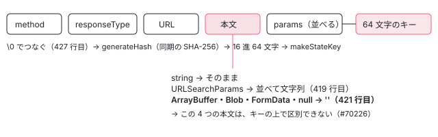

[目次](../README.md) › [HttpClient の細部と issue](README.md) › 第 5 回 / 全 6 回

# 転送キャッシュのキー：手書きの SHA-256 と、衝突の修正

> transfer\_cache.ts がキーを作る行（params の並べ方・本文・\\0 の区切り）、同期で動く SHA-256 を手で書いている理由と 1 ステップずつの中身、本文を base64 にする行（32 KB ずつ）と blob の応答が空になる行、運ばれなかったヘッダーを開発モードで知らせる Proxy。キーの衝突を防ぐ修正（3192dccaa3e・a6c7fc5c13e）と、安全なハッシュへの差し替え（5f36274da3f）、Set-Cookie（f76e8a98c10）、開いている #70226・#70947 を、ライブのデモと Node の記録で確かめる。

angular/angular · 読了 約 13 分 · 発展 · [サイトで読む（デモが動きます）](https://angular-deep-dive-cyan.vercel.app/chapter/httpx-transfer-cache-key)

---

SSR の転送キャッシュは、サーバーで受けた応答を「リクエストから作ったキー」で `TransferState` に書き、ブラウザで同じキーを作って引きます。この章では、そのキーを作る行を部品ごとに見て、**どの 2 つのリクエストが同じキーになるか**を、本物のコードを動かして確かめます。あわせて、キーのハッシュを同期の SHA-256 で手書きしている理由、2 進の本文を base64 にする行（32 KB ずつ）、運ばれなかったヘッダーを開発モードで知らせる `Proxy` を読み、最近の 5 本の修正と、開いている #70226・#70947 を行から読みます。

読む対象は `packages/common/http/src/transfer_cache.ts` です。`provideClientHydration` から転送キャッシュが有効になる流れ、どのリクエストが対象か（`canUseOrCacheRequest`）、サーバーで書いてブラウザで読む大きな流れは [転送キャッシュの章](../http/11-http-transfer-cache.md)にあります。キーの 5 つの部品の並びも、その章の 5 節で一度見ています。ここではその先の細部だけを書きます。

1. [1. HttpRequest の options](01-httpx-request-options.md)
2. [2. headers と params の更新](02-httpx-headers-params-updates.md)
3. [3. オーバーロードの型](03-httpx-overload-types.md)
4. [4. httpResource の型](04-httpx-resource-types.md)
5. **5. 転送キャッシュのキー**（この章）
6. [6. spec と issue](06-httpx-tests-issues.md)

## 1. キーの部品：params・本文・区切り

### params：URLSearchParams に入れ直して並べる

📄 `angular/packages/common/http/src/transfer_cache.ts` L402–408 （▶ の行: 402–404, 406–407）

```ts
402 ▶ function sortAndConcatParams(params: HttpParams | URLSearchParams): string {
403 ▶   const searchParams = new URLSearchParams(
404 ▶     params instanceof URLSearchParams ? params : params.toString(),
405 │   );
406 ▶   searchParams.sort();
407 ▶   return searchParams.toString();
408 │ }
```

1. **403・404 行目：`HttpParams` なら `toString()` してから `URLSearchParams` に入れる**

   `HttpParams.toString()` は URL に付けるのと同じ文字列（`role=user&role=admin`）を作ります（[第 2 回](02-httpx-headers-params-updates.md)）。それを読み直すので、同じ名前が 2 つあれば 2 つのまま残ります。
2. **406 行目：`sort()` で名前の順に並べる**

   `URLSearchParams.prototype.sort` は名前で並べ、同じ名前どうしの順は変えません（安定な並べ替え）。だから `?b=2&a=1` と `?a=1&b=2` は同じ文字列になり、`role=user&role=admin` と `role=admin&role=user` は違う文字列のままです。

この 6 行は a6c7fc5c13e（2026-05-05、「繰り返しの params を見分ける」）で入りました。それまでは ``[...params.keys()].sort().map((k) => `${k}=${params.getAll(k)}`).join('&')`` で、`getAll(k)` の配列を文字列にすると `,` でつながるため、`set('role', 'user,admin')` と `append('role','user').append('role','admin')` が同じ `role=user,admin` になっていました。コミットの本文は 1 文（「繰り返しの値を `,` でつながずに直列化し、違うリクエストが同じ応答を使い回せないようにする」）で、spec に 32 行の it を 1 つ足しています（「テストと直し方」）。

### 本文：文字列と URLSearchParams だけがキーに入る

📄 `angular/packages/common/http/src/transfer_cache.ts` L417–423 （▶ の行: 417–422）

```ts
417 ▶   let serializedBody = request.serializeBody();
418 ▶   if (serializedBody instanceof URLSearchParams) {
419 ▶     serializedBody = sortAndConcatParams(serializedBody);
420 ▶   } else if (typeof serializedBody !== 'string') {
421 ▶     serializedBody = '';
422 ▶   }
423 │ 
```

417 行目の `serializeBody()` は、文字列・`ArrayBuffer`・`Blob`・`FormData`・`URLSearchParams` はそのまま、ふつうのオブジェクトは `JSON.stringify` した文字列、本文が無ければ `null` を返します （[第 1 回](01-httpx-request-options.md)の `HttpRequest`）。418・419 行目で `URLSearchParams` は params と同じく並べ、**420・421 行目で、文字列でないものは全部 `''` になります**。`ArrayBuffer`・`Blob`・`FormData`、それに本文なし（`null`）が、キーの上では区別できません。

これが開いている #70226（2026-08-16）です。`includePostRequests` を付けて Protobuf や gRPC のように本文で中身を指定する POST を送ると、本文 `08 64`（文書 100）と `08 c8 01`（文書 200）が同じキーになり、2 つ目はサーバーに届かず 1 つ目の応答を受け取る、という報告です。7 節の記録で、`ArrayBuffer` 2 つ・`Blob` 2 つ・`FormData` 2 つ・本文なしの 7 つが全部同じキー `6bd2d8a4cd2a3c73…` になることを、今のソースで確かめました。JSON の本文（GraphQL の多く）は 420 行目の分岐に入らないので、本文ごとに違うキーになります。`Uint8Array` を本文に渡すと `serializeBody()` がオブジェクトとして `JSON.stringify` するので、これも違うキーになります（送る本文自体も JSON になります）。

#70226 には同じ人が直す PR #70227 を開いています（2026-11-06 の時点で開いたまま）。差分は、本文の種類（`'null'`・`'string'`・`'arrayBuffer'` など）をキーの部品に足し、`ArrayBuffer` は中身を `generateHash` にかけ、`Blob` と `FormData` は同期で中身を読めないので**キャッシュしない**（`makeCacheKey` が `null` を返す）、というものです。レビューでは「とても大きな本文が心配」というコメントがあり、そのあと base64 を経由せずにバイト列を直接ハッシュする形に変わっています。



*キーの 5 つの部品。本文は文字列と URLSearchParams だけが中身のまま入り、ほかは空になる*

### 区切り：\\0 でつなぐ

📄 `angular/packages/common/http/src/transfer_cache.ts` L424–430 （▶ の行: 424–428, 430）

```ts
424 ▶   // Joining with `|` lets a shifted field boundary (url `/a` + body `b|c` vs url `/a|b` + body `c`)
425 ▶   // collapse to the same string and thus the same hash. `\0` cannot occur in a valid url or in
426 ▶   // encoded params, so the field boundaries can't be forged by field content.
427 ▶   const key = [method, responseType, mappedRequestUrl, serializedBody, encodedParams].join('\0');
428 ▶   const hash = generateHash(key);
429 │ 
430 ▶   return makeStateKey(hash);
```

427 行目で method・responseType・URL・本文・params を `\0`（文字コード 0 の文字）でつなぎ、428 行目でハッシュにして、430 行目で `StateKey` にします。3192dccaa3e（2026-07-20、「キーの衝突を防ぐ」）の前は `join('|')` で、URL `/items/a` + 本文 `b|c` と URL `/items/a|b` + 本文 `c` がどちらも `POST|json|/items/a|b|c|` になっていました（7 節の記録で、`|` のハッシュは 2 つとも同じ、`\0` のハッシュは違う）。424〜426 行目のコメントは、その理由をそのまま書いています。

426 行目の「`\0` は正しい URL にもエンコード済みの params にも現れない」には前提があります。`HttpRequest` は URL の文字を調べないので、JS の文字列としては `'/a\0b'` も作れ、文字列の本文にも `\0` を入れられます。7 節の記録では、URL `'/a\0b'` + 本文 `'c'` と、URL `'/a'` + 本文 `'b\0c'` が同じキーになりました。これは #70738（2026-09-15 に開き、翌日閉じた）として出され、メンテナーは「生の `\0` は正しい URL に自然には現れない」「転送キャッシュは 1 回の SSR とハイドレーションの間だけのもので、利用者の間で共有されない」「全リクエストに検査を足す負担に見合わない」として、**不具合ではない（not planned）**で閉じています。どこまでを直す対象にするかの判断の例として読めます。

## 2. 同期で動く SHA-256 を手で書いている理由

📄 `angular/packages/common/http/src/transfer_cache.ts` L590–596 （▶ の行: 590–592, 594–595）

```ts
590 ▶  * Note: A custom synchronous SHA-256 implementation is used here because the Web Crypto API
591 ▶  * (`crypto.subtle.digest`) is strictly asynchronous (Promise-based), whereas the transfer cache
592 ▶  * state lookup and interceptor flow must operate synchronously due to the HttpResource API.
593 │  *
594 ▶  * The previous DJB2 hashing logic was vulnerable to pre-image and second-preimage attacks due to
595 ▶  * its small 64-bit keyspace and mathematical simplicity. An attacker could craft colliding request
596 │  * inputs to poison the cache, potentially causing a CDN or the application to serve the wrong
```

590〜592 行目：ブラウザの Web Crypto の `crypto.subtle.digest` は Promise を返す非同期の API です。一方、キーを引く `retrieveStateFromCache` は、インターセプタからも、`httpResource` の最初の値を作るところ（[第 4 回](04-httpx-resource-types.md)の 4 節）からも、**同期で**呼ばれます。`httpResource` はキャッシュがあれば作った瞬間に `resolved` にしたいので、Promise を待つことができません。だから同期の SHA-256 を自分で持っています。

594・595 行目：前は DJB2 という簡単なハッシュで、衝突する入力を作ってキャッシュを汚せた、とあります。5f36274da3f（2026-06-05、「暗号として安全な SHA-256 をキーに使う」）で替えました。消えた関数はこれです。

📄 `git show 5f36274da3f（消えた行）`

```
-/**
- * A method that returns a hash representation of a string using a variant of DJB2 hash
- * algorithm.
- *
- * This is the same hashing logic that is used to generate component ids.
- */
-function generateHash(value: string): string {
-  let hash = 0;
-
-  for (const char of value) {
-    hash = (Math.imul(31, hash) + char.charCodeAt(0)) << 0;
-  }
-
-  // Force positive number hash.
-  // 2147483647 = equivalent of Integer.MAX_VALUE.
-  hash += 2147483647 + 1;
-
-  return hash.toString();
-}
```
*5f36274da3f で消えた generateHash*

`Math.imul(31, hash) + …` を `<< 0` で 32 ビットの整数に切り、`2147483647 + 1`（2 の 31 乗）を足して正にしています。結果は 0〜232−1 の 1 つの数で、**32 ビット**の空間です。595 行目のコメントは「64-bit keyspace」と書いていますが、消えた関数の行は 32 ビットです（コミットの本文も「64-bit … combined DJB2」）。コメントと実物が合っていない箇所です。

### SHA-256 を 1 ステップずつ

📄 `angular/packages/common/http/src/transfer_cache.ts` L571–586 （▶ の行: 572, 574, 585）

```ts
571 │ /**
572 ▶  * SHA-256 Constants (first 32 bits of the fractional parts of the cube roots of the first 64 primes 2..311):
573 │  */
574 ▶ const SHA256_ROUND_CONSTANTS = /* @__PURE__ */ new Uint32Array([
575 │   0x428a2f98, 0x71374491, 0xb5c0fbcf, 0xe9b5dba5, 0x3956c25b, 0x59f111f1, 0x923f82a4, 0xab1c5ed5,
576 │   0xd807aa98, 0x12835b01, 0x243185be, 0x550c7dc3, 0x72be5d74, 0x80deb1fe, 0x9bdc06a7, 0xc19bf174,
577 │   0xe49b69c1, 0xefbe4786, 0x0fc19dc6, 0x240ca1cc, 0x2de92c6f, 0x4a7484aa, 0x5cb0a9dc, 0x76f988da,
578 │   0x983e5152, 0xa831c66d, 0xb00327c8, 0xbf597fc7, 0xc6e00bf3, 0xd5a79147, 0x06ca6351, 0x14292967,
579 │   0x27b70a85, 0x2e1b2138, 0x4d2c6dfc, 0x53380d13, 0x650a7354, 0x766a0abb, 0x81c2c92e, 0x92722c85,
580 │   0xa2bfe8a1, 0xa81a664b, 0xc24b8b70, 0xc76c51a3, 0xd192e819, 0xd6990624, 0xf40e3585, 0x106aa070,
581 │   0x19a4c116, 0x1e376c08, 0x2748774c, 0x34b0bcb5, 0x391c0cb3, 0x4ed8aa4a, 0x5b9cca4f, 0x682e6ff3,
582 │   0x748f82ee, 0x78a5636f, 0x84c87814, 0x8cc70208, 0x90befffa, 0xa4506ceb, 0xbef9a3f7, 0xc67178f2,
583 │ ]);
584 │ 
585 ▶ let textEncoder: TextEncoder | undefined;
586 │ 
```

📄 `angular/packages/common/http/src/transfer_cache.ts` L600–628 （▶ の行: 600–602, 605, 612, 615, 618–621, 624–627）

```ts
600 ▶ export function generateHash(value: string): string {
601 ▶   textEncoder ??= new TextEncoder();
602 ▶   const inputBytes = textEncoder.encode(value);
603 │ 
604 │   // Initial hash values (first 32 bits of the fractional parts of the square roots of the first 8 primes 2..19):
605 ▶   let hashState0 = 0x6a09e667;
606 │   let hashState1 = 0xbb67ae85;
607 │   let hashState2 = 0x3c6ef372;
608 │   let hashState3 = 0xa54ff53a;
609 │   let hashState4 = 0x510e527f;
610 │   let hashState5 = 0x9b05688c;
611 │   let hashState6 = 0x1f83d9ab;
612 ▶   let hashState7 = 0x5be0cd19;
613 │ 
614 │   // Pre-processing (Padding):
615 ▶   const messageLengthInBits = inputBytes.length * 8;
616 │ 
617 │   // The total length of the padded message must be a multiple of 64 bytes (512 bits)
618 ▶   const paddedLengthInBytes = (((inputBytes.length + 8) >> 6) + 1) << 6;
619 ▶   const paddedBytes = new Uint8Array(paddedLengthInBytes);
620 ▶   paddedBytes.set(inputBytes);
621 ▶   paddedBytes[inputBytes.length] = 0x80; // Append a single '1' bit (0x80 byte)
622 │ 
623 │   const paddedBytesView = new DataView(paddedBytes.buffer);
624 ▶   const lowBits = messageLengthInBits >>> 0;
625 ▶   const highBits = (messageLengthInBits / 0x100000000) >>> 0;
626 ▶   paddedBytesView.setUint32(paddedLengthInBytes - 8, highBits, false);
627 ▶   paddedBytesView.setUint32(paddedLengthInBytes - 4, lowBits, false);
628 │ 
```

📄 `angular/packages/common/http/src/transfer_cache.ts` L629–655 （▶ の行: 630–631, 633–635, 638, 640, 647, 653–655）

```ts
629 │   // Process the message in successive 64-byte chunks:
630 ▶   const messageSchedule = new Uint32Array(64);
631 ▶   for (let chunkOffset = 0; chunkOffset < paddedLengthInBytes; chunkOffset += 64) {
632 │     // Initialize first 16 words of the message schedule:
633 ▶     for (let i = 0; i < 16; i++) {
634 ▶       messageSchedule[i] = paddedBytesView.getUint32(chunkOffset + i * 4, false);
635 ▶     }
636 │ 
637 │     // Extend to 64 words:
638 ▶     for (let i = 16; i < 64; i++) {
639 │       const prevWord15 = messageSchedule[i - 15];
640 ▶       const sigma0 =
641 │         (((prevWord15 >>> 7) | (prevWord15 << 25)) ^
642 │           ((prevWord15 >>> 18) | (prevWord15 << 14)) ^
643 │           (prevWord15 >>> 3)) >>>
644 │         0;
645 │ 
646 │       const prevWord2 = messageSchedule[i - 2];
647 ▶       const sigma1 =
648 │         (((prevWord2 >>> 17) | (prevWord2 << 15)) ^
649 │           ((prevWord2 >>> 19) | (prevWord2 << 13)) ^
650 │           (prevWord2 >>> 10)) >>>
651 │         0;
652 │ 
653 ▶       messageSchedule[i] =
654 ▶         (messageSchedule[i - 16] + sigma0 + messageSchedule[i - 7] + sigma1) >>> 0;
655 ▶     }
```

📄 `angular/packages/common/http/src/transfer_cache.ts` L667–703 （▶ の行: 668–669, 674–675, 679, 683, 688, 693, 695, 702–703）

```ts
667 │     // Compression function main loop:
668 ▶     for (let i = 0; i < 64; i++) {
669 ▶       const capitalSigma1 =
670 │         (((workingStateE >>> 6) | (workingStateE << 26)) ^
671 │           ((workingStateE >>> 11) | (workingStateE << 21)) ^
672 │           ((workingStateE >>> 25) | (workingStateE << 7))) >>>
673 │         0;
674 ▶       const chFunction = ((workingStateE & workingStateF) ^ (~workingStateE & workingStateG)) >>> 0;
675 ▶       const temp1 =
676 │         (workingStateH +
677 │           capitalSigma1 +
678 │           chFunction +
679 ▶           SHA256_ROUND_CONSTANTS[i] +
680 │           messageSchedule[i]) >>>
681 │         0;
682 │ 
683 ▶       const capitalSigma0 =
684 │         (((workingStateA >>> 2) | (workingStateA << 30)) ^
685 │           ((workingStateA >>> 13) | (workingStateA << 19)) ^
686 │           ((workingStateA >>> 22) | (workingStateA << 10))) >>>
687 │         0;
688 ▶       const majFunction =
689 │         ((workingStateA & workingStateB) ^
690 │           (workingStateA & workingStateC) ^
691 │           (workingStateB & workingStateC)) >>>
692 │         0;
693 ▶       const temp2 = (capitalSigma0 + majFunction) >>> 0;
694 │ 
695 ▶       workingStateH = workingStateG;
696 │       workingStateG = workingStateF;
697 │       workingStateF = workingStateE;
698 │       workingStateE = (workingStateD + temp1) >>> 0;
699 │       workingStateD = workingStateC;
700 │       workingStateC = workingStateB;
701 │       workingStateB = workingStateA;
702 ▶       workingStateA = (temp1 + temp2) >>> 0;
703 ▶     }
```

📄 `angular/packages/common/http/src/transfer_cache.ts` L705–729 （▶ の行: 706, 713, 717, 727–728）

```ts
705 │     // Update intermediate hash state:
706 ▶     hashState0 = (hashState0 + workingStateA) >>> 0;
707 │     hashState1 = (hashState1 + workingStateB) >>> 0;
708 │     hashState2 = (hashState2 + workingStateC) >>> 0;
709 │     hashState3 = (hashState3 + workingStateD) >>> 0;
710 │     hashState4 = (hashState4 + workingStateE) >>> 0;
711 │     hashState5 = (hashState5 + workingStateF) >>> 0;
712 │     hashState6 = (hashState6 + workingStateG) >>> 0;
713 ▶     hashState7 = (hashState7 + workingStateH) >>> 0;
714 │   }
715 │ 
716 │   // Produce the final 64-character hexadecimal hash:
717 ▶   return [
718 │     hashState0,
719 │     hashState1,
720 │     hashState2,
721 │     hashState3,
722 │     hashState4,
723 │     hashState5,
724 │     hashState6,
725 │     hashState7,
726 │   ]
727 ▶     .map((x) => x.toString(16).padStart(8, '0'))
728 ▶     .join('');
729 │ }
```

1. **601・602 行目：文字列を UTF-8 のバイト列にする**

   `TextEncoder` は 585 行目のモジュールの変数に 1 回だけ作ります（`??=`）。SHA-256 はバイト列のハッシュなので、`'Angular 🚀'` は 12 バイトになります（7 節の記録）。
2. **605〜612 行目：8 つの 32 ビットの初期値**

   コメントのとおり、最初の 8 つの素数の平方根の小数部分の先頭 32 ビットです。SHA-256 の仕様（FIPS 180-4）の値そのものです。
3. **615〜627 行目：64 バイトの倍数に詰める**

   618 行目で「元の長さ + 1 バイト（621 行目の `0x80`）+ 8 バイト（長さ）」が入る 64 の倍数を計算し、619・620 行目で 0 で埋めた配列に元のバイトを写します。624〜627 行目で、最後の 8 バイトに元の長さ（ビット数）をビッグエンディアンで書きます。625 行目は 232 で割って上位 32 ビットを取る行で、JS の数は 32 ビットのビット演算しかできないための書き方です。
4. **631〜655 行目：64 バイトずつ、64 語の表を作る**

   630 行目の `Uint32Array(64)` はループの外で 1 回だけ作り、使い回します。633〜635 行目で 64 バイトを 16 個の 32 ビットの語に読み、638〜655 行目で残りの 48 語を前の語から作ります（σ0 は 640 行目、σ1 は 647 行目）。`>>> 0` は「32 ビットの符号なし整数に戻す」という JS の決まり文句です。
5. **668〜703 行目：64 回の圧縮**

   669 行目（Σ1）・674 行目（Ch）・683 行目（Σ0）・688 行目（Maj）を計算し、679 行目で 574 行目の 64 個の定数（最初の 64 個の素数の立方根から作った値）を 1 つずつ足して、695〜702 行目で 8 つの作業用の値を 1 つずつずらします。
6. **706〜713 行目と 717〜728 行目：足し込んで 16 進 64 文字にする**

   64 バイトごとに 8 つの値へ足し込み、最後に 8 つを 8 桁の 16 進（727 行目の `padStart(8, '0')`）にしてつなぎます。キーはいつも 64 文字です。

574 行目の `/* @__PURE__ */` は、ビルドの道具に「この `new Uint32Array` は副作用が無いので、使われなければ消してよい」と伝える印です。この印があるので、`generateHash` を使わないバンドルでは、この表も一緒に消せます。7 節の記録では、空文字・`'abc'`・`'Angular 🚀'`・55・56・64 バイト（詰める位置の境目）・1,000,000 バイトのどれも Node の `crypto.createHash('sha256')` と同じ値で、1,000,000 バイトは 20.8 ms でした。

## 3. 本文を base64 にする行（32 KB ずつ）

📄 `angular/packages/common/http/src/transfer_cache.ts` L327–333 （▶ の行: 327–330, 333）

```ts
327 ▶           transferState.set<TransferHttpResponse>(storeKey, {
328 ▶             [BODY]:
329 ▶               responseType === 'arraybuffer' || responseType === 'blob' ? toBase64(body) : body,
330 ▶             [HEADERS]: getFilteredHeaders(headers, headersToInclude),
331 │             [STATUS]: status,
332 │             [STATUS_TEXT]: statusText,
333 ▶             [REQ_URL]: requestUrl,
```

📄 `angular/packages/common/http/src/transfer_cache.ts` L433–453 （▶ の行: 434–436, 438, 442–446, 450–451）

```ts
433 │ function toBase64(buffer: unknown): string {
434 ▶   //TODO: replace with when is Baseline widely available
435 ▶   // https://developer.mozilla.org/en-US/docs/Web/JavaScript/Reference/Global_Objects/Uint8Array/toBase64
436 ▶   const bytes = new Uint8Array(buffer as ArrayBufferLike);
437 │ 
438 ▶   const CHUNK_SIZE = 0x8000; // 32,768 bytes (~32 KB) per chunk, to avoid stack overflow
439 │ 
440 │   let binaryString = '';
441 │ 
442 ▶   for (let i = 0; i < bytes.length; i += CHUNK_SIZE) {
443 ▶     const chunk = bytes.subarray(i, i + CHUNK_SIZE);
444 ▶     binaryString += String.fromCharCode.apply(null, chunk as unknown as number[]);
445 ▶   }
446 ▶   return btoa(binaryString);
447 │ }
448 │ 
449 │ function fromBase64(base64: string): ArrayBuffer {
450 ▶   const binary = atob(base64);
451 ▶   const bytes = Uint8Array.from(binary, (c) => c.charCodeAt(0));
452 │   return bytes.buffer;
453 │ }
```

1. **329 行目：`arraybuffer` と `blob` の応答だけ base64 にする**

   `TransferState` は HTML の中に JSON で書かれるので（[転送キャッシュの章](../http/11-http-transfer-cache.md)の 6 節）、バイト列はそのままでは入りません。cb1163e5e54（2026-01-31、#66827）で足した行です。それまで `httpResource.arrayBuffer` を SSR で使うと、ブラウザで `[object Object]` の 15 バイトが返っていました。
2. **436 行目：`new Uint8Array(buffer)` でバイトの並びとして見る**
3. **438・442〜445 行目：`0x8000`（32,768）バイトずつ `String.fromCharCode.apply` する**

   `btoa` は「1 文字 = 1 バイト」の文字列しか受け取らないので、先にバイトを文字に変えます。`String.fromCharCode.apply(null, 配列)` は配列の要素を**関数の引数**として並べるので、配列が大きいと引数の数の上限にかかります。7 節の記録では、1,000,000 バイトを 1 回で渡すと `RangeError: Maximum call stack size exceeded` になり、32 KB ずつなら 31 回で、Node の `Buffer` の base64 と同じ文字列になりました。
4. **434・435 行目の TODO：`Uint8Array.prototype.toBase64` が広く使えるようになったら置き換える**

   aafeb1d2bd9（2026-02-11、#67002）で「あれば `toBase64`・`fromBase64` を使う」形にしましたが、5338b5912c7（2026-03-04）で戻され、今の手書きのままです。

📄 `angular/packages/common/http/src/transfer_cache.ts` L247–253 （▶ の行: 248–249, 251–252）

```ts
247 │   switch (responseType) {
248 ▶     case 'arraybuffer':
249 ▶       body = fromBase64(undecodedBody);
250 │       break;
251 ▶     case 'blob':
252 ▶       body = new Blob([fromBase64(undecodedBody)]);
253 │       break;
```

ブラウザ側では 249 行目で `ArrayBuffer` に、252 行目で `Blob` に戻します。450・451 行目の `fromBase64` は `atob` の 1 文字を 1 バイトに戻すだけです。

### blob の応答は空になる

329 行目は `responseType === 'blob'` のときも `toBase64(body)` を呼びます。そのとき `body` は `Blob` です。436 行目の `new Uint8Array(Blob)` は、`Blob` が配列のようなもの（`length` を持つもの）でも反復できるものでもないので、**長さ 0 の配列**になり、例外も出ません。7 節の記録で、サーバーで 5 バイトの `Blob` を受けると TransferState に書かれる本文は `''（空文字）`、ブラウザでキャッシュから作った応答は `Blob 0 バイト` でした（`arraybuffer` は `ChQeKDI=` で、5 バイトのまま戻ります）。

この問題は一度直されています。1f057afaac8（2026-02-11、#67002）の本文は「`Blob` を `Uint8Array` に渡すと、例外を出さずに長さ 0 の配列になり、空のデータがキャッシュされていた」と書き、サーバー側の `tap` を `concatMap(async …)` にして `await blob.arrayBuffer()` してから base64 にしました。

📄 `git show 1f057afaac8（transfer_cache.ts の中心）`

```
-      tap((event: HttpEvent<unknown>) => {
+      concatMap(async (event: HttpEvent<unknown>) => {
         if (event instanceof HttpResponse) {
+          let body = event.body;
+          if (req.responseType === 'blob') {
+            // Note: Blob is converted to ArrayBuffer because Uint8Array constructor
+            // doesn't accept Blob directly, which would result in an empty array.
+            const arrayBuffer = await (event.body as Blob).arrayBuffer();
+            body = toBase64(arrayBuffer);
+          } else if (req.responseType === 'arraybuffer') {
+            body = toBase64(event.body as ArrayBufferLike);
+          }
```
*戻された修正。応答の流れが非同期になる*

この修正は 7eb33713b90（2026-03-04）で戻されました。PR #67002 のやりとりでは「main のテストを壊した」「非同期になったことが原因」とあり、そのあと止まって閉じています。そのため 22.2.0-next.7 と 新しい本家（../angular-main）の 329 行目は、今も `Blob` を空にします。`gh` で探した範囲では、これを書いた開いている issue はありませんでした（「テストと直し方」）。

> [!TIP]
> **新卒エンジニアへ**
>
> SSR で画像などを `Blob` で受けているなら、今は `responseType: 'arraybuffer'`（`httpResource.arrayBuffer`）で受けて自分で `new Blob([buf])` にするか、そのリクエストに `transferCache: false` を付けると、空の `Blob` を避けられます。`arraybuffer` は 329 行目と 249 行目でそのまま往復します（記録の表）。

## 4. 運ばれなかったヘッダーを知らせる Proxy

📄 `angular/packages/common/http/src/transfer_cache.ts` L260–266 （▶ の行: 260, 264–266）

```ts
260 ▶   if (typeof ngDevMode === 'undefined' || ngDevMode) {
261 │     // Append extra logic in dev mode to produce a warning when a header
262 │     // that was not transferred to the client is accessed in the code via `get`
263 │     // and `has` calls.
264 ▶     const {transferCache: requestOptions} = req;
265 ▶     const headersToInclude = getHeadersToInclude(options, requestOptions);
266 ▶     headers = appendMissingHeadersDetection(req.url, headers, headersToInclude ?? []);
```

キャッシュから作った応答のヘッダーは、`includeHeaders` に書いたものだけです（[転送キャッシュの章](../http/11-http-transfer-cache.md)の 6 節）。260 行目、開発モードのときだけ、264・265 行目でリクエスト単位か全体の `includeHeaders` を取り、266 行目でヘッダーを `Proxy` で包みます。

📄 `angular/packages/common/http/src/transfer_cache.ts` L499–517 （▶ の行: 503, 508–512, 514–516）

```ts
499 │ /**
500 │  * This function will add a proxy to an HttpHeader to intercept calls to get/has
501 │  * and log a warning if the header entry requested has been removed
502 │  */
503 ▶ function appendMissingHeadersDetection(
504 │   url: string,
505 │   headers: HttpHeaders,
506 │   headersToInclude: string[],
507 │ ): HttpHeaders {
508 ▶   const warningProduced = new Set();
509 ▶   return new Proxy<HttpHeaders>(headers, {
510 ▶     get(target: HttpHeaders, prop: keyof HttpHeaders): unknown {
511 ▶       const value = Reflect.get(target, prop);
512 ▶       const methods: Set<keyof HttpHeaders> = new Set(['get', 'has', 'getAll']);
513 │ 
514 ▶       if (typeof value !== 'function' || !methods.has(prop)) {
515 ▶         return value;
516 ▶       }
517 │ 
```

📄 `angular/packages/common/http/src/transfer_cache.ts` L518–544 （▶ の行: 518, 520–523, 525, 527, 536, 540–541）

```ts
518 ▶       return (headerName: string) => {
519 │         // We log when the key has been removed and a warning hasn't been produced for the header
520 ▶         const key = (prop + ':' + headerName).toLowerCase(); // e.g. `get:cache-control`
521 ▶         if (!headersToInclude.includes(headerName) && !warningProduced.has(key)) {
522 ▶           warningProduced.add(key);
523 ▶           const truncatedUrl = truncateMiddle(url);
524 │ 
525 ▶           console.warn(
526 │             formatRuntimeError(
527 ▶               RuntimeErrorCode.HEADERS_ALTERED_BY_TRANSFER_CACHE,
528 │               `Angular detected that the \`${headerName}\` header is accessed, but the value of the header ` +
529 │                 `was not transferred from the server to the client by the HttpTransferCache. ` +
530 │                 `To include the value of the \`${headerName}\` header for the \`${truncatedUrl}\` request, ` +
531 │                 `use the \`includeHeaders\` list. The \`includeHeaders\` can be defined either ` +
532 │                 `on a request level by adding the \`transferCache\` parameter, or on an application ` +
533 │                 `level by adding the \`httpCacheTransfer.includeHeaders\` argument to the ` +
534 │                 `\`provideClientHydration()\` call. `,
535 │             ),
536 ▶           );
537 │         }
538 │ 
539 │         // invoking the original method
540 ▶         return (value as Function).apply(target, [headerName]);
541 ▶       };
542 │     },
543 │   });
544 │ }
```

1. **509・510 行目：`Proxy` の `get` の罠**

   `Proxy` は、オブジェクトへの操作を横取りする JS の仕組みです。`headers.get` と書いて「`get` というプロパティを読む」ところで 510 行目が呼ばれます。
2. **511〜516 行目：`get`・`has`・`getAll` 以外は素通し**

   `keys()` や `append` などは 515 行目でそのまま返します。
3. **518〜541 行目：3 つのメソッドは包んだ関数を返す**

   520 行目で `'get:cache-control'` のような小文字のキーを作り、521 行目で「`includeHeaders` に無く、まだ警告していない」なら、522 行目で覚えて、525〜536 行目で NG02802 の警告を出します（523 行目で URL の真ん中を省く）。どちらでも 540 行目で本物のメソッドを呼ぶので、返る値は変わりません。

521 行目の `headersToInclude.includes(headerName)` は、**大文字と小文字を区別**します。一方 `HttpHeaders` はヘッダー名の大文字と小文字を区別しないので、`includeHeaders: ['ETag']` で運んだヘッダーを `headers.get('etag')` で読むと、値は返るのに「運ばれなかった」という警告が出ます。7 節の記録の表がそれです（`get('ETag')` は警告なし、`get('etag')` は値 `"v1"` と警告）。SSR のガイド（adev/src/content/guide/ssr.md）の例は `includeHeaders: ['ETag', 'Cache-Control']` と大文字で書いています。開発モードだけの警告で、値は正しいので、影響は「まちがった警告が出る」ことだけです。この Proxy を確かめる spec は、packages の中にありません（`appendMissingHeadersDetection` と NG02802 の文を grep して、ソースの 2 ファイルだけ）。

## 5. Set-Cookie と、新しい 2 つの options

📄 `angular/packages/common/http/src/transfer_cache.ts` L316–322 （▶ の行: 316–319, 321）

```ts
316 ▶           // Only cache successful HTTP responses that are not non-cacheable.
317 ▶           if (
318 ▶             !options.includeNonCacheableRequests &&
319 ▶             (hasUncacheableCacheControl(headers) || hasSetCookieHeader(headers))
320 │           ) {
321 ▶             return;
322 │           }
```

📄 `angular/packages/common/http/src/transfer_cache.ts` L369–371 （▶ の行: 370）

```ts
369 │ function hasSetCookieHeader(headers: HttpHeaders): boolean {
370 ▶   return headers.has('set-cookie');
371 │ }
```

f76e8a98c10（2026-06-16）は、サーバーで受けた応答に `Set-Cookie` があれば書かない（319 行目・370 行目）ようにしました。本文に「Cookie を設定する応答は、セッションや利用者ごとの状態であることが多い。HTML に埋めると、ハイドレーションで使われたり、共有のキャッシュや CDN から別の人に配られたりする」とあります。e3630c23c59（2026-07-06）は、それらを利用者が明示して戻すための options を足しました。

📄 `angular/packages/common/http/src/transfer_cache.ts` L69–75 （▶ の行: 72, 75）

```ts
69 │ 
70 │   /**
71 │    * Enables caching of requests and responses with `Cache-Control` directives that forbid caching
72 ▶    * (such as `no-cache`, `no-store`, or `private`), responses with a `Set-Cookie` header, or requests using Fetch API `no-cache` or `no-store` modes.
73 │    * By default, these requests/responses are excluded from caching.
74 │    */
75 ▶   includeNonCacheableRequests?: boolean;
```

318 行目の `!options.includeNonCacheableRequests` が 75 行目の options です。72 行目のとおり、`Set-Cookie` もこの 1 つで戻ります。キーの作り方は変えていません。新しい本家では bc22890f537 が `hasUncacheableCacheControl` を `headers.get` から `headers.getAll` に変え、`Cache-Control` が複数あるときに 2 つ目以降の `no-store` も見るようにしました（22.2.0-next.7 では最初の 1 つだけを見ます）。

## 6. #70947：リダイレクトの情報が運ばれない

📄 `angular/packages/common/http/src/transfer_cache.ts` L269–275 （▶ の行: 269, 274–275）

```ts
269 ▶   return new HttpResponse({
270 │     body,
271 │     headers,
272 │     status,
273 │     statusText,
274 ▶     url,
275 ▶   });
```

📄 `angular/packages/common/http/src/response.ts` L204–209 （▶ の行: 206–207, 209）

```ts
204 │   /**
205 │    * Indicates whether the HTTP response was redirected during the request.
206 ▶    * This property is only available when using the Fetch API using `withFetch()`
207 ▶    * When using the default XHR Request this property will be `undefined`
208 │    */
209 ▶   readonly redirected?: boolean;
```

サーバーで書くのは 3 節の 327〜333 行目の 6 つで、333 行目の URL はリクエストの URL です。ブラウザで作る応答は 269〜275 行目で、274 行目の `url` はその値、response.ts 209 行目の `redirected` は渡していません。7 節の記録では、サーバーで `url: 'https://other.example/final.json', redirected: true` の応答を受けると、ブラウザでキャッシュから作った応答は `url: '/api/runtime-config'`・`redirected: undefined` でした。

開いている #70947（2026-09-25）は、これをセキュリティの問題として出しています。「最終の URL がどこか」で応答を拒むインターセプタを書いていても、SSR では拒んだ応答が、ブラウザのハイドレーションでは信頼した URL のものとして通る、という筋書きです。同じ人の PR #70946 が開いていて、最終の URL と `redirected` を別の欄に書き、戻すときに使う差分です。なお 206・207 行目のコメントは「`withFetch()` のときだけ。既定の XHR では `undefined`」と書いていますが、1f9a42bb424（2026-03-22、「Fetch を `HttpBackend` の既定にする」）のあとも書き換えられておらず、v22 の既定（Fetch）と合いません。

## 7. DEMO と記録

📄 `angular/packages/common/http/src/transfer_cache.ts` L112–117 （▶ の行: 112–117）

```ts
112 ▶ export const BODY = 'b';
113 ▶ export const HEADERS = 'h';
114 ▶ export const STATUS = 's';
115 ▶ export const STATUS_TEXT = 'st';
116 ▶ export const REQ_URL = 'u';
117 ▶ export const RESPONSE_TYPE = 'rt';
```
*TransferState に書く 1 件の 6 つの欄の名前*

112〜117 行目が、サーバーの 327〜333 行目が書く 1 件の欄の名前です。HTML に入る JSON を短くするため、1〜2 文字にしています。DEMO の「サーバー役」も、この 6 つで書きます。

> **🧪 DEMO — 2 つのリクエストは同じキーになるか（ライブ）**
>
> ボタンを押すと、このサイトの依存の `@angular/common/http`（22.1.6）を `import()` で読み、`provideHttpClient()` と `ɵwithHttpTransferCache({includePostRequests: true})`（`provideClientHydration` が足すのと同じ関数）で注入器を作ります。`TransferState` は、`get(key)` の key を書き留めるように継承したものに差し替えます。リクエストを送ると、本物の `transferCacheInterceptorFn` がキーを作って `get` を呼ぶので、そのキーが見えます。「サーバー役」は、サーバーの 327〜333 行目と同じ形（112〜117 行目の 1 文字の名前）で、A の応答を A のキーに書きます。そのあと B を送ります。ネットワークには出ません。
>
> ▶ [このデモはサイトで動かせます](https://angular-deep-dive-cyan.vercel.app/chapter/httpx-transfer-cache-key)

押すと分かることです。

- 「params の順番」は同じキー（406 行目の `sort`）。「同じ名前の params」は違うキー（a6c7fc5c13e のあと）。
- 「GET と HEAD」「json と text」は、427 行目の先頭の 2 つの部品が違うので違うキー。
- 「| を含む URL と本文」は違うキー（3192dccaa3e のあと）。「JSON の本文」も違うキー。
- **「2 進の本文」「Blob と FormData の本文」は同じキーで、B はバックエンドに届かず、A の応答を受け取ります**（420・421 行目、#70226）。`Blob` の A と `FormData` の B のように、本文の種類が違っても同じです。

### Node で動かした記録（../angular のソース）

`makeCacheKey`・`toBase64`・`appendMissingHeadersDetection` は transfer\_cache.ts の外に出ていない関数なので、配布物の入口からは呼べません。そこで ../angular（8576f161ae4）の packages/common/http/src を esbuild で 1 つに束ね、Node で動かしました。束ねるときだけ、読み込んだ transfer\_cache.ts の文字列の末尾に `export` の 1 行を足しています（../angular のファイルは書き換えていません）。以下はその記録の再生で、ページの上では走りません（2026-11-06、Node v24.22.1）。

| 入力 | serializeBody() | makeCacheKey のキー |
| --- | --- | --- |
| `GET /api/items` | null | e050c57fd3e6e419d5a05a031aba5344595cff998711c4c1ec8f216dc424296c |
| `GET /api/items ?b=2&a=1` | null | 432989816fb8e3f55a4cf45bb0d519cd5852d68dbc780dee36d6f676908679df |
| `GET /api/items ?a=1&b=2` | null | 432989816fb8e3f55a4cf45bb0d519cd5852d68dbc780dee36d6f676908679df |
| `HEAD /api/items` | null | eaf860a67d43a89e939af11b5d5442bfbef8ae706db8f3270899edb102406080 |
| `GET /api/items（responseType: 'text'）` | null | d9e8f8bffb41fd5b7cb0b963998c89038a16b8b0225bea0acbe773511e90a631 |
| `GET ?role=user,admin（set で 1 つ）` | null | 0d681235aad0b3e79b8c1add033a6a4fe2912a8b67a8d4f5ae9f687606668cbb |
| `GET ?role=user&role=admin（append で 2 つ）` | null | 6082ba4c34e647a5bf20ce97d2638a95e554143f294d0489f087d8025e9b9b04 |
| `POST /items/a 本文 'b\|c'` | string（"b\|c"） | b4e45b1e8821b9eac8d9ea02d91b5ee4c5b86a9e95d4273c0b8c18c034e52100 |
| `POST /items/a\|b 本文 'c'` | string（"c"） | 629854a9359c7ed0204596e76424fa8fd84f7f6415de8a43346d95feb841d5d8 |
| `POST /doc 本文 {id: 100}` | string（"{\\"id\\":100}"） | e0d35bcb06a746fb4f9b35b9c41aee3131488aaf94f9e311dc3c384ce60eeace |
| `POST /doc 本文 {id: 200}` | string（"{\\"id\\":200}"） | 2595750e5f68715b21a9b5f025611df088b702e12b1bd3cdae3cfa799117751e |
| `POST /doc 本文なし（null）` | null | 6bd2d8a4cd2a3c73902f996146421e67d7243978f2cc654e71921052db945c6c |
| `POST /doc 本文 ArrayBuffer [08 64]` | ArrayBuffer | 6bd2d8a4cd2a3c73902f996146421e67d7243978f2cc654e71921052db945c6c |
| `POST /doc 本文 ArrayBuffer [08 c8 01]` | ArrayBuffer | 6bd2d8a4cd2a3c73902f996146421e67d7243978f2cc654e71921052db945c6c |
| `POST /doc 本文 Blob(['100'])` | Blob | 6bd2d8a4cd2a3c73902f996146421e67d7243978f2cc654e71921052db945c6c |
| `POST /doc 本文 Blob(['200'])` | Blob | 6bd2d8a4cd2a3c73902f996146421e67d7243978f2cc654e71921052db945c6c |
| `POST /doc 本文 FormData q=100` | FormData | 6bd2d8a4cd2a3c73902f996146421e67d7243978f2cc654e71921052db945c6c |
| `POST /doc 本文 FormData q=200` | FormData | 6bd2d8a4cd2a3c73902f996146421e67d7243978f2cc654e71921052db945c6c |
| `POST /doc 本文 Uint8Array [08 64]（ArrayBuffer ではない）` | string（"{\\"0\\":8,\\"1\\":100}"） | 533385412b30bdd631ffa2fee7be45c78ed91993638ffbf9b11ea7ad91a5f2bb |
| `POST '/a\0b' 本文 'c'` | string（"c"） | 5bd6c7790f8d71bcb263351c21164e7b2b82fb8c3953ddf2b812637c6f11eea7 |
| `POST '/a' 本文 'b\0c'` | string（"b\\u0000c"） | 5bd6c7790f8d71bcb263351c21164e7b2b82fb8c3953ddf2b812637c6f11eea7 |

| 3192dccaa3e の前の形 | join('\|') した文字列 | join('\|') のハッシュ | join('\\0') のハッシュ |
| --- | --- | --- | --- |
| `POST /items/a 本文 'b\|c'` | `POST\|json\|/items/a\|b\|c\|` | d296718e0c3eac82a78736aaecc760267200a11cfe14bfa3d757be530c7590be | b4e45b1e8821b9eac8d9ea02d91b5ee4c5b86a9e95d4273c0b8c18c034e52100 |
| `POST /items/a\|b 本文 'c'` | `POST\|json\|/items/a\|b\|c\|` | d296718e0c3eac82a78736aaecc760267200a11cfe14bfa3d757be530c7590be | 629854a9359c7ed0204596e76424fa8fd84f7f6415de8a43346d95feb841d5d8 |

| generateHash の入力 | バイト | ハッシュ | Node の crypto と同じ | ms |
| --- | --- | --- | --- | --- |
| `""` | 0 | e3b0c44298fc1c149afbf4c8996fb92427ae41e4649b934ca495991b7852b855 | true | 0 |
| `"abc"` | 3 | ba7816bf8f01cfea414140de5dae2223b00361a396177a9cb410ff61f20015ad | true | 0 |
| `"Angular 🚀"` | 12 | 043f3e39eaee0ff7deee573e4247050d39a5b3d2b551aa4c727a614f97e32154 | true | 0 |
| `"aaaaaaaaaaaaaaaaaaaaaaaaaaaaaaaaaaaaaaa…` | 55 | 9f4390f8d30c2dd92ec9f095b65e2b9ae9b0a925a5258e241c9f1e910f734318 | true | 0 |
| `"aaaaaaaaaaaaaaaaaaaaaaaaaaaaaaaaaaaaaaa…` | 56 | b35439a4ac6f0948b6d6f9e3c6af0f5f590ce20f1bde7090ef7970686ec6738a | true | 0 |
| `"aaaaaaaaaaaaaaaaaaaaaaaaaaaaaaaaaaaaaaa…` | 64 | ffe054fe7ae0cb6dc65c3af9b61d5209f439851db43d0ba5997337df154668eb | true | 0 |
| `'x'.repeat(1000000)` | 1000000 | 1b977e9f84f1b26b6ed7f68b0498faee2385ea4125bd29adce4a7d9106ba3134 | true | 20.8 |

| サーバーで受けた応答 | TransferState に書いた本文 | ブラウザでキャッシュから作った応答 |
| --- | --- | --- |
| arraybuffer：ArrayBuffer 5 バイト | `ChQeKDI=` | ArrayBuffer 5 バイト |
| blob：Blob 5 バイト | `''` | Blob 0 バイト |

| Proxy のついたヘッダー（includeHeaders: \['ETag'\]） | 返った値 | 出た警告（先頭） |
| --- | --- | --- |
| `get('ETag')` | `"\"v1\""` | （なし） |
| `get('etag')` | `"\"v1\""` | NG02802: Angular detected that the \`etag\` header is accessed, but the value of the header |
| `get('etag')（2 回目）` | `"\"v1\""` | （なし） |
| `has('x-total')` | `false` | NG02802: Angular detected that the \`x-total\` header is accessed, but the value of the head |
| `getAll('x-total')` | `null` | NG02802: Angular detected that the \`x-total\` header is accessed, but the value of the head |
| `keys()` | `["ETag"]` | （なし） |

📄 `scratchpad/httpx-b/key/build.mjs`

```js
// 使い方: node build.mjs <記録のスクリプト.ts> <出力.mjs>  →  node <出力.mjs> > 記録.json
// ../angular（8576f161ae4、読むだけ）の packages/common/http/src を、記録のスクリプトと 1 つの ESM に束ねる。
// transfer_cache.ts は公開していない関数（makeCacheKey・toBase64・sortAndConcatParams）を持つので、
// 束ねるときにだけ、読み込んだ文字列の末尾に export の 1 行を足す（../angular のファイルは書き換えない）。
// @angular/core・@angular/common・rxjs は angular-deep-dive/node_modules（22.1.6）から読む。
import { readFile } from 'node:fs/promises';
import { build } from '~/angular-research/angular-deep-dive/node_modules/esbuild/lib/main.js';
const SITE = '~/angular-research/angular-deep-dive';
const [entry, out] = process.argv.slice(2);
const plugin = {
  name: 'site-packages-and-private-exports',
  setup(b) {
    b.onResolve({ filter: /^[^./]/ }, async (args) => {
      if (args.pluginData === 'site') return undefined;
      const r = await b.resolve(args.path, { kind: args.kind, resolveDir: SITE, pluginData: 'site' });
      return r.errors.length ? undefined : r;
    });
    // http/src が '../../index'（@angular/common の入口）を読むところは、22.1.6 の @angular/common に向ける。
    b.onResolve({ filter: /^\.\.\/\.\.\/index$/ }, async (args) =>
      args.importer.includes('/packages/common/http/src/')
        ? b.resolve('@angular/common', { kind: args.kind, resolveDir: SITE, pluginData: 'site' })
        : undefined,
    );
    b.onLoad({ filter: /packages\/common\/http\/src\/transfer_cache\.ts$/ }, async (args) => ({
      contents: (await readFile(args.path, 'utf8')) + '\nexport {makeCacheKey, toBase64, fromBase64, sortAndConcatParams, appendMissingHeadersDetection};\n',
      loader: 'ts',
    }));
  },
};
await build({ entryPoints: [entry], outfile: out, bundle: true, platform: 'node', format: 'esm', target: 'es2022',
  plugins: [plugin], logLevel: 'warning',
  tsconfigRaw: { compilerOptions: { experimentalDecorators: true, useDefineForClassFields: false } },
  banner: { js: "import { createRequire as __cr } from 'module'; const require = __cr(import.meta.url);" } });

```
*束ねるスクリプトの全文（記録）*

📄 `scratchpad/httpx-b/key/record.ts`

```ts
// 第 5 回 httpx-transfer-cache-key の記録。../angular（8576f161ae4）の transfer_cache.ts を束ねて Node で動かす。
// 使い方: node build.mjs record.ts out.mjs && node out.mjs > record.json
import '@angular/compiler'; // http/src の @Injectable を JIT で動かすため
import { createHash } from 'node:crypto';
import { Injector, TransferState, runInInjectionContext } from '@angular/core';
import { of, firstValueFrom } from 'rxjs';
import { HttpRequest } from '~/angular-research/angular/packages/common/http/src/request';
import { HttpResponse } from '~/angular-research/angular/packages/common/http/src/response';
import { HttpParams } from '~/angular-research/angular/packages/common/http/src/params';
import { HttpHeaders } from '~/angular-research/angular/packages/common/http/src/headers';
import * as tc from '~/angular-research/angular/packages/common/http/src/transfer_cache';

const T: any = tc;
const out: any = { keys: [], oldJoin: [], hash: [], base64: [], blob: [], redirect: [], proxy: [] };
const short = (k: string) => k.slice(0, 16) + '…';

// ---- A. 入力を変えて makeCacheKey(req, req.url) を呼ぶ ----
const enc = (s: number[]) => new Uint8Array(s).buffer;
const fd = (v: string) => { const f = new FormData(); f.append('q', v); return f; };
const cases: Array<[string, string, HttpRequest<unknown>]> = [
  ['base', 'GET /api/items', new HttpRequest('GET', '/api/items')],
  ['order1', 'GET /api/items ?b=2&a=1', new HttpRequest('GET', '/api/items', null, { params: new HttpParams({ fromString: 'b=2&a=1' }) })],
  ['order2', 'GET /api/items ?a=1&b=2', new HttpRequest('GET', '/api/items', null, { params: new HttpParams({ fromString: 'a=1&b=2' }) })],
  ['head', 'HEAD /api/items', new HttpRequest('HEAD', '/api/items')],
  ['text', "GET /api/items（responseType: 'text'）", new HttpRequest('GET', '/api/items', null, { responseType: 'text' })],
  ['comma', "GET ?role=user,admin（set で 1 つ）", new HttpRequest('GET', '/r', null, { params: new HttpParams().set('role', 'user,admin') })],
  ['repeat', "GET ?role=user&role=admin（append で 2 つ）", new HttpRequest('GET', '/r', null, { params: new HttpParams().append('role', 'user').append('role', 'admin') })],
  ['pipe1', "POST /items/a 本文 'b|c'", new HttpRequest('POST', '/items/a', 'b|c')],
  ['pipe2', "POST /items/a|b 本文 'c'", new HttpRequest('POST', '/items/a|b', 'c')],
  ['json1', 'POST /doc 本文 {id: 100}', new HttpRequest('POST', '/doc', { id: 100 })],
  ['json2', 'POST /doc 本文 {id: 200}', new HttpRequest('POST', '/doc', { id: 200 })],
  ['null', 'POST /doc 本文なし（null）', new HttpRequest('POST', '/doc', null)],
  ['ab1', 'POST /doc 本文 ArrayBuffer [08 64]', new HttpRequest('POST', '/doc', enc([0x08, 0x64]))],
  ['ab2', 'POST /doc 本文 ArrayBuffer [08 c8 01]', new HttpRequest('POST', '/doc', enc([0x08, 0xc8, 0x01]))],
  ['blob1', "POST /doc 本文 Blob(['100'])", new HttpRequest('POST', '/doc', new Blob(['100']))],
  ['blob2', "POST /doc 本文 Blob(['200'])", new HttpRequest('POST', '/doc', new Blob(['200']))],
  ['fd1', "POST /doc 本文 FormData q=100", new HttpRequest('POST', '/doc', fd('100'))],
  ['fd2', "POST /doc 本文 FormData q=200", new HttpRequest('POST', '/doc', fd('200'))],
  ['u8a', 'POST /doc 本文 Uint8Array [08 64]（ArrayBuffer ではない）', new HttpRequest('POST', '/doc', new Uint8Array([0x08, 0x64]))],
  ['nul1', "POST '/a\\0b' 本文 'c'", new HttpRequest('POST', '/a\0b', 'c')],
  ['nul2', "POST '/a' 本文 'b\\0c'", new HttpRequest('POST', '/a', 'b\0c')],
];
for (const [id, label, req] of cases) {
  const sb = req.serializeBody();
  const kind = sb === null ? 'null' : typeof sb === 'string' ? `string（${JSON.stringify(sb)}）` : Object.prototype.toString.call(sb).slice(8, -1);
  out.keys.push({ id, label, serializeBody: kind, key: String(T.makeCacheKey(req, req.url)) });
}

// ---- A'. 3192dccaa3e の前は join('|') だった（git show で見た 1 行を、ここで同じ形に並べてハッシュする）----
for (const [label, parts] of [
  ["POST /items/a 本文 'b|c'", ['POST', 'json', '/items/a', 'b|c', '']],
  ["POST /items/a|b 本文 'c'", ['POST', 'json', '/items/a|b', 'c', '']],
] as const) {
  out.oldJoin.push({ label, joined: parts.join('|'), hashPipe: T.generateHash(parts.join('|')), hashNul: T.generateHash(parts.join('\0')) });
}

// ---- B. generateHash と node:crypto の SHA-256 ----
for (const s of ['', 'abc', 'Angular 🚀', 'a'.repeat(55), 'a'.repeat(56), 'a'.repeat(64), 'x'.repeat(1_000_000)]) {
  const t0 = performance.now();
  const mine = T.generateHash(s);
  const ms = performance.now() - t0;
  const ref = createHash('sha256').update(s, 'utf8').digest('hex');
  out.hash.push({ input: s.length > 70 ? `'${s[0]}'.repeat(${s.length})` : JSON.stringify(s), bytes: Buffer.byteLength(s), generateHash: mine, sameAsNodeCrypto: mine === ref, ms: Math.round(ms * 10) / 10 });
}

// ---- C. toBase64 は 32 KB ずつ ----
for (const n of [5, 32768, 32769, 1_000_000]) {
  const bytes = new Uint8Array(n).map((_, i) => (i * 7) & 0xff);
  const b64 = T.toBase64(bytes.buffer);
  out.base64.push({ bytes: n, chunks: Math.ceil(n / 0x8000), base64Length: b64.length, sameAsBuffer: b64 === Buffer.from(bytes).toString('base64') });
}
try {
  const big = new Uint8Array(1_000_000);
  String.fromCharCode.apply(null, big as unknown as number[]);
  out.base64.push({ direct: '1,000,000 バイトを 1 回の apply に渡す', result: '例外なし' });
} catch (e) {
  out.base64.push({ direct: '1,000,000 バイトを 1 回の apply に渡す', result: `${(e as Error).name}: ${(e as Error).message}` });
}
out.base64.push({ blobToBase64: "toBase64(new Blob([Uint8Array [10,20,30,40,50]]))", result: JSON.stringify(T.toBase64(new Blob([new Uint8Array([10, 20, 30, 40, 50])]))), uint8FromBlobLength: new Uint8Array(new Blob(['abc']) as any).length });

// ---- D. サーバー（ngServerMode = true）で応答を書き、ブラウザ側として読み直す ----
async function serverThenBrowser(responseType: 'blob' | 'arraybuffer', body: unknown, extra: Record<string, unknown> = {}, url = '/file') {
  const ts = new TransferState();
  const options = { isCacheActive: true, includeHeaders: ['ETag'], ...extra };
  const injector = Injector.create({ providers: [{ provide: T.CACHE_OPTIONS, useValue: options }, { provide: TransferState, useValue: ts }] });
  const req = new HttpRequest('GET', url, null, { responseType });
  (globalThis as any).ngServerMode = true;
  const first: any = await firstValueFrom(runInInjectionContext(injector, () => T.transferCacheInterceptorFn(req, () => of(new HttpResponse({ body, status: 200, statusText: 'OK', url, headers: new HttpHeaders({ ETag: '"v1"' }) })))));
  const stored = JSON.parse(ts.toJson());
  (globalThis as any).ngServerMode = false;
  const browserTs = new TransferState();
  (browserTs as any).store = stored; // HTML の <script id="ng-state"> を読んだのと同じ形
  const cached: any = T.retrieveStateFromCache(req, options, browserTs, null);
  const size = (b: any) => (b instanceof Blob ? `Blob ${b.size} バイト` : b instanceof ArrayBuffer ? `ArrayBuffer ${b.byteLength} バイト` : String(b));
  return { responseType, serverResponse: size(first.body), storedBody: Object.values(stored).map((v: any) => v.b)[0], browserResponse: cached ? size(cached.body) : 'キャッシュなし' };
}
const five = new Uint8Array([10, 20, 30, 40, 50]);
out.blob.push(await serverThenBrowser('arraybuffer', five.buffer));
out.blob.push(await serverThenBrowser('blob', new Blob([five])));

// ---- E. #70947: リダイレクトした応答を書いて、読み直す ----
{
  const ts = new TransferState();
  const options = { isCacheActive: true };
  const injector = Injector.create({ providers: [{ provide: T.CACHE_OPTIONS, useValue: options }, { provide: TransferState, useValue: ts }] });
  const req = new HttpRequest('GET', '/api/runtime-config');
  (globalThis as any).ngServerMode = true;
  const first: any = await firstValueFrom(runInInjectionContext(injector, () => T.transferCacheInterceptorFn(req, () => of(new HttpResponse({ body: { apiBaseUrl: 'https://other.example' }, status: 200, statusText: 'OK', url: 'https://other.example/final.json', redirected: true })))));
  const stored = JSON.parse(ts.toJson());
  (globalThis as any).ngServerMode = false;
  const browserTs = new TransferState();
  (browserTs as any).store = stored;
  const cached: any = T.retrieveStateFromCache(req, options, browserTs, null);
  out.redirect.push({ where: 'サーバーで backend から来た応答', url: first.url, redirected: first.redirected });
  out.redirect.push({ where: 'TransferState に書いたもの', stored: Object.values(stored)[0] });
  out.redirect.push({ where: 'ブラウザでキャッシュから作った応答', url: cached.url, redirected: cached.redirected ?? 'undefined' });
}

// ---- F. 開発モードの Proxy（appendMissingHeadersDetection）----
{
  const warns: string[] = [];
  const orig = console.warn;
  console.warn = (m: unknown) => { warns.push(String(m).split('\n')[0].slice(0, 90)); };
  const h = T.appendMissingHeadersDetection('/api/items', new HttpHeaders({ ETag: '"v1"' }), ['ETag']);
  const steps: Array<[string, () => unknown]> = [
    ["get('ETag')", () => h.get('ETag')],
    ["get('etag')", () => h.get('etag')],
    ["get('etag')（2 回目）", () => h.get('etag')],
    ["has('x-total')", () => h.has('x-total')],
    ["getAll('x-total')", () => h.getAll('x-total')],
    ['keys()', () => h.keys()],
  ];
  for (const [call, fn] of steps) {
    const before = warns.length;
    const v = fn();
    out.proxy.push({ call, returned: JSON.stringify(v), warned: warns.length > before ? warns[warns.length - 1] : '' });
  }
  console.warn = orig;
}

process.stdout.write(JSON.stringify(out, null, 1));
process.exit(0);

```
*記録を取ったスクリプトの全文（記録）*

## ここまでの呼び出し

- 👤 `http.post('/doc', body)` / `httpResource(…)` — あなたのコード
  - `transferCacheInterceptorFn(req, next)` — transfer\_cache.ts（転送キャッシュの章） — *ルートのインターセプタ*
    - `makeCacheKey(req, url)` — transfer\_cache.ts 417・427 — *本文は文字列か URLSearchParams だけ*
      - `sortAndConcatParams(params)` — transfer\_cache.ts 402〜407
      - `generateHash(key)` — transfer\_cache.ts 600〜729 — *同期の SHA-256*
    - `retrieveStateFromCache(…)` — transfer\_cache.ts 249・252・266・269 — *base64 を戻し、開発モードでは Proxy*
    - `transferState.set(storeKey, {b, h, s, st, u, rt})` — transfer\_cache.ts 327〜333 — *サーバーだけ。329 で toBase64*

## テストと直し方

### spec と it

| it（packages/common/http/test/transfer\_cache\_spec.ts） | 行 | この章のどこ |
| --- | --- | --- |
| `should cache arraybuffer responses correctly` | 501 | 3 節の 329・249 行目 |
| `should cache blob responses correctly` | 520 | 3 節（下のとおり、キャッシュからの応答を見ていない） |
| `should differentiate calls with different parameters`・`should differentiate repeated parameters from scalar comma parameters` | 578・590 | 1 節の 402〜407 行目 |
| `should differentiate POST requests with an ambiguous url/body boundary` | 889 | 1 節の 427 行目 |
| `should cache POST with the differing body in string form`・`… object form`・`… URLSearchParams form` | 883・898・912 | 1 節の 417〜421 行目（2 進の本文の it はありません） |
| `should not cache responses with a Set-Cookie header` | 229・781 | 5 節 |
| describe `generateHash` | 1365 | 2 節 |

📄 `angular/packages/common/http/test/transfer_cache_spec.ts` L501–530 （▶ の行: 501, 511–513, 515, 517, 520–521, 524–526, 528–529）

```ts
501 ▶     it('should cache arraybuffer responses correctly', () => {
502 │       const testData = new Uint8Array([1, 2, 3, 4, 5]).buffer;
503 │       let response!: ArrayBuffer;
504 │       TestBed.inject(HttpClient)
505 │         .get('/test-arraybuffer', {responseType: 'arraybuffer'})
506 │         .subscribe((r) => (response = r));
507 │       TestBed.inject(HttpTestingController).expectOne('/test-arraybuffer').flush(testData);
508 │ 
509 │       expect(new Uint8Array(response)).toEqual(new Uint8Array([1, 2, 3, 4, 5]));
510 │ 
511 ▶       let cachedResponse!: ArrayBuffer;
512 ▶       TestBed.inject(HttpClient)
513 ▶         .get('/test-arraybuffer', {responseType: 'arraybuffer'})
514 │         .subscribe((r) => (cachedResponse = r));
515 ▶       TestBed.inject(HttpTestingController).expectNone('/test-arraybuffer');
516 │ 
517 ▶       expect(new Uint8Array(cachedResponse)).toEqual(new Uint8Array([1, 2, 3, 4, 5]));
518 │     });
519 │ 
520 ▶     it('should cache blob responses correctly', () => {
521 ▶       const testData = new Uint8Array([10, 20, 30, 40, 50]).buffer;
522 │       let response!: Blob;
523 │       TestBed.inject(HttpClient)
524 ▶         .get('/test-blob', {responseType: 'blob'})
525 ▶         .subscribe((r) => (response = r));
526 ▶       TestBed.inject(HttpTestingController).expectOne('/test-blob').flush(testData);
527 │ 
528 ▶       expect(response instanceof Blob).toBeTrue();
529 ▶       expect(response.size).toBe(5);
530 │     });
```

524 行目で `responseType: 'blob'` を送り、526 行目でバックエンドから 5 バイトを返し、528・529 行目で確かめるのは、**バックエンドから来た 1 回目の応答**（525 行目の `response`）です。すぐ上の 501 行目の `arraybuffer` の it が 511〜517 行目でもう 1 回送り、515 行目の `expectNone` でバックエンドに行かないこと、517 行目でキャッシュからの中身を確かめているのと違い、この it はキャッシュから戻した `Blob` を見ません。3 節の「blob の応答は空になる」が、この it では落ちない理由です。

📄 `angular/packages/common/http/test/transfer_cache_spec.ts` L590–621 （▶ の行: 590, 593, 602, 612, 615, 617–619）

```ts
590 ▶     it('should differentiate repeated parameters from scalar comma parameters', () => {
591 │       let scalarResponse!: string;
592 │       TestBed.inject(HttpClient)
593 ▶         .get('/test-params', {params: new HttpParams().set('role', 'user,admin')})
594 │         .subscribe((response) => (scalarResponse = response as string));
595 │       TestBed.inject(HttpTestingController)
596 │         .expectOne('/test-params?role=user,admin')
597 │         .flush('scalar');
598 │ 
599 │       let repeatedResponse!: string;
600 │       TestBed.inject(HttpClient)
601 │         .get('/test-params', {
602 ▶           params: new HttpParams().append('role', 'user').append('role', 'admin'),
603 │         })
604 │         .subscribe((response) => (repeatedResponse = response as string));
605 │       TestBed.inject(HttpTestingController)
606 │         .expectOne('/test-params?role=user&role=admin')
607 │         .flush('repeated');
608 │ 
609 │       let repeatedCachedResponse!: string;
610 │       TestBed.inject(HttpClient)
611 │         .get('/test-params', {
612 ▶           params: new HttpParams().append('role', 'user').append('role', 'admin'),
613 │         })
614 │         .subscribe((response) => (repeatedCachedResponse = response as string));
615 ▶       TestBed.inject(HttpTestingController).expectNone('/test-params?role=user&role=admin');
616 │ 
617 ▶       expect(scalarResponse).toBe('scalar');
618 ▶       expect(repeatedResponse).toBe('repeated');
619 ▶       expect(repeatedCachedResponse).toBe('repeated');
620 │     });
621 │ 
```

a6c7fc5c13e が足した it です。593 行目の `set('role', 'user,admin')` と 602 行目の `append` 2 つを別々に送り、612 行目で 3 回目（`append` 2 つ）を送って 615 行目でバックエンドに行かない（`expectNone`）こと、617〜619 行目で中身を確かめます。

📄 `angular/packages/common/http/test/transfer_cache_spec.ts` L889–896 （▶ の行: 889, 893–895）

```ts
889 ▶     it('should differentiate POST requests with an ambiguous url/body boundary', () => {
890 │       // `/items/a` with body `b|c` and `/items/a|b` with body `c` are different requests, but a
891 │       // cache key that concatenates the fields with `|` maps both to the same string. The second
892 │       // request must be treated as a cache miss and hit the network.
893 ▶       makeRequestAndExpectOne('/items/a', null, {method: 'POST', transferCache: true, body: 'b|c'});
894 ▶       makeRequestAndExpectNone('/items/a', 'POST', {transferCache: true, body: 'b|c'});
895 ▶       makeRequestAndExpectOne('/items/a|b', null, {method: 'POST', transferCache: true, body: 'c'});
896 │     });
```

📄 `angular/packages/common/http/test/transfer_cache_spec.ts` L1365–1392 （▶ の行: 1366, 1368, 1373, 1380, 1384, 1388, 1390–1391）

```ts
1365 │   describe('generateHash', () => {
1366 ▶     async function computeNativeSha256(value: string): Promise<string> {
1367 │       const msgUint8 = new TextEncoder().encode(value);
1368 ▶       const hashBuffer = await crypto.subtle.digest('SHA-256', msgUint8);
1369 │       const hashArray = Array.from(new Uint8Array(hashBuffer));
1370 │       return hashArray.map((b) => b.toString(16).padStart(2, '0')).join('');
1371 │     }
1372 │ 
1373 ▶     it('should generate standard SHA-256 hashes matching Web Crypto specs', async () => {
1374 │       const testCases = [
1375 │         '',
1376 │         'hello',
1377 │         'angular',
1378 │         'abcdefghijklmnopqrstuvwxyzABCDEFGHIJKLMNOPQRSTUVWXYZ0123456789',
1379 │         'Angular 🚀',
1380 ▶         'a'.repeat(55),
1381 │         'a'.repeat(56),
1382 │         'a'.repeat(63),
1383 │         'a'.repeat(64),
1384 ▶         'a'.repeat(65),
1385 │         'a'.repeat(1000),
1386 │       ];
1387 │ 
1388 ▶       for (const testCase of testCases) {
1389 │         const expected = await computeNativeSha256(testCase);
1390 ▶         expect(generateHash(testCase)).withContext(`For: ${testCase}`).toBe(expected);
1391 ▶       }
1392 │     });
```

describe `generateHash` は、1368 行目で Web Crypto の `crypto.subtle.digest` を正解として使い、1388〜1391 行目で比べます。1380〜1384 行目の 55・56・63・64・65 バイトは、2 節の詰める位置（618 行目）の境目です。`generateHash` は transfer\_cache.ts の中で `export` されている（600 行目）ので、spec から直接呼べます。`makeCacheKey` は `export` されていないので、キーの it はどれも `HttpClient` を通して確かめています。

### 手元で走らせた結果

../angular で `pnpm bazel test //packages/common/http/test:test --nocache_test_results --test_output=all "--test_arg=--filter=^TransferCache "` で 「Ran 71 of 410 specs / 71 specs, 0 failures」でした（2026-11-06、scratchpad/httpx-logs/b-count.log）。4 つのターゲットをまとめて走らせた結果は[第 6 回](06-httpx-tests-issues.md)にあります。

### 直すとしたら

- #70226（2 進の本文）：`makeCacheKey` の 417〜422 行目。spec は表の「differing body」の it の並び。PR #70227 の差分がそのまま参考になり、「`Blob` と `FormData` はキャッシュしない」という振る舞いの変更と、ガイド（ssr.md）の 1 段落が一緒に要ります。
- blob の応答が空になる：329 行目。`Blob` を同期で読む方法は無いので、1f057afaac8 のように流れを非同期にするか、サーバーでは `blob` の応答をキャッシュしない（書かない）かの 2 択です。どちらにしても、520 行目の it に「もう 1 回送ってキャッシュからの `Blob` の `size` を見る」行を足すと、今のコードで落ちる it になります。
- Proxy の大文字と小文字：521 行目の `includes(headerName)` を、小文字にそろえて比べる形にします。spec は今 1 つも無いので、`includeHeaders: ['ETag']` と `get('etag')` で `console.warn` が呼ばれないことを確かめる it を新しく足すことになります。
- 595 行目（「64-bit keyspace」）と response.ts 206・207 行目のコメントは、実物（32 ビット、Fetch が既定）と合っていません。
- #70947 は PR #70946 が開いています。本家に PR や issue を出すことは勧めません。issue の全体は[第 6 回](06-httpx-tests-issues.md)にあります。

**本番ビルドでデモを動かした結果（2026-11-06）。**ヘッドレスの Chrome（HeadlessChrome/155.0.8043.0）で本番ビルドのこのページを開き、8 つのボタンを順に押しました。「params の順番」「2 進の本文」「Blob と FormData の本文」の 3 つは同じキーで、B はバックエンドに届かず A の応答（from: TransferState）を受け取りました。ほかの 5 つは違うキーで、B はバックエンドへ行きました。キーの値は 7 節の Node の記録（../angular のソース）と 1 文字も違わず、たとえば GET /api/items は e050c57f…、2 進の本文は 6bd2d8a4… でした。配布物の 22.1.6 とソースの makeCacheKey が同じ結果を出すことが、ここで確かめられます。コンソールの警告とエラーは 0 件でした。最初に押したときに読み込まれた JS は 680 バイトと 706 バイトの 2 つで、どちらも main と共有の chunk から名前を引き直すだけのものです（@angular/common/http の本体は、provideClientHydration のためにもともと main にあります）。scratchpad/httpx-b/verify.mjs、verify.json。

## 聞かれそうな質問

**Q. キーには何が入っていますか？ヘッダーは入りますか？**

427 行目の 5 つ（method・responseType・URL・本文・params）だけです。ヘッダーは入りません。`Accept-Language` などで応答が変わる API でも、同じキーになります。本文は 420・421 行目のとおり、文字列と `URLSearchParams` 以外は空です。

**Q. なぜ crypto.subtle.digest を使わないのですか？**

Promise を返すからです（590〜592 行目）。`retrieveStateFromCache` は `httpResource` の最初の値を作るときに同期で呼ばれ、インターセプタも `of(cachedResponse)` を同期で返します。計算は標準の SHA-256 そのもので、Node の `crypto` と同じ値になることを記録で確かめました。spec も Web Crypto を正解にしています（1368 行目）。

**Q. SHA-256 にしたのに、なぜ #70226 のような衝突が起きるのですか？**

ハッシュの前で、違う入力が同じ文字列になっているからです。420・421 行目で 2 進の本文が全部 `''` になるので、どんなに強いハッシュでも同じ値になります。5f36274da3f はハッシュ関数を替えた修正で、3192dccaa3e と a6c7fc5c13e は「ハッシュにかける前の文字列」を直した修正です。種類の違う直し方です。

**Q. blob で受けた応答が、SSR のあとブラウザで空になります。**

329 行目が `Blob` を `toBase64` に渡し、436 行目の `new Uint8Array(Blob)` が長さ 0 になるからです（記録の表）。直した 1f057afaac8 は 7eb33713b90 で戻されています。今は `responseType: 'arraybuffer'`（`httpResource.arrayBuffer`）で受けて自分で `Blob` にするか、そのリクエストに `transferCache: false` を付けます。

**Q. includeHeaders に書いたのに、運ばれていないという警告が出ます。**

書いた名前と読む名前の大文字・小文字が違うと、521 行目の `includes` が一致しないからです。値は運ばれていて、`get` は正しい値を返します（記録の表）。警告は開発モードだけ（260 行目）です。読む側の名前を `includeHeaders` と同じ書き方にそろえると消えます。

**Q. base64 を 32 KB ずつ作るのはなぜですか？**

444 行目の `String.fromCharCode.apply(null, chunk)` は配列の要素を関数の引数として渡すので、大きい配列を 1 回で渡すと引数の上限にかかり、記録では `RangeError` になりました。438 行目の `0x8000` ずつなら問題ありません。434・435 行目の TODO は、ブラウザの `toBase64` が広く使えるようになったら置き換える、というものです。

## 読み終えて

- キーは 427 行目の 5 つを `\0` でつないだ文字列の SHA-256。params は 406 行目で名前順（同じ名前の順は保つ）、本文は文字列と `URLSearchParams` だけが入る。
- SHA-256 を手で書くのは、キャッシュを同期で引くため（`httpResource` の最初の値）。中身は標準の SHA-256 で、64 文字の 16 進。
- 2026 年の修正は「ハッシュの前の文字列」を直すもの（`|` → `\0`、`,` でつながない）と、「何を書かないか」を足すもの（`Set-Cookie`）。#70226 は前者の続き。
- `blob` の応答は 329 行目で空になり、それを見つける it が無い。`Proxy` の警告は大文字と小文字で外れる。
- #70738 のように「直さない」と決まった報告もある。転送キャッシュは 1 回の描画の中だけ、という前提が判断の軸になっている。

---

← 前: [httpResource の型：text・blob・arrayBuffer と parse](04-httpx-resource-types.md)  
次: [spec と issue を読む：packages/common/http の今](06-httpx-tests-issues.md) →
