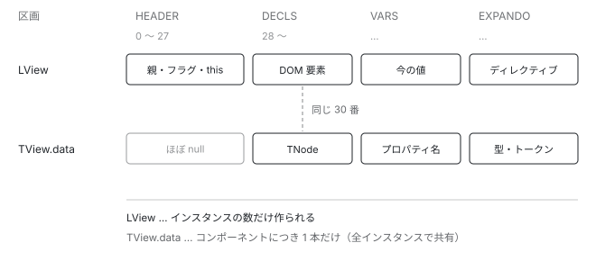

[目次](../README.md) › [Ivy ランタイム](README.md) › 第 1 回 / 全 17 回

# コンポーネントの実体は配列だった（概観）

> LView が Array を継承していること、インスタンスが型紙の slice() で作られること、ライフサイクルフックが TView 側にあることをソースから読む。

angular/angular · 読了 約 12 分 · 中核 · [サイトで読む（デモが動きます）](https://angular-deep-dive-cyan.vercel.app/chapter/component)

---

> [!NOTE]
> **ポイント**
>
> この章はシリーズ「Ivy ランタイム」の概観です。ここで出てくる TView・LView・ライフサイクルフックは、次の章から 1 概念ずつ関数単位で掘り下げます。まず全体の形をつかんでください。[シリーズの構成を見る](README.md)

`@Component` を書いてクラスを作ると、画面に何かが出ます。そのとき**「コンポーネントのインスタンス」として何が作られているのか**。読む対象は `packages/core/src/render3/` です。

## 1. 実体は配列だった

📄 `angular/packages/core/src/render3/interfaces/view.ts` L104–116 （▶ の行: 104）

```ts
104 ▶ export interface LView<T = unknown> extends Array<any> {
105 │   /**
106 │    * The node into which this `LView` is inserted.
107 │    */
108 │   [HOST]: RElement | null;
109 │ 
110 │   /**
111 │    * The static data for this view. We need a reference to this so we can easily walk up the
112 │    * node tree in DI and get the TView.data array associated with a node (where the
113 │    * directive defs are stored).
114 │    */
115 │   readonly [TVIEW]: TView;
116 │ 
```

104 行目。`LView` は **`Array<any>` を継承しています**。オブジェクトではなく配列です。これがコンポーネント 1 インスタンスぶんの実行時データになります。

配列なので、中身は番号でアクセスします。その番号には名前が付いています。

📄 `angular/packages/core/src/render3/interfaces/view.ts` L41–58 （▶ の行: 44–45, 48–49, 56）

```ts
41 │ // Below are constants for LView indices to help us look up LView members
42 │ // without having to remember the specific indices.
43 │ // Uglify will inline these when minifying so there shouldn't be a cost.
44 ▶ export const HOST = 0;
45 ▶ export const TVIEW = 1;
46 │ 
47 │ // Shared with LContainer
48 ▶ export const FLAGS = 2;
49 ▶ export const PARENT = 3;
50 │ export const NEXT = 4;
51 │ export const T_HOST = 5;
52 │ // End shared with LContainer
53 │ 
54 │ export const HYDRATION = 6;
55 │ export const CLEANUP = 7;
56 ▶ export const CONTEXT = 8;
57 │ export const INJECTOR = 9;
58 │ export const ENVIRONMENT = 10;
```

41 行目からのコメントが理由を説明しています。**「番号を覚えなくて済むように定数にした。minify すると展開されるのでコストはない」**。

44 行目が DOM のホスト要素、45 行目が共有される静的情報、49 行目が親への参照、56 行目が**あなたが書いたクラスのインスタンス**です。`this` で触れるあのオブジェクトは、この配列の 8 番目に入っています。

> [!NOTE]
> **さらに深く**
>
> なぜオブジェクトではなく配列なのか。プロパティ名の文字列を持たなくて済むぶん、**メモリが小さくなり、アクセスも速くなります**。1 画面に数千のコンポーネントが並ぶ状況を想定した設計です。読みにくさは、上のような定数で補っています。

## 2. 配列は 4 つの区画に分かれている

この配列のレイアウトには、リポジトリ内に設計メモが置かれています。

📄 `angular/packages/core/src/render3/VIEW_DATA.md` L1–20 （▶ の行: 16–19）

```md
 1 │ # View Data Explanation
 2 │ 
 3 │ `LView` and `TView.data` are how the Ivy renderer keeps track of the internal data needed to render the template.
 4 │ `LView` is designed so that a single array can contain all of the necessary data for the template rendering in a compact form.
 5 │ `TView.data` is a corollary to the `LView` and contains information which can be shared across the template instances.
 6 │ 
 7 │ ## `LView` / `TView.data` layout.
 8 │ 
 9 │ Both `LView` and `TView.data` are arrays whose indices refer to the same item.
10 │ For example index `123` may point to a component instance in the `LView` but a component type in `TView.data`.
11 │ 
12 │ The layout is as such:
13 │ 
14 │ | Section   | `LView`                                                      | `TView.data`                                               |
15 │ | --------- | ------------------------------------------------------------ | ---------------------------------------------------------- |
16 ▶ | `HEADER`  | contextual data                                              | mostly `null`                                              |
17 ▶ | `DECLS`   | DOM, pipe, and local ref instances                           |                                                            |
18 ▶ | `VARS`    | binding values                                               | property names                                             |
19 ▶ | `EXPANDO` | host bindings; directive instances; providers; dynamic nodes | host prop names; directive tokens; provider tokens; `null` |
20 │ 
```

16 行目からの表がすべてです。`LView` と `TView.data` は **同じ番号が同じものを指す 2 本の配列**で、片方に実体、もう片方に静的な情報が入ります。



*LView と TView.data は同じ番号が同じものを指す 2 本の配列。同じ 30 番でも、LView からは実際の DOM 要素が、TView.data からはその静的な情報が取れる。*

> **🧪 DEMO — 4 つの区画**
>
> 同じ番号で 2 本の配列を引くと、何が取れるかが変わります。
>
> ▶ [このデモはサイトで動かせます](https://angular-deep-dive-cyan.vercel.app/chapter/component)

HEADER の大きさは固定で、定数になっています。

📄 `angular/packages/core/src/render3/interfaces/view.ts` L78–85 （▶ の行: 85）

```ts
78 │ /**
79 │  * Size of LView's header. Necessary to adjust for it when setting slots.
80 │  *
81 │  * IMPORTANT: `HEADER_OFFSET` should only be referred to the in the `ɵɵ*` instructions to translate
82 │  * instruction index into `LView` index. All other indexes should be in the `LView` index space and
83 │  * there should be no need to refer to `HEADER_OFFSET` anywhere else.
84 │  */
85 ▶ export const HEADER_OFFSET = 28;
```

85 行目、**28**。コンパイラの章で見た `ɵɵdomElementStart(0, "h1")` の `0` は、実際には `28 + 0` 番目を指しています。テンプレート側は 0 から数え、実行時に固定分だけずらす仕組みです。

## 3. 番号の全体図

HEADER の 28 個には、すべて名前と役割があります。**1 つのコンポーネントは、この 28 個の枠を埋めて作られます**。積み木を組むように、決まった位置に決まったものを入れていくイメージです。

28〜DECLS / VARS / EXPANDO

あなたのクラス`lView[8]`**CONTEXT**あなたが書いたクラスのインスタンス

8 番に注目してください。**`CONTEXT` があなたの書いたクラス**です。「コンポーネント」と呼んでいるものは、この 28 個ぶんの枠のうち **たった 1 マス**にすぎません。残りは親子の参照、DOM への参照、フラグ、DI、Signal の受け皿です。

> [!TIP]
> **新卒エンジニアへ**
>
> この表を覚える必要はありません。大事なのは **「番号ごとに役割が決まっていて、全部で 28 個」**という形です。変更検知の章に出てきた `lView[FLAGS]` は 2 番、`lView[CONTEXT]` は 8 番。どの章のコードも、この地図の上のどこかを指しています。

## 4. インスタンスは「型紙のコピー」

では、その配列はどう作られるのか。`TView` にこういうものがあります。

📄 `angular/packages/core/src/render3/interfaces/view.ts` L629–633 （▶ の行: 630–631, 633）

```ts
629 │   /**
630 ▶    * This is a blueprint used to generate LView instances for this TView. Copying this
631 ▶    * blueprint is faster than creating a new LView from scratch.
632 │    */
633 ▶   blueprint: LView;
```

630 行目から 631 行目。**「LView を作るための型紙。ゼロから作るよりコピーするほうが速い」**。

実際の生成コードを見ると、そのとおりになっています。

📄 `angular/packages/core/src/render3/view/construction.ts` L173–192 （▶ の行: 186–188）

```ts
173 │ export function createLView<T>(
174 │   parentLView: LView | null,
175 │   tView: TView,
176 │   context: T | null,
177 │   flags: LViewFlags,
178 │   host: RElement | null,
179 │   tHostNode: TNode | null,
180 │   environment: LViewEnvironment | null,
181 │   renderer: Renderer | null,
182 │   injector: Injector | null,
183 │   embeddedViewInjector: Injector | null,
184 │   hydrationInfo: DehydratedView | null,
185 │ ): LView<T> {
186 ▶   const lView = tView.blueprint.slice() as LView;
187 ▶   lView[HOST] = host;
188 ▶   lView[FLAGS] =
189 │     flags |
190 │     LViewFlags.CreationMode |
191 │     LViewFlags.Attached |
192 │     LViewFlags.FirstLViewPass |
```

186 行目、`tView.blueprint.slice()`。**あらかじめ用意しておいた配列を複製する**だけです。そのあと 187 行目以降で、ホスト要素やフラグといった インスタンス固有の値を埋めていきます。

> [!TIP]
> **新卒エンジニアへ**
>
> 同じコンポーネントを 1000 個並べたとき、作られる `LView` は 1000 本ですが、型紙も `TView` も 1 つです。「構造の情報は共有し、値だけを individualize する」という方針が、この 1 行に表れています。

## 5. ライフサイクルフックはどこにあるか

`ngOnInit` を書くと、いつ呼ばれるのか。その登録先は `LView` ではなく `TView` のほうです。

📄 `angular/packages/core/src/render3/interfaces/view.ts` L741–752 （▶ の行: 741, 752）

```ts
741 ▶   /**
742 │    * Array of ngOnInit, ngOnChanges and ngDoCheck hooks that should be executed for this view in
743 │    * creation mode.
744 │    *
745 │    * This array has a flat structure and contains TNode indices, directive indices (where an
746 │    * instance can be found in `LView`) and hook functions. TNode index is followed by the directive
747 │    * index and a hook function. If there are multiple hooks for a given TNode, the TNode index is
748 │    * not repeated and the next lifecycle hook information is stored right after the previous hook
749 │    * function. This is done so that at runtime the system can efficiently iterate over all of the
750 │    * functions to invoke without having to make any decisions/lookups.
751 │    */
752 ▶   preOrderHooks: HookData | null;
```

741 行目からのコメントが構造を説明しています。**ノードの番号・ディレクティブの番号・フック関数が、平坦な配列に並んでいる**。オブジェクトの配列ではなく、数値と関数が交互に入った 1 本の配列です。

ここが `TView` にあるということは、**「どのフックをどの順で呼ぶか」は全インスタンスで共通**という意味です。インスタンスごとに違うのは「まだ呼んでいないか」という状態だけで、それは `LView` のフラグに入っています。

## 6. ここまでをつなぐと

コンポーネントが画面に出るまでの流れは、他の章と合わせるとこうなります。

| いつ | 何が起きるか |
| --- | --- |
| ビルド時 | `@Component` が `ɵcmp` になる。`decls` と `vars` が数えられる |
| 初回に使われたとき | `TView` と型紙が 1 回だけ作られる |
| インスタンスごと | 型紙を `slice()` して `LView` を作る |
| 作成時 | テンプレート関数を `rf & 1` で実行し、DOM を作る |
| 変更検知のたび | `rf & 2` で実行し、VARS 区画の値と比べて差分だけ書き換える |

> [!WARNING]
> **ハマりどころ**
>
> よく聞かれる「コンポーネントは重いのか」への答えもここにあります。1 インスタンスの実体は**配列 1 本とクラスのインスタンス 1 個**です。分割の粒度を細かくしても、それ自体のコストは小さい。重くなるのはたいてい、テンプレートの中で毎回新しいオブジェクトを作っている場合です。

## 読み終えて

「コンポーネントのインスタンス」と呼んでいたものの正体は、**固定長のヘッダーを持つ 1 本の配列**でした。そしてその配列は、テンプレートから作った型紙のコピーです。

変更検知の章で出てきた `lView[FLAGS]` や `lView[CONTEXT]` も、ここまで読めばただの配列アクセスだと分かります。

---

← 前: [SPA の「ページ遷移」で起きていること](../boot/13-boot-spa-navigation.md)  
次: [Ivy とは何か：ɵcmp にテンプレートが関数として入っている](02-ivy-overview.md) →
