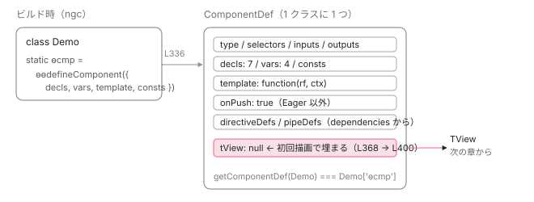

[目次](../README.md) › [Ivy ランタイム](README.md) › 第 2 回 / 全 17 回

# Ivy とは何か：ɵcmp にテンプレートが関数として入っている

> ɵɵdefineComponent が受け取る decls / vars / consts / template。コンポーネントの外を知らずにコンパイルできる「局所性」が、Ivy の設計の中心にある。

angular/angular · 読了 約 12 分 · 中核 · [サイトで読む（デモが動きます）](https://angular-deep-dive-cyan.vercel.app/chapter/ivy-overview)

---

「Ivy」は Angular のレンダリングエンジンの名前です。前の章（[概観](01-component.md)）で 「コンポーネントの実体は配列だった」と見ました。この章では一歩手前に戻って、**その配列を作るための材料がどこにあるか**を確認します。材料は、クラスの静的プロパティ `ɵcmp` に、`ɵɵdefineComponent({...})` の戻り値として入っています。テンプレートは文字列ではなく**関数**になって、そのオブジェクトの中にいます。

読む対象は `packages/core/src/render3/definition.ts`（`ɵɵdefineComponent` の本体）と `packages/core/src/render3/interfaces/definition.ts`（`ComponentDef` の型）です。

1. 概観（配列だった）
2. **Ivy とは**（この章）
3. テンプレート関数と RenderFlags
4. TNode
5. TView
6. LView
7. blueprint と TData
8. firstCreatePass
9. DOM を組む命令
10. 値を更新する命令
11. LContainer
12. ビューの木
13. フック
14. ディレクティブ
15. LFrame
16. ViewRef 等
17. 破棄

## 1. ɵɵ という接頭辞

これから出てくる関数名には `ɵɵ`（シータに似たラテン文字「バード」が 2 つ）が付いています。これが何かは、リポジトリに短い説明があります。

📄 `angular/packages/core/src/render3/CODE_GEN_API.md` L1–10 （▶ の行: 5, 9）

```md
 1 │ # Code Gen API
 2 │ 
 3 │ ### Prefix ɵɵ
 4 │ 
 5 ▶ Ivy exports a number of functions prefixed with `ɵɵ`, for example `ɵɵelementStart`, or `ɵɵinject`, et al. These functions are part of API required for code generation by the Angular compiler. These functions are called by generated code, and they must be publicly exposed in order to be consumed by this generated code. **They are not meant for developer consumption**. The reason they are prefixed with `ɵɵ` is not only to identify them as different from other functions, but also to make them not show up at the top of IDE code completion in environments such as Visual Studio code.
 6 │ 
 7 │ ### Guidance
 8 │ 
 9 ▶ - Do not use `ɵɵ` functions directly. They are meant to be used in generated code.
10 │ - Do not create new `ɵɵ` functions, it's not a convention that Angular consumes, and it is liable to confuse other developers into thinking consuming Angular's `ɵɵ` functions is a good pattern to follow.
```

5 行目。`ɵɵ` 付きの関数は**コンパイラが生成したコードから呼ばれるための API**です。開発者向けではなく、IDE の補完で上に出てこないようにこの文字を選んだ、とまで書いてあります。9 行目、自分で呼ぶものではありません。つまり、この先の章で読む `ɵɵelementStart` や `ɵɵadvance` は、すべて「コンパイラが書いた呼び出し」を読んでいることになります。

## 2. ngc の出力をもう一度見る

[コンパイラの章](../compiler/01-compiler.md)で実際の `ngc` 出力を読みました。その骨格だけを再掲します（`template` の中身はこの章では省きます）。

```
static ɵcmp = /*@__PURE__*/ i0.ɵɵdefineComponent({
  type: Demo,
  selectors: [["app-demo"]],
  decls: 7,
  vars: 4,
  consts: [[3, "title"]],
  template: function Demo_Template(rf, ctx) {
    if (rf & 1) { /* DOM を作る命令 */ }
    if (rf & 2) { /* 値を流す命令 */ }
  },
  encapsulation: 2
});
```
*compiler 章の出力から、ɵɵdefineComponent に渡しているオブジェクトのキーだけを残したもの。*

`@Component` デコレータは消え、クラスに `static ɵcmp` が足されています。値は `ɵɵdefineComponent` に**1 個のオブジェクト**を渡した戻り値です。キーは `type` / `selectors` / `decls` / `vars` / `consts` / `template` / `encapsulation`。この 7 つで、このコンポーネントを描くのに必要な静的情報は全部です。

## 3. ɵɵdefineComponent は何を返すか

📄 `angular/packages/core/src/render3/definition.ts` L320–338 （▶ の行: 329, 334, 336）

````ts
320 │ /**
321 │  * Create a component definition object.
322 │  *
323 │  *
324 │  * # Example
325 │  * ```ts
326 │  * class MyComponent {
327 │  *   // Generated by Angular Template Compiler
328 │  *   // [Symbol] syntax will not be supported by TypeScript until v2.7
329 ▶  *   static ɵcmp = defineComponent({
330 │  *     ...
331 │  *   });
332 │  * }
333 │  * ```
334 ▶  * @codeGenApi
335 │  */
336 ▶ export function ɵɵdefineComponent<T>(
337 │   componentDefinition: ComponentDefinition<T>,
338 │ ): ComponentDef<any> {
````

329 行目のコメントが、2 節で見た `static ɵcmp = defineComponent(...)` の形そのものです。334 行目に `@codeGenApi` の印。336 行目、引数は `ComponentDefinition<T>` 1 つ、戻り値は `ComponentDef` です。**入力の型と出力の型が別**であることに注目してください。コンパイラが書くのは `ComponentDefinition`、ランタイムが読むのは `ComponentDef` です。

📄 `angular/packages/core/src/render3/definition.ts` L339–370 （▶ の行: 344, 346–350, 352–355, 368）

```ts
339 │   return noSideEffects(() => {
340 │     // Initialize ngDevMode. This must be the first statement in ɵɵdefineComponent.
341 │     // See the `initNgDevMode` docstring for more information.
342 │     (typeof ngDevMode === 'undefined' || ngDevMode) && initNgDevMode();
343 │ 
344 ▶     const baseDef = getNgDirectiveDef(componentDefinition as DirectiveDefinition<T>);
345 │     const def: Writable<ComponentDef<T>> = {
346 ▶       ...baseDef,
347 ▶       decls: componentDefinition.decls,
348 ▶       vars: componentDefinition.vars,
349 ▶       template: componentDefinition.template,
350 ▶       consts: componentDefinition.consts || null,
351 │       ngContentSelectors: componentDefinition.ngContentSelectors,
352 ▶       onPush: componentDefinition.changeDetection !== ChangeDetectionStrategy.Eager,
353 ▶       directiveDefs: null!, // assigned in noSideEffects
354 ▶       pipeDefs: null!, // assigned in noSideEffects
355 ▶       dependencies: (baseDef.standalone && componentDefinition.dependencies) || null,
356 │       getStandaloneInjector: baseDef.standalone
357 │         ? (parentInjector: EnvironmentInjector) => {
358 │             return parentInjector.get(StandaloneService).getOrCreateStandaloneInjector(def);
359 │           }
360 │         : null,
361 │       getExternalStyles: null,
362 │       signals: componentDefinition.signals ?? false,
363 │       data: componentDefinition.data || {},
364 │       encapsulation: componentDefinition.encapsulation || ViewEncapsulation.Emulated,
365 │       styles: componentDefinition.styles || EMPTY_ARRAY,
366 │       _: null,
367 │       schemas: componentDefinition.schemas || null,
368 ▶       tView: null,
369 │       id: '',
370 │     };
```

1. **344 行目：`getNgDirectiveDef` で「ディレクティブとしての部分」を先に作る**

   コンポーネントはディレクティブの一種です。`type`・`selectors`・`inputs`・`outputs`・`hostBindings` のようにディレクティブと共通の項目は、別関数で `DirectiveDef` として組んでから（4 節）、346 行目のスプレッドで混ぜます。
2. **347〜350 行目：`decls` / `vars` / `template` / `consts` をそのまま写す**

   コンパイラが数えた数字と、テンプレート関数と、定数配列。**加工はしていません**。`consts` だけは未指定なら `null` に揃えます（350 行目）。
3. **352 行目：`onPush` は「`Eager` 以外なら true」**

   `changeDetection !== ChangeDetectionStrategy.Eager`。2 節の出力に `changeDetection` キーはありませんでした。未指定は `undefined` なので、`undefined !== Eager` は `true`。**v22 では何も書かないコンポーネントは OnPush** です。enum の定義も見ておきます。
4. **353〜355 行目：`directiveDefs` / `pipeDefs` は `null!` で仮置き**

   この時点では埋めません。355 行目で `dependencies`（`imports` に書いた型の配列）を持っておき、後ろの 379〜380 行目で変換します。
5. **368 行目：`tView: null`**

   ここが次の章以降の主役です。`ɵcmp` が作られる時点では `TView` は**存在しません**。最初のインスタンスが描かれるときに初めて作られ、ここに保存されます（[TView の章](05-ivy-tview.md)）。

📄 `angular/packages/core/src/change_detection/constants.ts` L18–34 （▶ の行: 25, 27, 34）

```ts
18 │ export enum ChangeDetectionStrategy {
19 │   /**
20 │    * Use the `CheckOnce` strategy, meaning that automatic change detection is deactivated
21 │    * until reactivated by setting the strategy to `Default` (`CheckAlways`).
22 │    * Change detection can still be explicitly invoked.
23 │    * This strategy applies to all child directives and cannot be overridden.
24 │    *
25 ▶    * NOTE: OnPush is enabled by default.
26 │    */
27 ▶   OnPush = 0,
28 │ 
29 │   /**
30 │    * Use the `Eager` strategy, meaning that the component is checked eagerly when the change
31 │    * detection traversal reaches it, rather than only checking under certain circumstances (e.g.
32 │    * `markForCheck`, a signal in the template changed, etc).
33 │    */
34 ▶   Eager = 1,
```

27 行目で `OnPush = 0`、34 行目で `Eager = 1`。25 行目に「OnPush is enabled by default」と明記されています。以前の `Default` は `Eager` の別名として残っているだけです。

📄 `angular/packages/core/src/render3/definition.ts` L377–385 （▶ の行: 377, 379–381）

```ts
377 ▶     initFeatures(def);
378 │     const dependencies = componentDefinition.dependencies;
379 ▶     def.directiveDefs = extractDefListOrFactory(dependencies, extractDirectiveDef);
380 ▶     def.pipeDefs = extractDefListOrFactory(dependencies, getPipeDef);
381 ▶     def.id = getComponentId(def);
382 │ 
383 │     return def;
384 │   });
385 │ }
```

377 行目、`features` に入っている関数（`ɵɵProvidersFeature` など）を `def` に適用します。379〜380 行目、`dependencies` から `ɵcmp` / `ɵdir` を持つものと `ɵpipe` を持つものを選り分けて、それぞれ `directiveDefs` と `pipeDefs` にします。381 行目で `id`（スタイルのスコープや hydration に使う文字列）を計算して、オブジェクトが完成します。

## 4. decls / vars / template / consts の意味

コンパイラが書き込む 4 つのキーには、それぞれ入力側の型 `ComponentDefinition` にドキュメントがあります。

📄 `angular/packages/core/src/render3/definition.ts` L217–232 （▶ の行: 219, 221, 224, 227, 232）

```ts
217 │ interface ComponentDefinition<T> extends Omit<DirectiveDefinition<T>, 'features'> {
218 │   /**
219 ▶    * The number of nodes, local refs, and pipes in this component template.
220 │    *
221 ▶    * Used to calculate the length of this component's LView array, so we
222 │    * can pre-fill the array and set the binding start index.
223 │    */
224 ▶   decls: number;
225 │ 
226 │   /**
227 ▶    * The number of bindings in this component template (including pure fn bindings).
228 │    *
229 │    * Used to calculate the length of this component's LView array, so we
230 │    * can pre-fill the array and set the host binding start index.
231 │    */
232 ▶   vars: number;
```

219 行目、`decls` は「ノード・ローカル参照・パイプ」の**個数**です。DOM 要素の数ではありません。`#ref` もパイプも 1 つずつ枠を取ります。221〜222 行目、この数は `LView` 配列の長さを決め、**バインディングの開始位置**を決めるために使われます。

227 行目、`vars` は「バインディングの個数（pure function のぶんも含む）」。`{{ a }}` や `[title]="b"` が 1 つずつ、`{{ a }} と {{ b }}` の補間なら 2 つです。どちらも**コンパイル時に数え終わっている**ので、ランタイムは配列を一度に確保できます。その計算は [blueprint の章](07-ivy-blueprint.md)で `HEADER_OFFSET + decls` として出てきます。

📄 `angular/packages/core/src/render3/definition.ts` L234–269 （▶ の行: 240–241, 244, 250–251, 256, 258, 263, 266, 269）

````ts
234 │   /**
235 │    * Template function use for rendering DOM.
236 │    *
237 │    * This function has following structure.
238 │    *
239 │    * ```ts
240 ▶    * function Template<T>(ctx:T, creationMode: boolean) {
241 ▶    *   if (creationMode) {
242 │    *     // Contains creation mode instructions.
243 │    *   }
244 ▶    *   // Contains binding update instructions
245 │    * }
246 │    * ```
247 │    *
248 │    * Common instructions are:
249 │    * Creation mode instructions:
250 ▶    *  - `elementStart`, `elementEnd`
251 ▶    *  - `text`
252 │    *  - `container`
253 │    *  - `listener`
254 │    *
255 │    * Binding update instructions:
256 ▶    * - `bind`
257 │    * - `elementAttribute`
258 ▶    * - `elementProperty`
259 │    * - `elementClass`
260 │    * - `elementStyle`
261 │    *
262 │    */
263 ▶   template: ComponentTemplate<T>;
264 │ 
265 │   /**
266 ▶    * Constants for the nodes in the component's view.
267 │    * Includes attribute arrays, local definition arrays etc.
268 │    */
269 ▶   consts?: any[] | (() => any[]);
````

240〜245 行目が `template` 関数の骨格です（このコメントは古い引数名のままですが、`rf & 1` と `rf & 2` の 2 ブロック構造は同じです）。250〜253 行目が作成側の命令、256〜260 行目が更新側の命令の例。2 種類の命令を 1 つの関数に同居させる理由は[次章](03-ivy-template-function.md)で読みます。

266〜269 行目、`consts` は「属性の配列やローカル参照の配列」をまとめた定数表です。2 節の出力では `consts: [[3, "title"]]` でした。`ɵɵdomElementStart(2, "p", 0)` の 3 番目の引数 `0` は、この表の 0 番目を指しています。テンプレート関数の中に配列リテラルを書くと呼び出しごとに配列が作られてしまうので、外に出して番号で引く設計です。

📄 `angular/packages/core/src/render3/interfaces/definition.ts` L22–30 （▶ の行: 29）

```ts
22 │ /**
23 │  * Definition of what a template rendering function should look like for a component.
24 │  */
25 │ export type ComponentTemplate<T> = {
26 │   // Note: the ctx parameter is typed as T|U, as using only U would prevent a template with
27 │   // e.g. ctx: {} from being assigned to ComponentTemplate<any> as TypeScript won't infer U = any
28 │   // in that scenario. By including T this incompatibility is resolved.
29 ▶   <U extends T>(rf: RenderFlags, ctx: T | U): void;
30 │ };
```

29 行目、`template` の型です。`(rf: RenderFlags, ctx: T) => void`。戻り値はありません。**テンプレート関数は何かを返すのではなく、呼ばれた副作用として DOM を作ったり値を書き込んだりします**。「仮想 DOM を返して差分を取る」方式ではないことが、型の時点で分かります。

## 5. ディレクティブとして共通の部分

📄 `angular/packages/core/src/render3/definition.ts` L618–647 （▶ の行: 622, 626–628, 635, 643–644）

```ts
618 │ function getNgDirectiveDef<T>(directiveDefinition: DirectiveDefinition<T>): DirectiveDef<T> {
619 │   const declaredInputs: Record<string, string> = {};
620 │ 
621 │   return {
622 ▶     type: directiveDefinition.type,
623 │     providersResolver: null,
624 │     viewProvidersResolver: null,
625 │     factory: null,
626 ▶     hostBindings: directiveDefinition.hostBindings || null,
627 ▶     hostVars: directiveDefinition.hostVars || 0,
628 ▶     hostAttrs: directiveDefinition.hostAttrs || null,
629 │     contentQueries: directiveDefinition.contentQueries || null,
630 │     declaredInputs: declaredInputs,
631 │     inputConfig: directiveDefinition.inputs || EMPTY_OBJ,
632 │     exportAs: directiveDefinition.exportAs || null,
633 │     standalone: directiveDefinition.standalone ?? true,
634 │     signals: directiveDefinition.signals === true,
635 ▶     selectors: directiveDefinition.selectors || EMPTY_ARRAY,
636 │     viewQuery: directiveDefinition.viewQuery || null,
637 │     features: directiveDefinition.features || null,
638 │     setInput: null,
639 │     resolveHostDirectives: null,
640 │     hostDirectives: null,
641 │     controlDef: null,
642 │     signalFormsInputPresence: null,
643 ▶     inputs: parseAndConvertInputsForDefinition(directiveDefinition.inputs, declaredInputs),
644 ▶     outputs: parseAndConvertOutputsForDefinition(directiveDefinition.outputs),
645 │     debugInfo: null,
646 │   };
647 │ }
```

622 行目の `type` はクラスそのもの。DI のトークンにもなります。635 行目の `selectors` は `[["app-demo"]]` のような配列で、親のテンプレートの要素と照合するときに使われます（[firstCreatePass の章](08-ivy-first-create-pass.md)の `findDirectiveDefMatches`）。626〜628 行目の `hostBindings` / `hostVars` / `hostAttrs` はホスト要素向けの情報、643〜644 行目で `inputs` / `outputs` を実行時に引きやすい形に変換します。

## 6. ランタイム側の置き場所：tView と directiveDefs

出力側の型 `ComponentDef` には、コンパイラが書かない、**ランタイムが後から埋めるための枠**があります。

📄 `angular/packages/core/src/render3/interfaces/definition.ts` L370–400 （▶ の行: 371, 373–374, 376, 389, 397–398, 400）

```ts
370 │   /**
371 ▶    * Registry of directives and components that may be found in this view.
372 │    *
373 ▶    * The property is either an array of `DirectiveDef`s or a function which returns the array of
374 ▶    * `DirectiveDef`s. The function is necessary to be able to support forward declarations.
375 │    */
376 ▶   directiveDefs: DirectiveDefListOrFactory | null;
377 │ 
378 │   /**
379 │    * Registry of pipes that may be found in this view.
380 │    *
381 │    * The property is either an array of `PipeDefs`s or a function which returns the array of
382 │    * `PipeDefs`s. The function is necessary to be able to support forward declarations.
383 │    */
384 │   pipeDefs: PipeDefListOrFactory | null;
385 │ 
386 │   /**
387 │    * Unfiltered list of all dependencies of a component, or `null` if none.
388 │    */
389 ▶   dependencies: TypeOrFactory<DependencyTypeList> | null;
390 │ 
391 │   /**
392 │    * The set of schemas that declare elements to be allowed in the component's template.
393 │    */
394 │   schemas: SchemaMetadata[] | null;
395 │ 
396 │   /**
397 ▶    * Ivy runtime uses this place to store the computed tView for the component. This gets filled on
398 ▶    * the first run of component.
399 │    */
400 ▶   tView: TView | null;
```

371〜376 行目、`directiveDefs` は「このビューに現れうるディレクティブとコンポーネントの一覧」です。配列か、配列を返す関数（前方参照のため）のどちらか。389 行目の `dependencies` がフィルタ前の生の一覧で、3 節の 379 行目でこちらに変換されました。

397〜400 行目。**「Ivy ランタイムは計算済みの tView をここに保存する。コンポーネントの初回実行時に埋まる」**。`ɵcmp` は 1 クラスに 1 つなので、`tView` も 1 クラスに 1 つです。インスタンスが 100 個あっても `tView` は 1 個。これが「TView は共有、LView はインスタンスごと」という、このシリーズ全体の前提になります。

## 7. ɵcmp はどこから読まれるか

📄 `angular/packages/core/src/render3/fields.ts` L9–14 （▶ の行: 11）

```ts
 9 │ import {getClosureSafeProperty} from '../util/property';
10 │ 
11 ▶ export const NG_COMP_DEF: string = getClosureSafeProperty({ɵcmp: getClosureSafeProperty});
12 │ export const NG_DIR_DEF: string = getClosureSafeProperty({ɵdir: getClosureSafeProperty});
13 │ export const NG_PIPE_DEF: string = getClosureSafeProperty({ɵpipe: getClosureSafeProperty});
14 │ export const NG_MOD_DEF: string = getClosureSafeProperty({ɵmod: getClosureSafeProperty});
```

📄 `angular/packages/core/src/render3/def_getters.ts` L33–42 （▶ の行: 39, 41）

```ts
33 │ /**
34 │  * The following getter methods retrieve the definition from the type. Currently the retrieval
35 │  * honors inheritance, but in the future we may change the rule to require that definitions are
36 │  * explicit. This would require some sort of migration strategy.
37 │  */
38 │ 
39 ▶ export function getComponentDef<T>(type: any): ComponentDef<T> | null {
40 │   assertTypeDefined(type, '@Component');
41 ▶   return type[NG_COMP_DEF] || null;
42 │ }
```

fields.ts 11 行目、`NG_COMP_DEF` は文字列 `'ɵcmp'` です （`getClosureSafeProperty` は、minifier にプロパティ名を変えられても同じ名前が取れるようにする小道具です）。def\_getters.ts 41 行目、`getComponentDef(type)` は `type['ɵcmp']` を返すだけ。ランタイムがコンポーネントを扱うときは、どこでもこの関数でクラスから `ComponentDef` を取り出します。`bootstrapApplication(App)` も、`App.ɵcmp` を読むところから始まります （[起動シリーズ](../boot/11-boot-first-render.md)）。



*ビルド時に ngc がクラスへ ɵcmp を書き込み、ɵɵdefineComponent が ComponentDef に整える。tView だけは空のまま、初回描画時にランタイムが埋める。*

## 8. 「局所性」：なぜ外を知らずにコンパイルできるのか

2 節の出力で、`<app-demo>` の中にどのディレクティブが付くかは書かれていませんでした。`dependencies`（`imports`）の一覧はありますが、「この要素にはこのディレクティブ」という対応表はありません。リポジトリの設計メモは、これを **locality（局所性）** と呼んでいます。

📄 `angular/packages/core/src/render3/STORING_METADATA_IN_D.TS.md` L1–8 （▶ の行: 3–5）

```md
1 │ # Storing Metadata in `.d.ts` files
2 │ 
3 ▶ Previous version of Angular used `metadata.json` files to store information about directives/component/pipes/ng-modules.
4 ▶ `ngc` compiler would than do a global analysis to generate the `.ngfactory.ts` files from the `metadata.json`.
5 ▶ Ivy strives for locality, which means that `ngtsc` should not need any global information in order to compile the system.
6 │ The above is mostly true.
7 │ Unfortunately, in order for `ngtsc` to generate code which is tree shakable `ngtsc` does need to have global knowledge.
8 │ 
```

3〜4 行目、以前の Angular は `metadata.json` を集めて**全体解析**してからコードを生成していました。5 行目、Ivy は「`ngtsc` がシステムをコンパイルするのにグローバルな情報を必要としない」ことを目指しています。1 つのコンポーネントは、自分のテンプレートと自分の `imports` だけを見てコンパイルできる。だからライブラリは `ɵcmp` 付きの JS を配布でき、利用側は再コンパイルなしでそれを使えます。

その代わり、「どの要素にどのディレクティブが付くか」は**実行時に決める**ことになります。`TView` の定義にその帰結が書かれています。

📄 `angular/packages/core/src/render3/interfaces/view.ts` L682–692 （▶ の行: 685–687）

```ts
682 │   /**
683 │    * The index where the "expando" section of `LView` begins. The expando
684 │    * section contains injectors, directive instances, and host binding values.
685 ▶    * Unlike the "decls" and "vars" sections of `LView`, the length of this
686 ▶    * section cannot be calculated at compile-time because directives are matched
687 ▶    * at runtime to preserve locality.
688 │    *
689 │    * We store this start index so we know where to start checking host bindings
690 │    * in `setHostBindings`.
691 │    */
692 │   expandoStartIndex: number;
```

685〜687 行目。「`decls` と `vars` の区画と違って、この区画の長さはコンパイル時に計算できない。**局所性を保つためにディレクティブは実行時に照合される**から」。4 節で見た `decls` / `vars` が数えられるのは自分のテンプレートだけで決まる量だから、ディレクティブのぶんが数えられないのは相手のセレクタを見る必要があるから、です。その照合を実際にやっている関数は [firstCreatePass の章](08-ivy-first-create-pass.md)で読みます。

> [!TIP]
> **新卒エンジニアへ**
>
> 「Ivy って結局なに？」と聞かれたら、こう答えられます。**「テンプレートを関数にコンパイルして `ɵcmp` に入れ、実行時にその関数を呼んで配列（LView）を埋めていくレンダリングエンジン。各コンポーネントは外を知らずにコンパイルされ、ディレクティブの照合は実行時にやる」**。この章で見たのは最初の半分、残りの半分がこの先の 15 章です。

## ここまでの呼び出し

- 👤 `@Component({ template: '...' }) class Demo` — あなたのソース — *ビルド時に ngc が読む*
  - `static ɵcmp = ɵɵdefineComponent({ decls, vars, consts, template })` — ngc の出力 — *テンプレートは関数になっている*
    - `ɵɵdefineComponent(componentDefinition)` — core/src/render3/definition.ts L336 — *モジュール評価時（import された瞬間）に 1 回だけ走る*
      - `getNgDirectiveDef(definition)` — definition.ts L618 — *type / selectors / inputs / outputs / hostBindings*
      - `{ ...baseDef, decls, vars, template, consts, onPush, tView: null }` — definition.ts L345-370
      - `initFeatures(def)` — definition.ts L377 — *ɵɵProvidersFeature などを適用*
      - `extractDefListOrFactory(dependencies, ...)` — definition.ts L379-380 — *directiveDefs / pipeDefs に振り分け*
  - `getComponentDef(Demo)` — core/src/render3/def\_getters.ts L39 — *実行時。Demo\['ɵcmp'\] を返すだけ*
    - `def.tView === null → createTView(...)` — core/src/render3/view/construction.ts L146 — *次章以降*

## 聞かれそうな質問

**Q. ɵcmp はいつ作られますか？実行時ですか？**

`static ɵcmp = ɵɵdefineComponent(...)` は静的プロパティの初期化式なので、**そのクラスを含むモジュールが評価された瞬間**（import されたとき）に 1 回だけ実行されます（definition.ts 336 行目の関数が走る）。画面に描かれるかどうかとは無関係です。描かれるときに作られるのは `ɵcmp.tView`（368 行目で `null` だった枠）のほうです。

**Q. decls と vars は何を数えていますか？DOM 要素の数ですか？**

違います。definition.ts 219 行目のとおり `decls` は「ノード・ローカル参照・パイプ」の個数で、テキストノードや `#ref`、パイプのインスタンスも 1 つずつ数えます。227 行目のとおり `vars` はバインディング式の個数です。どちらも `LView` 配列の長さを事前に決めるための数（221〜222 行目、229〜230 行目）です。

**Q. changeDetection を書かなかったコンポーネントは Default（毎回チェック）ですか？**

v22 では OnPush です。definition.ts 352 行目で `onPush = changeDetection !== ChangeDetectionStrategy.Eager` と計算していて、未指定（`undefined`）は `Eager` ではないので `true` になります。constants.ts 27 行目で `OnPush = 0`、25 行目に「OnPush is enabled by default」と書かれています。毎回チェックさせたいときは明示的に `ChangeDetectionStrategy.Eager` を指定します。

**Q. imports に書いた型と directiveDefs は同じものですか？**

元は同じですが、形が違います。`imports` は `dependencies`（definition.ts 355 行目）として生のまま保持され、379 行目の `extractDefListOrFactory` が各型から `ɵcmp` / `ɵdir` を取り出して `directiveDefs` に、380 行目が `ɵpipe` を取り出して `pipeDefs` にします。ランタイムの照合（`findDirectiveDefMatches`）が読むのは `directiveDefs` のほうです。

**Q. ɵɵelementStart などを自分のコードから呼んでもいいですか？**

いけません。CODE\_GEN\_API.md 5 行目と 9 行目に「生成コードから呼ばれるための API で、開発者が使うものではない」と明記されています。これらは `LFrame` というグローバル状態（[LFrame の章](15-ivy-lframe.md)）を前提に動くので、テンプレート関数の外から呼ぶと前提が崩れます。

**Q. 「局所性」があると何がうれしいのですか？**

STORING\_METADATA\_IN\_D.TS.md 5 行目のとおり、コンパイラが**グローバルな情報なしに**1 ファイルをコンパイルできます。ライブラリはコンパイル済みの `ɵcmp` 付き JS を配布でき、利用側は再コンパイル不要です。代償として、どの要素にどのディレクティブが付くかは実行時に照合します（view.ts 685〜687 行目）。その照合は最初の 1 インスタンスのときだけ行い、結果を `TView` に残して共有します。

## 読み終えて

- `@Component` はビルド時に消え、クラスの `static ɵcmp` に `ɵɵdefineComponent({ decls, vars, consts, template, ... })` の戻り値が入る
- `template` は `(rf, ctx) => void` の関数。何も返さず、副作用で DOM を作り値を書く
- `decls` はノード・ローカル参照・パイプの数、`vars` はバインディングの数。どちらもコンパイル時に確定し、`LView` の長さを決める
- `ComponentDef.tView` は `null` で始まり、初回描画で 1 回だけ埋まる。1 クラスに 1 つ。インスタンスが何個あっても共有される
- コンポーネントは外を知らずにコンパイルされる（局所性）。だからディレクティブの照合は実行時に行い、その結果の長さは `decls` / `vars` と違って事前に数えられない

---

← 前: [コンポーネントの実体は配列だった（概観）](01-component.md)  
次: [テンプレート関数と RenderFlags：同じ関数を Create と Update で 2 回呼ぶ](03-ivy-template-function.md) →
