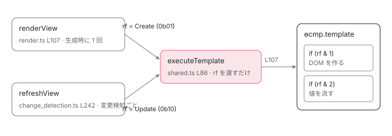

[目次](../README.md) › [Ivy ランタイム](README.md) › 第 3 回 / 全 17 回

# テンプレート関数と RenderFlags：同じ関数を Create と Update で 2 回呼ぶ

> rf & 1 のブロックは DOM を作り、rf & 2 のブロックは値を流す。executeTemplate がどう呼び分け、ɵɵadvance が「今どの要素か」を進めるか。

angular/angular · 読了 約 11 分 · 中核 · [サイトで読む（デモが動きます）](https://angular-deep-dive-cyan.vercel.app/chapter/ivy-template-function)

---

[前章](02-ivy-overview.md)で、テンプレートは `(rf, ctx) => void` の関数になって `ɵcmp.template` に入っていると確認しました。この章はその関数の**呼ばれ方**です。同じ 1 つの関数が、`rf = 1` で呼ばれると DOM を作り、`rf = 2` で呼ばれると値を流します。誰がどちらの値で呼ぶのか、そして更新ブロックの中で `ɵɵadvance()` が「今どの要素を見ているか」をどう進めるのかを、ソースの行で追います。

読む対象は `packages/core/src/render3/instructions/shared.ts`（`executeTemplate`）、`instructions/render.ts`（`renderView`）、`instructions/advance.ts`、`state.ts`（`LFrame` の `selectedIndex`）です。

1. 概観（配列だった）
2. Ivy とは
3. **テンプレート関数と RenderFlags**（この章）
4. TNode
5. TView
6. LView
7. blueprint と TData
8. firstCreatePass
9. DOM を組む命令
10. 値を更新する命令
11. LContainer
12. ビューの木
13. フック
14. ディレクティブ
15. LFrame
16. ViewRef 等
17. 破棄

## 1. RenderFlags は 2 ビット

📄 `angular/packages/core/src/render3/interfaces/definition.ts` L59–73 （▶ の行: 63–65, 69, 72）

```ts
59 │ /**
60 │  * Flags passed into template functions to determine which blocks (i.e. creation, update)
61 │  * should be executed.
62 │  *
63 ▶  * Typically, a template runs both the creation block and the update block on initialization and
64 ▶  * subsequent runs only execute the update block. However, dynamically created views require that
65 ▶  * the creation block be executed separately from the update block (for backwards compat).
66 │  */
67 │ export const enum RenderFlags {
68 │   /* Whether to run the creation block (e.g. create elements and directives) */
69 ▶   Create = 0b01,
70 │ 
71 │   /* Whether to run the update block (e.g. refresh bindings) */
72 ▶   Update = 0b10,
73 │ }
```

69 行目 `Create = 0b01`、72 行目 `Update = 0b10`。生成コードの `if (rf & 1)` と `if (rf & 2)` は、このビットを見ています。63〜65 行目のコメントに「通常は初期化時に両方のブロックを実行し、以降は更新ブロックだけ」とありますが、**v22 の core にはこの 2 つを OR で合成して渡している場所はありません** （`RenderFlags.Create | RenderFlags.Update` という式は `packages/core/src` に存在しません）。実際には作成と更新は**別々の呼び出し**です。それを 3 節で確認します。

設計メモにある最小の例で、2 ブロックの中身を見ておきます。

📄 `angular/packages/core/src/render3/VIEW_DATA.md` L88–106 （▶ の行: 90–91, 93–95, 98–101）

```md
 88 │   static ɵcmp = ɵɵdefineComponent({
 89 │     ...,
 90 ▶     decls: 2, // Two DOM Elements.
 91 ▶     vars: 2,   // Two bindings.
 92 │     template: function(rf: RenderFlags, ctx: MyApp) {
 93 ▶       if (rf & RenderFlags.Create) {
 94 ▶         ɵɵelementStart(0, 'div');
 95 ▶         ɵɵtext(1);
 96 │         ɵɵelementEnd();
 97 │       }
 98 ▶       if (rf & RenderFlags.Update) {
 99 ▶         ɵɵproperty('title', ctx.name);
100 ▶         ɵɵadvance();
101 ▶         ɵɵtextInterpolate1('Hello ', ctx.name, '!');
102 │       }
103 │       ...
104 │     }
105 │   });
106 │ }
```

93〜97 行目、作成ブロックは `elementStart(0, 'div')` と `text(1)`。**引数に番号がある**のが特徴です。98〜102 行目、更新ブロックは `property('title', ...)`、`advance()`、`textInterpolate1(...)`。**こちらには番号がありません**。「今選ばれている要素」に対して書く、という前提で動きます。その「今選ばれている要素」を動かすのが `advance()` です（5 節）。

> **🧪 DEMO — rf の値で通るブロックが変わる**
>
> compiler 章の Demo コンポーネント（decls: 7, vars: 4）の生成コード。右端のコメントは LView の添字（28 + index）です。
>
> ▶ [このデモはサイトで動かせます](https://angular-deep-dive-cyan.vercel.app/chapter/ivy-template-function)

## 2. executeTemplate：関数を呼ぶ唯一の場所

`ɵcmp.template` を直接呼んでいるのは、core の中でこの関数だけです。

📄 `angular/packages/core/src/render3/instructions/shared.ts` L86–116 （▶ の行: 93–94, 96–101, 107, 109）

```ts
 86 │ export function executeTemplate<T>(
 87 │   tView: TView,
 88 │   lView: LView<T>,
 89 │   templateFn: ComponentTemplate<T>,
 90 │   rf: RenderFlags,
 91 │   context: T,
 92 │ ) {
 93 ▶   const prevSelectedIndex = getSelectedIndex();
 94 ▶   const isUpdatePhase = rf & RenderFlags.Update;
 95 │   try {
 96 ▶     setSelectedIndex(-1);
 97 ▶     if (isUpdatePhase && lView.length > HEADER_OFFSET) {
 98 ▶       // When we're updating, inherently select 0 so we don't
 99 ▶       // have to generate that instruction for most update blocks.
100 ▶       selectIndexInternal(tView, lView, HEADER_OFFSET, !!ngDevMode && isInCheckNoChangesMode());
101 ▶     }
102 │ 
103 │     const preHookType = isUpdatePhase
104 │       ? ProfilerEvent.TemplateUpdateStart
105 │       : ProfilerEvent.TemplateCreateStart;
106 │     profiler(preHookType, context as unknown as {}, templateFn);
107 ▶     templateFn(rf, context);
108 │   } finally {
109 ▶     setSelectedIndex(prevSelectedIndex);
110 │ 
111 │     const postHookType = isUpdatePhase
112 │       ? ProfilerEvent.TemplateUpdateEnd
113 │       : ProfilerEvent.TemplateCreateEnd;
114 │     profiler(postHookType, context as unknown as {}, templateFn);
115 │   }
116 │ }
```

1. **93 行目：今の `selectedIndex` を退避する**

   `selectedIndex` は `LFrame` というグローバル状態の 1 項目です（4 節）。テンプレート関数の中で動かすので、呼ぶ前の値を覚えておき、109 行目の `finally` で必ず戻します。
2. **94 行目：`rf & Update` で更新フェーズかを判定**

   ここで `rf` を見るのは、これ一度だけです。この関数は `rf` を解釈せず、テンプレート関数に渡すだけです。
3. **96〜101 行目：更新フェーズなら、先頭の要素（28 番）を選択しておく**

   まず 96 行目で `-1`（何も選んでいない）にリセット。97 行目、更新フェーズで `LView` に HEADER より先の要素があれば、100 行目で `selectIndexInternal(tView, lView, HEADER_OFFSET)`。**テンプレートの最初の要素を暗黙に選択**します。98〜99 行目のコメントどおり、「ほとんどの更新ブロックで最初の `advance(0)` 相当を生成しなくて済むように」です。
4. **107 行目：`templateFn(rf, context)`**

   これが `ɵcmp.template` の呼び出しです。`context` はコンポーネントのインスタンス（`lView[CONTEXT]`）。生成コードの中で `ctx.title()` と書かれていたのは、この第 2 引数です。
5. **109 行目：`selectedIndex` を元に戻す**

   例外が出ても戻ります。親のテンプレート関数の途中から子を描いているとき、子の実行で親の「今どの要素か」が壊れないための処置です。

## 3. Create で呼ぶのは renderView、Update で呼ぶのは refreshView

`executeTemplate` を呼んでいる場所は 2 つです。まず作成側。

📄 `angular/packages/core/src/render3/instructions/render.ts` L93–117 （▶ の行: 94, 96, 105–107, 115–116）

```ts
 93 │ export function renderView<T>(tView: TView, lView: LView<T>, context: T): void {
 94 ▶   ngDevMode && assertEqual(isCreationMode(lView), true, 'Should be run in creation mode');
 95 │   ngDevMode && assertNotReactive(renderView.name);
 96 ▶   enterView(lView);
 97 │   try {
 98 │     const viewQuery = tView.viewQuery;
 99 │     if (viewQuery !== null) {
100 │       executeViewQueryFn<T>(RenderFlags.Create, viewQuery, context);
101 │     }
102 │ 
103 │     // Execute a template associated with this view, if it exists. A template function might not be
104 │     // defined for the root component views.
105 ▶     const templateFn = tView.template;
106 ▶     if (templateFn !== null) {
107 ▶       executeTemplate<T>(tView, lView, templateFn, RenderFlags.Create, context);
108 │     }
109 │ 
110 │     // This needs to be set before children are processed to support recursive components.
111 │     // This must be set to false immediately after the first creation run because in an
112 │     // ngFor loop, all the views will be created together before update mode runs and turns
113 │     // off firstCreatePass. If we don't set it here, instances will perform directive
114 │     // matching, etc again and again.
115 ▶     if (tView.firstCreatePass) {
116 ▶       tView.firstCreatePass = false;
117 │     }
```

94 行目、`renderView` は「creation mode のビューにだけ呼ばれる」ことを開発モードで検査します。96 行目で `enterView(lView)`（4 節）。105〜108 行目、`tView.template` があれば **`RenderFlags.Create` で**`executeTemplate` を呼びます。115〜117 行目、この直後に `tView.firstCreatePass = false`。「最初の 1 回」の意味は [firstCreatePass の章](08-ivy-first-create-pass.md)で読みます。

📄 `angular/packages/core/src/render3/instructions/render.ts` L142–155 （▶ の行: 152–153）

```ts
142 │   } catch (error) {
143 │     // If we didn't manage to get past the first template pass due to
144 │     // an error, mark the view as corrupted so we can try to recover.
145 │     if (tView.firstCreatePass) {
146 │       tView.incompleteFirstPass = true;
147 │       tView.firstCreatePass = false;
148 │     }
149 │ 
150 │     throw error;
151 │   } finally {
152 ▶     lView[FLAGS] &= ~LViewFlags.CreationMode;
153 ▶     leaveView();
154 │   }
155 │ }
```

152 行目、`finally` で `lView[FLAGS]` から `CreationMode` ビットを落とします。**この時点で、この LView は「作成済み」になります**。以後 `renderView` がこの LView に呼ばれることはありません。153 行目で `leaveView()`。

次に更新側。`refreshView` の中の、該当する 7 行だけを切り出します。

📄 `angular/packages/core/src/render3/instructions/change_detection.ts` L237–243 （▶ の行: 240, 242）

```ts
237 │   try {
238 │     resetPreOrderHookFlags(lView);
239 │ 
240 ▶     setBindingIndex(tView.bindingStartIndex);
241 │     if (templateFn !== null) {
242 ▶       executeTemplate(tView, lView, templateFn, RenderFlags.Update, context);
243 │     }
```

242 行目、同じ `executeTemplate` を**`RenderFlags.Update` で**呼びます。その直前の 240 行目、`setBindingIndex(tView.bindingStartIndex)`。バインディングの値を書き込む位置（`vars` 区画の先頭）を毎回先頭に戻しています。更新ブロックの `textInterpolate` などはこの `bindingIndex` を 1 つずつ進めながら前回値と比較します （[値を更新する命令の章](10-ivy-update-instructions.md)）。`refreshView` 全体の流れは [変更検知シリーズ](../cd/03-cd-refresh-view.md)に任せます。

「creation mode かどうか」は `LView` のフラグです。

📄 `angular/packages/core/src/render3/interfaces/view.ts` L415–432 （▶ の行: 418–421, 423, 432）

```ts
415 │   /**
416 │    * Whether or not the view is in creationMode.
417 │    *
418 ▶    * This must be stored in the view rather than using `data` as a marker so that
419 ▶    * we can properly support embedded views. Otherwise, when exiting a child view
420 ▶    * back into the parent view, `data` will be defined and `creationMode` will be
421 ▶    * improperly reported as false.
422 │    */
423 ▶   CreationMode = 1 << 2,
424 │ 
425 │   /**
426 │    * Whether or not this LView instance is on its first processing pass.
427 │    *
428 │    * An LView instance is considered to be on its "first pass" until it
429 │    * has completed one creation mode run and one update mode run. At this
430 │    * time, the flag is turned off.
431 │    */
432 ▶   FirstLViewPass = 1 << 3,
```

📄 `angular/packages/core/src/render3/util/view_utils.ts` L160–163 （▶ の行: 162）

```ts
160 │ /** Checks whether a given view is in creation mode */
161 │ export function isCreationMode(view: LView): boolean {
162 ▶   return (view[FLAGS] & LViewFlags.CreationMode) === LViewFlags.CreationMode;
163 │ }
```

423 行目 `CreationMode = 1 << 2`。418〜421 行目のコメントが、なぜ `LView` に持つのかを説明しています。「埋め込みビューから親に戻ったとき、`data` の有無で判定すると親の creationMode を誤って false と報告してしまう」。ビューごとに作成済みかどうかは独立なので、ビューごとの配列に持つ必要があります。view\_utils.ts 162 行目、判定はこのビットの AND だけです。432 行目の `FirstLViewPass` は別物で、「作成 1 回と更新 1 回が終わるまで」立っているフラグです。



*同じ template 関数を、renderView が Create で 1 回、refreshView が Update で変更検知のたびに呼ぶ。両方を一度に渡す呼び出しは core に無い。*

## 4. 「今どのビューか」「今どの要素か」は LFrame が持つ

テンプレート関数の中の命令は、`lView` を引数で受け取りません。`ɵɵtext(1)` には番号しかありません。では `ɵɵtext` はどの `LView` に書くのか。答えは `enterView` です。

📄 `angular/packages/core/src/render3/state.ts` L634–658 （▶ の行: 637, 650, 652–654, 656）

```ts
634 │ export function enterView(newView: LView): void {
635 │   ngDevMode && assertNotEqual(newView[0], newView[1] as any, '????');
636 │   ngDevMode && assertLViewOrUndefined(newView);
637 ▶   const newLFrame = allocLFrame();
638 │   if (ngDevMode) {
639 │     assertEqual(newLFrame.isParent, true, 'Expected clean LFrame');
640 │     assertEqual(newLFrame.lView, null, 'Expected clean LFrame');
641 │     assertEqual(newLFrame.tView, null, 'Expected clean LFrame');
642 │     assertEqual(newLFrame.selectedIndex, -1, 'Expected clean LFrame');
643 │     assertEqual(newLFrame.elementDepthCount, 0, 'Expected clean LFrame');
644 │     assertEqual(newLFrame.currentDirectiveIndex, -1, 'Expected clean LFrame');
645 │     assertEqual(newLFrame.currentNamespace, null, 'Expected clean LFrame');
646 │     assertEqual(newLFrame.bindingRootIndex, -1, 'Expected clean LFrame');
647 │     assertEqual(newLFrame.currentQueryIndex, 0, 'Expected clean LFrame');
648 │   }
649 │   const tView = newView[TVIEW];
650 ▶   instructionState.lFrame = newLFrame;
651 │   ngDevMode && tView.firstChild && assertTNodeForTView(tView.firstChild, tView);
652 ▶   newLFrame.currentTNode = tView.firstChild!;
653 ▶   newLFrame.lView = newView;
654 ▶   newLFrame.tView = tView;
655 │   newLFrame.contextLView = newView;
656 ▶   newLFrame.bindingIndex = tView.bindingStartIndex;
657 │   newLFrame.inI18n = false;
658 │ }
```

637 行目で `LFrame`（1 ビューぶんの作業状態を入れる小さなオブジェクト）を確保し、650 行目でグローバルの `instructionState.lFrame` に差し替えます。653〜654 行目で `lView` と `tView` を入れる。以後、命令が呼ぶ `getLView()` / `getTView()` はここを読みます。652 行目、`currentTNode` を `tView.firstChild` に。656 行目、`bindingIndex` を `tView.bindingStartIndex` に。**命令に `lView` を渡さなくて済むのは、この 1 回の `enterView` があるから**です。`LFrame` 全体は [LFrame の章](15-ivy-lframe.md)で扱います。ここでは `selectedIndex` だけ見ます。

📄 `angular/packages/core/src/render3/state.ts` L85–95 （▶ の行: 90, 95）

```ts
85 │   /**
86 │    * Index of currently selected element in LView.
87 │    *
88 │    * Used by binding instructions. Updated as part of advance instruction.
89 │    */
90 ▶   selectedIndex: number;
91 │ 
92 │   /**
93 │    * Current pointer to the binding index.
94 │    */
95 ▶   bindingIndex: number;
```

90 行目 `selectedIndex`：「`LView` の中で今選ばれている要素の添字。バインディング命令が使い、`advance` 命令で更新される」。95 行目 `bindingIndex`：「次に書き込むバインディングの位置」。更新ブロックの命令は、この 2 つの数字だけを頼りに `lView` の正しい場所へ書きます。

📄 `angular/packages/core/src/render3/state.ts` L725–737 （▶ の行: 726, 729）

```ts
725 │ export function leaveView() {
726 ▶   const oldLFrame = leaveViewLight();
727 │   oldLFrame.isParent = true;
728 │   oldLFrame.tView = null!;
729 ▶   oldLFrame.selectedIndex = -1;
730 │   oldLFrame.contextLView = null;
731 │   oldLFrame.elementDepthCount = 0;
732 │   oldLFrame.currentDirectiveIndex = -1;
733 │   oldLFrame.currentNamespace = null;
734 │   oldLFrame.bindingRootIndex = -1;
735 │   oldLFrame.bindingIndex = -1;
736 │   oldLFrame.currentQueryIndex = 0;
737 │ }
```

726 行目で親の `LFrame` に戻し、729 行目で `selectedIndex` を `-1` に。`renderView` の 153 行目で呼ばれていたのはこれです。

## 5. ɵɵadvance：選択位置を進める

📄 `angular/packages/core/src/render3/instructions/advance.ts` L43–51 （▶ の行: 43, 45, 48）

```ts
43 ▶ export function ɵɵadvance(delta: number = 1): void {
44 │   ngDevMode && assertGreaterThan(delta, 0, 'Can only advance forward');
45 ▶   selectIndexInternal(
46 │     getTView(),
47 │     getLView(),
48 ▶     getSelectedIndex() + delta,
49 │     !!ngDevMode && isInCheckNoChangesMode(),
50 │   );
51 │ }
```

43 行目、`delta` の既定値は `1`。生成コードの `ɵɵadvance()` は `ɵɵadvance(1)` です。48 行目、**今の `selectedIndex` に `delta` を足した値**を `selectIndexInternal` に渡します。絶対番号ではなく相対移動なのは、生成コードに数字を書かずに済ませてバンドルを小さくするためです （[コンパイラの章](../compiler/01-compiler.md)の 3 節）。

📄 `angular/packages/core/src/render3/instructions/advance.ts` L53–84 （▶ の行: 59, 63–65, 69, 74, 79–83）

```ts
53 │ export function selectIndexInternal(
54 │   tView: TView,
55 │   lView: LView,
56 │   index: number,
57 │   checkNoChangesMode: boolean,
58 │ ) {
59 ▶   ngDevMode && assertIndexInDeclRange(lView[TVIEW], index);
60 │ 
61 │   // Flush the initial hooks for elements in the view that have been added up to this point.
62 │   // PERF WARNING: do NOT extract this to a separate function without running benchmarks
63 ▶   if (!checkNoChangesMode) {
64 ▶     const hooksInitPhaseCompleted =
65 ▶       (lView[FLAGS] & LViewFlags.InitPhaseStateMask) === InitPhaseState.InitPhaseCompleted;
66 │     if (hooksInitPhaseCompleted) {
67 │       const preOrderCheckHooks = tView.preOrderCheckHooks;
68 │       if (preOrderCheckHooks !== null) {
69 ▶         executeCheckHooks(lView, preOrderCheckHooks, index);
70 │       }
71 │     } else {
72 │       const preOrderHooks = tView.preOrderHooks;
73 │       if (preOrderHooks !== null) {
74 ▶         executeInitAndCheckHooks(lView, preOrderHooks, InitPhaseState.OnInitHooksToBeRun, index);
75 │       }
76 │     }
77 │   }
78 │ 
79 ▶   // We must set the selected index *after* running the hooks, because hooks may have side-effects
80 ▶   // that cause other template functions to run, thus updating the selected index, which is global
81 ▶   // state. If we run `setSelectedIndex` *before* we run the hooks, in some cases the selected index
82 ▶   // will be altered by the time we leave the `ɵɵadvance` instruction.
83 ▶   setSelectedIndex(index);
84 │ }
```

1. **59 行目：`index` が `decls` 区画の中にあるか検査（開発モード）**

   `advance` で選べるのは要素・テキスト・コンテナの枠だけです。`vars` 区画を選ぶことはありません。
2. **63〜77 行目：この位置までのディレクティブの pre-order フックを流す**

   64〜65 行目で `lView[FLAGS]` の init フェーズを見て、初期化が終わっていれば 69 行目で `preOrderCheckHooks`（`ngDoCheck` / `ngOnChanges`）、まだなら 74 行目で `preOrderHooks`（`ngOnInit` を含む）を `index` の**手前まで**実行します。「要素 N のバインディングを更新する直前に、要素 N より前にあるディレクティブのフックを呼び終えている」という順序をこれで保証しています。フックの配列の形は [フックの章](13-ivy-hooks.md)で読みます。
3. **83 行目：最後に `setSelectedIndex(index)`**

   79〜82 行目のコメントが順序の理由です。フックの中で別のテンプレート関数が走ると `selectedIndex`（グローバル）が書き換わるので、フックの**後**に設定しないと値がずれます。

📄 `angular/packages/core/src/render3/state.ts` L753–777 （▶ の行: 754, 767–769, 776）

```ts
753 │ export function getSelectedIndex() {
754 ▶   return instructionState.lFrame.selectedIndex;
755 │ }
756 │ 
757 │ /**
758 │  * Sets the most recent index passed to {@link select}
759 │  *
760 │  * Used with {@link property} instruction (and more in the future) to identify the index in the
761 │  * current `LView` to act on.
762 │  *
763 │  * (Note that if an "exit function" was set earlier (via `setElementExitFn()`) then that will be
764 │  * run if and when the provided `index` value is different from the current selected index value.)
765 │  */
766 │ export function setSelectedIndex(index: number) {
767 ▶   ngDevMode &&
768 ▶     index !== -1 &&
769 ▶     assertGreaterThanOrEqual(index, HEADER_OFFSET, 'Index must be past HEADER_OFFSET (or -1).');
770 │   ngDevMode &&
771 │     assertLessThan(
772 │       index,
773 │       instructionState.lFrame.lView.length,
774 │       "Can't set index passed end of LView",
775 │     );
776 ▶   instructionState.lFrame.selectedIndex = index;
777 │ }
```

754 行目と 776 行目、どちらも `instructionState.lFrame.selectedIndex` を読み書きするだけです。767〜769 行目、開発モードでは `-1` 以外は `HEADER_OFFSET`（28）以上であることを検査しています。**「`ɵɵelementStart(0, ...)` の 0 は配列の 0 番目ではない」**という事実が、ここにも表れています。テンプレートの番号は 28 を足して LView の添字になります。

> **🧪 DEMO — 更新ブロックを 1 命令ずつ進める**
>
> compiler 章の Demo コンポーネント。executeTemplate が先に 28 を選び、advance() のたびに 1 つ進む。
>
> ▶ [このデモはサイトで動かせます](https://angular-deep-dive-cyan.vercel.app/chapter/ivy-template-function)

> [!WARNING]
> **ハマりどころ**
>
> 「`rf & 2` のブロックでは `advance()` を呼ばないと最初の要素も選ばれていない」と思いがちですが、逆です。`executeTemplate` の 97〜100 行目が先に 28 番を選んでいるので、**先頭要素へのバインディングには `advance()` が要りません**。compiler 章の出力で最初の命令が `advance()` なのは、`<h1>`（28 番）自身にはバインディングが無く、その中のテキスト（29 番）が最初の書き込み先だからです。

## ここまでの呼び出し

- `renderView(tView, lView, context)` — core/src/render3/instructions/render.ts L93 — *ビュー生成時に 1 回*
  - `enterView(lView)` — core/src/render3/state.ts L634 — *LFrame に lView / tView / bindingIndex を入れる*
  - `executeTemplate(tView, lView, templateFn, RenderFlags.Create, context)` — instructions/shared.ts L86
    - `templateFn(rf = 1, ctx)` — ɵcmp.template（生成コード） — *if (rf & 1) のブロックだけが走る*
      - 👤 `ɵɵdomElementStart(0, "h1")` … — 生成コード — *lView\[28..\] を埋める（9 章）*
  - `tView.firstCreatePass = false` — render.ts L116
  - `lView[FLAGS] &= ~CreationMode; leaveView()` — render.ts L152-153
- `refreshView(tView, lView, templateFn, context)` — instructions/change\_detection.ts L190 — *変更検知のたび*
  - `setBindingIndex(tView.bindingStartIndex)` — change\_detection.ts L240
  - `executeTemplate(tView, lView, templateFn, RenderFlags.Update, context)` — shared.ts L86
    - `selectIndexInternal(tView, lView, HEADER_OFFSET)` — shared.ts L100 — *先頭要素（28）を暗黙に選択*
    - `templateFn(rf = 2, ctx)` — ɵcmp.template — *if (rf & 2) のブロックだけが走る*
      - 👤 `ɵɵadvance()` — instructions/advance.ts L43 — *selectedIndex + 1 → フックを流してから setSelectedIndex*
      - 👤 `ɵɵtextInterpolate(ctx.title())` — 生成コード — *選択中の lView\[29\] に書く（10 章）*
    - `setSelectedIndex(prevSelectedIndex)` — shared.ts L109 — *finally で必ず戻す*

## 聞かれそうな質問

**Q. テンプレート関数は 1 回の描画で 1 回呼ばれるのですか？**

初回は 2 回です。`renderView`（render.ts 107 行目）が `RenderFlags.Create` で 1 回、続く変更検知で `refreshView`（change\_detection.ts 242 行目）が `RenderFlags.Update` で 1 回。2 回目以降の変更検知では `Update` の 1 回だけです。`Create | Update` をまとめて渡す呼び出しは `packages/core/src` にありません。

**Q. rf & 2 のブロックは、要素を作り直していますか？**

いません。`if (rf & 1)` のブロックを通らないので、`ɵɵelementStart` も `ɵɵtext` も呼ばれません。更新ブロックの命令は `LFrame.selectedIndex`（state.ts 90 行目）が指す既存の `lView[index]` に対して値を書くだけです。「毎回ツリーを作って差分を取る」方式ではありません。

**Q. 更新ブロックの命令は、なぜ番号を引数に取らないのですか？**

番号は `LFrame.selectedIndex` に入っているからです。`executeTemplate` が 100 行目で 28 を選び、以後 `ɵɵadvance(delta)`（advance.ts 48 行目）が相対的に進めます。各命令に絶対番号を書くと生成コードに数字が並んでバンドルが増えるので、既定値 1 の相対移動で済ませています。

**Q. ɵɵadvance() は位置を進めるだけですか？**

いえ、その位置の手前までのディレクティブの pre-order フック（`ngOnInit` / `ngDoCheck` / `ngOnChanges`）も実行します （advance.ts 63〜77 行目）。そして 83 行目で `setSelectedIndex` を**フックの後**に呼びます。フックの中で別のテンプレートが走って `selectedIndex` が書き換わることがあるためです（79〜82 行目のコメント）。

**Q. 「creation mode」はどこに記録されていますか？**

`lView[FLAGS]` の `LViewFlags.CreationMode`（view.ts 423 行目、`1 << 2`）です。`createLView` で立ち、`renderView` の `finally`（render.ts 152 行目）で落ちます。`TView` ではなく `LView` に持つ理由は 418〜421 行目のコメントのとおり、埋め込みビューから親へ戻るときに誤判定しないためです。

**Q. テンプレート関数の中で ɵɵtext(1) が「どの LView の 29 番か」を知る方法は？**

`enterView(lView)`（state.ts 634 行目）がグローバルの `instructionState.lFrame.lView` に入れた値を、各命令が `getLView()` で読みます。命令に `lView` を渡さない代わりに、ビューに入るときに 1 回だけセットする設計です。

## 読み終えて

- `RenderFlags` は `Create = 1` / `Update = 2` の 2 ビット。生成コードの `rf & 1` / `rf & 2` が見ているのはこれ
- テンプレート関数を呼ぶのは `executeTemplate` だけ。`renderView` が Create で 1 回、`refreshView` が Update で変更検知のたびに呼ぶ。両方同時は無い
- 更新ブロックの命令は番号を取らない。`LFrame.selectedIndex` が「今の要素」で、`executeTemplate` が先頭（28）を選び、`ɵɵadvance(delta = 1)` が進める
- `ɵɵadvance` は位置を進める前に、その位置より手前のディレクティブの pre-order フックを流す
- 命令が `lView` を引数に取らないのは、`enterView` が `LFrame` に入れているから。`leaveView` で親に戻る

この template 関数をコンパイラがどう組み立てるか（R3 AST から IR、74 個のフェーズ、reify）は [テンプレートコンパイラの内側](../compiler/README.md)のシリーズで 1 段ずつ追います。

---

← 前: [Ivy とは何か：ɵcmp にテンプレートが関数として入っている](02-ivy-overview.md)  
次: [TNode：テンプレートの 1 ノードぶんの静的情報](04-ivy-tnode.md) →
