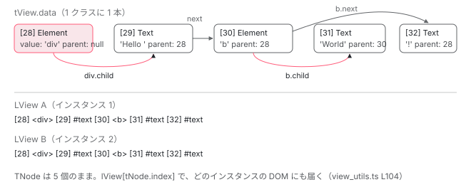

[目次](../README.md) › [Ivy ランタイム](README.md) › 第 4 回 / 全 17 回

# TNode：テンプレートの 1 ノードぶんの静的情報

> type / index / child / next / parent / directiveStart / directiveEnd / flags / attrs。要素 1 つにつき 1 個、全インスタンスで共有される。

angular/angular · 読了 約 13 分 · 中核 · [サイトで読む（デモが動きます）](https://angular-deep-dive-cyan.vercel.app/chapter/ivy-tnode)

---

`<div>Hello <b>World</b>!</div>` というテンプレートには、要素が 2 つ、テキストが 3 つあります。Ivy はこの 5 つそれぞれに **`TNode` というオブジェクトを 1 個ずつ**作ります。「T」は Template の T で、**テンプレートに書いた 1 ノードぶんの静的情報**です。この章では `TNode` のフィールドを 1 つずつ読み、それが**いつ・誰に・どの値で**作られるかを `createTNode` で確認します。インスタンスが 100 個あっても `TNode` は 5 個のままです。その理由も途中で出てきます。

読む対象は `packages/core/src/render3/interfaces/node.ts`（型定義、1013 行）と `packages/core/src/render3/tnode_manipulation.ts`（生成関数）です。

1. 概観（配列だった）
2. Ivy とは
3. テンプレート関数と RenderFlags
4. **TNode**（この章）
5. TView
6. LView
7. blueprint と TData
8. firstCreatePass
9. DOM を組む命令
10. 値を更新する命令
11. LContainer
12. ビューの木
13. フック
14. ディレクティブ
15. LFrame
16. ViewRef 等
17. 破棄

## 1. TNode は「型ごとに共有される」データ

📄 `angular/packages/core/src/render3/interfaces/node.ts` L256–279 （▶ の行: 257–258, 265, 269, 272, 277, 279）

```ts
256 │ /**
257 ▶  * Binding data (flyweight) for a particular node that is shared between all templates
258 ▶  * of a specific type.
259 │  *
260 │  * If a property is:
261 │  *    - PropertyAliases: that property's data was generated and this is it
262 │  *    - Null: that property's data was already generated and nothing was found.
263 │  *    - Undefined: that property's data has not yet been generated
264 │  *
265 ▶  * see: https://en.wikipedia.org/wiki/Flyweight_pattern for more on the Flyweight pattern
266 │  */
267 │ export interface TNode {
268 │   /** The type of the TNode. See TNodeType. */
269 ▶   type: TNodeType;
270 │ 
271 │   /**
272 ▶    * Index of the TNode in TView.data and corresponding native element in LView.
273 │    *
274 │    * This is necessary to get from any TNode to its corresponding native element when
275 │    * traversing the node tree.
276 │    *
277 ▶    * If index is -1, this is a dynamically created container node or embedded view node.
278 │    */
279 ▶   index: number;
```

257〜258 行目。「**特定の型のすべてのテンプレートで共有される**、ノード 1 つぶんのバインディングデータ（flyweight）」。265 行目に Flyweight パターンへのリンクがあります。Flyweight とは、同じ内容のオブジェクトを 1 つだけ作って使い回す設計の名前です。「同じコンポーネントのインスタンスが何個あっても、テンプレートの `<div>` の静的情報は 1 つで足りる」という判断が、この 2 行に書かれています。

269 行目 `type`、279 行目 `index`。272 行目のとおり、`index` は「`TView.data` の中の位置であり、**同じ番号で `LView` を引くと対応する DOM 要素が取れる**」番号です。277 行目、`-1` なら動的に作られたコンテナかビューのノードで、配列には入っていません。

📄 `angular/packages/core/src/render3/util/view_utils.ts` L101–106 （▶ の行: 104）

```ts
101 │ export function getNativeByTNode(tNode: TNode, lView: LView): RNode {
102 │   ngDevMode && assertTNodeForLView(tNode, lView);
103 │   ngDevMode && assertIndexInRange(lView, tNode.index);
104 ▶   const node: RNode = unwrapRNode(lView[tNode.index]);
105 │   return node;
106 │ }
```

104 行目、`lView[tNode.index]`。「TNode から DOM 要素を取る」とは、ただこれだけです。`TNode` 自身は DOM への参照を持ちません。持つのは**番号**です。だから 1 つの `TNode` を、別々の `LView`（インスタンス）に対して使い回せます。

## 2. type：ビットで表す 9 種類

📄 `angular/packages/core/src/render3/interfaces/node.ts` L30–63 （▶ の行: 30–31, 35, 37, 43, 48, 53, 58, 63）

```ts
30 ▶  * NOTE: type IDs are such that we use each bit to denote a type. This is done so that we can easily
31 ▶  * check if the `TNode` is of more than one type.
32 │  *
33 │  * `if (tNode.type === TNodeType.Text || tNode.type === TNode.Element)`
34 │  * can be written as:
35 ▶  * `if (tNode.type & (TNodeType.Text | TNodeType.Element))`
36 │  *
37 ▶  * However any given `TNode` can only be of one type.
38 │  */
39 │ export const enum TNodeType {
40 │   /**
41 │    * The TNode contains information about a DOM element aka {@link RText}.
42 │    */
43 ▶   Text = 0b1,
44 │ 
45 │   /**
46 │    * The TNode contains information about a DOM element aka {@link RElement}.
47 │    */
48 ▶   Element = 0b10,
49 │ 
50 │   /**
51 │    * The TNode contains information about an {@link LContainer} for embedded views.
52 │    */
53 ▶   Container = 0b100,
54 │ 
55 │   /**
56 │    * The TNode contains information about an `<ng-container>` element {@link RNode}.
57 │    */
58 ▶   ElementContainer = 0b1000,
59 │ 
60 │   /**
61 │    * The TNode contains information about an `<ng-content>` projection
62 │    */
63 ▶   Projection = 0b10000,
```

📄 `angular/packages/core/src/render3/interfaces/node.ts` L95–101 （▶ の行: 99–100）

```ts
 95 │   // Combined Types These should never be used for `TNode.type` only as a useful way to check
 96 │   // if `TNode.type` is one of several choices.
 97 │ 
 98 │   // See: https://github.com/microsoft/TypeScript/issues/35875 why we can't refer to existing enum.
 99 ▶   AnyRNode = 0b11, // Text | Element
100 ▶   AnyContainer = 0b1100, // Container | ElementContainer
101 │ }
```

43 行目 `Text = 0b1`、48 行目 `Element = 0b10`、53 行目 `Container = 0b100`（`@if` / `@for` / `<ng-template>` の置き場所）、58 行目 `ElementContainer = 0b1000`（`<ng-container>`）、63 行目 `Projection = 0b10000`（`<ng-content>`）。30〜35 行目のコメントが、なぜ 1, 2, 3 ではなく 1, 2, 4 なのかを説明しています。「`type === Text || type === Element`」を「`type & (Text | Element)`」と 1 回の AND で書けるようにするためです。99〜100 行目の `AnyRNode` / `AnyContainer` がその組み合わせです。1 つの `TNode` が持つ `type` は必ず 1 ビットだけ（37 行目）で、組み合わせ値は判定専用です。

## 3. 木をつなぐ 4 本のポインタ

📄 `angular/packages/core/src/render3/interfaces/node.ts` L512–548 （▶ の行: 515–516, 518, 520, 523–524, 526, 532, 543, 545–546, 548）

```ts
512 │   /**
513 │    * The TView attached to this node.
514 │    *
515 ▶    * If this TNode corresponds to an LContainer with a template (e.g. structural
516 ▶    * directive), the template's TView will be stored here.
517 │    *
518 ▶    * If this TNode corresponds to an element, tView will be `null`.
519 │    */
520 ▶   tView: TView | null;
521 │ 
522 │   /**
523 ▶    * The next sibling node. Necessary so we can propagate through the root nodes of a view
524 ▶    * to insert them or remove them from the DOM.
525 │    */
526 ▶   next: TNode | null;
527 │ 
528 │   /**
529 │    * The previous sibling node.
530 │    * This simplifies operations when we need a pointer to the previous node.
531 │    */
532 ▶   prev: TNode | null;
533 │ 
534 │   /**
535 │    * The next projected sibling. Since in Angular content projection works on the node-by-node
536 │    * basis the act of projecting nodes might change nodes relationship at the insertion point
537 │    * (target view). At the same time we need to keep initial relationship between nodes as
538 │    * expressed in content view.
539 │    */
540 │   projectionNext: TNode | null;
541 │ 
542 │   /**
543 ▶    * First child of the current node.
544 │    *
545 ▶    * For component nodes, the child will always be a ContentChild (in same view).
546 ▶    * For embedded view nodes, the child will be in their child view.
547 │    */
548 ▶   child: TNode | null;
```

📄 `angular/packages/core/src/render3/interfaces/node.ts` L550–564 （▶ の行: 551, 556–560, 564）

```ts
550 │   /**
551 ▶    * Parent node (in the same view only).
552 │    *
553 │    * We need a reference to a node's parent so we can append the node to its parent's native
554 │    * element at the appropriate time.
555 │    *
556 ▶    * If the parent would be in a different view (e.g. component host), this property will be null.
557 ▶    * It's important that we don't try to cross component boundaries when retrieving the parent
558 ▶    * because the parent will change (e.g. index, attrs) depending on where the component was
559 ▶    * used (and thus shouldn't be stored on TNode). In these cases, we retrieve the parent through
560 ▶    * LView.node instead (which will be instance-specific).
561 │    *
562 │    * If this is an inline view node (V), the parent will be its container.
563 │    */
564 ▶   parent: TElementNode | TContainerNode | null;
```

1. **526 行目 `next`、532 行目 `prev`：兄弟**

   523〜524 行目、「ビューのルートノードをたどって DOM に挿入・削除するため」に必要です。`<div>` の次が `<p>` なら `div.next === p`。
2. **548 行目 `child`：最初の子**

   子は 1 本の `child` だけで、2 番目以降は `child.next` でたどります。配列を持ちません。545〜546 行目、コンポーネントのホスト要素の `child` は**同じビューの中の**コンテントの子（投影される側）で、埋め込みビューのノードの `child` は子ビューの中にあります。
3. **564 行目 `parent`：同じビューの中の親だけ**

   551 行目「(in the same view only)」。556〜560 行目が重要です。親が別のビューにいる場合（＝このノードがコンポーネントのテンプレートの先頭要素で、親はそのコンポーネントのホスト要素）は **`null`** になります。理由：ホスト要素の `TNode` は「コンポーネントがどこで使われたか」によって `index` も `attrs` も変わるので、型ごとに共有する `TNode` に保存できないからです。その場合の親は `LView` 側から取ります（[DOM を組む命令の章](09-ivy-create-instructions.md)の `getClosestRElement`）。
4. **520 行目 `tView`：このノードが `<ng-template>` なら中身の TView**

   515〜518 行目、構造ディレクティブや `@if` の中身は別の `TView` になり、ここにぶら下がります。普通の要素なら `null` です。

設計メモ `VIEW_DATA.md` に、冒頭の例の木がそのまま表になっています。

📄 `angular/packages/core/src/render3/VIEW_DATA.md` L56–74 （▶ の行: 62–66, 71, 73–74）

```md
56 │ The above will create following layout:
57 │ 
58 │ |    Index | `LView`         | `TView.data`                                         |
59 │ | -------: | --------------- | ---------------------------------------------------- |
60 │ | `HEADER` |                 |                                                      |
61 │ |  `DECLS` |                 |                                                      |
62 ▶ |       10 | `<div>`         | `{type: Element, index: 10, parent: null}`           |
63 ▶ |       11 | `#text(Hello )` | `{type: Element, index: 11, parent: tView.data[10]}` |
64 ▶ |       12 | `<b>`           | `{type: Element, index: 12, parent: tView.data[10]}` |
65 ▶ |       13 | `#text(World)`  | `{type: Element, index: 13, parent: tView.data[12]}` |
66 ▶ |       14 | `#text(!)`      | `{type: Element, index: 14, parent: tView.data[10]}` |
67 │ |      ... | ...             | ...                                                  |
68 │ 
69 │ NOTE:
70 │ 
71 ▶ - The `10` is not the actual size of `HEADER` but it is left here for simplification.
72 │ - `LView` contains DOM instances only
73 ▶ - `TView.data` contains information on relationships such as where the parent is.
74 ▶   You need the `TView.data` information to make sense of the `LView` information.
```

62〜66 行目。`<div>` の `parent` は `null`（ビューの先頭）、中の 3 つは `parent: tView.data[10]`、`World` だけが `tView.data[12]`（`<b>`）。71 行目のとおり `10` は説明のための仮の数で、実際は `HEADER_OFFSET = 28` から始まります。73〜74 行目、「`LView` には DOM インスタンスだけ。親子関係は `TView.data` にある。**`LView` を読むには `TView.data` が要る**」。

> **🧪 DEMO — &lt;div&gt;Hello &lt;b&gt;World&lt;/b&gt;!&lt;/div&gt; の 5 つの TNode**
>
> HEADER\_OFFSET = 28 で数え直した実際の添字。クリックすると、その TNode の 4 本のポインタと、作られた瞬間の LFrame の状態を表示します。
>
> ▶ [このデモはサイトで動かせます](https://angular-deep-dive-cyan.vercel.app/chapter/ivy-tnode)

## 4. ディレクティブの位置を指す 4 つの数

📄 `angular/packages/core/src/render3/interfaces/node.ts` L334–367 （▶ の行: 335, 337, 348, 351, 354, 356–357, 360, 363–365, 367）

```ts
334 │   /**
335 ▶    * The index of the closest injector in this node's LView.
336 │    *
337 ▶    * If the index === -1, there is no injector on this node or any ancestor node in this view.
338 │    *
339 │    * If the index !== -1, it is the index of this node's injector OR the index of a parent
340 │    * injector in the same view. We pass the parent injector index down the node tree of a view so
341 │    * it's possible to find the parent injector without walking a potentially deep node tree.
342 │    * Injector indices are not set across view boundaries because there could be multiple component
343 │    * hosts.
344 │    *
345 │    * If tNode.injectorIndex === tNode.parent.injectorIndex, then the index belongs to a parent
346 │    * injector.
347 │    */
348 ▶   injectorIndex: number;
349 │ 
350 │   /** Stores starting index of the directives. */
351 ▶   directiveStart: number;
352 │ 
353 │   /**
354 ▶    * Stores final exclusive index of the directives.
355 │    *
356 ▶    * The area right behind the `directiveStart-directiveEnd` range is used to allocate the
357 ▶    * `HostBindingFunction` `vars` (or null if no bindings.) Therefore `directiveEnd` is used to set
358 │    * `LFrame.bindingRootIndex` before `HostBindingFunction` is executed.
359 │    */
360 ▶   directiveEnd: number;
361 │ 
362 │   /**
363 ▶    * Offset from the `directiveStart` at which the component (one at most) of the node is stored.
364 ▶    * Set to -1 if no components have been applied to the node. Component index can be found using
365 ▶    * `directiveStart + componentOffset`.
366 │    */
367 ▶   componentOffset: number;
```

351 行目 `directiveStart` と 360 行目 `directiveEnd`。この要素に付いたディレクティブのインスタンスは、`LView` の `[directiveStart, directiveEnd)` の範囲に並んでいて、同じ番号の `TView.data` に `DirectiveDef` が入っています。356〜357 行目、その直後に `hostBindings` 用の `vars` が確保されます。これらの番号は `decls` 区画ではなく **expando 区画**（[blueprint の章](07-ivy-blueprint.md)）の番号です。

367 行目 `componentOffset`。363〜365 行目、コンポーネントは 1 要素に最大 1 つで、`directiveStart + componentOffset` がその `ComponentDef` の位置。`-1` ならこの要素はコンポーネントのホストではありません。348 行目 `injectorIndex`。335〜337 行目、この要素か祖先のうち最も近い NodeInjector の位置で、`-1` なら無し。DI の章（[di](../di/10-di.md)）で使います。

📄 `angular/packages/core/src/render3/interfaces/type_checks.ts` L35–41 （▶ の行: 36, 40）

```ts
35 │ export function isComponentHost(tNode: TNode): boolean {
36 ▶   return tNode.componentOffset > -1;
37 │ }
38 │ 
39 │ export function isDirectiveHost(tNode: TNode): boolean {
40 ▶   return (tNode.flags & TNodeFlags.isDirectiveHost) === TNodeFlags.isDirectiveHost;
41 │ }
```

36 行目、「コンポーネントのホストか」は `componentOffset > -1`。40 行目、「ディレクティブのホストか」は `flags` のビット。この 2 つの判定が、[命令の章](09-ivy-create-instructions.md)で分岐の条件として何度も出てきます。

## 5. flags・value・attrs・inputs・outputs

📄 `angular/packages/core/src/render3/interfaces/node.ts` L405–427 （▶ の行: 409, 418, 423–424, 427）

```ts
405 │   /**
406 │    * Stores if Node isComponent, isProjected, hasContentQuery, hasClassInput and hasStyleInput
407 │    * etc.
408 │    */
409 ▶   flags: TNodeFlags;
410 │ 
411 │   /**
412 │    * This number stores two values using its bits:
413 │    *
414 │    * - the index of the first provider on that node (first 16 bits)
415 │    * - the count of view providers from the component on this node (last 16 bits)
416 │    */
417 │   // TODO(misko): break this into actual vars.
418 ▶   providerIndexes: TNodeProviderIndexes;
419 │ 
420 │   /**
421 │    * The value name associated with this node.
422 │    * if type:
423 ▶    *   `TNodeType.Text`: text value
424 ▶    *   `TNodeType.Element`: tag name
425 │    *   `TNodeType.ICUContainer`: `TIcu`
426 │    */
427 ▶   value: any;
```

📄 `angular/packages/core/src/render3/interfaces/node.ts` L146–171 （▶ の行: 148, 151, 154, 157, 160, 171）

```ts
146 │ export const enum TNodeFlags {
147 │   /** Bit #1 - This bit is set if the node is a host for any directive (including a component) */
148 ▶   isDirectiveHost = 1 << 0,
149 │ 
150 │   /** Bit #2 - This bit is set if the node has been projected */
151 ▶   isProjected = 1 << 1,
152 │ 
153 │   /** Bit #3 - This bit is set if any directive on this node has content queries */
154 ▶   hasContentQuery = 1 << 2,
155 │ 
156 │   /** Bit #4 - This bit is set if the node has any "class" inputs */
157 ▶   hasClassInput = 1 << 3,
158 │ 
159 │   /** Bit #5 - This bit is set if the node has any "style" inputs */
160 ▶   hasStyleInput = 1 << 4,
161 │ 
162 │   /** Bit #6 - This bit is set if the node has been detached by i18n */
163 │   isDetached = 1 << 5,
164 │ 
165 │   /**
166 │    * Bit #7 - This bit is set if the node has directives with host bindings.
167 │    *
168 │    * This flags allows us to guard host-binding logic and invoke it only on nodes
169 │    * that actually have directives with host bindings.
170 │    */
171 ▶   hasHostBindings = 1 << 6,
```

409 行目 `flags` は `TNodeFlags` のビット集合です。148 行目 `isDirectiveHost`（ディレクティブが 1 つでも付いた）、154 行目 `hasContentQuery`、157・160 行目 `hasClassInput` / `hasStyleInput`（`[class]` / `[style]` を input に持つディレクティブがある）、171 行目 `hasHostBindings`。どれも「この要素にこの処理が必要か」を 1 ビットで答えるためのものです。

427 行目 `value`。423〜424 行目、Text ならテキストの内容、Element ならタグ名です。`ɵɵelementStart(0, 'div')` の `'div'` と `ɵɵtext(1, 'Hello ')` の `'Hello '` はここに入ります。

📄 `angular/packages/core/src/render3/interfaces/node.ts` L434–448 （▶ の行: 435–438, 443–444, 448）

```ts
434 │   /**
435 ▶    * Attributes associated with an element. We need to store attributes to support various
436 ▶    * use-cases (attribute injection, content projection with selectors, directives matching).
437 ▶    * Attributes are stored statically because reading them from the DOM would be way too slow for
438 ▶    * content projection and queries.
439 │    *
440 │    * Since attrs will always be calculated first, they will never need to be marked undefined by
441 │    * other instructions.
442 │    *
443 ▶    * For regular attributes a name of an attribute and its value alternate in the array.
444 ▶    * e.g. ['role', 'checkbox']
445 │    * This array can contain flags that will indicate "special attributes" (attributes with
446 │    * namespaces, attributes extracted from bindings and outputs).
447 │    */
448 ▶   attrs: TAttributes | null;
```

448 行目 `attrs`。443〜444 行目、`['role', 'checkbox']` のように名前と値が交互に並ぶ配列です。435〜438 行目に「なぜ DOM から読まずに持つのか」とあります。**ディレクティブのセレクタ照合と `<ng-content select>` と属性の注入に使うので、DOM から読むのでは遅すぎる**からです。この配列は `ɵcmp.consts` の中にあり、`ɵɵelementStart` の第 3 引数がその添字でした（[前々章](02-ivy-overview.md)）。

📄 `angular/packages/core/src/render3/interfaces/node.ts` L485–500 （▶ の行: 486–487, 489, 497–498, 500）

```ts
485 │   /**
486 ▶    * Input data for all directives on this node. `null` means that there are no directives with
487 ▶    * inputs on this node.
488 │    */
489 ▶   inputs: NodeInputBindings | null;
490 │ 
491 │   /**
492 │    * Input data for host directives applied to the node.
493 │    */
494 │   hostDirectiveInputs: HostDirectiveInputs | null;
495 │ 
496 │   /**
497 ▶    * Output data for all directives on this node. `null` means that there are no directives with
498 ▶    * outputs on this node.
499 │    */
500 ▶   outputs: NodeOutputBindings | null;
```

489 行目 `inputs`、500 行目 `outputs`。486〜487 行目、「この要素に付いた**全ディレクティブの**入力」をまとめた表で、`null` なら入力を持つディレクティブが 1 つも無い。`[title]="x"` という 1 つのバインディングが、DOM プロパティなのかディレクティブの input なのかは、更新時にこの表を見て決めます（[値を更新する命令の章](10-ivy-update-instructions.md)）。

## 6. TElementNode：要素に限った型

📄 `angular/packages/core/src/render3/interfaces/node.ts` L731–755 （▶ の行: 735, 737–739, 741–742, 754）

```ts
731 │ /** Static data for an element  */
732 │ export interface TElementNode extends TNode {
733 │   /** Index in the data[] array */
734 │   index: number;
735 ▶   child: TElementNode | TTextNode | TElementContainerNode | TContainerNode | TProjectionNode | null;
736 │   /**
737 ▶    * Element nodes will have parents unless they are the first node of a component or
738 ▶    * embedded view (which means their parent is in a different view and must be
739 ▶    * retrieved using viewData[HOST_NODE]).
740 │    */
741 ▶   parent: TElementNode | TElementContainerNode | null;
742 ▶   tView: null;
743 │ 
744 │   /**
745 │    * If this is a component TNode with projection, this will be an array of projected
746 │    * TNodes or native nodes (see TNode.projection for more info). If it's a regular element node
747 │    * or a component without projection, it will be null.
748 │    */
749 │   projection: (TNode | RNode[])[] | null;
750 │ 
751 │   /**
752 │    * Stores TagName
753 │    */
754 ▶   value: string;
755 │ }
```

`TNode` は共通の型で、実際には `TElementNode` / `TTextNode` / `TContainerNode` などに絞られます。735 行目、要素の `child` は要素・テキスト・コンテナなど。741 行目、`parent` は要素か `<ng-container>`。737〜739 行目に 3 節の話がもう一度書かれています：「コンポーネントや埋め込みビューの**先頭ノードは親を持たない**。親は別のビューにいる」。742 行目、要素なら `tView` は常に `null`。754 行目、`value` はタグ名の `string` です。

## 7. createTNode：全フィールドの初期値

フィールドを 1 つずつ見てきました。それが生まれる瞬間を読みます。

📄 `angular/packages/core/src/render3/tnode_manipulation.ts` L272–291 （▶ の行: 272–278, 286–287）

```ts
272 ▶ export function createTNode(
273 ▶   tView: TView,
274 ▶   tParent: TElementNode | TContainerNode | null,
275 ▶   type: TNodeType,
276 ▶   index: number,
277 ▶   value: string | null,
278 ▶   attrs: TAttributes | null,
279 │ ): TNode {
280 │   ngDevMode &&
281 │     index !== 0 && // 0 are bogus nodes and they are OK. See `createContainerRef` in
282 │     // `view_engine_compatibility` for additional context.
283 │     assertGreaterThanOrEqual(index, HEADER_OFFSET, "TNodes can't be in the LView header.");
284 │   ngDevMode && assertNotSame(attrs, undefined, "'undefined' is not valid value for 'attrs'");
285 │   ngDevMode && tParent && assertTNodeForTView(tParent, tView);
286 ▶   let injectorIndex = tParent ? tParent.injectorIndex : -1;
287 ▶   let flags = 0;
288 │   if (isInSkipHydrationBlock()) {
289 │     flags |= TNodeFlags.inSkipHydrationBlock;
290 │   }
291 │ 
```

272〜279 行目、引数は `tView`・親 `TNode`・`type`・`index`・`value`・`attrs` の 6 つです。286 行目、`injectorIndex` は**親からコピー**します。「祖先のうち最も近いインジェクタ」を木を登らずに知るための仕掛けで、自分にインジェクタが付いたときだけ後で上書きされます。287 行目、`flags` は 0 から。

📄 `angular/packages/core/src/render3/tnode_manipulation.ts` L293–333 （▶ の行: 294–295, 298–299, 301, 307, 309, 318–320, 322–323）

```ts
293 │   const tNode = {
294 ▶     type,
295 ▶     index,
296 │     insertBeforeIndex: null,
297 │     injectorIndex,
298 ▶     directiveStart: -1,
299 ▶     directiveEnd: -1,
300 │     directiveStylingLast: -1,
301 ▶     componentOffset: -1,
302 │     controlDirectiveIndex: -1,
303 │     customControlIndex: -1,
304 │     propertyBindings: null,
305 │     flags,
306 │     providerIndexes: 0,
307 ▶     value: value,
308 │     namespace: getNamespace(),
309 ▶     attrs: attrs,
310 │     mergedAttrs: null,
311 │     localNames: null,
312 │     initialInputs: null,
313 │     inputs: null,
314 │     hostDirectiveInputs: null,
315 │     outputs: null,
316 │     hostDirectiveOutputs: null,
317 │     directiveToIndex: null,
318 ▶     tView: null,
319 ▶     next: null,
320 ▶     prev: null,
321 │     projectionNext: null,
322 ▶     child: null,
323 ▶     parent: tParent,
324 │     projection: null,
325 │     styles: null,
326 │     stylesWithoutHost: null,
327 │     residualStyles: undefined,
328 │     classes: null,
329 │     classesWithoutHost: null,
330 │     residualClasses: undefined,
331 │     classBindings: 0 as TStylingRange,
332 │     styleBindings: 0 as TStylingRange,
333 │   };
```

294〜295 行目、`type` と `index` は引数そのまま。298〜299 行目、`directiveStart` / `directiveEnd` は `-1`、301 行目 `componentOffset` も `-1`。**この時点ではディレクティブの照合はまだ行われていません**。4 節の数が埋まるのは、この後の `resolveDirectives` です （[firstCreatePass の章](08-ivy-first-create-pass.md)）。307 行目 `value`、309 行目 `attrs` は引数から。318 行目 `tView: null`。319〜322 行目、`next` / `prev` / `projectionNext` / `child` は全部 `null`。**木のポインタのうち、この関数が埋めるのは 323 行目の `parent` だけ**です。残りは次の関数がつなぎます。

> [!NOTE]
> **さらに深く**
>
> この関数の末尾（引用の直後）では、開発モードで `Object.seal(tNode)` しています。「実行時に同じ形（shape）を保つことが性能上重要。すべてのコードを monomorphic にするため」とコメントにあります。全フィールドをここで一度に書いているのも同じ理由です。後からプロパティを足すと V8 の hidden class が分岐し、`tNode.index` のような単純な参照が遅くなります（`PERF_NOTES.md`）。

## 8. 親を決め、木につなぐ：createTNodeAtIndex と linkTNodeInTView

`createTNode` に渡す「親」は誰が決めるのか。`LFrame` の `currentTNode` と `isParent` です。

📄 `angular/packages/core/src/render3/state.ts` L71–83 （▶ の行: 76, 80–81, 83）

```ts
71 │   /**
72 │    * Used to set the parent property when nodes are created and track query results.
73 │    *
74 │    * This is used in conjunction with `isParent`.
75 │    */
76 ▶   currentTNode: TNode | null;
77 │ 
78 │   /**
79 │    * If `isParent` is:
80 ▶    *  - `true`: then `currentTNode` points to a parent node.
81 ▶    *  - `false`: then `currentTNode` points to previous node (sibling).
82 │    */
83 ▶   isParent: boolean;
```

76 行目 `currentTNode` は「最後に触った TNode」。83 行目 `isParent` が `true` なら 80 行目「`currentTNode` は親」、`false` なら 81 行目「`currentTNode` は直前の兄弟」です。`ɵɵelementStart` は `isParent = true` にし（この後に来るノードは自分の子）、`ɵɵtext` と `ɵɵelementEnd` は `false` にします（この後に来るノードは兄弟）。その切り替えは[命令の章](09-ivy-create-instructions.md)で確認します。

📄 `angular/packages/core/src/render3/tnode_manipulation.ts` L149–176 （▶ の行: 156–158, 160–161, 173）

```ts
149 │ export function createTNodeAtIndex(
150 │   tView: TView,
151 │   index: number,
152 │   type: TNodeType,
153 │   name: string | null,
154 │   attrs: TAttributes | null,
155 │ ) {
156 ▶   const currentTNode = getCurrentTNodePlaceholderOk();
157 ▶   const isParent = isCurrentTNodeParent();
158 ▶   const parent = isParent ? currentTNode : currentTNode && currentTNode.parent;
159 │ 
160 ▶   // Parents cannot cross component boundaries because components will be used in multiple places.
161 ▶   const tNode = (tView.data[index] = createTNode(
162 │     tView,
163 │     parent as TElementNode | TContainerNode,
164 │     type,
165 │     index,
166 │     name,
167 │     attrs,
168 │   ));
169 │ 
170 │   // Assign a pointer to the first child node of a given view. The first node is not always the one
171 │   // at index 0, in case of i18n, index 0 can be the instruction `i18nStart` and the first node has
172 │   // the index 1 or more, so we can't just check node index.
173 ▶   linkTNodeInTView(tView, tNode, currentTNode, isParent);
174 │ 
175 │   return tNode;
176 │ }
```

1. **156〜158 行目：親を決める**

   `isParent` なら `currentTNode` がそのまま親。そうでなければ `currentTNode.parent`（兄弟の親＝自分の親）。`currentTNode` が `null`（ビューの先頭）なら親も `null`。160 行目のコメント「親はコンポーネント境界を越えない。コンポーネントは複数の場所で使われるから」が、3 節の `parent: null` の理由と同じです。
2. **161 行目：`tView.data[index]` に書き込む**

   `createTNode` の戻り値をそのまま `TView.data` の `index` 番に入れます。**これが「TNode は TView 側にある」の実体**です。`LView` には入れません。
3. **173 行目：`linkTNodeInTView` で兄弟・子をつなぐ**

📄 `angular/packages/core/src/render3/tnode_manipulation.ts` L178–203 （▶ の行: 184–185, 188, 190, 192, 195, 198–199）

```ts
178 │ function linkTNodeInTView(
179 │   tView: TView,
180 │   tNode: TNode,
181 │   currentTNode: TNode | null,
182 │   isParent: boolean,
183 │ ) {
184 ▶   if (tView.firstChild === null) {
185 ▶     tView.firstChild = tNode;
186 │   }
187 │   if (currentTNode !== null) {
188 ▶     if (isParent) {
189 │       // FIXME(misko): This logic looks unnecessarily complicated. Could we simplify?
190 ▶       if (currentTNode.child == null && tNode.parent !== null) {
191 │         // We are in the same view, which means we are adding content node to the parent view.
192 ▶         currentTNode.child = tNode;
193 │       }
194 │     } else {
195 ▶       if (currentTNode.next === null) {
196 │         // In the case of i18n the `currentTNode` may already be linked, in which case we don't want
197 │         // to break the links which i18n created.
198 ▶         currentTNode.next = tNode;
199 ▶         tNode.prev = currentTNode;
200 │       }
201 │     }
202 │   }
203 │ }
```

184〜185 行目、`tView.firstChild` が空なら、この TNode がビューの先頭になります（`enterView` が `currentTNode` の初期値に使うのはこれでした）。188〜192 行目、`isParent` なら `currentTNode.child = tNode`（まだ子が無いときだけ）。195〜199 行目、兄弟なら `currentTNode.next = tNode` と `tNode.prev = currentTNode` を双方向に。`parent` は `createTNode` で、`child` / `next` / `prev` はここで。4 本のポインタが揃いました。



*5 つの命令が順に走り、LFrame の currentTNode / isParent を見て親を決め、tView.data\[28..32\] に TNode を置き、child / next / prev でつなぐ。LView 側の同じ番号には DOM ノードが入る。*

## ここまでの呼び出し

- 👤 `ɵɵelementStart(0, 'div')` — 生成コード — *tView.firstCreatePass のときだけ以下に進む（8 章）*
  - `directiveHostFirstCreatePass(28, lView, TNodeType.Element, 'div', ...)` — core/src/render3/view/elements.ts L26
    - `getOrCreateTNode(tView, 28, Element, 'div', attrs)` — core/src/render3/tnode\_manipulation.ts L102 — *tView.data\[28\] が null なら作る*
      - `createTNodeAtIndex(tView, 28, type, name, attrs)` — tnode\_manipulation.ts L149 — *LFrame.currentTNode / isParent から親を決める*
        - `createTNode(tView, parent, type, 28, 'div', attrs)` — tnode\_manipulation.ts L272 — *全フィールドを初期化。directiveStart = -1*
        - `tView.data[28] = tNode` — tnode\_manipulation.ts L161
        - `linkTNodeInTView(tView, tNode, currentTNode, isParent)` — tnode\_manipulation.ts L178 — *firstChild / child / next / prev*
      - `setCurrentTNode(tNode, true)` — tnode\_manipulation.ts L140 — *次のノードは自分の子*
    - `resolveDirectives(tView, lView, tNode, ...)` — view/directives.ts L58 — *directiveStart / directiveEnd / componentOffset / flags を埋める（8 章）*

## 聞かれそうな質問

**Q. TNode は何個できますか？要素ごと？インスタンスごと？**

テンプレートのノードごとに 1 個、**インスタンスの数とは無関係**です。node.ts 257〜258 行目に「特定の型のすべてのテンプレートで共有される」と書かれ、置き場所は `tView.data[index]`（tnode\_manipulation.ts 161 行目）です。`TView` は 1 クラスに 1 つなので、`TNode` もそのテンプレートに書いた分だけです。冒頭の例なら 5 個。インスタンスが 100 個でも 5 個です。

**Q. TNode から DOM 要素はどう取りますか？**

`lView[tNode.index]`（view\_utils.ts 104 行目）です。`TNode` は DOM への参照を持たず、番号だけを持ちます（node.ts 272 行目）。どの `lView` を渡すかで、どのインスタンスの DOM が返るかが決まります。

**Q. tNode.parent が null なら、そのノードはルート要素ですか？**

「そのビューの中では」先頭です。node.ts 556〜560 行目のとおり、親が別のビューにいる場合も `null` になります。たとえばコンポーネントのテンプレートの一番外の要素は、親がホスト要素（別のビュー）なので `parent: null` です。コンポーネントはいろいろな場所で使われるので、共有する `TNode` に親を書けないためです（createTNodeAtIndex の 160 行目のコメントも同じ）。

**Q. directiveStart と directiveEnd は、作られた直後は何ですか？**

どちらも `-1` です（tnode\_manipulation.ts 298〜299 行目）。`componentOffset` も `-1`（301 行目）。`createTNode` はディレクティブの照合をしません。これらは直後の `resolveDirectives` → `initTNodeFlags` で埋まります （[firstCreatePass の章](08-ivy-first-create-pass.md)）。

**Q. 子ノードは配列で持っていますか？**

いません。`child`（node.ts 548 行目）が最初の子 1 つを指し、2 番目以降は `child.next`（526 行目）でたどります。つなぐのは `linkTNodeInTView`（tnode\_manipulation.ts 188〜199 行目）で、`isParent` なら `child`、そうでなければ `next` / `prev` を張ります。

**Q. type はなぜ 1, 2, 4, 8 なのですか？**

複数の種類をまとめて判定するためです。node.ts 30〜35 行目のとおり、`type & (Text | Element)` の 1 回の AND で「テキストか要素か」が分かります。99〜100 行目の `AnyRNode` / `AnyContainer` がその組み合わせ値です。1 つの `TNode` の `type` 自体は常に 1 ビットだけです（37 行目）。

## 読み終えて

- `TNode` はテンプレートの 1 ノードぶんの静的情報。`tView.data[index]` に置かれ、全インスタンスで共有される（flyweight）
- DOM への参照は持たず、番号 `index` だけを持つ。`lView[tNode.index]` でどのインスタンスの DOM にも届く
- 木は `parent` / `child` / `next` / `prev` の 4 本。`parent` は同じビュー内だけで、別ビューの親は `null`
- `createTNode` が全フィールドを初期化し `parent` を埋め、`linkTNodeInTView` が `child` / `next` / `prev` をつなぐ。親は `LFrame.currentTNode` と `isParent` で決まる
- `directiveStart` / `directiveEnd` / `componentOffset` は `-1` で始まり、ディレクティブ照合のあとで埋まる

---

← 前: [テンプレート関数と RenderFlags：同じ関数を Create と Update で 2 回呼ぶ](03-ivy-template-function.md)  
次: [TView：テンプレートの設計図](05-ivy-tview.md) →
