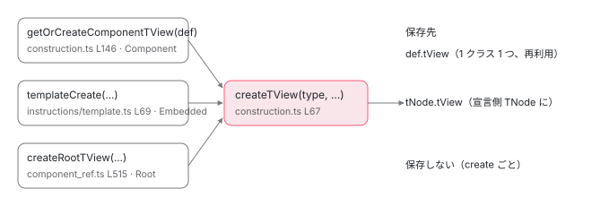

[目次](../README.md) › [Ivy ランタイム](README.md) › 第 5 回 / 全 17 回

# TView：テンプレートの設計図

> type / blueprint / data / bindingStartIndex / expandoStartIndex / フック配列 / components。createTView が何を初期化し、def.tView にどうキャッシュされるか。

angular/angular · 読了 約 14 分 · 中核 · [サイトで読む（デモが動きます）](https://angular-deep-dive-cyan.vercel.app/chapter/ivy-tview)

---

[前章](04-ivy-tnode.md)の `TNode` は `tView.data[index]` に置かれていました。その `TView` が今回の主役です。`TView` は**テンプレート 1 つぶんの設計図**で、`TNode` の配列・バインディング区画の開始位置・フックの一覧・`LView` の型紙を持ち、**1 クラスに 1 つ**だけ作られて `ɵcmp.tView` に保存されます。この章では `TView` の各フィールドを読み、`createTView` がそれらを何で初期化するか、そして `def.tView` にどう保存されて 2 回目以降は作られなくなるかを追います。

読む対象は `packages/core/src/render3/interfaces/view.ts` の `TView`（L623〜881）と `packages/core/src/render3/view/construction.ts` の `createTView` / `getOrCreateComponentTView` です。

1. 概観（配列だった）
2. Ivy とは
3. テンプレート関数と RenderFlags
4. TNode
5. **TView**（この章）
6. LView
7. blueprint と TData
8. firstCreatePass
9. DOM を組む命令
10. 値を更新する命令
11. LContainer
12. ビューの木
13. フック
14. ディレクティブ
15. LFrame
16. ViewRef 等
17. 破棄

## 1. TView とは：LView の静的データ

📄 `angular/packages/core/src/render3/interfaces/view.ts` L617–654 （▶ の行: 618–619, 621, 627, 630–631, 633, 636–637, 639, 647, 649, 653–654）

```ts
617 │ /**
618 ▶  * The static data for an LView (shared between all templates of a
619 ▶  * given type).
620 │  *
621 ▶  * Stored on the `ComponentDef.tView`.
622 │  */
623 │ export interface TView {
624 │   /**
625 │    * Type of `TView` (`Root`|`Component`|`Embedded`).
626 │    */
627 ▶   type: TViewType;
628 │ 
629 │   /**
630 ▶    * This is a blueprint used to generate LView instances for this TView. Copying this
631 ▶    * blueprint is faster than creating a new LView from scratch.
632 │    */
633 ▶   blueprint: LView;
634 │ 
635 │   /**
636 ▶    * The template function used to refresh the view of dynamically created views
637 ▶    * and components. Will be null for inline views.
638 │    */
639 ▶   template: ComponentTemplate<{}> | null;
640 │ 
641 │   /**
642 │    * A function containing query-related instructions.
643 │    */
644 │   viewQuery: ViewQueriesFunction<{}> | null;
645 │ 
646 │   /**
647 ▶    * A `TNode` representing the declaration location of this `TView` (not part of this TView).
648 │    */
649 ▶   declTNode: TNode | null;
650 │ 
651 │   // FIXME(misko): Why does `TView` not have `declarationTView` property?
652 │ 
653 ▶   /** Whether or not this template has been processed in creation mode. */
654 ▶   firstCreatePass: boolean;
```

618〜621 行目。「**`LView` の静的データ。同じ型のすべてのテンプレートで共有される。`ComponentDef.tView` に保存される**」。前章の `TNode` と同じ「共有」の言葉です。`LView` がインスタンスごとに持つ「値」に対して、`TView` は「構造」を持ちます。

1. **627 行目 `type`**

   Root / Component / Embedded のどれか。次の引用で見ます。
2. **633 行目 `blueprint`**

   630〜631 行目、「この TView 用の LView を生成するための型紙。ゼロから作るより速い」。[概観](01-component.md)で `blueprint.slice()` を見ました。中身の作り方は[blueprint の章](07-ivy-blueprint.md)で読みます。
3. **639 行目 `template`**

   636〜637 行目、「動的に作られたビューとコンポーネントのビューを更新するためのテンプレート関数」。`ɵcmp.template` と同じ関数がここにもコピーされます（[3 章](03-ivy-template-function.md)の `renderView` が読んでいた `tView.template` がこれです）。
4. **649 行目 `declTNode`**

   647 行目、「この TView が宣言された場所の `TNode`（この TView の一部ではない）」。`<ng-template>` の中身の TView なら、その `<ng-template>` を表す `TNode` です。コンポーネントの TView では `null`（4 節）。
5. **654 行目 `firstCreatePass`**

   653 行目、「このテンプレートが creation mode で処理されたことがあるか」。`true` のあいだだけ `TNode` を作りディレクティブを照合します。いつ `false` になるかは 5 節。

📄 `angular/packages/core/src/render3/interfaces/view.ts` L591–615 （▶ の行: 597, 603, 609, 614）

```ts
591 │ export const enum TViewType {
592 │   /**
593 │    * Root `TView` is the used to bootstrap components into. It is used in conjunction with
594 │    * `LView` which takes an existing DOM node not owned by Angular and wraps it in `TView`/`LView`
595 │    * so that other components can be loaded into it.
596 │    */
597 ▶   Root = 0,
598 │ 
599 │   /**
600 │    * `TView` associated with a Component. This would be the `TView` directly associated with the
601 │    * component view (as opposed an `Embedded` `TView` which would be a child of `Component` `TView`)
602 │    */
603 ▶   Component = 1,
604 │ 
605 │   /**
606 │    * `TView` associated with a template. Such as `*ngIf`, `<ng-template>` etc... A `Component`
607 │    * can have zero or more `Embedded` `TView`s.
608 │    */
609 ▶   Embedded = 2,
610 │ 
611 │   /**
612 │    * Foreign `TView` associated with a range of nodes between `head` and `tail` comment nodes.
613 │    */
614 ▶   Foreign = 3,
615 │ }
```

597 行目 `Root`：ブートストラップ時に、Angular の管理外の既存 DOM ノードを包むための TView。603 行目 `Component`：コンポーネントのテンプレートの TView。609 行目 `Embedded`：`@if` / `@for` / `<ng-template>` の中身。コンポーネントの TView は 0 個以上の Embedded TView を子に持ちます。614 行目 `Foreign` は別フレームワークのノード範囲用です。4 節で、3 種類それぞれの `createTView` 呼び出しを見ます。

## 2. 3 つの添字：data・bindingStartIndex・expandoStartIndex

📄 `angular/packages/core/src/render3/interfaces/view.ts` L656–692 （▶ の行: 659–660, 667, 669–670, 673–676, 680, 683–687, 692）

```ts
656 │   /**
657 │    *  Whether or not this template has been processed in update mode (e.g. change detected)
658 │    *
659 ▶    * `firstUpdatePass` is used by styling to set up `TData` to contain metadata about the styling
660 ▶    * instructions. (Mainly to build up a linked list of styling priority order.)
661 │    *
662 │    * Typically this function gets cleared after first execution. If exception is thrown then this
663 │    * flag can remain turned un until there is first successful (no exception) pass. This means that
664 │    * individual styling instructions keep track of if they have already been added to the linked
665 │    * list to prevent double adding.
666 │    */
667 ▶   firstUpdatePass: boolean;
668 │ 
669 ▶   /** Static data equivalent of LView.data[]. Contains TNodes, PipeDefInternal or TI18n. */
670 ▶   data: TData;
671 │ 
672 │   /**
673 ▶    * The binding start index is the index at which the data array
674 ▶    * starts to store bindings only. Saving this value ensures that we
675 ▶    * will begin reading bindings at the correct point in the array when
676 ▶    * we are in update mode.
677 │    *
678 │    * -1 means that it has not been initialized.
679 │    */
680 ▶   bindingStartIndex: number;
681 │ 
682 │   /**
683 ▶    * The index where the "expando" section of `LView` begins. The expando
684 ▶    * section contains injectors, directive instances, and host binding values.
685 ▶    * Unlike the "decls" and "vars" sections of `LView`, the length of this
686 ▶    * section cannot be calculated at compile-time because directives are matched
687 ▶    * at runtime to preserve locality.
688 │    *
689 │    * We store this start index so we know where to start checking host bindings
690 │    * in `setHostBindings`.
691 │    */
692 ▶   expandoStartIndex: number;
```

1. **670 行目 `data`**

   669 行目、「`LView.data[]` の静的な対応物。`TNode`、`PipeDef`、`TI18n` が入る」。`TNode` が `tView.data[28]` に入っていたのはこれです。`LView` と**同じ長さ・同じ番号**で、`LView` の 28 番が `<div>` なら `data` の 28 番はその `TNode`。
2. **680 行目 `bindingStartIndex`**

   673〜676 行目、「`data` 配列がバインディング**だけ**を保存し始める位置。更新モードで正しい位置から読み始めるために保存している」。[3 章](03-ivy-template-function.md)の `refreshView` が `setBindingIndex(tView.bindingStartIndex)` していたのは、この値です。3 節で `HEADER_OFFSET + decls` と計算されるのを見ます。
3. **692 行目 `expandoStartIndex`**

   683〜687 行目、「expando 区画の開始位置。インジェクタ、ディレクティブのインスタンス、host binding の値が入る。`decls` / `vars` と違って**長さをコンパイル時に計算できない**。局所性を保つためにディレクティブは実行時に照合されるから」。[2 章](02-ivy-overview.md)で読んだ局所性の帰結が、この 1 フィールドです。
4. **667 行目 `firstUpdatePass`**

   659〜660 行目、スタイリング命令が `TData` にメタデータ（優先順位の連結リスト）を組むために使うフラグ。`firstCreatePass` の更新側の相棒で、こちらは `refreshView` が落とします（5 節）。

## 3. createTView：全フィールドの初期値

📄 `angular/packages/core/src/render3/view/construction.ts` L54–86 （▶ の行: 67–74, 80–86）

```ts
54 │ /**
55 │  * Creates a TView instance
56 │  *
57 │  * @param type Type of `TView`.
58 │  * @param declTNode Declaration location of this `TView`.
59 │  * @param templateFn Template function
60 │  * @param decls The number of nodes, local refs, and pipes in this template
61 │  * @param directives Registry of directives for this view
62 │  * @param pipes Registry of pipes for this view
63 │  * @param viewQuery View queries for this view
64 │  * @param schemas Schemas for this view
65 │  * @param consts Constants for this view
66 │  */
67 ▶ export function createTView(
68 ▶   type: TViewType,
69 ▶   declTNode: TNode | null,
70 ▶   templateFn: ComponentTemplate<any> | null,
71 ▶   decls: number,
72 ▶   vars: number,
73 ▶   directives: DirectiveDefListOrFactory | null,
74 ▶   pipes: PipeDefListOrFactory | null,
75 │   viewQuery: ViewQueriesFunction<any> | null,
76 │   schemas: SchemaMetadata[] | null,
77 │   constsOrFactory: TConstantsOrFactory | null,
78 │   ssrId: string | null,
79 │ ): TView {
80 ▶   const bindingStartIndex = HEADER_OFFSET + decls;
81 ▶   // This length does not yet contain host bindings from child directives because at this point,
82 ▶   // we don't know which directives are active on this template. As soon as a directive is matched
83 ▶   // that has a host binding, we will update the blueprint with that def's hostVars count.
84 ▶   const initialViewLength = bindingStartIndex + vars;
85 ▶   const blueprint = createViewBlueprint(bindingStartIndex, initialViewLength);
86 ▶   const consts = typeof constsOrFactory === 'function' ? constsOrFactory() : constsOrFactory;
```

67〜79 行目、引数は 11 個。`type`・`declTNode`・`templateFn`・`decls`・`vars`・ディレクティブとパイプのレジストリ・`viewQuery`・`schemas`・`consts`・`ssrId`。**全部 `ɵcmp` にあったもの**です（4 節の呼び出し側で確認します）。

1. **80 行目：`bindingStartIndex = HEADER_OFFSET + decls`**

   28 + ノード数。「`ɵɵelementStart(0, ...)` の 0 は 28 番」というずらしは、ここで `decls` 個ぶんの区画として確定します。
2. **84 行目：`initialViewLength = bindingStartIndex + vars`**

   81〜83 行目のコメント。「この長さには子ディレクティブの host binding はまだ含まれない。この時点ではどのディレクティブが有効か分からないから。**host binding を持つディレクティブが照合されたら、その `hostVars` のぶんだけ blueprint を更新する**」。これが expando 区画が「あとから伸びる」理由です（[次々章](07-ivy-blueprint.md)の `allocExpando`）。
3. **85 行目：`createViewBlueprint(bindingStartIndex, initialViewLength)`**

   型紙を 1 本作ります。中身は[blueprint の章](07-ivy-blueprint.md)で。
4. **86 行目：`consts` が関数なら呼んで配列にする**

   `ɵcmp.consts` は配列か関数（i18n のとき）でした。TView には必ず配列で入れます。

📄 `angular/packages/core/src/render3/view/construction.ts` L87–127 （▶ の行: 87–90, 93–96, 98–99, 102, 108, 111–114, 116–117, 120–124）

```ts
 87 ▶   const tView = (blueprint[TVIEW as any] = {
 88 ▶     type: type,
 89 ▶     blueprint: blueprint,
 90 ▶     template: templateFn,
 91 │     queries: null,
 92 │     viewQuery: viewQuery,
 93 ▶     declTNode: declTNode,
 94 ▶     data: blueprint.slice().fill(null, bindingStartIndex),
 95 ▶     bindingStartIndex: bindingStartIndex,
 96 ▶     expandoStartIndex: initialViewLength,
 97 │     hostBindingOpCodes: null,
 98 ▶     firstCreatePass: true,
 99 ▶     firstUpdatePass: true,
100 │     staticViewQueries: false,
101 │     staticContentQueries: false,
102 ▶     preOrderHooks: null,
103 │     preOrderCheckHooks: null,
104 │     contentHooks: null,
105 │     contentCheckHooks: null,
106 │     viewHooks: null,
107 │     viewCheckHooks: null,
108 ▶     destroyHooks: null,
109 │     cleanup: null,
110 │     contentQueries: null,
111 ▶     components: null,
112 ▶     directiveRegistry: typeof directives === 'function' ? directives() : directives,
113 ▶     pipeRegistry: typeof pipes === 'function' ? pipes() : pipes,
114 ▶     firstChild: null,
115 │     schemas: schemas,
116 ▶     consts: consts,
117 ▶     incompleteFirstPass: false,
118 │     ssrId,
119 │   });
120 ▶   if (ngDevMode) {
121 ▶     // For performance reasons it is important that the tView retains the same shape during runtime.
122 ▶     // (To make sure that all of the code is monomorphic.) For this reason we seal the object to
123 ▶     // prevent class transitions.
124 ▶     Object.seal(tView);
125 │   }
126 │   return tView;
127 │ }
```

1. **87 行目：`blueprint[TVIEW] = tView`**

   型紙の 1 番（`TVIEW`）に、今作っている `TView` 自身を入れます。型紙を `slice()` して作られる全 `LView` は、**最初から `lView[TVIEW]` が埋まっている**ことになります。[次章](06-ivy-lview.md)の `createLView` に `lView[TVIEW] = ...` という行が無いのはこのためです。
2. **94 行目：`data = blueprint.slice().fill(null, bindingStartIndex)`**

   `data` も型紙の複製から作ります。ただし `bindingStartIndex` 以降を `null` で埋め直します （型紙のその区画には `NO_CHANGE` が入っているので、`TData` 側は `null` にしておく）。`TNode` が入る 28〜 の区画も、この時点では全部 `null` です。
3. **98〜99 行目：`firstCreatePass: true`、`firstUpdatePass: true`**
4. **102〜108 行目：フック配列はすべて `null`**

   `preOrderHooks` から `destroyHooks` まで。ディレクティブを照合して初めて、必要なものだけが配列になります。
5. **111〜114 行目：`components: null`、レジストリ、`firstChild: null`**

   112〜113 行目、ディレクティブとパイプのレジストリが関数なら呼んで配列に。`ɵcmp.directiveDefs` が関数の形をとれたのは前方参照のためでした。`firstChild` は前章の `linkTNodeInTView` が最初の `TNode` で埋めます。
6. **124 行目：`Object.seal(tView)`（開発モード）**

   120〜123 行目、形を固定して monomorphic に保つため。`createTNode` と同じ理由です。

📄 `angular/packages/core/src/render3/interfaces/view.ts` L710–739 （▶ の行: 713, 720, 723, 725–726, 728, 739）

```ts
710 │   /**
711 │    * A reference to the first child node located in the view.
712 │    */
713 ▶   firstChild: TNode | null;
714 │ 
715 │   /**
716 │    * Stores the OpCodes to be replayed during change-detection to process the `HostBindings`
717 │    *
718 │    * See `HostBindingOpCodes` for encoding details.
719 │    */
720 ▶   hostBindingOpCodes: HostBindingOpCodes | null;
721 │ 
722 │   /**
723 ▶    * Full registry of directives and components that may be found in this view.
724 │    *
725 ▶    * It's necessary to keep a copy of the full def list on the TView so it's possible
726 ▶    * to render template functions without a host component.
727 │    */
728 ▶   directiveRegistry: DirectiveDefList | null;
729 │ 
730 │   /**
731 │    * Full registry of pipes that may be found in this view.
732 │    *
733 │    * The property is either an array of `PipeDefs`s or a function which returns the array of
734 │    * `PipeDefs`s. The function is necessary to be able to support forward declarations.
735 │    *
736 │    * It's necessary to keep a copy of the full def list on the TView so it's possible
737 │    * to render template functions without a host component.
738 │    */
739 ▶   pipeRegistry: PipeDefList | null;
```

728 行目 `directiveRegistry`、739 行目 `pipeRegistry`。725〜726 行目、「ホストコンポーネント無しでもテンプレート関数を描けるように、完全な一覧のコピーを TView に持つ」。[firstCreatePass の章](08-ivy-first-create-pass.md)の `findDirectiveDefMatches` が総当たりするのはこの配列です。720 行目 `hostBindingOpCodes` は host binding を再生するための命令列で、[ディレクティブの章](14-ivy-directives.md)で扱います。

📄 `angular/packages/core/src/render3/interfaces/view.ts` L754–786 （▶ の行: 759, 762–763, 765–766, 768, 777, 786）

```ts
754 │   /**
755 │    * Array of ngOnChanges and ngDoCheck hooks that should be executed for this view in update mode.
756 │    *
757 │    * This array has the same structure as the `preOrderHooks` one.
758 │    */
759 ▶   preOrderCheckHooks: HookData | null;
760 │ 
761 │   /**
762 ▶    * Array of ngAfterContentInit and ngAfterContentChecked hooks that should be executed
763 ▶    * for this view in creation mode.
764 │    *
765 ▶    * Even indices: Directive index
766 ▶    * Odd indices: Hook function
767 │    */
768 ▶   contentHooks: HookData | null;
769 │ 
770 │   /**
771 │    * Array of ngAfterContentChecked hooks that should be executed for this view in update
772 │    * mode.
773 │    *
774 │    * Even indices: Directive index
775 │    * Odd indices: Hook function
776 │    */
777 ▶   contentCheckHooks: HookData | null;
778 │ 
779 │   /**
780 │    * Array of ngAfterViewInit and ngAfterViewChecked hooks that should be executed for
781 │    * this view in creation mode.
782 │    *
783 │    * Even indices: Directive index
784 │    * Odd indices: Hook function
785 │    */
786 ▶   viewHooks: HookData | null;
```

📄 `angular/packages/core/src/render3/interfaces/view.ts` L833–844 （▶ の行: 834–836, 839）

```ts
833 │   /**
834 ▶    * A list of element indices for child components that will need to be
835 ▶    * refreshed when the current view has finished its check. These indices have
836 ▶    * already been adjusted for the HEADER_OFFSET.
837 │    *
838 │    */
839 ▶   components: number[] | null;
840 │ 
841 │   /**
842 │    * A collection of queries tracked in a given view.
843 │    */
844 │   queries: TQueries | null;
```

759 行目 `preOrderCheckHooks`、768 行目 `contentHooks`、777 行目 `contentCheckHooks`、786 行目 `viewHooks`。765〜766 行目、「偶数番にディレクティブの添字、奇数番にフック関数」という平坦な配列です。**フックの一覧が `TView` にある**ということは、「どのフックをどの順で呼ぶか」は全インスタンス共通で、「まだ呼んでいないか」だけがインスタンス側（`lView[FLAGS]`）にある、という分担です（[フックの章](13-ivy-hooks.md)）。

839 行目 `components`。834〜836 行目、「このビューのチェックが終わったあとに更新する必要がある子コンポーネントのホスト要素の添字一覧。`HEADER_OFFSET` 済み」。変更検知が子へ降りるときの道しるべで、`markAsComponentHost`（[8 章](08-ivy-first-create-pass.md)）が `push` します。

📄 `angular/packages/core/src/render3/interfaces/view.ts` L862–881 （▶ の行: 866, 869–872, 877, 880）

```ts
862 │   /**
863 │    * Array of constants for the view. Includes attribute arrays, local definition arrays etc.
864 │    * Used for directive matching, attribute bindings, local definitions and more.
865 │    */
866 ▶   consts: TConstants | null;
867 │ 
868 │   /**
869 ▶    * Indicates that there was an error before we managed to complete the first create pass of the
870 ▶    * view. This means that the view is likely corrupted and we should try to recover it.
871 ▶    */
872 ▶   incompleteFirstPass: boolean;
873 │ 
874 │   /**
875 │    * Unique id of this TView for hydration purposes:
876 │    * - TViewType.Embedded: a unique id generated during serialization on the server
877 ▶    * - TViewType.Component: an id generated based on component properties
878 │    *                        (see `getComponentId` function for details)
879 │    */
880 ▶   ssrId: string | null;
881 │ }
```

866 行目 `consts`、880 行目 `ssrId`（877 行目、コンポーネントなら `ɵcmp.id`）。872 行目 `incompleteFirstPass`。869〜871 行目、「最初の create pass を完了する前にエラーが起きた印。ビューは壊れている可能性が高いので回復を試みる」。使われ方は 4 節と 5 節で出てきます。

## 4. 3 つの呼び出し側：Component / Embedded / Root

### Component：getOrCreateComponentTView と def.tView

📄 `angular/packages/core/src/render3/interfaces/definition.ts` L396–400 （▶ の行: 397–398, 400）

```ts
396 │   /**
397 ▶    * Ivy runtime uses this place to store the computed tView for the component. This gets filled on
398 ▶    * the first run of component.
399 │    */
400 ▶   tView: TView | null;
```

📄 `angular/packages/core/src/render3/view/construction.ts` L139–171 （▶ の行: 147, 149–167, 170）

```ts
139 │ /**
140 │  * Gets TView from a template function or creates a new TView
141 │  * if it doesn't already exist.
142 │  *
143 │  * @param def ComponentDef
144 │  * @returns TView
145 │  */
146 │ export function getOrCreateComponentTView(def: ComponentDef<any>): TView {
147 ▶   const tView = def.tView;
148 │ 
149 ▶   // Create a TView if there isn't one, or recreate it if the first create pass didn't
150 ▶   // complete successfully since we can't know for sure whether it's in a usable shape.
151 ▶   if (tView === null || tView.incompleteFirstPass) {
152 ▶     // Declaration node here is null since this function is called when we dynamically create a
153 ▶     // component and hence there is no declaration.
154 ▶     const declTNode = null;
155 ▶     return (def.tView = createTView(
156 ▶       TViewType.Component,
157 ▶       declTNode,
158 ▶       def.template,
159 ▶       def.decls,
160 ▶       def.vars,
161 ▶       def.directiveDefs,
162 ▶       def.pipeDefs,
163 ▶       def.viewQuery,
164 ▶       def.schemas,
165 ▶       def.consts,
166 ▶       def.id,
167 ▶     ));
168 │   }
169 │ 
170 ▶   return tView;
171 │ }
```

1. **147 行目：`def.tView` を読む**

   [2 章](02-ivy-overview.md)で `null` だった枠です。
2. **151 行目：`null` か、`incompleteFirstPass` なら作る**

   149〜150 行目のコメント、「無ければ作る。**最初の create pass が成功しなかった場合も作り直す**。使える形か確信できないから」。3 節で見た `incompleteFirstPass` の読み手がここです。
3. **155〜167 行目：`def.tView = createTView(TViewType.Component, null, def.template, def.decls, def.vars, def.directiveDefs, def.pipeDefs, def.viewQuery, def.schemas, def.consts, def.id)`**

   11 個の引数のうち `declTNode` だけが `null`（152〜154 行目：動的に作るので宣言場所が無い）。残り 9 個は**すべて `ɵcmp` のフィールドをそのまま渡しています**。`TView` は「`ɵcmp` を実行時用に展開したもの」と言えます。戻り値を `def.tView` に**代入してから**返すので、2 回目の呼び出しは 170 行目で既存を返します。

この関数を呼ぶのは `createComponentLView`（[次章](06-ivy-lview.md)）で、その呼び出し元はディレクティブのインスタンス化です。

📄 `angular/packages/core/src/render3/instructions/shared.ts` L386–399 （▶ の行: 390–392, 394, 397）

```ts
386 │ function instantiateAllDirectives(tView: TView, lView: LView, tNode: TDirectiveHostNode) {
387 │   const start = tNode.directiveStart;
388 │   const end = tNode.directiveEnd;
389 │ 
390 ▶   // The component view needs to be created before creating the node injector
391 ▶   // since it is used to inject some special symbols like `ChangeDetectorRef`.
392 ▶   if (isComponentHost(tNode)) {
393 │     ngDevMode && assertTNodeType(tNode, TNodeType.AnyRNode);
394 ▶     createComponentLView(
395 │       lView,
396 │       tNode as TElementNode,
397 ▶       tView.data[start + tNode.componentOffset] as ComponentDef<unknown>,
398 │     );
399 │   }
```

392 行目、親テンプレートの要素がコンポーネントのホストなら、394 行目で `createComponentLView`。397 行目、渡している `def` は `tView.data[directiveStart + componentOffset]`、つまり**親の TData に入っている子の `ComponentDef`** です。「親の `<app-child>` を作る命令の中で、子の TView が（初回なら）作られる」という順序になります。390〜391 行目のコメント、子のビューをインジェクタより先に作るのは `ChangeDetectorRef` の注入に必要だからです。

### Embedded：tNode.tView に保存

📄 `angular/packages/core/src/render3/instructions/template.ts` L65–87 （▶ の行: 65, 69–76, 79–80）

```ts
65 ▶   if (declarationTView.firstCreatePass) {
66 │     // Merge the template attrs last so that they have the highest priority.
67 │     tNode.mergedAttrs = mergeHostAttrs(tNode.mergedAttrs, tNode.attrs);
68 │ 
69 ▶     const embeddedTView = (tNode.tView = createTView(
70 ▶       TViewType.Embedded,
71 ▶       tNode,
72 ▶       templateFn,
73 ▶       decls,
74 ▶       vars,
75 ▶       declarationTView.directiveRegistry,
76 ▶       declarationTView.pipeRegistry,
77 │       null,
78 │       declarationTView.schemas,
79 ▶       declarationTView.consts,
80 ▶       null /* ssrId */,
81 │     ));
82 │ 
83 │     if (declarationTView.queries !== null) {
84 │       declarationTView.queries.template(declarationTView, tNode);
85 │       embeddedTView.queries = declarationTView.queries.embeddedTView(tNode);
86 │     }
87 │   }
```

65 行目、**宣言側の TView**が `firstCreatePass` のときだけ。69〜81 行目、`tNode.tView = createTView(TViewType.Embedded, tNode, templateFn, decls, vars, ...)`。保存先は `def.tView` ではなく**`<ng-template>` を表す `TNode` の `tView`**（前章 520 行目のフィールド）で、`declTNode` にはその `tNode` 自身を渡します。75〜76 行目、ディレクティブとパイプのレジストリは**宣言側の TView のものをそのまま**。`@if` の中でも親と同じ `imports` が効くのはこの 2 行です。79 行目の `consts` も親と共有。80 行目、`ssrId` は `null`。

### Root：ブートストラップ用の 1 ノード

📄 `angular/packages/core/src/render3/component_ref.ts` L515–527 （▶ の行: 516–521, 525）

```ts
515 │   const rootTView = createTView(
516 ▶     TViewType.Root,
517 ▶     null,
518 ▶     getRootTViewTemplate(creationBindings, updateBindings),
519 ▶     1,
520 ▶     varsToAllocate,
521 ▶     directivesToApply,
522 │     null,
523 │     null,
524 │     null,
525 ▶     [tAttributes],
526 │     null,
527 │   );
```

516 行目 `TViewType.Root`、517 行目 `declTNode: null`、519 行目 `decls: 1`。ルート TView は「ホスト要素 1 個だけを持つテンプレート」です。518 行目、テンプレート関数はバインディング指定があるときだけ生成されます。521 行目、レジストリにはルートコンポーネント（と `directives` オプションで足されたもの）だけ。525 行目、`consts` は属性配列 1 本。この TView は `def.tView` に保存されず、`ComponentFactory.create` のたびに作られます。使われ方は[起動シリーズ](../boot/11-boot-first-render.md)で。



*createTView の 3 つの呼び出し側。Component は def.tView に保存して以後再利用、Embedded は宣言側 TNode の tView に保存、Root は create のたびに作る。*

## 5. firstCreatePass と firstUpdatePass が false になる瞬間

📄 `angular/packages/core/src/render3/instructions/render.ts` L110–117 （▶ の行: 110–116）

```ts
110 ▶     // This needs to be set before children are processed to support recursive components.
111 ▶     // This must be set to false immediately after the first creation run because in an
112 ▶     // ngFor loop, all the views will be created together before update mode runs and turns
113 ▶     // off firstCreatePass. If we don't set it here, instances will perform directive
114 ▶     // matching, etc again and again.
115 ▶     if (tView.firstCreatePass) {
116 ▶       tView.firstCreatePass = false;
117 │     }
```

115〜116 行目、`renderView` が `executeTemplate(Create)` を終えた**直後**に `false` にします。110〜114 行目のコメントに 2 つの理由があります。「子を処理する前に設定する必要がある。再帰コンポーネントのため」と、「`ngFor` のループでは**全ビューが一緒に作られてから**更新モードが走るので、ここで落とさないと各インスタンスが照合をやり直してしまう」。つまり **`firstCreatePass` の寿命は「最初の 1 インスタンスの作成ブロック 1 回ぶん」**です。

📄 `angular/packages/core/src/render3/instructions/render.ts` L142–150 （▶ の行: 145–147）

```ts
142 │   } catch (error) {
143 │     // If we didn't manage to get past the first template pass due to
144 │     // an error, mark the view as corrupted so we can try to recover.
145 ▶     if (tView.firstCreatePass) {
146 ▶       tView.incompleteFirstPass = true;
147 ▶       tView.firstCreatePass = false;
148 │     }
149 │ 
150 │     throw error;
```

145〜147 行目、作成中に例外が出て、まだ `firstCreatePass` が `true` なら、`incompleteFirstPass = true` にしてから `false` に落とします。`getOrCreateComponentTView` の 151 行目がこの印を見て、次回は作り直します。

📄 `angular/packages/core/src/render3/instructions/change_detection.ts` L334–342 （▶ の行: 334–341）

```ts
334 ▶     if (tView.firstUpdatePass === true) {
335 ▶       // We need to make sure that we only flip the flag on successful `refreshView` only
336 ▶       // Don't do this in `finally` block.
337 ▶       // If we did this in `finally` block then an exception could block the execution of styling
338 ▶       // instructions which in turn would be unable to insert themselves into the styling linked
339 ▶       // list. The result of this would be that if the exception would not be throw on subsequent CD
340 ▶       // the styling would be unable to process it data and reflect to the DOM.
341 ▶       tView.firstUpdatePass = false;
342 │     }
```

334 行目と 341 行目、`firstUpdatePass` は `refreshView` の中で、フックの実行まで終わったあとに落ちます。335〜340 行目、こちらは `finally` に置きません。例外でスタイリング命令が途中で止まった場合に連結リストが組めなくなるので、**成功した更新 1 回**で落とす方針です。

📄 `angular/packages/core/src/render3/state.ts` L344–349 （▶ の行: 348）

```ts
344 │ /**
345 │  * Return the current `TView`.
346 │  */
347 │ export function getTView(): TView {
348 ▶   return instructionState.lFrame.tView;
349 │ }
```

348 行目、命令が `getTView()` で読むのは `LFrame` に入れた参照です。`enterView` が `newView[TVIEW]` から取って入れていました（3 章）。`lView[TVIEW]` をたどるより 1 段速いので、頻出するこの参照だけ `LFrame` にキャッシュしています。

> **🧪 DEMO — N 個並べたら、何が何個？**
>
> 同じコンポーネントを instances 個描いたとき。decls はテンプレートのノード数（コンパイラが数える）。
>
> ▶ [このデモはサイトで動かせます](https://angular-deep-dive-cyan.vercel.app/chapter/ivy-tview)

## ここまでの呼び出し

- 👤 `ɵɵelementStart(0, 'app-child')` — 親の生成コード — *親の firstCreatePass で app-child が Child に照合される（8 章）*
  - `initializeElement(...)` → `createDirectivesInstances(tView, lView, tNode)` — instructions/element.ts L144
    - `instantiateAllDirectives(tView, lView, tNode)` — instructions/shared.ts L386 — *isComponentHost(tNode) が真*
      - `createComponentLView(lView, tNode, tView.data[directiveStart + componentOffset])` — view/construction.ts L226
        - `getOrCreateComponentTView(def)` — construction.ts L146 — *def.tView が null → 作る。2 個目以降は既存を返す*
          - `createTView(Component, null, def.template, def.decls, def.vars, def.directiveDefs, def.pipeDefs, def.viewQuery, def.schemas, def.consts, def.id)` — construction.ts L67
            - `createViewBlueprint(28 + decls, 28 + decls + vars)` — construction.ts L129 — *型紙 1 本（7 章）*
            - `blueprint[TVIEW] = tView; data = blueprint.slice().fill(null, bindingStartIndex)` — construction.ts L87, L94
          - `def.tView = tView` — construction.ts L155
        - `createLView(lView, tView, null, flags, native, tNode, ...)` — construction.ts L239 — *子の LView（6 章）*
- `renderView(componentTView, componentView, context)` — instructions/render.ts L93 — *親の renderView → renderChildComponents → renderComponent から*
  - `executeTemplate(..., RenderFlags.Create, ...)` — shared.ts L86 — *子の TNode が tView.data に作られる*
  - `tView.firstCreatePass = false` — render.ts L116 — *以後、同じ Child のどのインスタンスも TNode を作らない*

## 聞かれそうな質問

**Q. TView と LView の違いを一言で。インスタンスが 100 個なら TView は何個？**

`TView` は構造（`TNode`、区画の境目、フック一覧、型紙）、`LView` は値（DOM、バインディングの現在値、`this`）です。`TView` は `def.tView` に 1 つ（construction.ts 155 行目で代入、147・170 行目で再利用）なので、100 個でも **1 個**。`LView` は 100 本です。view.ts 618〜621 行目の「同じ型のすべてのテンプレートで共有」がその定義です。

**Q. TView はいつ作られますか？**

**最初のインスタンスを描くとき**です。親テンプレートの `ɵɵelementStart` → `instantiateAllDirectives`（shared.ts 392〜398 行目）→ `createComponentLView` → `getOrCreateComponentTView`（construction.ts 151 行目で `null` 判定）の順に到達します。`ɵcmp` が作られるモジュール評価時ではありません（[2 章](02-ivy-overview.md)）。

**Q. @if の中身の TView はどこにありますか？**

`def.tView` ではなく、その `@if` を表す `TNode` の `tView` フィールドです（template.ts 69 行目で `tNode.tView = createTView(TViewType.Embedded, tNode, ...)`）。作られるのは宣言側 TView の `firstCreatePass` のとき（65 行目）。レジストリは宣言側のものを共有します（75〜76 行目）。

**Q. firstCreatePass はいつ false になりますか？インスタンスごとですか？**

`TView` のフラグなので、クラスにつき 1 回だけ変わります。`renderView` が `executeTemplate(Create)` を終えた直後（render.ts 115〜116 行目）です。110〜114 行目のコメントどおり、`ngFor` で複数ビューが連続して作られるときに 2 個目が照合をやり直さないよう、更新を待たずにここで落とします。

**Q. bindingStartIndex と expandoStartIndex はどう決まりますか？**

construction.ts 80 行目で `bindingStartIndex = HEADER_OFFSET + decls`、84 行目で `initialViewLength = bindingStartIndex + vars`、96 行目で `expandoStartIndex = initialViewLength`。前 2 つはコンパイル時の数で確定しますが、expando の**長さ**は確定しません（view.ts 683〜687 行目）。81〜83 行目のコメントどおり、ディレクティブが照合されるたびに伸びます。

**Q. 最初の描画で例外が出たら、TView は壊れたままですか？**

コンポーネントの TView は作り直されます。render.ts 145〜147 行目で `incompleteFirstPass = true` になり、次の `getOrCreateComponentTView`（construction.ts 151 行目）がそれを見て `createTView` をやり直します。

## 読み終えて

- `TView` はテンプレート 1 つぶんの設計図。`def.tView` に 1 つだけ保存され、全インスタンスで共有される
- `createTView` の 11 引数は `declTNode` 以外すべて `ɵcmp` のフィールド。`bindingStartIndex = 28 + decls`、`expandoStartIndex = 28 + decls + vars` をここで確定する
- `blueprint[TVIEW] = tView` と `data = blueprint.slice().fill(null, ...)`。型紙と `TData` は最初から同じ長さ・同じ番号
- Component は `def.tView`、Embedded は `tNode.tView`、Root は保存なし。3 つの呼び出し側で `TViewType` が決まる
- `firstCreatePass` は `renderView` の作成ブロック直後に、`firstUpdatePass` は `refreshView` の成功時に、それぞれクラスにつき 1 回だけ `false` になる

---

← 前: [TNode：テンプレートの 1 ノードぶんの静的情報](04-ivy-tnode.md)  
次: [LView：インスタンスごとの 28 + decls + vars + expando](06-ivy-lview.md) →
