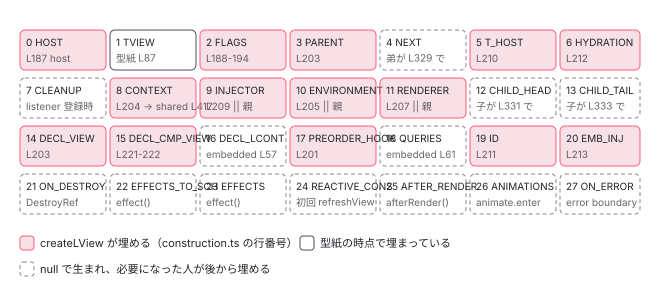

[目次](../README.md) › [Ivy ランタイム](README.md) › 第 6 回 / 全 17 回

# LView：インスタンスごとの 28 + decls + vars + expando

> HEADER の 28 スロットを 1 つずつ。createLView が blueprint.slice() で配列を作り、HOST・CONTEXT・INJECTOR・RENDERER を埋めていく手順。

angular/angular · 読了 約 14 分 · 中核 · [サイトで読む（デモが動きます）](https://angular-deep-dive-cyan.vercel.app/chapter/ivy-lview)

---

[概観](01-component.md)で、`LView` は `Array` を継承した配列で、先頭 28 個に名前が付いていると見ました（スロット地図のデモもそこにあります）。この章はその続きです。**28 個のスロットそれぞれが、いつ・誰に・何で埋められるのか**を `createLView` の 1 行ずつで確認し、3 つの呼び出し側（Root / Component / Embedded）が 11 個の引数に何を渡すかを比べます。「`LView[0]` には何が入っているか」「`this` はどこか」に、行番号で答えられるようになるのが目標です。

読む対象は `packages/core/src/render3/interfaces/view.ts`（`LView` の各スロットの doc コメント）と `packages/core/src/render3/view/construction.ts`（`createLView` / `createComponentLView`）です。

1. 概観（配列だった）
2. Ivy とは
3. テンプレート関数と RenderFlags
4. TNode
5. TView
6. **LView**（この章）
7. blueprint と TData
8. firstCreatePass
9. DOM を組む命令
10. 値を更新する命令
11. LContainer
12. ビューの木
13. フック
14. ディレクティブ
15. LFrame
16. ViewRef 等
17. 破棄

## 1. LView は「今処理しているビュー」として差し替えられる

📄 `angular/packages/core/src/render3/interfaces/view.ts` L94–103 （▶ の行: 95–99）

```ts
 94 │ /**
 95 ▶  * `LView` stores all of the information needed to process the instructions as
 96 ▶  * they are invoked from the template. Each embedded view and component view has its
 97 ▶  * own `LView`. When processing a particular view, we set the `viewData` to that
 98 ▶  * `LView`. When that view is done processing, the `viewData` is set back to
 99 ▶  * whatever the original `viewData` was before (the parent `LView`).
100 │  *
101 │  * Keeping separate state for each view facilities view insertion / deletion, so we
102 │  * don't have to edit the data array based on which views are present.
103 │  */
```

95〜96 行目、「テンプレートから命令が呼ばれたときに必要な情報をすべて持つ。**埋め込みビューとコンポーネントビューはそれぞれ自分の `LView` を持つ**」。97〜99 行目、「あるビューを処理するときは `viewData` をその `LView` に設定し、終わったら元（親の `LView`）に戻す」。これが [3 章](03-ivy-template-function.md)の `enterView` / `leaveView` でした。

📄 `angular/packages/core/src/render3/state.ts` L337–342 （▶ の行: 341）

```ts
337 │ /**
338 │  * Return the current `LView`.
339 │  */
340 │ export function getLView<T>(): LView<T> {
341 ▶   return instructionState.lFrame.lView as LView<T>;
342 │ }
```

341 行目、命令が呼ぶ `getLView()` は `instructionState.lFrame.lView` を返すだけです。「今の LView」は常に 1 本で、それが `LFrame` にあります。

## 2. createLView：11 引数と 14 回の代入

概観の章で `blueprint.slice()` の行だけ見ました。今回は関数全体を 2 つに分けて、全部の代入を読みます。

📄 `angular/packages/core/src/render3/view/construction.ts` L173–201 （▶ の行: 174–184, 186–194, 196–197, 199, 201）

```ts
173 │ export function createLView<T>(
174 ▶   parentLView: LView | null,
175 ▶   tView: TView,
176 ▶   context: T | null,
177 ▶   flags: LViewFlags,
178 ▶   host: RElement | null,
179 ▶   tHostNode: TNode | null,
180 ▶   environment: LViewEnvironment | null,
181 ▶   renderer: Renderer | null,
182 ▶   injector: Injector | null,
183 ▶   embeddedViewInjector: Injector | null,
184 ▶   hydrationInfo: DehydratedView | null,
185 │ ): LView<T> {
186 ▶   const lView = tView.blueprint.slice() as LView;
187 ▶   lView[HOST] = host;
188 ▶   lView[FLAGS] =
189 ▶     flags |
190 ▶     LViewFlags.CreationMode |
191 ▶     LViewFlags.Attached |
192 ▶     LViewFlags.FirstLViewPass |
193 ▶     LViewFlags.Dirty |
194 ▶     LViewFlags.RefreshView;
195 │   if (
196 ▶     embeddedViewInjector !== null ||
197 ▶     (parentLView && parentLView[FLAGS] & LViewFlags.HasEmbeddedViewInjector)
198 │   ) {
199 ▶     lView[FLAGS] |= LViewFlags.HasEmbeddedViewInjector;
200 │   }
201 ▶   resetPreOrderHookFlags(lView);
```

1. **174〜184 行目：引数は 11 個**

   親の `LView`、`TView`、コンテキスト（`this` になるもの）、フラグ、ホスト DOM 要素、ホストの `TNode`、環境、レンダラ、インジェクタ、埋め込みビュー用インジェクタ、hydration 情報。**どの引数がどのスロットに入るか**を以下で 1 つずつ対応づけます。
2. **186 行目：`tView.blueprint.slice()`**

   型紙の複製。この 1 行で `lView[TVIEW]`（1 番）は埋まっています（[前章](05-ivy-tview.md) 87 行目で型紙に入れてあるから）。また `decls` 区画は `null`、`vars` 区画は `NO_CHANGE` で満たされています（[次章](07-ivy-blueprint.md)）。
3. **187 行目：`lView[HOST] = host`（0 番）**

   「このビューが差し込まれている DOM ノード」。コンポーネントなら `<app-child>` 要素そのもの。Root と Embedded では `null` です（4 節）。
4. **188〜194 行目：`lView[FLAGS]`（2 番）**

   引数の `flags` に、`CreationMode`・`Attached`・`FirstLViewPass`・`Dirty`・`RefreshView` の 5 ビットを OR します。**生まれたばかりの LView は「作成中・接続済み・初回・ダーティ・要リフレッシュ」**です。`CreationMode` は `renderView` の `finally` で落ちます（3 章）。
5. **196〜199 行目：`HasEmbeddedViewInjector` は親から伝播**

   自分か祖先に埋め込みビュー用インジェクタがあれば立てます。DI の探索順に影響するフラグです。
6. **201 行目：`resetPreOrderHookFlags(lView)`（17 番）**

   `lView[PREORDER_HOOK_FLAGS]` を 0 に。フックの進行状況カーソルの初期化です。

📄 `angular/packages/core/src/render3/view/construction.ts` L203–224 （▶ の行: 203–205, 207, 209–213, 217, 221–223）

```ts
203 ▶   lView[PARENT] = lView[DECLARATION_VIEW] = parentLView;
204 ▶   lView[CONTEXT] = context;
205 ▶   lView[ENVIRONMENT] = (environment || (parentLView && parentLView[ENVIRONMENT]))!;
206 │   ngDevMode && assertDefined(lView[ENVIRONMENT], 'LViewEnvironment is required');
207 ▶   lView[RENDERER] = (renderer || (parentLView && parentLView[RENDERER]))!;
208 │   ngDevMode && assertDefined(lView[RENDERER], 'Renderer is required');
209 ▶   lView[INJECTOR as any] = injector || (parentLView && parentLView[INJECTOR]) || null;
210 ▶   lView[T_HOST] = tHostNode;
211 ▶   lView[ID] = getUniqueLViewId();
212 ▶   lView[HYDRATION] = hydrationInfo;
213 ▶   lView[EMBEDDED_VIEW_INJECTOR as any] = embeddedViewInjector;
214 │ 
215 │   ngDevMode &&
216 │     assertEqual(
217 ▶       tView.type == TViewType.Embedded ? parentLView !== null : true,
218 │       true,
219 │       'Embedded views must have parentLView',
220 │     );
221 ▶   lView[DECLARATION_COMPONENT_VIEW] =
222 ▶     tView.type == TViewType.Embedded ? parentLView![DECLARATION_COMPONENT_VIEW] : lView;
223 ▶   return lView as LView<T>;
224 │ }
```

1. **203 行目：`lView[PARENT] = lView[DECLARATION_VIEW] = parentLView`（3 番と 14 番）**

   親と宣言元を**同じ値**で初期化します。2 つが違う値になるのは、`<ng-template>` を別のコンポーネントに渡して挿入したとき（transplanted view）だけです。その場合は `PARENT` が `LContainer` に差し替わります（[LContainer の章](11-ivy-lcontainer.md)）。
2. **204 行目：`lView[CONTEXT] = context`（8 番）**

   **ここが `this` の入る場所**です。ただし Component の呼び出し側は `null` を渡します（4 節）。コンポーネントのインスタンスはこの時点ではまだ作られていないからです。
3. **205・207・209 行目：`ENVIRONMENT`（10）、`RENDERER`（11）、`INJECTOR`（9）は「引数 `||` 親の値」**

   3 つとも同じ形です。引数が `null` なら `parentLView` の同じスロットを継承します。子ビューが親と同じレンダラ・同じインジェクタを使うのはこの `||` です。209 行目、`INJECTOR` は「要素インジェクタで見つからなかったときの**後詰め**（fall back）」で、`inject()` がまず探すのは `TNode` 側の NodeInjector です（[DI の章](../di/10-di.md)）。
4. **210 行目：`lView[T_HOST] = tHostNode`（5 番）**

   「このビューが差し込まれている場所の `TNode`」。3 節で、なぜ `TView` ではなく `LView` に持つのかを読みます。
5. **211〜213 行目：`ID`（19）、`HYDRATION`（6）、`EMBEDDED_VIEW_INJECTOR`（20）**

   211 行目 `getUniqueLViewId()` は単調増加のカウンタで、DOM 要素に `__ngContext__` として付けて逆引きに使います。
6. **221〜222 行目：`DECLARATION_COMPONENT_VIEW`（15 番）**

   Embedded なら親の同じスロット（＝自分を宣言したコンポーネントのビュー）を引き継ぎ、**それ以外は自分自身**。コンポーネントビューの 15 番は自分を指しています。

> [!NOTE]
> **ポイント**
>
> `createLView` が**触らない**スロットがあります。4 `NEXT`、7 `CLEANUP`、12 `CHILD_HEAD`、13 `CHILD_TAIL`、16 `DECLARATION_LCONTAINER`、18 `QUERIES`、21 `ON_DESTROY_HOOKS`、22〜27 の signal / after-render / animation / error 用のスロット。これらは型紙の `null` のまま生まれ、**必要になった人が後から埋めます**（5 節）。

## 3. スロットの doc コメントを読む

📄 `angular/packages/core/src/render3/interfaces/view.ts` L117–143 （▶ の行: 118, 123–125, 127, 129, 133, 135–137, 140, 143）

```ts
117 │   /** Flags for this view. See LViewFlags for more info. */
118 ▶   [FLAGS]: LViewFlags;
119 │ 
120 │   /**
121 │    * This may store an {@link LView} or {@link LContainer}.
122 │    *
123 ▶    * `LView` - The parent view. This is needed when we exit the view and must restore the previous
124 ▶    * LView. Without this, the render method would have to keep a stack of
125 ▶    * views as it is recursively rendering templates.
126 │    *
127 ▶    * `LContainer` - The current view is part of a container, and is an embedded view.
128 │    */
129 ▶   [PARENT]: LView | LContainer | null;
130 │ 
131 │   /**
132 │    *
133 ▶    * The next sibling LView or LContainer.
134 │    *
135 ▶    * Allows us to propagate between sibling view states that aren't in the same
136 ▶    * container. Embedded views already have a node.next, but it is only set for
137 ▶    * views in the same container. We need a way to link component views and views
138 │    * across containers as well.
139 │    */
140 ▶   [NEXT]: LView | LContainer | null;
141 │ 
142 │   /** Queries active for this view - nodes from a view are reported to those queries. */
143 ▶   [QUERIES]: LQueries | null;
```

129 行目 `PARENT`。123〜125 行目、「ビューを抜けるとき前の `LView` を復元するために必要。これが無いとレンダラがビューのスタックを持たないといけない」。127 行目、埋め込みビューなら `LContainer` が入ります。140 行目 `NEXT`。135〜137 行目、同じコンテナに入っていない兄弟ビュー同士を結ぶためのものです。143 行目 `QUERIES`、このビューで有効なクエリ。

📄 `angular/packages/core/src/render3/interfaces/view.ts` L145–174 （▶ の行: 146, 155–157, 159–161, 165–167, 171, 174）

````ts
145 │   /**
146 ▶    * Store the `TNode` of the location where the current `LView` is inserted into.
147 │    *
148 │    * Given:
149 │    * ```html
150 │    * <div>
151 │    *   <ng-template><span></span></ng-template>
152 │    * </div>
153 │    * ```
154 │    *
155 ▶    * We end up with two `TView`s.
156 ▶    * - `parent` `TView` which contains `<div><!-- anchor --></div>`
157 ▶    * - `child` `TView` which contains `<span></span>`
158 │    *
159 ▶    * Typically the `child` is inserted into the declaration location of the `parent`, but it can be
160 ▶    * inserted anywhere. Because it can be inserted anywhere it is not possible to store the
161 ▶    * insertion information in the `TView` and instead we must store it in the `LView[T_HOST]`.
162 │    *
163 │    * So to determine where is our insertion parent we would execute:
164 │    * ```ts
165 ▶    * const parentLView = lView[PARENT];
166 ▶    * const parentTNode = lView[T_HOST];
167 ▶    * const insertionParent = parentLView[parentTNode.index];
168 │    * ```
169 │    *
170 │    *
171 ▶    * If `null`, this is the root view of an application (root component is in this view) and it has
172 │    * no parents.
173 │    */
174 ▶   [T_HOST]: TNode | null;
````

174 行目 `T_HOST`。155〜157 行目の例で、`<div><ng-template><span>` は 2 つの `TView` になります。159〜161 行目、**子は通常は宣言場所に挿入されるが、どこにでも挿入できる。だから挿入場所は `TView` に書けず、`LView[T_HOST]` に持つ**。165〜167 行目、挿入先の親要素は `lView[PARENT][lView[T_HOST].index]` で取れます。171 行目、`null` ならアプリケーションのルートビューです。[TNode の章](04-ivy-tnode.md)で「先頭ノードの `parent` は `null`」でした。その代わりがこの `T_HOST` です。

📄 `angular/packages/core/src/render3/interfaces/view.ts` L176–200 （▶ の行: 177–178, 181–182, 188, 191–195, 197, 199–200）

```ts
176 │   /**
177 ▶    * When a view is destroyed, listeners need to be released and outputs need to be
178 ▶    * unsubscribed. This context array stores both listener functions wrapped with
179 │    * their context and output subscription instances for a particular view.
180 │    *
181 ▶    * These change per LView instance, so they cannot be stored on TView. Instead,
182 ▶    * TView.cleanup saves an index to the necessary context in this array.
183 │    *
184 │    * After `LView` is created it is possible to attach additional instance specific functions at the
185 │    * end of the `lView[CLEANUP]` because we know that no more `T` level cleanup functions will be
186 │    * added here.
187 │    */
188 ▶   [CLEANUP]: any[] | null;
189 │ 
190 │   /**
191 ▶    * - For dynamic views, this is the context with which to render the template (e.g.
192 ▶    *   `NgForContext`), or `{}` if not defined explicitly.
193 ▶    * - For root view of the root component it's a reference to the component instance itself.
194 ▶    * - For components, the context is a reference to the component instance itself.
195 ▶    * - For inline views, the context is null.
196 │    */
197 ▶   [CONTEXT]: T;
198 │ 
199 ▶   /** A Module Injector to be used as fall back after Element Injectors are consulted. */
200 ▶   readonly [INJECTOR]: Injector;
```

197 行目 `CONTEXT`。191〜195 行目、4 通りあります。動的ビュー（`@for` の 1 行など）なら `$implicit` を持つコンテキストオブジェクト、ルートビューならルートコンポーネントのインスタンス、**コンポーネントビューならそのコンポーネントのインスタンス**、インラインビューなら `null`。「`this` はどこか」の答えは **`lView[8]`** で、それはテンプレート関数に `ctx` として渡されます（`executeTemplate` の第 5 引数）。

188 行目 `CLEANUP`。177〜178 行目、リスナーの解除関数と output の購読を入れる配列。181〜182 行目、「**インスタンスごとに変わるので `TView` に置けない**。`TView.cleanup` はこの配列への添字を持つ」。T と L の分担の典型例です。200 行目 `INJECTOR` は 2 節で見た後詰めのインジェクタです。

📄 `angular/packages/core/src/render3/interfaces/view.ts` L202–225 （▶ の行: 203, 205, 208, 211–212, 214–215, 217, 221–223, 225）

```ts
202 │   /**
203 ▶    * Contextual data that is shared across multiple instances of `LView` in the same application.
204 │    */
205 ▶   [ENVIRONMENT]: LViewEnvironment;
206 │ 
207 │   /** Renderer to be used for this view. */
208 ▶   [RENDERER]: Renderer;
209 │ 
210 │   /**
211 ▶    * Reference to the first LView or LContainer beneath this LView in
212 ▶    * the hierarchy.
213 │    *
214 ▶    * Necessary to store this so views can traverse through their nested views
215 ▶    * to remove listeners and call onDestroy callbacks.
216 │    */
217 ▶   [CHILD_HEAD]: LView | LContainer | null;
218 │ 
219 │   /**
220 │    * The last LView or LContainer beneath this LView in the hierarchy.
221 ▶    *
222 ▶    * The tail allows us to quickly add a new state to the end of the view list
223 ▶    * without having to propagate starting from the first child.
224 │    */
225 ▶   [CHILD_TAIL]: LView | LContainer | null;
```

📄 `angular/packages/core/src/render3/interfaces/view.ts` L386–407 （▶ の行: 389, 391, 394, 397, 400, 406）

```ts
386 │ /**
387 │  * Contextual data that is shared across multiple instances of `LView` in the same application.
388 │  */
389 ▶ export interface LViewEnvironment {
390 │   /** Factory to be used for creating Renderer. */
391 ▶   rendererFactory: RendererFactory;
392 │ 
393 │   /** An optional custom sanitizer. */
394 ▶   sanitizer: Sanitizer | null;
395 │ 
396 │   /** Scheduler for change detection to notify when application state changes. */
397 ▶   changeDetectionScheduler: ChangeDetectionScheduler | null;
398 │ 
399 │   /** Service used for tracing different parts of the application. */
400 ▶   tracingService: TracingService<TracingSnapshot> | null;
401 │ 
402 │   /**
403 │    * Whether `ng-reflect-*` attributes should be produced in dev mode
404 │    * (always disabled in prod mode).
405 │    */
406 ▶   ngReflect: boolean;
407 │ }
```

205 行目 `ENVIRONMENT`。203 行目、「同じアプリケーションの複数の `LView` で共有される文脈データ」。中身は 389〜407 行目の `LViewEnvironment`：391 行目 `rendererFactory`、394 行目 `sanitizer`、397 行目 `changeDetectionScheduler`（[zoneless シリーズ](../zoneless/03-zoneless-notify.md)で `markViewDirty` がここ経由で `notify` を呼びます）、400 行目 `tracingService`、406 行目 `ngReflect`。**アプリ全体で 1 つ**のオブジェクトを、すべての `LView` の 10 番が指しています。

217 行目 `CHILD_HEAD`、225 行目 `CHILD_TAIL`。211〜215 行目、「このビューの下にある最初の `LView` か `LContainer`。ネストしたビューをたどってリスナーを外し `onDestroy` を呼ぶために必要」。221〜223 行目、末尾を持つのは先頭からたどらずに追加するため。埋め方は 5 節の `addToEndOfViewTree` です。

📄 `angular/packages/core/src/render3/interfaces/view.ts` L227–249 （▶ の行: 228, 230–235, 239–240, 249）

```ts
227 │   /**
228 ▶    * View where this view's template was declared.
229 │    *
230 ▶    * The template for a dynamically created view may be declared in a different view than
231 ▶    * it is inserted. We already track the "insertion view" (view where the template was
232 ▶    * inserted) in LView[PARENT], but we also need access to the "declaration view"
233 ▶    * (view where the template was declared). Otherwise, we wouldn't be able to call the
234 ▶    * view's template function with the proper contexts. Context should be inherited from
235 ▶    * the declaration view tree, not the insertion view tree.
236 │    *
237 │    * Example (AppComponent template):
238 │    *
239 ▶    * <ng-template #foo></ng-template>       <-- declared here -->
240 ▶    * <some-comp [tpl]="foo"></some-comp>    <-- inserted inside this component -->
241 │    *
242 │    * The <ng-template> above is declared in the AppComponent template, but it will be passed into
243 │    * SomeComp and inserted there. In this case, the declaration view would be the AppComponent,
244 │    * but the insertion view would be SomeComp. When we are removing views, we would want to
245 │    * traverse through the insertion view to clean up listeners. When we are calling the
246 │    * template function during change detection, we need the declaration view to get inherited
247 │    * context.
248 │    */
249 ▶   [DECLARATION_VIEW]: LView | null;
```

249 行目 `DECLARATION_VIEW`。230〜235 行目、「動的に作られたビューのテンプレートは、挿入されたビューと違うビューで宣言されていることがある。挿入先は `PARENT` で追えるが、**テンプレート関数を正しいコンテキストで呼ぶには宣言元が要る**」。239〜240 行目の例、`AppComponent` で宣言した `#foo` を `SomeComp` に渡して挿入すると、宣言元は App、挿入先は SomeComp。`createLView` の 203 行目で両方に同じ親を入れておき、移植されたときだけ `PARENT` が書き換わる、という設計です。

📄 `angular/packages/core/src/render3/interfaces/view.ts` L332–349 （▶ の行: 335, 337–338, 343, 346–347, 349）

```ts
332 │   /**
333 │    * More flags for this view. See PreOrderHookFlags for more info.
334 │    */
335 ▶   [PREORDER_HOOK_FLAGS]: PreOrderHookFlags;
336 │ 
337 ▶   /** Unique ID of the view. Used for `__ngContext__` lookups in the `LView` registry. */
338 ▶   [ID]: number;
339 │ 
340 │   /**
341 │    * A container related to hydration annotation information that's associated with this LView.
342 │    */
343 ▶   [HYDRATION]: DehydratedView | null;
344 │ 
345 │   /**
346 ▶    * Optional injector assigned to embedded views that takes
347 ▶    * precedence over the element and module injectors.
348 │    */
349 ▶   readonly [EMBEDDED_VIEW_INJECTOR]: Injector | null;
```

📄 `angular/packages/core/src/render3/interfaces/view.ts` L351–384 （▶ の行: 352, 354, 356, 359–360, 363, 366, 368–369, 371, 374, 377, 380, 383）

```ts
351 │   /**
352 ▶    * Effect scheduling operations that need to run during this views's update pass.
353 │    */
354 ▶   [EFFECTS_TO_SCHEDULE]: Array<() => void> | null;
355 │ 
356 ▶   [EFFECTS]: Set<ViewEffectNode> | null;
357 │ 
358 │   /**
359 ▶    * A collection of callbacks functions that are executed when a given LView is destroyed. Those
360 ▶    * are user defined, LView-specific destroy callbacks that don't have any corresponding TView
361 │    * entries.
362 │    */
363 ▶   [ON_DESTROY_HOOKS]: Array<() => void> | null;
364 │ 
365 │   /**
366 ▶    * The `Consumer` for this `LView`'s template so that signal reads can be tracked.
367 │    *
368 ▶    * This is initially `null` and gets assigned a consumer after template execution
369 ▶    * if any signals were read.
370 │    */
371 ▶   [REACTIVE_TEMPLATE_CONSUMER]: ReactiveLViewConsumer | null;
372 │ 
373 │   // AfterRenderSequences that need to be scheduled
374 ▶   [AFTER_RENDER_SEQUENCES_TO_ADD]: AfterRenderSequence[] | null;
375 │ 
376 │   // Enter animations that apply to nodes in this view
377 ▶   [ANIMATIONS]: AnimationLViewData | null;
378 │ 
379 │   /**
380 ▶    * Function to be called when an error occurs during change detection or lifecycle hooks
381 │    * in this view or any of its descendants. The error is always encapsulated in an `Error` instance.
382 │    */
383 ▶   [ON_ERROR]: ((error: Error, details: ErrorDetails) => void) | null;
384 │ }
```

338 行目 `ID`（337 行目、`__ngContext__` 逆引き用）、343 行目 `HYDRATION`、349 行目 `EMBEDDED_VIEW_INJECTOR`（346〜347 行目、要素・モジュールインジェクタより優先）。354 行目 `EFFECTS_TO_SCHEDULE`、356 行目 `EFFECTS`、363 行目 `ON_DESTROY_HOOKS`（359〜360 行目、`TView` に対応物の無いインスタンス固有の破棄コールバック）。371 行目 `REACTIVE_TEMPLATE_CONSUMER`。366〜369 行目、「テンプレートが読んだ signal を追跡する consumer。**最初は `null` で、テンプレート実行後に signal を読んでいれば割り当てられる**」（[変更検知シリーズ](../cd/05-cd-signal-consumer.md)）。374 行目 after-render、377 行目アニメーション、383 行目 `ON_ERROR`。22〜27 番は**すべて `null` で生まれ、その機能を使ったときだけ埋まります**。

## 4. 3 つの呼び出し側が渡すもの

### Component：createComponentLView

📄 `angular/packages/core/src/render3/view/construction.ts` L226–257 （▶ の行: 231–232, 234–237, 239–251, 256）

```ts
226 │ export function createComponentLView<T>(
227 │   lView: LView,
228 │   hostTNode: TElementNode,
229 │   def: ComponentDef<T>,
230 │ ): LView {
231 ▶   const native = getNativeByTNode(hostTNode, lView) as RElement;
232 ▶   const tView = getOrCreateComponentTView(def);
233 │ 
234 ▶   // Only component views should be added to the view tree directly. Embedded views are
235 ▶   // accessed through their containers because they may be removed / re-added later.
236 ▶   const rendererFactory = lView[ENVIRONMENT].rendererFactory;
237 ▶   const componentView = addToEndOfViewTree(
238 │     lView,
239 ▶     createLView(
240 ▶       lView,
241 ▶       tView,
242 ▶       null,
243 ▶       getInitialLViewFlagsFromDef(def),
244 ▶       native,
245 ▶       hostTNode as TElementNode,
246 ▶       null,
247 ▶       rendererFactory.createRenderer(native, def),
248 ▶       null,
249 ▶       null,
250 ▶       null,
251 ▶     ),
252 │   );
253 │ 
254 │   // Component view will always be created before any injected LContainers,
255 │   // so this is a regular element, wrap it with the component view
256 ▶   return (lView[hostTNode.index] = componentView);
257 │ }
```

1. **231 行目：`native = lView[hostTNode.index]`**

   親の `LView` から、`<app-child>` の DOM 要素を取ります。`ɵɵelementStart` がそこに入れた直後なので取れます（[9 章](09-ivy-create-instructions.md)）。
2. **232 行目：`getOrCreateComponentTView(def)`**

   前章の関数。初回ならここで子の `TView` が生まれます。
3. **239〜251 行目：`createLView` の 11 引数**

   `parentLView = lView`（親）、`context = null`、`flags = getInitialLViewFlagsFromDef(def)`、`host = native`、`tHostNode = hostTNode`、`environment = null`（親から継承）、`renderer = rendererFactory.createRenderer(native, def)`（247 行目。**コンポーネントごとに専用レンダラ**。スタイルのカプセル化用の属性を付けるのはこれ）、`injector = null`（親から継承）、残り 2 つも `null`。
4. **237 行目：`addToEndOfViewTree(lView, ...)`**

   234〜235 行目、「コンポーネントビューだけが直接ビューの木に追加される。埋め込みビューはコンテナ経由」。関数の中身は 5 節。
5. **256 行目：`lView[hostTNode.index] = componentView`**

   **親の `LView` の、ホスト要素が入っていた枠を、子の `LView` で上書き**します。以後、親から `lView[28]` を読むと DOM 要素ではなく子の `LView` が返ります。DOM 要素は子の `LView[HOST]` に移っています（244 行目で `native` を `host` に渡した）。`getNativeByTNode` が `unwrapRNode` を挟んでいたのはこのためです。

📄 `angular/packages/core/src/render3/view/construction.ts` L259–271 （▶ の行: 264–268）

```ts
259 │ /**
260 │  * Gets the initial set of LView flags based on the component definition that the LView represents.
261 │  * @param def Component definition from which to determine the flags.
262 │  */
263 │ export function getInitialLViewFlagsFromDef(def: ComponentDef<unknown>): LViewFlags {
264 ▶   let flags = LViewFlags.CheckAlways;
265 ▶   if (def.signals) {
266 ▶     flags = LViewFlags.SignalView;
267 ▶   } else if (def.onPush) {
268 ▶     flags = LViewFlags.Dirty;
269 │   }
270 │   return flags;
271 │ }
```

264 行目、既定は `CheckAlways`。265〜266 行目、`signals: true` なら `SignalView`。267〜268 行目、`onPush` なら `Dirty`。[2 章](02-ivy-overview.md)で `onPush` は「`Eager` 以外なら true」でした。つまり **v22 の既定のコンポーネントビューは `CheckAlways` ビットを持たず、`Dirty` だけ**で生まれ、その `Dirty` を `createLView` の 193 行目でもう一度 OR します。`CheckAlways` が付くのは `Eager` を明示したときだけです。

では、`null` だった `CONTEXT` はいつ埋まるのか。

📄 `angular/packages/core/src/render3/instructions/shared.ts` L405–420 （▶ の行: 406–408, 415–417）

```ts
405 │   const initialInputs = tNode.initialInputs;
406 ▶   for (let i = start; i < end; i++) {
407 ▶     const def = tView.data[i] as DirectiveDef<any>;
408 ▶     const directive = getNodeInjectable(lView, tView, i, tNode);
409 │     attachPatchData(directive, lView);
410 │ 
411 │     if (initialInputs !== null) {
412 │       setInputsFromAttrs(lView, i - start, directive, def, tNode, initialInputs!);
413 │     }
414 │ 
415 ▶     if (isComponentDef(def)) {
416 ▶       const componentView = getComponentLViewByIndex(tNode.index, lView);
417 ▶       componentView[CONTEXT] = getNodeInjectable(lView, tView, i, tNode);
418 │     }
419 │   }
420 │ }
```

406〜408 行目、ホスト要素に付いたディレクティブを `directiveStart` から順にインスタンス化します（`getNodeInjectable` がファクトリを呼んで `lView[i]` に入れる）。415〜417 行目、その `def` がコンポーネントなら、**できたインスタンスを子ビューの `CONTEXT` に入れる**。`createComponentLView`（`context = null`）→ インスタンス化 → `componentView[CONTEXT] = instance` の順です。「`LView[8]` に `this` が入る瞬間」はこの 417 行目です。

### Root：ブートストラップ

📄 `angular/packages/core/src/render3/component_ref.ts` L356–368 （▶ の行: 356–367）

```ts
356 ▶     const rootLView = createLView<T>(
357 ▶       null,
358 ▶       rootTView,
359 ▶       null,
360 ▶       LViewFlags.IsRoot | getInitialLViewFlagsFromDef(cmpDef),
361 ▶       null,
362 ▶       null,
363 ▶       environment,
364 ▶       hostRenderer,
365 ▶       rootViewInjector,
366 ▶       null,
367 ▶       retrieveHydrationInfo(hostElement, rootViewInjector, true /* isRootView */),
368 │     );
```

📄 `angular/packages/core/src/render3/component_ref.ts` L384–391 （▶ の行: 384, 391）

```ts
384 ▶     rootLView[HEADER_OFFSET] = hostElement;
385 │ 
386 │     // rootView is the parent when bootstrapping
387 │     // TODO(misko): it looks like we are entering view here but we don't really need to as
388 │     // `renderView` does that. However as the code is written it is needed because
389 │     // `createRootComponentView` and `createRootComponent` both read global state. Fixing those
390 │     // issues would allow us to drop this.
391 ▶     enterView(rootLView);
```

357 行目 `parentLView = null`、359 行目 `context = null`、360 行目 `IsRoot` ビット、361〜362 行目 `host` も `tHostNode` も `null`、363〜365 行目は環境・レンダラ・インジェクタを**直接**渡す（親がいないので継承できない）、367 行目 hydration 情報。384 行目、`rootLView[HEADER_OFFSET] = hostElement`。**ルートビューでは `HOST`（0 番）は `null` のままで、`<app-root>` 要素は 28 番（`decls: 1` の唯一の枠）に入ります**。ルートビューは「`<app-root>` 1 個だけを持つテンプレート」として扱われるからです。391 行目、ここで `enterView`。

### Embedded：@if / @for の 1 ビュー

📄 `angular/packages/core/src/render3/view_manipulation.ts` L38–57 （▶ の行: 38–47, 50–52, 57）

```ts
38 ▶     // Embedded views follow the change detection strategy of the view they're declared in.
39 ▶     const isSignalView = declarationLView[FLAGS] & LViewFlags.SignalView;
40 ▶     const viewFlags = isSignalView ? LViewFlags.SignalView : LViewFlags.CheckAlways;
41 ▶     const embeddedLView = createLView<T>(
42 ▶       declarationLView,
43 ▶       embeddedTView,
44 ▶       context,
45 ▶       viewFlags,
46 ▶       null,
47 ▶       templateTNode,
48 │       null,
49 │       null,
50 ▶       options?.injector ?? null,
51 ▶       options?.embeddedViewInjector ?? null,
52 ▶       options?.dehydratedView ?? null,
53 │     );
54 │ 
55 │     const declarationLContainer = declarationLView[templateTNode.index];
56 │     ngDevMode && assertLContainer(declarationLContainer);
57 ▶     embeddedLView[DECLARATION_LCONTAINER] = declarationLContainer;
```

42 行目 `parentLView = declarationLView`、44 行目 `context` は `$implicit` などを持つオブジェクト、45 行目 `flags` は 38〜40 行目のとおり「宣言側が `SignalView` なら `SignalView`、そうでなければ `CheckAlways`」。**埋め込みビューは常に CheckAlways**（OnPush にならない）です。46 行目 `host = null`、47 行目 `tHostNode = templateTNode`。50〜52 行目、インジェクタ類はオプションから。57 行目、`createLView` が触らなかった `DECLARATION_LCONTAINER`（16 番）をここで埋めます。

> **🧪 DEMO — 3 つの呼び出し側が createLView に渡すもの**
>
> 11 個の引数と、それが書き込まれるスロット番号。
>
> ▶ [このデモはサイトで動かせます](https://angular-deep-dive-cyan.vercel.app/chapter/ivy-lview)

## 5. あとから埋まるスロット：addToEndOfViewTree

📄 `angular/packages/core/src/render3/view/construction.ts` L320–335 （▶ の行: 328–329, 331, 333）

```ts
320 │ export function addToEndOfViewTree<T extends LView | LContainer>(
321 │   lView: LView,
322 │   lViewOrLContainer: T,
323 │ ): T {
324 │   // TODO(benlesh/misko): This implementation is incorrect, because it always adds the LContainer
325 │   // to the end of the queue, which means if the developer retrieves the LContainers from RNodes out
326 │   // of order, the change detection will run out of order, as the act of retrieving the
327 │   // LContainer from the RNode is what adds it to the queue.
328 ▶   if (lView[CHILD_HEAD]) {
329 ▶     lView[CHILD_TAIL]![NEXT] = lViewOrLContainer;
330 │   } else {
331 ▶     lView[CHILD_HEAD] = lViewOrLContainer;
332 │   }
333 ▶   lView[CHILD_TAIL] = lViewOrLContainer;
334 │   return lViewOrLContainer;
335 │ }
```

328〜333 行目。親の `CHILD_HEAD`（12 番）が空なら 331 行目で先頭に、空でなければ 329 行目で**現在の末尾の `NEXT`（4 番）**につなぎ、333 行目で末尾を更新。`createLView` が触らなかった 4・12・13 番は、**子ができたときに親の側で**埋まります。自分の 4 番を埋めるのは自分ではなく、次に生まれた弟です。この連結リストが変更検知と破棄の走査順になります（[ビューの木の章](12-ivy-view-tree.md)）。

📄 `angular/packages/core/src/render3/interfaces/view.ts` L434–464 （▶ の行: 435, 441, 444, 447, 450, 458, 461, 464）

```ts
434 │   /** Whether this view has default change detection strategy (checks always) or onPush */
435 ▶   CheckAlways = 1 << 4,
436 │ 
437 │   /** Whether there are any i18n blocks inside this LView. */
438 │   HasI18n = 1 << 5,
439 │ 
440 │   /** Whether or not this view is currently dirty (needing check) */
441 ▶   Dirty = 1 << 6,
442 │ 
443 │   /** Whether or not this view is currently attached to change detection tree. */
444 ▶   Attached = 1 << 7,
445 │ 
446 │   /** Whether or not this view is destroyed. */
447 ▶   Destroyed = 1 << 8,
448 │ 
449 │   /** Whether or not this view is the root view */
450 ▶   IsRoot = 1 << 9,
451 │ 
452 │   /**
453 │    * Whether this moved LView needs to be refreshed. Similar to the Dirty flag, but used for
454 │    * transplanted and signal views where the parent/ancestor views are not marked dirty as well.
455 │    * i.e. "Refresh just this view". Used in conjunction with the HAS_CHILD_VIEWS_TO_REFRESH
456 │    * flag.
457 │    */
458 ▶   RefreshView = 1 << 10,
459 │ 
460 │   /** Indicates that the view **or any of its ancestors** have an embedded view injector. */
461 ▶   HasEmbeddedViewInjector = 1 << 11,
462 │ 
463 │   /** Indicates that the view was created with `signals: true`. */
464 ▶   SignalView = 1 << 12,
```

2 節の 188〜194 行目で OR されたビットの定義です。435 行目 `CheckAlways`、441 行目 `Dirty`、444 行目 `Attached`、447 行目 `Destroyed`、450 行目 `IsRoot`、458 行目 `RefreshView`、461 行目 `HasEmbeddedViewInjector`、464 行目 `SignalView`。`lView[FLAGS]` 1 つの数値に、ビューの状態がすべてビットで入っています。変更検知の各章で `lView[FLAGS] & LViewFlags.Dirty` のように読まれるのはこの定義です。



*28 スロットを「誰が埋めるか」で色分け。型紙の時点で埋まるのは TVIEW だけ。createLView が 14 スロットを埋め、残りは後から必要になった人が埋める。*

## ここまでの呼び出し

- 👤 `ɵɵelementStart(0, 'app-child')` — 親の生成コード
  - `elementLikeStartShared(...)` → `lView[28] = native` — instructions/shared.ts L593 — *親の 28 番に DOM 要素*
  - `createDirectivesInstances(tView, lView, tNode)` — shared.ts L121
    - `instantiateAllDirectives(tView, lView, tNode)` — shared.ts L386
      - `createComponentLView(lView, hostTNode, def)` — view/construction.ts L226
        - `native = getNativeByTNode(hostTNode, lView)` — construction.ts L231 — *lView\[28\] から DOM 要素*
        - `getOrCreateComponentTView(def)` — construction.ts L232
        - `createLView(lView, tView, null, flags, native, hostTNode, null, renderer, null, null, null)` — construction.ts L239
          - `tView.blueprint.slice()` — construction.ts L186 — *TVIEW は型紙に入っている*
          - `lView[HOST] = native; lView[FLAGS] = ...; lView[PARENT] = lView[DECLARATION_VIEW] = parent; ...` — construction.ts L187-222 — *14 スロット*
        - `addToEndOfViewTree(lView, componentView)` — construction.ts L237 — *親の CHILD\_HEAD / CHILD\_TAIL / 兄の NEXT*
        - `lView[hostTNode.index] = componentView` — construction.ts L256 — *親の 28 番を子 LView で上書き*
      - `getNodeInjectable(lView, tView, i, tNode)` — shared.ts L408 — *new Child(...)*
      - `componentView[CONTEXT] = instance` — shared.ts L417 — *子の 8 番に this*

## 聞かれそうな質問

**Q. LView\[0\] には何が入っていますか？this はどこ？**

0 番は `HOST`、このビューが差し込まれている DOM 要素です（construction.ts 187 行目で `host` 引数が入る）。コンポーネントビューなら `<app-child>` 要素、ルートビューと埋め込みビューでは `null` です（component\_ref.ts 361 行目、view\_manipulation.ts 46 行目）。`this` は 8 番 `CONTEXT`（view.ts 197 行目）で、コンポーネントビューでは `createLView` に `null` が渡され（construction.ts 242 行目）、インスタンス化の直後 shared.ts 417 行目で入ります。

**Q. createLView は 28 スロット全部を埋めますか？**

いいえ、14 個です（construction.ts 187〜222 行目：HOST, FLAGS, PARENT, DECLARATION\_VIEW, CONTEXT, ENVIRONMENT, RENDERER, INJECTOR, T\_HOST, ID, HYDRATION, EMBEDDED\_VIEW\_INJECTOR, DECLARATION\_COMPONENT\_VIEW、それに 201 行目の PREORDER\_HOOK\_FLAGS）。TVIEW は型紙にあり、残りは `null` のまま生まれて、`addToEndOfViewTree`（328〜333 行目）やリスナー登録、effect など、必要になったときに埋まります。

**Q. 子コンポーネントの LView は、親の LView のどこにありますか？**

親のホスト要素の枠そのものです。construction.ts 256 行目で `lView[hostTNode.index] = componentView` と、DOM 要素が入っていた枠を子の `LView` で上書きします。DOM 要素は子の `HOST`（244 行目で渡した `native`）に移ります。加えて 237 行目の `addToEndOfViewTree` で親の `CHILD_HEAD` / `CHILD_TAIL` の連結リストにも入ります。

**Q. RENDERER や INJECTOR を渡さなかったらどうなりますか？**

親の同じスロットを継承します（construction.ts 205・207・209 行目の `引数 || parentLView[...]`）。`createComponentLView` は `environment` と `injector` に `null` を渡し（246・248 行目）、レンダラだけ 247 行目で専用に作ります。ルートビューは親がいないので 3 つとも直接渡します（component\_ref.ts 363〜365 行目）。

**Q. T\_HOST はなぜ TView ではなく LView にあるのですか？**

view.ts 159〜161 行目のとおり、埋め込みビューは宣言場所以外にも挿入できるので、「どこに差し込まれたか」はテンプレート（型）の情報ではなくインスタンスの情報だからです。`TNode.parent` が別ビューの親を持たない（`null`）のを補うのが `lView[T_HOST]` で、165〜167 行目の式で挿入先の親要素を求めます。

**Q. 生まれたばかりの LView のフラグは？**

construction.ts 188〜194 行目で、呼び出し側のフラグに `CreationMode | Attached | FirstLViewPass | Dirty | RefreshView` を OR します。既定のコンポーネント（`onPush: true`）なら呼び出し側のフラグは 268 行目の `Dirty`、埋め込みビューは `CheckAlways`（view\_manipulation.ts 40 行目）、ルートは `IsRoot` 付き（component\_ref.ts 360 行目）。

## 読み終えて

- `createLView` は 11 引数で 14 スロットを埋める。`TVIEW` は型紙にあり、残りは `null` のまま後から埋まる
- `HOST`（0）はホスト DOM 要素。コンポーネントビューだけが持ち、Root と Embedded では `null`
- `CONTEXT`（8）が `this`。コンポーネントでは `null` で生まれ、インスタンス化直後（shared.ts 417 行目）に入る
- `ENVIRONMENT` / `RENDERER` / `INJECTOR` は「引数 `||` 親」。レンダラだけコンポーネントごとに専用
- 子の `LView` は親の `lView[hostTNode.index]` を上書きし、`addToEndOfViewTree` で `CHILD_HEAD` / `CHILD_TAIL` / `NEXT` の連結リストに入る

---

← 前: [TView：テンプレートの設計図](05-ivy-tview.md)  
次: [blueprint と TData：同じ番号で 2 本の配列を引く](07-ivy-blueprint.md) →
