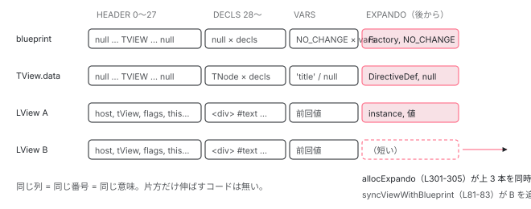

[目次](../README.md) › [Ivy ランタイム](README.md) › 第 7 回 / 全 17 回

# blueprint と TData：同じ番号で 2 本の配列を引く

> VIEW\_DATA.md に描かれた 4 区画。syncViewWithBlueprint で足りないぶんを伸ばし、allocExpando で末尾に追加する。番号 = 意味、という約束。

angular/angular · 読了 約 11 分 · 中核 · [サイトで読む（デモが動きます）](https://angular-deep-dive-cyan.vercel.app/chapter/ivy-blueprint)

---

[概観](01-component.md)で「`LView` と `TView.data` は同じ番号が同じものを指す 2 本の配列」と見ました。この章はその約束を支える仕組みです。`blueprint`（型紙）がどう作られ、なぜ `decls` 区画は `null` で `vars` 区画は `NO_CHANGE` なのか、長さが事前に分からない `expando` 区画を `allocExpando` がどう伸ばし、`syncViewWithBlueprint` が遅れた `LView` をどう追いつかせるのか。「番号 = 意味」という約束を、2 本の配列を**必ず同時に**伸ばすコードで確認します。

読む対象は `packages/core/src/render3/VIEW_DATA.md`（設計メモ）、`view/construction.ts`（`createViewBlueprint` / `allocExpando`）、`instructions/render.ts`（`syncViewWithBlueprint`）、`bindings.ts`（`bindingUpdated`）です。

1. 概観（配列だった）
2. Ivy とは
3. テンプレート関数と RenderFlags
4. TNode
5. TView
6. LView
7. **blueprint と TData**（この章）
8. firstCreatePass
9. DOM を組む命令
10. 値を更新する命令
11. LContainer
12. ビューの木
13. フック
14. ディレクティブ
15. LFrame
16. ViewRef 等
17. 破棄

## 1. 4 区画の約束

📄 `angular/packages/core/src/render3/VIEW_DATA.md` L21–29 （▶ の行: 23–24, 28–29）

```md
21 │ ## `HEADER`
22 │ 
23 ▶ `HEADER` is a fixed array size which contains contextual information about the template.
24 ▶ Mostly information such as parent `LView`, `Sanitizer`, `TView`, and many more bits of information needed for template rendering.
25 │ 
26 │ ## `DECLS`
27 │ 
28 ▶ `DECLS` contain the DOM elements, pipe instances, and local refs.
29 ▶ The size of the `DECLS` section is declared in the property `decls` of the component definition.
```

23〜24 行目、`HEADER` は固定長で、親 `LView` や `TView` などの文脈情報（[前章](06-ivy-lview.md)）。28〜29 行目、`DECLS` には DOM 要素・パイプのインスタンス・ローカル参照が入り、**長さはコンポーネント定義の `decls`**。

📄 `angular/packages/core/src/render3/VIEW_DATA.md` L109–125 （▶ の行: 115–116, 118–119, 124–125）

```md
109 │ The above will create following layout:
110 │ 
111 │ |    Index | `LView`   | `TView.data`                                         |
112 │ | -------: | --------- | ---------------------------------------------------- |
113 │ | `HEADER` |           |                                                      |
114 │ |  `DECLS` |           |                                                      |
115 ▶ |       10 | `<div>`   | `{type: Element, index: 10, parent: null}`           |
116 ▶ |       11 | `#text()` | `{type: Element, index: 11, parent: tView.data[10]}` |
117 │ |   `VARS` |           |                                                      |
118 ▶ |       12 | `'World'` | `'title'`                                            |
119 ▶ |       13 | `'World'` | `null`                                               |
120 │ |      ... | ...       | ...                                                  |
121 │ 
122 │ NOTE:
123 │ 
124 ▶ - `LView` contain DOM instances and previous binding values only
125 ▶ - `TView.data` contains information on relationships and property labels.
```

`<div title="{{name}}">Hello {{name}}!</div>`（`decls: 2, vars: 2`）の配置です。115〜116 行目、`DECLS` の 2 枠には `LView` 側に DOM ノード、`TView.data` 側に `TNode`。118 行目、`VARS` の 1 枠目は `LView` 側が前回値 `'World'`、`TView.data` 側が **プロパティ名 `'title'`**。119 行目、2 枠目はテキスト補間なので `TView.data` 側は `null`。124〜125 行目、「`LView` は DOM と**前回のバインディング値**だけ。`TView.data` は関係とラベル」。

📄 `angular/packages/core/src/render3/VIEW_DATA.md` L127–134 （▶ の行: 129, 132–133）

```md
127 │ ## `EXPANDO`
128 │ 
129 ▶ `EXPANDO` contains information on data which size is not known at compile time.
130 │ Examples include:
131 │ 
132 ▶ - `Component`/`Directives` since we don't know at compile time which directives will match.
133 ▶ - Host bindings, since until we match the directives it is unclear how many host bindings need to be allocated.
134 │ 
```

📄 `angular/packages/core/src/render3/VIEW_DATA.md` L181–195 （▶ の行: 190–194）

```md
181 │ The above will create the following layout:
182 │ 
183 │ |     Index | `LView`          | `TView.data`                               |
184 │ | --------: | ---------------- | ------------------------------------------ |
185 │ |  `HEADER` |                  |                                            |
186 │ |   `DECLS` |                  |                                            |
187 │ |        10 | `[<child>, ...]` | `{type: Element, index: 10, parent: null}` |
188 │ |    `VARS` |                  |                                            |
189 │ | `EXPANDO` |                  |                                            |
190 ▶ |    11..18 | cumulativeBloom  | templateBloom                              |
191 ▶ |        19 | `new Child()`    | `Child`                                    |
192 ▶ |        20 | `new Tooltip()`  | `Tooltip`                                  |
193 ▶ |        21 | `'Hello World!'` | `'tooltip'`                                |
194 ▶ |        22 | `'greeting'`     | `'title'`                                  |
195 │ |       ... | ...              | ...                                        |
```

129 行目、`EXPANDO` は「**コンパイル時にサイズが分からない**データ」。132〜133 行目、どのディレクティブが照合されるか分からないのでディレクティブ本体も host binding も数えられない。191〜192 行目、`<child tooltip>` に 2 つ照合された結果、`LView` 側に `new Child()` / `new Tooltip()`、`TView.data` 側に型 `Child` / `Tooltip`。193〜194 行目、その直後に host binding の値（`LView`）とプロパティ名（`TView.data`）。190 行目の bloom は DI 用のビットマスクです。4 区画すべてで「`LView` に実体、`TView.data` に型・名前」の対応が崩れていません。

## 2. TData：型が語る「番号ごとに何が入るか」

📄 `angular/packages/core/src/render3/interfaces/view.ts` L926–952 （▶ の行: 927, 929–931, 933–934, 939–940, 943, 947–949, 951）

```ts
926 │ /**
927 ▶  * Static data that corresponds to the instance-specific data array on an LView.
928 │  *
929 ▶  * Each node's static data is stored in tData at the same index that it's stored
930 ▶  * in the data array.  Any nodes that do not have static data store a null value in
931 ▶  * tData to avoid a sparse array.
932 │  *
933 ▶  * Each pipe's definition is stored here at the same index as its pipe instance in
934 ▶  * the data array.
935 │  *
936 │  * Each host property's name is stored here at the same index as its value in the
937 │  * data array.
938 │  *
939 ▶  * Each property binding name is stored here at the same index as its value in
940 ▶  * the data array. If the binding is an interpolation, the static string values
941 │  * are stored parallel to the dynamic values. Example:
942 │  *
943 ▶  * id="prefix {{ v0 }} a {{ v1 }} b {{ v2 }} suffix"
944 │  *
945 │  * LView       |   TView.data
946 │  *------------------------
947 ▶  *  v0 value   |   'a'
948 ▶  *  v1 value   |   'b'
949 ▶  *  v2 value   |   id � prefix � suffix
950 │  *
951 ▶  * Injector bloom filters are also stored here.
952 │  */
```

📄 `angular/packages/core/src/render3/interfaces/view.ts` L953–968 （▶ の行: 953–958, 961, 965–966）

```ts
953 ▶ export type TData = (
954 ▶   | TNode
955 ▶   | PipeDef<any>
956 ▶   | DirectiveDef<any>
957 ▶   | ComponentDef<any>
958 ▶   | number
959 │   | TStylingRange
960 │   | TStylingKey
961 ▶   | ProviderToken<any>
962 │   | TI18n
963 │   | I18nUpdateOpCodes
964 │   | TIcu
965 ▶   | null
966 ▶   | string
967 │   | TDeferBlockDetails
968 │ )[];
```

929〜931 行目、「各ノードの静的データは、`data` 配列と**同じ添字**の `tData` に入る。静的データが無いノードは **`null` を入れて穴を作らない**」。穴（hole）を作らないのは、V8 が穴あき配列を遅い表現に切り替えるためです（`PERF_NOTES.md`）。933〜934 行目パイプ、939〜940 行目プロパティ名、951 行目 bloom フィルタ。943〜949 行目の補間の例では、3 つの値 `v0``v1``v2` の**隣に**静的な文字列 `'a'``'b'` が並びます。

953〜968 行目、`TData` は union 型の配列です。954〜957 行目 `TNode` / `PipeDef` / `DirectiveDef` / `ComponentDef`、958 行目 `number`（bloom）、961 行目 `ProviderToken`、965 行目 `null`、966 行目 `string`（プロパティ名）。**番号を知っていれば、この union のどれが入っているかは区画で決まります**。`DECLS` なら `TNode` か `PipeDef`、`VARS` なら `string` か `null`、`EXPANDO` ならディレクティブ定義かトークンか `number`。

## 3. createViewBlueprint：null と NO\_CHANGE

📄 `angular/packages/core/src/render3/view/construction.ts` L80–96 （▶ の行: 80, 84–85, 87, 94–96）

```ts
80 ▶   const bindingStartIndex = HEADER_OFFSET + decls;
81 │   // This length does not yet contain host bindings from child directives because at this point,
82 │   // we don't know which directives are active on this template. As soon as a directive is matched
83 │   // that has a host binding, we will update the blueprint with that def's hostVars count.
84 ▶   const initialViewLength = bindingStartIndex + vars;
85 ▶   const blueprint = createViewBlueprint(bindingStartIndex, initialViewLength);
86 │   const consts = typeof constsOrFactory === 'function' ? constsOrFactory() : constsOrFactory;
87 ▶   const tView = (blueprint[TVIEW as any] = {
88 │     type: type,
89 │     blueprint: blueprint,
90 │     template: templateFn,
91 │     queries: null,
92 │     viewQuery: viewQuery,
93 │     declTNode: declTNode,
94 ▶     data: blueprint.slice().fill(null, bindingStartIndex),
95 ▶     bindingStartIndex: bindingStartIndex,
96 ▶     expandoStartIndex: initialViewLength,
```

📄 `angular/packages/core/src/render3/view/construction.ts` L129–137 （▶ の行: 130, 132–133, 136）

```ts
129 │ function createViewBlueprint(bindingStartIndex: number, initialViewLength: number): LView {
130 ▶   const blueprint = [];
131 │ 
132 ▶   for (let i = 0; i < initialViewLength; i++) {
133 ▶     blueprint.push(i < bindingStartIndex ? null : NO_CHANGE);
134 │   }
135 │ 
136 ▶   return blueprint as LView;
137 │ }
```

1. **80 行目：`bindingStartIndex = 28 + decls`、84 行目：`initialViewLength = bindingStartIndex + vars`**

   区画の境目 2 つ。[TView の章](05-ivy-tview.md)で読みました。
2. **130〜134 行目：長さ `initialViewLength` の配列を `push` で作る**

   133 行目、`i < bindingStartIndex` なら `null`、それ以外は `NO_CHANGE`。つまり **`HEADER` と `DECLS` は `null`、`VARS` は `NO_CHANGE`** で埋めた配列です。`new Array(n)` ではなく `push` で作るのも、穴あき配列を避けるためです。
3. **87 行目：`blueprint[TVIEW] = tView`**

   `HEADER` で唯一、型紙の時点で埋まる枠です。
4. **94 行目：`data = blueprint.slice().fill(null, bindingStartIndex)`**

   `TData` は型紙の複製に `fill(null, bindingStartIndex)` を掛けたもの。`VARS` 区画の `NO_CHANGE` を `null` に戻します。**この瞬間、`blueprint` と `data` は同じ長さ**です。以後、片方だけ伸ばすコードは存在しません（4 節）。

📄 `angular/packages/core/src/render3/tokens.ts` L9–16 （▶ の行: 14–16）

```ts
 9 │ export interface NO_CHANGE {
10 │   // This is a brand that ensures that this type can never match anything else
11 │   __brand__: 'NO_CHANGE';
12 │ }
13 │ 
14 ▶ /** A special value which designates that a value has not changed. */
15 ▶ export const NO_CHANGE: NO_CHANGE =
16 ▶   typeof ngDevMode === 'undefined' || ngDevMode ? {__brand__: 'NO_CHANGE'} : ({} as NO_CHANGE);
```

14〜16 行目、`NO_CHANGE` は「値が変わっていない」ことを表す**唯一のオブジェクト**です。`undefined` や `null` を使わないのは、それらがバインディングの正当な値になりうるから。`VARS` 区画の初期値がこれなので、「まだ一度も値が書かれていない」と「前回 `undefined` だった」を区別できます。

## 4. VARS 区画の使われ方：bindingUpdated

📄 `angular/packages/core/src/render3/bindings.ts` L44–56 （▶ の行: 44, 48–49, 52, 54–55）

```ts
44 ▶ export function bindingUpdated(lView: LView, bindingIndex: number, value: any): boolean {
45 │   ngDevMode &&
46 │     assertLessThan(bindingIndex, lView.length, `Slot should have been initialized to NO_CHANGE`);
47 │ 
48 ▶   if (value === NO_CHANGE) {
49 ▶     return false;
50 │   }
51 │ 
52 ▶   const oldValue = lView[bindingIndex];
53 │ 
54 ▶   if (Object.is(oldValue, value)) {
55 ▶     return false;
56 │   } else {
```

📄 `angular/packages/core/src/render3/bindings.ts` L76–84 （▶ の行: 82–83）

```ts
76 │       // There was a change, but the `devModeEqual` decided that the change is exempt from an error.
77 │       // For this reason we exit as if no change. The early exit is needed to prevent the changed
78 │       // value to be written into `LView` (If we would write the new value that we would not see it
79 │       // as change on next CD.)
80 │       return false;
81 │     }
82 ▶     lView[bindingIndex] = value;
83 ▶     return true;
84 │   }
```

44 行目、更新命令はすべてこの関数に `lView` と `bindingIndex`（`LFrame.bindingIndex` が指す `VARS` の 1 枠）と新しい値を渡します。52 行目、**前回値は `lView[bindingIndex]`**。初回は型紙由来の `NO_CHANGE` なので 54 行目の `Object.is` は偽、82 行目で新しい値を書いて 83 行目 `true`。2 回目以降は前回値と比べ、同じなら 55 行目 `false` で DOM を触りません。48〜49 行目、呼び出し側が `NO_CHANGE` を渡してきたときも `false`。「`VARS` 区画 = 前回値の保存場所」が、この関数の実体です。各命令からの呼び方は[値を更新する命令の章](10-ivy-update-instructions.md)で。

📄 `angular/packages/core/src/render3/instructions/shared.ts` L668–685 （▶ の行: 671, 680）

```ts
668 │   // Binding meta-data are stored only the first time a given property instruction is processed.
669 │   // Since we don't have a concept of the "first update pass" we need to check for presence of the
670 │   // binding meta-data to decide if one should be stored (or if was stored already).
671 ▶   if (tData[bindingIndex] === null) {
672 │     if (!tNode.inputs?.[propertyName] && !tNode.hostDirectiveInputs?.[propertyName]) {
673 │       const propBindingIdxs = tNode.propertyBindings || (tNode.propertyBindings = []);
674 │       propBindingIdxs.push(bindingIndex);
675 │       let bindingMetadata = propertyName;
676 │       if (interpolationParts.length > 0) {
677 │         bindingMetadata +=
678 │           INTERPOLATION_DELIMITER + interpolationParts.join(INTERPOLATION_DELIMITER);
679 │       }
680 ▶       tData[bindingIndex] = bindingMetadata;
681 │     }
682 │   }
683 │ }
684 │ 
685 │ /**
```

671 行目、`tData[bindingIndex] === null` なら初回。680 行目、同じ `bindingIndex` の `tData` 側にプロパティ名を書きます。1 節の表で `TView.data` の `VARS` 区画に `'title'` が入っていた理由です（`DebugElement.properties` 用で、本番では呼ばれません）。**同じ番号 `bindingIndex` で、`LView` には値、`TData` には名前**。

## 5. allocExpando：2 本（実は 3 本）を同時に伸ばす

📄 `angular/packages/core/src/render3/view/construction.ts` L273–307 （▶ の行: 274–275, 288, 290, 292–298, 300–306）

```ts
273 │ /**
274 ▶  * When elements are created dynamically after a view blueprint is created (e.g. through
275 ▶  * i18nApply()), we need to adjust the blueprint for future template passes.
276 │  *
277 │  * @param tView `TView` associated with `LView`
278 │  * @param lView The `LView` containing the blueprint to adjust
279 │  * @param numSlotsToAlloc The number of slots to alloc in the LView, should be >0
280 │  * @param initialValue Initial value to store in blueprint
281 │  */
282 │ export function allocExpando(
283 │   tView: TView,
284 │   lView: LView,
285 │   numSlotsToAlloc: number,
286 │   initialValue: unknown,
287 │ ): number {
288 ▶   if (numSlotsToAlloc === 0) return -1;
289 │   if (ngDevMode) {
290 ▶     assertFirstCreatePass(tView);
291 │     assertSame(tView, lView[TVIEW], '`LView` must be associated with `TView`!');
292 ▶     assertEqual(tView.data.length, lView.length, 'Expecting LView to be same size as TView');
293 ▶     assertEqual(
294 ▶       tView.data.length,
295 ▶       tView.blueprint.length,
296 ▶       'Expecting Blueprint to be same size as TView',
297 ▶     );
298 ▶     assertFirstUpdatePass(tView);
299 │   }
300 ▶   const allocIdx = lView.length;
301 ▶   for (let i = 0; i < numSlotsToAlloc; i++) {
302 ▶     lView.push(initialValue);
303 ▶     tView.blueprint.push(initialValue);
304 ▶     tView.data.push(null);
305 ▶   }
306 ▶   return allocIdx;
307 │ }
```

1. **288 行目：0 個なら `-1` を返して終わり**
2. **290〜298 行目：firstCreatePass であること、3 本の長さが一致することを検査**

   292 行目 `tView.data.length === lView.length`、293〜297 行目 `tView.data.length === tView.blueprint.length`。**伸ばす前に「3 本は同じ長さ」を前提として確認**しています。
3. **300 行目：`allocIdx = lView.length`**

   新しい区画の開始番号は、今の末尾です。戻り値になります。
4. **301〜305 行目：`lView`、`tView.blueprint`、`tView.data` に同じ回数 `push`**

   302 行目 `lView.push(initialValue)`、303 行目 `tView.blueprint.push(initialValue)`、304 行目 `tView.data.push(null)`。**今作っている `LView` だけでなく型紙も伸ばす**ので、次に `slice()` される `LView` は最初からこの長さで生まれます。`data` は `null`（穴を作らない）。274〜275 行目のコメントどおり、「型紙を作ったあとに動的に要素が増えたとき、今後のテンプレート実行のために型紙を調整する」関数です。

誰が呼ぶのか。ディレクティブの照合です。

📄 `angular/packages/core/src/render3/view/directives.ts` L554–566 （▶ の行: 561, 563–565）

```ts
554 │ function initTNodeFlags(tNode: TNode, index: number, numberOfDirectives: number) {
555 │   ngDevMode &&
556 │     assertNotEqual(
557 │       numberOfDirectives,
558 │       tNode.directiveEnd - tNode.directiveStart,
559 │       'Reached the max number of directives',
560 │     );
561 ▶   tNode.flags |= TNodeFlags.isDirectiveHost;
562 │   // When the first directive is created on a node, save the index
563 ▶   tNode.directiveStart = index;
564 ▶   tNode.directiveEnd = index + numberOfDirectives;
565 ▶   tNode.providerIndexes = index;
566 │ }
```

📄 `angular/packages/core/src/render3/view/directives.ts` L452–473 （▶ の行: 452, 458–465, 467, 471）

```ts
452 ▶   tView.data[directiveIndex] = def;
453 │   const directiveFactory =
454 │     def.factory || ((def as Writable<DirectiveDef<T>>).factory = getFactoryDef(def.type, true));
455 │   // Even though `directiveFactory` will already be using `ɵɵdirectiveInject` in its generated code,
456 │   // we also want to support `inject()` directly from the directive constructor context so we set
457 │   // `ɵɵdirectiveInject` as the inject implementation here too.
458 ▶   const nodeInjectorFactory = new NodeInjectorFactory(
459 ▶     directiveFactory,
460 ▶     isComponentDef(def),
461 ▶     ɵɵdirectiveInject,
462 ▶     ngDevMode ? def.type.name : null,
463 ▶   );
464 ▶   tView.blueprint[directiveIndex] = nodeInjectorFactory;
465 ▶   lView[directiveIndex] = nodeInjectorFactory;
466 │ 
467 ▶   registerHostBindingOpCodes(
468 │     tView,
469 │     tNode,
470 │     directiveIndex,
471 ▶     allocExpando(tView, lView, def.hostVars, NO_CHANGE),
472 │     def,
473 │   );
```

563〜564 行目、`directiveStart` には呼び出し時の `tView.data.length`、`directiveEnd` にはそこにディレクティブ数を足した値。**「今の末尾からディレクティブ数ぶん」が、この要素のディレクティブの区画になる**と、照合直後に `TNode` に書き込みます。その直後に `allocExpando(tView, lView, directivesLength, null)` で実際に伸ばされ（[次章](08-ivy-first-create-pass.md) 183 行目）、戻り値が `directiveStart` と一致することが検査されます。

452 行目、`tView.data[directiveIndex] = def`。`TData` 側に `DirectiveDef`。458〜463 行目、ファクトリを `NodeInjectorFactory` で包み、464 行目 **型紙**に、465 行目 **今の `LView`** に入れます。`LView` 側の初期値は「インスタンス」ではなく「**インスタンスを作る工場**」です。471 行目、`allocExpando(tView, lView, def.hostVars, NO_CHANGE)`。host binding の `vars` を**ディレクティブの直後**に `NO_CHANGE` で確保します。1 節の表で `new Child()` の後ろに `'Hello World!'` が来ていたのはこの配置です。

📄 `angular/packages/core/src/render3/di.ts` L735–765 （▶ の行: 742, 744–745, 757, 759–764）

```ts
735 │ export function getNodeInjectable(
736 │   lView: LView,
737 │   tView: TView,
738 │   index: number,
739 │   tNode: TDirectiveHostNode,
740 │   flags?: InternalInjectFlags,
741 │ ): any {
742 ▶   let value = lView[index];
743 │   const tData = tView.data;
744 ▶   if (value instanceof NodeInjectorFactory) {
745 ▶     const factory: NodeInjectorFactory = value;
746 │     ngDevMode && injectionPath.push(factory.name ?? 'unknown');
747 │     if (factory.resolving) {
748 │       let token = '';
749 │       if (ngDevMode) {
750 │         token = stringifyForError(tData[index]);
751 │         throw cyclicDependencyErrorWithDetails(token, injectionPath);
752 │       } else {
753 │         throw cyclicDependencyError(token);
754 │       }
755 │     }
756 │     const previousIncludeViewProviders = setIncludeViewProviders(factory.canSeeViewProviders);
757 ▶     factory.resolving = true;
758 │ 
759 ▶     // tData indexes mirror the concrete instances in its corresponding LView.
760 ▶     // lView[index] here is either the injectable instance itself or a factory,
761 ▶     // therefore tData[index] is the constructor of that injectable or a
762 ▶     // definition object that contains the constructor in a `.type` field.
763 ▶     const token =
764 ▶       (tData[index] as DirectiveDef<unknown> | ComponentDef<unknown>).type || tData[index];
765 │ 
```

742 行目、`lView[index]` を読む。744 行目、それが `NodeInjectorFactory` なら**まだ作られていない**。757 行目で循環検出フラグを立て、759〜764 行目のコメントどおり、`tData[index]`（`DirectiveDef`）からトークンを得てファクトリを呼び、結果を `lView[index]` に**上書き**します（引用の直後）。以後 742 行目で読むとインスタンスが返るので、744 行目は偽。**同じ番号の `LView` の中身が「工場 → 製品」に入れ替わる**、これが EXPANDO 区画の生涯です。`TData` 側は `DirectiveDef` のまま変わりません。

## 6. syncViewWithBlueprint：遅れて生まれた LView を追いつかせる

`allocExpando` は「今の `LView`」と型紙を伸ばしますが、**すでに型紙から作られていた別の `LView`** は伸びません。その穴を埋める関数です。

📄 `angular/packages/core/src/render3/instructions/render.ts` L53–84 （▶ の行: 56–57, 66–72, 74–75, 81–83）

````ts
53 │ /**
54 │  * Syncs an LView instance with its blueprint if they have gotten out of sync.
55 │  *
56 ▶  * Typically, blueprints and their view instances should always be in sync, so the loop here
57 ▶  * will be skipped. However, consider this case of two components side-by-side:
58 │  *
59 │  * App template:
60 │  * ```html
61 │  * <comp></comp>
62 │  * <comp></comp>
63 │  * ```
64 │  *
65 │  * The following will happen:
66 ▶  * 1. App template begins processing.
67 ▶  * 2. First <comp> is matched as a component and its LView is created.
68 ▶  * 3. Second <comp> is matched as a component and its LView is created.
69 ▶  * 4. App template completes processing, so it's time to check child templates.
70 ▶  * 5. First <comp> template is checked. It has a directive, so its def is pushed to blueprint.
71 ▶  * 6. Second <comp> template is checked. Its blueprint has been updated by the first
72 ▶  * <comp> template, but its LView was created before this update, so it is out of sync.
73 │  *
74 ▶  * Note that embedded views inside ngFor loops will never be out of sync because these views
75 ▶  * are processed as soon as they are created.
76 │  *
77 │  * @param tView The `TView` that contains the blueprint for syncing
78 │  * @param lView The view to sync
79 │  */
80 │ export function syncViewWithBlueprint(tView: TView, lView: LView) {
81 ▶   for (let i = lView.length; i < tView.blueprint.length; i++) {
82 ▶     lView.push(tView.blueprint[i]);
83 ▶   }
84 │ }
````

1. **66〜68 行目：`<comp></comp><comp></comp>` と並べると、親の作成ブロックで 2 つの `LView` が先に作られる**

   [前章](06-ivy-lview.md)で見たとおり、`createComponentLView` は親の `ɵɵelementStart` の中で呼ばれます。2 つ目の `<comp>` の `LView` も、この時点で `blueprint.slice()` されます。
2. **69〜70 行目：親が終わってから、1 つ目の `<comp>` のテンプレートが走り、ディレクティブが照合されて型紙が伸びる**

   `allocExpando` が 1 つ目の `LView` と型紙を伸ばします。
3. **71〜72 行目：2 つ目の `<comp>` の `LView` は、伸びる前の型紙から作られたので短い**
4. **81〜83 行目：足りないぶんを型紙の末尾からコピーする**

   `lView.length` から `blueprint.length` まで `push`。56〜57 行目、「通常は同期しているのでループは走らない」。`@for` の中の埋め込みビューはすぐ処理されるので、ずれは起きません（74〜75 行目）。

📄 `angular/packages/core/src/render3/instructions/render.ts` L32–37 （▶ の行: 34–36）

```ts
32 │ export function renderComponent(hostLView: LView, componentHostIdx: number) {
33 │   ngDevMode && assertEqual(isCreationMode(hostLView), true, 'Should be run in creation mode');
34 ▶   const componentView = getComponentLViewByIndex(componentHostIdx, hostLView);
35 ▶   const componentTView = componentView[TVIEW];
36 ▶   syncViewWithBlueprint(componentTView, componentView);
37 │ 
```

36 行目、子コンポーネントを描く `renderComponent` は、`renderView` を呼ぶ**前に**必ず `syncViewWithBlueprint` を通します。「`LView` の長さは常に型紙以上」という不変条件を、ここで回復しています。



*型紙・TData・各 LView は同じ番号で対応する。allocExpando は今の LView と型紙と TData を同時に伸ばし、先に生まれていた LView は renderComponent の syncViewWithBlueprint で追いつく。*

> **🧪 DEMO — 4 区画の添字を計算する**
>
> compiler 章の Demo（decls: 7, vars: 4）が既定値。ディレクティブは「この要素に照合された数」、hostVars は各ディレクティブの host binding 数。
>
> ▶ [このデモはサイトで動かせます](https://angular-deep-dive-cyan.vercel.app/chapter/ivy-blueprint)

> [!WARNING]
> **ハマりどころ**
>
> 「`ɵɵelementStart(0, 'div')` の 0 は配列の 0 番目」ではありません。`createViewBlueprint` の 133 行目で `i < bindingStartIndex`（= 28 + decls）が `null` で埋められている範囲のうち、先頭 28 個は `HEADER` です。テンプレートの 0 番は `lView[28]`、`tView.data[28]`。`ɵɵ` 命令の中だけが `HEADER_OFFSET` を足し、それ以外のコードは足したあとの番号で会話します（view.ts の `HEADER_OFFSET` のコメント）。

## ここまでの呼び出し

- `createTView(type, declTNode, templateFn, decls, vars, ...)` — core/src/render3/view/construction.ts L67
  - `bindingStartIndex = 28 + decls; initialViewLength = bindingStartIndex + vars` — construction.ts L80, L84
  - `createViewBlueprint(bindingStartIndex, initialViewLength)` — construction.ts L129 — *i &lt; bindingStartIndex は null、以降は NO\_CHANGE*
  - `blueprint[TVIEW] = tView; data = blueprint.slice().fill(null, bindingStartIndex)` — construction.ts L87, L94 — *3 本が同じ長さで出発*
- `createLView(...)` → `tView.blueprint.slice()` — construction.ts L186 — *インスタンスごと*
- 👤 `ɵɵelementStart(0, 'child')` — 生成コード（firstCreatePass）
  - `resolveDirectives → initializeDirectives` — view/directives.ts L58, L136
    - `initTNodeFlags(tNode, tView.data.length, n)` — directives.ts L554 — *directiveStart = 今の末尾*
    - `allocExpando(tView, lView, n, null)` — construction.ts L282 — *lView / blueprint / data を n 個 push*
    - `configureViewWithDirective(tView, tNode, lView, idx, def)` — directives.ts L443 — *data\[idx\] = def; blueprint\[idx\] = lView\[idx\] = Factory*
      - `allocExpando(tView, lView, def.hostVars, NO_CHANGE)` — construction.ts L282 — *host binding の vars*
  - `getNodeInjectable(lView, tView, idx, tNode)` — di.ts L735 — *lView\[idx\]: Factory → instance*
- `renderComponent(hostLView, componentHostIdx)` — instructions/render.ts L32
  - `syncViewWithBlueprint(componentTView, componentView)` — render.ts L80 — *短い LView を型紙の長さまで push*
- `refreshView → ɵɵproperty / ɵɵtextInterpolate → bindingUpdated(lView, bindingIndex, value)` — bindings.ts L44 — *VARS 区画の前回値と Object.is*

## 聞かれそうな質問

**Q. decls と vars は何を数えていて、配列のどこに対応しますか？**

`decls` はノード・ローカル参照・パイプの数で、`lView[28]` から `decls` 個の `DECLS` 区画（VIEW\_DATA.md 28〜29 行目、construction.ts 80 行目で `bindingStartIndex = 28 + decls`）。`vars` はバインディングの数で、`bindingStartIndex` から `vars` 個の `VARS` 区画（84 行目）。前者は型紙で `null`、後者は `NO_CHANGE` で初期化されます（133 行目）。

**Q. VARS 区画が NO\_CHANGE で初期化されているのはなぜですか？**

初回の更新で必ず「変わった」と判定させるためです。`bindingUpdated`（bindings.ts 52〜54 行目）は `lView[bindingIndex]` と新しい値を `Object.is` で比べます。`undefined` や `null` は正当なバインディング値になりうるので、専用のオブジェクト `NO_CHANGE`（tokens.ts 15〜16 行目）を「未書き込み」の印にしています。

**Q. EXPANDO 区画の長さは誰が決めますか？**

コンパイラではなく実行時の `allocExpando`（construction.ts 282 行目）です。ディレクティブが照合されると `initializeDirectives` が本数ぶん（directives.ts 183 行目）、`configureViewWithDirective` が各 `hostVars` ぶん（471 行目）呼び、`lView`・`blueprint`・`data` を同時に `push` します（301〜305 行目）。`createTView` の時点では長さ 0 です（`expandoStartIndex = initialViewLength`、96 行目）。

**Q. LView と TView.data の長さがずれることはありますか？**

`allocExpando` は 3 本を同時に伸ばし、開発モードで事前に長さの一致を検査します（construction.ts 292〜297 行目）。ただし「型紙が伸びる前に `slice()` された別の `LView`」は短いままなので、`renderComponent` が `renderView` の前に `syncViewWithBlueprint`（render.ts 36 行目、81〜83 行目）で足りないぶんを型紙からコピーします。起きるのは兄弟のコンポーネントを並べたときで、`@for` の埋め込みビューでは起きません（74〜75 行目）。

**Q. LView のディレクティブの枠には、最初からインスタンスが入っていますか？**

いません。`configureViewWithDirective` が `NodeInjectorFactory`（工場）を型紙と `LView` に入れ（directives.ts 464〜465 行目）、`getNodeInjectable` が初めて読んだときに `instanceof NodeInjectorFactory` で判定して（di.ts 744 行目）ファクトリを呼び、結果で `lView[index]` を上書きします。`TData` 側は最初から最後まで `DirectiveDef`（452 行目）です。

## 読み終えて

- `createViewBlueprint` は `bindingStartIndex` 未満を `null`、以降を `NO_CHANGE` で埋めた 1 本。`TData` はその複製を `null` で埋め直したもの。出発点から同じ長さ
- `VARS` 区画は前回値の保存場所。`bindingUpdated` が `lView[bindingIndex]` と `Object.is` で比べ、変わっていれば書く。`NO_CHANGE` は「未書き込み」の印
- `EXPANDO` は `allocExpando` が実行時に伸ばす。`lView`・`blueprint`・`data` を同じ回数 `push` し、片方だけ伸ばすコードは無い
- ディレクティブの枠は `NodeInjectorFactory` で生まれ、初回アクセスでインスタンスに置き換わる。`TData` 側は `DirectiveDef` のまま
- 型紙が伸びる前に生まれた兄弟の `LView` は、`renderComponent` の `syncViewWithBlueprint` で追いつく

---

← 前: [LView：インスタンスごとの 28 + decls + vars + expando](06-ivy-lview.md)  
次: [firstCreatePass：最初の 1 インスタンスだけがする仕事](08-ivy-first-create-pass.md) →
