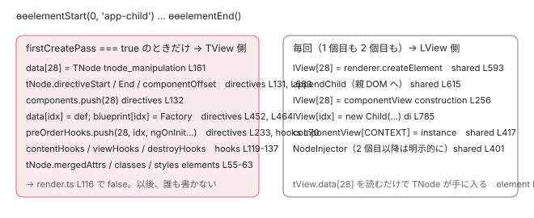

[目次](../README.md) › [Ivy ランタイム](README.md) › 第 8 回 / 全 17 回

# firstCreatePass：最初の 1 インスタンスだけがする仕事

> elementStartFirstCreatePass で TNode を作り、ディレクティブを照合し、フックを登録する。2 インスタンス目は tView.data\[index\] を読むだけ。

angular/angular · 読了 約 13 分 · 発展 · [サイトで読む（デモが動きます）](https://angular-deep-dive-cyan.vercel.app/chapter/ivy-first-create-pass)

---

[TView の章](05-ivy-tview.md)で、`firstCreatePass` は「クラスにつき 1 回だけ `true`」のフラグだと見ました。この章は、その 1 回に**何をしているか**です。`ɵɵelementStart` は `firstCreatePass` が `true` のとき `TNode` を作り、`directiveRegistry` を総当たりしてディレクティブを照合し、`TNode` の `directiveStart` / `componentOffset` を埋め、`TData` と型紙を伸ばし、ライフサイクルフックを `TView` に登録します。2 インスタンス目は、そのすべてを飛ばして `tView.data[index]` を読むだけです。どこで分岐し、何が飛ばされるのかを、行で追います。

読む対象は `packages/core/src/render3/instructions/element.ts`、`view/elements.ts`、`view/directives.ts`、`hooks.ts`、`di.ts` です。

1. 概観（配列だった）
2. Ivy とは
3. テンプレート関数と RenderFlags
4. TNode
5. TView
6. LView
7. blueprint と TData
8. **firstCreatePass**（この章）
9. DOM を組む命令
10. 値を更新する命令
11. LContainer
12. ビューの木
13. フック
14. ディレクティブ
15. LFrame
16. ViewRef 等
17. 破棄

## 1. 分岐点：ɵɵelementStart の三項演算子

📄 `angular/packages/core/src/render3/interfaces/view.ts` L653–667 （▶ の行: 653–654）

```ts
653 ▶   /** Whether or not this template has been processed in creation mode. */
654 ▶   firstCreatePass: boolean;
655 │ 
656 │   /**
657 │    *  Whether or not this template has been processed in update mode (e.g. change detected)
658 │    *
659 │    * `firstUpdatePass` is used by styling to set up `TData` to contain metadata about the styling
660 │    * instructions. (Mainly to build up a linked list of styling priority order.)
661 │    *
662 │    * Typically this function gets cleared after first execution. If exception is thrown then this
663 │    * flag can remain turned un until there is first successful (no exception) pass. This means that
664 │    * individual styling instructions keep track of if they have already been added to the linked
665 │    * list to prevent double adding.
666 │    */
667 │   firstUpdatePass: boolean;
```

📄 `angular/packages/core/src/render3/instructions/element.ts` L90–113 （▶ の行: 96, 100–113）

```ts
 90 │ export function ɵɵelementStart(
 91 │   index: number,
 92 │   name: string,
 93 │   attrsIndex?: number | null,
 94 │   localRefsIndex?: number,
 95 │ ): typeof ɵɵelementStart {
 96 ▶   const lView = getLView();
 97 │ 
 98 │   ngDevMode && assertTNodeCreationIndex(lView, index);
 99 │ 
100 ▶   const tView = lView[TVIEW];
101 ▶   const adjustedIndex = index + HEADER_OFFSET;
102 ▶   const tNode = tView.firstCreatePass
103 ▶     ? directiveHostFirstCreatePass(
104 ▶         adjustedIndex,
105 ▶         lView,
106 ▶         TNodeType.Element,
107 ▶         name,
108 ▶         findDirectiveDefMatches,
109 ▶         getBindingsEnabled(),
110 ▶         attrsIndex,
111 ▶         localRefsIndex,
112 ▶       )
113 ▶     : (tView.data[adjustedIndex] as TElementNode);
```

96 行目で今の `LView`、100〜101 行目で `TView` と `adjustedIndex = index + 28`。102 行目が分岐です。**`tView.firstCreatePass` なら 103〜112 行目の `directiveHostFirstCreatePass`、そうでなければ 113 行目の `tView.data[adjustedIndex]`**。どちらの枝も戻り値は同じ `TNode` で、以降の処理（`initializeElement`、[次章](09-ivy-create-instructions.md)）は区別しません。108 行目、照合の方法として `findDirectiveDefMatches` を関数ごと渡しています。109 行目 `getBindingsEnabled()` は `ɵɵdisableBindings` で止められていないか（通常は `true`）。

📄 `angular/packages/core/src/render3/assert.ts` L118–124 （▶ の行: 118, 120–121）

```ts
118 ▶ export function assertFirstCreatePass(tView: TView, errMessage?: string) {
119 │   assertEqual(
120 ▶     tView.firstCreatePass,
121 ▶     true,
122 │     errMessage || 'Should only be called in first create pass.',
123 │   );
124 │ }
```

この章で読む関数のほとんどが、先頭で `ngDevMode && assertFirstCreatePass(tView)` を呼びます。120〜121 行目、`firstCreatePass === true` でなければ開発モードで例外。**「この関数は最初の 1 回以外では呼ばれてはいけない」**という契約をコードで表しています。

## 2. directiveHostFirstCreatePass：TNode を作り、照合し、属性を合成する

📄 `angular/packages/core/src/render3/view/elements.ts` L26–70 （▶ の行: 37–40, 44–52, 54–55, 57–58, 61–63, 65–67）

```ts
26 │ export function directiveHostFirstCreatePass(
27 │   index: number,
28 │   lView: LView,
29 │   type: TNodeType.Element | TNodeType.ElementContainer,
30 │   name: string,
31 │   directiveMatcher: DirectiveMatcherStrategy,
32 │   bindingsEnabled: boolean,
33 │   attrsIndex?: number | null,
34 │   localRefsIndex?: number,
35 │ ): TElementNode | TElementContainerNode {
36 │   const tView = lView[TVIEW];
37 ▶   ngDevMode && assertFirstCreatePass(tView);
38 ▶   const tViewConsts = tView.consts;
39 ▶   const attrs = getConstant<TAttributes>(tViewConsts, attrsIndex);
40 ▶   const tNode = getOrCreateTNode(tView, index, type, name, attrs) as
41 │     | TElementNode
42 │     | TElementContainerNode;
43 │ 
44 ▶   if (bindingsEnabled) {
45 ▶     resolveDirectives(
46 ▶       tView,
47 ▶       lView,
48 ▶       tNode,
49 ▶       getConstant<string[]>(tViewConsts, localRefsIndex),
50 ▶       directiveMatcher,
51 ▶     );
52 ▶   }
53 │ 
54 ▶   // Merge the template attrs last so that they have the highest priority.
55 ▶   tNode.mergedAttrs = mergeHostAttrs(tNode.mergedAttrs, tNode.attrs);
56 │ 
57 ▶   if (tNode.attrs !== null) {
58 ▶     computeStaticStyling(tNode, tNode.attrs, false);
59 │   }
60 │ 
61 ▶   if (tNode.mergedAttrs !== null) {
62 ▶     computeStaticStyling(tNode, tNode.mergedAttrs, true);
63 ▶   }
64 │ 
65 ▶   if (tView.queries !== null) {
66 ▶     tView.queries.elementStart(tView, tNode);
67 ▶   }
68 │ 
69 │   return tNode;
70 │ }
```

1. **38〜39 行目：`attrs` を `tView.consts` から取る**

   `ɵɵelementStart(2, "p", 0)` の `0` が `attrsIndex` で、`consts[0]` が属性配列です（[2 章](02-ivy-overview.md)）。
2. **40 行目：`getOrCreateTNode`**

   以下で読みます。[TNode の章](04-ivy-tnode.md)の `createTNodeAtIndex` に続く入口です。
3. **44〜52 行目：`resolveDirectives`**

   `bindingsEnabled` のときだけ。49 行目、ローカル参照（`#ref`）の配列も `consts` から取って渡します。3 節。
4. **55 行目：`mergedAttrs = mergeHostAttrs(mergedAttrs, attrs)`**

   54 行目のコメント、「テンプレートの attrs を**最後に**混ぜて最優先にする」。`resolveDirectives` の中でディレクティブの `hostAttrs` が先に `mergedAttrs` に入っており（3 節の 200 行目）、テンプレートに書いた属性がそれを上書きします。
5. **57〜63 行目：`computeStaticStyling`**

   `class="a b"` / `style="..."` を `tNode.classes` / `tNode.styles` に展開（ホスト込みとホスト無しの 2 種類）。
6. **65〜67 行目：クエリに「要素が始まった」と通知**

📄 `angular/packages/core/src/render3/tnode_manipulation.ts` L115–140 （▶ の行: 118, 121–123, 131–133, 140）

```ts
115 │   ngDevMode &&
116 │     index !== 0 && // 0 are bogus nodes and they are OK. See `createContainerRef` in
117 │     // `view_engine_compatibility` for additional context.
118 ▶     assertGreaterThanOrEqual(index, HEADER_OFFSET, "TNodes can't be in the LView header.");
119 │   // Keep this function short, so that the VM will inline it.
120 │   ngDevMode && assertPureTNodeType(type);
121 ▶   let tNode = tView.data[index] as TNode;
122 ▶   if (tNode === null) {
123 ▶     tNode = createTNodeAtIndex(tView, index, type, name, attrs);
124 │     if (isInI18nBlock()) {
125 │       // If we are in i18n block then all elements should be pre declared through `Placeholder`
126 │       // See `TNodeType.Placeholder` and `LFrame.inI18n` for more context.
127 │       // If the `TNode` was not pre-declared than it means it was not mentioned which means it was
128 │       // removed, so we mark it as detached.
129 │       tNode.flags |= TNodeFlags.isDetached;
130 │     }
131 ▶   } else if (tNode.type & TNodeType.Placeholder) {
132 ▶     tNode.type = type;
133 ▶     tNode.value = name;
134 │     tNode.attrs = attrs;
135 │     const parent = getCurrentParentTNode();
136 │     tNode.injectorIndex = parent === null ? -1 : parent.injectorIndex;
137 │     ngDevMode && assertTNodeForTView(tNode, tView);
138 │     ngDevMode && assertEqual(index, tNode.index, 'Expecting same index');
139 │   }
140 ▶   setCurrentTNode(tNode, true);
```

118 行目、`index` は 28 以上（「TNode は HEADER に入れない」）。121〜123 行目、`tView.data[index]` が `null` なら `createTNodeAtIndex` で作る。131〜133 行目、i18n が先に置いた `Placeholder` があれば中身を埋めて再利用。140 行目、`setCurrentTNode(tNode, true)`。「`getOrCreate`」の「get」側は `firstCreatePass` の中でも起きます（i18n）。`firstCreatePass` が `false` のときは、この関数そのものが呼ばれません。

## 3. resolveDirectives：どのディレクティブが付くかを決める

📄 `angular/packages/core/src/render3/view/directives.ts` L58–95 （▶ の行: 66, 68–69, 71, 76–79, 86）

```ts
58 │ export function resolveDirectives(
59 │   tView: TView,
60 │   lView: LView,
61 │   tNode: TElementNode | TContainerNode | TElementContainerNode,
62 │   localRefs: string[] | null,
63 │   directiveMatcher: DirectiveMatcherStrategy,
64 │ ): void {
65 │   // Please make sure to have explicit type for `exportsMap`. Inferred type triggers bug in tsickle.
66 ▶   ngDevMode && assertFirstCreatePass(tView);
67 │ 
68 ▶   const exportsMap: Record<string, number> | null = localRefs === null ? null : {'': -1};
69 ▶   const matchedDirectiveDefs = directiveMatcher(tView, tNode);
70 │ 
71 ▶   if (matchedDirectiveDefs !== null) {
72 │     let directiveDefs = matchedDirectiveDefs;
73 │     let hostDirectiveDefs: HostDirectiveDefs | null = null;
74 │     let hostDirectiveRanges: HostDirectiveRanges | null = null;
75 │ 
76 ▶     for (const def of matchedDirectiveDefs) {
77 ▶       if (def.resolveHostDirectives !== null) {
78 ▶         [directiveDefs, hostDirectiveDefs, hostDirectiveRanges] =
79 ▶           def.resolveHostDirectives(matchedDirectiveDefs);
80 │         break;
81 │       }
82 │     }
83 │ 
84 │     ngDevMode && assertNoDuplicateDirectives(directiveDefs);
85 │ 
86 ▶     initializeDirectives(
87 │       tView,
88 │       lView,
89 │       tNode,
90 │       directiveDefs,
91 │       exportsMap,
92 │       hostDirectiveDefs,
93 │       hostDirectiveRanges,
94 │     );
95 │   }
```

66 行目、`assertFirstCreatePass`。69 行目、渡された `directiveMatcher`（= `findDirectiveDefMatches`）を呼び、照合結果の配列を得る。71 行目、1 つでも照合されたら、76〜79 行目で `hostDirectives` を展開してから 86 行目の `initializeDirectives`。68 行目の `exportsMap` は `#ref="exportAs"` を解決するための表です。

📄 `angular/packages/core/src/render3/instructions/shared.ts` L459–497 （▶ の行: 463, 466, 469–472, 474, 483–485, 488, 490, 496）

```ts
459 │ export function findDirectiveDefMatches(
460 │   tView: TView,
461 │   tNode: TElementNode | TContainerNode | TElementContainerNode,
462 │ ): DirectiveDef<unknown>[] | null {
463 ▶   ngDevMode && assertFirstCreatePass(tView);
464 │   ngDevMode && assertTNodeType(tNode, TNodeType.AnyRNode | TNodeType.AnyContainer);
465 │ 
466 ▶   const registry = tView.directiveRegistry;
467 │   let matches: DirectiveDef<unknown>[] | null = null;
468 │   if (registry) {
469 ▶     for (let i = 0; i < registry.length; i++) {
470 ▶       const def = registry[i] as ComponentDef<any> | DirectiveDef<any>;
471 ▶       if (isNodeMatchingSelectorList(tNode, def.selectors!, /* isProjectionMode */ false)) {
472 ▶         matches ??= [];
473 │ 
474 ▶         if (isComponentDef(def)) {
475 │           if (ngDevMode) {
476 │             assertTNodeType(
477 │               tNode,
478 │               TNodeType.Element,
479 │               `"${tNode.value}" tags cannot be used as component hosts. ` +
480 │                 `Please use a different tag to activate the ${stringify(def.type)} component.`,
481 │             );
482 │ 
483 ▶             if (matches.length && isComponentDef(matches[0])) {
484 ▶               throwMultipleComponentError(tNode, matches.find(isComponentDef)!.type, def.type);
485 ▶             }
486 │           }
487 │ 
488 ▶           matches.unshift(def);
489 │         } else {
490 ▶           matches.push(def);
491 │         }
492 │       }
493 │     }
494 │   }
495 │ 
496 ▶   return matches;
497 │ }
```

1. **466 行目：`tView.directiveRegistry`**

   `ɵcmp.directiveDefs`（`imports` から作った一覧）を `createTView` がコピーしたものです。**この配列の外にあるディレクティブは、どんなセレクタでも照合されません**。「`imports` に書き忘れると動かない」の実体です。
2. **469〜471 行目：全部の `def` について `isNodeMatchingSelectorList(tNode, def.selectors)`**

   総当たりです。`tNode.value`（タグ名）と `tNode.attrs` を、`def.selectors`（`[["app-child"]]` や `[["", "tooltip", ""]]`）と比べます。[TNode の章](04-ivy-tnode.md)で「`attrs` を DOM から読まずに持つのはセレクタ照合が遅くなるから」とあった、その照合がここです。**この総当たりが `firstCreatePass` の 1 回で済む**のが、`TNode` を共有する最大の利益です。
3. **474・488 行目：コンポーネントなら先頭に `unshift`、490 行目：ディレクティブなら末尾に `push`**

   「コンポーネントは最大 1 つで、配列の 0 番目」という約束（`componentOffset` が 0 になる理由）。483〜485 行目、2 つ目のコンポーネントが照合されたら開発モードで例外です。

## 4. initializeDirectives：TNode・TData・型紙に書き込む

📄 `angular/packages/core/src/render3/view/directives.ts` L145–161 （▶ の行: 145, 152–156, 158, 161）

```ts
145 ▶   ngDevMode && assertFirstCreatePass(tView);
146 │ 
147 │   const directivesLength = directives.length;
148 │   let componentDef: ComponentDef<unknown> | null = null;
149 │ 
150 │   // Publishes the directive types to DI so they can be injected. Needs to
151 │   // happen in a separate pass before the TNode flags have been initialized.
152 ▶   for (let i = 0; i < directivesLength; i++) {
153 ▶     const def = directives[i];
154 ▶     if (componentDef === null && isComponentDef(def)) {
155 ▶       componentDef = def;
156 ▶       markAsComponentHost(tView, tNode, i);
157 │     }
158 ▶     diPublicInInjector(getOrCreateNodeInjectorForNode(tNode, lView), tView, def.type);
159 │   }
160 │ 
161 ▶   initTNodeFlags(tNode, tView.data.length, directivesLength);
```

📄 `angular/packages/core/src/render3/view/directives.ts` L123–133 （▶ の行: 131–132）

```ts
123 │ /**
124 │  * Marks a given TNode as a component's host. This consists of:
125 │  * - setting the component offset on the TNode.
126 │  * - storing index of component's host element so it will be queued for view refresh during CD.
127 │  */
128 │ function markAsComponentHost(tView: TView, hostTNode: TNode, componentOffset: number): void {
129 │   ngDevMode && assertFirstCreatePass(tView);
130 │   ngDevMode && assertGreaterThan(componentOffset, -1, 'componentOffset must be great than -1');
131 ▶   hostTNode.componentOffset = componentOffset;
132 ▶   (tView.components ??= []).push(hostTNode.index);
133 │ }
```

1. **152〜157 行目：最初に見つかった `ComponentDef` で `markAsComponentHost(tView, tNode, i)`**

   131 行目、`tNode.componentOffset = i`（3 節の `unshift` により 0）。132 行目、**`tView.components` に `tNode.index` を `push`**。変更検知が「このビューの子コンポーネントはどこか」を知る一覧（[TView の章](05-ivy-tview.md) 839 行目）が、ここで 1 要素ずつ増えます。
2. **158 行目：`diPublicInInjector(getOrCreateNodeInjectorForNode(tNode, lView), tView, def.type)`**

   この要素の NodeInjector（bloom フィルタ）を作り、ディレクティブの型を「注入できる」として公開します。`tNode.injectorIndex` が `-1` から実際の番号に変わるのはこの中です（[DI の章](../di/10-di.md)）。
3. **161 行目：`initTNodeFlags(tNode, tView.data.length, directivesLength)`**

   `isDirectiveHost` フラグ、`directiveStart = tView.data.length`（今の末尾）、`directiveEnd = start + n`。[前章](07-ivy-blueprint.md)の 554〜566 行目です。

📄 `angular/packages/core/src/render3/view/directives.ts` L181–203 （▶ の行: 183–189, 193, 196–197, 200, 202–203）

```ts
181 │   let preOrderHooksFound = false;
182 │   let preOrderCheckHooksFound = false;
183 ▶   let directiveIdx = allocExpando(tView, lView, directivesLength, null);
184 ▶   ngDevMode &&
185 ▶     assertSame(
186 ▶       directiveIdx,
187 ▶       tNode.directiveStart,
188 ▶       'TNode.directiveStart should point to just allocated space',
189 ▶     );
190 │ 
191 │   // If there's at least one directive, we'll have to track it so initialize the map.
192 │   if (directivesLength > 0) {
193 ▶     tNode.directiveToIndex = new Map();
194 │   }
195 │ 
196 ▶   for (let i = 0; i < directivesLength; i++) {
197 ▶     const def = directives[i];
198 │     // Merge the attrs in the order of matches. This assumes that the first directive is the
199 │     // component itself, so that the component has the least priority.
200 ▶     tNode.mergedAttrs = mergeHostAttrs(tNode.mergedAttrs, def.hostAttrs);
201 │ 
202 ▶     configureViewWithDirective(tView, tNode, lView, directiveIdx, def);
203 ▶     saveNameToExportMap(directiveIdx, def, exportsMap);
```

1. **183 行目：`directiveIdx = allocExpando(tView, lView, directivesLength, null)`**

   `lView`・型紙・`data` を `n` 個伸ばし、先頭の番号を受け取る。184〜189 行目、それが `tNode.directiveStart` と同じであることを検査。
2. **193 行目：`tNode.directiveToIndex = new Map()`**

   「ディレクティブのクラス → `LView` の番号」の表。`ViewChild(SomeDirective)` などの逆引きに使います。
3. **196〜203 行目：ディレクティブごとに**

   200 行目、`def.hostAttrs` を `mergedAttrs` に（コンポーネントが先頭なので最も優先度が低い）。202 行目、`configureViewWithDirective`（下）。203 行目、`exportAs` を `exportsMap` に。

📄 `angular/packages/core/src/render3/view/directives.ts` L443–474 （▶ の行: 452–454, 458, 464–465, 467–472）

```ts
443 │ function configureViewWithDirective<T>(
444 │   tView: TView,
445 │   tNode: TNode,
446 │   lView: LView,
447 │   directiveIndex: number,
448 │   def: DirectiveDef<T>,
449 │ ): void {
450 │   ngDevMode &&
451 │     assertGreaterThanOrEqual(directiveIndex, HEADER_OFFSET, 'Must be in Expando section');
452 ▶   tView.data[directiveIndex] = def;
453 ▶   const directiveFactory =
454 ▶     def.factory || ((def as Writable<DirectiveDef<T>>).factory = getFactoryDef(def.type, true));
455 │   // Even though `directiveFactory` will already be using `ɵɵdirectiveInject` in its generated code,
456 │   // we also want to support `inject()` directly from the directive constructor context so we set
457 │   // `ɵɵdirectiveInject` as the inject implementation here too.
458 ▶   const nodeInjectorFactory = new NodeInjectorFactory(
459 │     directiveFactory,
460 │     isComponentDef(def),
461 │     ɵɵdirectiveInject,
462 │     ngDevMode ? def.type.name : null,
463 │   );
464 ▶   tView.blueprint[directiveIndex] = nodeInjectorFactory;
465 ▶   lView[directiveIndex] = nodeInjectorFactory;
466 │ 
467 ▶   registerHostBindingOpCodes(
468 ▶     tView,
469 ▶     tNode,
470 ▶     directiveIndex,
471 ▶     allocExpando(tView, lView, def.hostVars, NO_CHANGE),
472 ▶     def,
473 │   );
474 │ }
```

452 行目、**`tView.data[directiveIndex] = def`**。TData にディレクティブ定義が入る瞬間です。453〜454 行目、`def.factory` が無ければ `ɵfac` から取って `def` にキャッシュ。458 行目、それを `NodeInjectorFactory` で包み、464〜465 行目で型紙と `lView` に。467〜473 行目、`hostVars` ぶんの枠を `NO_CHANGE` で確保して、`hostBindings` 関数を `tView.hostBindingOpCodes` に登録します（[ディレクティブの章](14-ivy-directives.md)）。

📄 `angular/packages/core/src/render3/view/directives.ts` L219–246 （▶ の行: 219–221, 223, 226–235, 237–240, 242, 245）

```ts
219 ▶     if (def.contentQueries !== null) tNode.flags |= TNodeFlags.hasContentQuery;
220 ▶     if (def.hostBindings !== null || def.hostAttrs !== null || def.hostVars !== 0)
221 ▶       tNode.flags |= TNodeFlags.hasHostBindings;
222 │ 
223 ▶     const lifeCycleHooks: Partial<OnChanges & OnInit & DoCheck> = def.type.prototype;
224 │     // Only push a node index into the preOrderHooks array if this is the first
225 │     // pre-order hook found on this node.
226 ▶     if (
227 ▶       !preOrderHooksFound &&
228 ▶       (lifeCycleHooks.ngOnChanges || lifeCycleHooks.ngOnInit || lifeCycleHooks.ngDoCheck)
229 ▶     ) {
230 ▶       // We will push the actual hook function into this array later during dir instantiation.
231 ▶       // We cannot do it now because we must ensure hooks are registered in the same
232 ▶       // order that directives are created (i.e. injection order).
233 ▶       (tView.preOrderHooks ??= []).push(tNode.index);
234 ▶       preOrderHooksFound = true;
235 ▶     }
236 │ 
237 ▶     if (!preOrderCheckHooksFound && (lifeCycleHooks.ngOnChanges || lifeCycleHooks.ngDoCheck)) {
238 ▶       (tView.preOrderCheckHooks ??= []).push(tNode.index);
239 ▶       preOrderCheckHooksFound = true;
240 ▶     }
241 │ 
242 ▶     directiveIdx++;
243 │   }
244 │ 
245 ▶   initializeInputAndOutputAliases(tView, tNode, hostDirectiveDefs);
246 │ }
```

219 行目、`contentQueries` があれば `hasContentQuery`。220〜221 行目、`hostBindings` / `hostAttrs` / `hostVars` のどれかがあれば `hasHostBindings`。223 行目、**`def.type.prototype` を見て**`ngOnChanges` / `ngOnInit` / `ngDoCheck` が定義されているかを調べます。226〜235 行目、このノードで初めて見つかったなら `tView.preOrderHooks` に **`tNode.index`** を `push`。230〜232 行目のコメント、「フック関数そのものは後でインスタンス化のときに `push` する。注入の順序とフックの順序を一致させるため」。237〜240 行目、`preOrderCheckHooks` にも同様に。245 行目、最後に input / output の別名表を作ります。

## 5. フック関数の登録：インスタンス化のときと、elementEnd のとき

📄 `angular/packages/core/src/render3/di.ts` L785–798 （▶ の行: 785, 795–797）

```ts
785 ▶       value = lView[index] = factory.factory(undefined, flags, tData, lView, tNode);
786 │ 
787 │       ngDevMode && emitInstanceCreatedByInjectorEvent(value);
788 │ 
789 │       // This code path is hit for both directives and providers.
790 │       // For perf reasons, we want to avoid searching for hooks on providers.
791 │       // It does no harm to try (the hooks just won't exist), but the extra
792 │       // checks are unnecessary and this is a hot path. So we check to see
793 │       // if the index of the dependency is in the directive range for this
794 │       // tNode. If it's not, we know it's a provider and skip hook registration.
795 ▶       if (tView.firstCreatePass && index >= tNode.directiveStart) {
796 ▶         ngDevMode && assertDirectiveDef(tData[index]);
797 ▶         registerPreOrderHooks(index, tData[index] as DirectiveDef<any>, tView);
798 │       }
```

📄 `angular/packages/core/src/render3/hooks.ts` L53–77 （▶ の行: 58–59, 63–67, 69–71, 73–76）

```ts
53 │ export function registerPreOrderHooks(
54 │   directiveIndex: number,
55 │   directiveDef: DirectiveDef<any>,
56 │   tView: TView,
57 │ ): void {
58 ▶   ngDevMode && assertFirstCreatePass(tView);
59 ▶   const {ngOnChanges, ngOnInit, ngDoCheck} = directiveDef.type.prototype as OnChanges &
60 │     OnInit &
61 │     DoCheck;
62 │ 
63 ▶   if (ngOnChanges as Function | undefined) {
64 ▶     const wrappedOnChanges = getNgOnChangesFeatureImpl()(directiveDef);
65 ▶     (tView.preOrderHooks ??= []).push(directiveIndex, wrappedOnChanges);
66 ▶     (tView.preOrderCheckHooks ??= []).push(directiveIndex, wrappedOnChanges);
67 ▶   }
68 │ 
69 ▶   if (ngOnInit) {
70 ▶     (tView.preOrderHooks ??= []).push(0 - directiveIndex, ngOnInit);
71 ▶   }
72 │ 
73 ▶   if (ngDoCheck) {
74 ▶     (tView.preOrderHooks ??= []).push(directiveIndex, ngDoCheck);
75 ▶     (tView.preOrderCheckHooks ??= []).push(directiveIndex, ngDoCheck);
76 ▶   }
77 │ }
```

di.ts 785 行目、`getNodeInjectable` がファクトリを呼んでインスタンスを `lView[index]` に入れた直後、795 行目、**`firstCreatePass` かつディレクティブの範囲なら** 797 行目で `registerPreOrderHooks`。hooks.ts 59 行目、再び `prototype` から 3 つを取り、63〜67 行目 `ngOnChanges`（ラップした関数を `preOrderHooks` と `preOrderCheckHooks` の両方へ）、69〜71 行目 `ngOnInit`（**負の番号 `0 - directiveIndex`** で「1 回だけの init フック」の印）、73〜76 行目 `ngDoCheck`。4 節で `push` された `tNode.index` の後ろに、`[directiveIndex, fn]` の組が並んでいきます。配列の実行側は[フックの章](13-ivy-hooks.md)で。

📄 `angular/packages/core/src/render3/instructions/element.ts` L163–173 （▶ の行: 164–165, 168, 171–172）

```ts
163 │ export function ɵɵelementEnd(): typeof ɵɵelementEnd {
164 ▶   const tView = getTView();
165 ▶   const initialTNode = getCurrentTNode()!;
166 │   ngDevMode && assertDefined(initialTNode, 'No parent node to close.');
167 │ 
168 ▶   const currentTNode = elementLikeEndShared(initialTNode);
169 │   ngDevMode && assertTNodeType(currentTNode, TNodeType.AnyRNode);
170 │ 
171 ▶   if (tView.firstCreatePass) {
172 ▶     directiveHostEndFirstCreatePass(tView, currentTNode);
173 │   }
```

📄 `angular/packages/core/src/render3/view/elements.ts` L72–78 （▶ の行: 73–76）

```ts
72 │ export function directiveHostEndFirstCreatePass(tView: TView, tNode: TNode) {
73 ▶   ngDevMode && assertFirstCreatePass(tView);
74 ▶   registerPostOrderHooks(tView, tNode);
75 ▶   if (isContentQueryHost(tNode)) {
76 ▶     tView.queries!.elementEnd(tNode);
77 │   }
78 │ }
```

📄 `angular/packages/core/src/render3/hooks.ts` L97–140 （▶ の行: 99–103, 109, 118–119, 122–125, 127–128, 131–134, 136–137）

```ts
 97 │ export function registerPostOrderHooks(tView: TView, tNode: TNode): void {
 98 │   ngDevMode && assertFirstCreatePass(tView);
 99 ▶   // It's necessary to loop through the directives at elementEnd() (rather than processing in
100 ▶   // directiveCreate) so we can preserve the current hook order. Content, view, and destroy
101 ▶   // hooks for projected components and directives must be called *before* their hosts.
102 ▶   for (let i = tNode.directiveStart, end = tNode.directiveEnd; i < end; i++) {
103 ▶     const directiveDef = tView.data[i] as DirectiveDef<any>;
104 │     ngDevMode && assertDefined(directiveDef, 'Expecting DirectiveDef');
105 │     const lifecycleHooks: AfterContentInit &
106 │       AfterContentChecked &
107 │       AfterViewInit &
108 │       AfterViewChecked &
109 ▶       OnDestroy = directiveDef.type.prototype;
110 │     const {
111 │       ngAfterContentInit,
112 │       ngAfterContentChecked,
113 │       ngAfterViewInit,
114 │       ngAfterViewChecked,
115 │       ngOnDestroy,
116 │     } = lifecycleHooks;
117 │ 
118 ▶     if (ngAfterContentInit) {
119 ▶       (tView.contentHooks ??= []).push(-i, ngAfterContentInit);
120 │     }
121 │ 
122 ▶     if (ngAfterContentChecked) {
123 ▶       (tView.contentHooks ??= []).push(i, ngAfterContentChecked);
124 ▶       (tView.contentCheckHooks ??= []).push(i, ngAfterContentChecked);
125 ▶     }
126 │ 
127 ▶     if (ngAfterViewInit) {
128 ▶       (tView.viewHooks ??= []).push(-i, ngAfterViewInit);
129 │     }
130 │ 
131 ▶     if (ngAfterViewChecked) {
132 ▶       (tView.viewHooks ??= []).push(i, ngAfterViewChecked);
133 ▶       (tView.viewCheckHooks ??= []).push(i, ngAfterViewChecked);
134 ▶     }
135 │ 
136 ▶     if (ngOnDestroy != null) {
137 ▶       (tView.destroyHooks ??= []).push(i, ngOnDestroy);
138 │     }
139 │   }
140 │ }
```

element.ts 171〜172 行目、`ɵɵelementEnd` も `firstCreatePass` のときだけ `directiveHostEndFirstCreatePass`。elements.ts 74 行目で `registerPostOrderHooks`、75〜76 行目でクエリに「要素が終わった」と通知。hooks.ts 102 行目、`directiveStart` から `directiveEnd` までの `def` について、109 行目 `prototype` から 118〜119 行目 `ngAfterContentInit`（負の番号）、122〜125 行目 `ngAfterContentChecked`、127〜128 行目 `ngAfterViewInit`（負の番号）、131〜134 行目 `ngAfterViewChecked`、136〜137 行目 `ngOnDestroy` を登録。99〜101 行目、なぜ `elementEnd` で登録するのか：**「投影されたコンポーネントのフックは、そのホストより先に呼ばれなければならない」**。子要素の `elementEnd` は親の `elementEnd` より先に来るので、配列の順序がそのまま実行順になります。



*firstCreatePass の 1 回で、ɵɵelementStart と ɵɵelementEnd が TView 側に書き込むもの。LView 側に書くのは DOM 要素とインスタンスだけで、それは 2 回目以降も同じ。*

## 6. 2 インスタンス目：何が変わるか

📄 `angular/packages/core/src/render3/instructions/render.ts` L105–117 （▶ の行: 107, 115–116）

```ts
105 │     const templateFn = tView.template;
106 │     if (templateFn !== null) {
107 ▶       executeTemplate<T>(tView, lView, templateFn, RenderFlags.Create, context);
108 │     }
109 │ 
110 │     // This needs to be set before children are processed to support recursive components.
111 │     // This must be set to false immediately after the first creation run because in an
112 │     // ngFor loop, all the views will be created together before update mode runs and turns
113 │     // off firstCreatePass. If we don't set it here, instances will perform directive
114 │     // matching, etc again and again.
115 ▶     if (tView.firstCreatePass) {
116 ▶       tView.firstCreatePass = false;
117 │     }
```

107 行目で作成ブロックが終わり、115〜116 行目で `false`。[TView の章](05-ivy-tview.md)で読んだとおりです。この行を通ったあと、同じクラスの 2 個目のインスタンスの `ɵɵelementStart` は 1 節の 113 行目の枝に入ります。

📄 `angular/packages/core/src/render3/instructions/shared.ts` L386–403 （▶ の行: 387–388, 392, 394–398, 401–403）

```ts
386 │ function instantiateAllDirectives(tView: TView, lView: LView, tNode: TDirectiveHostNode) {
387 ▶   const start = tNode.directiveStart;
388 ▶   const end = tNode.directiveEnd;
389 │ 
390 │   // The component view needs to be created before creating the node injector
391 │   // since it is used to inject some special symbols like `ChangeDetectorRef`.
392 ▶   if (isComponentHost(tNode)) {
393 │     ngDevMode && assertTNodeType(tNode, TNodeType.AnyRNode);
394 ▶     createComponentLView(
395 ▶       lView,
396 ▶       tNode as TElementNode,
397 ▶       tView.data[start + tNode.componentOffset] as ComponentDef<unknown>,
398 ▶     );
399 │   }
400 │ 
401 ▶   if (!tView.firstCreatePass) {
402 ▶     getOrCreateNodeInjectorForNode(tNode, lView);
403 ▶   }
```

387〜388 行目、`directiveStart` / `directiveEnd` は `TNode` から読むだけ。1 個目で埋まった値です。392〜398 行目、`createComponentLView`（[LView の章](06-ivy-lview.md)）は**毎回**。401〜403 行目、**`firstCreatePass` でないときだけ**`getOrCreateNodeInjectorForNode`。1 個目では 4 節の 158 行目（`initializeDirectives` の中）で作られていたので、2 個目以降はここで明示的に作る必要があります。NodeInjector の bloom フィルタは `TView` 側（共有）ですが、`LView` 側にも 1 ビューぶんの枠が要るからです。

> **🧪 DEMO — firstCreatePass の値で、ɵɵelementStart 〜 ɵɵelementEnd が通る関数**
>
> &lt;app-child&gt; 1 要素ぶん。切り替えると、飛ばされる関数が消えます。
>
> ▶ [このデモはサイトで動かせます](https://angular-deep-dive-cyan.vercel.app/chapter/ivy-first-create-pass)

## 7. ɵɵtext と ɵɵdomElementStart：照合しない命令

📄 `angular/packages/core/src/render3/instructions/text.ts` L34–46 （▶ の行: 41–43）

```ts
34 │ export function ɵɵtext(index: number, value = ''): void {
35 │   const lView = getLView();
36 │   const tView = getTView();
37 │   const adjustedIndex = index + HEADER_OFFSET;
38 │ 
39 │   ngDevMode && assertTNodeCreationIndex(lView, index);
40 │ 
41 ▶   const tNode = tView.firstCreatePass
42 ▶     ? getOrCreateTNode(tView, adjustedIndex, TNodeType.Text, value, null)
43 ▶     : (tView.data[adjustedIndex] as TElementNode);
44 │ 
45 │   const textNative = _locateOrCreateTextNode(tView, lView, tNode, value);
46 │   lView[adjustedIndex] = textNative;
```

📄 `angular/packages/core/src/render3/instructions/element.ts` L236–259 （▶ の行: 248–249, 257, 259）

```ts
236 │ export function ɵɵdomElementStart(
237 │   index: number,
238 │   name: string,
239 │   attrsIndex?: number | null,
240 │   localRefsIndex?: number,
241 │ ): typeof ɵɵdomElementStart {
242 │   const lView = getLView();
243 │ 
244 │   ngDevMode && assertTNodeCreationIndex(lView, index);
245 │ 
246 │   const tView = lView[TVIEW];
247 │   const adjustedIndex = index + HEADER_OFFSET;
248 ▶   const tNode = tView.firstCreatePass
249 ▶     ? domOnlyFirstCreatePass(
250 │         adjustedIndex,
251 │         tView,
252 │         TNodeType.Element,
253 │         name,
254 │         attrsIndex,
255 │         localRefsIndex,
256 │       )
257 ▶     : (tView.data[adjustedIndex] as TElementNode);
258 │ 
259 ▶   elementLikeStartShared(tNode, lView, index, name, _locateOrCreateElementNode);
```

📄 `angular/packages/core/src/render3/view/elements.ts` L80–96 （▶ の行: 88, 91, 96）

```ts
80 │ export function domOnlyFirstCreatePass(
81 │   index: number,
82 │   tView: TView,
83 │   type: TNodeType.Element | TNodeType.ElementContainer,
84 │   name: string,
85 │   attrsIndex?: number | null,
86 │   localRefsIndex?: number,
87 │ ): TElementNode | TElementContainerNode {
88 ▶   ngDevMode && assertFirstCreatePass(tView);
89 │   const tViewConsts = tView.consts;
90 │   const attrs = getConstant<TAttributes>(tViewConsts, attrsIndex);
91 ▶   const tNode = getOrCreateTNode(tView, index, type, name, attrs) as
92 │     | TElementNode
93 │     | TElementContainerNode;
94 │ 
95 │   // Merge the template attrs last so that they have the highest priority.
96 ▶   tNode.mergedAttrs = mergeHostAttrs(tNode.mergedAttrs, tNode.attrs);
```

text.ts 41〜43 行目、`ɵɵtext` も同じ三項演算子ですが、`firstCreatePass` 側は `getOrCreateTNode` だけ。テキストにディレクティブは付かないので照合しません。element.ts 248〜257 行目、`ɵɵdomElementStart`（compiler 章の出力で `<h1>` や `<p>` に使われていた命令）は `domOnlyFirstCreatePass` を呼びます。elements.ts 91 行目で `TNode` を作り、96 行目で `mergedAttrs`。**`resolveDirectives` の呼び出しがありません**。コンパイラは「この要素に照合されうるディレクティブが `imports` に 1 つも無い」と判定できたとき、照合を省いたこの命令を出します。総当たりの回数を減らすための、コンパイル時の最適化です。

> [!TIP]
> **新卒エンジニアへ**
>
> 「ディレクティブが効かない」と相談されたら、見るべき場所は 3 節の 466 行目です。`tView.directiveRegistry` は `ɵcmp.directiveDefs`、つまり**そのコンポーネントの `imports`**。親に `imports` しても子のテンプレートには届きません。レジストリは `TView` ごとだからです （埋め込みビューだけは宣言側のレジストリを引き継ぎます。[TView の章](05-ivy-tview.md) template.ts 75 行目）。

## ここまでの呼び出し

- 👤 `ɵɵelementStart(0, 'app-child', 0)` — 親の生成コード — *tView.firstCreatePass === true*
  - `directiveHostFirstCreatePass(28, lView, Element, 'app-child', findDirectiveDefMatches, true, 0)` — view/elements.ts L26
    - `getOrCreateTNode(tView, 28, Element, 'app-child', attrs)` — tnode\_manipulation.ts L102 — *data\[28\] = TNode*
    - `resolveDirectives(tView, lView, tNode, localRefs, findDirectiveDefMatches)` — view/directives.ts L58
      - `findDirectiveDefMatches(tView, tNode)` — instructions/shared.ts L459 — *directiveRegistry を総当たり。コンポーネントは unshift*
      - `initializeDirectives(tView, lView, tNode, defs, exportsMap, ...)` — directives.ts L136
        - `markAsComponentHost(tView, tNode, 0)` — directives.ts L128 — *componentOffset = 0; components.push(28)*
        - `diPublicInInjector(getOrCreateNodeInjectorForNode(tNode, lView), tView, def.type)` — directives.ts L158
        - `initTNodeFlags(tNode, tView.data.length, n)` — directives.ts L554 — *directiveStart / directiveEnd*
        - `allocExpando(tView, lView, n, null)` — view/construction.ts L282
        - `configureViewWithDirective(tView, tNode, lView, idx, def)` × n — directives.ts L443 — *data\[idx\] = def; blueprint\[idx\] = lView\[idx\] = Factory*
        - `preOrderHooks.push(tNode.index)` — directives.ts L233 — *prototype に ngOnInit 等があれば*
    - `mergedAttrs = mergeHostAttrs(mergedAttrs, attrs); computeStaticStyling(...)` — elements.ts L55-63
  - `initializeElement(...)` → `createDirectivesInstances` → `instantiateAllDirectives` — element.ts L129, shared.ts L386 — *ここからは毎回*
    - `getNodeInjectable(lView, tView, idx, tNode)` — di.ts L735 — *lView\[idx\] = factory(...)*
      - `registerPreOrderHooks(idx, def, tView)` — di.ts L797 → hooks.ts L53 — *firstCreatePass のときだけ。ngOnInit は負の番号で*
- 👤 `ɵɵelementEnd()` — 親の生成コード
  - `directiveHostEndFirstCreatePass(tView, tNode)` — element.ts L172 → elements.ts L72 — *firstCreatePass のときだけ*
    - `registerPostOrderHooks(tView, tNode)` — hooks.ts L97 — *contentHooks / viewHooks / destroyHooks*
- `renderView` → `tView.firstCreatePass = false` — instructions/render.ts L116 — *親の作成ブロックが終わった直後*

## 聞かれそうな質問

**Q. firstCreatePass が true のときと false のときで、ɵɵelementStart の処理はどう違いますか？**

element.ts 102 行目の三項演算子で分かれます。`true` なら 103〜112 行目の `directiveHostFirstCreatePass`： `TNode` を作り（elements.ts 40 行目）、`directiveRegistry` を総当たりしてディレクティブを照合し（shared.ts 469〜471 行目）、`componentOffset` / `directiveStart` / `directiveEnd` を埋め（directives.ts 131・161 行目）、`TData` と型紙を伸ばし（183・452・464 行目）、フックの位置を登録します（233 行目）。`false` なら 113 行目で `tView.data[adjustedIndex]` を読むだけ。その後の DOM 作成とインスタンス化（`initializeElement`）は両方で同じです。

**Q. ディレクティブの照合は、インスタンスごとにやり直しますか？**

いいえ。`findDirectiveDefMatches` は `assertFirstCreatePass`（shared.ts 463 行目）で守られていて、最初の 1 回しか呼ばれません。結果は `tNode.directiveStart` 〜 `directiveEnd` と `tView.data[...]`（directives.ts 452 行目）に残り、2 個目以降の `instantiateAllDirectives` は shared.ts 387〜388 行目でその範囲を読むだけです。

**Q. imports に書き忘れたディレクティブが動かないのは、どの行のせいですか？**

shared.ts 466 行目の `tView.directiveRegistry` です。これは `ɵcmp.directiveDefs`（`imports` から作った一覧）のコピーで、469〜471 行目の総当たりはこの配列の中だけを見ます。レジストリは `TView` ごとなので、親の `imports` は子のテンプレートに届きません。

**Q. ngOnInit が 1 回しか呼ばれないのは、どこで保証していますか？**

登録の形です。hooks.ts 70 行目、`ngOnInit` は `0 - directiveIndex`（負の番号）で `preOrderHooks` に入ります。`ngDoCheck`（74〜75 行目）は正の番号で `preOrderHooks` と `preOrderCheckHooks` の両方に。実行側は負の番号を「init フック」と見て、`lView[FLAGS]` の init フェーズと照らして 1 回だけ呼びます（[フックの章](13-ivy-hooks.md)）。

**Q. ngAfterViewInit などが elementEnd で登録されるのはなぜですか？**

hooks.ts 99〜101 行目のコメントどおり、「投影されたコンポーネントの content / view / destroy フックは、そのホストより先に呼ばれなければならない」からです。子要素の `ɵɵelementEnd`（element.ts 171〜172 行目 → elements.ts 74 行目）は親の `ɵɵelementEnd` より先に来るので、`push` の順序がそのまま「子が先、親が後」の実行順になります。

**Q. ɵɵdomElementStart と ɵɵelementStart の違いは？**

`ɵɵdomElementStart`（element.ts 248〜257 行目）は `domOnlyFirstCreatePass` を呼び、そこには `resolveDirectives` がありません（elements.ts 80〜96 行目）。コンパイラが「この要素に照合されうるディレクティブは `imports` に無い」と確定できた要素に使う、照合を省いた版です。

## 読み終えて

- 分岐は element.ts 102 行目の三項演算子。`true` なら `directiveHostFirstCreatePass`、`false` なら `tView.data[adjustedIndex]`
- 最初の 1 回がすること：`TNode` 作成、`directiveRegistry` の総当たり照合、`componentOffset` / `directiveStart` / `directiveEnd`、`components.push`、`data[idx] = def` と型紙への `Factory`、フックの登録
- フック登録は 3 か所：`initializeDirectives` が `tNode.index`、`getNodeInjectable` が pre-order のフック関数、`elementEnd` が post-order のフック関数
- 2 個目以降も毎回やること：DOM 作成、`createComponentLView`、インスタンス化、`CONTEXT` 設定、NodeInjector（こちらは明示的に）
- 照合の範囲は `tView.directiveRegistry` = そのコンポーネントの `imports`。`ɵɵdomElementStart` は照合そのものを省いた命令

---

← 前: [blueprint と TData：同じ番号で 2 本の配列を引く](07-ivy-blueprint.md)  
次: [DOM を組む命令：ɵɵelementStart / ɵɵtext / ɵɵelementEnd](09-ivy-create-instructions.md) →
