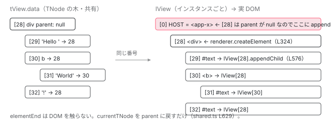

[目次](../README.md) › [Ivy ランタイム](README.md) › 第 9 回 / 全 17 回

# DOM を組む命令：ɵɵelementStart / ɵɵtext / ɵɵelementEnd

> createElementNode → appendChild → getParentRElement。renderer 経由で要素を作り、親を見つけて挿す。elementEnd が閉じるのは TNode の木。

angular/angular · 読了 約 12 分 · 中核 · [サイトで読む（デモが動きます）](https://angular-deep-dive-cyan.vercel.app/chapter/ivy-create-instructions)

---

[前章](08-ivy-first-create-pass.md)で、`ɵɵelementStart` の前半（`TNode` を作る・照合する）は最初の 1 回だけだと見ました。この章は後半、**毎回走る部分**です。`renderer.createElement` で DOM 要素を作って `lView[28 + index]` に入れ、親の DOM 要素を `TNode.parent`（無ければ `lView[HOST]`）から見つけて `appendChild` し、`ɵɵelementEnd` で `LFrame.currentTNode` を親に戻す。`<div>Hello <b>World</b>!</div>` の 7 つの命令で、DOM の木と `TNode` の木がどう対応して組まれるかを追います。

読む対象は `packages/core/src/render3/instructions/element.ts`、`instructions/text.ts`、`instructions/shared.ts`、`node_manipulation.ts`（`appendChild` / `getParentRElement` / `getClosestRElement`）、`dom_node_manipulation.ts` です。

1. 概観（配列だった）
2. Ivy とは
3. テンプレート関数と RenderFlags
4. TNode
5. TView
6. LView
7. blueprint と TData
8. firstCreatePass
9. **DOM を組む命令**（この章）
10. 値を更新する命令
11. LContainer
12. ビューの木
13. フック
14. ディレクティブ
15. LFrame
16. ViewRef 等
17. 破棄

## 1. initializeElement：TNode が決まったあとにすること

📄 `angular/packages/core/src/render3/instructions/element.ts` L133–155 （▶ の行: 140, 142–145, 148–149）

```ts
133 │ function initializeElement(
134 │   index: number,
135 │   name: string,
136 │   lView: LView,
137 │   tNode: TElementNode,
138 │   localRefsIndex: number | undefined,
139 │ ) {
140 ▶   elementLikeStartShared(tNode, lView, index, name, _locateOrCreateElementNode);
141 │ 
142 ▶   if (isDirectiveHost(tNode)) {
143 ▶     const tView = lView[TVIEW];
144 ▶     createDirectivesInstances(tView, lView, tNode);
145 ▶     executeContentQueries(tView, tNode, lView);
146 │   }
147 │ 
148 ▶   if (localRefsIndex != null) {
149 ▶     saveResolvedLocalsInData(lView, tNode);
150 │   }
151 │ 
152 │   if (ngDevMode && lView[TVIEW].firstCreatePass) {
153 │     validateElementIsKnown(lView, tNode);
154 │   }
155 │ }
```

`ɵɵelementStart` は `TNode` を得たあと（前章の三項演算子）、この関数に渡します。140 行目、`elementLikeStartShared` に「DOM ノードをどう用意するか」の関数 `_locateOrCreateElementNode` を渡して呼ぶ。2 節。142〜146 行目、`TNode` がディレクティブのホストなら `createDirectivesInstances`（[LView の章](06-ivy-lview.md)で読んだ `instantiateAllDirectives` の入口）と content query。148〜150 行目、`#ref` があれば `lView[tNode.index + 1]` 以降に解決した値を入れます。**DOM を作って挿すのは 140 行目の 1 行**で、残りはディレクティブとローカル参照です。

## 2. elementLikeStartShared：作って、入れて、属性を書いて、挿す

📄 `angular/packages/core/src/render3/instructions/shared.ts` L589–619 （▶ の行: 590–594, 596–599, 604–605, 607, 609, 612–616, 618）

```ts
589 │ ) {
590 ▶   const adjustedIndex = HEADER_OFFSET + index;
591 ▶   const tView = lView[TVIEW];
592 ▶   const native = locateOrCreateNativeNode(tView, lView, tNode, name, index);
593 ▶   lView[adjustedIndex] = native;
594 ▶   setCurrentTNode(tNode, true);
595 │ 
596 ▶   // It's important that this runs before we've instantiated the directives.
597 ▶   const isElement = tNode.type === TNodeType.Element;
598 ▶   if (isElement) {
599 ▶     setupStaticAttributes(lView[RENDERER], native as RElement, tNode);
600 │ 
601 │     // any immediate children of a component or template container must be pre-emptively
602 │     // monkey-patched with the component view data so that the element can be inspected
603 │     // later on using any element discovery utility methods (see `element_discovery.ts`)
604 ▶     if (getElementDepthCount() === 0 || isDirectiveHost(tNode)) {
605 ▶       attachPatchData(native, lView);
606 │     }
607 ▶     increaseElementDepthCount();
608 │   } else {
609 ▶     attachPatchData(native, lView);
610 │   }
611 │ 
612 ▶   if (wasLastNodeCreated() && (!isElement || !isDetachedByI18n(tNode))) {
613 ▶     // In the i18n case, the translation may have removed this element, so only add it if it is not
614 ▶     // detached. See `TNodeType.Placeholder` and `LFrame.inI18n` for more context.
615 ▶     appendChild(tView, lView, native, tNode);
616 ▶   }
617 │ 
618 ▶   return tNode;
619 │ }
```

1. **590 行目：`adjustedIndex = HEADER_OFFSET + index`**

   テンプレートの 0 番は配列の 28 番。`ɵɵ` 命令の中だけがこの足し算をします。
2. **592 行目：`native = locateOrCreateNativeNode(tView, lView, tNode, name, index)`**

   引数で受け取った関数で DOM ノードを用意します。通常は「作る」、hydration 中は「既存の DOM から探す」。中身は次の引用。
3. **593 行目：`lView[adjustedIndex] = native`**

   **`LView` の `DECLS` 区画に DOM 要素が入る瞬間**です。型紙由来の `null` がここで置き換わります。同じ番号の `tView.data` には前章で作った `TNode` が入っています。
4. **594 行目：`setCurrentTNode(tNode, true)`**

   「この後に来るノードは自分の子」。5 節で `ɵɵelementEnd` がこれを戻します。
5. **597〜599 行目：要素なら `setupStaticAttributes`**

   `tNode.mergedAttrs`（テンプレートの属性 + ディレクティブの `hostAttrs`）、`tNode.classes`、`tNode.styles` を DOM に書きます（3 節）。596 行目のコメント、「ディレクティブをインスタンス化する**前**に走ることが重要」。コンストラクタで `ElementRef` から属性を読めるようにするためです。
6. **604〜607 行目：`attachPatchData` と `increaseElementDepthCount`**

   テンプレートのルート要素（深さ 0）かディレクティブのホストなら、DOM 要素に `__ngContext__` として `LView` の `ID` を付けます。DevTools や `getComponent(el)` が DOM から `LView` を逆引きする手がかりです。607 行目で深さを 1 増やします。
7. **612〜616 行目：`wasLastNodeCreated()` なら `appendChild`**

   「作った」ノードだけを挿します。hydration で「見つけた」ノードはすでに DOM にあるので挿しません。4 節。

📄 `angular/packages/core/src/render3/instructions/element.ts` L316–325 （▶ の行: 316, 323–324）

```ts
316 ▶ let _locateOrCreateElementNode: typeof locateOrCreateElementNodeImpl = (
317 │   tView: TView,
318 │   lView: LView,
319 │   tNode: TNode,
320 │   name: string,
321 │   index: number,
322 │ ) => {
323 ▶   lastNodeWasCreated(true);
324 ▶   return createElementNode(lView[RENDERER], name, getNamespace());
325 │ };
```

📄 `angular/packages/core/src/render3/dom_node_manipulation.ts` L28–41 （▶ の行: 35–38, 40）

```ts
28 │ /**
29 │  * Creates a native element from a tag name, using a renderer.
30 │  * @param renderer A renderer to use
31 │  * @param name the tag name
32 │  * @param namespace Optional namespace for element.
33 │  * @returns the element created
34 │  */
35 ▶ export function createElementNode(
36 ▶   renderer: Renderer,
37 ▶   name: string,
38 ▶   namespace: string | null,
39 │ ): RElement {
40 ▶   return renderer.createElement(name, namespace);
41 │ }
```

📄 `angular/packages/core/src/render3/interfaces/renderer.ts` L34–46 （▶ の行: 34, 37–38, 45–46）

```ts
34 ▶ export interface Renderer {
35 │   destroy(): void;
36 │   createComment(value: string): RComment;
37 ▶   createElement(name: string, namespace?: string | null): RElement;
38 ▶   createText(value: string): RText;
39 │   /**
40 │    * This property is allowed to be null / undefined,
41 │    * in which case the view engine won't call it.
42 │    * This is used as a performance optimization for production mode.
43 │    */
44 │   destroyNode?: ((node: RNode) => void) | null;
45 ▶   appendChild(parent: RElement, newChild: RNode): void;
46 ▶   insertBefore(parent: RNode, newChild: RNode, refChild: RNode | null, isMove?: boolean): void;
```

element.ts 323 行目、「最後のノードは作られた」フラグを立て、324 行目で `createElementNode(lView[RENDERER], name, getNamespace())`。dom\_node\_manipulation.ts 40 行目、中身は `renderer.createElement(name, namespace)` の 1 行。renderer.ts 34 行目、`Renderer` は「要素とテキストを作るための手続き的 API」で、37〜38 行目 `createElement` / `createText`、45〜46 行目 `appendChild` / `insertBefore`。ブラウザでは `document.createElement` を呼ぶ `DefaultDomRenderer2` がこれを実装します（[DOM の章](../template/05-dom.md)）。**Ivy の命令は `document` を直接触らず、`lView[RENDERER]` を経由します**。

## 3. setupStaticAttributes：静的な属性・class・style

📄 `angular/packages/core/src/render3/dom_node_manipulation.ts` L140–155 （▶ の行: 141–142, 144–145, 148–149, 152–153）

```ts
140 │ /** Sets up the static DOM attributes on an `RNode`. */
141 ▶ export function setupStaticAttributes(renderer: Renderer, element: RElement, tNode: TNode) {
142 ▶   const {mergedAttrs, classes, styles} = tNode;
143 │ 
144 ▶   if (mergedAttrs !== null) {
145 ▶     setUpAttributes(renderer, element, mergedAttrs);
146 │   }
147 │ 
148 ▶   if (classes !== null) {
149 ▶     writeDirectClass(renderer, element, classes);
150 │   }
151 │ 
152 ▶   if (styles !== null) {
153 ▶     writeDirectStyle(renderer, element, styles);
154 │   }
155 │ }
```

142 行目、`TNode` から `mergedAttrs` / `classes` / `styles` を取り出す。144〜145 行目、属性配列を `renderer.setAttribute` で順に書く。148〜149 行目、`class="..."` は 1 回の `className` 書き込み、152〜153 行目、`style="..."` も 1 回。どれも `TNode` に**前章の `firstCreatePass` で計算済み**の値です。2 個目以降のインスタンスは、計算せずに書くだけです。

## 4. appendChild：親の DOM 要素を見つけて挿す

📄 `angular/packages/core/src/render3/node_manipulation.ts` L662–692 （▶ の行: 670, 676–688）

```ts
662 │ /**
663 │  * Appends the `child` native node (or a collection of nodes) to the `parent`.
664 │  *
665 │  * @param tView The `TView' to be appended
666 │  * @param lView The current LView
667 │  * @param childRNode The native child (or children) that should be appended
668 │  * @param childTNode The TNode of the child element
669 │  */
670 ▶ export function appendChild(
671 │   tView: TView,
672 │   lView: LView,
673 │   childRNode: RNode | RNode[],
674 │   childTNode: TNode,
675 │ ): void {
676 ▶   const parentRNode = getParentRElement(tView, childTNode, lView);
677 ▶   const renderer = lView[RENDERER];
678 ▶   const parentTNode: TNode = childTNode.parent || lView[T_HOST]!;
679 ▶   const anchorNode = getInsertInFrontOfRNode(parentTNode, childTNode, lView);
680 ▶   if (parentRNode != null) {
681 ▶     if (Array.isArray(childRNode)) {
682 ▶       for (let i = 0; i < childRNode.length; i++) {
683 ▶         nativeAppendOrInsertBefore(renderer, parentRNode, childRNode[i], anchorNode, false);
684 ▶       }
685 ▶     } else {
686 ▶       nativeAppendOrInsertBefore(renderer, parentRNode, childRNode, anchorNode, false);
687 ▶     }
688 ▶   }
689 │ 
690 │   _processI18nInsertBefore !== undefined &&
691 │     _processI18nInsertBefore(renderer, childTNode, lView, childRNode, parentRNode);
692 │ }
```

1. **676 行目：`parentRNode = getParentRElement(tView, childTNode, lView)`**

   挿す先の DOM 要素。次の 2 つの引用で求め方を読みます。`null` が返ることもあります。
2. **678 行目：`parentTNode = childTNode.parent || lView[T_HOST]`**

   [TNode の章](04-ivy-tnode.md)で「先頭ノードの `parent` は `null`」、[LView の章](06-ivy-lview.md)で「その代わりが `T_HOST`」と見ました。その 2 つがここで `||` でつながります。
3. **679 行目：`anchorNode = getInsertInFrontOfRNode(...)`**

   「この前に挿す」ノード。通常は `null`（末尾に append）。`<ng-container>` の中では、そのコメントノードの前に挿します（後述）。
4. **680〜688 行目：`parentRNode != null` なら `nativeAppendOrInsertBefore`**

   `null` なら**何もしません**。「親が決まらないので今は挿さない」ケースがあります。次の引用の 568〜573 行目です。

📄 `angular/packages/core/src/render3/node_manipulation.ts` L505–515 （▶ の行: 507–514）

```ts
505 │   // Guard against it so production throws a coded RuntimeError instead of a raw TypeError when
506 │   // dereferencing `tNode.parent` below.
507 ▶   if (tNode === null) {
508 ▶     throw new RuntimeError(
509 ▶       RuntimeErrorCode.PARENT_NODE_NOT_FOUND,
510 ▶       ngDevMode &&
511 ▶         'getParentRElement() was called with a null TNode, so no parent element could be resolved. This usually means a TNode was never created for this node, or was already destroyed.',
512 ▶     );
513 ▶   }
514 ▶   return getClosestRElement(tView, tNode.parent, lView);
515 │ }
```

📄 `angular/packages/core/src/render3/node_manipulation.ts` L532–554 （▶ の行: 537, 541–543, 545–546, 549–554）

```ts
532 │ export function getClosestRElement(
533 │   tView: TView,
534 │   tNode: TNode | null,
535 │   lView: LView,
536 │ ): RElement | null {
537 ▶   let parentTNode: TNode | null = tNode;
538 │   // Skip over element and ICU containers as those are represented by a comment node and
539 │   // can't be used as a render parent. Also skip let declarations since they don't have a
540 │   // corresponding DOM node at all.
541 ▶   while (
542 ▶     parentTNode !== null &&
543 ▶     parentTNode.type & (TNodeType.ElementContainer | TNodeType.Icu | TNodeType.LetDeclaration)
544 │   ) {
545 ▶     tNode = parentTNode;
546 ▶     parentTNode = tNode.parent;
547 │   }
548 │ 
549 ▶   // If the parent tNode is null, then we are inserting across views: either into an embedded view
550 ▶   // or a component view.
551 ▶   if (parentTNode === null) {
552 ▶     // We are inserting a root element of the component view into the component host element and
553 ▶     // it should always be eager.
554 ▶     return lView[HOST];
```

📄 `angular/packages/core/src/render3/node_manipulation.ts` L555–578 （▶ の行: 557, 559–573, 576）

```ts
555 │   } else {
556 │     ngDevMode && assertTNodeType(parentTNode, TNodeType.AnyRNode | TNodeType.Container);
557 ▶     if (isComponentHost(parentTNode)) {
558 │       ngDevMode && assertTNodeForLView(parentTNode, lView);
559 ▶       const {encapsulation} = tView.data[
560 ▶         parentTNode.directiveStart + parentTNode.componentOffset
561 ▶       ] as ComponentDef<unknown>;
562 ▶       // We've got a parent which is an element in the current view. We just need to verify if the
563 ▶       // parent element is not a component. Component's content nodes are not inserted immediately
564 ▶       // because they will be projected, and so doing insert at this point would be wasteful.
565 ▶       // Since the projection would then move it to its final destination. Note that we can't
566 ▶       // make this assumption when using the Shadow DOM, because the native projection placeholders
567 ▶       // (<content> or <slot>) have to be in place as elements are being inserted.
568 ▶       if (
569 ▶         encapsulation === ViewEncapsulation.None ||
570 ▶         encapsulation === ViewEncapsulation.Emulated
571 ▶       ) {
572 ▶         return null;
573 ▶       }
574 │     }
575 │ 
576 ▶     return getNativeByTNode(parentTNode, lView) as RElement;
577 │   }
578 │ }
```

1. **514 行目：`getClosestRElement(tView, tNode.parent, lView)`**

   `appendChild` は子の `TNode` を渡し、ここで `.parent` に変えて「最も近い DOM 要素」を探します。507〜513 行目は `tNode` が `null` のときの防御です。
2. **541〜547 行目：`<ng-container>`・ICU・`@let` は飛ばして上へ**

   これらは DOM 要素を持たない（コメントノード、または何も無い）ので、親にはなれません。`parent` をたどって要素が出るまで登ります。
3. **551〜554 行目：`parentTNode === null` なら `lView[HOST]`**

   549〜550 行目のコメント、「親が `null` なら、ビューをまたいで挿している」。**コンポーネントのテンプレートの先頭要素は、`lView[HOST]`（`<app-child>` 要素そのもの）に挿されます**。`TNode` には書けなかった「別ビューの親」を、`LView` の 0 番が補っている場面です。
4. **557〜573 行目：親がコンポーネントのホストなら、Emulated / None では `null`**

   `<app-child><p>content</p></app-child>` の `<p>` の親は `<app-child>` ですが、562〜567 行目のコメントどおり「コンポーネントのコンテントは投影されるので、今挿すのは無駄。投影時に最終位置へ移る」。559〜561 行目で `ComponentDef.encapsulation` を読み、568〜573 行目、`None` か `Emulated` なら `null` を返して `appendChild` を空振りさせます。`ShadowDom` のときだけ即座に挿します（`<slot>` が DOM 上に要るから）。投影の仕組みは[projection の章](../template/02-projection.md)で。
5. **576 行目：それ以外は `getNativeByTNode(parentTNode, lView)`**

   `lView[parentTNode.index]`。同じビューの中の普通の要素なら、ただ配列を引くだけです。

📄 `angular/packages/core/src/render3/node_manipulation.ts` L609–618 （▶ の行: 614–615, 617）

```ts
609 │ export function getInsertInFrontOfRNodeWithNoI18n(
610 │   parentTNode: TNode,
611 │   currentTNode: TNode,
612 │   lView: LView,
613 │ ): RNode | null {
614 ▶   if (parentTNode.type & (TNodeType.ElementContainer | TNodeType.Icu)) {
615 ▶     return getNativeByTNode(parentTNode, lView);
616 │   }
617 ▶   return null;
618 │ }
```

📄 `angular/packages/core/src/render3/dom_node_manipulation.ts` L57–74 （▶ の行: 59, 69–70, 72）

```ts
57 │ export function nativeAppendChild(renderer: Renderer, parent: RElement, child: RNode): void {
58 │   ngDevMode && assertDefined(parent, 'parent node must be defined');
59 ▶   renderer.appendChild(parent, child);
60 │ }
61 │ 
62 │ export function nativeAppendOrInsertBefore(
63 │   renderer: Renderer,
64 │   parent: RElement,
65 │   child: RNode,
66 │   beforeNode: RNode | null,
67 │   isMove: boolean,
68 │ ) {
69 ▶   if (beforeNode !== null) {
70 ▶     nativeInsertBefore(renderer, parent, child, beforeNode, isMove);
71 │   } else {
72 ▶     nativeAppendChild(renderer, parent, child);
73 │   }
74 │ }
```

node\_manipulation.ts 614〜615 行目、親が `<ng-container>`（コメントノードで表される）なら、そのコメントノードを「この前に挿す」目印にします。`<ng-container>` の子は、実 DOM 上ではコメントの**前**に並ぶということです。617 行目、それ以外は `null`。dom\_node\_manipulation.ts 69〜73 行目、目印があれば `insertBefore`、無ければ 59 行目の `renderer.appendChild(parent, child)`。

## 5. ɵɵtext と ɵɵelementEnd：子を閉じる

📄 `angular/packages/core/src/render3/instructions/text.ts` L34–54 （▶ の行: 35–37, 41–43, 45–46, 48–50, 52–53）

```ts
34 │ export function ɵɵtext(index: number, value = ''): void {
35 ▶   const lView = getLView();
36 ▶   const tView = getTView();
37 ▶   const adjustedIndex = index + HEADER_OFFSET;
38 │ 
39 │   ngDevMode && assertTNodeCreationIndex(lView, index);
40 │ 
41 ▶   const tNode = tView.firstCreatePass
42 ▶     ? getOrCreateTNode(tView, adjustedIndex, TNodeType.Text, value, null)
43 ▶     : (tView.data[adjustedIndex] as TElementNode);
44 │ 
45 ▶   const textNative = _locateOrCreateTextNode(tView, lView, tNode, value);
46 ▶   lView[adjustedIndex] = textNative;
47 │ 
48 ▶   if (wasLastNodeCreated()) {
49 ▶     appendChild(tView, lView, textNative, tNode);
50 ▶   }
51 │ 
52 ▶   // Text nodes are self closing.
53 ▶   setCurrentTNode(tNode, false);
54 │ }
```

📄 `angular/packages/core/src/render3/dom_node_manipulation.ts` L16–26 （▶ の行: 16–17）

```ts
16 ▶ export function createTextNode(renderer: Renderer, value: string): RText {
17 ▶   return renderer.createText(value);
18 │ }
19 │ 
20 │ export function updateTextNode(renderer: Renderer, rNode: RText, value: string): void {
21 │   renderer.setValue(rNode, value);
22 │ }
23 │ 
24 │ export function createCommentNode(renderer: Renderer, value: string): RComment {
25 │   return renderer.createComment(escapeCommentText(value));
26 │ }
```

text.ts 35〜37 行目、`LView`・`TView`・`adjustedIndex`。41〜43 行目、前章の三項演算子。45 行目、`createTextNode`（dom\_node\_manipulation.ts 17 行目、`renderer.createText(value)`）。46 行目、`lView[adjustedIndex]` に入れる。48〜50 行目、作ったなら `appendChild`。53 行目、**`setCurrentTNode(tNode, false)`**。要素は `true`（594 行目）、テキストは `false`。52 行目のコメント「テキストノードは自己完結（self closing）」。`ɵɵtextEnd` は存在せず、次に来るノードは兄弟です。

📄 `angular/packages/core/src/render3/instructions/element.ts` L163–179 （▶ の行: 164–165, 168, 171–172, 175–176, 179）

```ts
163 │ export function ɵɵelementEnd(): typeof ɵɵelementEnd {
164 ▶   const tView = getTView();
165 ▶   const initialTNode = getCurrentTNode()!;
166 │   ngDevMode && assertDefined(initialTNode, 'No parent node to close.');
167 │ 
168 ▶   const currentTNode = elementLikeEndShared(initialTNode);
169 │   ngDevMode && assertTNodeType(currentTNode, TNodeType.AnyRNode);
170 │ 
171 ▶   if (tView.firstCreatePass) {
172 ▶     directiveHostEndFirstCreatePass(tView, currentTNode);
173 │   }
174 │ 
175 ▶   if (isSkipHydrationRootTNode(currentTNode)) {
176 ▶     leaveSkipHydrationBlock();
177 │   }
178 │ 
179 ▶   decreaseElementDepthCount();
```

📄 `angular/packages/core/src/render3/instructions/shared.ts` L621–634 （▶ の行: 622–623, 625–627, 629–630, 633）

```ts
621 │ /** Shared code between instructions that indicate the end of an element. */
622 ▶ export function elementLikeEndShared(tNode: TNode): TNode {
623 ▶   let currentTNode = tNode;
624 │ 
625 ▶   if (isCurrentTNodeParent()) {
626 ▶     setCurrentTNodeAsNotParent();
627 ▶   } else {
628 │     ngDevMode && assertHasParent(getCurrentTNode());
629 ▶     currentTNode = currentTNode.parent!;
630 ▶     setCurrentTNode(currentTNode, false);
631 │   }
632 │ 
633 ▶   return currentTNode;
634 │ }
```

📄 `angular/packages/core/src/render3/state.ts` L397–410 （▶ の行: 397, 400–401, 405, 409）

```ts
397 ▶ export function setCurrentTNode(tNode: TNode | null, isParent: boolean) {
398 │   ngDevMode && tNode && assertTNodeForTView(tNode, instructionState.lFrame.tView);
399 │   const lFrame = instructionState.lFrame;
400 ▶   lFrame.currentTNode = tNode;
401 ▶   lFrame.isParent = isParent;
402 │ }
403 │ 
404 │ export function isCurrentTNodeParent(): boolean {
405 ▶   return instructionState.lFrame.isParent;
406 │ }
407 │ 
408 │ export function setCurrentTNodeAsNotParent(): void {
409 ▶   instructionState.lFrame.isParent = false;
410 │ }
```

1. **element.ts 165 行目：`initialTNode = getCurrentTNode()`**

   `ɵɵelementEnd()` には引数がありません。「今の `TNode`」を `LFrame` から取ります。`<b>World</b>` の `</b>` なら、直前の `ɵɵtext(3)` が入れた `#text(World)` です。
2. **shared.ts 625〜626 行目：`isParent` が `true` なら、`false` にするだけ**

   `<b></b>` のように**子が無い**要素の `elementEnd`。`currentTNode` は `<b>` 自身のままで、「この後は兄弟」に切り替えます。
3. **627〜630 行目：`false` なら `currentTNode = currentTNode.parent`**

   子があった要素の `elementEnd`。`#text(World).parent === <b>` なので `<b>` に戻り、`isParent = false`。**これが「`elementEnd` が閉じるのは TNode の木」の意味**です。DOM には何もしません。DOM は `appendChild` の時点で正しい親に入っています。
4. **element.ts 171〜172 行目：`firstCreatePass` なら post-order フックの登録（前章）、179 行目：深さを 1 戻す**

state.ts 400〜401 行目、`setCurrentTNode` は `LFrame` の 2 項目を書くだけ。405 行目と 409 行目がその読み書きです。[TNode の章](04-ivy-tnode.md)の `createTNodeAtIndex` が「`isParent` なら `currentTNode` が親、でなければ `currentTNode.parent` が親」と読んでいたのは、この 2 項目でした。**要素の開始で `true`、テキストと要素の終了で `false`**。この切り替えだけで、ネストが正しく復元されます。

> **🧪 DEMO — &lt;div&gt;Hello &lt;b&gt;World&lt;/b&gt;!&lt;/div&gt; を 7 命令で組む**
>
> 各命令のあとの LView、appendChild の親の決まり方、LFrame の currentTNode / isParent、実 DOM。
>
> ▶ [このデモはサイトで動かせます](https://angular-deep-dive-cyan.vercel.app/chapter/ivy-create-instructions)

## 6. ɵɵelement と ɵɵdomElementStart

📄 `angular/packages/core/src/render3/instructions/element.ts` L203–223 （▶ の行: 214, 220–221）

```ts
203 │ /**
204 │  * Creates an empty element using {@link elementStart} and {@link elementEnd}
205 │  *
206 │  * @param index Index of the element in the data array
207 │  * @param name Name of the DOM Node
208 │  * @param attrsIndex Index of the element's attributes in the `consts` array.
209 │  * @param localRefsIndex Index of the element's local references in the `consts` array.
210 │  * @returns This function returns itself so that it may be chained.
211 │  *
212 │  * @codeGenApi
213 │  */
214 ▶ export function ɵɵelement(
215 │   index: number,
216 │   name: string,
217 │   attrsIndex?: number | null,
218 │   localRefsIndex?: number,
219 │ ): typeof ɵɵelement {
220 ▶   ɵɵelementStart(index, name, attrsIndex, localRefsIndex);
221 ▶   ɵɵelementEnd();
222 │   return ɵɵelement;
223 │ }
```

📄 `angular/packages/core/src/render3/instructions/element.ts` L225–241 （▶ の行: 226, 236）

```ts
225 │ /**
226 ▶  * Create DOM element that cannot have any directives.
227 │  *
228 │  * @param index Index of the element in the LView array
229 │  * @param name Name of the DOM Node
230 │  * @param attrsIndex Index of the element's attributes in the `consts` array.
231 │  * @param localRefsIndex Index of the element's local references in the `consts` array.
232 │  * @returns This function returns itself so that it may be chained.
233 │  *
234 │  * @codeGenApi
235 │  */
236 ▶ export function ɵɵdomElementStart(
237 │   index: number,
238 │   name: string,
239 │   attrsIndex?: number | null,
240 │   localRefsIndex?: number,
241 │ ): typeof ɵɵdomElementStart {
```

220〜221 行目、`ɵɵelement` は `ɵɵelementStart` と `ɵɵelementEnd` を続けて呼ぶだけ。子を持たない要素（`<input>` や `<app-child />`）にコンパイラが使います。226 行目、`ɵɵdomElementStart` は「**ディレクティブを持てない** DOM 要素を作る」。前章で見たとおり照合を省く版で、`initializeElement` の `createDirectivesInstances` も通りません。DOM を作って挿す部分（`elementLikeStartShared`）は同じです。

📄 `angular/packages/core/src/render3/context_discovery.ts` L191–201 （▶ の行: 191, 193–198）

```ts
191 ▶ export function attachPatchData(target: any, data: LView | LContext) {
192 │   ngDevMode && assertDefined(target, 'Target expected');
193 ▶   // Only attach the ID of the view in order to avoid memory leaks (see #41047). We only do this
194 ▶   // for `LView`, because we have control over when an `LView` is created and destroyed, whereas
195 ▶   // we can't know when to remove an `LContext`.
196 ▶   if (isLView(data)) {
197 ▶     target[MONKEY_PATCH_KEY_NAME] = data[ID];
198 ▶     registerLView(data);
199 │   } else {
200 │     target[MONKEY_PATCH_KEY_NAME] = data;
201 │   }
```

2 節の 605 行目で呼ばれていた関数です。196〜198 行目、`LView` なら DOM 要素に **`ID`（19 番）だけ**を付け、`LView` をレジストリに登録します。`LView` そのものを DOM に付けないのは、193〜195 行目のコメントどおりメモリリークを避けるためです。

📄 `angular/packages/core/src/render3/state.ts` L243–253 （▶ の行: 244, 248, 252）

```ts
243 │ export function getElementDepthCount() {
244 ▶   return instructionState.lFrame.elementDepthCount;
245 │ }
246 │ 
247 │ export function increaseElementDepthCount() {
248 ▶   instructionState.lFrame.elementDepthCount++;
249 │ }
250 │ 
251 │ export function decreaseElementDepthCount() {
252 ▶   instructionState.lFrame.elementDepthCount--;
253 │ }
```

244・248・252 行目、`LFrame.elementDepthCount` の読み書き。`ɵɵelementStart` で +1、`ɵɵelementEnd` で −1。深さ 0 のときだけ `attachPatchData` するために数えています（2 節の 604 行目）。



*7 つの命令で、TNode の木（tView.data）と DOM の木（lView と実 DOM）が同じ形に組まれる。親の DOM 要素は TNode.parent → lView\[parent.index\] で、先頭要素だけ lView\[HOST\]。*

## ここまでの呼び出し

- 👤 `ɵɵelementStart(0, 'div')` — 生成コード
  - `tNode = tView.firstCreatePass ? directiveHostFirstCreatePass(...) : tView.data[28]` — instructions/element.ts L102 — *前章*
  - `initializeElement(0, 'div', lView, tNode, localRefsIndex)` — element.ts L133
    - `elementLikeStartShared(tNode, lView, 0, 'div', _locateOrCreateElementNode)` — instructions/shared.ts L577
      - `_locateOrCreateElementNode(...)` → `createElementNode(lView[RENDERER], 'div', ns)` — element.ts L316 → dom\_node\_manipulation.ts L35 — *renderer.createElement*
      - `lView[28] = native` — shared.ts L593
      - `setCurrentTNode(tNode, true)` — shared.ts L594 → state.ts L397 — *次は自分の子*
      - `setupStaticAttributes(lView[RENDERER], native, tNode)` — dom\_node\_manipulation.ts L141 — *mergedAttrs / classes / styles*
      - `attachPatchData(native, lView); increaseElementDepthCount()` — context\_discovery.ts L191, state.ts L247
      - `appendChild(tView, lView, native, tNode)` — node\_manipulation.ts L670
        - `getParentRElement(tView, tNode, lView)` → `getClosestRElement(tView, tNode.parent, lView)` — node\_manipulation.ts L490, L532 — *parent が null → lView\[HOST\]*
        - `nativeAppendOrInsertBefore(renderer, parentRNode, native, anchor, false)` — dom\_node\_manipulation.ts L62 — *renderer.appendChild*
    - `createDirectivesInstances(...)`（ディレクティブのホストなら） — element.ts L144 — *6 章・8 章*
- 👤 `ɵɵtext(1, 'Hello ')` — 生成コード
  - `lView[29] = createTextNode(lView[RENDERER], 'Hello '); appendChild(...); setCurrentTNode(tNode, false)` — instructions/text.ts L45-53 — *親は lView\[28\]。次は兄弟*
- 👤 `ɵɵelementEnd()` — 生成コード
  - `elementLikeEndShared(getCurrentTNode())` — element.ts L168 → shared.ts L622 — *isParent なら false に、でなければ currentTNode = parent*
  - `decreaseElementDepthCount()` — element.ts L179

## 聞かれそうな質問

**Q. ɵɵelementStart(0, 'div') の 0 は配列の 0 番目ですか？**

いいえ。shared.ts 590 行目で `adjustedIndex = HEADER_OFFSET + index`、つまり 28 番です。593 行目で `lView[28] = native`。0〜27 番は `HOST` や `CONTEXT` などのヘッダーで、テンプレートの番号は `ɵɵ` 命令の中で 28 を足されてから使われます。

**Q. DOM 要素を作っているのはどの行ですか？document.createElement を呼んでいますか？**

element.ts 324 行目 → dom\_node\_manipulation.ts 40 行目の `renderer.createElement(name, namespace)` です。`document` を直接は触りません。`lView[RENDERER]`（renderer.ts 34 行目の `Renderer` インターフェース）を経由し、ブラウザではその実装が `document.createElement` を呼びます。テキストは text.ts 45 行目 → dom\_node\_manipulation.ts 17 行目の `renderer.createText` です。

**Q. 作った要素の親はどう決まりますか？コンポーネントの一番外の要素はどこに入りますか？**

node\_manipulation.ts 676 行目 → 514 行目 → `getClosestRElement(tView, tNode.parent, lView)`。同じビューに親要素があれば 576 行目の `lView[parent.index]`。`tNode.parent` が `null`（ビューの先頭）なら 554 行目で **`lView[HOST]`**、つまりコンポーネントのホスト要素 `<app-child>` の直下に入ります。

**Q. &lt;app-child&gt;&lt;p&gt;…&lt;/p&gt;&lt;/app-child&gt; の &lt;p&gt; は、作られた時点で DOM に入りますか？**

既定（Emulated）では入りません。node\_manipulation.ts 557〜573 行目、親がコンポーネントのホストで `encapsulation` が `None` か `Emulated` なら `getClosestRElement` は `null` を返し、`appendChild` の 680 行目の条件が偽になって何もしません。`<ng-content>` の投影時に最終位置へ入ります（562〜567 行目のコメント）。`ShadowDom` のときだけ即座に挿します。

**Q. ɵɵelementEnd は DOM に何かしますか？**

しません。shared.ts 625〜630 行目、`LFrame.isParent` が `true` なら `false` にし、`false` なら `currentTNode` を `parent` に戻すだけです。DOM は `appendChild` の時点で正しい親に入っています。`ɵɵelementEnd` が閉じるのは `TNode` の木（次に作るノードの親が誰か）です。加えて element.ts 171〜172 行目で `firstCreatePass` なら post-order フックの登録、179 行目で深さカウンタを戻します。

**Q. ɵɵtext に対応する ɵɵtextEnd はありますか？**

ありません。text.ts 52〜53 行目、テキストノードは「self closing」で、`setCurrentTNode(tNode, false)` を自分で呼びます。要素は `true`（shared.ts 594 行目）で「次は子」、テキストは `false` で「次は兄弟」。この違いだけで `ɵɵtextEnd` が不要になります。

## 読み終えて

- DOM を作って `lView[28 + index]` に入れるのは `elementLikeStartShared` の 592〜593 行目。作るのは `lView[RENDERER].createElement`、`document` は直接触らない
- 親の DOM 要素は `getClosestRElement`：同じビューなら `lView[parent.index]`、先頭要素なら `lView[HOST]`、Emulated なコンポーネントのコンテントなら `null`（投影待ち）
- 静的な属性・class・style は `TNode` に計算済みの値を `setupStaticAttributes` が書くだけ
- `ɵɵelementStart` は `isParent = true`、`ɵɵtext` と `ɵɵelementEnd` は `false`。`ɵɵelementEnd` は DOM を触らず `currentTNode` を親に戻す
- 2 個目以降のインスタンスも、この章の処理は毎回全部走る。飛ばされるのは前章の「TNode 作成と照合」だけ

---

← 前: [firstCreatePass：最初の 1 インスタンスだけがする仕事](08-ivy-first-create-pass.md)  
次: [値を更新する命令：ɵɵproperty / ɵɵtextInterpolate と bindingUpdated](10-ivy-update-instructions.md) →
