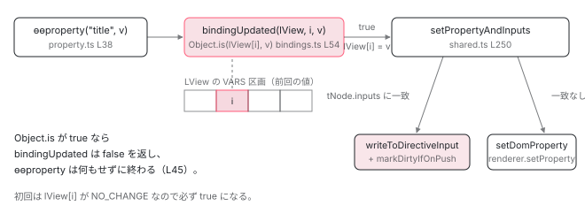

[目次](../README.md) › [Ivy ランタイム](README.md) › 第 10 回 / 全 17 回

# 値を更新する命令：ɵɵproperty / ɵɵtextInterpolate と bindingUpdated

> bindingIndex が前回の値の場所を指す。Object.is で比べ、変わっていなければ NO\_CHANGE。setPropertyAndInputs が DOM かディレクティブ入力かを振り分ける。

angular/angular · 読了 約 12 分 · 中核 · [サイトで読む（デモが動きます）](https://angular-deep-dive-cyan.vercel.app/chapter/ivy-update-instructions)

---

`{{ name }}` の `name` が前回と同じとき、Angular は DOM を触りません。「触らない」と判断しているのは誰で、前回の値はどこに置いてあるのか。この章では `ɵɵproperty` と `ɵɵtextInterpolate` の 2 つの更新命令を入口に、`bindingUpdated` が `Object.is` で比べる 1 行と、変わっていたときに `setPropertyAndInputs` が「DOM か、ディレクティブの入力か」を振り分ける手順を追います。

読む対象は `packages/core/src/render3/bindings.ts`、`instructions/property.ts`、`instructions/shared.ts`、`instructions/text_interpolation.ts` です。

1. 概観（配列だった）
2. Ivy とは
3. テンプレート関数と RenderFlags
4. TNode
5. TView
6. LView
7. blueprint と TData
8. firstCreatePass
9. DOM を組む命令
10. **値を更新する命令**（この章）
11. LContainer
12. ビューの木
13. フック
14. ディレクティブ
15. LFrame
16. ViewRef 等
17. 破棄

## 1. ɵɵproperty は 15 行しかない

テンプレートに `[title]="name"` と書くと、コンパイラは更新ブロック（`rf & 2`）に `ɵɵproperty("title", ctx.name)` を出力します（[テンプレート関数の章](03-ivy-template-function.md)）。その実装がこれです。

📄 `angular/packages/core/src/render3/instructions/property.ts` L38–52 （▶ の行: 43–45, 48）

```ts
38 │ export function ɵɵproperty<T>(
39 │   propName: string,
40 │   value: T,
41 │   sanitizer?: SanitizerFn | null,
42 │ ): typeof ɵɵproperty {
43 ▶   const lView = getLView();
44 ▶   const bindingIndex = nextBindingIndex();
45 ▶   if (bindingUpdated(lView, bindingIndex, value)) {
46 │     const tView = getTView();
47 │     const tNode = getSelectedTNode();
48 ▶     setPropertyAndInputs(tNode, lView, propName, value, lView[RENDERER], sanitizer);
49 │     ngDevMode && storePropertyBindingMetadata(tView.data, tNode, propName, bindingIndex);
50 │   }
51 │   return ɵɵproperty;
52 │ }
```

43 行目で今のビュー（`LView`）を、44 行目で**この束縛の番号**を取ります。45 行目の `bindingUpdated` が「変わったか」を判定し、変わっていたときだけ 48 行目で DOM か入力に書きます。`false` なら何もせず 51 行目で自分自身を返して終わりです。つまり「DOM を触るかどうか」は 45 行目の 1 回の呼び出しで決まります。

## 2. bindingIndex は「前回の値の場所」

📄 `angular/packages/core/src/render3/state.ts` L453–463 （▶ の行: 461–462）

```ts
453 │ export function getBindingIndex(): number {
454 │   return instructionState.lFrame.bindingIndex;
455 │ }
456 │ 
457 │ export function setBindingIndex(value: number): number {
458 │   return (instructionState.lFrame.bindingIndex = value);
459 │ }
460 │ 
461 ▶ export function nextBindingIndex(): number {
462 ▶   return instructionState.lFrame.bindingIndex++;
463 │ }
```

462 行目、`nextBindingIndex()` は `lFrame.bindingIndex` を返してから 1 増やすだけです （`lFrame` が何かは [LFrame の章](15-ivy-lframe.md)）。テンプレート関数の中で更新命令が呼ばれる順に、0 番目の束縛、1 番目の束縛、と番号が進みます。この番号は毎回同じ順で進むので、**同じ束縛は毎回同じ番号**になります。

📄 `angular/packages/core/src/render3/instructions/change_detection.ts` L237–243 （▶ の行: 240, 242）

```ts
237 │   try {
238 │     resetPreOrderHookFlags(lView);
239 │ 
240 ▶     setBindingIndex(tView.bindingStartIndex);
241 │     if (templateFn !== null) {
242 ▶       executeTemplate(tView, lView, templateFn, RenderFlags.Update, context);
243 │     }
```

240 行目、`refreshView` はテンプレート関数を更新モードで呼ぶ（242 行目）直前に、`bindingIndex` を `tView.bindingStartIndex` に戻します。`bindingStartIndex` は `HEADER_OFFSET + decls`、つまり [blueprint の章](07-ivy-blueprint.md)で見た VARS 区画の先頭です。変更検知のたびにここから数え直すので、`lView[bindingIndex]` は**常に「この束縛の前回の値」**を指します。

📄 `angular/packages/core/src/render3/view/construction.ts` L129–137 （▶ の行: 133）

```ts
129 │ function createViewBlueprint(bindingStartIndex: number, initialViewLength: number): LView {
130 │   const blueprint = [];
131 │ 
132 │   for (let i = 0; i < initialViewLength; i++) {
133 ▶     blueprint.push(i < bindingStartIndex ? null : NO_CHANGE);
134 │   }
135 │ 
136 │   return blueprint as LView;
137 │ }
```

📄 `angular/packages/core/src/render3/tokens.ts` L9–16 （▶ の行: 15–16）

```ts
 9 │ export interface NO_CHANGE {
10 │   // This is a brand that ensures that this type can never match anything else
11 │   __brand__: 'NO_CHANGE';
12 │ }
13 │ 
14 │ /** A special value which designates that a value has not changed. */
15 ▶ export const NO_CHANGE: NO_CHANGE =
16 ▶   typeof ngDevMode === 'undefined' || ngDevMode ? {__brand__: 'NO_CHANGE'} : ({} as NO_CHANGE);
```

初回はどうなるのでしょう。133 行目、blueprint の VARS 区画は `NO_CHANGE` で埋められています。`NO_CHANGE` は 15〜16 行目のとおり、ただの空オブジェクトです。他のどんな値とも `Object.is` で一致しないので、**初回の比較は必ず「変わった」になり**、DOM への初回書き込みが起こります。

## 3. bindingUpdated：Object.is の 1 行

📄 `angular/packages/core/src/render3/bindings.ts` L44–56 （▶ の行: 48–49, 52, 54–55）

```ts
44 │ export function bindingUpdated(lView: LView, bindingIndex: number, value: any): boolean {
45 │   ngDevMode &&
46 │     assertLessThan(bindingIndex, lView.length, `Slot should have been initialized to NO_CHANGE`);
47 │ 
48 ▶   if (value === NO_CHANGE) {
49 ▶     return false;
50 │   }
51 │ 
52 ▶   const oldValue = lView[bindingIndex];
53 │ 
54 ▶   if (Object.is(oldValue, value)) {
55 ▶     return false;
56 │   } else {
```

1. **48〜49 行目：渡された値が `NO_CHANGE` なら `false`**

   引数の型が `T | NO_CHANGE` と宣言された命令（`ɵɵstyleProp`、`ɵɵsyntheticHostProperty` など）では、6 節で見る `interpolationN` が返した `NO_CHANGE` がそのまま値として渡ってくることがあります。その場合は比較すらせずに「変わっていない」です。
2. **52 行目：前回の値を読む**

   `lView[bindingIndex]`。2 節で見た VARS 区画の 1 マスです。
3. **54〜55 行目：`Object.is(oldValue, value)` なら `false`**

   `===` ではなく `Object.is` です。違いは `NaN` と `+0/-0` だけで、`NaN` 同士は「同じ」、`+0` と `-0` は「違う」と判定します。オブジェクトや配列は**参照が同じなら同じ**です。中身を書き換えても参照が同じなら「変わっていない」です。

📄 `angular/packages/core/src/render3/bindings.ts` L57–85 （▶ の行: 57, 61, 68, 80, 82–83）

```ts
57 ▶     if (ngDevMode && isInCheckNoChangesMode()) {
58 │       // View engine didn't report undefined values as changed on the first checkNoChanges pass
59 │       // (before the change detection was run).
60 │       const oldValueToCompare = oldValue !== NO_CHANGE ? oldValue : undefined;
61 ▶       if (!devModeEqual(oldValueToCompare, value)) {
62 │         const details = getExpressionChangedErrorDetails(
63 │           lView,
64 │           bindingIndex,
65 │           oldValueToCompare,
66 │           value,
67 │         );
68 ▶         throwErrorIfNoChangesMode(
69 │           oldValue === NO_CHANGE,
70 │           details.oldValue,
71 │           details.newValue,
72 │           details.propName,
73 │           lView,
74 │         );
75 │       }
76 │       // There was a change, but the `devModeEqual` decided that the change is exempt from an error.
77 │       // For this reason we exit as if no change. The early exit is needed to prevent the changed
78 │       // value to be written into `LView` (If we would write the new value that we would not see it
79 │       // as change on next CD.)
80 ▶       return false;
81 │     }
82 ▶     lView[bindingIndex] = value;
83 ▶     return true;
84 │   }
85 │ }
```

1. **57 行目：開発モードの checkNoChanges 中なら例外**

   変わっていたのに、今が「変化がないことを確認する 2 回目のパス」なら、61 行目で `devModeEqual`（配列やイテラブルは中身で比べる緩い比較）にかけ、それでも違えば 68 行目で `throwErrorIfNoChangesMode` が `ExpressionChangedAfterItHasBeenCheckedError` を投げます。80 行目、例外にならなかった場合も **値を書かずに**`false` を返します。書いてしまうと次の変更検知で差分が見えなくなるから、とコメントが説明しています。このパスの全体は [checkNoChanges の章](../cd/07-cd-check-no-changes.md)で読みます。
2. **82〜83 行目：新しい値を保存して `true`**

   `lView[bindingIndex] = value`。これが「前回の値」の正体です。次の変更検知では、この値が 52 行目で読まれます。

📄 `angular/packages/core/src/render3/bindings.ts` L87–91 （▶ の行: 89–90）

```ts
87 │ /** Updates 2 bindings if changed, then returns whether either was updated. */
88 │ export function bindingUpdated2(lView: LView, bindingIndex: number, exp1: any, exp2: any): boolean {
89 ▶   const different = bindingUpdated(lView, bindingIndex, exp1);
90 ▶   return bindingUpdated(lView, bindingIndex + 1, exp2) || different;
91 │ }
```

束縛が 2 つある命令（`ɵɵtextInterpolate2` など）は `bindingUpdated2` を使います。89 行目で 1 つ目、90 行目で 2 つ目を判定しますが、`||` の**左側**に 2 つ目の呼び出しがあることに注意してください。1 つ目が変わっていても 2 つ目の `bindingUpdated` は必ず呼ばれ、2 つ目の値も保存されます。どちらかが変わっていれば `true` です。

> **🧪 DEMO — Object.is で「変わった」と判定されるか**
>
> bindings.ts 54 行目の判定だけを取り出しました。前回の値と今回の値を選ぶと、DOM に書くかどうかが決まります。
>
> プリミティブは値で比べる。同じ文字列なら触らない。
>
> ▶ [このデモはサイトで動かせます](https://angular-deep-dive-cyan.vercel.app/chapter/ivy-update-instructions)

## 4. setPropertyAndInputs：DOM か、ディレクティブの入力か

`bindingUpdated` が `true` を返したら、`ɵɵproperty` の 48 行目が呼ぶのがこの関数です。

📄 `angular/packages/core/src/render3/instructions/shared.ts` L250–274 （▶ の行: 259–260, 262–263, 265, 269–270, 273）

```ts
250 │ export function setPropertyAndInputs<T>(
251 │   tNode: TNode,
252 │   lView: LView,
253 │   propName: string,
254 │   value: T,
255 │   renderer: Renderer,
256 │   sanitizer: SanitizerFn | null | undefined,
257 │ ): void {
258 │   ngDevMode && assertNotSame(value, NO_CHANGE as any, 'Incoming value should never be NO_CHANGE.');
259 ▶   const tView = lView[TVIEW];
260 ▶   const hasSetInput = setAllInputsForProperty(tNode, tView, lView, propName, value);
261 │ 
262 ▶   if (hasSetInput) {
263 ▶     isComponentHost(tNode) && markDirtyIfOnPush(lView, tNode.index);
264 │     ngDevMode && setNgReflectProperties(lView, tView, tNode, propName, value);
265 ▶     return; // Stop propcessing if we've matched at least one input.
266 │   }
267 │ 
268 │   // If the property is going to a DOM node, we have to remap it.
269 ▶   if (tNode.type & TNodeType.AnyRNode) {
270 ▶     propName = mapPropName(propName);
271 │   }
272 │ 
273 ▶   setDomProperty(tNode, lView, propName, value, renderer, sanitizer);
274 │ }
```

260 行目、**まずディレクティブの入力を探します**。1 つでも見つかれば（262 行目）、263 行目で OnPush の子コンポーネントを dirty にして、265 行目で `return`。DOM には書きません。見つからなければ 269〜270 行目でプロパティ名を DOM 用に変換し、273 行目で DOM に書きます。「`[title]` が子コンポーネントの `@Input() title` にも `HTMLElement.title` にも当てはまるとき」は、**入力が勝って DOM には書かれない**、という順序です。

📄 `angular/packages/core/src/render3/instructions/shared.ts` L730–763 （▶ の行: 737, 752–753, 755–757, 762）

```ts
730 │ export function setAllInputsForProperty(
731 │   tNode: TNode,
732 │   tView: TView,
733 │   lView: LView,
734 │   publicName: string,
735 │   value: unknown,
736 │ ): boolean {
737 ▶   const inputs = tNode.inputs?.[publicName];
738 │   const hostDirectiveInputs = tNode.hostDirectiveInputs?.[publicName];
739 │   let hasMatch = false;
740 │ 
741 │   if (hostDirectiveInputs) {
742 │     for (let i = 0; i < hostDirectiveInputs.length; i += 2) {
743 │       const index = hostDirectiveInputs[i] as number;
744 │       ngDevMode && assertIndexInRange(lView, index);
745 │       const publicName = hostDirectiveInputs[i + 1] as string;
746 │       const def = tView.data[index] as DirectiveDef<unknown>;
747 │       writeToDirectiveInput(def, lView[index], publicName, value);
748 │       hasMatch = true;
749 │     }
750 │   }
751 │ 
752 ▶   if (inputs) {
753 ▶     for (const index of inputs) {
754 │       ngDevMode && assertIndexInRange(lView, index);
755 ▶       const instance = lView[index];
756 ▶       const def = tView.data[index] as DirectiveDef<any>;
757 ▶       writeToDirectiveInput(def, instance, publicName, value);
758 │       hasMatch = true;
759 │     }
760 │   }
761 │ 
762 ▶   return hasMatch;
763 │ }
```

737 行目、`tNode.inputs[publicName]` は「この公開名の入力を持つディレクティブの番号」の配列です （[TNode の章](04-ivy-tnode.md)）。753 行目でその番号を 1 つずつ回し、755 行目で `lView[index]` からインスタンスを、756 行目で `tView.data[index]` から定義を取り、757 行目で書き込みます。同じ要素に同じ名前の入力を持つディレクティブが 3 つあれば、3 つ全部に書かれます。762 行目、1 つでも書けば `true` です。

📄 `angular/packages/core/src/render3/instructions/write_to_directive_input.ts` L43–72 （▶ の行: 43, 50, 52, 57–58, 61, 64–65, 67）

```ts
43 ▶     const [privateName, flags, transform] = def.inputs[publicName];
44 │ 
45 │     // If we know we are dealing with a signal input, we cache its reference
46 │     // in a tree-shakable way. The input signal node can then be used for
47 │     // value transform execution or actual value updates without introducing
48 │     // additional megamorphic accesses for accessing the instance field.
49 │     let inputSignalNode: InputSignalNode<unknown, unknown> | null = null;
50 ▶     if ((flags & InputFlags.SignalBased) !== 0) {
51 │       const field = (instance as any)[privateName] as InputSignalWithTransform<unknown, unknown>;
52 ▶       inputSignalNode = field[SIGNAL];
53 │     }
54 │ 
55 │     // If there is a signal node and a transform, run it before potentially
56 │     // delegating to features like `NgOnChanges`.
57 ▶     if (inputSignalNode !== null && inputSignalNode.transformFn !== undefined) {
58 ▶       value = inputSignalNode.transformFn(value);
59 │     } else if (transform !== null) {
60 │       // If there is a decorator input transform, run it.
61 ▶       value = transform.call(instance, value);
62 │     }
63 │ 
64 ▶     if (def.setInput !== null) {
65 ▶       def.setInput(instance, inputSignalNode, value, publicName, privateName);
66 │     } else {
67 ▶       applyValueToInputField(instance, inputSignalNode, privateName, value);
68 │     }
69 │   } finally {
70 │     setActiveConsumer(prevConsumer);
71 │   }
72 │ }
```

43 行目、`def.inputs[publicName]` は `[プライベート名, フラグ, transform]` の 3 つ組です。50〜52 行目、`input()` で宣言された signal ベースの入力なら、インスタンスのフィールドから `SIGNAL` ノードを取り出します。57〜61 行目で transform があれば先に通し、64 行目、`def.setInput`（`ngOnChanges` を持つディレクティブに `NgOnChangesFeature` が差し込む関数）があればそれを、なければ 67 行目で `applyValueToInputField` がフィールドに直接代入します。`ngOnChanges` に渡る `SimpleChanges` を積んでいるのは 65 行目の経路です （[フックの章](13-ivy-hooks.md)）。

📄 `angular/packages/core/src/render3/instructions/shared.ts` L318–325 （▶ の行: 321–323）

```ts
318 │ /** If node is an OnPush component, marks its LView dirty. */
319 │ export function markDirtyIfOnPush(lView: LView, viewIndex: number): void {
320 │   ngDevMode && assertLView(lView);
321 ▶   const childComponentLView = getComponentLViewByIndex(viewIndex, lView);
322 ▶   if (!(childComponentLView[FLAGS] & LViewFlags.CheckAlways)) {
323 ▶     childComponentLView[FLAGS] |= LViewFlags.Dirty;
324 │   }
325 │ }
```

321 行目で子コンポーネントの `LView` を取り、322 行目で `CheckAlways` が**立っていない**（＝OnPush）なら、323 行目で `Dirty` を立てます。「OnPush のコンポーネントは入力が変わったとき検査される」の実装はこの 3 行です。親から流れてきた値が `Object.is` で同じなら、そもそも `bindingUpdated` が `false` なのでここに来ません。

## 5. DOM に書くとき：名前の変換と renderer.setProperty

📄 `angular/packages/core/src/render3/instructions/shared.ts` L240–248 （▶ の行: 241–242, 246）

```ts
240 │ function mapPropName(name: string): string {
241 ▶   if (name === 'class') return 'className';
242 ▶   if (name === 'for') return 'htmlFor';
243 │   if (name === 'formaction') return 'formAction';
244 │   if (name === 'innerHtml') return 'innerHTML';
245 │   if (name === 'readonly') return 'readOnly';
246 ▶   if (name === 'tabindex') return 'tabIndex';
247 │   return name;
248 │ }
```

テンプレートの `[class]` は DOM では `className`、`[for]` は `htmlFor` です。241〜246 行目の 6 つだけが変換され、他はそのまま使われます。コメントにあるとおり、コンパイラ側にも同じ表があります。

📄 `angular/packages/core/src/render3/instructions/shared.ts` L285–316 （▶ の行: 293–294, 307–309, 313）

```ts
285 │ export function setDomProperty<T>(
286 │   tNode: TNode,
287 │   lView: LView,
288 │   propName: string,
289 │   value: T,
290 │   renderer: Renderer,
291 │   sanitizer: SanitizerFn | null | undefined,
292 │ ) {
293 ▶   if (tNode.type & TNodeType.AnyRNode) {
294 ▶     const element = getNativeByTNode(tNode, lView) as RElement | RComment;
295 │ 
296 │     if (ngDevMode) {
297 │       if (lView[TVIEW].firstUpdatePass) {
298 │         validateAgainstEventProperties(propName);
299 │       }
300 │       if (!isPropertyValid(element, propName, tNode.value, lView[TVIEW].schemas)) {
301 │         handleUnknownPropertyError(propName, tNode.value, tNode.type, lView);
302 │       }
303 │     }
304 │ 
305 │     // It is assumed that the sanitizer is only added when the compiler determines that the
306 │     // property is risky, so sanitization can be done without further checks.
307 ▶     value = sanitizer != null ? (sanitizer(value, tNode.value || '', propName) as any) : value;
308 ▶     renderer.setProperty(element as RElement, propName, value);
309 ▶   } else if (tNode.type & TNodeType.AnyContainer) {
310 │     // If the node is a container and the property didn't
311 │     // match any of the inputs or schemas we should throw.
312 │     if (ngDevMode && !matchingSchemas(lView[TVIEW].schemas, tNode.value)) {
313 ▶       handleUnknownPropertyError(propName, tNode.value, tNode.type, lView);
314 │     }
315 │   }
316 │ }
```

293 行目、`TNode` が実 DOM ノード（要素かテキスト）のときだけ書きます。294 行目で `lView[tNode.index]` から要素を取り出し、307 行目でサニタイザがあれば通し、308 行目で `renderer.setProperty(element, propName, value)`。ブラウザの `DefaultDomRenderer2` なら `element[propName] = value` です。309〜313 行目、`ng-template` や `ng-container` で入力に一致しなかった場合は、開発モードでエラーになります （`Can't bind to 'x' since it isn't a known property` の正体です）。

## 6. ɵɵtextInterpolate：文字列を組んでから 1 回だけ書く

📄 `angular/packages/core/src/render3/instructions/text_interpolation.ts` L48–83 （▶ の行: 48–49, 77–80）

````ts
48 ▶ export function ɵɵtextInterpolate(v0: any): typeof ɵɵtextInterpolate {
49 ▶   ɵɵtextInterpolate1('', v0);
50 │   return ɵɵtextInterpolate;
51 │ }
52 │ 
53 │ /**
54 │  *
55 │  * Update text content with single bound value surrounded by other text.
56 │  *
57 │  * Used when a text node has 1 interpolated value in it:
58 │  *
59 │  * ```html
60 │  * <div>prefix{{v0}}suffix</div>
61 │  * ```
62 │  *
63 │  * Its compiled representation is:
64 │  *
65 │  * ```ts
66 │  * ɵɵtextInterpolate1('prefix', v0, 'suffix');
67 │  * ```
68 │  * @returns itself, so that it may be chained.
69 │  * @see textInterpolateV
70 │  * @codeGenApi
71 │  */
72 │ export function ɵɵtextInterpolate1(
73 │   prefix: string,
74 │   v0: any,
75 │   suffix?: string,
76 │ ): typeof ɵɵtextInterpolate1 {
77 ▶   const lView = getLView();
78 ▶   const interpolated = interpolation1(lView, prefix, v0, suffix);
79 ▶   if (interpolated !== NO_CHANGE) {
80 ▶     textBindingInternal(lView, getSelectedIndex(), interpolated as string);
81 │   }
82 │   return ɵɵtextInterpolate1;
83 │ }
````

`<p>{{ name }}</p>` は `ɵɵtextInterpolate(ctx.name)` になり、49 行目で接頭辞・接尾辞が空の `ɵɵtextInterpolate1` に渡されます。78 行目で `interpolation1` が「変わっていれば結合済みの文字列、変わっていなければ `NO_CHANGE`」を返し、79 行目で `NO_CHANGE` でないときだけ 80 行目が DOM に書きます。

📄 `angular/packages/core/src/render3/instructions/interpolation.ts` L60–68 （▶ の行: 66–67）

```ts
60 │ export function interpolation1(
61 │   lView: LView,
62 │   prefix: string,
63 │   v0: any,
64 │   suffix = '',
65 │ ): string | NO_CHANGE {
66 ▶   const different = bindingUpdated(lView, nextBindingIndex(), v0);
67 ▶   return different ? prefix + renderStringify(v0) + suffix : NO_CHANGE;
68 │ }
```

66 行目が 3 節と同じ `bindingUpdated` です。比べているのは**結合前の `v0`** で、文字列全体ではありません。67 行目、変わっていれば `prefix + renderStringify(v0) + suffix` を作って返します。`renderStringify` は `null`/`undefined` を空文字に、それ以外を `String(value)` にする関数です。

📄 `angular/packages/core/src/render3/instructions/text_interpolation.ts` L460–467 （▶ の行: 464, 466）

```ts
460 │ function textBindingInternal(lView: LView, index: number, value: string): void {
461 │   ngDevMode && assertString(value, 'Value should be a string');
462 │   ngDevMode && assertNotSame(value, NO_CHANGE as any, 'value should not be NO_CHANGE');
463 │   ngDevMode && assertIndexInRange(lView, index);
464 ▶   const element = getNativeByIndex(index, lView) as any as RText;
465 │   ngDevMode && assertDefined(element, 'native element should exist');
466 ▶   updateTextNode(lView[RENDERER], element, value);
467 │ }
```

📄 `angular/packages/core/src/render3/dom_node_manipulation.ts` L20–22 （▶ の行: 21）

```ts
20 │ export function updateTextNode(renderer: Renderer, rNode: RText, value: string): void {
21 ▶   renderer.setValue(rNode, value);
22 │ }
```

464 行目、`getNativeByIndex(index, lView)` で `lView[index]` のテキストノードを取り、466 行目 → 21 行目で `renderer.setValue(rNode, value)`。ブラウザでは `textNode.nodeValue = value` です。`index` は `getSelectedIndex()`、つまり直前の `ɵɵadvance` で選ばれていた要素の番号です。



*更新命令は bindingIndex で前回の値を読み、Object.is で比べ、変わったときだけ右へ進む。右側は 2 つの出口（ディレクティブ入力 / DOM）に分かれる。*

## ここまでの呼び出し

- `refreshView(tView, lView, templateFn, ctx)` — render3/instructions/change\_detection.ts L240 — *setBindingIndex(tView.bindingStartIndex) で VARS の先頭に戻す*
  - `executeTemplate(..., RenderFlags.Update, ctx)` — instructions/shared.ts L86
    - 👤 `templateFn(rf, ctx)` — あなたのコンポーネントの ɵcmp.template — *rf & 2 のブロック*
      - `ɵɵproperty("title", ctx.name)` — instructions/property.ts L38
        - `nextBindingIndex()` — state.ts L461 — *lFrame.bindingIndex++*
        - `bindingUpdated(lView, i, value)` — bindings.ts L44 — *Object.is(lView\[i\], value)。違えば lView\[i\] = value して true*
        - `setPropertyAndInputs(tNode, lView, "title", value, renderer, sanitizer)` — instructions/shared.ts L250
          - `setAllInputsForProperty(...)` — shared.ts L730 — *tNode.inputs\["title"\] の各ディレクティブに writeToDirectiveInput*
          - `markDirtyIfOnPush(lView, tNode.index)` — shared.ts L319 — *入力に書けた場合のみ。子が OnPush なら Dirty*
          - `setDomProperty(...)` — shared.ts L285 — *入力に書けなかった場合のみ。renderer.setProperty*
      - `ɵɵtextInterpolate(ctx.name)` — instructions/text\_interpolation.ts L48
        - `interpolation1(lView, "", v0, "")` — instructions/interpolation.ts L60 — *bindingUpdated が false なら NO\_CHANGE を返す*
        - `textBindingInternal(lView, selectedIndex, str)` — text\_interpolation.ts L460 — *renderer.setValue(textNode, str)*

## 聞かれそうな質問

**Q. {{ name }} の値が変わっていないとき、Angular は DOM を触りますか？**

触りません。`interpolation1`（interpolation.ts 66 行目）が `bindingUpdated` を呼び、bindings.ts 54 行目の `Object.is(lView[bindingIndex], value)` が `true` なら 55 行目で `false` が返ります。すると 67 行目で `NO_CHANGE` が返り、`ɵɵtextInterpolate1` の 79 行目の `if` に入らないので `renderer.setValue` は呼ばれません。

**Q. 配列の中身を push で変えたのに \[items\]="items" が反映されないのはなぜですか？**

bindings.ts 54 行目の比較が `Object.is` だからです。同じ配列の参照なら `true` になり、`bindingUpdated` は `false` を返します。子コンポーネントの入力には何も書かれず、`markDirtyIfOnPush`（shared.ts 319 行目）も呼ばれません。新しい配列を作って代入すれば参照が変わるので `true` になります。

**Q. 「前回の値」はどこに保存されていますか？**

`LView` の VARS 区画、`lView[bindingIndex]` です。bindings.ts 82 行目で書き、次回は 52 行目で読みます。`bindingIndex` は `refreshView`（change\_detection.ts 240 行目）が毎回 `tView.bindingStartIndex` に戻し、更新命令が呼ばれるたびに `nextBindingIndex()`（state.ts 462 行目）で 1 つ進みます。初期値は blueprint が `NO_CHANGE` で埋めています（construction.ts 133 行目）。

**Q. \[title\]="x" が子コンポーネントの @Input() と要素の title 属性の両方に当たるときは？**

入力が勝ちます。`setPropertyAndInputs`（shared.ts 260 行目）が先に `setAllInputsForProperty` を呼び、1 つでも書けたら 265 行目で `return` するので、273 行目の `setDomProperty` には到達しません。

**Q. ExpressionChangedAfterItHasBeenCheckedError はどこで投げられますか？**

bindings.ts 57〜74 行目です。開発モードの checkNoChanges パス中に `Object.is` が `false` になり、さらに 61 行目の `devModeEqual` でも違うと判定されたとき、68 行目の `throwErrorIfNoChangesMode` が投げます。本番ビルドではこのブロックは `ngDevMode` ごと消えます。

**Q. OnPush の子コンポーネントが「入力が変わったら検査される」のは誰の仕事ですか？**

`setPropertyAndInputs` の 263 行目です。入力に書けたとき、`isComponentHost(tNode)` なら `markDirtyIfOnPush`（319 行目）が子の `LView` を取り、`CheckAlways` が立っていなければ 323 行目で `LViewFlags.Dirty` を立てます。

## 読み終えて

- 更新命令は `nextBindingIndex()` で自分の番号を取り、`lView[番号]` に前回の値を置いている。番号は `refreshView` が毎回 `bindingStartIndex` に戻すので、同じ束縛は常に同じマスを使う
- 「変わったか」は `bindingUpdated`（bindings.ts 54 行目）の `Object.is` 1 回で決まる。参照が同じオブジェクトは変わっていない扱い
- 変わっていたら `setPropertyAndInputs` がディレクティブ入力を先に探し、見つかれば DOM には書かない。OnPush の子を dirty にするのもこの経路
- `ɵɵtextInterpolate` は結合前の値で比べ、変わったときだけ文字列を作って `renderer.setValue` を 1 回呼ぶ

---

← 前: [DOM を組む命令：ɵɵelementStart / ɵɵtext / ɵɵelementEnd](09-ivy-create-instructions.md)  
次: [LContainer：@if が入れ替えるビューの入れ物](11-ivy-lcontainer.md) →
