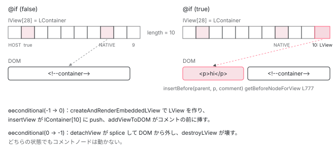

[目次](../README.md) › [Ivy ランタイム](README.md) › 第 11 回 / 全 17 回

# LContainer：@if が入れ替えるビューの入れ物

> TYPE / NATIVE / VIEW\_REFS / CONTAINER\_HEADER\_OFFSET = 10。ɵɵtemplate がコメントノードを碇として置き、createAndRenderEmbeddedLView がそこにビューを足す。

angular/angular · 読了 約 12 分 · 中核 · [サイトで読む（デモが動きます）](https://angular-deep-dive-cyan.vercel.app/chapter/ivy-lcontainer)

---

`@if (show) { ... }` の中身は、`show` が `false` のとき DOM にありません。ではどこにあるのか、そして `true` になったとき誰がどこへ差し込むのか。この章では `LContainer` という**長さ 10 のヘッダを持つ配列**を読み、`ɵɵtemplate` がコメントノードを碇（いかり）として DOM に置く手順と、`ɵɵconditional` が `createAndRenderEmbeddedLView` でビューを作って `addLViewToLContainer` で差し込む手順を追います。

読む対象は `packages/core/src/render3/interfaces/container.ts`、`instructions/template.ts`、`view/container.ts`、`view_manipulation.ts`、`instructions/control_flow.ts` です。`ViewContainerRef` の公開 API 側は [view-container の章](../template/04-view-container.md)で扱っているので、ここでは配列と命令だけを見ます。

1. 概観（配列だった）
2. Ivy とは
3. テンプレート関数と RenderFlags
4. TNode
5. TView
6. LView
7. blueprint と TData
8. firstCreatePass
9. DOM を組む命令
10. 値を更新する命令
11. **LContainer**（この章）
12. ビューの木
13. フック
14. ディレクティブ
15. LFrame
16. ViewRef 等
17. 破棄

## 1. LContainer は 10 マスのヘッダを持つ配列

📄 `angular/packages/core/src/render3/interfaces/container.ts` L15–42 （▶ の行: 20, 28, 31–34, 42）

```ts
15 │ /**
16 │  * Special location which allows easy identification of type. If we have an array which was
17 │  * retrieved from the `LView` and that array has `true` at `TYPE` location, we know it is
18 │  * `LContainer`.
19 │  */
20 ▶ export const TYPE = 1;
21 │ 
22 │ /**
23 │  * Below are constants for LContainer indices to help us look up LContainer members
24 │  * without having to remember the specific indices.
25 │  * Uglify will inline these when minifying so there shouldn't be a cost.
26 │  */
27 │ 
28 ▶ // FLAGS, PARENT, NEXT, and T_HOST are indices 2, 3, 4, and 5
29 │ // As we already have these constants in LView, we don't need to re-create them.
30 │ 
31 ▶ export const DEHYDRATED_VIEWS = 6;
32 ▶ export const NATIVE = 7;
33 ▶ export const VIEW_REFS = 8;
34 ▶ export const MOVED_VIEWS = 9;
35 │ 
36 │ /**
37 │  * Size of LContainer's header. Represents the index after which all views in the
38 │  * container will be inserted. We need to keep a record of current views so we know
39 │  * which views are already in the DOM (and don't need to be re-added) and so we can
40 │  * remove views from the DOM when they are no longer required.
41 │  */
42 ▶ export const CONTAINER_HEADER_OFFSET = 10;
```

20 行目、1 番は `TYPE`。ここに `true` が入っていれば `LContainer` です。28 行目のコメントが大事で、**2〜5 番（FLAGS / PARENT / NEXT / T\_HOST）は `LView` と同じ番号**を使います。`LView` の 1 番は `TVIEW`（オブジェクト）なので、1 番を見れば両者を区別できます。31〜34 行目が `LContainer` 固有の 4 つ、42 行目が `CONTAINER_HEADER_OFFSET = 10` です。10 番以降にビュー（`LView`）が順に並びます。

📄 `angular/packages/core/src/render3/interfaces/container.ts` L52–80 （▶ の行: 52, 59, 65, 74, 80）

```ts
52 ▶ export interface LContainer extends Array<any> {
53 │   /**
54 │    * The host element of this LContainer.
55 │    *
56 │    * The host could be an LView if this container is on a component node.
57 │    * In that case, the component LView is its HOST.
58 │    */
59 ▶   readonly [HOST]: RElement | RComment | LView;
60 │ 
61 │   /**
62 │    * This is a type field which allows us to differentiate `LContainer` from `StylingContext` in an
63 │    * efficient way. The value is always set to `true`
64 │    */
65 ▶   [TYPE]: true;
66 │ 
67 │   /** Flags for this container. See LContainerFlags for more info. */
68 │   [FLAGS]: LContainerFlags;
69 │ 
70 │   /**
71 │    * Access to the parent view is necessary so we can propagate back
72 │    * up from inside a container to parent[NEXT].
73 │    */
74 ▶   [PARENT]: LView;
75 │ 
76 │   /**
77 │    * This allows us to jump from a container to a sibling container or component
78 │    * view with the same parent, so we can remove listeners efficiently.
79 │    */
80 ▶   [NEXT]: LView | LContainer | null;
```

📄 `angular/packages/core/src/render3/interfaces/container.ts` L94–105 （▶ の行: 95, 105）

```ts
 94 │   /** The comment element that serves as an anchor for this LContainer. */
 95 ▶   [NATIVE]: RComment;
 96 │ 
 97 │   /**
 98 │    * Array of `ViewRef`s used by any `ViewContainerRef`s that point to this container.
 99 │    *
100 │    * This is lazily initialized by `ViewContainerRef` when the first view is inserted.
101 │    *
102 │    * NOTE: This is stored as `any[]` because render3 should really not be aware of `ViewRef` and
103 │    * doing so creates circular dependency.
104 │    */
105 ▶   [VIEW_REFS]: unknown[] | null;
```

52 行目、`LView` と同じく `Array<any>` の継承です。59 行目の `HOST` は碇を置いた場所の DOM ノードまたは `LView`、74 行目の `PARENT` はこのコンテナを宣言したビュー、80 行目の `NEXT` は兄弟のビューかコンテナです（[ビューの木の章](12-ivy-view-tree.md)で使います）。95 行目の `NATIVE` が**コメントノード**で、この章の主役です。105 行目の `VIEW_REFS` は `ViewContainerRef` が `ViewRef` を保管する場所で、`@if` の経路では `null` のままです。

📄 `angular/packages/core/src/render3/interfaces/type_checks.ts` L19–29 （▶ の行: 20, 28）

```ts
19 │ export function isLView(value: RNode | LView | LContainer | {} | null): value is LView {
20 ▶   return Array.isArray(value) && typeof value[TYPE] === 'object';
21 │ }
22 │ 
23 │ /**
24 │  * True if `value` is `LContainer`.
25 │  * @param value wrapped value of `RNode`, `LView`, `LContainer`
26 │  */
27 │ export function isLContainer(value: RNode | LView | LContainer | {} | null): value is LContainer {
28 ▶   return Array.isArray(value) && value[TYPE] === true;
29 │ }
```

20 行目と 28 行目。`value[TYPE]`（1 番）が `object` なら `LView`（`TView` が入っている）、`true` なら `LContainer` です。ビューの木を歩くコードはすべてこの 2 つの関数で分岐します。

## 2. ɵɵtemplate が碇を置く

`<ng-template>` や `*ngIf` はコンパイルすると `ɵɵtemplate(index, templateFn, decls, vars, ...)` になります。`@if` は後述の `ɵɵconditionalCreate` ですが、中で同じ関数を通ります。

📄 `angular/packages/core/src/render3/instructions/template.ts` L266–293 （▶ の行: 276–277, 279）

```ts
266 │ export function ɵɵtemplate(
267 │   index: number,
268 │   templateFn: ComponentTemplate<any> | null,
269 │   decls: number,
270 │   vars: number,
271 │   tagName?: string | null,
272 │   attrsIndex?: number | null,
273 │   localRefsIndex?: number | null,
274 │   localRefExtractor?: LocalRefExtractor,
275 │ ): typeof ɵɵtemplate {
276 ▶   const lView = getLView();
277 ▶   const tView = getTView();
278 │   const attrs = getConstant<TAttributes>(tView.consts, attrsIndex);
279 ▶   declareDirectiveHostTemplate(
280 │     lView,
281 │     tView,
282 │     index,
283 │     templateFn,
284 │     decls,
285 │     vars,
286 │     tagName,
287 │     attrs,
288 │     undefined,
289 │     localRefsIndex,
290 │     localRefExtractor,
291 │   );
292 │   return ɵɵtemplate;
293 │ }
```

📄 `angular/packages/core/src/render3/instructions/template.ts` L144–176 （▶ の行: 144, 147, 149, 152, 158, 167, 172, 175）

```ts
144 ▶   const adjustedIndex = index + HEADER_OFFSET;
145 │   let tNode: TContainerNode;
146 │ 
147 ▶   if (declarationTView.firstCreatePass) {
148 │     // TODO(pk): refactor getOrCreateTNode to have the "create" only version
149 ▶     tNode = getOrCreateTNode(
150 │       declarationTView,
151 │       adjustedIndex,
152 ▶       TNodeType.Container,
153 │       tagName || null,
154 │       attrs || null,
155 │     );
156 │ 
157 │     if (getBindingsEnabled()) {
158 ▶       resolveDirectives(
159 │         declarationTView,
160 │         declarationLView,
161 │         tNode,
162 │         getConstant<string[]>(declarationTView.consts, localRefsIndex),
163 │         findDirectiveDefMatches,
164 │       );
165 │     }
166 │ 
167 ▶     registerPostOrderHooks(declarationTView, tNode);
168 │   } else {
169 │     tNode = declarationTView.data[adjustedIndex] as TContainerNode;
170 │   }
171 │ 
172 ▶   templateCreate(tNode, declarationLView, declarationTView, index, templateFn, decls, vars, flags);
173 │ 
174 │   if (isDirectiveHost(tNode)) {
175 ▶     createDirectivesInstances(declarationTView, declarationLView, tNode);
176 │   }
```

1. **144 行目：`index + HEADER_OFFSET`**

   テンプレートの番号 `index` に 28 を足して、`LView` の実際の位置にします（[LView の章](06-ivy-lview.md)）。
2. **147〜167 行目：初回だけ `TNode` を作る**

   152 行目、型は `TNodeType.Container`。158 行目で `ng-template` に付いたディレクティブ（`*ngIf` の `NgIf` など）を照合し、167 行目で `ngOnDestroy` などの後順フックを登録します（[firstCreatePass の章](08-ivy-first-create-pass.md)）。2 回目以降は 169 行目で `tView.data` から読むだけです。
3. **172 行目：`templateCreate`**

   ここで `TView`、コメントノード、`LContainer` の 3 つが作られます。次の引用で読みます。
4. **175 行目：ディレクティブのインスタンス化**

   `ng-template` にディレクティブがあれば、ここで `new` されます（[ディレクティブの章](14-ivy-directives.md)）。

📄 `angular/packages/core/src/render3/instructions/template.ts` L89–114 （▶ の行: 94, 101–102, 106–108）

```ts
 89 │   if (flags) {
 90 │     tNode.flags |= flags;
 91 │   }
 92 │   setCurrentTNode(tNode, false);
 93 │ 
 94 ▶   const comment = _locateOrCreateContainerAnchor(
 95 │     declarationTView,
 96 │     declarationLView,
 97 │     tNode,
 98 │     index,
 99 │   ) as RComment;
100 │ 
101 ▶   if (wasLastNodeCreated()) {
102 ▶     appendChild(declarationTView, declarationLView, comment, tNode);
103 │   }
104 │   attachPatchData(comment, declarationLView);
105 │ 
106 ▶   const lContainer = createLContainer(comment, declarationLView, comment, tNode);
107 ▶   declarationLView[index + HEADER_OFFSET] = lContainer;
108 ▶   addToEndOfViewTree(declarationLView, lContainer);
109 │ 
110 │   // If hydration is enabled, looks up dehydrated views in the DOM
111 │   // using hydration annotation info and stores those views on LContainer.
112 │   // In client-only mode, this function is a noop.
113 │   populateDehydratedViewsInLContainer(lContainer, tNode, declarationLView);
114 │ }
```

94 行目で碇となるコメントノードを作り、101〜102 行目で親要素に `appendChild` します。106 行目で `createLContainer`、107 行目で **`lView[index + 28]` にそのコンテナを入れます**。通常の要素なら DOM 要素が入るマスに、`ng-template` の場合は配列（`LContainer`）が入るのです。108 行目の `addToEndOfViewTree` はビューの木への登録で、[次章](12-ivy-view-tree.md)で読みます。

📄 `angular/packages/core/src/render3/instructions/template.ts` L344–352 （▶ の行: 351）

```ts
344 │ function createContainerAnchorImpl(
345 │   tView: TView,
346 │   lView: LView,
347 │   tNode: TNode,
348 │   index: number,
349 │ ): RComment {
350 │   lastNodeWasCreated(true);
351 ▶   return lView[RENDERER].createComment(ngDevMode ? 'container' : '');
352 │ }
```

351 行目。碇の正体は `renderer.createComment('container')`（本番では空文字）です。開発者ツールで `<!--container-->` と見えるのがこれです。**条件が `false` のとき DOM に残るのは、このコメントノード 1 つだけ**です。hydration 有効時は `locateOrCreateContainerAnchorImpl`（359 行目以降）が SSR 済みのコメントを探して再利用します。

📄 `angular/packages/core/src/render3/view/container.ts` L56–82 （▶ の行: 63–65, 67, 69, 71–72, 78）

```ts
56 │ export function createLContainer(
57 │   hostNative: RElement | RComment | LView,
58 │   currentView: LView,
59 │   native: RComment,
60 │   tNode: TNode,
61 │ ): LContainer {
62 │   ngDevMode && assertLView(currentView);
63 ▶   const lContainer: LContainer = [
64 ▶     hostNative, // host native
65 ▶     true, // Boolean `true` in this position signifies that this is an `LContainer`
66 │     0, // flags
67 ▶     currentView, // parent
68 │     null, // next
69 ▶     tNode, // t_host
70 │     null, // dehydrated views
71 ▶     native, // native,
72 ▶     null, // view refs
73 │     null, // moved views
74 │   ];
75 │   ngDevMode &&
76 │     assertEqual(
77 │       lContainer.length,
78 ▶       CONTAINER_HEADER_OFFSET,
79 │       'Should allocate correct number of slots for LContainer header.',
80 │     );
81 │   return lContainer;
82 │ }
```

63〜74 行目、配列リテラルで 10 要素をそのまま並べています。64 行目 `HOST` と 71 行目 `NATIVE` には、`templateCreate` の 106 行目でどちらも同じコメントノードが渡されています。65 行目に `true`、67 行目に親ビュー、69 行目に `TNode`、72 行目の `VIEW_REFS` は `null`。78 行目の assert が「ちょうど 10 個」であることを確かめています。**この時点でビューは 1 つも入っていません**。

## 3. @if のコンパイル結果：conditionalCreate と conditional

`@if (show) { <p>hi</p> }` は、作成ブロックに `ɵɵconditionalCreate(0, Tpl, 1, 0)`、更新ブロックに `ɵɵconditional(ctx.show ? 0 : -1)` と出力されます。

📄 `angular/packages/core/src/render3/instructions/control_flow.ts` L74–102 （▶ の行: 88, 97）

```ts
 74 │ export function ɵɵconditionalCreate(
 75 │   index: number,
 76 │   templateFn: ComponentTemplate<any> | null,
 77 │   decls: number,
 78 │   vars: number,
 79 │   tagName?: string | null,
 80 │   attrsIndex?: number | null,
 81 │   localRefsIndex?: number | null,
 82 │   localRefExtractor?: LocalRefExtractor,
 83 │ ): typeof ɵɵconditionalBranchCreate {
 84 │   performanceMarkFeature('NgControlFlow');
 85 │   const lView = getLView();
 86 │   const tView = getTView();
 87 │   const attrs = getConstant<TAttributes>(tView.consts, attrsIndex);
 88 ▶   declareNoDirectiveHostTemplate(
 89 │     lView,
 90 │     tView,
 91 │     index,
 92 │     templateFn,
 93 │     decls,
 94 │     vars,
 95 │     tagName,
 96 │     attrs,
 97 ▶     TNodeFlags.isControlFlowStart,
 98 │     localRefsIndex,
 99 │     localRefExtractor,
100 │   );
101 │   return ɵɵconditionalBranchCreate;
102 │ }
```

88 行目、`declareNoDirectiveHostTemplate` は 2 節の `declareDirectiveHostTemplate` からディレクティブ照合を省いた版で、中で同じ `templateCreate` を呼びます。97 行目の `isControlFlowStart` フラグは hydration と後始末のための印です。つまり**作成時点では、`@if` も `<ng-template>` も「コメントノード + 空の LContainer」**で同じです。

📄 `angular/packages/core/src/render3/instructions/control_flow.ts` L188–199 （▶ の行: 192–194, 197, 199）

```ts
188 │ export function ɵɵconditional<T>(matchingTemplateIndex: number, contextValue?: T) {
189 │   performanceMarkFeature('NgControlFlow');
190 │ 
191 │   const hostLView = getLView();
192 ▶   const bindingIndex = nextBindingIndex();
193 ▶   const prevMatchingTemplateIndex: number =
194 ▶     hostLView[bindingIndex] !== NO_CHANGE ? hostLView[bindingIndex] : -1;
195 │   const prevContainer =
196 │     prevMatchingTemplateIndex !== -1
197 ▶       ? getLContainer(hostLView, HEADER_OFFSET + prevMatchingTemplateIndex)
198 │       : undefined;
199 ▶   const viewInContainerIdx = 0;
```

192 行目、`ɵɵconditional` も[更新命令](10-ivy-update-instructions.md)なので `nextBindingIndex()` で自分のマスを取ります。193〜194 行目、そのマスに入っている**前回の分岐番号**（初回は `NO_CHANGE` なので `-1`）を読み、197 行目で前回表示していたコンテナを `lView[28 + 番号]` から取ります。199 行目、コンテナ内でのビューの位置は常に `0`。`@if` のコンテナにはビューが 0 個か 1 個しか入りません。

📄 `angular/packages/core/src/render3/instructions/control_flow.ts` L201–232 （▶ の行: 201, 206–207, 212–215, 222, 226）

```ts
201 ▶   if (bindingUpdated(hostLView, bindingIndex, matchingTemplateIndex)) {
202 │     const prevConsumer = setActiveConsumer(null);
203 │     try {
204 │       // The index of the view to show changed - remove the previously displayed one
205 │       // (it is a noop if there are no active views in a container).
206 ▶       if (prevContainer !== undefined) {
207 ▶         removeLViewFromLContainer(prevContainer, viewInContainerIdx);
208 │       }
209 │ 
210 │       // Index -1 is a special case where none of the conditions evaluates to
211 │       // a truthy value and as the consequence we've got no view to show.
212 ▶       if (matchingTemplateIndex !== -1) {
213 ▶         const nextLContainerIndex = HEADER_OFFSET + matchingTemplateIndex;
214 ▶         const nextContainer = getLContainer(hostLView, nextLContainerIndex);
215 ▶         const templateTNode = getExistingTNode(hostLView[TVIEW], nextLContainerIndex);
216 │ 
217 │         const dehydratedView = findAndReconcileMatchingDehydratedViews(
218 │           nextContainer,
219 │           templateTNode,
220 │           hostLView,
221 │         );
222 ▶         const embeddedLView = createAndRenderEmbeddedLView(hostLView, templateTNode, contextValue, {
223 │           dehydratedView,
224 │         });
225 │ 
226 ▶         addLViewToLContainer(
227 │           nextContainer,
228 │           embeddedLView,
229 │           viewInContainerIdx,
230 │           shouldAddViewToDom(templateTNode, dehydratedView),
231 │         );
232 │       }
```

1. **201 行目：分岐番号が変わったか**

   `bindingUpdated` で前回の番号と比べます。`true → true` のように同じ分岐が続くなら `false` で、ビューの作り直しは起きません。
2. **206〜207 行目：前のビューを外す**

   `removeLViewFromLContainer(prevContainer, 0)`。中身は 5 節で読みます。
3. **212〜215 行目：次のコンテナと TNode を取る**

   213 行目で `28 + 分岐番号`、214 行目で `lView` からそのコンテナ、215 行目で `tView.data` から同じ番号の `TNode`。`TNode.tView` に `templateCreate` 69 行目で作った埋め込み `TView` が入っています。
4. **222 行目：ビューを作って描く**

   `createAndRenderEmbeddedLView`。4 節で読みます。
5. **226 行目：コンテナの 0 番に差し込む**

   `addLViewToLContainer(nextContainer, embeddedLView, 0, true)`。5 節で読みます。

📄 `angular/packages/core/src/render3/instructions/control_flow.ts` L233–244 （▶ の行: 236, 239, 241）

```ts
233 │     } finally {
234 │       setActiveConsumer(prevConsumer);
235 │     }
236 ▶   } else if (prevContainer !== undefined) {
237 │     // We might keep displaying the same template but the actual value of the expression could have
238 │     // changed - re-bind in context.
239 ▶     const lView = getLViewFromLContainer<T | undefined>(prevContainer, viewInContainerIdx);
240 │     if (lView !== undefined) {
241 ▶       lView[CONTEXT] = contextValue;
242 │     }
243 │   }
244 │ }
```

236 行目、分岐番号が同じで前のコンテナがあるとき（`@if (user; as u)` で `user` が別オブジェクトになった場合など）は、239 行目でコンテナの 0 番にある `LView` を取り、241 行目で `CONTEXT` だけ差し替えます。ビューは作り直しません。

## 4. createAndRenderEmbeddedLView：LView を作って作成モードで 1 回実行

📄 `angular/packages/core/src/render3/view_manipulation.ts` L22–53 （▶ の行: 34, 39–44, 47）

```ts
22 │ export function createAndRenderEmbeddedLView<T>(
23 │   declarationLView: LView<unknown>,
24 │   templateTNode: TNode,
25 │   context: T,
26 │   options?: {
27 │     injector?: Injector;
28 │     embeddedViewInjector?: Injector;
29 │     dehydratedView?: DehydratedContainerView | null;
30 │   },
31 │ ): LView<T> {
32 │   const prevConsumer = setActiveConsumer(null);
33 │   try {
34 ▶     const embeddedTView = templateTNode.tView!;
35 │     ngDevMode && assertDefined(embeddedTView, 'TView must be defined for a template node.');
36 │     ngDevMode && assertTNodeForLView(templateTNode, declarationLView);
37 │ 
38 │     // Embedded views follow the change detection strategy of the view they're declared in.
39 ▶     const isSignalView = declarationLView[FLAGS] & LViewFlags.SignalView;
40 ▶     const viewFlags = isSignalView ? LViewFlags.SignalView : LViewFlags.CheckAlways;
41 ▶     const embeddedLView = createLView<T>(
42 ▶       declarationLView,
43 ▶       embeddedTView,
44 ▶       context,
45 │       viewFlags,
46 │       null,
47 ▶       templateTNode,
48 │       null,
49 │       null,
50 │       options?.injector ?? null,
51 │       options?.embeddedViewInjector ?? null,
52 │       options?.dehydratedView ?? null,
53 │     );
```

📄 `angular/packages/core/src/render3/view_manipulation.ts` L54–71 （▶ の行: 55, 57, 65）

```ts
54 │ 
55 ▶     const declarationLContainer = declarationLView[templateTNode.index];
56 │     ngDevMode && assertLContainer(declarationLContainer);
57 ▶     embeddedLView[DECLARATION_LCONTAINER] = declarationLContainer;
58 │ 
59 │     const declarationViewLQueries = declarationLView[QUERIES];
60 │     if (declarationViewLQueries !== null) {
61 │       embeddedLView[QUERIES] = declarationViewLQueries.createEmbeddedView(embeddedTView);
62 │     }
63 │ 
64 │     // execute creation mode of a view
65 ▶     renderView(embeddedTView, embeddedLView, context);
66 │ 
67 │     return embeddedLView;
68 │   } finally {
69 │     setActiveConsumer(prevConsumer);
70 │   }
71 │ }
```

34 行目、`templateTNode.tView` から埋め込み `TView` を取ります。39〜40 行目、埋め込みビューは宣言元のビューの検査方式（signal view か CheckAlways か）を引き継ぎます。41〜53 行目で `createLView`（[LView の章](06-ivy-lview.md)）。第 1 引数が宣言元の `LView`、第 3 引数が `$implicit` などになる `context`、第 6 引数が `TNode` です。55〜57 行目で `DECLARATION_LCONTAINER`（どのコンテナで宣言されたか）を記録し、65 行目の `renderView` がテンプレート関数を `RenderFlags.Create` で 1 回実行して DOM ノードを作ります （[DOM を組む命令の章](09-ivy-create-instructions.md)）。

> [!NOTE]
> **ポイント**
>
> この時点で `<p>hi</p>` の DOM ノードは**作られているが、まだ画面上の DOM 木には繋がっていません**。46 行目、`createLView` の第 5 引数 `host` が `null` だからです。埋め込みビューのルート要素は親 `TNode` が無いので、作成モードの `appendChild` が呼ぶ `getClosestRElement` は `lView[HOST]`（＝`null`）を返し、挿入は保留されます。繋ぐのは次の `addLViewToLContainer` です。

## 5. addLViewToLContainer：配列に入れて、碇の前に DOM を挿す

📄 `angular/packages/core/src/render3/view/container.ts` L98–117 （▶ の行: 107, 110–111, 113, 115）

```ts
 98 │ export function addLViewToLContainer(
 99 │   lContainer: LContainer,
100 │   lView: LView<unknown>,
101 │   index: number,
102 │   addToDOM = true,
103 │ ): void {
104 │   const tView = lView[TVIEW];
105 │ 
106 │   // Insert into the view tree so the new view can be change-detected
107 ▶   insertView(tView, lView, lContainer, index);
108 │ 
109 │   // Insert elements that belong to this view into the DOM tree
110 ▶   if (addToDOM) {
111 ▶     const beforeNode = getBeforeNodeForView(index, lContainer);
112 │     const renderer = lView[RENDERER];
113 ▶     const parentRNode = renderer.parentNode(lContainer[NATIVE] as RElement | RComment);
114 │     if (parentRNode !== null) {
115 ▶       addViewToDOM(tView, lContainer[T_HOST], renderer, lView, parentRNode, beforeNode);
116 │     }
117 │   }
```

107 行目が配列への挿入、110〜115 行目が DOM への挿入です。113 行目、**DOM 上の親はコメントノード（`lContainer[NATIVE]`）の `parentNode`**。111 行目の `getBeforeNodeForView` が「どのノードの前に挿すか」を決め、115 行目の `addViewToDOM` がビューの全ルートノードを `insertBefore` します。

📄 `angular/packages/core/src/render3/view/container.ts` L194–229 （▶ の行: 197, 200, 202, 204–206, 208–209, 212, 228）

```ts
194 │ function insertView(tView: TView, lView: LView, lContainer: LContainer, index: number) {
195 │   ngDevMode && assertLView(lView);
196 │   ngDevMode && assertLContainer(lContainer);
197 ▶   const indexInContainer = CONTAINER_HEADER_OFFSET + index;
198 │   const containerLength = lContainer.length;
199 │ 
200 ▶   if (index > 0) {
201 │     // This is a new view, we need to add it to the children.
202 ▶     lContainer[indexInContainer - 1][NEXT] = lView;
203 │   }
204 ▶   if (index < containerLength - CONTAINER_HEADER_OFFSET) {
205 ▶     lView[NEXT] = lContainer[indexInContainer];
206 ▶     addToArray(lContainer, CONTAINER_HEADER_OFFSET + index, lView);
207 │   } else {
208 ▶     lContainer.push(lView);
209 ▶     lView[NEXT] = null;
210 │   }
211 │ 
212 ▶   lView[PARENT] = lContainer;
213 │ 
214 │   // track views where declaration and insertion points are different
215 │   const declarationLContainer = lView[DECLARATION_LCONTAINER];
216 │   if (declarationLContainer !== null && lContainer !== declarationLContainer) {
217 │     trackMovedView(declarationLContainer, lView);
218 │   }
219 │ 
220 │   // notify query that a new view has been added
221 │   const lQueries = lView[QUERIES];
222 │   if (lQueries !== null) {
223 │     lQueries.insertView(tView);
224 │   }
225 │ 
226 │   updateAncestorTraversalFlagsOnAttach(lView);
227 │   // Sets the attached flag
228 ▶   lView[FLAGS] |= LViewFlags.Attached;
229 │ }
```

197 行目、配列上の位置は `10 + index`。200〜202 行目、0 番以外なら 1 つ前のビューの `NEXT` を自分に向け、204〜206 行目、途中への挿入なら自分の `NEXT` を後ろのビューに向けて `addToArray`（`splice`）、末尾なら 208〜209 行目で `push` して `NEXT = null`。212 行目で `lView[PARENT] = lContainer`。**埋め込みビューの PARENT はコンテナ**で、ビューではありません。228 行目で `Attached` フラグが立ち、変更検知の対象になります。

📄 `angular/packages/core/src/render3/node_manipulation.ts` L764–778 （▶ の行: 768–769, 773, 777）

```ts
764 │ export function getBeforeNodeForView(
765 │   viewIndexInContainer: number,
766 │   lContainer: LContainer,
767 │ ): RNode | null {
768 ▶   const nextViewIndex = CONTAINER_HEADER_OFFSET + viewIndexInContainer + 1;
769 ▶   if (nextViewIndex < lContainer.length) {
770 │     const lView = lContainer[nextViewIndex] as LView;
771 │     const firstTNodeOfView = lView[TVIEW].firstChild;
772 │     if (firstTNodeOfView !== null) {
773 ▶       return getFirstNativeNode(lView, firstTNodeOfView);
774 │     }
775 │   }
776 │ 
777 ▶   return lContainer[NATIVE];
778 │ }
```

768〜773 行目、自分の次のビューがあれば、その先頭の DOM ノードの前に挿します。なければ 777 行目、**コメントノードの前**です。だから `@for` で増えたビューはすべてコメントノードの*手前*に順番どおり並び、コメントノードは常に末尾に残ります。

## 6. removeLViewFromLContainer：外して、壊す

📄 `angular/packages/core/src/render3/view/container.ts` L128–137 （▶ の行: 132, 134）

```ts
128 │ export function removeLViewFromLContainer(
129 │   lContainer: LContainer,
130 │   index: number,
131 │ ): LView<unknown> | undefined {
132 ▶   const lView = detachView(lContainer, index);
133 │   if (lView !== undefined) {
134 ▶     destroyLView(lView[TVIEW], lView);
135 │   }
136 │   return lView;
137 │ }
```

📄 `angular/packages/core/src/render3/view/container.ts` L149–179 （▶ の行: 150, 152–153, 162, 164–165, 173–174, 176）

```ts
149 │ export function detachView(lContainer: LContainer, removeIndex: number): LView | undefined {
150 ▶   if (lContainer.length <= CONTAINER_HEADER_OFFSET) return;
151 │ 
152 ▶   const indexInContainer = CONTAINER_HEADER_OFFSET + removeIndex;
153 ▶   const viewToDetach = lContainer[indexInContainer];
154 │ 
155 │   if (viewToDetach) {
156 │     const declarationLContainer = viewToDetach[DECLARATION_LCONTAINER];
157 │     if (declarationLContainer !== null && declarationLContainer !== lContainer) {
158 │       detachMovedView(declarationLContainer, viewToDetach);
159 │     }
160 │ 
161 │     if (removeIndex > 0) {
162 ▶       lContainer[indexInContainer - 1][NEXT] = viewToDetach[NEXT] as LView;
163 │     }
164 ▶     const removedLView = removeFromArray(lContainer, CONTAINER_HEADER_OFFSET + removeIndex);
165 ▶     removeViewFromDOM(viewToDetach[TVIEW], viewToDetach);
166 │ 
167 │     // notify query that a view has been removed
168 │     const lQueries = removedLView[QUERIES];
169 │     if (lQueries !== null) {
170 │       lQueries.detachView(removedLView[TVIEW]);
171 │     }
172 │ 
173 ▶     viewToDetach[PARENT] = null;
174 ▶     viewToDetach[NEXT] = null;
175 │     // Unsets the attached flag
176 ▶     viewToDetach[FLAGS] &= ~LViewFlags.Attached;
177 │   }
178 │   return viewToDetach;
179 │ }
```

150 行目、ヘッダしかなければ何もしません（`@if` が `false → false` のときはそもそも 3 節の 201 行目で止まりますが、安全弁です）。152〜153 行目で `10 + index` のビューを取り、162 行目で前のビューの `NEXT` を繋ぎ直し、164 行目で配列から `splice`、165 行目で DOM から外します。173〜176 行目で `PARENT`・`NEXT` を切り、`Attached` を落とします。ここまでが「外す」で、`removeLViewFromLContainer` の 134 行目 `destroyLView` が「壊す」です （[破棄の章](17-ivy-destroy.md)）。`ViewContainerRef.detach()` は前半だけ、`remove()` は両方を呼びます。

📄 `angular/packages/core/src/render3/view/container.ts` L84–96 （▶ の行: 88, 91）

```ts
84 │ export function getLViewFromLContainer<T>(
85 │   lContainer: LContainer,
86 │   index: number,
87 │ ): LView<T> | undefined {
88 ▶   const adjustedIndex = CONTAINER_HEADER_OFFSET + index;
89 │   // avoid reading past the array boundaries
90 │   if (adjustedIndex < lContainer.length) {
91 ▶     const lView = lContainer[adjustedIndex];
92 │     ngDevMode && assertLView(lView);
93 │     return lView as LView<T>;
94 │   }
95 │   return undefined;
96 │ }
```

📄 `angular/packages/core/src/render3/instructions/control_flow.ts` L246–256 （▶ の行: 254）

```ts
246 │ export class RepeaterContext<T> {
247 │   constructor(
248 │     private lContainer: LContainer,
249 │     public $implicit: T,
250 │     public $index: number,
251 │   ) {}
252 │ 
253 │   get $count(): number {
254 ▶     return this.lContainer.length - CONTAINER_HEADER_OFFSET;
255 │   }
256 │ }
```

88〜91 行目、`i` 番目のビューは `lContainer[10 + i]`。254 行目、`@for` の `$count` は `length - 10`。[view-container の章](../template/04-view-container.md)で見た `ViewContainerRef.length` と同じ式です。



*@if の前後。false のときは lView\[28\] に空の LContainer、DOM にはコメントノードだけ。true になると LContainer の 10 番に LView が入り、その DOM ノードがコメントノードの前に挿される。*

> **🧪 DEMO — @if を切り替えたときの LContainer の中身**
>
> `ɵɵconditional(ctx.show ? 0 : -1)` を模しています。bindingIndex のマスに前回の分岐番号が入り、変わったときだけ配列と DOM が動きます。
>
> ▶ [このデモはサイトで動かせます](https://angular-deep-dive-cyan.vercel.app/chapter/ivy-lcontainer)

## ここまでの呼び出し

- 👤 `templateFn(rf & 1, ctx)` — ɵcmp.template（作成ブロック）
  - `ɵɵconditionalCreate(0, Tpl, 1, 0)` — instructions/control\_flow.ts L74
    - `declareNoDirectiveHostTemplate(...)` — instructions/template.ts L200 — *TNode（Container）を作成・取得*
      - `templateCreate(tNode, lView, tView, 0, Tpl, 1, 0, flags)` — template.ts L55 — *初回: createTView で埋め込み TView*
        - `createContainerAnchorImpl(...)` — template.ts L344 — *renderer.createComment('container')*
        - `appendChild(tView, lView, comment, tNode)` — node\_manipulation.ts L670
        - `createLContainer(comment, lView, comment, tNode)` — view/container.ts L56 — *10 要素の配列 → lView\[28\]*
- 👤 `templateFn(rf & 2, ctx)` — ɵcmp.template（更新ブロック）
  - `ɵɵconditional(ctx.show ? 0 : -1)` — control\_flow.ts L188 — *bindingUpdated で分岐番号を比較*
    - `removeLViewFromLContainer(prevContainer, 0)` — view/container.ts L128 — *前の分岐があれば detachView → destroyLView*
    - `createAndRenderEmbeddedLView(lView, templateTNode, ctx)` — view\_manipulation.ts L22 — *createLView → renderView(Create)*
    - `addLViewToLContainer(nextContainer, embeddedLView, 0, true)` — view/container.ts L98
      - `insertView(tView, lView, lContainer, 0)` — view/container.ts L194 — *lContainer.push(lView)、lView\[PARENT\] = lContainer、Attached*
      - `addViewToDOM(tView, tHost, renderer, lView, parentRNode, beforeNode)` — node\_manipulation.ts L218 — *beforeNode = コメントノード*

## 聞かれそうな質問

**Q. @if の中身は、条件が false のときどこに保存されていますか？**

「中身の DOM」はどこにも保存されていません。false になった時点で `ɵɵconditional`（control\_flow.ts 207 行目）が `removeLViewFromLContainer` を呼び、`detachView`（view/container.ts 164〜165 行目）が配列から外して DOM からも外し、134 行目の `destroyLView` で壊します。残っているのは `lView[28 + 番号]` の空の `LContainer`（長さ 10）と、`TNode.tView` に入った埋め込みテンプレートの設計図だけです。true に戻ると 222 行目で新しい `LView` を作り直します。

**Q. 条件が false のとき、DOM には何が残っていますか？**

コメントノード 1 つです。`createContainerAnchorImpl`（template.ts 351 行目）が `renderer.createComment(ngDevMode ? 'container' : '')` で作り、`templateCreate` 102 行目で親に `appendChild` したものです。`lContainer[NATIVE]`（container.ts 32 行目、7 番）に入っています。ビューの出し入れでこのノードは動きません。

**Q. true になったとき、新しい DOM はどこに挿されますか？**

コメントノードの直前です。`addLViewToLContainer`（view/container.ts 113 行目）が `parentNode(lContainer[NATIVE])` を親にし、`getBeforeNodeForView`（node\_manipulation.ts 777 行目）が次のビューが無ければ `lContainer[NATIVE]` を返すので、`insertBefore(parent, node, comment)` になります。

**Q. LContainer と LView はどう見分けていますか？**

1 番（`TYPE`）の値です。`isLContainer`（type\_checks.ts 28 行目）は `value[TYPE] === true`、`isLView`（20 行目）は `typeof value[TYPE] === 'object'`（`TVIEW` が入っている）で判定します。2〜5 番（FLAGS / PARENT / NEXT / T\_HOST）は両者で同じ番号なので、木を歩くコードは型を見ずに `[NEXT]` を辿れます（container.ts 28〜29 行目のコメント）。

**Q. @if の条件が true のまま、中で参照している値だけ変わったらビューは作り直されますか？**

作り直されません。`ɵɵconditional` が `bindingUpdated` で比べているのは**分岐番号**（control\_flow.ts 201 行目）です。同じ番号なら 236〜242 行目の `else if` に入り、既存の `LView` の `CONTEXT` を差し替えるだけです。中身の更新は、埋め込みビューの変更検知が `refreshView` で行います。

**Q. @for で 100 件表示したとき LContainer の長さは？**

110 です。`insertView`（view/container.ts 208 行目）が `CONTAINER_HEADER_OFFSET = 10` の後ろに `push` していくので、`RepeaterContext.$count`（control\_flow.ts 254 行目）は `length - CONTAINER_HEADER_OFFSET` で件数になります。

## 読み終えて

- `LContainer` は長さ 10 のヘッダを持つ配列。1 番が `true`、7 番がコメントノード、10 番以降にビューが並ぶ。2〜5 番は `LView` と同じ番号なので、木を歩くときに型を見なくてよい
- `ɵɵtemplate` / `ɵɵconditionalCreate` は作成時にコメントノードを DOM に置き、空の `LContainer` を `lView[index + 28]` に入れるだけ
- `ɵɵconditional` は分岐番号を `bindingUpdated` で比べ、変わったときだけ `removeLViewFromLContainer` → `createAndRenderEmbeddedLView` → `addLViewToLContainer` を実行する
- ビューの DOM はコメントノードの直前に `insertBefore` される。false になればビューは壊され、コメントノードだけが残る

---

← 前: [値を更新する命令：ɵɵproperty / ɵɵtextInterpolate と bindingUpdated](10-ivy-update-instructions.md)  
次: [ビューの木をどう歩くか：CHILD\_HEAD / NEXT / PARENT / DECLARATION\_VIEW](12-ivy-view-tree.md) →
