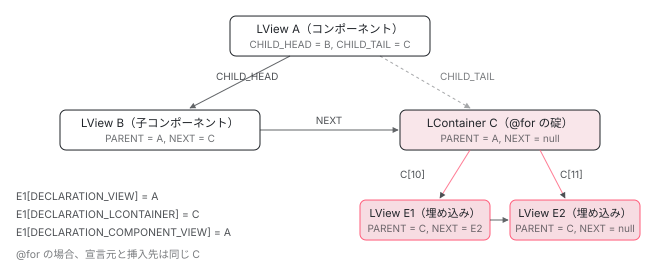

[目次](../README.md) › [Ivy ランタイム](README.md) › 第 12 回 / 全 17 回

# ビューの木をどう歩くか：CHILD\_HEAD / NEXT / PARENT / DECLARATION\_VIEW

> addToEndOfViewTree が連結リストを伸ばす。「どこに挿入されたか」の木と「どこで宣言されたか」の木は別で、ずれると transplanted view になる。

angular/angular · 読了 約 12 分 · 発展 · [サイトで読む（デモが動きます）](https://angular-deep-dive-cyan.vercel.app/chapter/ivy-view-tree)

---

`LView` と `LContainer` は配列ですが、互いを指す番号を持っていて、全体で木になっています。この章ではその木を作る 4 つのポインタ（`PARENT` / `NEXT` / `CHILD_HEAD` / `CHILD_TAIL`）を `addToEndOfViewTree` と `insertView` がどう繋ぐかを読みます。そして**「どこに挿入されたか」の木と「どこで宣言されたか」の木は別物**で、2 つがずれたビューを transplanted view と呼ぶことを、`DECLARATION_VIEW` と `trackMovedView` で確認します。

読む対象は `packages/core/src/render3/interfaces/view.ts`、`view/construction.ts`、`view/container.ts`、`util/view_utils.ts` です。

1. 概観（配列だった）
2. Ivy とは
3. テンプレート関数と RenderFlags
4. TNode
5. TView
6. LView
7. blueprint と TData
8. firstCreatePass
9. DOM を組む命令
10. 値を更新する命令
11. LContainer
12. **ビューの木**（この章）
13. フック
14. ディレクティブ
15. LFrame
16. ViewRef 等
17. 破棄

## 1. 木を作る 4 つのマスと、宣言元を指す 3 つのマス

📄 `angular/packages/core/src/render3/interfaces/view.ts` L44–66 （▶ の行: 49–50, 60–61, 63–65）

```ts
44 │ export const HOST = 0;
45 │ export const TVIEW = 1;
46 │ 
47 │ // Shared with LContainer
48 │ export const FLAGS = 2;
49 ▶ export const PARENT = 3;
50 ▶ export const NEXT = 4;
51 │ export const T_HOST = 5;
52 │ // End shared with LContainer
53 │ 
54 │ export const HYDRATION = 6;
55 │ export const CLEANUP = 7;
56 │ export const CONTEXT = 8;
57 │ export const INJECTOR = 9;
58 │ export const ENVIRONMENT = 10;
59 │ export const RENDERER = 11;
60 ▶ export const CHILD_HEAD = 12;
61 ▶ export const CHILD_TAIL = 13;
62 │ // FIXME(misko): Investigate if the three declarations aren't all same thing.
63 ▶ export const DECLARATION_VIEW = 14;
64 ▶ export const DECLARATION_COMPONENT_VIEW = 15;
65 ▶ export const DECLARATION_LCONTAINER = 16;
66 │ export const PREORDER_HOOK_FLAGS = 17;
```

49〜50 行目の `PARENT` と `NEXT`、60〜61 行目の `CHILD_HEAD` と `CHILD_TAIL` が木のポインタです。63〜65 行目の `DECLARATION_VIEW`、`DECLARATION_COMPONENT_VIEW`、`DECLARATION_LCONTAINER` が「宣言元」です。[前章](11-ivy-lcontainer.md)で見たとおり、`LContainer` も 3 番 `PARENT` と 4 番 `NEXT` を同じ番号で持ちます。

📄 `angular/packages/core/src/render3/interfaces/view.ts` L120–140 （▶ の行: 123, 127, 129, 133, 140）

```ts
120 │   /**
121 │    * This may store an {@link LView} or {@link LContainer}.
122 │    *
123 ▶    * `LView` - The parent view. This is needed when we exit the view and must restore the previous
124 │    * LView. Without this, the render method would have to keep a stack of
125 │    * views as it is recursively rendering templates.
126 │    *
127 ▶    * `LContainer` - The current view is part of a container, and is an embedded view.
128 │    */
129 ▶   [PARENT]: LView | LContainer | null;
130 │ 
131 │   /**
132 │    *
133 ▶    * The next sibling LView or LContainer.
134 │    *
135 │    * Allows us to propagate between sibling view states that aren't in the same
136 │    * container. Embedded views already have a node.next, but it is only set for
137 │    * views in the same container. We need a way to link component views and views
138 │    * across containers as well.
139 │    */
140 ▶   [NEXT]: LView | LContainer | null;
```

📄 `angular/packages/core/src/render3/interfaces/view.ts` L210–225 （▶ の行: 211, 215, 217, 220, 225）

```ts
210 │   /**
211 ▶    * Reference to the first LView or LContainer beneath this LView in
212 │    * the hierarchy.
213 │    *
214 │    * Necessary to store this so views can traverse through their nested views
215 ▶    * to remove listeners and call onDestroy callbacks.
216 │    */
217 ▶   [CHILD_HEAD]: LView | LContainer | null;
218 │ 
219 │   /**
220 ▶    * The last LView or LContainer beneath this LView in the hierarchy.
221 │    *
222 │    * The tail allows us to quickly add a new state to the end of the view list
223 │    * without having to propagate starting from the first child.
224 │    */
225 ▶   [CHILD_TAIL]: LView | LContainer | null;
```

123〜127 行目、`PARENT` には `LView` か `LContainer` が入ります。コンポーネントのビューなら親ビュー、埋め込みビューなら**自分が入っているコンテナ**です。133 行目、`NEXT` は兄弟。211〜215 行目、`CHILD_HEAD` は最初の子で、「リスナーを外して onDestroy を呼ぶために子を辿る」のが目的だと書かれています。220〜225 行目、`CHILD_TAIL` は末尾へ O(1) で追加するためのものです。つまりこれは**子を単方向連結リストで持つ木**です。

📄 `angular/packages/core/src/render3/interfaces/type_checks.ts` L19–29 （▶ の行: 20, 28）

```ts
19 │ export function isLView(value: RNode | LView | LContainer | {} | null): value is LView {
20 ▶   return Array.isArray(value) && typeof value[TYPE] === 'object';
21 │ }
22 │ 
23 │ /**
24 │  * True if `value` is `LContainer`.
25 │  * @param value wrapped value of `RNode`, `LView`, `LContainer`
26 │  */
27 │ export function isLContainer(value: RNode | LView | LContainer | {} | null): value is LContainer {
28 ▶   return Array.isArray(value) && value[TYPE] === true;
29 │ }
```

木には `LView` と `LContainer` が混ざるので、辿るコードは 20 行目と 28 行目の判定で分岐します。

## 2. createLView が置く初期値

📄 `angular/packages/core/src/render3/view/construction.ts` L201–223 （▶ の行: 203, 221–222）

```ts
201 │   resetPreOrderHookFlags(lView);
202 │   ngDevMode && tView.declTNode && parentLView && assertTNodeForLView(tView.declTNode, parentLView);
203 ▶   lView[PARENT] = lView[DECLARATION_VIEW] = parentLView;
204 │   lView[CONTEXT] = context;
205 │   lView[ENVIRONMENT] = (environment || (parentLView && parentLView[ENVIRONMENT]))!;
206 │   ngDevMode && assertDefined(lView[ENVIRONMENT], 'LViewEnvironment is required');
207 │   lView[RENDERER] = (renderer || (parentLView && parentLView[RENDERER]))!;
208 │   ngDevMode && assertDefined(lView[RENDERER], 'Renderer is required');
209 │   lView[INJECTOR as any] = injector || (parentLView && parentLView[INJECTOR]) || null;
210 │   lView[T_HOST] = tHostNode;
211 │   lView[ID] = getUniqueLViewId();
212 │   lView[HYDRATION] = hydrationInfo;
213 │   lView[EMBEDDED_VIEW_INJECTOR as any] = embeddedViewInjector;
214 │ 
215 │   ngDevMode &&
216 │     assertEqual(
217 │       tView.type == TViewType.Embedded ? parentLView !== null : true,
218 │       true,
219 │       'Embedded views must have parentLView',
220 │     );
221 ▶   lView[DECLARATION_COMPONENT_VIEW] =
222 ▶     tView.type == TViewType.Embedded ? parentLView![DECLARATION_COMPONENT_VIEW] : lView;
223 │   return lView as LView<T>;
```

203 行目、**`PARENT` と `DECLARATION_VIEW` に同じ `parentLView`** が入ります。作られた時点では「挿入先」と「宣言元」は同じです。221〜222 行目、埋め込みビューなら親の `DECLARATION_COMPONENT_VIEW` を引き継ぎ、コンポーネントビューなら自分自身。「このビューはどのコンポーネントのテンプレートに書かれたものか」を 1 回の配列参照で知るためのマスです。`CHILD_HEAD` / `CHILD_TAIL` / `NEXT` は blueprint の `null` のままです。

## 3. addToEndOfViewTree：親の子リストの末尾に繋ぐ

📄 `angular/packages/core/src/render3/view/construction.ts` L320–335 （▶ の行: 328–329, 331, 333）

```ts
320 │ export function addToEndOfViewTree<T extends LView | LContainer>(
321 │   lView: LView,
322 │   lViewOrLContainer: T,
323 │ ): T {
324 │   // TODO(benlesh/misko): This implementation is incorrect, because it always adds the LContainer
325 │   // to the end of the queue, which means if the developer retrieves the LContainers from RNodes out
326 │   // of order, the change detection will run out of order, as the act of retrieving the
327 │   // LContainer from the RNode is what adds it to the queue.
328 ▶   if (lView[CHILD_HEAD]) {
329 ▶     lView[CHILD_TAIL]![NEXT] = lViewOrLContainer;
330 │   } else {
331 ▶     lView[CHILD_HEAD] = lViewOrLContainer;
332 │   }
333 ▶   lView[CHILD_TAIL] = lViewOrLContainer;
334 │   return lViewOrLContainer;
335 │ }
```

328 行目、親にすでに子がいれば、329 行目で `CHILD_TAIL` の `NEXT` を新しい子に向けます。いなければ 331 行目で `CHILD_HEAD` に。どちらの場合も 333 行目で `CHILD_TAIL` を新しい子にします。連結リストの末尾追加そのものです。誰がこれを呼ぶかが重要です。

📄 `angular/packages/core/src/render3/view/construction.ts` L226–257 （▶ の行: 234–235, 237, 239, 256）

```ts
226 │ export function createComponentLView<T>(
227 │   lView: LView,
228 │   hostTNode: TElementNode,
229 │   def: ComponentDef<T>,
230 │ ): LView {
231 │   const native = getNativeByTNode(hostTNode, lView) as RElement;
232 │   const tView = getOrCreateComponentTView(def);
233 │ 
234 ▶   // Only component views should be added to the view tree directly. Embedded views are
235 ▶   // accessed through their containers because they may be removed / re-added later.
236 │   const rendererFactory = lView[ENVIRONMENT].rendererFactory;
237 ▶   const componentView = addToEndOfViewTree(
238 │     lView,
239 ▶     createLView(
240 │       lView,
241 │       tView,
242 │       null,
243 │       getInitialLViewFlagsFromDef(def),
244 │       native,
245 │       hostTNode as TElementNode,
246 │       null,
247 │       rendererFactory.createRenderer(native, def),
248 │       null,
249 │       null,
250 │       null,
251 │     ),
252 │   );
253 │ 
254 │   // Component view will always be created before any injected LContainers,
255 │   // so this is a regular element, wrap it with the component view
256 ▶   return (lView[hostTNode.index] = componentView);
257 │ }
```

📄 `angular/packages/core/src/render3/instructions/template.ts` L101–109 （▶ の行: 106–108）

```ts
101 │   if (wasLastNodeCreated()) {
102 │     appendChild(declarationTView, declarationLView, comment, tNode);
103 │   }
104 │   attachPatchData(comment, declarationLView);
105 │ 
106 ▶   const lContainer = createLContainer(comment, declarationLView, comment, tNode);
107 ▶   declarationLView[index + HEADER_OFFSET] = lContainer;
108 ▶   addToEndOfViewTree(declarationLView, lContainer);
109 │ 
```

1 つ目は子コンポーネントです。237〜239 行目、`createComponentLView` はコンポーネントの `LView` を作ってすぐ親の子リストに繋ぎます。234〜235 行目のコメント：**「コンポーネントビューだけが直接ビューの木に入る。埋め込みビューはコンテナ経由でアクセスする」**。2 つ目はコンテナです。108 行目、`templateCreate` は `LContainer` を作って親の子リストに繋ぎます。つまり `CHILD_HEAD` から辿れる子は**コンポーネントビューとコンテナ**の 2 種類で、埋め込みビューはコンテナの 10 番以降に入っていて、この連結リストには直接現れません。

## 4. insertView：埋め込みビューの PARENT はコンテナ

📄 `angular/packages/core/src/render3/view/container.ts` L194–229 （▶ の行: 202, 205, 209, 212, 215–217）

```ts
194 │ function insertView(tView: TView, lView: LView, lContainer: LContainer, index: number) {
195 │   ngDevMode && assertLView(lView);
196 │   ngDevMode && assertLContainer(lContainer);
197 │   const indexInContainer = CONTAINER_HEADER_OFFSET + index;
198 │   const containerLength = lContainer.length;
199 │ 
200 │   if (index > 0) {
201 │     // This is a new view, we need to add it to the children.
202 ▶     lContainer[indexInContainer - 1][NEXT] = lView;
203 │   }
204 │   if (index < containerLength - CONTAINER_HEADER_OFFSET) {
205 ▶     lView[NEXT] = lContainer[indexInContainer];
206 │     addToArray(lContainer, CONTAINER_HEADER_OFFSET + index, lView);
207 │   } else {
208 │     lContainer.push(lView);
209 ▶     lView[NEXT] = null;
210 │   }
211 │ 
212 ▶   lView[PARENT] = lContainer;
213 │ 
214 │   // track views where declaration and insertion points are different
215 ▶   const declarationLContainer = lView[DECLARATION_LCONTAINER];
216 ▶   if (declarationLContainer !== null && lContainer !== declarationLContainer) {
217 ▶     trackMovedView(declarationLContainer, lView);
218 │   }
219 │ 
220 │   // notify query that a new view has been added
221 │   const lQueries = lView[QUERIES];
222 │   if (lQueries !== null) {
223 │     lQueries.insertView(tView);
224 │   }
225 │ 
226 │   updateAncestorTraversalFlagsOnAttach(lView);
227 │   // Sets the attached flag
228 │   lView[FLAGS] |= LViewFlags.Attached;
229 │ }
```

202 行目で前のビューの `NEXT` を自分に、205 行目で自分の `NEXT` を後ろのビューに（末尾なら 209 行目で `null`）。コンテナ内のビュー同士も `NEXT` で繋がっています。212 行目、**`lView[PARENT] = lContainer`**。`createLView` の 203 行目で入れた `parentLView` が、ここで上書きされます。この瞬間に「挿入先（PARENT）」と「宣言元（DECLARATION\_VIEW）」が別のものを指し始めます。215〜217 行目、宣言元のコンテナと挿入先のコンテナが違えば `trackMovedView` が呼ばれます。6 節で読みます。



*コンポーネントビュー A の子リスト（CHILD\_HEAD → NEXT → …）にはコンポーネントビュー B とコンテナ C が並ぶ。C の 10 番以降に埋め込みビュー E1, E2 が入り、E1\[PARENT\] は C、C\[PARENT\] は A。*

## 5. 2 本目の木：DECLARATION\_VIEW

📄 `angular/packages/core/src/render3/interfaces/view.ts` L227–249 （▶ の行: 230–233, 239–240, 244–246, 249）

```ts
227 │   /**
228 │    * View where this view's template was declared.
229 │    *
230 ▶    * The template for a dynamically created view may be declared in a different view than
231 ▶    * it is inserted. We already track the "insertion view" (view where the template was
232 ▶    * inserted) in LView[PARENT], but we also need access to the "declaration view"
233 ▶    * (view where the template was declared). Otherwise, we wouldn't be able to call the
234 │    * view's template function with the proper contexts. Context should be inherited from
235 │    * the declaration view tree, not the insertion view tree.
236 │    *
237 │    * Example (AppComponent template):
238 │    *
239 ▶    * <ng-template #foo></ng-template>       <-- declared here -->
240 ▶    * <some-comp [tpl]="foo"></some-comp>    <-- inserted inside this component -->
241 │    *
242 │    * The <ng-template> above is declared in the AppComponent template, but it will be passed into
243 │    * SomeComp and inserted there. In this case, the declaration view would be the AppComponent,
244 ▶    * but the insertion view would be SomeComp. When we are removing views, we would want to
245 ▶    * traverse through the insertion view to clean up listeners. When we are calling the
246 ▶    * template function during change detection, we need the declaration view to get inherited
247 │    * context.
248 │    */
249 ▶   [DECLARATION_VIEW]: LView | null;
```

230〜233 行目が問題設定です。`<ng-template #foo>` を `AppComponent` に書き、`<some-comp [tpl]="foo">` に渡して `SomeComp` の中で `createEmbeddedView` すると（239〜240 行目）、挿入先（`PARENT`）は `SomeComp` のコンテナ、宣言元（`DECLARATION_VIEW`）は `AppComponent` のビューになります。244〜246 行目：**ビューを消すときは挿入先の木を辿り、テンプレート関数を実行するときは宣言元の木を辿る**。テンプレート内の `{{ name }}` が参照する `name` は `AppComponent` のものだからです。

📄 `angular/packages/core/src/render3/view_manipulation.ts` L38–57 （▶ の行: 42, 55, 57）

```ts
38 │     // Embedded views follow the change detection strategy of the view they're declared in.
39 │     const isSignalView = declarationLView[FLAGS] & LViewFlags.SignalView;
40 │     const viewFlags = isSignalView ? LViewFlags.SignalView : LViewFlags.CheckAlways;
41 │     const embeddedLView = createLView<T>(
42 ▶       declarationLView,
43 │       embeddedTView,
44 │       context,
45 │       viewFlags,
46 │       null,
47 │       templateTNode,
48 │       null,
49 │       null,
50 │       options?.injector ?? null,
51 │       options?.embeddedViewInjector ?? null,
52 │       options?.dehydratedView ?? null,
53 │     );
54 │ 
55 ▶     const declarationLContainer = declarationLView[templateTNode.index];
56 │     ngDevMode && assertLContainer(declarationLContainer);
57 ▶     embeddedLView[DECLARATION_LCONTAINER] = declarationLContainer;
```

42 行目、`createAndRenderEmbeddedLView` は `createLView` の第 1 引数に**宣言元の `LView`** を渡します。2 節の 203 行目でそれが `DECLARATION_VIEW` になります。55〜57 行目、宣言元の `LContainer`（`ng-template` の碇）を `DECLARATION_LCONTAINER` に記録します。この 2 つは `insertView` で上書きされません。

📄 `angular/packages/core/src/render3/util/view_utils.ts` L218–234 （▶ の行: 223, 230）

```ts
218 │ /**
219 │  * Walks up the LView hierarchy.
220 │  * @param nestingLevel Number of times to walk up in hierarchy.
221 │  * @param currentView View from which to start the lookup.
222 │  */
223 ▶ export function walkUpViews(nestingLevel: number, currentView: LView): LView {
224 │   while (nestingLevel > 0) {
225 │     ngDevMode &&
226 │       assertDefined(
227 │         currentView[DECLARATION_VIEW],
228 │         'Declaration view should be defined if nesting level is greater than 0.',
229 │       );
230 ▶     currentView = currentView[DECLARATION_VIEW]!;
231 │     nestingLevel--;
232 │   }
233 │   return currentView;
234 │ }
```

📄 `angular/packages/core/src/render3/state.ts` L739–745 （▶ の行: 740, 744）

```ts
739 │ export function nextContextImpl<T = any>(level: number): T {
740 ▶   const contextLView = (instructionState.lFrame.contextLView = walkUpViews(
741 │     level,
742 │     instructionState.lFrame.contextLView!,
743 │   ));
744 ▶   return contextLView[CONTEXT] as unknown as T;
745 │ }
```

宣言元の木を登る関数が `walkUpViews` です。230 行目、`DECLARATION_VIEW` を `level` 回辿ります。使っているのは 740 行目、`ɵɵnextContext` の実装です。埋め込みテンプレートの中で外側のコンポーネントのプロパティを読むとき、コンパイラは `ɵɵnextContext()` を出力し、744 行目で宣言元ビューの `CONTEXT`（コンポーネントインスタンス）を返します。**挿入先ではなく宣言元**を辿るので、どこに挿されても正しい `this` が取れます。

## 6. ずれたビュー：transplanted view

📄 `angular/packages/core/src/render3/view/container.ts` L235–260 （▶ の行: 238–239, 241–242, 244, 246, 248, 252, 256, 258）

```ts
235 │ export function trackMovedView(declarationContainer: LContainer, lView: LView) {
236 │   ngDevMode && assertDefined(lView, 'LView required');
237 │   ngDevMode && assertLContainer(declarationContainer);
238 ▶   const movedViews = declarationContainer[MOVED_VIEWS];
239 ▶   const parent = lView[PARENT]!;
240 │   ngDevMode && assertDefined(parent, 'missing parent');
241 ▶   if (isLView(parent)) {
242 ▶     declarationContainer[FLAGS] |= LContainerFlags.HasTransplantedViews;
243 │   } else {
244 ▶     const insertedComponentLView = parent[PARENT]![DECLARATION_COMPONENT_VIEW];
245 │     ngDevMode && assertDefined(insertedComponentLView, 'Missing insertedComponentLView');
246 ▶     const declaredComponentLView = lView[DECLARATION_COMPONENT_VIEW];
247 │     ngDevMode && assertDefined(declaredComponentLView, 'Missing declaredComponentLView');
248 ▶     if (declaredComponentLView !== insertedComponentLView) {
249 │       // At this point the declaration-component is not same as insertion-component; this means that
250 │       // this is a transplanted view. Mark the declared lView as having transplanted views so that
251 │       // those views can participate in CD.
252 ▶       declarationContainer[FLAGS] |= LContainerFlags.HasTransplantedViews;
253 │     }
254 │   }
255 │   if (movedViews === null) {
256 ▶     declarationContainer[MOVED_VIEWS] = [lView];
257 │   } else {
258 ▶     movedViews.push(lView);
259 │   }
260 │ }
```

`insertView` の 217 行目から来ます。239 行目、挿入先の `PARENT`（コンテナ）を取り、241〜242 行目、それが `LView` なら（`ApplicationRef.attachView` で直接繋いだ場合）即 `HasTransplantedViews`。244 行目で挿入先コンテナの親ビューの `DECLARATION_COMPONENT_VIEW`、246 行目で自分の `DECLARATION_COMPONENT_VIEW` を取り、248 行目で**違えば** 252 行目で宣言元コンテナに `HasTransplantedViews` を立てます。256〜258 行目で宣言元コンテナの `MOVED_VIEWS` にこのビューを追加します。「別のコンポーネントのテンプレートに宣言されたビューが、ここに差し込まれている」という記録です。

📄 `angular/packages/core/src/render3/interfaces/container.ts` L120–136 （▶ の行: 124–125, 127, 129）

```ts
120 │ /** Flags associated with an LContainer (saved in LContainer[FLAGS]) */
121 │ export const enum LContainerFlags {
122 │   None = 0,
123 │   /**
124 ▶    * Flag to signify that this `LContainer` may have transplanted views which need to be change
125 ▶    * detected. (see: `LView[DECLARATION_COMPONENT_VIEW])`.
126 │    *
127 ▶    * This flag, once set, is never unset for the `LContainer`.
128 │    */
129 ▶   HasTransplantedViews = 1 << 1,
130 │ 
131 │   /**
132 │    * Flag to signify that this `LContainer` is logical-only and its views should not be added
133 │    * to or removed from the rendering tree by the platform renderer.
134 │    */
135 │   LogicalOnly = 1 << 2,
136 │ }
```

124〜129 行目。このフラグは一度立てたら消えません（127 行目）。変更検知は宣言元コンポーネントを refresh するとき `MOVED_VIEWS` を見て、別の場所に挿されたビューも refresh します （`refreshView` 内の `markTransplantedViewsForRefresh`、[refreshView の章](../cd/03-cd-refresh-view.md)）。宣言元が OnPush でなく挿入先が OnPush のとき、挿入先が検査されなくてもビューが更新される理由です。

📄 `angular/packages/core/src/render3/interfaces/view.ts` L310–330 （▶ の行: 310–311, 320, 330）

```ts
310 ▶    * Note: `[DECLARATION_COMPONENT_VIEW]` points to itself if the LView is a component view (the
311 ▶    *       simplest / most common case).
312 │    *
313 │    * see also:
314 │    *   - https://hackmd.io/@mhevery/rJUJsvv9H write up of the problem
315 │    *   - `LContainer[HAS_TRANSPLANTED_VIEWS]` which marks which `LContainer` has transplanted views.
316 │    *   - `LContainer[TRANSPLANT_HEAD]` and `LContainer[TRANSPLANT_TAIL]` storage for transplanted
317 │    *   - `LView[DECLARATION_LCONTAINER]` similar problem for queries
318 │    *   - `LContainer[MOVED_VIEWS]` similar problem for queries
319 │    */
320 ▶   [DECLARATION_COMPONENT_VIEW]: LView;
321 │ 
322 │   /**
323 │    * A declaration point of embedded views (ones instantiated based on the content of a
324 │    * <ng-template>), null for other types of views.
325 │    *
326 │    * We need to track all embedded views created from a given declaration point so we can prepare
327 │    * query matches in a proper order (query matches are ordered based on their declaration point and
328 │    * _not_ the insertion point).
329 │    */
330 ▶   [DECLARATION_LCONTAINER]: LContainer | null;
```

310〜311 行目、コンポーネントビューの `DECLARATION_COMPONENT_VIEW` は自分自身。埋め込みビューは `createLView` 222 行目で親から引き継ぐので、何段ネストしても「書かれたコンポーネント」を 1 回で取れます。330 行目の `DECLARATION_LCONTAINER` はクエリ（`@ViewChildren` 等）が宣言順に結果を集めるためのものです。

## 7. 木を歩く関数たち

📄 `angular/packages/core/src/render3/util/view_utils.ts` L310–319 （▶ の行: 317–318）

```ts
310 │ /**
311 │  * Gets the parent LView of the passed LView, if the PARENT is an LContainer, will get the parent of
312 │  * that LContainer, which is an LView
313 │  * @param lView the lView whose parent to get
314 │  */
315 │ export function getLViewParent(lView: LView): LView | null {
316 │   ngDevMode && assertLView(lView);
317 ▶   const parent = lView[PARENT];
318 ▶   return isLContainer(parent) ? parent[PARENT] : parent;
319 │ }
```

📄 `angular/packages/core/src/render3/util/view_utils.ts` L175–178 （▶ の行: 177）

```ts
175 │ /** Returns a boolean for whether the view is attached to a container. */
176 │ export function viewAttachedToContainer(view: LView): boolean {
177 ▶   return isLContainer(view[PARENT]);
178 │ }
```

317〜318 行目、`getLViewParent` は `PARENT` がコンテナならその `PARENT`（ビュー）を返します。「埋め込みビュー → コンテナ → 親ビュー」の 2 段を 1 段に見せる関数で、挿入先の木を登るときはこれを使います。177 行目、`PARENT` がコンテナかどうかが「埋め込みビューか」の判定です。

📄 `angular/packages/core/src/render3/instructions/mark_view_dirty.ts` L40–51 （▶ の行: 41–43, 49）

```ts
40 │   lView[ENVIRONMENT].changeDetectionScheduler?.notify(source);
41 ▶   while (lView) {
42 ▶     lView[FLAGS] |= dirtyBitsToUse;
43 ▶     const parent = getLViewParent(lView);
44 │     // Stop traversing up as soon as you find a root view that wasn't attached to any container
45 │     if (isRootView(lView) && !parent) {
46 │       return lView;
47 │     }
48 │     // continue otherwise
49 ▶     lView = parent!;
50 │   }
51 │   return null;
```

`markForCheck()` の中身です（[markForCheck の章](../cd/04-cd-onpush-markforcheck.md)）。41〜49 行目、`getLViewParent` で**挿入先の木**をルートまで登りながら `Dirty` を立てます。埋め込みビューから呼べば、コンテナを飛ばして挿入先のコンポーネントが dirty になります。

📄 `angular/packages/core/src/render3/util/view_utils.ts` L257–280 （▶ の行: 266–267, 270, 274–275, 278）

```ts
257 │ /**
258 │  * Ensures views above the given `lView` are traversed during change detection even when they are
259 │  * not dirty.
260 │  *
261 │  * This is done by setting the `HAS_CHILD_VIEWS_TO_REFRESH` flag up to the root, stopping when the
262 │  * flag is already `true` or the `lView` is detached.
263 │  */
264 │ export function markAncestorsForTraversal(lView: LView) {
265 │   lView[ENVIRONMENT].changeDetectionScheduler?.notify(NotificationSource.MarkAncestorsForTraversal);
266 ▶   let parent = getLViewParent(lView);
267 ▶   while (parent !== null) {
268 │     // We stop adding markers to the ancestors once we reach one that already has the marker. This
269 │     // is to avoid needlessly traversing all the way to the root when the marker already exists.
270 ▶     if (parent[FLAGS] & LViewFlags.HasChildViewsToRefresh) {
271 │       break;
272 │     }
273 │ 
274 ▶     parent[FLAGS] |= LViewFlags.HasChildViewsToRefresh;
275 ▶     if (!viewAttachedToChangeDetector(parent)) {
276 │       break;
277 │     }
278 ▶     parent = getLViewParent(parent);
279 │   }
280 │ }
```

266〜278 行目も同じ木を登ります。`HasChildViewsToRefresh` を親に立てていき、270 行目ですでに立っている親に出会えば止まります。275 行目、`Attached` でない（`detach()` された）親で止まるのもここです。

📄 `angular/packages/core/src/render3/node_manipulation.ts` L265–277 （▶ の行: 268, 270, 274–275）

```ts
265 │   while (lViewOrLContainer) {
266 │     let next: LView | LContainer | null = null;
267 │ 
268 ▶     if (isLView(lViewOrLContainer)) {
269 │       // If LView, traverse down to child.
270 ▶       next = lViewOrLContainer[CHILD_HEAD];
271 │     } else {
272 │       ngDevMode && assertLContainer(lViewOrLContainer);
273 │       // If container, traverse down to its first LView.
274 ▶       const firstView: LView | undefined = lViewOrLContainer[CONTAINER_HEADER_OFFSET];
275 ▶       if (firstView) next = firstView;
276 │     }
277 │ 
```

下る方向の例が `destroyViewTree` です。268〜270 行目、`LView` なら `CHILD_HEAD` へ、274〜275 行目、`LContainer` なら `CONTAINER_HEADER_OFFSET`（10 番）の最初のビューへ。3 節で見た「子リストにはコンポーネントビューとコンテナ、埋め込みビューはコンテナの中」という形を、そのまま辿っています。全体は [破棄の章](17-ivy-destroy.md)で読みます。

## ここまでの呼び出し

- `createLView(parentLView, tView, ...)` — view/construction.ts L173 — *L203: PARENT = DECLARATION\_VIEW = parentLView、L222: DECLARATION\_COMPONENT\_VIEW*
  - `createComponentLView(lView, hostTNode, def)` — construction.ts L226 — *子コンポーネントのとき*
    - `addToEndOfViewTree(lView, componentView)` — construction.ts L320 — *親の CHILD\_TAIL\[NEXT\] = 子、CHILD\_TAIL = 子*
  - `templateCreate(...)` — instructions/template.ts L55 — *ng-template / @if / @for のとき*
    - `addToEndOfViewTree(declarationLView, lContainer)` — construction.ts L320 — *コンテナを親の子リストに*
  - `createAndRenderEmbeddedLView(declarationLView, tNode, ctx)` — view\_manipulation.ts L22 — *L42: 宣言元を parentLView に、L57: DECLARATION\_LCONTAINER*
    - `addLViewToLContainer(lContainer, lView, index)` — view/container.ts L98
      - `insertView(tView, lView, lContainer, index)` — view/container.ts L194 — *L212: PARENT = lContainer（上書き）、L202/205: 兄弟の NEXT*
        - `trackMovedView(declarationLContainer, lView)` — view/container.ts L235 — *宣言元 ≠ 挿入先のとき。HasTransplantedViews と MOVED\_VIEWS*

## 聞かれそうな質問

**Q. 埋め込みビューの PARENT はなぜ LView ではなく LContainer なのですか？**

`insertView`（view/container.ts 212 行目）が `lView[PARENT] = lContainer` と上書きするからです。`createLView`（construction.ts 203 行目）の時点では宣言元の `LView` が入っていますが、コンテナに差し込まれた瞬間にコンテナを指します。コンテナ内の位置や兄弟（`NEXT`、202〜209 行目）と整合させるためで、親ビューが必要なら `getLViewParent`（view\_utils.ts 318 行目）が `parent[PARENT]` を返します。

**Q. CHILD\_HEAD から辿れるのは何ですか？埋め込みビューも含まれますか？**

含まれません。`addToEndOfViewTree`（construction.ts 320 行目）を呼ぶのは `createComponentLView`（237 行目、コンポーネントビュー）と `templateCreate`（template.ts 108 行目、`LContainer`）の 2 か所だけです。埋め込みビューは `insertView` でコンテナの 10 番以降に入るので、`destroyViewTree`（node\_manipulation.ts 274 行目）のように コンテナに出会ったら `lContainer[CONTAINER_HEADER_OFFSET]` へ下る、という辿り方になります。

**Q. transplanted view とは何ですか？**

宣言されたコンポーネントと挿入されたコンポーネントが異なる埋め込みビューです。`trackMovedView`（view/container.ts 244〜248 行目）が、挿入先の `DECLARATION_COMPONENT_VIEW` と 自分の `DECLARATION_COMPONENT_VIEW` を比べ、違えば宣言元コンテナに `LContainerFlags.HasTransplantedViews`（container.ts 129 行目）を立て、`MOVED_VIEWS`（256〜258 行目）に登録します。`<ng-template>` を `@Input` で別コンポーネントに渡して `createEmbeddedView` すると発生します。

**Q. 埋め込みテンプレートの中の {{ name }} は、どのコンポーネントの name を読みますか？**

宣言元のコンポーネントです。コンパイラが出力する `ɵɵnextContext()` は `nextContextImpl`（state.ts 740 行目）→ `walkUpViews`（view\_utils.ts 230 行目）で `DECLARATION_VIEW` を辿り、744 行目でその `CONTEXT` を返します。`PARENT`（挿入先）は使いません。view.ts 244〜246 行目のコメントがこの使い分けを説明しています。

**Q. 埋め込みビューの中で markForCheck() を呼ぶと、どちらの木を登りますか？**

挿入先の木です。`markViewDirty`（mark\_view\_dirty.ts 43 行目）は `getLViewParent` で `PARENT` を辿ります。埋め込みビュー → コンテナ → 挿入先コンポーネント → … とルートまで `Dirty` を立てます。宣言元のコンポーネントは、挿入先の祖先でなければ dirty になりません。

## 読み終えて

- ビューの木は `PARENT` / `NEXT` / `CHILD_HEAD` / `CHILD_TAIL` の 4 マスで作る単方向連結リストの木。`addToEndOfViewTree` が末尾に繋ぐ
- 子リストに入るのはコンポーネントビューとコンテナだけ。埋め込みビューはコンテナの 10 番以降に入り、`insertView` で `PARENT` がコンテナに書き換わる
- `DECLARATION_VIEW` は `createLView` で入った宣言元のまま変わらない。消すときは `PARENT`、テンプレート関数の `this` を探すときは `DECLARATION_VIEW`
- 宣言元と挿入先のコンポーネントが違えば `trackMovedView` が `HasTransplantedViews` と `MOVED_VIEWS` に記録し、変更検知が宣言元からも辿れるようにする

---

← 前: [LContainer：@if が入れ替えるビューの入れ物](11-ivy-lcontainer.md)  
次: [ライフサイクルフックは TView の数列](13-ivy-hooks.md) →
