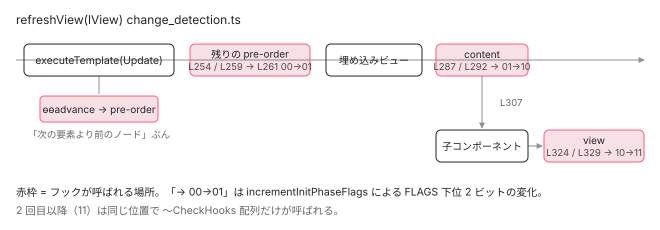

[目次](../README.md) › [Ivy ランタイム](README.md) › 第 13 回 / 全 17 回

# ライフサイクルフックは TView の数列

> registerPreOrderHooks / registerPostOrderHooks が \[index, fn, index, fn, …\] を積む。InitPhaseState の 2 ビットで ngOnInit を 1 回だけにする仕組み。

angular/angular · 読了 約 13 分 · 中核 · [サイトで読む（デモが動きます）](https://angular-deep-dive-cyan.vercel.app/chapter/ivy-hooks)

---

`ngOnInit` が 1 回しか呼ばれないのは、誰がどう保証しているのか。`ngOnChanges → ngOnInit → ngDoCheck` の順番はどこで決まるのか。この章では、ライフサイクルフックが `TView` に `[index, fn, index, fn, …]` という**数と関数が交互に並ぶ配列**として登録される手順と、`LView[FLAGS]` の下位 2 ビット（`InitPhaseState`）で「init 系フックをもう呼んだか」を数える仕組みを読みます。

読む対象は `packages/core/src/render3/hooks.ts`（324 行）と、`interfaces/view.ts` のフラグ定義、`instructions/change_detection.ts` の呼び出し箇所です。

1. 概観（配列だった）
2. Ivy とは
3. テンプレート関数と RenderFlags
4. TNode
5. TView
6. LView
7. blueprint と TData
8. firstCreatePass
9. DOM を組む命令
10. 値を更新する命令
11. LContainer
12. ビューの木
13. **フック**（この章）
14. ディレクティブ
15. LFrame
16. ViewRef 等
17. 破棄

## 1. フックは TView の 7 本の配列

📄 `angular/packages/core/src/render3/interfaces/view.ts` L886–904 （▶ の行: 896, 898–899, 902, 904）

```ts
886 │ /**
887 │  * Information necessary to call a hook. E.g. the callback that
888 │  * needs to invoked and the index at which to find its context.
889 │  */
890 │ export type HookEntry = number | HookFn;
891 │ 
892 │ /**
893 │  * Array of hooks that should be executed for a view and their directive indices.
894 │  *
895 │  * For each node of the view, the following data is stored:
896 ▶  * 1) Node index (optional)
897 │  * 2) A series of number/function pairs where:
898 ▶  *  - even indices are directive indices
899 ▶  *  - odd indices are hook functions
900 │  *
901 │  * Special cases:
902 ▶  *  - a negative directive index flags an init hook (ngOnInit, ngAfterContentInit, ngAfterViewInit)
903 │  */
904 ▶ export type HookData = HookEntry[];
```

904 行目、`HookData` は `(number | HookFn)[]` です。898〜899 行目、偶数番にディレクティブの番号（`LView` でインスタンスが入っているマス）、奇数番にフック関数。896 行目、pre-order 系の配列ではその前に「ノードの番号」が 1 つ入ることがあります。902 行目が鍵で、**ディレクティブ番号が負なら init フック**（`ngOnInit` / `ngAfterContentInit` / `ngAfterViewInit`）です。

📄 `angular/packages/core/src/render3/interfaces/view.ts` L741–759 （▶ の行: 752, 759）

```ts
741 │   /**
742 │    * Array of ngOnInit, ngOnChanges and ngDoCheck hooks that should be executed for this view in
743 │    * creation mode.
744 │    *
745 │    * This array has a flat structure and contains TNode indices, directive indices (where an
746 │    * instance can be found in `LView`) and hook functions. TNode index is followed by the directive
747 │    * index and a hook function. If there are multiple hooks for a given TNode, the TNode index is
748 │    * not repeated and the next lifecycle hook information is stored right after the previous hook
749 │    * function. This is done so that at runtime the system can efficiently iterate over all of the
750 │    * functions to invoke without having to make any decisions/lookups.
751 │    */
752 ▶   preOrderHooks: HookData | null;
753 │ 
754 │   /**
755 │    * Array of ngOnChanges and ngDoCheck hooks that should be executed for this view in update mode.
756 │    *
757 │    * This array has the same structure as the `preOrderHooks` one.
758 │    */
759 ▶   preOrderCheckHooks: HookData | null;
```

📄 `angular/packages/core/src/render3/interfaces/view.ts` L761–803 （▶ の行: 768, 777, 786, 795, 803）

```ts
761 │   /**
762 │    * Array of ngAfterContentInit and ngAfterContentChecked hooks that should be executed
763 │    * for this view in creation mode.
764 │    *
765 │    * Even indices: Directive index
766 │    * Odd indices: Hook function
767 │    */
768 ▶   contentHooks: HookData | null;
769 │ 
770 │   /**
771 │    * Array of ngAfterContentChecked hooks that should be executed for this view in update
772 │    * mode.
773 │    *
774 │    * Even indices: Directive index
775 │    * Odd indices: Hook function
776 │    */
777 ▶   contentCheckHooks: HookData | null;
778 │ 
779 │   /**
780 │    * Array of ngAfterViewInit and ngAfterViewChecked hooks that should be executed for
781 │    * this view in creation mode.
782 │    *
783 │    * Even indices: Directive index
784 │    * Odd indices: Hook function
785 │    */
786 ▶   viewHooks: HookData | null;
787 │ 
788 │   /**
789 │    * Array of ngAfterViewChecked hooks that should be executed for this view in
790 │    * update mode.
791 │    *
792 │    * Even indices: Directive index
793 │    * Odd indices: Hook function
794 │    */
795 ▶   viewCheckHooks: HookData | null;
796 │ 
797 │   /**
798 │    * Array of ngOnDestroy hooks that should be executed when this view is destroyed.
799 │    *
800 │    * Even indices: Directive index
801 │    * Odd indices: Hook function
802 │    */
803 ▶   destroyHooks: DestroyHookData | null;
```

752 行目 `preOrderHooks`（OnChanges / OnInit / DoCheck 全部）、759 行目 `preOrderCheckHooks`（OnChanges / DoCheck だけ）。768 / 777 行目が content 系、786 / 795 行目が view 系、803 行目が destroy。「〜Hooks」は初回用で init フックを含み、「〜CheckHooks」は 2 回目以降用で init フックを含みません。**同じ関数が 2 本の配列に入る**のは、2 回目以降に「init かどうか」を判定するコストを省くためです。これらは `TView` にあるので、[概観の章](01-component.md)で見たとおり全インスタンスで共有されます。

## 2. registerPreOrderHooks：ディレクティブが作られた直後に積む

📄 `angular/packages/core/src/render3/hooks.ts` L53–77 （▶ の行: 59, 63–66, 69–70, 73–75）

```ts
53 │ export function registerPreOrderHooks(
54 │   directiveIndex: number,
55 │   directiveDef: DirectiveDef<any>,
56 │   tView: TView,
57 │ ): void {
58 │   ngDevMode && assertFirstCreatePass(tView);
59 ▶   const {ngOnChanges, ngOnInit, ngDoCheck} = directiveDef.type.prototype as OnChanges &
60 │     OnInit &
61 │     DoCheck;
62 │ 
63 ▶   if (ngOnChanges as Function | undefined) {
64 ▶     const wrappedOnChanges = getNgOnChangesFeatureImpl()(directiveDef);
65 ▶     (tView.preOrderHooks ??= []).push(directiveIndex, wrappedOnChanges);
66 ▶     (tView.preOrderCheckHooks ??= []).push(directiveIndex, wrappedOnChanges);
67 │   }
68 │ 
69 ▶   if (ngOnInit) {
70 ▶     (tView.preOrderHooks ??= []).push(0 - directiveIndex, ngOnInit);
71 │   }
72 │ 
73 ▶   if (ngDoCheck) {
74 ▶     (tView.preOrderHooks ??= []).push(directiveIndex, ngDoCheck);
75 ▶     (tView.preOrderCheckHooks ??= []).push(directiveIndex, ngDoCheck);
76 │   }
77 │ }
```

1. **59 行目：prototype から 3 つのメソッドを取る**

   `directiveDef.type.prototype` の `ngOnChanges` / `ngOnInit` / `ngDoCheck`。クラスにメソッドが定義されていれば関数、なければ `undefined` です。インターフェースを `implements` しているかは見ません。メソッド名だけで判定します。
2. **63〜66 行目：ngOnChanges**

   64 行目で `NgOnChangesFeature` の包み関数（蓄積した `SimpleChanges` があるときだけ本物を呼ぶ）を作り、`preOrderHooks` と `preOrderCheckHooks` の**両方**に `directiveIndex, fn` を push します。番号は正です。
3. **69〜70 行目：ngOnInit**

   `preOrderHooks`**だけ**に、`0 - directiveIndex`（負の番号）で push。1 節の 902 行目の約束どおり、負＝init フックです。
4. **73〜75 行目：ngDoCheck**

   両方の配列に正の番号で push。

push の順が `ngOnChanges → ngOnInit → ngDoCheck` なので、**1 つのディレクティブ内の呼び出し順はここで決まります**。では、この関数はいつ呼ばれるのでしょう。

📄 `angular/packages/core/src/render3/view/directives.ts` L223–240 （▶ の行: 226, 228, 233–234, 238）

```ts
223 │     const lifeCycleHooks: Partial<OnChanges & OnInit & DoCheck> = def.type.prototype;
224 │     // Only push a node index into the preOrderHooks array if this is the first
225 │     // pre-order hook found on this node.
226 ▶     if (
227 │       !preOrderHooksFound &&
228 ▶       (lifeCycleHooks.ngOnChanges || lifeCycleHooks.ngOnInit || lifeCycleHooks.ngDoCheck)
229 │     ) {
230 │       // We will push the actual hook function into this array later during dir instantiation.
231 │       // We cannot do it now because we must ensure hooks are registered in the same
232 │       // order that directives are created (i.e. injection order).
233 ▶       (tView.preOrderHooks ??= []).push(tNode.index);
234 ▶       preOrderHooksFound = true;
235 │     }
236 │ 
237 │     if (!preOrderCheckHooksFound && (lifeCycleHooks.ngOnChanges || lifeCycleHooks.ngDoCheck)) {
238 ▶       (tView.preOrderCheckHooks ??= []).push(tNode.index);
239 │       preOrderCheckHooksFound = true;
240 │     }
```

その前に、1 節の 896 行目「ノードの番号」はいつ入るのか。初回パスでディレクティブを照合する `initializeDirectives`（[ディレクティブの章](14-ivy-directives.md)）の中です。226〜234 行目、そのノードで**最初に** pre-order フックを持つディレクティブが見つかったとき、`tNode.index` を 1 つだけ push します（238 行目は check 側）。230〜232 行目のコメント：フック関数自体はここでは積まず、「ディレクティブが作られる順＝inject の順」で積むために後回しにする。その「後」が次の引用です。

📄 `angular/packages/core/src/render3/di.ts` L785–798 （▶ の行: 785, 795, 797）

```ts
785 ▶       value = lView[index] = factory.factory(undefined, flags, tData, lView, tNode);
786 │ 
787 │       ngDevMode && emitInstanceCreatedByInjectorEvent(value);
788 │ 
789 │       // This code path is hit for both directives and providers.
790 │       // For perf reasons, we want to avoid searching for hooks on providers.
791 │       // It does no harm to try (the hooks just won't exist), but the extra
792 │       // checks are unnecessary and this is a hot path. So we check to see
793 │       // if the index of the dependency is in the directive range for this
794 │       // tNode. If it's not, we know it's a provider and skip hook registration.
795 ▶       if (tView.firstCreatePass && index >= tNode.directiveStart) {
796 │         ngDevMode && assertDirectiveDef(tData[index]);
797 ▶         registerPreOrderHooks(index, tData[index] as DirectiveDef<any>, tView);
798 │       }
```

`getNodeInjectable`（[ディレクティブの章](14-ivy-directives.md)）の中です。785 行目でディレクティブのインスタンスが作られ、795 行目、**`firstCreatePass` かつ番号がディレクティブ範囲内なら**、797 行目で登録します。インスタンス化の順（`directiveStart` から `directiveEnd`）がそのまま配列の順になります。つまり同じ要素に複数のディレクティブがあれば、照合された順にそれぞれの 3 フックが並びます。

## 3. registerPostOrderHooks：elementEnd で積む

📄 `angular/packages/core/src/render3/hooks.ts` L97–117 （▶ の行: 99–103）

```ts
 97 │ export function registerPostOrderHooks(tView: TView, tNode: TNode): void {
 98 │   ngDevMode && assertFirstCreatePass(tView);
 99 ▶   // It's necessary to loop through the directives at elementEnd() (rather than processing in
100 ▶   // directiveCreate) so we can preserve the current hook order. Content, view, and destroy
101 ▶   // hooks for projected components and directives must be called *before* their hosts.
102 ▶   for (let i = tNode.directiveStart, end = tNode.directiveEnd; i < end; i++) {
103 ▶     const directiveDef = tView.data[i] as DirectiveDef<any>;
104 │     ngDevMode && assertDefined(directiveDef, 'Expecting DirectiveDef');
105 │     const lifecycleHooks: AfterContentInit &
106 │       AfterContentChecked &
107 │       AfterViewInit &
108 │       AfterViewChecked &
109 │       OnDestroy = directiveDef.type.prototype;
110 │     const {
111 │       ngAfterContentInit,
112 │       ngAfterContentChecked,
113 │       ngAfterViewInit,
114 │       ngAfterViewChecked,
115 │       ngOnDestroy,
116 │     } = lifecycleHooks;
117 │ 
```

📄 `angular/packages/core/src/render3/hooks.ts` L118–140 （▶ の行: 119, 123–124, 128, 132–133, 137）

```ts
118 │     if (ngAfterContentInit) {
119 ▶       (tView.contentHooks ??= []).push(-i, ngAfterContentInit);
120 │     }
121 │ 
122 │     if (ngAfterContentChecked) {
123 ▶       (tView.contentHooks ??= []).push(i, ngAfterContentChecked);
124 ▶       (tView.contentCheckHooks ??= []).push(i, ngAfterContentChecked);
125 │     }
126 │ 
127 │     if (ngAfterViewInit) {
128 ▶       (tView.viewHooks ??= []).push(-i, ngAfterViewInit);
129 │     }
130 │ 
131 │     if (ngAfterViewChecked) {
132 ▶       (tView.viewHooks ??= []).push(i, ngAfterViewChecked);
133 ▶       (tView.viewCheckHooks ??= []).push(i, ngAfterViewChecked);
134 │     }
135 │ 
136 │     if (ngOnDestroy != null) {
137 ▶       (tView.destroyHooks ??= []).push(i, ngOnDestroy);
138 │     }
139 │   }
140 │ }
```

102〜103 行目、`directiveStart` から `directiveEnd` までの `DirectiveDef` を順に見ます。119 行目 `ngAfterContentInit` は `-i`（init）で `contentHooks` だけに、123〜124 行目 `ngAfterContentChecked` は正で `contentHooks` と `contentCheckHooks` の両方に。128〜133 行目の view 系も同じ型です。137 行目 `ngOnDestroy` は `destroyHooks` に正の番号で（[破棄の章](17-ivy-destroy.md)）。

99〜101 行目のコメントが呼び出しタイミングの理由です。**「elementEnd() で処理する。子（投影されたコンポーネント）の content / view / destroy フックは親より先に呼ばれなければならない」**。要素の終了タグで登録するので、子要素のフックは配列上で親より前に来ます。

📄 `angular/packages/core/src/render3/view/elements.ts` L72–78 （▶ の行: 72, 74）

```ts
72 ▶ export function directiveHostEndFirstCreatePass(tView: TView, tNode: TNode) {
73 │   ngDevMode && assertFirstCreatePass(tView);
74 ▶   registerPostOrderHooks(tView, tNode);
75 │   if (isContentQueryHost(tNode)) {
76 │     tView.queries!.elementEnd(tNode);
77 │   }
78 │ }
```

72〜74 行目、`ɵɵelementEnd` の初回パス部分です。`ng-template` の場合は [LContainer の章](11-ivy-lcontainer.md)で見た `declareDirectiveHostTemplate` が同じ関数を呼びます。

## 4. いつ実行されるか：ɵɵadvance と refreshView の 3 か所

📄 `angular/packages/core/src/render3/hooks.ts` L142–160 （▶ の行: 145–146, 149–150, 152, 154–155, 159）

```ts
142 │ /**
143 │  * Executing hooks requires complex logic as we need to deal with 2 constraints.
144 │  *
145 ▶  * 1. Init hooks (ngOnInit, ngAfterContentInit, ngAfterViewInit) must all be executed once and only
146 ▶  * once, across many change detection cycles. This must be true even if some hooks throw, or if
147 │  * some recursively trigger a change detection cycle.
148 │  * To solve that, it is required to track the state of the execution of these init hooks.
149 ▶  * This is done by storing and maintaining flags in the view: the {@link InitPhaseState},
150 ▶  * and the index within that phase. They can be seen as a cursor in the following structure:
151 │  * [[onInit1, onInit2], [afterContentInit1], [afterViewInit1, afterViewInit2, afterViewInit3]]
152 ▶  * They are stored as flags in LView[FLAGS].
153 │  *
154 ▶  * 2. Pre-order hooks can be executed in batches, because of the select instruction.
155 ▶  * To be able to pause and resume their execution, we also need some state about the hook's array
156 │  * that is being processed:
157 │  * - the index of the next hook to be executed
158 │  * - the number of init hooks already found in the processed part of the  array
159 ▶  * They are stored as flags in LView[PREORDER_HOOK_FLAGS].
160 │  */
```

hooks.ts の中央にあるこのコメントが設計を説明しています。145〜152 行目：init フックは**複数の変更検知サイクルをまたいで 1 回だけ**。例外が出ても、再帰的に変更検知が走っても。そのために `InitPhaseState` と「フェーズ内で何番目まで呼んだか」を `LView[FLAGS]` に持つ。154〜159 行目：pre-order フックは `ɵɵadvance` によって分割実行されるので、「次に呼ぶフックの位置」と「init フックをいくつ見たか」を `LView[PREORDER_HOOK_FLAGS]` に持つ。

📄 `angular/packages/core/src/render3/instructions/advance.ts` L43–51 （▶ の行: 45, 48）

```ts
43 │ export function ɵɵadvance(delta: number = 1): void {
44 │   ngDevMode && assertGreaterThan(delta, 0, 'Can only advance forward');
45 ▶   selectIndexInternal(
46 │     getTView(),
47 │     getLView(),
48 ▶     getSelectedIndex() + delta,
49 │     !!ngDevMode && isInCheckNoChangesMode(),
50 │   );
51 │ }
```

📄 `angular/packages/core/src/render3/instructions/advance.ts` L53–77 （▶ の行: 64–66, 69, 72, 74）

```ts
53 │ export function selectIndexInternal(
54 │   tView: TView,
55 │   lView: LView,
56 │   index: number,
57 │   checkNoChangesMode: boolean,
58 │ ) {
59 │   ngDevMode && assertIndexInDeclRange(lView[TVIEW], index);
60 │ 
61 │   // Flush the initial hooks for elements in the view that have been added up to this point.
62 │   // PERF WARNING: do NOT extract this to a separate function without running benchmarks
63 │   if (!checkNoChangesMode) {
64 ▶     const hooksInitPhaseCompleted =
65 ▶       (lView[FLAGS] & LViewFlags.InitPhaseStateMask) === InitPhaseState.InitPhaseCompleted;
66 ▶     if (hooksInitPhaseCompleted) {
67 │       const preOrderCheckHooks = tView.preOrderCheckHooks;
68 │       if (preOrderCheckHooks !== null) {
69 ▶         executeCheckHooks(lView, preOrderCheckHooks, index);
70 │       }
71 │     } else {
72 ▶       const preOrderHooks = tView.preOrderHooks;
73 │       if (preOrderHooks !== null) {
74 ▶         executeInitAndCheckHooks(lView, preOrderHooks, InitPhaseState.OnInitHooksToBeRun, index);
75 │       }
76 │     }
77 │   }
```

更新ブロックの `ɵɵadvance(n)`（[テンプレート関数の章](03-ivy-template-function.md)）は、48 行目で選択番号を進める前に 45 行目で `selectIndexInternal` を通ります。64〜65 行目で `InitPhaseCompleted` かを見て、完了済みなら 69 行目で `preOrderCheckHooks`、未完了なら 74 行目で `preOrderHooks` を、**「これから選ぶ要素の番号より前のノードのぶんだけ」**実行します。だから子要素の `[input]="…"` 束縛が書かれる直前に、その子の `ngOnChanges` / `ngOnInit` / `ngDoCheck` が走ります。親の束縛が書かれてから子のフックが呼ばれる、という順序の正体です。

📄 `angular/packages/core/src/render3/instructions/change_detection.ts` L237–263 （▶ の行: 238, 240, 242, 245–246, 251, 254, 257, 259, 261）

```ts
237 │   try {
238 ▶     resetPreOrderHookFlags(lView);
239 │ 
240 ▶     setBindingIndex(tView.bindingStartIndex);
241 │     if (templateFn !== null) {
242 ▶       executeTemplate(tView, lView, templateFn, RenderFlags.Update, context);
243 │     }
244 │ 
245 ▶     const hooksInitPhaseCompleted =
246 ▶       (flags & LViewFlags.InitPhaseStateMask) === InitPhaseState.InitPhaseCompleted;
247 │ 
248 │     // execute pre-order hooks (OnInit, OnChanges, DoCheck)
249 │     // PERF WARNING: do NOT extract this to a separate function without running benchmarks
250 │     if (!isInCheckNoChangesPass) {
251 ▶       if (hooksInitPhaseCompleted) {
252 │         const preOrderCheckHooks = tView.preOrderCheckHooks;
253 │         if (preOrderCheckHooks !== null) {
254 ▶           executeCheckHooks(lView, preOrderCheckHooks, null);
255 │         }
256 │       } else {
257 ▶         const preOrderHooks = tView.preOrderHooks;
258 │         if (preOrderHooks !== null) {
259 ▶           executeInitAndCheckHooks(lView, preOrderHooks, InitPhaseState.OnInitHooksToBeRun, null);
260 │         }
261 ▶         incrementInitPhaseFlags(lView, InitPhaseState.OnInitHooksToBeRun);
262 │       }
263 │     }
```

238 行目、`refreshView` はまず `PREORDER_HOOK_FLAGS` をゼロに戻し、240〜242 行目でテンプレート関数の更新ブロックを実行します（この中で上の `ɵɵadvance` が走ります）。そのあと 254 または 259 行目で**残りの pre-order フック**（最後の `ɵɵadvance` 以降のノードのぶん）を `nodeIndex = null` で流し切ります。261 行目、`incrementInitPhaseFlags(lView, OnInitHooksToBeRun)` で「OnInit フェーズ完了」に進めます。245〜246 行目の `hooksInitPhaseCompleted` は `refreshView` の先頭で読んだ `flags` から 1 回だけ計算されるので、初回の `refreshView` の間は 3 か所すべてが「〜Hooks」側（init を含む配列）を通ります。

📄 `angular/packages/core/src/render3/instructions/change_detection.ts` L276–300 （▶ の行: 278, 284, 287, 292, 298）

```ts
276 │     // Content query results must be refreshed before content hooks are called.
277 │     if (tView.contentQueries !== null) {
278 ▶       refreshContentQueries(tView, lView);
279 │     }
280 │ 
281 │     // execute content hooks (AfterContentInit, AfterContentChecked)
282 │     // PERF WARNING: do NOT extract this to a separate function without running benchmarks
283 │     if (!isInCheckNoChangesPass) {
284 ▶       if (hooksInitPhaseCompleted) {
285 │         const contentCheckHooks = tView.contentCheckHooks;
286 │         if (contentCheckHooks !== null) {
287 ▶           executeCheckHooks(lView, contentCheckHooks);
288 │         }
289 │       } else {
290 │         const contentHooks = tView.contentHooks;
291 │         if (contentHooks !== null) {
292 ▶           executeInitAndCheckHooks(
293 │             lView,
294 │             contentHooks,
295 │             InitPhaseState.AfterContentInitHooksToBeRun,
296 │           );
297 │         }
298 ▶         incrementInitPhaseFlags(lView, InitPhaseState.AfterContentInitHooksToBeRun);
299 │       }
300 │     }
```

📄 `angular/packages/core/src/render3/instructions/change_detection.ts` L304–333 （▶ の行: 307, 315, 321, 324, 329, 331）

```ts
304 │     // Refresh child component views.
305 │     const components = tView.components;
306 │     if (components !== null) {
307 ▶       detectChangesInChildComponents(lView, components, ChangeDetectionMode.Global);
308 │     }
309 │ 
310 │     // View queries must execute after refreshing child components because a template in this view
311 │     // could be inserted in a child component. If the view query executes before child component
312 │     // refresh, the template might not yet be inserted.
313 │     const viewQuery = tView.viewQuery;
314 │     if (viewQuery !== null) {
315 ▶       executeViewQueryFn<T>(RenderFlags.Update, viewQuery, context);
316 │     }
317 │ 
318 │     // execute view hooks (AfterViewInit, AfterViewChecked)
319 │     // PERF WARNING: do NOT extract this to a separate function without running benchmarks
320 │     if (!isInCheckNoChangesPass) {
321 ▶       if (hooksInitPhaseCompleted) {
322 │         const viewCheckHooks = tView.viewCheckHooks;
323 │         if (viewCheckHooks !== null) {
324 ▶           executeCheckHooks(lView, viewCheckHooks);
325 │         }
326 │       } else {
327 │         const viewHooks = tView.viewHooks;
328 │         if (viewHooks !== null) {
329 ▶           executeInitAndCheckHooks(lView, viewHooks, InitPhaseState.AfterViewInitHooksToBeRun);
330 │         }
331 ▶         incrementInitPhaseFlags(lView, InitPhaseState.AfterViewInitHooksToBeRun);
332 │       }
333 │     }
```

278 行目でコンテントクエリを更新したあと、287 または 292 行目で content 系フック、298 行目でフェーズを進めます。307 行目で**子コンポーネントを refresh し**、315 行目でビュークエリを更新したあと、324 または 329 行目で view 系フック、331 行目でフェーズを進めます。`ngAfterViewInit` が「子コンポーネントの初期化後」に呼ばれるのは、307 行目が 329 行目より前にあるからです。pre-order 以外の 2 か所は `nodeIndex` を渡しません（`undefined`）。配列を先頭から全部実行します。

## 5. FLAGS の下位 2 ビット：InitPhaseState

📄 `angular/packages/core/src/render3/interfaces/view.ts` L409–413 （▶ の行: 412–413）

```ts
409 │ /** Flags associated with an LView (saved in LView[FLAGS]) */
410 │ export const enum LViewFlags {
411 │   /** The state of the init phase on the first 2 bits */
412 ▶   InitPhaseStateIncrementer = 0b00000000001,
413 ▶   InitPhaseStateMask = 0b00000000011,
```

📄 `angular/packages/core/src/render3/interfaces/view.ts` L488–500 （▶ の行: 496–499）

```ts
488 │ /**
489 │  * Possible states of the init phase:
490 │  * - 00: OnInit hooks to be run.
491 │  * - 01: AfterContentInit hooks to be run
492 │  * - 10: AfterViewInit hooks to be run
493 │  * - 11: All init hooks have been run
494 │  */
495 │ export const enum InitPhaseState {
496 ▶   OnInitHooksToBeRun = 0b00,
497 ▶   AfterContentInitHooksToBeRun = 0b01,
498 ▶   AfterViewInitHooksToBeRun = 0b10,
499 ▶   InitPhaseCompleted = 0b11,
500 │ }
```

📄 `angular/packages/core/src/render3/interfaces/view.ts` L473–486 （▶ の行: 476, 481, 485）

```ts
473 │   /**
474 │    * This is the count of the bits the 1 was shifted above (base 10)
475 │    */
476 ▶   IndexWithinInitPhaseShift = 14,
477 │ 
478 │   /**
479 │    * Index of the current init phase on last 21 bits
480 │    */
481 ▶   IndexWithinInitPhaseIncrementer = 1 << IndexWithinInitPhaseShift,
482 │ 
483 │   // Subtracting 1 gives all 1s to the right of the initial shift
484 │   // So `(1 << 3) - 1` would give 3 1s: 1 << 3 = 0b01000, subtract 1 = 0b00111
485 ▶   IndexWithinInitPhaseReset = (1 << IndexWithinInitPhaseShift) - 1,
486 │ }
```

412〜413 行目、`LView[FLAGS]` の下位 2 ビットがフェーズです。496〜499 行目、`00` = OnInit 待ち、`01` = AfterContentInit 待ち、`10` = AfterViewInit 待ち、`11` = 全部済み。476〜481 行目、14 ビット目以降が「今のフェーズ内で呼び終えた init フックの数」です。485 行目の `IndexWithinInitPhaseReset` は下位 14 ビットが全部 1 のマスクで、これと AND を取ると上位（数）がゼロに戻ります。

📄 `angular/packages/core/src/render3/hooks.ts` L209–222 （▶ の行: 217–220）

```ts
209 │ export function incrementInitPhaseFlags(lView: LView, initPhase: InitPhaseState): void {
210 │   ngDevMode &&
211 │     assertNotEqual(
212 │       initPhase,
213 │       InitPhaseState.InitPhaseCompleted,
214 │       'Init hooks phase should not be incremented after all init hooks have been run.',
215 │     );
216 │   let flags = lView[FLAGS];
217 ▶   if ((flags & LViewFlags.InitPhaseStateMask) === initPhase) {
218 ▶     flags &= LViewFlags.IndexWithinInitPhaseReset;
219 ▶     flags += LViewFlags.InitPhaseStateIncrementer;
220 ▶     lView[FLAGS] = flags;
221 │   }
222 │ }
```

217 行目、今のフェーズが引数と一致するときだけ、218 行目で数をリセットし、219 行目で `+1`（下位 2 ビットが 1 進む）。`00 → 01 → 10 → 11` と進み、`11` になると 4 節で見た分岐が全部「〜CheckHooks」側に切り替わります。**一度 `11` になった `LView` は、二度と init フックの配列を見ません**。

📄 `angular/packages/core/src/render3/interfaces/view.ts` L502–516 （▶ の行: 508, 513–514）

```ts
502 │ /** More flags associated with an LView (saved in LView[PREORDER_HOOK_FLAGS]) */
503 │ export const enum PreOrderHookFlags {
504 │   /**
505 │      The index of the next pre-order hook to be called in the hooks array, on the first 16
506 │      bits
507 │    */
508 ▶   IndexOfTheNextPreOrderHookMaskMask = 0b01111111111111111,
509 │ 
510 │   /**
511 │    * The number of init hooks that have already been called, on the last 16 bits
512 │    */
513 ▶   NumberOfInitHooksCalledIncrementer = 0b010000000000000000,
514 ▶   NumberOfInitHooksCalledShift = 16,
515 │   NumberOfInitHooksCalledMask = 0b11111111111111110000000000000000,
516 │ }
```

もう 1 つのマス `LView[PREORDER_HOOK_FLAGS]`（17 番）。508 行目、下位 16 ビットが「次に見る配列位置」、513〜514 行目、上位 16 ビットが「ここまでに見た init フックの数」です。`refreshView` は毎回先頭（4 節の 238 行目）で `resetPreOrderHookFlags` によりゼロに戻します。

> **🧪 DEMO — LView\[FLAGS\] の下位 2 ビットが進む様子**
>
> incrementInitPhaseFlags（hooks.ts 217〜220 行目）を 1 回ずつ進めます。実際には初回の refreshView 1 回の中で 3 回進みます。11 になると、次の refreshView からは executeInitAndCheckHooks ではなく executeCheckHooks だけが呼ばれます。
>
> ▶ [このデモはサイトで動かせます](https://angular-deep-dive-cyan.vercel.app/chapter/ivy-hooks)

## 6. callHooks と callHook：負の番号を見て 1 回だけ呼ぶ

📄 `angular/packages/core/src/render3/hooks.ts` L192–207 （▶ の行: 204–205）

```ts
192 │ export function executeInitAndCheckHooks(
193 │   lView: LView,
194 │   hooks: HookData,
195 │   initPhase: InitPhaseState,
196 │   nodeIndex?: number | null,
197 │ ) {
198 │   ngDevMode &&
199 │     assertNotEqual(
200 │       initPhase,
201 │       InitPhaseState.InitPhaseCompleted,
202 │       'Init pre-order hooks should not be called more than once',
203 │     );
204 ▶   if ((lView[FLAGS] & LViewFlags.InitPhaseStateMask) === initPhase) {
205 ▶     callHooks(lView, hooks, initPhase, nodeIndex);
206 │   }
207 │ }
```

📄 `angular/packages/core/src/render3/hooks.ts` L175–177 （▶ の行: 176）

```ts
175 │ export function executeCheckHooks(lView: LView, hooks: HookData, nodeIndex?: number | null) {
176 ▶   callHooks(lView, hooks, InitPhaseState.InitPhaseCompleted, nodeIndex);
177 │ }
```

204 行目、`executeInitAndCheckHooks` は **今のフェーズが引数と一致するときだけ**`callHooks` を呼びます。`refreshView` の 259 行目は `OnInitHooksToBeRun`（`00`）を渡すので、フェーズが `01` 以降なら何もしません。176 行目、`executeCheckHooks` は常に `InitPhaseCompleted` を渡して `callHooks` します。

📄 `angular/packages/core/src/render3/hooks.ts` L250–279 （▶ の行: 250–252, 257–261, 265–267, 269–271）

```ts
250 ▶   const startIndex =
251 ▶     currentNodeIndex !== undefined
252 ▶       ? currentView[PREORDER_HOOK_FLAGS] & PreOrderHookFlags.IndexOfTheNextPreOrderHookMaskMask
253 │       : 0;
254 │   const nodeIndexLimit = currentNodeIndex != null ? currentNodeIndex : -1;
255 │   const max = arr.length - 1; // Stop the loop at length - 1, because we look for the hook at i + 1
256 │   let lastNodeIndexFound = 0;
257 ▶   for (let i = startIndex; i < max; i++) {
258 ▶     const hook = arr[i + 1] as number | (() => void);
259 ▶     if (typeof hook === 'number') {
260 ▶       lastNodeIndexFound = arr[i] as number;
261 ▶       if (currentNodeIndex != null && lastNodeIndexFound >= currentNodeIndex) {
262 │         break;
263 │       }
264 │     } else {
265 ▶       const isInitHook = (arr[i] as number) < 0;
266 ▶       if (isInitHook) {
267 ▶         currentView[PREORDER_HOOK_FLAGS] += PreOrderHookFlags.NumberOfInitHooksCalledIncrementer;
268 │       }
269 ▶       if (lastNodeIndexFound < nodeIndexLimit || nodeIndexLimit == -1) {
270 ▶         callHook(currentView, initPhase, arr, i);
271 ▶         currentView[PREORDER_HOOK_FLAGS] =
272 │           (currentView[PREORDER_HOOK_FLAGS] & PreOrderHookFlags.NumberOfInitHooksCalledMask) +
273 │           i +
274 │           2;
275 │       }
276 │       i++;
277 │     }
278 │   }
279 │ }
```

1. **250〜253 行目：どこから読み始めるか**

   `nodeIndex` が渡された（pre-order の）場合は `PREORDER_HOOK_FLAGS` の下位 16 ビット、つまり前回の `ɵɵadvance` で止まった位置から。渡されない（content / view）場合は 0 から。
2. **257〜263 行目：ノード番号に出会ったら**

   258 行目で `arr[i + 1]` を見て、それが数なら `arr[i]` はノード番号です（`[nodeIndex, dirIndex, fn]` の並び）。261 行目、そのノードが今選ぼうとしている要素以降なら `break`。ここが「前のノードのぶんだけ」を実現する行です。
3. **265〜267 行目：init フックなら数える**

   `arr[i] < 0` なら `PREORDER_HOOK_FLAGS` の上位 16 ビットを 1 増やします。呼ぶ前に数えます。
4. **269〜271 行目：呼んで、位置を保存**

   270 行目で `callHook`、271 行目で「次は `i + 2` から」を下位 16 ビットに保存します。

📄 `angular/packages/core/src/render3/hooks.ts` L305–324 （▶ の行: 306, 308–311, 314–316, 318–319, 322）

```ts
305 │ function callHook(currentView: LView, initPhase: InitPhaseState, arr: HookData, i: number) {
306 ▶   const isInitHook = (arr[i] as number) < 0;
307 │   const hook = arr[i + 1] as () => void;
308 ▶   const directiveIndex = isInitHook ? -arr[i] : (arr[i] as number);
309 ▶   const directive = currentView[directiveIndex];
310 ▶   if (isInitHook) {
311 ▶     const indexWithintInitPhase = currentView[FLAGS] >> LViewFlags.IndexWithinInitPhaseShift;
312 │     // The init phase state must be always checked here as it may have been recursively updated.
313 │     if (
314 ▶       indexWithintInitPhase <
315 ▶         currentView[PREORDER_HOOK_FLAGS] >> PreOrderHookFlags.NumberOfInitHooksCalledShift &&
316 ▶       (currentView[FLAGS] & LViewFlags.InitPhaseStateMask) === initPhase
317 │     ) {
318 ▶       currentView[FLAGS] += LViewFlags.IndexWithinInitPhaseIncrementer;
319 ▶       callHookInternal(directive, hook);
320 │     }
321 │   } else {
322 ▶     callHookInternal(directive, hook);
323 │   }
324 │ }
```

1. **306〜309 行目：負の番号を正に戻してインスタンスを取る**

   `directive = currentView[directiveIndex]`。[EXPANDO 区画](14-ivy-directives.md)のインスタンスです。
2. **310〜320 行目：init フックなら 2 条件を確認**

   311 行目で「このフェーズで呼び終えた数」（`FLAGS >> 14`）を取り、314〜316 行目で**「呼び終えた数 &lt; ここまでに見た init フックの数」かつ「フェーズが一致」**のときだけ、318 行目で呼び終えた数を 1 増やして 319 行目で呼びます。

   例外で途中終了した場合、呼び終えた数は増えているので次回は続きから。フック内で再帰的に変更検知が走った場合、再帰側で先に呼ばれて数が増えているので、戻ってきたときは呼びません。これが「1 回だけ」の保証です。
3. **322 行目：check フックはそのまま呼ぶ**

   正の番号なら条件なしで毎回呼びます。`ngDoCheck` や `ngAfterViewChecked` がこちらです。

📄 `angular/packages/core/src/render3/hooks.ts` L286–295 （▶ の行: 288, 290, 292）

```ts
286 │ function callHookInternal(directive: any, hook: () => void) {
287 │   profiler(ProfilerEvent.LifecycleHookStart, directive, hook);
288 ▶   const prevConsumer = setActiveConsumer(null);
289 │   try {
290 ▶     hook.call(directive);
291 │   } finally {
292 ▶     setActiveConsumer(prevConsumer);
293 │     profiler(ProfilerEvent.LifecycleHookEnd, directive, hook);
294 │   }
295 │ }
```

288 行目、呼ぶ前に `setActiveConsumer(null)`。フックの中で signal を読んでも、テンプレートの依存として記録されません。290 行目で `hook.call(directive)`、292 行目で元に戻します。`ngOnInit` の中で `this.count()` を読んだだけでは、その signal の変更でビューは再描画されない、ということです。



*refreshView 1 回の中でフックが呼ばれる位置。pre-order は ɵɵadvance ごとに分割され、残りをテンプレート直後に流し切る。content は埋め込みビュー refresh の後、view は子コンポーネント refresh の後。*

## ここまでの呼び出し

- `ɵɵelementStart(0, 'child', ...)` — instructions/element.ts L90（作成モード・初回）
  - `getNodeInjectable(lView, tView, i, tNode)` — render3/di.ts L735 — *L785: インスタンス化*
    - `registerPreOrderHooks(i, def, tView)` — hooks.ts L53 — *preOrderHooks に \[i, onChanges, -i, onInit, i, doCheck\]*
- `ɵɵelementEnd()` — instructions/element.ts
  - `directiveHostEndFirstCreatePass(tView, tNode)` — view/elements.ts L72
    - `registerPostOrderHooks(tView, tNode)` — hooks.ts L97 — *contentHooks / viewHooks / destroyHooks*
- `refreshView(tView, lView, templateFn, ctx)` — instructions/change\_detection.ts — *L238: resetPreOrderHookFlags*
  - `executeTemplate(..., Update, ctx)` — instructions/shared.ts L86
    - `ɵɵadvance(n)` → `selectIndexInternal(...)` — instructions/advance.ts L43 / L53 — *L74: 前のノードぶんの preOrderHooks*
      - `executeInitAndCheckHooks(lView, hooks, OnInitHooksToBeRun, index)` — hooks.ts L192 — *L204: フェーズ一致なら callHooks*
        - `callHooks(...)` → `callHook(...)` → `callHookInternal(directive, hook)` — hooks.ts L238 / L305 / L286 — *負の番号なら数を見て 1 回だけ。setActiveConsumer(null) で呼ぶ*
  - `executeInitAndCheckHooks(lView, preOrderHooks, OnInitHooksToBeRun, null)` — change\_detection.ts L259 — *残りを流し切る*
  - `incrementInitPhaseFlags(lView, OnInitHooksToBeRun)` — hooks.ts L209 — *FLAGS 下位 2 ビット 00 → 01*
  - `executeInitAndCheckHooks(lView, contentHooks, AfterContentInitHooksToBeRun)` — change\_detection.ts L292 — *→ 01 → 10*
  - `detectChangesInChildComponents(...)` — change\_detection.ts L307
  - `executeInitAndCheckHooks(lView, viewHooks, AfterViewInitHooksToBeRun)` — change\_detection.ts L329 — *→ 10 → 11*

## 聞かれそうな質問

**Q. ngOnInit が 1 回しか呼ばれないのは誰が保証していますか？**

`callHook`（hooks.ts 310〜320 行目）です。`ngOnInit` は `registerPreOrderHooks` 70 行目で**負の番号**として登録され、306 行目でそれを見て init フックと判定します。314〜316 行目で「このフェーズで呼び終えた数（`FLAGS >> 14`）がここまでに見た init フックの数より少ない」かつ 「フェーズが `OnInitHooksToBeRun`」のときだけ 319 行目で呼び、318 行目で数を増やします。さらに `refreshView` が 261 行目で `incrementInitPhaseFlags` を呼ぶとフェーズが `01` に進み、次回からは `executeInitAndCheckHooks` の 204 行目でフェーズ不一致となって `preOrderHooks` 自体が読まれません。`ngOnInit` は `preOrderCheckHooks` には入っていない（70 行目）ので、2 回目以降の経路には存在しません。

**Q. ngOnChanges と ngOnInit と ngDoCheck の順番はどこで決まりますか？**

`registerPreOrderHooks`（hooks.ts 63〜76 行目）の push 順です。65 行目 `ngOnChanges`、70 行目 `ngOnInit`、74 行目 `ngDoCheck` の順に 1 本の配列に積まれ、`callHooks`（257 行目）が先頭から順に呼びます。複数ディレクティブ間の順は、`getNodeInjectable`（di.ts 797 行目）が呼ばれる順、つまりインスタンス化の順です。

**Q. 子コンポーネントの ngOnInit は、親のどのタイミングで呼ばれますか？**

親の更新ブロックで、その子要素を選ぶ `ɵɵadvance` の中です。`selectIndexInternal`（advance.ts 74 行目）が 「選ぼうとする番号より前のノード」のぶんだけ `preOrderHooks` を実行します（`callHooks` 261 行目の `break`）。子への `[input]` 束縛はその直前の `ɵɵadvance` 以前に書かれているので、「入力が揃った直後に `ngOnChanges` → `ngOnInit`」になります。最後の要素以降のぶんは `refreshView` 259 行目で流し切ります。

**Q. ngAfterViewInit が子コンポーネントの初期化後なのはなぜですか？**

`refreshView` の並び順です。307 行目 `detectChangesInChildComponents`（子の `refreshView`）の後、329 行目で `viewHooks` を実行します。`contentHooks` は 292 行目、埋め込みビューの refresh（274 行目）の後、子コンポーネントの前です。

**Q. ngOnInit の中で signal を読むと、その signal が変わったときビューは更新されますか？**

フック内の読み取りだけでは更新されません。`callHookInternal`（hooks.ts 288 行目）が `setActiveConsumer(null)` にしてから呼ぶので、テンプレートの reactive consumer に依存として記録されません。テンプレートで読んでいれば別です（[signal consumer の章](../cd/05-cd-signal-consumer.md)）。

**Q. implements OnInit を書き忘れても ngOnInit は呼ばれますか？**

呼ばれます。`registerPreOrderHooks` 59 行目は `directiveDef.type.prototype` から `ngOnInit` という名前のメソッドを取るだけで、インターフェースは見ません。逆に、メソッド名を 1 文字でも間違えると登録されません。

## 読み終えて

- フックは `TView` の 7 本の配列に `[ディレクティブ番号, 関数]` の繰り返しで入る。init フックは負の番号。「〜CheckHooks」には init が入っていない
- pre-order 系は `getNodeInjectable` がインスタンスを作った直後に、post-order 系は `elementEnd` で登録される。push の順が呼び出し順
- 実行は `ɵɵadvance`（前のノードぶん）、`refreshView` のテンプレート直後（残り）、埋め込みビュー後（content）、子コンポーネント後（view）の 4 か所
- `LView[FLAGS]` の下位 2 ビットが `00 → 01 → 10 → 11` と進み、`callHook` が「呼び終えた数」と比べて init フックを 1 回だけ呼ぶ

---

← 前: [ビューの木をどう歩くか：CHILD\_HEAD / NEXT / PARENT / DECLARATION\_VIEW](12-ivy-view-tree.md)  
次: [ディレクティブのインスタンス化と EXPANDO](14-ivy-directives.md) →
