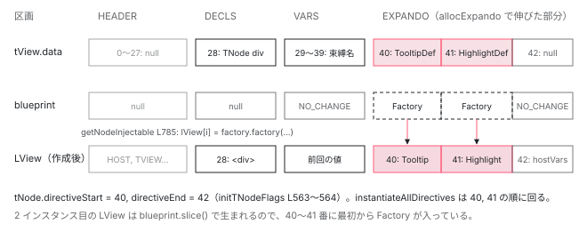

[目次](../README.md) › [Ivy ランタイム](README.md) › 第 14 回 / 全 17 回

# ディレクティブのインスタンス化と EXPANDO

> instantiateAllDirectives が directiveStart から directiveEnd まで順に new する。インスタンスは LView の EXPANDO 区画に並び、属性からの初期入力はここで流れる。

angular/angular · 読了 約 12 分 · 発展 · [サイトで読む（デモが動きます）](https://angular-deep-dive-cyan.vercel.app/chapter/ivy-directives)

---

`<div appTooltip appHighlight>` と書いたとき、`Tooltip` と `Highlight` のインスタンスはどこに作られ、どこに置かれるのか。この章では、初回パスが `LView` の末尾（EXPANDO 区画）にディレクティブの数だけマスを確保して `NodeInjectorFactory` を置く手順、`instantiateAllDirectives` が `directiveStart` から `directiveEnd` まで順にそのファクトリをインスタンスに置き換える手順、そして `name="Bess"` のような静的属性が `setInputsFromAttrs` で入力に流れる手順を読みます。

読む対象は `packages/core/src/render3/instructions/shared.ts`、`view/directives.ts`、`render3/di.ts` です。どのディレクティブが一致するかの照合（`resolveDirectives`）は[firstCreatePass の章](08-ivy-first-create-pass.md)が扱っているので、ここでは一致したあとから始めます。

1. 概観（配列だった）
2. Ivy とは
3. テンプレート関数と RenderFlags
4. TNode
5. TView
6. LView
7. blueprint と TData
8. firstCreatePass
9. DOM を組む命令
10. 値を更新する命令
11. LContainer
12. ビューの木
13. フック
14. **ディレクティブ**（この章）
15. LFrame
16. ViewRef 等
17. 破棄

## 1. 入口：ɵɵelementStart の中の createDirectivesInstances

📄 `angular/packages/core/src/render3/instructions/element.ts` L133–150 （▶ の行: 140, 142, 144）

```ts
133 │ function initializeElement(
134 │   index: number,
135 │   name: string,
136 │   lView: LView,
137 │   tNode: TElementNode,
138 │   localRefsIndex: number | undefined,
139 │ ) {
140 ▶   elementLikeStartShared(tNode, lView, index, name, _locateOrCreateElementNode);
141 │ 
142 ▶   if (isDirectiveHost(tNode)) {
143 │     const tView = lView[TVIEW];
144 ▶     createDirectivesInstances(tView, lView, tNode);
145 │     executeContentQueries(tView, tNode, lView);
146 │   }
147 │ 
148 │   if (localRefsIndex != null) {
149 │     saveResolvedLocalsInData(lView, tNode);
150 │   }
```

📄 `angular/packages/core/src/render3/instructions/shared.ts` L121–126 （▶ の行: 122–124）

```ts
121 │ export function createDirectivesInstances(tView: TView, lView: LView, tNode: TDirectiveHostNode) {
122 ▶   instantiateAllDirectives(tView, lView, tNode);
123 ▶   if ((tNode.flags & TNodeFlags.hasHostBindings) === TNodeFlags.hasHostBindings) {
124 ▶     invokeDirectivesHostBindings(tView, lView, tNode);
125 │   }
126 │ }
```

140 行目で DOM 要素を作ったあと（[DOM を組む命令の章](09-ivy-create-instructions.md)）、142 行目で `TNode` にディレクティブが付いていれば 144 行目へ。122 行目でインスタンス化、123〜124 行目でホストバインディングの作成モード実行です。**ディレクティブは要素が作られた直後、子要素より前に作られます**。

## 2. 初回パス：EXPANDO 区画にマスを確保する

初回パス（`tView.firstCreatePass`）で照合に一致した `DirectiveDef` の配列は、こう作られています。

📄 `angular/packages/core/src/render3/instructions/shared.ts` L466–491 （▶ の行: 471, 474, 488, 490）

```ts
466 │   const registry = tView.directiveRegistry;
467 │   let matches: DirectiveDef<unknown>[] | null = null;
468 │   if (registry) {
469 │     for (let i = 0; i < registry.length; i++) {
470 │       const def = registry[i] as ComponentDef<any> | DirectiveDef<any>;
471 ▶       if (isNodeMatchingSelectorList(tNode, def.selectors!, /* isProjectionMode */ false)) {
472 │         matches ??= [];
473 │ 
474 ▶         if (isComponentDef(def)) {
475 │           if (ngDevMode) {
476 │             assertTNodeType(
477 │               tNode,
478 │               TNodeType.Element,
479 │               `"${tNode.value}" tags cannot be used as component hosts. ` +
480 │                 `Please use a different tag to activate the ${stringify(def.type)} component.`,
481 │             );
482 │ 
483 │             if (matches.length && isComponentDef(matches[0])) {
484 │               throwMultipleComponentError(tNode, matches.find(isComponentDef)!.type, def.type);
485 │             }
486 │           }
487 │ 
488 ▶           matches.unshift(def);
489 │         } else {
490 ▶           matches.push(def);
491 │         }
```

471 行目でセレクタが一致したものを、474 行目でコンポーネントなら 488 行目 `unshift`（先頭へ）、それ以外は 490 行目 `push`。**コンポーネントは必ず 0 番目**、ディレクティブはレジストリ（`imports` の並び）の順です。この配列の順が、以降のすべての順になります。

📄 `angular/packages/core/src/render3/view/directives.ts` L554–566 （▶ の行: 561, 563–565）

```ts
554 │ function initTNodeFlags(tNode: TNode, index: number, numberOfDirectives: number) {
555 │   ngDevMode &&
556 │     assertNotEqual(
557 │       numberOfDirectives,
558 │       tNode.directiveEnd - tNode.directiveStart,
559 │       'Reached the max number of directives',
560 │     );
561 ▶   tNode.flags |= TNodeFlags.isDirectiveHost;
562 │   // When the first directive is created on a node, save the index
563 ▶   tNode.directiveStart = index;
564 ▶   tNode.directiveEnd = index + numberOfDirectives;
565 ▶   tNode.providerIndexes = index;
566 │ }
```

📄 `angular/packages/core/src/render3/interfaces/node.ts` L350–366 （▶ の行: 351, 356–357, 360, 363–365）

```ts
350 │   /** Stores starting index of the directives. */
351 ▶   directiveStart: number;
352 │ 
353 │   /**
354 │    * Stores final exclusive index of the directives.
355 │    *
356 ▶    * The area right behind the `directiveStart-directiveEnd` range is used to allocate the
357 ▶    * `HostBindingFunction` `vars` (or null if no bindings.) Therefore `directiveEnd` is used to set
358 │    * `LFrame.bindingRootIndex` before `HostBindingFunction` is executed.
359 │    */
360 ▶   directiveEnd: number;
361 │ 
362 │   /**
363 ▶    * Offset from the `directiveStart` at which the component (one at most) of the node is stored.
364 ▶    * Set to -1 if no components have been applied to the node. Component index can be found using
365 ▶    * `directiveStart + componentOffset`.
366 │    */
```

561 行目で `isDirectiveHost` フラグ、563〜564 行目で `directiveStart` と `directiveEnd`（排他）。`index` には `tView.data.length`、つまり**今の配列の末尾**が渡されます。363〜365 行目、コンポーネントは `directiveStart + componentOffset` にあり、2 節冒頭の `unshift` により通常 `componentOffset = 0` です。356〜358 行目、`directiveEnd` の直後にはホストバインディングの束縛値が置かれます。

📄 `angular/packages/core/src/render3/view/directives.ts` L181–194 （▶ の行: 183, 187, 193）

```ts
181 │   let preOrderHooksFound = false;
182 │   let preOrderCheckHooksFound = false;
183 ▶   let directiveIdx = allocExpando(tView, lView, directivesLength, null);
184 │   ngDevMode &&
185 │     assertSame(
186 │       directiveIdx,
187 ▶       tNode.directiveStart,
188 │       'TNode.directiveStart should point to just allocated space',
189 │     );
190 │ 
191 │   // If there's at least one directive, we'll have to track it so initialize the map.
192 │   if (directivesLength > 0) {
193 ▶     tNode.directiveToIndex = new Map();
194 │   }
```

📄 `angular/packages/core/src/render3/view/construction.ts` L282–307 （▶ の行: 288, 300–304, 306）

```ts
282 │ export function allocExpando(
283 │   tView: TView,
284 │   lView: LView,
285 │   numSlotsToAlloc: number,
286 │   initialValue: unknown,
287 │ ): number {
288 ▶   if (numSlotsToAlloc === 0) return -1;
289 │   if (ngDevMode) {
290 │     assertFirstCreatePass(tView);
291 │     assertSame(tView, lView[TVIEW], '`LView` must be associated with `TView`!');
292 │     assertEqual(tView.data.length, lView.length, 'Expecting LView to be same size as TView');
293 │     assertEqual(
294 │       tView.data.length,
295 │       tView.blueprint.length,
296 │       'Expecting Blueprint to be same size as TView',
297 │     );
298 │     assertFirstUpdatePass(tView);
299 │   }
300 ▶   const allocIdx = lView.length;
301 ▶   for (let i = 0; i < numSlotsToAlloc; i++) {
302 ▶     lView.push(initialValue);
303 ▶     tView.blueprint.push(initialValue);
304 ▶     tView.data.push(null);
305 │   }
306 ▶   return allocIdx;
307 │ }
```

183 行目、`allocExpando(tView, lView, ディレクティブ数, null)`。300 行目で今の長さを控え、301〜304 行目で **`lView`・`tView.blueprint`・`tView.data` の 3 本を同じ数だけ伸ばし**、306 行目で先頭の番号を返します。187 行目の assert が「それは `directiveStart` と同じ番号だ」と確かめています。[blueprint の章](07-ivy-blueprint.md)の 4 区画のうち、HEADER・DECLS・VARS の後ろに追加されるのがこの EXPANDO です。193 行目、クラスから番号を引くための `Map` も作られます（8 節）。

## 3. マスの初期値は NodeInjectorFactory

📄 `angular/packages/core/src/render3/view/directives.ts` L196–217 （▶ の行: 196, 200, 202–203, 216）

```ts
196 ▶   for (let i = 0; i < directivesLength; i++) {
197 │     const def = directives[i];
198 │     // Merge the attrs in the order of matches. This assumes that the first directive is the
199 │     // component itself, so that the component has the least priority.
200 ▶     tNode.mergedAttrs = mergeHostAttrs(tNode.mergedAttrs, def.hostAttrs);
201 │ 
202 ▶     configureViewWithDirective(tView, tNode, lView, directiveIdx, def);
203 ▶     saveNameToExportMap(directiveIdx, def, exportsMap);
204 │ 
205 │     // If a directive has host directives, we need to track both its index and the range within
206 │     // the host directives are declared. Host directives are not tracked, but should be resolved
207 │     // by looking up the host and getting its indexes from there.
208 │     if (hostDirectiveRanges !== null && hostDirectiveRanges.has(def)) {
209 │       const [start, end] = hostDirectiveRanges.get(def)!;
210 │       tNode.directiveToIndex!.set(def.type, [
211 │         directiveIdx,
212 │         start + tNode.directiveStart,
213 │         end + tNode.directiveStart,
214 │       ]);
215 │     } else if (hostDirectiveDefs === null || !hostDirectiveDefs.has(def)) {
216 ▶       tNode.directiveToIndex!.set(def.type, directiveIdx);
217 │     }
```

📄 `angular/packages/core/src/render3/view/directives.ts` L443–474 （▶ の行: 452–454, 458, 464–465, 471）

```ts
443 │ function configureViewWithDirective<T>(
444 │   tView: TView,
445 │   tNode: TNode,
446 │   lView: LView,
447 │   directiveIndex: number,
448 │   def: DirectiveDef<T>,
449 │ ): void {
450 │   ngDevMode &&
451 │     assertGreaterThanOrEqual(directiveIndex, HEADER_OFFSET, 'Must be in Expando section');
452 ▶   tView.data[directiveIndex] = def;
453 ▶   const directiveFactory =
454 ▶     def.factory || ((def as Writable<DirectiveDef<T>>).factory = getFactoryDef(def.type, true));
455 │   // Even though `directiveFactory` will already be using `ɵɵdirectiveInject` in its generated code,
456 │   // we also want to support `inject()` directly from the directive constructor context so we set
457 │   // `ɵɵdirectiveInject` as the inject implementation here too.
458 ▶   const nodeInjectorFactory = new NodeInjectorFactory(
459 │     directiveFactory,
460 │     isComponentDef(def),
461 │     ɵɵdirectiveInject,
462 │     ngDevMode ? def.type.name : null,
463 │   );
464 ▶   tView.blueprint[directiveIndex] = nodeInjectorFactory;
465 ▶   lView[directiveIndex] = nodeInjectorFactory;
466 │ 
467 │   registerHostBindingOpCodes(
468 │     tView,
469 │     tNode,
470 │     directiveIndex,
471 ▶     allocExpando(tView, lView, def.hostVars, NO_CHANGE),
472 │     def,
473 │   );
474 │ }
```

1. **452 行目：`tView.data[directiveIndex] = def`**

   静的側には `DirectiveDef`。[TNode](04-ivy-tnode.md) が入っている DECLS 区画と同じ配列の、後ろのほうです。
2. **453〜454 行目：ファクトリ関数**

   `def.factory`、つまりコンパイラが生成した `ɵfac`（`new Tooltip(ɵɵdirectiveInject(ElementRef))` のようなコード）です。
3. **458〜465 行目：`NodeInjectorFactory` を blueprint と lView の両方に**

   464 行目で blueprint に入れるので、**以後作られるすべての `LView`（`blueprint.slice()`）は、このマスにファクトリを持った状態で生まれます**。465 行目は今まさに作っている初回の `LView` 用です。
4. **471 行目：ホストバインディングの束縛マス**

   `def.hostVars` 個を `NO_CHANGE` で確保します。2 節の 356〜358 行目のとおり、ディレクティブのマスの直後です。

196〜216 行目のループがディレクティブごとにこれを呼び、216 行目で `directiveToIndex` に「クラス → 番号」を記録します。200 行目、ホスト属性（`host: { class: 'x' }`）は照合順にマージされ、コンポーネントが最も低い優先度になります。

📄 `angular/packages/core/src/render3/interfaces/injector.ts` L176–191 （▶ の行: 176, 180, 186, 191）

```ts
176 ▶ export class NodeInjectorFactory {
177 │   /**
178 │    * The inject implementation to be activated when using the factory.
179 │    */
180 ▶   injectImpl: null | (<T>(token: ProviderToken<T>, flags?: InternalInjectFlags) => T);
181 │ 
182 │   /**
183 │    * Marker set to true during factory invocation to see if we get into recursive loop.
184 │    * Recursive loop causes an error to be displayed.
185 │    */
186 ▶   resolving = false;
187 │ 
188 │   /**
189 │    * Marks that the token can see other Tokens declared in `viewProviders` on the same node.
190 │    */
191 ▶   canSeeViewProviders: boolean;
```

176 行目、`NodeInjectorFactory` はファクトリ関数と少しの状態を包むクラスです。186 行目の `resolving` が循環依存の検出用、191 行目の `canSeeViewProviders` が `viewProviders` の可視範囲を決めます。なぜインスタンスでなくファクトリを先に置くのか。**同じ要素の別のディレクティブが `inject(Tooltip)` すると、順番が来る前に `Tooltip` が必要になる**からです。マスにファクトリがあれば、DI はそれを見て「まだ無いなら今作る」ができます（5 節）。

## 4. instantiateAllDirectives：directiveStart から directiveEnd まで

📄 `angular/packages/core/src/render3/instructions/shared.ts` L386–420 （▶ の行: 387–388, 392, 394, 401–402, 405–409, 411–412, 415–417）

```ts
386 │ function instantiateAllDirectives(tView: TView, lView: LView, tNode: TDirectiveHostNode) {
387 ▶   const start = tNode.directiveStart;
388 ▶   const end = tNode.directiveEnd;
389 │ 
390 │   // The component view needs to be created before creating the node injector
391 │   // since it is used to inject some special symbols like `ChangeDetectorRef`.
392 ▶   if (isComponentHost(tNode)) {
393 │     ngDevMode && assertTNodeType(tNode, TNodeType.AnyRNode);
394 ▶     createComponentLView(
395 │       lView,
396 │       tNode as TElementNode,
397 │       tView.data[start + tNode.componentOffset] as ComponentDef<unknown>,
398 │     );
399 │   }
400 │ 
401 ▶   if (!tView.firstCreatePass) {
402 ▶     getOrCreateNodeInjectorForNode(tNode, lView);
403 │   }
404 │ 
405 ▶   const initialInputs = tNode.initialInputs;
406 ▶   for (let i = start; i < end; i++) {
407 ▶     const def = tView.data[i] as DirectiveDef<any>;
408 ▶     const directive = getNodeInjectable(lView, tView, i, tNode);
409 ▶     attachPatchData(directive, lView);
410 │ 
411 ▶     if (initialInputs !== null) {
412 ▶       setInputsFromAttrs(lView, i - start, directive, def, tNode, initialInputs!);
413 │     }
414 │ 
415 ▶     if (isComponentDef(def)) {
416 ▶       const componentView = getComponentLViewByIndex(tNode.index, lView);
417 ▶       componentView[CONTEXT] = getNodeInjectable(lView, tView, i, tNode);
418 │     }
419 │   }
420 │ }
```

1. **387〜388 行目：範囲を取る**

   2 節で初回パスが決めた `directiveStart` / `directiveEnd`。2 回目以降のインスタンスも同じ `TNode` を読むので同じ範囲です。
2. **392〜394 行目：コンポーネントならビューを先に作る**

   `createComponentLView`（[ビューの木の章](12-ivy-view-tree.md)）。コンストラクタで `inject(ChangeDetectorRef)` されたとき、コンポーネントビューがもう存在している必要があるからです（390〜391 行目のコメント）。
3. **401〜402 行目：2 回目以降はノードインジェクタだけ作る**

   初回パスは `initializeDirectives` の中で作っています。
4. **406〜408 行目：1 つずつ `getNodeInjectable`**

   407 行目で `tView.data[i]` から定義、408 行目でインスタンス。5 節で読みます。409 行目の `attachPatchData` はインスタンスから `LView` を逆引きできるようにする印です（`inject` 以外の経路、例えば `getComponent()` デバッグ API 用）。
5. **411〜412 行目：静的属性から初期入力**

   6 節で読みます。`i - start` は「このノードの何番目のディレクティブか」です。
6. **415〜417 行目：コンポーネントならビューの `CONTEXT` に**

   `componentView[CONTEXT] = インスタンス`。[概観の章](01-component.md)で見た「8 番にあなたのクラス」が埋まる瞬間です。417 行目でもう一度 `getNodeInjectable` を呼んでいますが、408 行目で `lView[i]` はもうインスタンスなので、そのまま返ります（5 節の 742〜744 行目）。

## 5. getNodeInjectable：ファクトリならインスタンスに置き換える

📄 `angular/packages/core/src/render3/di.ts` L735–757 （▶ の行: 742, 744, 747, 751, 756–757）

```ts
735 │ export function getNodeInjectable(
736 │   lView: LView,
737 │   tView: TView,
738 │   index: number,
739 │   tNode: TDirectiveHostNode,
740 │   flags?: InternalInjectFlags,
741 │ ): any {
742 ▶   let value = lView[index];
743 │   const tData = tView.data;
744 ▶   if (value instanceof NodeInjectorFactory) {
745 │     const factory: NodeInjectorFactory = value;
746 │     ngDevMode && injectionPath.push(factory.name ?? 'unknown');
747 ▶     if (factory.resolving) {
748 │       let token = '';
749 │       if (ngDevMode) {
750 │         token = stringifyForError(tData[index]);
751 ▶         throw cyclicDependencyErrorWithDetails(token, injectionPath);
752 │       } else {
753 │         throw cyclicDependencyError(token);
754 │       }
755 │     }
756 ▶     const previousIncludeViewProviders = setIncludeViewProviders(factory.canSeeViewProviders);
757 ▶     factory.resolving = true;
```

📄 `angular/packages/core/src/render3/di.ts` L782–798 （▶ の行: 785, 795–797）

```ts
782 │     try {
783 │       ngDevMode && emitInjectorToCreateInstanceEvent(token);
784 │ 
785 ▶       value = lView[index] = factory.factory(undefined, flags, tData, lView, tNode);
786 │ 
787 │       ngDevMode && emitInstanceCreatedByInjectorEvent(value);
788 │ 
789 │       // This code path is hit for both directives and providers.
790 │       // For perf reasons, we want to avoid searching for hooks on providers.
791 │       // It does no harm to try (the hooks just won't exist), but the extra
792 │       // checks are unnecessary and this is a hot path. So we check to see
793 │       // if the index of the dependency is in the directive range for this
794 │       // tNode. If it's not, we know it's a provider and skip hook registration.
795 ▶       if (tView.firstCreatePass && index >= tNode.directiveStart) {
796 ▶         ngDevMode && assertDirectiveDef(tData[index]);
797 ▶         registerPreOrderHooks(index, tData[index] as DirectiveDef<any>, tView);
798 │       }
```

742 行目で `lView[index]` を読み、744 行目、それが `NodeInjectorFactory` のときだけ中に入ります。すでにインスタンスなら 810 行目でそのまま返ります。747〜751 行目、`resolving` がすでに `true` なら循環依存（A が B を inject し、B が A を inject）としてエラー。757 行目で `true` にしてから、**785 行目、`lView[index] = factory.factory(...)`**。ファクトリ関数が `new Tooltip(...)` を実行し、その結果が同じマスに上書きされます。795〜797 行目、初回パスでディレクティブ範囲内なら、ここで `registerPreOrderHooks`（[フックの章](13-ivy-hooks.md)）。「作られた順にフックが登録される」のはこの位置のためです。

> [!NOTE]
> **ポイント**
>
> この関数は `instantiateAllDirectives` の 408 行目からだけでなく、`inject()` の解決経路（`NodeInjector`）からも呼ばれます。だから `Highlight` のコンストラクタが `inject(Tooltip)` すると、`Tooltip` の番が来る前にここで `Tooltip` が作られます。そのあと 406〜408 行目のループが `Tooltip` の番に来たときは、744 行目の判定が `false` なので二重には作られません。

## 6. 静的属性から入力へ：setInputsFromAttrs

📄 `angular/packages/core/src/render3/view/directives.ts` L352–365 （▶ の行: 356–358, 361）

```ts
352 │ /**
353 │  * Sets up the initialInputData for a node and stores it in the template's static storage
354 │  * so subsequent template invocations don't have to recalculate it.
355 │  *
356 ▶  * initialInputData is an array containing values that need to be set as input properties
357 ▶  * for directives on this node, but only once on creation. We need this array to support
358 ▶  * the case where you set an @Input property of a directive using attribute-like syntax.
359 │  * e.g. if you have a `name` @Input, you can set it once like this:
360 │  *
361 ▶  * <my-component name="Bess"></my-component>
362 │  *
363 │  * @param tNode TNode on which to set up the initial inputs.
364 │  * @param directiveIndex Index of the directive that is currently being processed.
365 │  */
```

📄 `angular/packages/core/src/render3/view/directives.ts` L382–412 （▶ の行: 384–385, 399, 403, 405–406, 408）

```ts
382 │   let inputsToStore: InitialInputs | null = null;
383 │   let i = 0;
384 ▶   while (i < attrs.length) {
385 ▶     const attrName = attrs[i];
386 │     if (attrName === AttributeMarker.NamespaceURI) {
387 │       // We do not allow inputs on namespaced attributes.
388 │       i += 4;
389 │       continue;
390 │     } else if (attrName === AttributeMarker.ProjectAs) {
391 │       // Skip over the `ngProjectAs` value.
392 │       i += 2;
393 │       continue;
394 │     } else if (typeof attrName === 'number') {
395 │       // If we hit any other attribute markers, we're done anyway. None of those are valid inputs.
396 │       break;
397 │     }
398 │ 
399 ▶     if (!isHostDirective && Object.hasOwn(inputs!, attrName as string)) {
400 │       // Find the input's public name from the input store. Note that we can be found easier
401 │       // through the directive def, but we want to do it using the inputs store so that it can
402 │       // account for host directive aliases.
403 ▶       const inputConfig = inputs![attrName as string];
404 │ 
405 ▶       for (const index of inputConfig) {
406 ▶         if (index === directiveIndex) {
407 │           inputsToStore ??= [];
408 ▶           inputsToStore.push(attrName as string, attrs[i + 1] as string);
409 │           // A directive can't have multiple inputs with the same name so we can break here.
410 │           break;
411 │         }
412 │       }
```

📄 `angular/packages/core/src/render3/view/directives.ts` L424–429 （▶ の行: 427–428）

```ts
424 │     i += 2;
425 │   }
426 │ 
427 ▶   tNode.initialInputs ??= [];
428 ▶   tNode.initialInputs.push(inputsToStore);
429 │ }
```

356〜361 行目、`<my-component name="Bess">` のように**束縛でなく属性**で書かれた値を、作成時に 1 回だけ入力に流すための表です。初回パスの `setupInitialInputs` が、384〜385 行目で `tNode.attrs`（`[名前, 値, 名前, 値, …]`）を回し、399 行目で `tNode.inputs` にその名前の入力があるか、403〜406 行目でそれが**このディレクティブ**の入力かを確かめ、408 行目で `[名前, 値]` を積みます。427〜428 行目、ディレクティブごとに 1 本（該当なしなら `null`）を `tNode.initialInputs` に push。入力名に一致しない属性はここで無視され、普通の DOM 属性として残ります。

📄 `angular/packages/core/src/render3/interfaces/node.ts` L482–489 （▶ の行: 483, 489）

```ts
482 │   /** Information about input properties that need to be set once from attribute data. */
483 ▶   initialInputs: InitialInputData | null;
484 │ 
485 │   /**
486 │    * Input data for all directives on this node. `null` means that there are no directives with
487 │    * inputs on this node.
488 │    */
489 ▶   inputs: NodeInputBindings | null;
```

📄 `angular/packages/core/src/render3/instructions/shared.ts` L553–574 （▶ の行: 561–565, 567, 570）

```ts
553 │ function setInputsFromAttrs<T>(
554 │   lView: LView,
555 │   directiveIndex: number,
556 │   instance: T,
557 │   def: DirectiveDef<T>,
558 │   tNode: TNode,
559 │   initialInputData: InitialInputData,
560 │ ): void {
561 ▶   const initialInputs: InitialInputs | null = initialInputData![directiveIndex];
562 ▶   if (initialInputs !== null) {
563 ▶     for (let i = 0; i < initialInputs.length; i += 2) {
564 ▶       const lookupName = initialInputs[i];
565 ▶       const value = initialInputs[i + 1];
566 │ 
567 ▶       writeToDirectiveInput<T>(def, instance, lookupName, value);
568 │ 
569 │       if (ngDevMode) {
570 ▶         setNgReflectProperty(lView, tNode, def.inputs[lookupName][0], value);
571 │       }
572 │     }
573 │   }
574 │ }
```

実行側。561 行目で「このノードの `directiveIndex` 番目のディレクティブ」の表を取り、563〜567 行目で `[名前, 値]` を 2 つずつ読んで `writeToDirectiveInput`。[更新命令の章](10-ivy-update-instructions.md)で見たテンプレート束縛と同じ書き込み関数です。570 行目、開発モードでは `ng-reflect-*` 属性も付けます。インスタンス化（4 節 408 行目）の直後、**どのフックより前**に実行されるので、`ngOnInit` の時点で静的属性からの入力は入っています。

📄 `angular/packages/core/src/render3/instructions/write_to_directive_input.ts` L43–72 （▶ の行: 43, 50–52, 64–65, 67）

```ts
43 ▶     const [privateName, flags, transform] = def.inputs[publicName];
44 │ 
45 │     // If we know we are dealing with a signal input, we cache its reference
46 │     // in a tree-shakable way. The input signal node can then be used for
47 │     // value transform execution or actual value updates without introducing
48 │     // additional megamorphic accesses for accessing the instance field.
49 │     let inputSignalNode: InputSignalNode<unknown, unknown> | null = null;
50 ▶     if ((flags & InputFlags.SignalBased) !== 0) {
51 ▶       const field = (instance as any)[privateName] as InputSignalWithTransform<unknown, unknown>;
52 ▶       inputSignalNode = field[SIGNAL];
53 │     }
54 │ 
55 │     // If there is a signal node and a transform, run it before potentially
56 │     // delegating to features like `NgOnChanges`.
57 │     if (inputSignalNode !== null && inputSignalNode.transformFn !== undefined) {
58 │       value = inputSignalNode.transformFn(value);
59 │     } else if (transform !== null) {
60 │       // If there is a decorator input transform, run it.
61 │       value = transform.call(instance, value);
62 │     }
63 │ 
64 ▶     if (def.setInput !== null) {
65 ▶       def.setInput(instance, inputSignalNode, value, publicName, privateName);
66 │     } else {
67 ▶       applyValueToInputField(instance, inputSignalNode, privateName, value);
68 │     }
69 │   } finally {
70 │     setActiveConsumer(prevConsumer);
71 │   }
72 │ }
```

43 行目で `def.inputs[公開名]` から `[プライベート名, フラグ, transform]`、50〜52 行目で signal 入力ならそのノードを取り、64〜65 行目で `def.setInput`（`ngOnChanges` 用の記録を伴う）か、67 行目で直接代入。`@Input()` プロパティなら `instance[privateName] = value`、`input()` なら signal ノードの値更新です。

## 7. ホストバインディングの作成モード

📄 `angular/packages/core/src/render3/instructions/shared.ts` L422–441 （▶ の行: 423–424, 428–434, 438–439）

```ts
422 │ export function invokeDirectivesHostBindings(tView: TView, lView: LView, tNode: TNode) {
423 ▶   const start = tNode.directiveStart;
424 ▶   const end = tNode.directiveEnd;
425 │   const elementIndex = tNode.index;
426 │   const currentDirectiveIndex = getCurrentDirectiveIndex();
427 │   try {
428 ▶     setSelectedIndex(elementIndex);
429 ▶     for (let dirIndex = start; dirIndex < end; dirIndex++) {
430 ▶       const def = tView.data[dirIndex] as DirectiveDef<unknown>;
431 ▶       const directive = lView[dirIndex];
432 ▶       setCurrentDirectiveIndex(dirIndex);
433 ▶       if (def.hostBindings !== null || def.hostVars !== 0 || def.hostAttrs !== null) {
434 ▶         invokeHostBindingsInCreationMode(def, directive);
435 │       }
436 │     }
437 │   } finally {
438 ▶     setSelectedIndex(-1);
439 ▶     setCurrentDirectiveIndex(currentDirectiveIndex);
440 │   }
441 │ }
```

1 節の 124 行目から来ます。423〜424 行目で同じ範囲、428 行目で `selectedIndex` をこの要素に、429〜432 行目でディレクティブごとに `currentDirectiveIndex` をセット （どちらも [LFrame](15-ivy-lframe.md) の値）。433〜434 行目、`hostBindings` 関数があれば `RenderFlags.Create` で呼びます。`host: { '(click)': ... }` のリスナー登録はここです。438〜439 行目の `finally` で元に戻します。更新モード側（`[class.x]` の値の反映）は `refreshView` の `processHostBindingOpCodes` が担当します。

## 8. あとから引く：directiveToIndex と setDirectiveInput

📄 `angular/packages/core/src/render3/interfaces/node.ts` L507–510 （▶ の行: 510）

```ts
507 │   /**
508 │    * Mapping between directive classes applied to the node and their indexes.
509 │    */
510 ▶   directiveToIndex: DirectiveIndexMap | null;
```

📄 `angular/packages/core/src/render3/instructions/shared.ts` L782–797 （▶ の行: 791, 793–794, 796）

```ts
782 │   let hostIndex: number | null = null;
783 │   let hostDirectivesStart: number | null = null;
784 │   let hostDirectivesEnd: number | null = null;
785 │   let hasSet = false;
786 │ 
787 │   if (ngDevMode && !tNode.directiveToIndex?.has(target.type)) {
788 │     throw new Error(`Node does not have a directive with type ${target.type.name}`);
789 │   }
790 │ 
791 ▶   const data = tNode.directiveToIndex!.get(target.type)!;
792 │ 
793 ▶   if (typeof data === 'number') {
794 ▶     hostIndex = data;
795 │   } else {
796 ▶     [hostIndex, hostDirectivesStart, hostDirectivesEnd] = data;
797 │   }
```

510 行目、3 節の 216 行目で作った `Map`。791 行目でクラスから引き、793〜794 行目、数ならそのままディレクティブの番号、796 行目、配列なら `[本体の番号, ホストディレクティブの開始, 終了]` です。`inputBinding()` や `@Directive({ hostDirectives })` で「特定のディレクティブにだけ入力を書く」ときに使われます。テンプレート束縛の `setAllInputsForProperty` は `tNode.inputs[公開名]` の番号配列を使うので、こちらの `Map` は不要です。



*初回パスのあとの LView と tView.data。EXPANDO 区画の 40〜41 番にディレクティブ、42 番にホストバインディングの束縛マス。lView 側は blueprint.slice() の直後は NodeInjectorFactory、instantiateAllDirectives のあとはインスタンス。*

> **🧪 DEMO — 同じ要素のディレクティブが何個でも、マスは連続する**
>
> 照合結果の配列（コンポーネントは unshift で先頭）から directiveStart / directiveEnd と tView.data / lView の中身を組み立てます。
>
> ▶ [このデモはサイトで動かせます](https://angular-deep-dive-cyan.vercel.app/chapter/ivy-directives)

## ここまでの呼び出し

- `ɵɵelementStart(0, 'div', ...)` — instructions/element.ts L90
  - `directiveHostFirstCreatePass(...)` → `resolveDirectives(...)` — view/elements.ts / view/directives.ts L58 — *初回のみ*
    - `findDirectiveDefMatches(tView, tNode)` — instructions/shared.ts L459 — *コンポーネントは unshift、他は push*
    - `initializeDirectives(...)` — view/directives.ts L136
      - `initTNodeFlags(tNode, tView.data.length, n)` — view/directives.ts L554 — *directiveStart / directiveEnd*
      - `allocExpando(tView, lView, n, null)` — view/construction.ts L282 — *lView / blueprint / tView.data を n 個伸ばす*
      - `configureViewWithDirective(tView, tNode, lView, idx, def)` × n — view/directives.ts L443 — *tView.data\[idx\] = def、blueprint\[idx\] = lView\[idx\] = NodeInjectorFactory*
      - `setupInitialInputs(tNode, idx, false)` × n — view/directives.ts L366 — *attrs から tNode.initialInputs*
  - `initializeElement(...)` — instructions/element.ts L133
    - `createDirectivesInstances(tView, lView, tNode)` — instructions/shared.ts L121
      - `instantiateAllDirectives(tView, lView, tNode)` — shared.ts L386 — *コンポーネントなら先に createComponentLView*
        - `getNodeInjectable(lView, tView, i, tNode)` × (end - start) — render3/di.ts L735 — *L785: lView\[i\] = factory.factory(...)、L797: registerPreOrderHooks*
          - 👤 `new Tooltip(ɵɵdirectiveInject(ElementRef))` — あなたのディレクティブの ɵfac
        - `setInputsFromAttrs(lView, i - start, directive, def, tNode, initialInputs)` — shared.ts L553 — *静的属性 → writeToDirectiveInput*
      - `invokeDirectivesHostBindings(tView, lView, tNode)` — shared.ts L422 — *hostBindings(RenderFlags.Create, directive)*

## 聞かれそうな質問

**Q. ディレクティブのインスタンスはどこに格納されますか？**

`LView` の EXPANDO 区画、`lView[tNode.directiveStart]` から `lView[tNode.directiveEnd - 1]` までです。初回パスの `allocExpando`（construction.ts 300〜304 行目）が `lView` の末尾にマスを push し、`getNodeInjectable`（di.ts 785 行目）が `lView[index] = factory.factory(...)` でインスタンスを入れます。同じ番号の `tView.data[index]` には `DirectiveDef`（directives.ts 452 行目）が入っています。

**Q. 同じ要素にディレクティブが 3 つあったらどうなりますか？**

連続した 3 マスです。`initTNodeFlags`（directives.ts 563〜564 行目）が `directiveStart = tView.data.length`、`directiveEnd = start + 3` とし、`allocExpando` が 3 つ伸ばします。順番は `findDirectiveDefMatches`（shared.ts 488〜490 行目）の配列順で、コンポーネントがあれば 0 番目、残りはディレクティブレジストリ（`imports`）の順です。`instantiateAllDirectives`（shared.ts 406 行目）はこの順に `new` します。

**Q. なぜ最初からインスタンスを作らず、NodeInjectorFactory を置くのですか？**

同じ要素の別のディレクティブが先に `inject()` するかもしれないからです。`getNodeInjectable`（di.ts 744 行目）は `lView[index]` がファクトリなら作ってマスを置き換え、インスタンスならそのまま返します。`instantiateAllDirectives` から順番に呼ばれても、DI から先に呼ばれても、結果は同じ 1 インスタンスです。747〜751 行目の `resolving` チェックが、A → B → A の循環を検出します。

**Q. 2 インスタンス目の要素でも照合や allocExpando をやり直しますか？**

やりません。`allocExpando` は `tView.blueprint` も伸ばしている（construction.ts 303 行目）ので、2 インスタンス目の `LView`（`blueprint.slice()`）には 最初から EXPANDO 区画と `NodeInjectorFactory`（directives.ts 464 行目）が入っています。`instantiateAllDirectives`（shared.ts 401〜402 行目）はノードインジェクタを作るだけで、定義は `tView.data`（407 行目）から読みます。

**Q. &lt;my-cmp name="Bess"&gt; の "Bess" は、いつ @Input() name に入りますか？**

インスタンス化の直後、どのフックよりも前です。初回パスの `setupInitialInputs`（directives.ts 399〜408 行目）が `tNode.attrs` から入力名に一致する属性だけを `tNode.initialInputs` に積み、`instantiateAllDirectives` 411〜412 行目の `setInputsFromAttrs`（shared.ts 567 行目）が `writeToDirectiveInput` で書きます。`ngOnInit` はその後の更新パスで呼ばれるので、そこではもう値が入っています。

**Q. host: { '(click)': 'onClick()' } のリスナーはいつ登録されますか？**

`invokeDirectivesHostBindings`（shared.ts 433〜434 行目）が `def.hostBindings(RenderFlags.Create, directive)` を呼んだときです。`createDirectivesInstances`（123〜124 行目）がインスタンス化の直後に呼びます。その前に 428〜432 行目で `selectedIndex` と `currentDirectiveIndex` をセットするので、`hostBindings` 内の命令は正しい要素とディレクティブを見ます。

## 読み終えて

- 初回パスが `allocExpando` で `lView` / `blueprint` / `tView.data` の末尾をディレクティブ数だけ伸ばし、`tView.data` に `DirectiveDef`、`blueprint` と `lView` に `NodeInjectorFactory` を置く
- `instantiateAllDirectives` が `directiveStart` から `directiveEnd` まで `getNodeInjectable` を呼び、ファクトリをインスタンスで上書きする。DI から先に呼ばれても同じ経路
- コンポーネントは照合結果の先頭に置かれ、ビューが先に作られ、インスタンスは `componentView[CONTEXT]` にも入る
- 「照合結果」そのもの（`directiveRegistry` のどの def が当たるか）は [実行時の依存解決の章](../standalone/07-standalone-directive-registry.md)で追う
- 静的属性は `tNode.initialInputs` に表として持たれ、インスタンス化直後に `setInputsFromAttrs` で入力に書かれる。`ngOnInit` より前

---

← 前: [ライフサイクルフックは TView の数列](13-ivy-hooks.md)  
次: [命令が「今どこか」を知る方法：LFrame と instructionState](15-ivy-lframe.md) →
