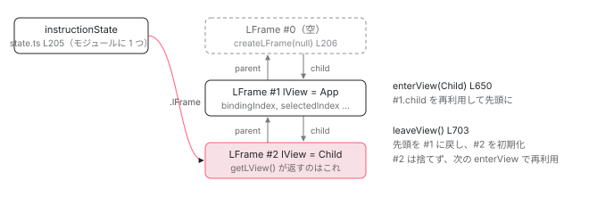

[目次](../README.md) › [Ivy ランタイム](README.md) › 第 15 回 / 全 17 回

# 命令が「今どこか」を知る方法：LFrame と instructionState

> ɵɵelementStart(0, 'h1') には lView が渡されない。enterView / leaveView がグローバルなスタックを積み、bindingIndex と selectedIndex を持ち回る。

angular/angular · 読了 約 11 分 · 発展 · [サイトで読む（デモが動きます）](https://angular-deep-dive-cyan.vercel.app/chapter/ivy-lframe)

---

`ɵɵelementStart(0, 'h1')` には `lView` が渡されていません。それなのにこの関数は、自分がどのコンポーネントのどのビューを組み立てているのかを知っています。この章では、その答えである `LFrame`（命令が参照する「今の状態」を 1 つにまとめたオブジェクト）と、それを束ねるモジュール変数 `instructionState` を読みます。`enterView` / `leaveView` がフレームを積んで降ろす手順、`bindingIndex` と `selectedIndex` という 2 つのカーソルがどう持ち回られるかを追います。

読む対象は `packages/core/src/render3/state.ts`（843 行）1 本と、それを呼ぶ `instructions/render.ts`、`instructions/change_detection.ts`、`instructions/shared.ts` の数行です。

1. 概観（配列だった）
2. Ivy とは
3. テンプレート関数と RenderFlags
4. TNode
5. TView
6. LView
7. blueprint と TData
8. firstCreatePass
9. DOM を組む命令
10. 値を更新する命令
11. LContainer
12. ビューの木
13. フック
14. ディレクティブ
15. **LFrame**（この章）
16. ViewRef 等
17. 破棄

## 1. 命令は引数ではなく getLView() で自分のビューを取る

📄 `angular/packages/core/src/render3/instructions/element.ts` L90–101 （▶ の行: 90–92, 96, 100）

```ts
 90 ▶ export function ɵɵelementStart(
 91 ▶   index: number,
 92 ▶   name: string,
 93 │   attrsIndex?: number | null,
 94 │   localRefsIndex?: number,
 95 │ ): typeof ɵɵelementStart {
 96 ▶   const lView = getLView();
 97 │ 
 98 │   ngDevMode && assertTNodeCreationIndex(lView, index);
 99 │ 
100 ▶   const tView = lView[TVIEW];
101 │   const adjustedIndex = index + HEADER_OFFSET;
```

📄 `angular/packages/core/src/render3/instructions/property.ts` L38–52 （▶ の行: 43–44, 46–47）

```ts
38 │ export function ɵɵproperty<T>(
39 │   propName: string,
40 │   value: T,
41 │   sanitizer?: SanitizerFn | null,
42 │ ): typeof ɵɵproperty {
43 ▶   const lView = getLView();
44 ▶   const bindingIndex = nextBindingIndex();
45 │   if (bindingUpdated(lView, bindingIndex, value)) {
46 ▶     const tView = getTView();
47 ▶     const tNode = getSelectedTNode();
48 │     setPropertyAndInputs(tNode, lView, propName, value, lView[RENDERER], sanitizer);
49 │     ngDevMode && storePropertyBindingMetadata(tView.data, tNode, propName, bindingIndex);
50 │   }
51 │   return ɵɵproperty;
52 │ }
```

90〜92 行目、`ɵɵelementStart` の引数は番号と要素名だけです。96 行目で `getLView()`、100 行目で `lView[TVIEW]`。`ɵɵproperty` も同じで、43 行目 `getLView()`、44 行目 `nextBindingIndex()`、46〜47 行目 `getTView()` と `getSelectedTNode()`。**命令は全部、引数以外の「どこか」から今の状態を読んでいます**。その「どこか」が `state.ts` です。

> [!TIP]
> **新卒エンジニアへ**
>
> コンパイラが出力するテンプレート関数は、呼び出しが数百〜数千並びます。毎回 `lView, tView` を引数で渡すとコードサイズが増え、呼び出しコストも増えます。だから「今処理中のビュー」を 1 か所に置き、命令側がそれを読む設計になっています。

## 2. LFrame：1 ビューぶんの作業状態

📄 `angular/packages/core/src/render3/state.ts` L40–69 （▶ の行: 46, 53, 61, 69）

```ts
40 │ interface LFrame {
41 │   /**
42 │    * Parent LFrame.
43 │    *
44 │    * This is needed when `leaveView` is called to restore the previous state.
45 │    */
46 ▶   parent: LFrame;
47 │ 
48 │   /**
49 │    * Child LFrame.
50 │    *
51 │    * This is used to cache existing LFrames to relieve the memory pressure.
52 │    */
53 ▶   child: LFrame | null;
54 │ 
55 │   /**
56 │    * State of the current view being processed.
57 │    *
58 │    * An array of nodes (text, element, container, etc), pipes, their bindings, and
59 │    * any local variables that need to be stored between invocations.
60 │    */
61 ▶   lView: LView;
62 │ 
63 │   /**
64 │    * Current `TView` associated with the `LFrame.lView`.
65 │    *
66 │    * One can get `TView` from `lFrame[TVIEW]` however because it is so common it makes sense to
67 │    * store it in `LFrame` for perf reasons.
68 │    */
69 ▶   tView: TView;
```

📄 `angular/packages/core/src/render3/state.ts` L71–95 （▶ の行: 76, 83, 90, 95）

```ts
71 │   /**
72 │    * Used to set the parent property when nodes are created and track query results.
73 │    *
74 │    * This is used in conjunction with `isParent`.
75 │    */
76 ▶   currentTNode: TNode | null;
77 │ 
78 │   /**
79 │    * If `isParent` is:
80 │    *  - `true`: then `currentTNode` points to a parent node.
81 │    *  - `false`: then `currentTNode` points to previous node (sibling).
82 │    */
83 ▶   isParent: boolean;
84 │ 
85 │   /**
86 │    * Index of currently selected element in LView.
87 │    *
88 │    * Used by binding instructions. Updated as part of advance instruction.
89 │    */
90 ▶   selectedIndex: number;
91 │ 
92 │   /**
93 │    * Current pointer to the binding index.
94 │    */
95 ▶   bindingIndex: number;
```

📄 `angular/packages/core/src/render3/state.ts` L118–136 （▶ の行: 123, 129, 136）

```ts
118 │   /**
119 │    * The root index from which pure function instructions should calculate their binding
120 │    * indices. In component views, this is TView.bindingStartIndex. In a host binding
121 │    * context, this is the TView.expandoStartIndex + any dirs/hostVars before the given dir.
122 │    */
123 ▶   bindingRootIndex: number;
124 │ 
125 │   /**
126 │    * Current index of a View or Content Query which needs to be processed next.
127 │    * We iterate over the list of Queries and increment current query index at every step.
128 │    */
129 ▶   currentQueryIndex: number;
130 │ 
131 │   /**
132 │    * When host binding is executing this points to the directive index.
133 │    * `TView.data[currentDirectiveIndex]` is `DirectiveDef`
134 │    * `LView[currentDirectiveIndex]` is directive instance.
135 │    */
136 ▶   currentDirectiveIndex: number;
```

1. **46 行目・53 行目：`parent` と `child`**

   `parent` は `leaveView` で戻る先。`child` は「前に使ったフレームの再利用」のためのキャッシュです。これで `LFrame` は双方向リストになり、スタックとして使われます。
2. **61 行目・69 行目：`lView` と `tView`**

   今処理中のビューと設計図。69 行目のコメントどおり `lView[TVIEW]` で取れますが、頻繫に使うので別に持ちます。
3. **76 行目・83 行目：`currentTNode` と `isParent`**

   作成モードで「最後に作ったノード」。`isParent` が `true` なら次に作るノードはその子、`false` なら兄弟です。`ɵɵelementStart` が `true` に、`ɵɵelementEnd` が `false` にします（[DOM を組む命令の章](09-ivy-create-instructions.md)）。
4. **90 行目：`selectedIndex`**

   更新モードで「今どの要素に束縛しているか」。`ɵɵadvance` が進めます（6 節）。
5. **95 行目：`bindingIndex`**

   「次の束縛の値を `LView` のどこに置くか」。[更新命令の章](10-ivy-update-instructions.md)で見た `nextBindingIndex()` がこれを進めます。
6. **123 行目・136 行目：`bindingRootIndex` と `currentDirectiveIndex`**

   ホストバインディング（`host: { '[class.x]': ... }`）を実行するときに使います。ホストバインディングの束縛値は VARS 区画ではなく EXPANDO 区画のディレクティブの直後に置かれるので、起点をずらす必要があるからです （[ディレクティブの章](14-ivy-directives.md)）。

## 3. instructionState：モジュールに 1 つだけ

📄 `angular/packages/core/src/render3/state.ts` L155–171 （▶ の行: 158–159, 161–162, 170）

```ts
155 │ /**
156 │  * All implicit instruction state is stored here.
157 │  *
158 ▶  * It is useful to have a single object where all of the state is stored as a mental model
159 ▶  * (rather it being spread across many different variables.)
160 │  *
161 ▶  * PERF NOTE: Turns out that writing to a true global variable is slower than
162 ▶  * having an intermediate object with properties.
163 │  */
164 │ interface InstructionState {
165 │   /**
166 │    * Current `LFrame`
167 │    *
168 │    * `null` if we have not called `enterView`
169 │    */
170 ▶   lFrame: LFrame;
171 │ 
```

📄 `angular/packages/core/src/render3/state.ts` L205–209 （▶ の行: 205–206）

```ts
205 ▶ const instructionState: InstructionState = {
206 ▶   lFrame: createLFrame(null),
207 │   bindingsEnabled: true,
208 │   skipHydrationRootTNode: null,
209 │ };
```

205〜206 行目、`instructionState` はモジュールスコープの `const` で、`lFrame` に最初の空フレームを持ちます。**アプリ全体でこの 1 個**です。158〜162 行目のコメント：「状態を 1 つのオブジェクトに集めるのは、心のモデルとして分かりやすいから。そして実測では、素のグローバル変数に書くより中間オブジェクトのプロパティに書くほうが速い」。170 行目、`lFrame` が今のフレーム。`bindingsEnabled` は `ngNonBindable` 用のフラグです。

## 4. getLView / getTView / getCurrentTNode は 1 行

📄 `angular/packages/core/src/render3/state.ts` L337–349 （▶ の行: 341, 348）

```ts
337 │ /**
338 │  * Return the current `LView`.
339 │  */
340 │ export function getLView<T>(): LView<T> {
341 ▶   return instructionState.lFrame.lView as LView<T>;
342 │ }
343 │ 
344 │ /**
345 │  * Return the current `TView`.
346 │  */
347 │ export function getTView(): TView {
348 ▶   return instructionState.lFrame.tView;
349 │ }
```

📄 `angular/packages/core/src/render3/state.ts` L379–402 （▶ の行: 380–382, 388, 400–401）

```ts
379 │ export function getCurrentTNode(): TNode | null {
380 ▶   let currentTNode = getCurrentTNodePlaceholderOk();
381 ▶   while (currentTNode !== null && currentTNode.type === TNodeType.Placeholder) {
382 ▶     currentTNode = currentTNode.parent;
383 │   }
384 │   return currentTNode;
385 │ }
386 │ 
387 │ export function getCurrentTNodePlaceholderOk(): TNode | null {
388 ▶   return instructionState.lFrame.currentTNode;
389 │ }
390 │ 
391 │ export function getCurrentParentTNode(): TNode | null {
392 │   const lFrame = instructionState.lFrame;
393 │   const currentTNode = lFrame.currentTNode;
394 │   return lFrame.isParent ? currentTNode : currentTNode!.parent;
395 │ }
396 │ 
397 │ export function setCurrentTNode(tNode: TNode | null, isParent: boolean) {
398 │   ngDevMode && tNode && assertTNodeForTView(tNode, instructionState.lFrame.tView);
399 │   const lFrame = instructionState.lFrame;
400 ▶   lFrame.currentTNode = tNode;
401 ▶   lFrame.isParent = isParent;
402 │ }
```

341 行目、`getLView()` は `instructionState.lFrame.lView` を返すだけ。348 行目も同じです。380〜388 行目、`getCurrentTNode()` は `lFrame.currentTNode` ですが、i18n のプレースホルダは飛ばして親を返します。400〜401 行目、`setCurrentTNode` が `isParent` も同時に更新します。`inject(ElementRef)` がコンストラクタで動くのは、この `currentTNode` が「今作っている要素」を指しているからです （[ViewRef 等の章](16-ivy-refs.md)）。

📄 `angular/packages/core/src/render3/state.ts` L453–470 （▶ の行: 454, 458, 462, 468）

```ts
453 │ export function getBindingIndex(): number {
454 ▶   return instructionState.lFrame.bindingIndex;
455 │ }
456 │ 
457 │ export function setBindingIndex(value: number): number {
458 ▶   return (instructionState.lFrame.bindingIndex = value);
459 │ }
460 │ 
461 │ export function nextBindingIndex(): number {
462 ▶   return instructionState.lFrame.bindingIndex++;
463 │ }
464 │ 
465 │ export function incrementBindingIndex(count: number): number {
466 │   const lFrame = instructionState.lFrame;
467 │   const index = lFrame.bindingIndex;
468 ▶   lFrame.bindingIndex = lFrame.bindingIndex + count;
469 │   return index;
470 │ }
```

📄 `angular/packages/core/src/render3/state.ts` L753–785 （▶ の行: 754, 769, 773, 776, 784）

```ts
753 │ export function getSelectedIndex() {
754 ▶   return instructionState.lFrame.selectedIndex;
755 │ }
756 │ 
757 │ /**
758 │  * Sets the most recent index passed to {@link select}
759 │  *
760 │  * Used with {@link property} instruction (and more in the future) to identify the index in the
761 │  * current `LView` to act on.
762 │  *
763 │  * (Note that if an "exit function" was set earlier (via `setElementExitFn()`) then that will be
764 │  * run if and when the provided `index` value is different from the current selected index value.)
765 │  */
766 │ export function setSelectedIndex(index: number) {
767 │   ngDevMode &&
768 │     index !== -1 &&
769 ▶     assertGreaterThanOrEqual(index, HEADER_OFFSET, 'Index must be past HEADER_OFFSET (or -1).');
770 │   ngDevMode &&
771 │     assertLessThan(
772 │       index,
773 ▶       instructionState.lFrame.lView.length,
774 │       "Can't set index passed end of LView",
775 │     );
776 ▶   instructionState.lFrame.selectedIndex = index;
777 │ }
778 │ 
779 │ /**
780 │  * Gets the `tNode` that represents currently selected element.
781 │  */
782 │ export function getSelectedTNode() {
783 │   const lFrame = instructionState.lFrame;
784 ▶   return getTNode(lFrame.tView, lFrame.selectedIndex);
785 │ }
```

454 / 458 / 462 / 468 行目、`bindingIndex` の読み・書き・後置インクリメント・加算。全部 `lFrame` のプロパティ操作です。754 / 776 行目、`selectedIndex` も同様。769〜773 行目の assert が「`HEADER_OFFSET` 以上、`lView.length` 未満」を確かめています。784 行目、`getSelectedTNode()` は `tView.data[selectedIndex]` です。`ɵɵproperty` が「どの要素の」プロパティかを知るのは、この 1 行です。

## 5. enterView / leaveView：フレームを積んで降ろす

📄 `angular/packages/core/src/render3/state.ts` L634–658 （▶ の行: 637, 649–650, 652–656）

```ts
634 │ export function enterView(newView: LView): void {
635 │   ngDevMode && assertNotEqual(newView[0], newView[1] as any, '????');
636 │   ngDevMode && assertLViewOrUndefined(newView);
637 ▶   const newLFrame = allocLFrame();
638 │   if (ngDevMode) {
639 │     assertEqual(newLFrame.isParent, true, 'Expected clean LFrame');
640 │     assertEqual(newLFrame.lView, null, 'Expected clean LFrame');
641 │     assertEqual(newLFrame.tView, null, 'Expected clean LFrame');
642 │     assertEqual(newLFrame.selectedIndex, -1, 'Expected clean LFrame');
643 │     assertEqual(newLFrame.elementDepthCount, 0, 'Expected clean LFrame');
644 │     assertEqual(newLFrame.currentDirectiveIndex, -1, 'Expected clean LFrame');
645 │     assertEqual(newLFrame.currentNamespace, null, 'Expected clean LFrame');
646 │     assertEqual(newLFrame.bindingRootIndex, -1, 'Expected clean LFrame');
647 │     assertEqual(newLFrame.currentQueryIndex, 0, 'Expected clean LFrame');
648 │   }
649 ▶   const tView = newView[TVIEW];
650 ▶   instructionState.lFrame = newLFrame;
651 │   ngDevMode && tView.firstChild && assertTNodeForTView(tView.firstChild, tView);
652 ▶   newLFrame.currentTNode = tView.firstChild!;
653 ▶   newLFrame.lView = newView;
654 ▶   newLFrame.tView = tView;
655 ▶   newLFrame.contextLView = newView;
656 ▶   newLFrame.bindingIndex = tView.bindingStartIndex;
657 │   newLFrame.inI18n = false;
658 │ }
```

1. **637 行目：フレームを確保**

   `allocLFrame()`。次の引用で読みます。新品か、再利用かのどちらかです。
2. **650 行目：`instructionState.lFrame` を差し替える**

   この行以降、`getLView()` は新しいビューを返します。
3. **652〜656 行目：フレームを埋める**

   `currentTNode` は `tView.firstChild`、`lView`・`tView`・`contextLView`、そして 656 行目、**`bindingIndex = tView.bindingStartIndex`**。VARS 区画の先頭です。ビューに入るたびに束縛カーソルは先頭に戻ります。

📄 `angular/packages/core/src/render3/state.ts` L663–690 （▶ の行: 664–666, 676, 682, 684, 688）

```ts
663 │ function allocLFrame() {
664 ▶   const currentLFrame = instructionState.lFrame;
665 ▶   const childLFrame = currentLFrame === null ? null : currentLFrame.child;
666 ▶   const newLFrame = childLFrame === null ? createLFrame(currentLFrame) : childLFrame;
667 │   return newLFrame;
668 │ }
669 │ 
670 │ function createLFrame(parent: LFrame | null): LFrame {
671 │   const lFrame: LFrame = {
672 │     currentTNode: null,
673 │     isParent: true,
674 │     lView: null!,
675 │     tView: null!,
676 ▶     selectedIndex: -1,
677 │     contextLView: null,
678 │     elementDepthCount: 0,
679 │     currentNamespace: null,
680 │     currentDirectiveIndex: -1,
681 │     bindingRootIndex: -1,
682 ▶     bindingIndex: -1,
683 │     currentQueryIndex: 0,
684 ▶     parent: parent!,
685 │     child: null,
686 │     inI18n: false,
687 │   };
688 ▶   parent !== null && (parent.child = lFrame); // link the new LFrame for reuse.
689 │   return lFrame;
690 │ }
```

664〜666 行目、今のフレームに `child` があればそれを再利用、なければ `createLFrame(今のフレーム)`。688 行目、新しいフレームは親の `child` に繋がれます。**一度ネストした深さまでフレームが作られたら、以降はオブジェクトを新規確保しません**。676 / 682 / 684 行目、初期値は `selectedIndex = -1`、`bindingIndex = -1`、`parent` は呼び出し元のフレームです。

📄 `angular/packages/core/src/render3/state.ts` L701–737 （▶ の行: 702–705, 726–729, 735）

```ts
701 │ function leaveViewLight(): LFrame {
702 ▶   const oldLFrame = instructionState.lFrame;
703 ▶   instructionState.lFrame = oldLFrame.parent;
704 ▶   oldLFrame.currentTNode = null!;
705 ▶   oldLFrame.lView = null!;
706 │   return oldLFrame;
707 │ }
708 │ 
709 │ /**
710 │  * This is a lightweight version of the `leaveView` which is needed by the DI system.
711 │  *
712 │  * NOTE: this function is an alias so that we can change the type of the function to have `void`
713 │  * return type.
714 │  */
715 │ export const leaveDI: () => void = leaveViewLight;
716 │ 
717 │ /**
718 │  * Leave the current `LView`
719 │  *
720 │  * This pops the `LFrame` with the associated `LView` from the stack.
721 │  *
722 │  * IMPORTANT: We must zero out the `LFrame` values here otherwise they will be retained. This is
723 │  * because for performance reasons we don't release `LFrame` but rather keep it for next use.
724 │  */
725 │ export function leaveView() {
726 ▶   const oldLFrame = leaveViewLight();
727 ▶   oldLFrame.isParent = true;
728 ▶   oldLFrame.tView = null!;
729 ▶   oldLFrame.selectedIndex = -1;
730 │   oldLFrame.contextLView = null;
731 │   oldLFrame.elementDepthCount = 0;
732 │   oldLFrame.currentDirectiveIndex = -1;
733 │   oldLFrame.currentNamespace = null;
734 │   oldLFrame.bindingRootIndex = -1;
735 ▶   oldLFrame.bindingIndex = -1;
736 │   oldLFrame.currentQueryIndex = 0;
737 │ }
```

702〜705 行目、`leaveViewLight` は `instructionState.lFrame` を `parent` に戻し、`currentTNode` と `lView` を `null` にします。DI（`enterDI` / `leaveDI`）が使う軽量版です。726〜736 行目、`leaveView` はそれに加えて残りのプロパティも初期値に戻します。コメントどおり、**フレームは解放せず再利用するので、値を残すとメモリリークと誤動作の原因になる**からです。735 行目、`bindingIndex` も `-1` に。



*instructionState.lFrame は常にスタックの先頭を指す。enterView で child を再利用（無ければ作成）して先頭を進め、leaveView で parent に戻してフレームの中身を初期化する。*

## 6. 誰が enterView を呼ぶか：renderView と refreshView

📄 `angular/packages/core/src/render3/instructions/render.ts` L93–108 （▶ の行: 96, 107）

```ts
 93 │ export function renderView<T>(tView: TView, lView: LView<T>, context: T): void {
 94 │   ngDevMode && assertEqual(isCreationMode(lView), true, 'Should be run in creation mode');
 95 │   ngDevMode && assertNotReactive(renderView.name);
 96 ▶   enterView(lView);
 97 │   try {
 98 │     const viewQuery = tView.viewQuery;
 99 │     if (viewQuery !== null) {
100 │       executeViewQueryFn<T>(RenderFlags.Create, viewQuery, context);
101 │     }
102 │ 
103 │     // Execute a template associated with this view, if it exists. A template function might not be
104 │     // defined for the root component views.
105 │     const templateFn = tView.template;
106 │     if (templateFn !== null) {
107 ▶       executeTemplate<T>(tView, lView, templateFn, RenderFlags.Create, context);
108 │     }
```

📄 `angular/packages/core/src/render3/instructions/render.ts` L151–155 （▶ の行: 153）

```ts
151 │   } finally {
152 │     lView[FLAGS] &= ~LViewFlags.CreationMode;
153 ▶     leaveView();
154 │   }
155 │ }
```

作成モードは `renderView`。96 行目で `enterView(lView)`、107 行目でテンプレート関数を `RenderFlags.Create` で実行、153 行目の `finally` で `leaveView()`。例外が出てもフレームは必ず降ろされます。

📄 `angular/packages/core/src/render3/instructions/change_detection.ts` L207–210 （▶ の行: 210）

```ts
207 │   // Start component reactive context
208 │   // - We might already be in a reactive context if this is an embedded view of the host.
209 │   // - We might be descending into a view that needs a consumer.
210 ▶   enterView(lView);
```

📄 `angular/packages/core/src/render3/instructions/change_detection.ts` L237–243 （▶ の行: 240, 242）

```ts
237 │   try {
238 │     resetPreOrderHookFlags(lView);
239 │ 
240 ▶     setBindingIndex(tView.bindingStartIndex);
241 │     if (templateFn !== null) {
242 ▶       executeTemplate(tView, lView, templateFn, RenderFlags.Update, context);
243 │     }
```

📄 `angular/packages/core/src/render3/instructions/change_detection.ts` L408–416 （▶ の行: 415）

```ts
408 │   } finally {
409 │     if (currentConsumer !== null) {
410 │       consumerAfterComputation(currentConsumer, prevConsumer);
411 │       if (returnConsumerToPool) {
412 │         maybeReturnReactiveLViewConsumer(currentConsumer);
413 │       }
414 │     }
415 ▶     leaveView();
416 │   }
```

更新モードは `refreshView`。210 行目で `enterView`、240 行目で改めて `setBindingIndex(tView.bindingStartIndex)` （`enterView` の 656 行目と同じ値ですが、フックやクエリの処理を挟むので明示的に戻しています）、242 行目で `RenderFlags.Update` で実行、415 行目の `finally` で `leaveView`。子コンポーネントの refresh は `refreshView` の中から再帰的に呼ばれるので、そのたびに `enterView` が 1 段積みます。[テンプレート関数の章](03-ivy-template-function.md)で見た「同じ関数を 2 回呼ぶ」の、2 回とも `enterView` で始まります。

## 7. selectedIndex の持ち回り：executeTemplate と ɵɵadvance

📄 `angular/packages/core/src/render3/instructions/shared.ts` L86–115 （▶ の行: 93, 96–97, 100, 107, 109）

```ts
 86 │ export function executeTemplate<T>(
 87 │   tView: TView,
 88 │   lView: LView<T>,
 89 │   templateFn: ComponentTemplate<T>,
 90 │   rf: RenderFlags,
 91 │   context: T,
 92 │ ) {
 93 ▶   const prevSelectedIndex = getSelectedIndex();
 94 │   const isUpdatePhase = rf & RenderFlags.Update;
 95 │   try {
 96 ▶     setSelectedIndex(-1);
 97 ▶     if (isUpdatePhase && lView.length > HEADER_OFFSET) {
 98 │       // When we're updating, inherently select 0 so we don't
 99 │       // have to generate that instruction for most update blocks.
100 ▶       selectIndexInternal(tView, lView, HEADER_OFFSET, !!ngDevMode && isInCheckNoChangesMode());
101 │     }
102 │ 
103 │     const preHookType = isUpdatePhase
104 │       ? ProfilerEvent.TemplateUpdateStart
105 │       : ProfilerEvent.TemplateCreateStart;
106 │     profiler(preHookType, context as unknown as {}, templateFn);
107 ▶     templateFn(rf, context);
108 │   } finally {
109 ▶     setSelectedIndex(prevSelectedIndex);
110 │ 
111 │     const postHookType = isUpdatePhase
112 │       ? ProfilerEvent.TemplateUpdateEnd
113 │       : ProfilerEvent.TemplateCreateEnd;
114 │     profiler(postHookType, context as unknown as {}, templateFn);
115 │   }
```

93 行目で呼び出し前の `selectedIndex` を保存し、96 行目で `-1` にリセット。97〜100 行目、更新モードなら `HEADER_OFFSET`（28 番、最初の要素）を暗黙に選びます。「更新ブロックの先頭に `ɵɵadvance(0)` を出力しなくてよい」ためです。107 行目でテンプレート関数、109 行目の `finally` で元の値に戻します。埋め込みビューのテンプレート関数が親のテンプレート関数の途中で実行されても、親の `selectedIndex` が壊れません。

📄 `angular/packages/core/src/render3/instructions/advance.ts` L43–51 （▶ の行: 45, 48）

```ts
43 │ export function ɵɵadvance(delta: number = 1): void {
44 │   ngDevMode && assertGreaterThan(delta, 0, 'Can only advance forward');
45 ▶   selectIndexInternal(
46 │     getTView(),
47 │     getLView(),
48 ▶     getSelectedIndex() + delta,
49 │     !!ngDevMode && isInCheckNoChangesMode(),
50 │   );
51 │ }
```

📄 `angular/packages/core/src/render3/instructions/advance.ts` L79–84 （▶ の行: 83）

```ts
79 │   // We must set the selected index *after* running the hooks, because hooks may have side-effects
80 │   // that cause other template functions to run, thus updating the selected index, which is global
81 │   // state. If we run `setSelectedIndex` *before* we run the hooks, in some cases the selected index
82 │   // will be altered by the time we leave the `ɵɵadvance` instruction.
83 ▶   setSelectedIndex(index);
84 │ }
```

48 行目、`getSelectedIndex() + delta` で次の番号を計算し、45 行目の `selectIndexInternal` に渡します。その中で[前のノードぶんの pre-order フック](13-ivy-hooks.md)を実行してから、83 行目で `setSelectedIndex(index)`。79〜82 行目のコメントが順序の理由です：フックの中で別のテンプレート関数が走って `selectedIndex` が書き換わる可能性があるので、**フックの後に**セットします。グローバル状態を持つ設計の、典型的な注意点です。

📄 `angular/packages/core/src/render3/state.ts` L739–745 （▶ の行: 740, 744）

```ts
739 │ export function nextContextImpl<T = any>(level: number): T {
740 ▶   const contextLView = (instructionState.lFrame.contextLView = walkUpViews(
741 │     level,
742 │     instructionState.lFrame.contextLView!,
743 │   ));
744 ▶   return contextLView[CONTEXT] as unknown as T;
745 │ }
```

もう 1 つ、`contextLView`。740 行目、`ɵɵnextContext()` は `lFrame.contextLView` から `DECLARATION_VIEW` を辿って （[ビューの木の章](12-ivy-view-tree.md)）外側のビューを `contextLView` に入れ、744 行目でその `CONTEXT` を返します。埋め込みテンプレートの中で `ctx_r0.name` のように外側の `this` を参照するコードは、この経路で値を得ています。これも `LFrame` に置かれた一時状態で、`enterView` 655 行目で自分自身にリセットされます。

> **🧪 DEMO — enterView / leaveView でスタックがどう動くか**
>
> App → Child → GrandChild と refreshView が再帰する様子です。instructionState.lFrame は常に先頭を指し、bindingIndex は enterView のたびに bindingStartIndex に戻ります。
>
> ▶ [このデモはサイトで動かせます](https://angular-deep-dive-cyan.vercel.app/chapter/ivy-lframe)

## ここまでの呼び出し

- `refreshView(tView, lView, templateFn, ctx)` — instructions/change\_detection.ts
  - `enterView(lView)` — state.ts L634 — *allocLFrame → instructionState.lFrame = 新フレーム。bindingIndex = bindingStartIndex*
  - `setBindingIndex(tView.bindingStartIndex)` — state.ts L457
  - `executeTemplate(tView, lView, templateFn, Update, ctx)` — instructions/shared.ts L86 — *selectedIndex を保存 → -1 → HEADER\_OFFSET*
    - 👤 `templateFn(2, ctx)` — ɵcmp.template
      - `ɵɵproperty("title", ctx.name)` — instructions/property.ts L38 — *getLView() / nextBindingIndex() / getSelectedTNode() はすべて lFrame を読む*
      - `ɵɵadvance(2)` — instructions/advance.ts L43 — *フック実行後に setSelectedIndex*
    - `finally: setSelectedIndex(prevSelectedIndex)` — shared.ts L109
  - `detectChangesInChildComponents(...)` → 子の `refreshView` — change\_detection.ts — *子で enterView がもう 1 段積む（child を再利用）*
  - `finally: leaveView()` — state.ts L725 — *instructionState.lFrame = parent。降ろしたフレームは初期化して保持*

## 聞かれそうな質問

**Q. ɵɵelementStart(0, 'h1') は lView を受け取らないのに、どうやって自分のビューを知るのですか？**

element.ts 96 行目の `getLView()` です。中身は state.ts 341 行目、`instructionState.lFrame.lView` を返すだけ。`instructionState` はモジュールに 1 つの定数（205 行目）で、`renderView`（render.ts 96 行目）や `refreshView`（change\_detection.ts 210 行目）が テンプレート関数を呼ぶ直前に `enterView(lView)`（state.ts 650〜653 行目）で `lFrame.lView` をそのビューに差し替えています。テンプレート関数の実行中、命令はこの値を読みます。

**Q. 子コンポーネントのテンプレートが走っている間、親の状態はどこにありますか？**

1 つ下のフレームです。子の `refreshView` が `enterView` を呼ぶと、`allocLFrame`（state.ts 664〜666 行目）が 今のフレームの `child` を取って（無ければ作って）`instructionState.lFrame` にします。親のフレームは新フレームの `parent`（684 行目）として残り、`leaveView`（703 行目）で戻ります。スタックです。

**Q. bindingIndex は LView に保存されないのですか？**

されません。`LFrame.bindingIndex`（state.ts 95 行目）にだけあり、`enterView` 656 行目で `tView.bindingStartIndex` に戻され、`leaveView` 735 行目で `-1` に戻されます。テンプレート関数の実行中にしか意味を持たない一時カーソルで、同じ順序で命令が呼ばれる限り毎回同じ番号列になるので、保存する必要がありません。

**Q. LFrame は enterView のたびに new されますか？**

最初の 1 回だけです。`createLFrame`（state.ts 688 行目）が親の `child` に新フレームを繋ぎ、次に同じ深さに入るとき `allocLFrame`（665〜666 行目）がそれを再利用します。だから `leaveView`（727〜736 行目）が全プロパティを初期値に戻しています。戻さないと前のビューの `lView` が参照され続けます。

**Q. ɵɵadvance はなぜフックを呼んでから selectedIndex を更新するのですか？**

advance.ts 79〜82 行目のコメントどおり、フック（`ngOnInit` など）の中で別のテンプレート関数が走ると `selectedIndex` がグローバルに書き換わるからです。先にセットすると、フックから戻ったときに別の値になっている可能性があります。83 行目で最後にセットします。`executeTemplate`（shared.ts 93 / 109 行目）が前後で保存・復元しているのも同じ理由です。

## 読み終えて

- 命令は引数で `lView` を受け取らず、`instructionState.lFrame`（モジュールに 1 つ）から `getLView()` / `getTView()` で読む
- `LFrame` は `lView` / `tView` / `currentTNode` / `selectedIndex` / `bindingIndex` などの作業状態を 1 ビューぶんまとめたもの
- `enterView` が `child` を再利用してフレームを積み、`bindingIndex` を `bindingStartIndex` に戻す。`leaveView` が `parent` に戻して中身を初期化する
- `renderView` と `refreshView` が `enterView` 〜 `leaveView` で囲み、`executeTemplate` と `ɵɵadvance` が `selectedIndex` を進める

---

← 前: [ディレクティブのインスタンス化と EXPANDO](14-ivy-directives.md)  
次: [ViewRef / ComponentRef / ElementRef は配列への窓](16-ivy-refs.md) →
