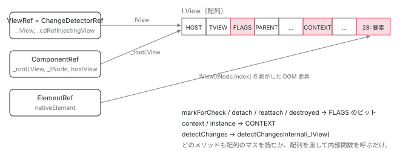

[目次](../README.md) › [Ivy ランタイム](README.md) › 第 16 回 / 全 17 回

# ViewRef / ComponentRef / ElementRef は配列への窓

> ViewRef は \_lView を 1 本持つだけ。detectChanges は detectChangesInternal、markForCheck は markViewDirty を呼ぶ。公開 API が内部配列にどう対応するか。

angular/angular · 読了 約 11 分 · 中核 · [サイトで読む（デモが動きます）](https://angular-deep-dive-cyan.vercel.app/chapter/ivy-refs)

---

`ChangeDetectorRef`、`ViewRef`、`ComponentRef`、`ElementRef`。公開 API として触るこれらのクラスは、中では**配列（`LView`）への参照を 1 本持っているだけ**です。この章では `ViewRef` のフィールドが `_lView` だけであることを確認し、`markForCheck()` → `markViewDirty`、`detectChanges()` → `detectChangesInternal`、`detach()` → `FLAGS` のビット操作、というメソッドと内部関数の対応を 1 つずつ見ます。最後に `ApplicationRef.tick()` との違いを、呼ばれる関数の違いとして示します。

読む対象は `packages/core/src/render3/view_ref.ts`、`render3/component_ref.ts`、`change_detection/change_detector_ref.ts`、`linker/element_ref.ts` です。

1. 概観（配列だった）
2. Ivy とは
3. テンプレート関数と RenderFlags
4. TNode
5. TView
6. LView
7. blueprint と TData
8. firstCreatePass
9. DOM を組む命令
10. 値を更新する命令
11. LContainer
12. ビューの木
13. フック
14. ディレクティブ
15. LFrame
16. **ViewRef 等**（この章）
17. 破棄

## 1. ViewRef のフィールドは \_lView と \_cdRefInjectingView

📄 `angular/packages/core/src/render3/view_ref.ts` L45–78 （▶ の行: 45–47, 68, 76）

```ts
45 ▶ export class ViewRef<T> implements EmbeddedViewRef<T>, ChangeDetectorRef {
46 ▶   private _appRef: ApplicationRef | null = null;
47 ▶   private _attachedToViewContainer = false;
48 │   private exhaustive?: boolean;
49 │ 
50 │   get rootNodes(): any[] {
51 │     const lView = this._lView;
52 │     const tView = lView[TVIEW];
53 │     return collectNativeNodes(tView, lView, tView.firstChild, []);
54 │   }
55 │ 
56 │   constructor(
57 │     /**
58 │      * This represents `LView` associated with the component when ViewRef is a ChangeDetectorRef.
59 │      *
60 │      * When ViewRef is created for a dynamic component, this also represents the `LView` for the
61 │      * component.
62 │      *
63 │      * For a "regular" ViewRef created for an embedded view, this is the `LView` for the embedded
64 │      * view.
65 │      *
66 │      * @internal
67 │      */
68 ▶     public _lView: LView,
69 │ 
70 │     /**
71 │      * This represents the `LView` associated with the point where `ChangeDetectorRef` was
72 │      * requested.
73 │      *
74 │      * This may be different from `_lView` if the `_cdRefInjectingView` is an embedded view.
75 │      */
76 ▶     private _cdRefInjectingView?: LView,
77 │   ) {}
78 │ 
```

45 行目、`ViewRef` は `EmbeddedViewRef` と `ChangeDetectorRef` の両方を実装しています。コンストラクタで受けるのは 68 行目の `_lView` と 76 行目の `_cdRefInjectingView` の 2 つ。46〜47 行目の `_appRef` と `_attachedToViewContainer` は「どこに繋がれているか」の印です。**状態らしい状態はこれだけ**で、ビューの中身はすべて `_lView` という配列の中にあります。

📄 `angular/packages/core/src/render3/view_ref.ts` L79–82 （▶ の行: 80）

```ts
79 │   get context(): T {
80 ▶     return this._lView[CONTEXT] as unknown as T;
81 │   }
82 │ 
```

📄 `angular/packages/core/src/render3/view_ref.ts` L100–102 （▶ の行: 101）

```ts
100 │   get destroyed(): boolean {
101 ▶     return isDestroyed(this._lView);
102 │   }
```

80 行目、`context` は `_lView[CONTEXT]`（8 番、[概観の章](01-component.md)）。101 行目、`destroyed` は `_lView[FLAGS]` の `Destroyed` ビット。どのプロパティも配列の 1 マスを読んでいるだけです。

## 2. inject(ChangeDetectorRef) が返すもの

📄 `angular/packages/core/src/change_detection/change_detector_ref.ts` L121–154 （▶ の行: 122, 124–125, 139, 142–143, 150–151）

```ts
121 │ /** Returns a ChangeDetectorRef (a.k.a. a ViewRef) */
122 ▶ export function injectChangeDetectorRef(flags: InternalInjectFlags): ChangeDetectorRef {
123 │   return createViewRef(
124 ▶     getCurrentTNode()!,
125 ▶     getLView(),
126 │     (flags & InternalInjectFlags.ForPipe) === InternalInjectFlags.ForPipe,
127 │   );
128 │ }
129 │ 
130 │ /**
131 │  * Creates a ViewRef and stores it on the injector as ChangeDetectorRef (public alias).
132 │  *
133 │  * @param tNode The node that is requesting a ChangeDetectorRef
134 │  * @param lView The view to which the node belongs
135 │  * @param isPipe Whether the view is being injected into a pipe.
136 │  * @returns The ChangeDetectorRef to use
137 │  */
138 │ function createViewRef(tNode: TNode, lView: LView, isPipe: boolean): ChangeDetectorRef {
139 ▶   if (isComponentHost(tNode) && !isPipe) {
140 │     // The LView represents the location where the component is declared.
141 │     // Instead we want the LView for the component View and so we need to look it up.
142 ▶     const componentView = getComponentLViewByIndex(tNode.index, lView); // look down
143 ▶     return new ViewRef(componentView, componentView);
144 │   } else if (
145 │     tNode.type &
146 │     (TNodeType.AnyRNode | TNodeType.AnyContainer | TNodeType.Icu | TNodeType.LetDeclaration)
147 │   ) {
148 │     // The LView represents the location where the injection is requested from.
149 │     // We need to locate the containing LView (in case where the `lView` is an embedded view)
150 ▶     const hostComponentView = lView[DECLARATION_COMPONENT_VIEW]; // look up
151 ▶     return new ViewRef(hostComponentView, lView);
152 │   }
153 │   return null!;
154 │ }
```

122〜125 行目、`ChangeDetectorRef` を inject すると `getCurrentTNode()` と `getLView()` （[LFrame の章](15-ivy-lframe.md)）から `createViewRef` が呼ばれます。139〜143 行目、**コンポーネントのコンストラクタで inject した場合**：`tNode` はそのコンポーネントのホスト要素なので、142 行目で「下を見て」コンポーネントビューを取り、`new ViewRef(componentView, componentView)`。150〜151 行目、**ディレクティブで inject した場合**：`lView` はディレクティブが置かれているビューなので、「上を見て」その `DECLARATION_COMPONENT_VIEW`（[ビューの木の章](12-ivy-view-tree.md)）を `_lView` に、inject した場所のビューを `_cdRefInjectingView` にします。`ChangeDetectorRef` は別クラスではなく、`ViewRef` そのものです。

## 3. markForCheck と detach / reattach：FLAGS を触るだけ

📄 `angular/packages/core/src/render3/view_ref.ts` L162–164 （▶ の行: 163）

```ts
162 │   markForCheck(): void {
163 ▶     markViewDirty(this._cdRefInjectingView || this._lView, NotificationSource.MarkForCheck);
164 │   }
```

📄 `angular/packages/core/src/render3/instructions/mark_view_dirty.ts` L26–51 （▶ の行: 26–27, 33, 39–43, 45, 49）

```ts
26 ▶ export function markViewDirty(lView: LView, source: NotificationSource): LView | null {
27 ▶   const dirtyBitsToUse = isRefreshingViews()
28 │     ? // When we are actively refreshing views, we only use the `Dirty` bit to mark a view
29 │       // for check. This bit is ignored in ChangeDetectionMode.Targeted, which is used to
30 │       // synchronously rerun change detection on a specific set of views (those which have
31 │       // the `RefreshView` flag and those with dirty signal consumers). `LViewFlags.Dirty`
32 │       // does not support re-entrant change detection on its own.
33 ▶       LViewFlags.Dirty
34 │     : // When we are not actively refreshing a view tree, it is absolutely
35 │       // valid to update state and mark views dirty. We use the `RefreshView` flag in this
36 │       // case to allow synchronously rerunning change detection. This applies today to
37 │       // afterRender hooks as well as animation listeners which execute after detecting
38 │       // changes in a view when the render factory flushes.
39 ▶       LViewFlags.RefreshView | LViewFlags.Dirty;
40 ▶   lView[ENVIRONMENT].changeDetectionScheduler?.notify(source);
41 ▶   while (lView) {
42 ▶     lView[FLAGS] |= dirtyBitsToUse;
43 ▶     const parent = getLViewParent(lView);
44 │     // Stop traversing up as soon as you find a root view that wasn't attached to any container
45 ▶     if (isRootView(lView) && !parent) {
46 │       return lView;
47 │     }
48 │     // continue otherwise
49 ▶     lView = parent!;
50 │   }
51 │   return null;
```

163 行目、`markForCheck()` は `markViewDirty(_cdRefInjectingView || _lView, MarkForCheck)`。埋め込みビュー内のディレクティブから呼ばれた場合は、inject した場所（埋め込みビュー）から登り始めます。27〜39 行目、立てるビットは変更検知中なら `Dirty` だけ、そうでなければ `RefreshView | Dirty`。40 行目で `ChangeDetectionScheduler.notify`（[zoneless の notify の章](../zoneless/03-zoneless-notify.md)）、41〜49 行目で `getLViewParent` を使って**ルートまで全部に**ビットを立てます。OnPush のコンポーネントが次の tick で検査されるのは、自分と祖先の `FLAGS` にこのビットが立つからです （[markForCheck の章](../cd/04-cd-onpush-markforcheck.md)）。

📄 `angular/packages/core/src/render3/view_ref.ts` L221–223 （▶ の行: 222）

```ts
221 │   detach(): void {
222 ▶     this._lView[FLAGS] &= ~LViewFlags.Attached;
223 │   }
```

📄 `angular/packages/core/src/render3/view_ref.ts` L281–284 （▶ の行: 282–283）

```ts
281 │   reattach(): void {
282 ▶     updateAncestorTraversalFlagsOnAttach(this._lView);
283 ▶     this._lView[FLAGS] |= LViewFlags.Attached;
284 │   }
```

222 行目、`detach()` は `Attached` ビットを落とす 1 行。変更検知の走査は `Attached` が無いビューを飛ばします。283 行目、`reattach()` はビットを戻し、282 行目で祖先に `HasChildViewsToRefresh` を立てて次の走査で到達できるようにします。「ビューを変更検知から外す」は、配列 1 マスの 1 ビットの話です。

## 4. detectChanges と ApplicationRef.tick の違い

📄 `angular/packages/core/src/render3/view_ref.ts` L307–315 （▶ の行: 313–314）

```ts
307 │   detectChanges(): void {
308 │     // Add `RefreshView` flag to ensure this view is refreshed if not already dirty.
309 │     // `RefreshView` flag is used intentionally over `Dirty` because it gets cleared before
310 │     // executing any of the actual refresh code while the `Dirty` flag doesn't get cleared
311 │     // until the end of the refresh. Using `RefreshView` prevents creating a potential difference
312 │     // in the state of the LViewFlags during template execution.
313 ▶     this._lView[FLAGS] |= LViewFlags.RefreshView;
314 ▶     detectChangesInternal(this._lView);
315 │   }
```

📄 `angular/packages/core/src/render3/instructions/change_detection.ts` L90–110 （▶ の行: 90, 100, 104, 107）

```ts
 90 ▶ export function detectChangesInternal(lView: LView, mode = ChangeDetectionMode.Global) {
 91 │   const environment = lView[ENVIRONMENT];
 92 │   const rendererFactory = environment.rendererFactory;
 93 │ 
 94 │   // Check no changes mode is a dev only mode used to verify that bindings have not changed
 95 │   // since they were assigned. We do not want to invoke renderer factory functions in that mode
 96 │   // to avoid any possible side-effects.
 97 │   const checkNoChangesMode = !!ngDevMode && isInCheckNoChangesMode();
 98 │ 
 99 │   if (!checkNoChangesMode) {
100 ▶     rendererFactory.begin?.();
101 │   }
102 │ 
103 │   try {
104 ▶     detectChangesInViewWhileDirty(lView, mode);
105 │   } finally {
106 │     if (!checkNoChangesMode) {
107 ▶       rendererFactory.end?.();
108 │     }
109 │   }
110 │ }
```

313 行目で `RefreshView` を立て、314 行目で `detectChangesInternal(this._lView)`。90 行目、第 2 引数は既定の `ChangeDetectionMode.Global`。100 / 107 行目で renderer factory の `begin` / `end`（アニメーション等のバッチ用）を挟み、104 行目で**この `_lView` とその子孫だけ**を検査します。`detectChangesInView` 以降の走査は [detectChangesInView の章](../cd/02-cd-detect-changes-in-view.md)に続きます。

📄 `angular/packages/core/src/application/application_ref.ts` L533–538 （▶ の行: 534–535, 537）

```ts
533 │   tick(): void {
534 ▶     if (!this.zonelessEnabled) {
535 ▶       this.dirtyFlags |= ApplicationRefDirtyFlags.ViewTreeGlobal;
536 │     }
537 ▶     this._tick();
538 │   }
```

📄 `angular/packages/core/src/application/application_ref.ts` L638–655 （▶ の行: 639, 641, 645, 653）

```ts
638 │       // Check all potentially dirty views.
639 ▶       for (let {_lView} of this.allViews) {
640 │         // When re-checking, only check views which actually need it.
641 ▶         if (!useGlobalCheck && !requiresRefreshOrTraversal(_lView)) {
642 │           continue;
643 │         }
644 │ 
645 ▶         const mode =
646 │           useGlobalCheck && !this.zonelessEnabled
647 │             ? // Global mode includes `CheckAlways` views.
648 │               // When using zoneless, all root views must be explicitly marked for refresh, even if they are
649 │               // `CheckAlways`.
650 │               ChangeDetectionMode.Global
651 │             : // Only refresh views with the `RefreshView` flag or views is a changed signal
652 │               ChangeDetectionMode.Targeted;
653 ▶         detectChangesInternal(_lView, mode);
654 │         ranDetectChanges = true;
655 │       }
```

一方 `ApplicationRef.tick()` は 534〜535 行目で zone.js ありのときだけ `ViewTreeGlobal` を立て（[zoneless の章](../zoneless/01-zoneless-default.md)）、537 行目の `_tick` 経由で `synchronizeOnce` に至ります。639 行目、**`allViews`（`attachView` されたルートビュー全部）をループ**し、641 行目で必要なもののみ、645〜652 行目で Global か Targeted のモードを決め、653 行目で同じ `detectChangesInternal` を呼びます。違いは 3 つです。(1) 起点がルートビュー全部か、1 つの `_lView` か。(2) モードが状況で変わるか、常に Global か。(3) `tick` は afterRender フックや effect の flush も含む `synchronize` の一部として動くが、`detectChanges` は検査だけ。`ViewRef.detectChanges()` はスケジューラにも通知しません。

📄 `angular/packages/core/src/application/application_ref.ts` L721–736 （▶ の行: 724–725, 734–735）

```ts
721 │   attachView(viewRef: ViewRef): void {
722 │     (typeof ngDevMode === 'undefined' || ngDevMode) && warnIfDestroyed(this._destroyed);
723 │     const view = viewRef as InternalViewRef<unknown>;
724 ▶     this._views.push(view);
725 ▶     view.attachToAppRef(this);
726 │   }
727 │ 
728 │   /**
729 │    * Detaches a view from dirty checking again.
730 │    */
731 │   detachView(viewRef: ViewRef): void {
732 │     (typeof ngDevMode === 'undefined' || ngDevMode) && warnIfDestroyed(this._destroyed);
733 │     const view = viewRef as InternalViewRef<unknown>;
734 ▶     remove(this._views, view);
735 ▶     view.detachFromAppRef();
736 │   }
```

📄 `angular/packages/core/src/render3/view_ref.ts` L362–376 （▶ の行: 363, 369, 373, 375）

```ts
362 │   attachToAppRef(appRef: ApplicationRef) {
363 ▶     if (this._attachedToViewContainer) {
364 │       throw new RuntimeError(
365 │         RuntimeErrorCode.VIEW_ALREADY_ATTACHED,
366 │         ngDevMode && 'This view is already attached to a ViewContainer!',
367 │       );
368 │     }
369 ▶     this._appRef = appRef;
370 │     const isRoot = isRootView(this._lView);
371 │     const declarationContainer = this._lView[DECLARATION_LCONTAINER];
372 │     if (declarationContainer !== null && !isRoot) {
373 ▶       trackMovedView(declarationContainer, this._lView);
374 │     }
375 ▶     updateAncestorTraversalFlagsOnAttach(this._lView);
376 │   }
```

724〜725 行目、`attachView` は `_views` に push して `ViewRef.attachToAppRef` を呼びます。363 行目、`ViewContainerRef` にすでに入っていればエラー。**1 つのビューは、コンテナか `ApplicationRef` のどちらか一方にしか繋げません**。369 行目で `_appRef` を記録し、373 行目、埋め込みビューならそれを `trackMovedView` で transplanted として登録します。`bootstrapApplication` で作られたルートコンポーネントの `hostView` もこの経路で `_views` に入り、639 行目のループの対象になります。

## 5. destroy：どこに繋がれているかで外し方が変わる

📄 `angular/packages/core/src/render3/view_ref.ts` L104–130 （▶ の行: 105–108, 110–111, 119–120, 125, 129）

```ts
104 │   destroy(): void {
105 ▶     if (this._appRef) {
106 ▶       this._appRef.detachView(this);
107 ▶     } else if (this._attachedToViewContainer) {
108 ▶       const parent = this._lView[PARENT];
109 │       if (isLContainer(parent)) {
110 ▶         const viewRefs = parent[VIEW_REFS] as ViewRef<unknown>[] | null;
111 ▶         const index = viewRefs ? viewRefs.indexOf(this) : -1;
112 │         if (index > -1) {
113 │           ngDevMode &&
114 │             assertEqual(
115 │               index,
116 │               parent.indexOf(this._lView) - CONTAINER_HEADER_OFFSET,
117 │               'An attached view should be in the same position within its container as its ViewRef in the VIEW_REFS array.',
118 │             );
119 ▶           detachView(parent, index);
120 ▶           removeFromArray(viewRefs!, index);
121 │         }
122 │       }
123 │       this._attachedToViewContainer = false;
124 │     }
125 ▶     destroyLView(this._lView[TVIEW], this._lView);
126 │   }
127 │ 
128 │   onDestroy(callback: Function) {
129 ▶     storeLViewOnDestroy(this._lView, callback as () => void);
130 │   }
```

105〜106 行目、`ApplicationRef` に繋がれていれば `detachView`（4 節の 734〜735 行目）。107〜111 行目、コンテナに繋がれていれば `_lView[PARENT]`（[LContainer](11-ivy-lcontainer.md)）の `VIEW_REFS` から自分の位置を探し、119 行目で `detachView`（配列と DOM から外す）、120 行目で `VIEW_REFS` からも消します。どちらの場合も最後は 125 行目、`destroyLView(_lView[TVIEW], _lView)`。この先は[破棄の章](17-ivy-destroy.md)です。129 行目、`onDestroy(callback)` は `_lView[ON_DESTROY_HOOKS]`（21 番）に関数を push します。

## 6. ComponentRef：LView と TNode から全部を導く

📄 `angular/packages/core/src/render3/component_ref.ts` L582–605 （▶ の行: 583–585, 587, 597–601）

```ts
582 │ export class ComponentRef<T> extends AbstractComponentRef<T> {
583 ▶   override instance: T;
584 ▶   override hostView: ViewRef<T>;
585 ▶   override changeDetectorRef: ChangeDetectorRef;
586 │   override componentType: Type<T>;
587 ▶   override location: ElementRef;
588 │   private previousInputValues: Map<string, unknown> | null = null;
589 │   private _tNode: TElementNode | TContainerNode | TElementContainerNode;
590 │ 
591 │   constructor(
592 │     componentType: Type<T>,
593 │     private readonly _rootLView: LView,
594 │     private readonly _hasInputBindings: boolean,
595 │   ) {
596 │     super();
597 ▶     this._tNode = getTNode(_rootLView[TVIEW], HEADER_OFFSET) as TElementNode;
598 ▶     this.location = createElementRef(this._tNode, _rootLView);
599 ▶     this.instance = getComponentLViewByIndex(this._tNode.index, _rootLView)[CONTEXT] as T;
600 ▶     this.hostView = this.changeDetectorRef = new ViewRef<T>(
601 ▶       _rootLView,
602 │       undefined /* _cdRefInjectingView */,
603 │     );
604 │     this.componentType = componentType;
605 │   }
```

1. **597 行目：ホスト要素の TNode**

   `_rootLView` は `createComponent` が作る「ホスト要素 1 つだけを持つルートビュー」。その `HEADER_OFFSET`（28 番）にあるのがコンポーネントのホスト要素の `TNode` です。
2. **598 行目：`location`**

   `createElementRef(tNode, lView)`。7 節で読みます。
3. **599 行目：`instance`**

   ホスト要素のマスにはコンポーネントビュー（`LView`）が入っている（[createComponentLView の 256 行目](12-ivy-view-tree.md)）ので、`getComponentLViewByIndex` でそれを取り、`[CONTEXT]` があなたのクラスのインスタンスです。
4. **600〜601 行目：`hostView` と `changeDetectorRef` は同じ `ViewRef`**

   `new ViewRef(_rootLView)` を 1 つ作り、両方のプロパティに入れます。`componentRef.changeDetectorRef.detectChanges()` と `componentRef.hostView.detectChanges()` は同じ呼び出しです。

📄 `angular/packages/core/src/render3/component_ref.ts` L607–631 （▶ の行: 616, 619–621, 623, 627, 629–630）

```ts
607 │   override setInput(name: string, value: unknown): void {
608 │     if (this._hasInputBindings && ngDevMode) {
609 │       throw new RuntimeError(
610 │         RuntimeErrorCode.INVALID_SET_INPUT_CALL,
611 │         'Cannot call `setInput` on a component that is using the `inputBinding` or `twoWayBinding` functions.',
612 │       );
613 │     }
614 │ 
615 │     const tNode = this._tNode;
616 ▶     this.previousInputValues ??= new Map();
617 │     // Do not set the input if it is the same as the last value
618 │     // This behavior matches `bindingUpdated` when binding inputs in templates.
619 ▶     if (
620 ▶       this.previousInputValues.has(name) &&
621 ▶       Object.is(this.previousInputValues.get(name), value)
622 │     ) {
623 ▶       return;
624 │     }
625 │ 
626 │     const lView = this._rootLView;
627 ▶     const hasSetInput = setAllInputsForProperty(tNode, lView[TVIEW], lView, name, value);
628 │     this.previousInputValues.set(name, value);
629 ▶     const childComponentLView = getComponentLViewByIndex(tNode.index, lView);
630 ▶     markViewDirty(childComponentLView, NotificationSource.SetInput);
631 │ 
```

607 行目からの `setInput` は、テンプレートの `[name]="..."` に相当する操作を手で行うものです。616〜623 行目、`previousInputValues` という `Map` に前回の値を持ち、`Object.is` で同じなら `return`。コメントどおり [bindingUpdated](10-ivy-update-instructions.md) と同じ判定を、`LView` の VARS 区画ではなく `Map` で再現しています（ルートビューには束縛用のマスが無いからです）。627 行目で `setAllInputsForProperty`（テンプレートの束縛と同じ関数）、629〜630 行目でコンポーネントビューを `markViewDirty`。

📄 `angular/packages/core/src/render3/component_ref.ts` L644–650 （▶ の行: 645, 649）

```ts
644 │   override destroy(): void {
645 ▶     this.hostView.destroy();
646 │   }
647 │ 
648 │   override onDestroy(callback: () => void): void {
649 ▶     this.hostView.onDestroy(callback);
650 │   }
```

645 / 649 行目、`destroy` と `onDestroy` は `hostView`（`ViewRef`）に委譲するだけです。

## 7. ElementRef：nativeElement を持つだけ

📄 `angular/packages/core/src/linker/element_ref.ts` L22–35 （▶ の行: 22–23, 33–34）

```ts
22 ▶ export function injectElementRef(): ElementRef {
23 ▶   return createElementRef(getCurrentTNode()!, getLView());
24 │ }
25 │ 
26 │ /**
27 │  * Creates an ElementRef given a node.
28 │  *
29 │  * @param tNode The node for which you'd like an ElementRef
30 │  * @param lView The view to which the node belongs
31 │  * @returns The ElementRef instance to use
32 │  */
33 ▶ export function createElementRef(tNode: TNode, lView: LView): ElementRef {
34 ▶   return new ElementRef(getNativeByTNode(tNode, lView) as RElement);
35 │ }
```

📄 `angular/packages/core/src/linker/element_ref.ts` L66–77 （▶ の行: 66, 68–69, 76）

```ts
66 ▶   public nativeElement: T;
67 │ 
68 ▶   constructor(nativeElement: T) {
69 ▶     this.nativeElement = nativeElement;
70 │   }
71 │ 
72 │   /**
73 │    * @internal
74 │    * @nocollapse
75 │    */
76 ▶   static __NG_ELEMENT_ID__: () => ElementRef = injectElementRef;
77 │ }
```

23 行目、`inject(ElementRef)` は `getCurrentTNode()` と `getLView()` から作ります。34 行目、`getNativeByTNode(tNode, lView)` は `lView[tNode.index]` を取り出して（コンポーネントなら `LView` を剥がして）DOM 要素を返します。66〜69 行目、クラスは `nativeElement` を代入するだけ。76 行目の `__NG_ELEMENT_ID__` が「このトークンは inject されたら `injectElementRef` を呼べ」という印です。ディレクティブのコンストラクタで `inject(ElementRef)` すると自分のホスト要素が取れるのは、[LFrame](15-ivy-lframe.md) の `currentTNode` がそのとき自分の要素を指しているからです。

📄 `angular/packages/core/src/render3/view_ref.ts` L382–384 （▶ の行: 383）

```ts
382 │ export function isViewDirty(view: ViewRef<unknown>): boolean {
383 ▶   return requiresRefreshOrTraversal(view._lView) || !!(view._lView[FLAGS] & LViewFlags.Dirty);
384 │ }
```

383 行目、`ApplicationRef` が使う `isViewDirty` も `view._lView[FLAGS]` を読むだけです。公開クラスの外側からも、結局は配列を見ています。



*4 つの公開クラスはすべて LView（または TNode）への参照を包むだけ。ViewRef は \_lView、ComponentRef は \_rootLView と \_tNode、ElementRef は lView\[tNode.index\] の中身。*

## ここまでの呼び出し

- 👤 `inject(ChangeDetectorRef)` — あなたのコンポーネント / ディレクティブ
  - `injectChangeDetectorRef(flags)` — change\_detection/change\_detector\_ref.ts L122 — *getCurrentTNode() / getLView() を渡す*
    - `createViewRef(tNode, lView, isPipe)` — change\_detector\_ref.ts L138 — *コンポーネントなら下（componentView）、ディレクティブなら上（DECLARATION\_COMPONENT\_VIEW）*
      - `new ViewRef(lView, cdRefInjectingView)` — render3/view\_ref.ts L56
- 👤 `cdRef.markForCheck()`
  - `markViewDirty(_cdRefInjectingView || _lView, MarkForCheck)` — instructions/mark\_view\_dirty.ts L26 — *scheduler.notify → ルートまで FLAGS |= RefreshView | Dirty*
- 👤 `cdRef.detectChanges()`
  - `detectChangesInternal(_lView)` — instructions/change\_detection.ts L90 — *Global モードで \_lView 以下だけ*
- 👤 `appRef.tick()`
  - `_tick()` → `synchronize()` → `synchronizeOnce()` — application/application\_ref.ts L541 / L588 / L617
    - `detectChangesInternal(_lView, mode)` × allViews — application\_ref.ts L653 — *attachView された全ルートビュー*

## 聞かれそうな質問

**Q. ViewRef.detectChanges() と ApplicationRef.tick() の違いは何ですか？**

呼ぶ関数は同じ `detectChangesInternal` ですが、起点とモードが違います。`ViewRef.detectChanges()`（view\_ref.ts 313〜314 行目）は自分の `_lView` 1 本を、常に `ChangeDetectionMode.Global`（change\_detection.ts 90 行目の既定値）で検査します。`ApplicationRef.tick()`（application\_ref.ts 533〜538 行目）は `synchronizeOnce` の 639〜653 行目で `allViews` 全部をループし、`dirtyFlags` と `zonelessEnabled` からモードを決めて検査し、さらに afterRender フック等も含めて処理します。`detectChanges()` はスケジューラへの通知もしません。

**Q. ChangeDetectorRef と ViewRef は別のクラスですか？**

同じです。view\_ref.ts 45 行目で `ViewRef` が `ChangeDetectorRef` を実装し、`inject(ChangeDetectorRef)` は `createViewRef`（change\_detector\_ref.ts 143 / 151 行目）で `new ViewRef(...)` を返します。`ComponentRef` でも 600 行目で同じインスタンスを `hostView` と `changeDetectorRef` の両方に入れています。

**Q. ディレクティブで inject した ChangeDetectorRef の markForCheck() は、どのビューを dirty にしますか？**

inject した場所のビューから、挿入先の木をルートまでです。`createViewRef` 151 行目で `_cdRefInjectingView` に inject 場所の `lView` が入り、`markForCheck`（view\_ref.ts 163 行目）はそれを `markViewDirty` に渡します。41〜49 行目のループが `getLViewParent` で登るので、埋め込みビュー → 挿入先コンポーネント → … → ルートの順に `Dirty` が立ちます。

**Q. detach() したビューは本当に何もされなくなりますか？**

`detach()`（view\_ref.ts 222 行目）は `_lView[FLAGS]` の `Attached` ビットを落とすだけです。変更検知の走査（`detectChangesInView`）は `Attached` の無いビューを refresh しませんが、`viewRef.detectChanges()` を直接呼べば 314 行目で検査されます。`markForCheck()` も `markAncestorsForTraversal` （view\_utils.ts）が `Attached` でない親で止まるので、detach されたビューの上には伝わりません。

**Q. ComponentRef.setInput() はテンプレートの \[input\] 束縛と同じですか？**

書き込み部分は同じ `setAllInputsForProperty`（component\_ref.ts 627 行目）です。違いは「前回の値」の置き場所で、テンプレートは `LView` の VARS 区画、`setInput` は `previousInputValues` という `Map`（616〜623 行目）です。どちらも `Object.is` で比べて同じなら何もしません。`setInput` は 630 行目で `markViewDirty` を呼び、OnPush でなくてもコンポーネントビューを dirty にします。

**Q. ElementRef.nativeElement はいつ決まりますか？**

inject された瞬間です。`injectElementRef`（element\_ref.ts 23 行目）が `getCurrentTNode()` と `getLView()` を読み、34 行目の `getNativeByTNode` が `lView[tNode.index]` から DOM 要素を取って `new ElementRef(...)`（69 行目）に渡します。コンストラクタ実行中は `ɵɵelementStart` が `currentTNode` を自分の要素にしているので、ホスト要素が取れます。

## 読み終えて

- `ViewRef`（＝`ChangeDetectorRef`）の中身は `_lView` 1 本と、inject 場所の `_cdRefInjectingView`。`context` も `destroyed` も配列のマス
- `markForCheck` / `detach` / `reattach` は `FLAGS` のビット操作。`markForCheck` だけは `markViewDirty` でルートまで登る
- `detectChanges()` は `detectChangesInternal(_lView)` を Global で 1 本。`ApplicationRef.tick()` は `allViews` を状況に応じたモードで全部
- `ComponentRef` は `_rootLView` と `HEADER_OFFSET` の `TNode` から `instance` / `location` / `hostView` を導く。`ElementRef` は `lView[tNode.index]` の DOM 要素を持つだけ

---

← 前: [命令が「今どこか」を知る方法：LFrame と instructionState](15-ivy-lframe.md)  
次: [ビューの破棄：destroyLView → cleanUpView → executeOnDestroys](17-ivy-destroy.md) →
