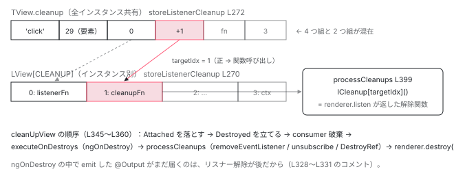

[目次](../README.md) › [Ivy ランタイム](README.md) › 第 17 回 / 全 17 回

# ビューの破棄：destroyLView → cleanUpView → executeOnDestroys

> DOM から外し、リスナーを解除し、ngOnDestroy を呼ぶ順番。TView.cleanup と LView\[CLEANUP\] に積まれていた後始末が、ここでまとめて消費される。

angular/angular · 読了 約 11 分 · 発展 · [サイトで読む（デモが動きます）](https://angular-deep-dive-cyan.vercel.app/chapter/ivy-destroy)

---

コンポーネントが消えるとき、`(click)` のリスナーは誰が外すのか。`ngOnDestroy` はどのタイミングで、どの順で呼ばれるのか。この章では `@if` が `false` になった瞬間から始まる `removeLViewFromLContainer` → `detachView` → `destroyLView` → `destroyViewTree` → `cleanUpView` → `executeOnDestroys` / `processCleanups` の 1 本の経路を読みます。作成時に `TView.cleanup` と `LView[CLEANUP]` に積まれていた後始末が、ここでまとめて消費されます。

読む対象は `packages/core/src/render3/node_manipulation.ts` の 198〜472 行と、登録側の `view/listeners.ts`、`hooks.ts`、`interfaces/view.ts` です。

1. 概観（配列だった）
2. Ivy とは
3. テンプレート関数と RenderFlags
4. TNode
5. TView
6. LView
7. blueprint と TData
8. firstCreatePass
9. DOM を組む命令
10. 値を更新する命令
11. LContainer
12. ビューの木
13. フック
14. ディレクティブ
15. LFrame
16. ViewRef 等
17. **破棄**（この章）

## 1. 入口：@if が false になる、または ViewRef.destroy()

📄 `angular/packages/core/src/render3/instructions/control_flow.ts` L204–208 （▶ の行: 207）

```ts
204 │       // The index of the view to show changed - remove the previously displayed one
205 │       // (it is a noop if there are no active views in a container).
206 │       if (prevContainer !== undefined) {
207 ▶         removeLViewFromLContainer(prevContainer, viewInContainerIdx);
208 │       }
```

📄 `angular/packages/core/src/render3/view/container.ts` L128–137 （▶ の行: 132, 134）

```ts
128 │ export function removeLViewFromLContainer(
129 │   lContainer: LContainer,
130 │   index: number,
131 │ ): LView<unknown> | undefined {
132 ▶   const lView = detachView(lContainer, index);
133 │   if (lView !== undefined) {
134 ▶     destroyLView(lView[TVIEW], lView);
135 │   }
136 │   return lView;
137 │ }
```

207 行目、[LContainer の章](11-ivy-lcontainer.md)で見た `ɵɵconditional` が前の分岐を外す行です。132 行目で `detachView`（配列と DOM から外す）、134 行目で `destroyLView`（壊す）。**「外す」と「壊す」は別の関数**で、この順で呼ばれます。

📄 `angular/packages/core/src/render3/view/container.ts` L161–177 （▶ の行: 164–165, 173–174, 176）

```ts
161 │     if (removeIndex > 0) {
162 │       lContainer[indexInContainer - 1][NEXT] = viewToDetach[NEXT] as LView;
163 │     }
164 ▶     const removedLView = removeFromArray(lContainer, CONTAINER_HEADER_OFFSET + removeIndex);
165 ▶     removeViewFromDOM(viewToDetach[TVIEW], viewToDetach);
166 │ 
167 │     // notify query that a view has been removed
168 │     const lQueries = removedLView[QUERIES];
169 │     if (lQueries !== null) {
170 │       lQueries.detachView(removedLView[TVIEW]);
171 │     }
172 │ 
173 ▶     viewToDetach[PARENT] = null;
174 ▶     viewToDetach[NEXT] = null;
175 │     // Unsets the attached flag
176 ▶     viewToDetach[FLAGS] &= ~LViewFlags.Attached;
177 │   }
```

📄 `angular/packages/core/src/render3/node_manipulation.ts` L198–202 （▶ の行: 199–201）

```ts
198 │ export function removeViewFromDOM(tView: TView, lView: LView): void {
199 ▶   detachViewFromDOM(tView, lView);
200 ▶   lView[HOST] = null;
201 ▶   lView[T_HOST] = null;
202 │ }
```

📄 `angular/packages/core/src/render3/node_manipulation.ts` L237–243 （▶ の行: 241–242）

```ts
237 │ export function detachViewFromDOM(tView: TView, lView: LView) {
238 │   // When we remove a view from the DOM, we need to rerun afterRender hooks
239 │   // We don't necessarily needs to run change detection. DOM removal only requires
240 │   // change detection if animations are enabled (this notification is handled by animations).
241 ▶   lView[ENVIRONMENT].changeDetectionScheduler?.notify(NotificationSource.ViewDetachedFromDOM);
242 ▶   applyView(tView, lView, lView[RENDERER], WalkTNodeTreeAction.Detach, null, null);
243 │ }
```

164 行目で `LContainer` から `splice`、165 行目で `removeViewFromDOM`。その中身は 199 行目 `detachViewFromDOM` → 242 行目、`applyView(..., WalkTNodeTreeAction.Detach, ...)` でビューのルートノードを DOM から `removeChild` します。241 行目、DOM から外したことをスケジューラに `ViewDetachedFromDOM` で通知します（afterRender フックの再実行のため）。200〜201 行目で `HOST` と `T_HOST` を `null` に、173〜176 行目で `PARENT` / `NEXT` を切り `Attached` を落とします。ここまでで**ビューは木からも DOM からも切り離されましたが、リスナーもインスタンスも生きています**。

📄 `angular/packages/core/src/render3/view_ref.ts` L104–126 （▶ の行: 105–106, 119, 125）

```ts
104 │   destroy(): void {
105 ▶     if (this._appRef) {
106 ▶       this._appRef.detachView(this);
107 │     } else if (this._attachedToViewContainer) {
108 │       const parent = this._lView[PARENT];
109 │       if (isLContainer(parent)) {
110 │         const viewRefs = parent[VIEW_REFS] as ViewRef<unknown>[] | null;
111 │         const index = viewRefs ? viewRefs.indexOf(this) : -1;
112 │         if (index > -1) {
113 │           ngDevMode &&
114 │             assertEqual(
115 │               index,
116 │               parent.indexOf(this._lView) - CONTAINER_HEADER_OFFSET,
117 │               'An attached view should be in the same position within its container as its ViewRef in the VIEW_REFS array.',
118 │             );
119 ▶           detachView(parent, index);
120 │           removeFromArray(viewRefs!, index);
121 │         }
122 │       }
123 │       this._attachedToViewContainer = false;
124 │     }
125 ▶     destroyLView(this._lView[TVIEW], this._lView);
126 │   }
```

もう 1 つの入口、[ViewRef](16-ivy-refs.md) の `destroy()`。105〜106 行目で `ApplicationRef` から、119 行目でコンテナから外し、125 行目で同じ `destroyLView` に合流します。`ComponentRef.destroy()` も `hostView.destroy()` なのでここに来ます。

## 2. destroyLView：DOM ノードの破棄と、木の走査

📄 `angular/packages/core/src/render3/node_manipulation.ts` L316–326 （▶ の行: 317, 320, 322–323, 325）

```ts
316 │ export function destroyLView(tView: TView, lView: LView) {
317 ▶   if (isDestroyed(lView)) {
318 │     return;
319 │   }
320 ▶   const renderer = lView[RENDERER];
321 │ 
322 ▶   if (renderer.destroyNode) {
323 ▶     applyView(tView, lView, renderer, WalkTNodeTreeAction.Destroy, null, null);
324 │   }
325 ▶   destroyViewTree(lView);
326 │ }
```

📄 `angular/packages/core/src/render3/interfaces/type_checks.ts` L60–63 （▶ の行: 62）

```ts
60 │ export function isDestroyed(lView: LView): boolean {
61 │   // Determines whether a given LView is marked as destroyed.
62 ▶   return (lView[FLAGS] & LViewFlags.Destroyed) === LViewFlags.Destroyed;
63 │ }
```

317 行目、すでに `Destroyed` ビット（62 行目）が立っていれば何もしません。2 回呼んでも安全です。322〜323 行目、renderer が `destroyNode` を持つなら `WalkTNodeTreeAction.Destroy` で全ノードを歩きます。325 行目、`destroyViewTree` がこの章の本体です。

📄 `angular/packages/core/src/render3/node_manipulation.ts` L96–111 （▶ の行: 98, 104, 107, 110）

```ts
 96 │ export const enum WalkTNodeTreeAction {
 97 │   /** node create in the native environment. Run on initial creation. */
 98 ▶   Create = 0,
 99 │ 
100 │   /**
101 │    * node insert in the native environment.
102 │    * Run when existing node has been detached and needs to be re-attached.
103 │    */
104 ▶   Insert = 1,
105 │ 
106 │   /** node detach from the native environment */
107 ▶   Detach = 2,
108 │ 
109 │   /** node destruction using the renderer's API */
110 ▶   Destroy = 3,
111 │ }
```

📄 `angular/packages/core/src/render3/node_manipulation.ts` L176–185 （▶ の行: 176, 179）

```ts
176 ▶     } else if (action === WalkTNodeTreeAction.Destroy) {
177 │       reusedNodes.delete(rNode as HTMLElement);
178 │       runLeaveAnimationsWithCallback(parentLView, tNode, injector, () => {
179 ▶         renderer.destroyNode!(rNode);
180 │       });
181 │     }
182 │     if (lContainer != null) {
183 │       applyContainer(renderer, action, injector, lContainer, tNode, parent, beforeNode);
184 │     }
185 │   }
```

98〜110 行目、DOM 木を歩く 4 種類の動作。1 節の `Detach`（107 行目）と、ここでの `Destroy`（110 行目）は別物です。179 行目、`Destroy` は各ノードに `renderer.destroyNode(rNode)` を呼びます。ブラウザの `DefaultDomRenderer2` は `destroyNode` が `null` なので 322 行目の `if` に入らず、この走査は起きません。アニメーション用 renderer など、ノードごとの後始末が必要な renderer のためのフックです。

## 3. destroyViewTree：下から上へ、cleanUpView を呼ぶ順番

📄 `angular/packages/core/src/render3/node_manipulation.ts` L258–295 （▶ の行: 260–262, 268, 270, 274–275, 278, 281, 283, 285, 289, 291）

```ts
258 │ export function destroyViewTree(rootView: LView): void {
259 │   // If the view has no children, we can clean it up and return early.
260 ▶   let lViewOrLContainer = rootView[CHILD_HEAD];
261 ▶   if (!lViewOrLContainer) {
262 ▶     return cleanUpView(rootView[TVIEW], rootView);
263 │   }
264 │ 
265 │   while (lViewOrLContainer) {
266 │     let next: LView | LContainer | null = null;
267 │ 
268 ▶     if (isLView(lViewOrLContainer)) {
269 │       // If LView, traverse down to child.
270 ▶       next = lViewOrLContainer[CHILD_HEAD];
271 │     } else {
272 │       ngDevMode && assertLContainer(lViewOrLContainer);
273 │       // If container, traverse down to its first LView.
274 ▶       const firstView: LView | undefined = lViewOrLContainer[CONTAINER_HEADER_OFFSET];
275 ▶       if (firstView) next = firstView;
276 │     }
277 │ 
278 ▶     if (!next) {
279 │       // Only clean up view when moving to the side or up, as destroy hooks
280 │       // should be called in order from the bottom up.
281 ▶       while (lViewOrLContainer && !lViewOrLContainer![NEXT] && lViewOrLContainer !== rootView) {
282 │         if (isLView(lViewOrLContainer)) {
283 ▶           cleanUpView(lViewOrLContainer[TVIEW], lViewOrLContainer);
284 │         }
285 ▶         lViewOrLContainer = lViewOrLContainer[PARENT];
286 │       }
287 │       if (lViewOrLContainer === null) lViewOrLContainer = rootView;
288 │       if (isLView(lViewOrLContainer)) {
289 ▶         cleanUpView(lViewOrLContainer[TVIEW], lViewOrLContainer);
290 │       }
291 ▶       next = lViewOrLContainer && lViewOrLContainer![NEXT];
292 │     }
293 │     lViewOrLContainer = next;
294 │   }
295 │ }
```

1. **260〜262 行目：子がいなければ自分だけ**

   `CHILD_HEAD` が `null` なら `cleanUpView(rootView)` して終わりです。
2. **268〜275 行目：まず下へ**

   `LView` なら `CHILD_HEAD`、`LContainer` なら 10 番の最初のビューへ （[ビューの木の章](12-ivy-view-tree.md)の形そのまま）。下に行けるかぎり降りて、**この段階では `cleanUpView` を呼びません**。
3. **278〜286 行目：行き止まりで、横か上に動くときに掃除**

   281 行目、`NEXT` が無く、かつルートでないかぎり `PARENT` へ登り続け、283 行目で登る前に `cleanUpView`（`LView` のときだけ。`LContainer` は配列なので掃除するものがありません）。289 行目で止まった場所も掃除し、291 行目で `NEXT` へ。

結果として**最も深い子から順に `cleanUpView` が呼ばれ、ルートが最後**です。コメント（node\_manipulation.ts 249〜254 行目）の「onDestroy のために bottom-up でなければならない」がこの走査の理由です。子コンポーネントの `ngOnDestroy` が親より先に呼ばれるのは、この `while` が決めています。

## 4. cleanUpView：フラグ → ngOnDestroy → リスナー解除 → renderer

📄 `angular/packages/core/src/render3/node_manipulation.ts` L336–361 （▶ の行: 337, 341, 345, 352, 354, 356–357, 359–360）

```ts
336 │ function cleanUpView(tView: TView, lView: LView): void {
337 ▶   if (isDestroyed(lView)) {
338 │     return;
339 │   }
340 │ 
341 ▶   const prevConsumer = setActiveConsumer(null);
342 │   try {
343 │     // Usually the Attached flag is removed when the view is detached from its parent, however
344 │     // if it's a root view, the flag won't be unset hence why we're also removing on destroy.
345 ▶     lView[FLAGS] &= ~LViewFlags.Attached;
346 │ 
347 │     // Mark the LView as destroyed *before* executing the onDestroy hooks. An onDestroy hook
348 │     // runs arbitrary user code, which could include its own `viewRef.destroy()` (or similar). If
349 │     // We don't flag the view as destroyed before the hooks, this could lead to an infinite loop.
350 │     // This also aligns with the ViewEngine behavior. It also means that the onDestroy hook is
351 │     // really more of an "afterDestroy" hook if you think about it.
352 ▶     lView[FLAGS] |= LViewFlags.Destroyed;
353 │ 
354 ▶     lView[REACTIVE_TEMPLATE_CONSUMER] && consumerDestroy(lView[REACTIVE_TEMPLATE_CONSUMER]);
355 │ 
356 ▶     executeOnDestroys(tView, lView);
357 ▶     processCleanups(tView, lView);
358 │     // For component views only, the local renderer is destroyed at clean up time.
359 ▶     if (lView[TVIEW].type === TViewType.Component) {
360 ▶       lView[RENDERER].destroy();
361 │     }
```

1. **337 行目：二重破棄の防止**

   `isDestroyed` なら即 return。
2. **341 行目：reactive context を切る**

   `setActiveConsumer(null)`。`ngOnDestroy` の中で signal を読んでも依存として記録されません。
3. **345 行目・352 行目：`Attached` を落とし、`Destroyed` を立てる**

   347〜351 行目のコメント：**フックを呼ぶ前に `Destroyed` を立てる**。`ngOnDestroy` の中で `viewRef.destroy()` が呼ばれても、337 行目で止まるので無限ループになりません。「`ngOnDestroy` は実質 afterDestroy だ」とも書かれています。
4. **354 行目：テンプレートの reactive consumer を破棄**

   signal を読んでいたテンプレートの依存グラフを切ります。
5. **356 行目：`executeOnDestroys`（`ngOnDestroy`）**

   5 節で読みます。
6. **357 行目：`processCleanups`（リスナー解除、出力の購読解除、`DestroyRef.onDestroy`）**

   6 節で読みます。328〜331 行目のコメント：**リスナー解除が最後なのは、`ngOnDestroy` の中で emit した `@Output` がまだ届くようにするため**です。
7. **359〜360 行目：コンポーネントビューなら renderer を破棄**

   コンポーネントごとに作られた renderer（スタイルのカプセル化を担当）が `destroy()` されます。

📄 `angular/packages/core/src/render3/node_manipulation.ts` L363–383 （▶ の行: 363, 365, 367–368, 373–374, 379）

```ts
363 ▶     const declarationContainer = lView[DECLARATION_LCONTAINER];
364 │     // we are dealing with an embedded view that is still inserted into a container
365 ▶     if (declarationContainer !== null && isLContainer(lView[PARENT])) {
366 │       // and this is a projected view
367 ▶       if (declarationContainer !== lView[PARENT]) {
368 ▶         detachMovedView(declarationContainer, lView);
369 │       }
370 │ 
371 │       // For embedded views still attached to a container: remove query result from this view.
372 │       const lQueries = lView[QUERIES];
373 ▶       if (lQueries !== null) {
374 ▶         lQueries.detachView(tView);
375 │       }
376 │     }
377 │ 
378 │     // Unregister the view once everything else has been cleaned up.
379 ▶     unregisterLView(lView);
380 │   } finally {
381 │     setActiveConsumer(prevConsumer);
382 │   }
383 │ }
```

363〜376 行目、埋め込みビューがまだコンテナに入った状態で壊される場合（`ViewContainerRef.clear()` ではなく親ごと壊されたとき）、transplanted view なら `MOVED_VIEWS` から外し（368 行目）、クエリにも通知します（374 行目）。379 行目、`unregisterLView` で開発ツール用の `LView` 登録簿から消します。

## 5. executeOnDestroys：TView.destroyHooks を消費する

📄 `angular/packages/core/src/render3/hooks.ts` L97–103 （▶ の行: 102）

```ts
 97 │ export function registerPostOrderHooks(tView: TView, tNode: TNode): void {
 98 │   ngDevMode && assertFirstCreatePass(tView);
 99 │   // It's necessary to loop through the directives at elementEnd() (rather than processing in
100 │   // directiveCreate) so we can preserve the current hook order. Content, view, and destroy
101 │   // hooks for projected components and directives must be called *before* their hosts.
102 ▶   for (let i = tNode.directiveStart, end = tNode.directiveEnd; i < end; i++) {
103 │     const directiveDef = tView.data[i] as DirectiveDef<any>;
```

📄 `angular/packages/core/src/render3/hooks.ts` L136–139 （▶ の行: 137）

```ts
136 │     if (ngOnDestroy != null) {
137 ▶       (tView.destroyHooks ??= []).push(i, ngOnDestroy);
138 │     }
139 │   }
```

登録側は[フックの章](13-ivy-hooks.md)の `registerPostOrderHooks`。102 行目でディレクティブを順に見て、137 行目で `tView.destroyHooks` に `[ディレクティブ番号, ngOnDestroy]` を push します。`TView` にあるので全インスタンス共通です。

📄 `angular/packages/core/src/render3/interfaces/view.ts` L906–924 （▶ の行: 910–912, 917–918）

```ts
906 │ /**
907 │  * Array of destroy hooks that should be executed for a view and their directive indices.
908 │  *
909 │  * The array is set up as a series of number/function or number/(number|function)[]:
910 ▶  * - Even indices represent the context with which hooks should be called.
911 ▶  * - Odd indices are the hook functions themselves. If a value at an odd index is an array,
912 ▶  *   it represents the destroy hooks of a `multi` provider where:
913 │  *     - Even indices represent the index of the provider for which we've registered a destroy hook,
914 │  *       inside of the `multi` provider array.
915 │  *     - Odd indices are the destroy hook functions.
916 │  * For example:
917 ▶  * LView: `[0, 1, 2, AService, 4, [BService, CService, DService]]`
918 ▶  * destroyHooks: `[3, AService.ngOnDestroy, 5, [0, BService.ngOnDestroy, 2, DService.ngOnDestroy]]`
919 │  *
920 │  * In the example above `AService` is a type provider with an `ngOnDestroy`, whereas `BService`,
921 │  * `CService` and `DService` are part of a `multi` provider where only `BService` and `DService`
922 │  * have an `ngOnDestroy` hook.
923 │  */
924 │ export type DestroyHookData = (HookEntry | HookData)[];
```

910〜912 行目、偶数番がコンテキストの `LView` 上の番号、奇数番が関数**または配列**。配列になるのは `multi: true` プロバイダで、917〜918 行目の例では `lView[5]` に 3 つのサービスの配列があり、そのうち 0 番目と 2 番目が `ngOnDestroy` を持つ、という形です。ディレクティブだけでなく、コンポーネントの `providers` に書いたサービスの `ngOnDestroy` もここに入ります。

📄 `angular/packages/core/src/render3/node_manipulation.ts` L438–472 （▶ の行: 442–444, 447–448, 450, 452, 456, 464）

```ts
438 │ function executeOnDestroys(tView: TView, lView: LView): void {
439 │   ngDevMode && assertNotReactive(executeOnDestroys.name);
440 │   let destroyHooks: DestroyHookData | null;
441 │ 
442 ▶   if (tView != null && (destroyHooks = tView.destroyHooks) != null) {
443 ▶     for (let i = 0; i < destroyHooks.length; i += 2) {
444 ▶       const context = lView[destroyHooks[i] as number];
445 │ 
446 │       // Only call the destroy hook if the context has been requested.
447 ▶       if (!(context instanceof NodeInjectorFactory)) {
448 ▶         const toCall = destroyHooks[i + 1] as HookFn | HookData;
449 │ 
450 ▶         if (Array.isArray(toCall)) {
451 │           for (let j = 0; j < toCall.length; j += 2) {
452 ▶             const callContext = context[toCall[j] as number];
453 │             const hook = toCall[j + 1] as HookFn;
454 │             profiler(ProfilerEvent.LifecycleHookStart, callContext, hook);
455 │             try {
456 ▶               hook.call(callContext);
457 │             } finally {
458 │               profiler(ProfilerEvent.LifecycleHookEnd, callContext, hook);
459 │             }
460 │           }
461 │         } else {
462 │           profiler(ProfilerEvent.LifecycleHookStart, context, toCall);
463 │           try {
464 ▶             toCall.call(context);
465 │           } finally {
466 │             profiler(ProfilerEvent.LifecycleHookEnd, context, toCall);
467 │           }
468 │         }
469 │       }
470 │     }
471 │   }
472 │ }
```

1. **442〜444 行目：2 つずつ読んで、コンテキストを `lView` から取る**

   `context = lView[destroyHooks[i]]`。[EXPANDO 区画](14-ivy-directives.md)のディレクティブインスタンス、またはプロバイダのインスタンスです。
2. **447 行目：`NodeInjectorFactory` のままなら呼ばない**

   一度も inject されなかったプロバイダは、`lView` のマスにファクトリが入ったままです（[ディレクティブの章](14-ivy-directives.md)）。インスタンスが無いので `ngOnDestroy` も呼びません。
3. **450〜456 行目：multi プロバイダなら配列の中を回す**

   452 行目で `context[toCall[j]]`、456 行目で `hook.call(callContext)`。
4. **464 行目：通常はそのまま `toCall.call(context)`**

   これがあなたの `ngOnDestroy()` の呼び出しです。前後の `profiler` は開発ツール用です。

## 6. processCleanups：(click) リスナーを外す

先に登録側を読みます。`(click)="onClick()"` は作成モードで `ɵɵlistener` → `listenerInternal` → `listenToDomEvent` と進みます。

📄 `angular/packages/core/src/render3/view/listeners.ts` L169–201 （▶ の行: 169, 181, 186–187, 189, 191）

```ts
169 ▶     const native = getNativeByTNode(tNode, lView) as RElement;
170 │     const target = eventTargetResolver ? eventTargetResolver(native) : native;
171 │ 
172 │     stashEventListenerImpl(lView, target, eventName, wrappedListener);
173 │ 
174 │     // For element-local listeners (not global targets like document/window), store the
175 │     // native element on the wrapped listener so that when it fires it can mark the
176 │     // (event, element) pair as handled, preventing jsaction from replaying an event that
177 │     // was already dispatched by the real DOM listener post-hydration (see #67328).
178 │     if (!eventTargetResolver) {
179 │       (wrappedListener as any).__ngNativeEl__ = native as unknown as Element;
180 │     }
181 ▶     const cleanupFn = renderer.listen(target as RElement, eventName, wrappedListener);
182 │ 
183 │     // We skip cleaning up animation event types to ensure leaving animation events can be used.
184 │     // These events should be automatically garbage collected anyway after the element is
185 │     // removed from the DOM.
186 ▶     if (!isAnimationEventType(eventName)) {
187 ▶       const idxOrTargetGetter = eventTargetResolver
188 │         ? (_lView: LView) => eventTargetResolver(unwrapRNode(_lView[tNode.index]))
189 ▶         : tNode.index;
190 │ 
191 ▶       storeListenerCleanup(
192 │         idxOrTargetGetter,
193 │         tView,
194 │         lView,
195 │         eventName,
196 │         wrappedListener,
197 │         cleanupFn,
198 │         false,
199 │       );
200 │     }
201 │   }
```

📄 `angular/packages/core/src/render3/view/listeners.ts` L258–273 （▶ の行: 267–270, 272）

```ts
258 │ export function storeListenerCleanup(
259 │   indexOrTargetGetter: number | ((lView: LView) => EventTarget),
260 │   tView: TView,
261 │   lView: LView,
262 │   eventName: string,
263 │   listenerFn: WrappedEventCallback,
264 │   cleanup: (() => void) | {unsubscribe: () => void},
265 │   isOutput: boolean,
266 │ ) {
267 ▶   const tCleanup = tView.firstCreatePass ? getOrCreateTViewCleanup(tView) : null;
268 ▶   const lCleanup = getOrCreateLViewCleanup(lView);
269 ▶   const index = lCleanup.length;
270 ▶   lCleanup.push(listenerFn, cleanup);
271 │   tCleanup &&
272 ▶     tCleanup.push(eventName, indexOrTargetGetter, index, (index + 1) * (isOutput ? -1 : 1));
273 │ }
```

1. **181 行目：`renderer.listen` が解除関数を返す**

   `DefaultDomRenderer2.listen` は `addEventListener` して、`removeEventListener` を呼ぶ関数を返します。この返り値 `cleanupFn` が後始末の実体です。
2. **186〜199 行目：アニメーションイベント以外は登録**

   189 行目、要素の番号 `tNode.index`（グローバルターゲットなら取得関数）を添えて `storeListenerCleanup`。
3. **267〜270 行目：`LView[CLEANUP]` に 2 つ push**

   `[listenerFn, cleanup]`。インスタンスごとに違う（クロージャだから）ので `LView` 側です。269 行目の `index` は push 前の長さ、つまり `listenerFn` の位置です。
4. **272 行目：初回だけ `TView.cleanup` に 4 つ push**

   `[eventName, 要素番号, listenerFn の位置, (index + 1) * ±1]`。4 つ目は `cleanup` の位置で、**DOM リスナーなら正、`@Output` の購読なら負**にして区別します。全インスタンス共通の情報なので `TView` 側です。

📄 `angular/packages/core/src/render3/interfaces/view.ts` L805–831 （▶ の行: 807–808, 813, 819–820, 823–824, 827, 829）

```ts
805 │   /**
806 │    * When a view is destroyed, listeners need to be released and outputs need to be
807 ▶    * unsubscribed. This cleanup array stores both listener data (in chunks of 4)
808 ▶    * and output data (in chunks of 2) for a particular view. Combining the arrays
809 │    * saves on memory (70 bytes per array) and on a few bytes of code size (for two
810 │    * separate for loops).
811 │    *
812 │    * If it's a native DOM listener or output subscription being stored:
813 ▶    * 1st index is: event name  `name = tView.cleanup[i+0]`
814 │    * 2nd index is: index of native element or a function that retrieves global target (window,
815 │    *               document or body) reference based on the native element:
816 │    *    `typeof idxOrTargetGetter === 'function'`: global target getter function
817 │    *    `typeof idxOrTargetGetter === 'number'`: index of native element
818 │    *
819 ▶    * 3rd index is: index of listener function `listener = lView[CLEANUP][tView.cleanup[i+2]]`
820 ▶    * 4th index is: `useCaptureOrIndx = tView.cleanup[i+3]`
821 │    *    `typeof useCaptureOrIndx == 'boolean' : useCapture boolean
822 │    *    `typeof useCaptureOrIndx == 'number':
823 ▶    *         `useCaptureOrIndx >= 0` `removeListener = LView[CLEANUP][useCaptureOrIndx]`
824 ▶    *         `useCaptureOrIndx <  0` `subscription = LView[CLEANUP][-useCaptureOrIndx]`
825 │    *
826 │    * If it's an output subscription or query list destroy hook:
827 ▶    * 1st index is: output unsubscribe function / query list destroy function
828 │    * 2nd index is: index of function context in LView.cleanupInstances[]
829 ▶    *               `tView.cleanup[i+0].call(lView[CLEANUP][tView.cleanup[i+1]])`
830 │    */
831 │   cleanup: any[] | null;
```

📄 `angular/packages/core/src/render3/interfaces/view.ts` L176–188 （▶ の行: 181–182, 188）

```ts
176 │   /**
177 │    * When a view is destroyed, listeners need to be released and outputs need to be
178 │    * unsubscribed. This context array stores both listener functions wrapped with
179 │    * their context and output subscription instances for a particular view.
180 │    *
181 ▶    * These change per LView instance, so they cannot be stored on TView. Instead,
182 ▶    * TView.cleanup saves an index to the necessary context in this array.
183 │    *
184 │    * After `LView` is created it is possible to attach additional instance specific functions at the
185 │    * end of the `lView[CLEANUP]` because we know that no more `T` level cleanup functions will be
186 │    * added here.
187 │    */
188 ▶   [CLEANUP]: any[] | null;
```

807〜808 行目、`TView.cleanup` は 4 つ組（リスナー）と 2 つ組（それ以外）が混在する 1 本の配列。「配列を 1 本にまとめてメモリ 70 バイトを節約」とあります。813〜824 行目が 4 つ組の読み方、827〜829 行目が 2 つ組（関数とコンテキストの位置）の読み方です。181〜182 行目、`LView[CLEANUP]` はインスタンスごとに違うものだけを持ち、`TView.cleanup` がそこへの添字を持つ、という分担です。

📄 `angular/packages/core/src/render3/node_manipulation.ts` L386–411 （▶ の行: 388–389, 391–392, 395, 397, 399, 402, 404, 407–408）

```ts
386 │ function processCleanups(tView: TView, lView: LView): void {
387 │   ngDevMode && assertNotReactive(processCleanups.name);
388 ▶   const tCleanup = tView.cleanup;
389 ▶   const lCleanup = lView[CLEANUP]!;
390 │   if (tCleanup !== null) {
391 ▶     for (let i = 0; i < tCleanup.length - 1; i += 2) {
392 ▶       if (typeof tCleanup[i] === 'string') {
393 │         // This is a native DOM listener. It will occupy 4 entries in the TCleanup array (hence i +=
394 │         // 2 at the end of this block).
395 ▶         const targetIdx = tCleanup[i + 3];
396 │         ngDevMode && assertNumber(targetIdx, 'cleanup target must be a number');
397 ▶         if (targetIdx >= 0) {
398 │           // Destroy anything whose teardown is a function call (e.g. QueryList, ModelSignal).
399 ▶           lCleanup[targetIdx]();
400 │         } else {
401 │           // Subscription
402 ▶           lCleanup[-targetIdx].unsubscribe();
403 │         }
404 ▶         i += 2;
405 │       } else {
406 │         // This is a cleanup function that is grouped with the index of its context
407 ▶         const context = lCleanup[tCleanup[i + 1]];
408 ▶         tCleanup[i].call(context);
409 │       }
410 │     }
411 │   }
```

1. **388〜391 行目：2 つずつ進む**

   `tCleanup` と `lCleanup` を並べ、`i += 2` で進みます。
2. **392 行目：先頭が文字列なら DOM リスナー（4 つ組）**

   395 行目で 4 つ目 `targetIdx` を取り、397〜399 行目、正なら `lCleanup[targetIdx]()`。**これが `removeEventListener` の呼び出し**です。402 行目、負なら `lCleanup[-targetIdx].unsubscribe()`（`@Output` の購読）。404 行目で追加の 2 つぶん進めて、合計 4 つ消費します。
3. **407〜408 行目：先頭が関数なら 2 つ組**

   `tCleanup[i].call(lCleanup[tCleanup[i + 1]])`。クエリリストの破棄などがこちらです。

📄 `angular/packages/core/src/render3/node_manipulation.ts` L412–435 （▶ の行: 413, 415, 419, 423, 428, 430, 432）

```ts
412 │   if (lCleanup !== null) {
413 ▶     lView[CLEANUP] = null;
414 │   }
415 ▶   const destroyHooks = lView[ON_DESTROY_HOOKS];
416 │   if (destroyHooks !== null) {
417 │     // Reset the ON_DESTROY_HOOKS array before iterating over it to prevent hooks that unregister
418 │     // themselves from mutating the array during iteration.
419 ▶     lView[ON_DESTROY_HOOKS] = null;
420 │     for (let i = 0; i < destroyHooks.length; i++) {
421 │       const destroyHooksFn = destroyHooks[i];
422 │       ngDevMode && assertFunction(destroyHooksFn, 'Expecting destroy hook to be a function.');
423 ▶       destroyHooksFn();
424 │     }
425 │   }
426 │ 
427 │   // Destroy effects registered to the view. Many of these will have been processed above.
428 ▶   const effects = lView[EFFECTS];
429 │   if (effects !== null) {
430 ▶     lView[EFFECTS] = null;
431 │     for (const effect of effects) {
432 ▶       effect.destroy();
433 │     }
434 │   }
435 │ }
```

📄 `angular/packages/core/src/render3/util/view_utils.ts` L285–296 （▶ の行: 286, 292–293, 295）

```ts
285 │ export function storeLViewOnDestroy(lView: LView, onDestroyCallback: () => void) {
286 ▶   if (isDestroyed(lView)) {
287 │     throw new RuntimeError(
288 │       RuntimeErrorCode.VIEW_ALREADY_DESTROYED,
289 │       ngDevMode && 'View has already been destroyed.',
290 │     );
291 │   }
292 ▶   if (lView[ON_DESTROY_HOOKS] === null) {
293 ▶     lView[ON_DESTROY_HOOKS] = [];
294 │   }
295 ▶   lView[ON_DESTROY_HOOKS].push(onDestroyCallback);
296 │ }
```

413 行目で `LView[CLEANUP]` を `null` に。415〜423 行目、`LView[ON_DESTROY_HOOKS]`（21 番）の関数を全部呼びます。ここに入るのは `storeLViewOnDestroy`（295 行目）で登録されたもの、つまり `ViewRef.onDestroy()` と `inject(DestroyRef).onDestroy()` のコールバックです。286 行目、すでに破棄済みのビューに登録しようとすると例外になります。419 行目、呼ぶ前に配列を `null` にしてから回すのは、コールバックの中で自分を解除するものがあっても壊れないようにするためです。428〜432 行目、ビューに紐づいた `effect()` も `destroy()` されます。



*作成時に TView.cleanup（共有）と LView\[CLEANUP\]（インスタンス別）へ分けて積まれた情報を、processCleanups が 4 つ組 / 2 つ組として読み、removeEventListener か unsubscribe を呼ぶ。*

## ここまでの呼び出し

- `ɵɵconditional(-1)` — instructions/control\_flow.ts L188 — *分岐番号が 0 → -1 に変わった*
  - `removeLViewFromLContainer(prevContainer, 0)` — view/container.ts L128
    - `detachView(lContainer, 0)` — view/container.ts L149 — *splice、removeViewFromDOM（Detach 走査）、PARENT/NEXT を切る*
    - `destroyLView(tView, lView)` — node\_manipulation.ts L316 — *renderer.destroyNode があれば Destroy 走査*
      - `destroyViewTree(lView)` — node\_manipulation.ts L258 — *CHILD\_HEAD / CONTAINER\_HEADER\_OFFSET で下へ、行き止まりで掃除しながら NEXT / PARENT へ*
        - `cleanUpView(tView, lView)` × 子から順に — node\_manipulation.ts L336 — *FLAGS |= Destroyed を先に*
          - `consumerDestroy(lView[REACTIVE_TEMPLATE_CONSUMER])` — L354
          - `executeOnDestroys(tView, lView)` — L438 — *tView.destroyHooks の \[index, fn\] を lView\[index\] に対して呼ぶ*
            - 👤 `ngOnDestroy()` — あなたのコンポーネント / ディレクティブ / providers のサービス
          - `processCleanups(tView, lView)` — L386 — *tView.cleanup の 4 つ組 → lCleanup\[targetIdx\]()（removeEventListener）/ unsubscribe()*
            - 👤 `destroyRef.onDestroy(cb)` の cb — lView\[ON\_DESTROY\_HOOKS\]
          - `lView[RENDERER].destroy()` — L360 — *コンポーネントビューのみ*
          - `unregisterLView(lView)` — L379

## 聞かれそうな質問

**Q. コンポーネントが destroy されたとき、(click) リスナーは誰が外しますか？**

`processCleanups`（node\_manipulation.ts 399 行目）です。作成時に `listenToDomEvent`（view/listeners.ts 181 行目）が `renderer.listen` の返り値（解除関数）を受け取り、`storeListenerCleanup` 270 行目で `LView[CLEANUP]` に、272 行目で位置情報を `TView.cleanup` に積んでいます。破棄時は `cleanUpView` 357 行目から `processCleanups` が呼ばれ、392 行目で 4 つ組を見つけ、397〜399 行目で `lCleanup[targetIdx]()`、つまり `removeEventListener` を呼びます。手で外す必要はありません。

**Q. ngOnDestroy とリスナー解除はどちらが先ですか？**

`ngOnDestroy` が先です。`cleanUpView` の 356 行目 `executeOnDestroys`、357 行目 `processCleanups` の順。328〜331 行目のコメントどおり、`ngOnDestroy` の中で `@Output` を emit しても親のハンドラに届くようにするためです。

**Q. 子コンポーネントの ngOnDestroy は親より先に呼ばれますか？**

先です。`destroyViewTree`（node\_manipulation.ts 265〜294 行目）は `CHILD_HEAD` で下まで降り、行き止まりで横か上に動くときだけ `cleanUpView`（283 / 289 行目）を呼びます。249〜250 行目のコメント「onDestroy のために bottom-up でなければならない」のとおり、深い子が先、ルートが最後です。

**Q. ngOnDestroy の中で viewRef.destroy() を呼んだらどうなりますか？**

何も起きません。`cleanUpView` は 352 行目でフックを呼ぶ**前に**`LViewFlags.Destroyed` を立てるので、再入した `destroyLView`（317 行目）と `cleanUpView`（337 行目）は `isDestroyed` で即 return します。347〜351 行目のコメントがこの理由を説明しています。

**Q. inject(DestroyRef).onDestroy() のコールバックはどこに保存され、いつ呼ばれますか？**

`storeLViewOnDestroy`（view\_utils.ts 295 行目）で `lView[ON_DESTROY_HOOKS]` に push されます。呼ばれるのは `processCleanups` の 415〜423 行目、つまり `ngOnDestroy` とリスナー解除の**後**です。すでに破棄済みのビューに登録すると 286〜290 行目で例外になります。

**Q. providers に書いたサービスの ngOnDestroy も呼ばれますか？**

呼ばれます。`tView.destroyHooks`（view.ts 906〜924 行目）にはディレクティブだけでなくノードインジェクタのプロバイダも入り、`executeOnDestroys` 444 行目で `lView[index]` からインスタンスを取って呼びます。ただし 447 行目、一度も inject されずに `NodeInjectorFactory` のままのプロバイダは呼ばれません。インスタンスが存在しないからです。

## 読み終えて

- 破棄は「外す」（`detachView`：配列と DOM から）と「壊す」（`destroyLView`）の 2 段。`@if` も `ViewRef.destroy()` も最後は `destroyLView` に合流する
- `destroyViewTree` は `CHILD_HEAD` / 10 番 / `NEXT` / `PARENT` で木を歩き、深い子から順に `cleanUpView` を呼ぶ
- `cleanUpView` の順序は `Destroyed` を立てる → `ngOnDestroy` → リスナー解除・購読解除・`DestroyRef` → renderer 破棄。再入しても安全
- `(click)` の解除関数は作成時に `LView[CLEANUP]` に、その位置は `TView.cleanup` の 4 つ組に積まれ、`processCleanups` が `lCleanup[targetIdx]()` で呼ぶ

---

← 前: [ViewRef / ComponentRef / ElementRef は配列への窓](16-ivy-refs.md)  
次: [zone.js は何をしていたのか（概観）](../zone/01-ngzone.md) →
