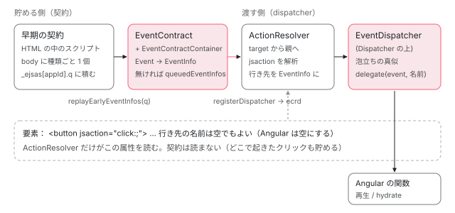

[目次](../README.md) › [イベント配送（event-dispatch）と jsaction の内側](README.md) › 第 1 回 / 全 12 回

# JSAction の全体像：契約・行き先の解決・配送

> event-dispatch のファイルの分担（eventcontract・event\_contract\_container・earlyeventcontract・action\_resolver・event\_info・event\_type・event・dispatcher・event\_dispatcher・a11y\_click）と、イベントが「早期の契約で貯める → EventContract が受ける → ActionResolver が行き先を決める → Dispatcher が渡す」と流れる全体図。README が挙げる 2 つの問題、Angular が使う 2 つの所（イベントの記録と再生・hydrate トリガー）、公開されている入口（index.ts）と各章へのリンク。

angular/angular · 読了 約 12 分 · 基礎 · [サイトで読む（デモが動きます）](https://angular-deep-dive-cyan.vercel.app/chapter/jsaction-overview)

---

`packages/core/primitives/event-dispatch/` は、JSAction と呼ばれる 3000 行ほどの小さなイベント委譲（delegation：リスナーを要素ごとに付けず、親の 1 か所でまとめて受けること）のライブラリです。この章では、20 個のソースがそれぞれ何を受け持つか、イベントがどの関数をどの順に通って「行き先」に届くかを 1 枚の図と 1 本の呼び出しの列にし、README が挙げる 2 つの問題と、Angular がこのライブラリを使っている 2 つの所を確かめます。最後に、本物のライブラリをこのページの上で動かして、イベントが「貯まる → 渡される」のを見ます。

読む対象は `event-dispatch/README.md`・`index.ts`・`contract_binary.ts` と、`src/` の 20 個のファイルの冒頭です（中身は第 2 回からの各章で読みます）。

1. **1. 全体像**（この章）
2. [2. jsaction 属性](02-jsaction-attribute.md)
3. [3. EventInfo](03-jsaction-event-info.md)
4. [4. イベントの種類](04-jsaction-event-types.md)
5. [5. 早期の契約](05-jsaction-early-contract.md)
6. [6. EventContract](06-jsaction-contract.md)
7. [7. 行き先を探す](07-jsaction-resolver.md)
8. [8. a11y の click](08-jsaction-a11y-click.md)
9. [9. mouseenter とタッチ](09-jsaction-mouse-touch.md)
10. [10. Dispatcher](10-jsaction-dispatcher.md)
11. [11. Angular の側](11-jsaction-angular.md)
12. [12. spec と issue](12-jsaction-tests-issues.md)

## 1. README が挙げる 2 つの問題

README の冒頭は「これは Angular の内部のライブラリで、公開 API ではない」という注意書きです（Angular のアプリから直接使わないこと）。そのすぐ後に、ふつうの `addEventListener` が抱える問題を 2 つ挙げています。

📄 `angular/packages/core/primitives/event-dispatch/README.md` L14–43 （▶ の行: 17–18, 21–22, 30–34, 41）

````md
14 │ ## How it works
15 │ 
16 │ The traditional way of adding an event listener is to obtain a reference to the
17 ▶ node and call `.addEventListener` (or use `.onclick`-like properties). However,
18 ▶ this necessarily requires that the code that handles the event has been loaded.
19 │ This can introduce a couple problems:
20 │ 
21 ▶ 1.  Server rendered applications will silently ignore user events that happen
22 ▶     before the app hydrates and registers handlers
23 │ 
24 │     ```html
25 │     <!-- Let's say this server-rendered page is streamed to the browser -->
26 │     <body>
27 │       <button id="buy_btn" type="button">Buy now!</button>
28 │       ...
29 │       <!--
30 ▶       There's a window of time between when the button is rendered and the
31 ▶       script below reaches the client, either because there's a lot of content
32 ▶       streamed in-between, network lag, or the script is asynchronously loaded
33 ▶       via a follow-up network request rather than as part of the main document
34 ▶       content.
35 │       ->
36 │       ...
37 │       <script>
38 │         const btn = document.querySelector('#buy_btn');
39 │         // Until this line is executed, clicking on the button doesn't do
40 │         // anything. This can be a frustrating user experience.
41 ▶         btn.addEventListener('click', () => app.confirmPurchase());
42 │       </script>
43 │     ```
````

17〜18 行目。`addEventListener` は、ハンドラーのコードが**もう読み込まれている**ことを前提にしています。21〜22 行目が 1 つ目の問題で、サーバーで描いた（SSR した）ページでは、アプリがハイドレーション（サーバーの HTML に JS の状態を結び付け直すこと）を終えてハンドラーを付けるまでの間のクリックが、黙って捨てられます。30〜34 行目のとおり、間に長い内容が流れてきたり、通信が遅かったり、スクリプトが別のリクエストで来たりすると、この「押しても何も起きない時間」が伸びます。41 行目の `addEventListener` が実行されるまで、ボタンは飾りです。

📄 `angular/packages/core/primitives/event-dispatch/README.md` L45–69 （▶ の行: 45–47, 63–65, 68）

````md
45 ▶ 2.  Applications must eagerly load any possible handler that could be needed to
46 ▶     handle user interactions, even if that handler is never invoked or even
47 ▶     rendered on the page
48 │ 
49 │     ```html
50 │     // This button is rarely clicked, but the code to show the dialog must be // loaded for every
51 │     user
52 │     <button type="button" (click)="showAdvancedOptionsDialog()">Advanced options</button>
53 │ 
54 │     // Non-admins will never see this button, and yet they still have to load // this handler. @if
55 │     (isAdmin) {
56 │     <button type="button" (click)="showAdminOptionsDialog()">Admin options</button>
57 │     }
58 │     ```
59 │ 
60 │     It's possible to write these handlers so that they will late-load their
61 │     inner logic, but that's a manual, opt-in solution.
62 │ 
63 ▶ Instead, JSAction "registers" event handlers by storing a map from event type
64 ▶ to handler name (which can map to whatever handler function or behavior the
65 ▶ application needs) on a custom HTML `jsaction` attribute.
66 │ 
67 │ ```html
68 ▶ <button id="buy_btn" type="button" jsaction="click:confirmPurchase">Buy now!</button>
69 │ ```
````

45〜47 行目が 2 つ目の問題です。押されるかどうか分からないボタン（管理者にしか見えないボタンも含めて）のハンドラーも、先に全部読み込まなければなりません。63〜65 行目が JSAction の答えで、**「イベントの種類 → ハンドラーの名前」の対応を、要素の `jsaction` 属性に文字列で書いておく**ことです。68 行目の `jsaction="click:confirmPurchase"` は「click が来たら `confirmPurchase` という名前の行き先へ」という意味です。名前を何に結び付けるかは使う側（Angular や Wiz）が決めます。書式の細かい規則は [第 2 回](02-jsaction-attribute.md)で読みます。

📄 `angular/packages/core/primitives/event-dispatch/README.md` L71–86 （▶ の行: 71–74, 76–77, 83–86）

```md
71 ▶ A small inline script is added before any application content which registers
72 ▶ global event handlers for event types that could be delegated. Any events
73 ▶ triggered on the page bubble up to the global handler and are queued until the
74 ▶ application has bootstrapped or hydrated.
75 │ 
76 ▶ Once ready, JSAction can "replay" the queued events to the application,
77 ▶ providing the events and their matched handler name. It's up to the user of
78 │ JSAction what to do with the replayed events. The handler name could be mapped
79 │ to some eagerly loaded handlers and called right away, or it could be used to
80 │ lazily load a handler. (Typically JSAction is not used directly, but configured
81 │ by a framework like Angular or Wiz).
82 │ 
83 ▶ Frameworks may continue using JSAction after hydration to take advantage of its
84 ▶ event delegation. This allows handling most if not all events in your
85 ▶ application with just a few global listeners, saving the cost of registering
86 ▶ a larger amount (potentially thousands) of listeners on individual elements.
```

71〜74 行目。ページの先頭に小さなインラインのスクリプトを置き、委譲できる種類のイベントについて**全体のハンドラー**を付けます。ページのどこで起きたイベントも泡立って（bubble：子から親へ伝わって）そのハンドラーに届き、アプリの準備ができるまで列に貯められます。76〜77 行目、準備ができたら貯めたイベントを「再生」して、ハンドラーの名前と一緒にアプリへ渡します。83〜86 行目、ハイドレーションの後も使い続けてよく、そうすれば数千個になり得るリスナーを数個に減らせる、とも書いています。

## 2. ファイルの分担

`src/` の 20 個のファイルを、行数（v22.2.0-next.7、8576f161ae4）と役目で並べます。役目は各ファイルの中身を読んで書きました。

| ファイル | 行数 | 受け持つこと | 読む章 |
| --- | --- | --- | --- |
| `attribute.ts`・`char.ts`・`property.ts` | 23・21・34 | 属性名 `jsaction`、区切り文字 `:` と `.`、要素に貼るプロパティ名 `__jsaction`・`__owner` | [2](02-jsaction-attribute.md) |
| `cache.ts` | 69 | 解析した結果を要素に貼る・読む・消す。属性の文字列ごとの解析のキャッシュ | [2](02-jsaction-attribute.md) |
| `event_info.ts` | 330 | 1 回のイベントを運ぶ入れ物 `EventInfo` と、その get・set、`EventInfoWrapper` | [3](03-jsaction-event-info.md) |
| `event_type.ts` | 380 | イベントの種類の名前の一覧、泡立つもの・捕獲（capture）で聞くもの・早期に貯めるものの並び | [4](04-jsaction-event-types.md) |
| `event.ts` | 691 | DOM に触る小さな関数の集まり（リスナーの付け外し、修飾キーの判定、Enter・Space の判定、mouseenter やタッチの作り直し） | [4](04-jsaction-event-types.md)・[8](08-jsaction-a11y-click.md)・[9](09-jsaction-mouse-touch.md) |
| `earlyeventcontract.ts`・`bootstrap_app_scoped.ts`・`bootstrap_global.ts` | 145・76・47 | JS が来る前に HTML の中で動く「早期の契約」。`window._ejsas[appId]`（または `_ejsa`）の列に貯める | [5](05-jsaction-early-contract.md) |
| `eventcontract.ts`・`event_contract_container.ts`・`event_handler.ts`・`event_contract_defines.ts`・`restriction.ts` | 289・69・22・14・15 | コンテナに種類ごとに 1 つリスナーを付け、受けたイベントを `EventInfo` にして、dispatcher が無ければ貯め、あれば渡す | [6](06-jsaction-contract.md) |
| `action_resolver.ts` | 292 | イベントの対象の要素から親へたどり、そのイベントの種類が `jsaction` に書かれた最初の要素を行き先にする。属性の解析（`parseActions`）もここ | [7](07-jsaction-resolver.md)（解析は [2](02-jsaction-attribute.md)） |
| `a11y_click.ts`・`key_code.ts` | 64・22 | キーボードの Enter・Space を click の行き先へ回す（`ActionResolver` に差し込む） | [8](08-jsaction-a11y-click.md) |
| `dispatcher.ts` | 150 | `Dispatcher`：行き先を解決させてから、使う側の関数に `EventInfoWrapper` を渡す。再生の予定を立てる | [10](10-jsaction-dispatcher.md) |
| `event_dispatcher.ts` | 195 | `EventDispatcher`：`Dispatcher` の上に、ブラウザらしい泡立ち・`stopPropagation`・`currentTarget` を真似る層。Angular が使うのはこちら | [10](10-jsaction-dispatcher.md) |

20 個で 2948 行です。いちばん大きい `event.ts`（691 行）は、ほとんどがブラウザごとの違いを吸収する判定の関数です。「契約（contract）」という名前が何度も出てきます。JSAction では、**イベントを受けて貯める側**（HTML に埋め込むので小さく保つ）を契約と呼び、**行き先を決めて渡す側**（アプリの JS と一緒に後から来る）を dispatcher と呼んで、2 つを分けています。

## 3. イベントが通る道



*クリック 1 回が通る道。左の 2 つ（貯める側）は HTML とアプリの最初の JS に入る。右の 2 つ（渡す側）が jsaction 属性を読む。dispatcher が来るまでは、EventContract の列で止まる。*

1. **HTML の中：早期の契約がイベントを貯める**

   JS の本体が来る前から、`<body>` に種類ごとに 1 個だけリスナーを付け、受けたイベントを `EventInfo` にして列に積みます。このとき `jsaction` 属性は**読みません**。行き先は後で決めます（[第 5 回](05-jsaction-early-contract.md)）。
2. **アプリの JS：`EventContract` が受け継ぐ**

   `EventContract` を作り、`EventContractContainer`（リスナーを付ける要素 1 つを包むもの）で同じ種類を聞き始め、早期の契約の列を `replayEarlyEventInfos` で引き取ります。dispatcher がまだ無ければ、引き取ったものも新しく来たものも `queuedEventInfos` に積み、「再生」の印を付けます（[第 6 回](06-jsaction-contract.md)）。
3. **dispatcher の登録：貯めたものを順に渡す**

   `registerDispatcher` が契約の `ecrd` を呼ぶと、積んでいた `EventInfo` が順に dispatcher へ渡り、その後のイベントはすぐ渡るようになります。
4. **`ActionResolver`：`jsaction` を読んで行き先を決める**

   イベントの対象の要素から親へたどり、そのイベントの種類が書かれた最初の `jsaction` を見つけ、名前と要素を `EventInfo` に書き込みます（[第 7 回](07-jsaction-resolver.md)）。キーボードの Enter を click として扱う仕組み（[第 8 回](08-jsaction-a11y-click.md)）や、泡立たない `mouseenter` の作り直し（[第 9 回](09-jsaction-mouse-touch.md)）もここに差し込まれます。
5. **`EventDispatcher`：ブラウザのように配る**

   見つかった行き先に `(event, 名前)` で渡し、`stopPropagation` されなければ親の `jsaction` へ続けます。`currentTarget` などを差し替えて、本物のリスナーで受けたように見せます（[第 10 回](10-jsaction-dispatcher.md)）。

## 4. 公開されている入口

📄 `angular/packages/core/primitives/event-dispatch/index.ts` L9–23 （▶ の行: 10, 13–14, 16, 18, 20–21）

```ts
 9 │ export {Attribute} from './src/attribute';
10 ▶ export {getDefaulted as getActionCache} from './src/cache';
11 │ export type {EarlyJsactionDataContainer} from './src/earlyeventcontract';
12 │ export {EventContractContainer} from './src/event_contract_container';
13 ▶ export {EventDispatcher, EventPhase, registerDispatcher} from './src/event_dispatcher';
14 ▶ export {EventInfoWrapper} from './src/event_info';
15 │ export {isEarlyEventType, isCaptureEventType} from './src/event_type';
16 ▶ export {EventContract} from './src/eventcontract';
17 │ export {
18 ▶   bootstrapAppScopedEarlyEventContract,
19 │   clearAppScopedEarlyEventContract,
20 ▶   getAppScopedQueuedEventInfos,
21 ▶   registerAppScopedDispatcher,
22 │   removeAllAppScopedEventListeners,
23 │ } from './src/bootstrap_app_scoped';
```

`@angular/core/primitives/event-dispatch` という入口（package.json の exports にある別の入り口）から出ているのは、この 15 行に並ぶものだけです。10 行目、`cache.ts` の `getDefaulted` は `getActionCache` という別名で出ています。13 行目の `registerDispatcher` は `event_dispatcher.ts` のもの（`EventDispatcher` を受ける版）で、`dispatcher.ts` にある同じ名前の関数ではありません。**`Dispatcher` クラスと `ActionResolver` はこの入口に無い**ので、外から行き先の解決を使うには `EventDispatcher` を通ります。

このサイトが入れている配布物（`@angular/core` 22.1.6 の `fesm2022/primitives-event-dispatch.mjs`、25767 バイト）の最後の `export` 文も確かめました。並んでいる名前は `Attribute`・`EventContract`・`EventContractContainer`・`EventDispatcher`・`EventInfoWrapper`・`EventPhase`・`bootstrapAppScopedEarlyEventContract`・`clearAppScopedEarlyEventContract`・`getDefaulted as getActionCache`・`getAppScopedQueuedEventInfos`・`isCaptureEventType`・`isEarlyEventType`・`registerAppScopedDispatcher`・`registerDispatcher$1 as registerDispatcher`・`removeAllAppScopedEventListeners` の 15 個で、ソースの index.ts と同じです（`$1` は、束ねるときに同じ名前の 2 つの関数を区別した印）。11 行目の `EarlyJsactionDataContainer` は型だけなので、JS の export には出てきません。

| 入口の名前 | 中身 | Angular の中で使っている所（`grep` で確かめたもの） |
| --- | --- | --- |
| `EventContract`・`EventContractContainer` | 契約とコンテナ | `core/src/hydration/event_replay.ts`（`initEventReplay`） |
| `EventDispatcher`・`registerDispatcher` | 泡立ちを真似る dispatcher と、その登録 | 同じ `event_replay.ts` |
| `bootstrapAppScopedEarlyEventContract` ほか `…AppScoped…` の 4 つ | `window._ejsas[appId]` の早期の契約を作る・読む・片付ける | 作るのは HTML の中のスクリプト（下の `contract_binary.ts`）。列を読む `getAppScopedQueuedEventInfos` と消す `clearAppScopedEarlyEventContract` は `event_replay.ts`。`registerAppScopedDispatcher` と `removeAllAppScopedEventListeners` は手元の版ではどこからも呼ばれていない（後者は [第 5 回](05-jsaction-early-contract.md)・[第 12 回](12-jsaction-tests-issues.md)） |
| `isEarlyEventType`・`isCaptureEventType` | 種類の判定 | サーバーで記録する種類を選ぶ `event_replay.ts` |
| `Attribute` | 属性名 `'jsaction'` | `core/src/event_delegation_utils.ts`（属性を書く・消す） |
| `EventInfoWrapper`・`EventPhase` | EventInfo の包み、再生の段の番号（101） | `EventPhase` は `event_replay.ts` の `invokeRegisteredReplayListeners` が「再生のときだけ預けた関数を呼ぶ」判定に使う。`EventInfoWrapper` は `core/src` では使われていない（`Dispatcher` の中で使われる） |
| `getActionCache` | 要素に貼った解析の結果を読む（無ければ空を貼る） | 今は使われていない。以前は全体の委譲の実験（5f356fc0920 で削除）が使っていた |

README の手順の最後（4 番目）は、この入口と合っていない所があります。

📄 `angular/packages/core/primitives/event-dispatch/README.md` L199–234 （▶ の行: 206, 230, 233）

````md
199 │ ### 4. Register your application with JSAction
200 │ 
201 │ Finally, once your application is bootstrapped and ready to handle events,
202 │ you'll need to create a `Dispatcher` and register it with the `EventContract`
203 │ that has been queueing events.
204 │ 
205 │ ```javascript
206 ▶ import {Dispatcher, registerDispatcher} from '@angular/core/primitives/event-dispatch';
207 │ 
208 │ function handleEvent(eventInfoWrapper) {
209 │   // eventInfoWrapper contains all the information about the event
210 │   const eventType = eventInfoWrapper.getEventType();
211 │   const handlerName = eventInfoWrapper.getAction().name;
212 │   const event = eventInfoWrapper.getEvent();
213 │ 
214 │   // Your application or framework must now decide how to get and call the
215 │   // appropriate handler.
216 │   myApp.runHandler(eventType, handlerName, event);
217 │ }
218 │ 
219 │ function eventReplayer(eventInfoWrappers) {
220 │   // The dispatcher uses a separate callback for replaying events to allow
221 │   // control over how the events are replayed. Here we simply handle them like
222 │   // any other event.
223 │   for (const eventInfoWrapper of eventInfoWrappers) {
224 │     handleEvent(eventInfoWrapper);
225 │   }
226 │ }
227 │ 
228 │ // Get the contract that we stashed in the other bundle.
229 │ const eventContract = window['__ec'];
230 ▶ const dispatcher = new Dispatcher(handleEvent, {eventReplayer});
231 │ 
232 │ // This will replay any queued events and call handleEvent for each one of them.
233 ▶ registerDispatcher(eventContract, dispatcher);
234 │ ```
````

206 行目は入口から `Dispatcher` を import していますが、上の index.ts には `Dispatcher` がありません。230 行目の `new Dispatcher(handleEvent, {eventReplayer})` と 233 行目の `registerDispatcher(eventContract, dispatcher)` は、`dispatcher.ts` の組み合わせの書き方です。入口の `registerDispatcher` は `EventDispatcher` を受けるので、入口だけで書くなら `new EventDispatcher((event, actionName) => …)` を渡します（下のデモがその形です）。

### HTML に入れる側の入口

📄 `angular/packages/core/primitives/event-dispatch/contract_binary.ts` L9–11 （▶ の行: 9, 11）

```ts
 9 ▶ import {bootstrapAppScopedEarlyEventContract} from './src/bootstrap_app_scoped';
10 │ 
11 ▶ (window as any)['__jsaction_bootstrap'] = bootstrapAppScopedEarlyEventContract;
```

もう 1 つの入口がこの 3 行のファイルです。11 行目で `bootstrapAppScopedEarlyEventContract` を `window.__jsaction_bootstrap` に置くだけです。これを esbuild で最小化した 1 行が、配布物の `@angular/core/event-dispatch-contract.min.js`（476 バイト）です。ビルドのときに CLI がこれを HTML の `<body>` の先頭に入れ、描画のときに platform-server が続けて `__jsaction_bootstrap(document.body,"ng",["click"],[])` を呼ぶ 1 行を入れます。作り方と呼ばれ方は [第 5 回](05-jsaction-early-contract.md)で読みます。

## 5. Angular が使っている 2 つの所

| 使う所 | 何のために | 読む章 |
| --- | --- | --- |
| イベントの記録と再生（`withEventReplay()`。v22 では `provideClientHydration()` が既定で入れる） | SSR のページで、JS が来る前やハイドレーションの途中のクリックを貯めておき、安定した後に、要素に預けたリスナーへ渡し直す。README の 1 つ目の問題への答え | [event-replay](../platform/14-event-replay.md)、[第 11 回](11-jsaction-angular.md) |
| `@defer (hydrate on interaction)`・`(hydrate on hover)` | まだハイドレートしていない塊の中で起きたイベントを契約が受け、その塊のハイドレーションを始めてから、イベントを渡す。README の 2 つ目の問題（使われないコードを先に読まない）への答え | [defer-hydrate-events](../defer/18-defer-hydrate-events.md)、[incremental-hydration](../platform/15-incremental-hydration.md) |

どちらも、サーバーがリスナーのある要素に `jsaction="click:;"` のような属性を書き、ブラウザでは `event_replay.ts` が `<body>` の上に `EventContract` と `EventDispatcher` を作る、という同じ部品の上に乗っています。行き先の名前は空です。Angular は名前で関数を探さず、要素に預けた関数（`__jsaction_fns`）を呼ぶからです（[event-replay](../platform/14-event-replay.md) の 7 節）。ハイドレーションの後のふつうのクリックは、Angular が要素に直接付けたリスナー（[domr-listen](../domr/14-domr-listen.md)）が受けます。JSAction は「間に合わなかった分」を受け持ちます。

## 6. 本物を動かす

> **🧪 DEMO — 貯める → 登録する → 渡される（ライブ）**
>
> このページの JS に入っている本物の `@angular/core/primitives/event-dispatch`（@angular/core 22.1.6）を、下の赤い枠（`#jsa-ov-stage`）の上で動かします。「契約を作る」で `new EventContract(new EventContractContainer(赤い枠))` を作り、`addEvent('click')` と `addEvent('keydown')` を呼びます。「dispatcher を登録する」で `new EventDispatcher((event, actionName) => …)` を作って入口の `registerDispatcher` で登録します。このとき章のコードは契約の `ecrd` を 1 枚だけ包み、dispatcher に渡る `EventInfo` を `new EventInfoWrapper(…)` で持っておき、行き先の関数（delegate）が呼ばれた瞬間の getter の値を表に積みます。「貯まった数」は契約の内部の欄（`queuedEventInfos`）を読んでいます（書き換えません）。
>
> 試す順番の例：「契約を作る」→ A の文字（span）を押す → B を押す → そのまま Enter → C を押す（ここまでで「貯めた」が 4 行。B は `<div>` なので Enter は keydown だけ。Tab で動くと Tab の keydown も貯まる）→「dispatcher を登録する」。登録した瞬間に、貯めた 4 つが押した順に渡されます。A は対象が span でも行き先は親の `<button>`、C は `jsaction` が無いので「行き先なし」。貯めていた分は `getIsReplay()` が `true`、`eventPhase` が `101`（`EventPhase.REPLAY`）で、時刻は**押したとき**のままです。登録した後に押すと、`getIsReplay()` は `undefined`、`eventPhase` は本物の泡立ちの段（3）になります。Enter をボタン A で押すと、keydown（A の `jsaction` に無いので行き先なし）と、ブラウザが作る click の 2 つが来ます。
>
> ▶ [このデモはサイトで動かせます](https://angular-deep-dive-cyan.vercel.app/chapter/jsaction-overview)

> [!WARNING]
> **ハマりどころ**
>
> 外枠で `stopPropagation` しているのには理由があります。このサイトは `withIncrementalHydration()` を使っていて、Angular 自身の `EventContract` と `EventDispatcher` が `<body>` に残っています。デモのイベントが body まで泡立つと、同じ `Event` に 2 つ目の `EventDispatcher` が触ります。`EventDispatcher` は `Event` の `stopPropagation` を `Object.defineProperty` で（定義し直せない形で）差し替えるので、2 つ目は `TypeError: Cannot redefine property: stopPropagation` を投げます。ヘッドレスの Chrome で、配布物の 22.1.6 を使い、body と中の div にそれぞれ契約と `EventDispatcher` を作ってボタンを `click()` すると、このエラーになることを確かめました。差し替えの行は [第 10 回](10-jsaction-dispatcher.md)で読みます。

## ここまでの呼び出し

- 👤 `ユーザーのクリック` — ブラウザ — *デモの赤い枠の中*
  - `(event) => eventHandler(eventType, event, element)` — eventcontract.ts L179 — *EventContractContainer が addEventListener で付けた関数*
    - `EventContract.handleEvent()` — eventcontract.ts L112 — *createEventInfoFromParameters（event\_info.ts L187）で EventInfo を作る*
      - `EventContract.handleEventInfo()` — eventcontract.ts L126 — *dispatcher が無ければ setIsReplay(true) して queuedEventInfos へ*
- 👤 `registerDispatcher(contract, new EventDispatcher(delegate))` — event\_dispatcher.ts L185 — *デモの「dispatcher を登録する」*
  - `EventContract.ecrd()` — eventcontract.ts L279 — *貯めた分を順に handleEventInfo へ戻す*
    - `EventDispatcher.dispatch()` → `Dispatcher.dispatch()` — event\_dispatcher.ts L77 / dispatcher.ts L78 — *new EventInfoWrapper(eventInfo)*
      - `ActionResolver.resolveEventType()` / `resolveAction()` — action\_resolver.ts L59 / L104
        - `populateAction()` → `populateActionOnElement()` → `parseActions()` — action\_resolver.ts L135 / L230 / L251 — *jsaction を解析し、要素に \_\_jsaction として貼る*
      - `EventDispatcher.dispatchToDelegate()` — event\_dispatcher.ts L82 — *再生なら eventPhase = 101。泡立ちの真似*
        - 👤 `delegate(event, actionName)` — デモの関数 — *ここで EventInfoWrapper の getter を読む*

## テストと直し方

| spec（`event-dispatch/test/`） | 行数 | `it` の数 | 主に確かめていること | 詳しく読む章 |
| --- | --- | --- | --- | --- |
| `eventcontract_test.ts` | 606 | 17 | リスナーの付け方（passive）、dispatcher が来るまで貯める、早期の契約からの引き取り、cleanUp | [6](06-jsaction-contract.md)・[5](05-jsaction-early-contract.md) |
| `dispatcher_test.ts` | 1132 | 30 | 行き先の解決（子が勝つ・`__owner`・shadow DOM・修飾キー）、属性の解析とキャッシュ、a11y の click、mouseenter の作り直し | [2](02-jsaction-attribute.md)・[7](07-jsaction-resolver.md)・[8](08-jsaction-a11y-click.md)・[9](09-jsaction-mouse-touch.md) |
| `event_dispatcher_test.ts` | 275 | 7 | 泡立ちの真似と `stopPropagation`、再生 | [10](10-jsaction-dispatcher.md) |
| `event_test.ts` | 830 | 57 | `event.ts` の判定の関数（キー、修飾キー、タッチ、mouseenter） | [8](08-jsaction-a11y-click.md)・[9](09-jsaction-mouse-touch.md) |

4 つは `test/BUILD.bazel` の 1 つの `ng_web_test_suite(name = "browser_test")` にまとめられていて、Chromium と Firefox の 2 つのターゲットになり、本物のブラウザの DOM で走ります（合計 17 + 30 + 7 + 57 = 111 個の `it`）。ほかに、ライブラリの DOM の使い方を検査する `tsec_test` と、Angular の側の再生を Node で確かめる `packages/platform-server/test:event_replay_test` があります。

📄 `手元で走らせるコマンド`

```
cd ~/angular-research/angular
pnpm bazel test //packages/core/primitives/event-dispatch/test:browser_test_chromium \
  //packages/core/primitives/event-dispatch/test:browser_test_firefox \
  //packages/core/primitives/event-dispatch:tsec_test \
  //packages/platform-server/test:event_replay_test \
  --nocache_test_results --test_output=all
```

📄 `走らせた結果`

```
（2026-11-06、このマシンで実行。4 ターゲットをまとめて）
23 specs, 0 failures                    ← platform-server の event_replay_test（Node の jasmine）
Chromium: 1/1 test files | 111 passed, 0 failed
Firefox: 1/1 test files | 111 passed, 0 failed
INFO: Elapsed time: 3.257s
//packages/core/primitives/event-dispatch:tsec_test                      PASSED in 0.6s
//packages/core/primitives/event-dispatch/test:browser_test_chromium     PASSED in 1.3s
//packages/core/primitives/event-dispatch/test:browser_test_firefox      PASSED in 2.4s
//packages/platform-server/test:event_replay_test                        PASSED in 1.4s
（browser_test_chromium に --test_arg=--filter=caches jsaction を付けても 111 passed。ブラウザのターゲットでは絞り込みは効かない）
```

- **絞り込み**：ブラウザのターゲットに `'--test_arg=--filter=caches jsaction'` を付けても、結果は同じ 111 passed でした。名前で 1 つだけ走らせることはできないので、直したらターゲット全体を走らせます（それでも 1〜2 秒です）。Node の `event_replay_test` のほうは `--filter` が効きます。
- **直す入口**：直したいのが「どの要素が行き先になるか」なら `action_resolver.ts` と `dispatcher_test.ts`、「いつ・どう渡すか」なら `eventcontract.ts`・`event_dispatcher.ts` と、同じ名前の spec です。`event_info.ts` と `cache.ts` には自分の spec が無く、ほかの spec の中で間接に確かめられています（[第 3 回](03-jsaction-event-info.md)・[第 2 回](02-jsaction-attribute.md)）。
- **最近の修正**：2025 年 11 月以降にこのライブラリ（`event-dispatch/`）へ取り込まれたコミット（`git log --since=2025-11-01`）は、手元の版までに 8 個（iOS の `cursor: pointer` の古い対策を消す a24179e1251、使っていない `restriction` の引数を消す d072791f131、重複した spec を消す 667219230ac ほか、整形やビルドの変更）、手元の版より後の `main` に 2 個（失敗する spec を先に入れる 5cb3ed2958a と、属性の解析に `{}` ではなく `Object.create(null)` を使う 8d8859cb211。[第 2 回](02-jsaction-attribute.md)）です。Angular の側の修正（d5fd51e9569・30e9c62bdfb・3583c01bf9a など）は [第 11 回](11-jsaction-angular.md)、開いている issue は [第 12 回](12-jsaction-tests-issues.md)で読みます。
- 本家に PR を出すことは勧めません。まずここで手元の spec を走らせ、issue を読むときに「どのファイルのどの関数の話か」を当てられるようにするのが、このシリーズの目標です。

## 聞かれそうな質問

**Q. JSAction と Angular の `(click)` は、どちらがクリックを受けるのですか？**

ハイドレーションが済んだ後のふつうのクリックは、Angular が要素に直接付けたリスナーが受けます。JSAction が受け持つのは、README の 21〜22 行目にある「アプリがハンドラーを付けるまでの間」のイベントと、まだハイドレートしていない `@defer` の塊の中のイベントです。README の 83〜86 行目は「ハイドレーションの後も委譲に使い続けてよい」と書いていますが、Angular はそうしていません（全体の委譲の実験は 5f356fc0920 で消されました）。

**Q. `jsaction` 属性はいつ読まれるのですか？契約が読むのですか？**

契約は読みません。早期の契約も `EventContract` も、受けたイベントを種類・対象・時刻とともに `EventInfo` にするだけです。属性を読むのは dispatcher の側の `ActionResolver` で、イベントが dispatcher に渡ったときに初めて、対象から親へたどって解析します。デモで「貯めた」行の行き先が「（まだ探していない）」なのはこのためです。

**Q. `Dispatcher` と `EventDispatcher` はどう違うのですか？**

`Dispatcher` は行き先を解決させてから、`EventInfoWrapper` を使う側の関数に 1 回渡すだけです。`EventDispatcher` はその上で、ブラウザのように親の `jsaction` へ泡立たせ、`stopPropagation` や `currentTarget` を真似ます。渡すのは `(event, 名前)` です。公開の入口（index.ts 13 行目）にあるのは `EventDispatcher` だけで、Angular もこちらを使います。README の 206・230 行目の書き方は `Dispatcher` の版で、入口とは合っていません。

**Q. アプリの中で `@angular/core/primitives/event-dispatch` を使ってよいですか？**

README の冒頭の注意書きが「公開 API ではないので、Angular のアプリから直接使わないこと」と書いています。このページのデモは仕組みを見るために使っていますが、アプリでは使いません。実際、同じページに 2 つの `EventDispatcher` があると、同じ `Event` を 2 つ目が差し替えられずに `TypeError` になる、という落とし穴がありました（デモの下の注意）。

**Q. HTML に入るスクリプトはどれくらいの大きさですか？**

`contract_binary.ts` の 11 行目（`window.__jsaction_bootstrap` に関数を置くだけ）を最小化したもので、配布物の `event-dispatch-contract.min.js` は 476 バイトです。`EventContract` も `ActionResolver` も入っておらず、入っているのは「リスナーを付けて列に積む」だけです。だから HTML の先頭に置けます。

## 読み終えて

- JSAction は「イベントを受けて貯める契約」と「`jsaction` を読んで行き先へ渡す dispatcher」を分けたライブラリ。契約は小さく HTML に入れ、dispatcher は後から来る。
- イベントは 早期の契約 → `EventContract` → `ActionResolver` → `EventDispatcher` の順に通り、dispatcher が来るまでは列で止まる。
- 公開の入口は index.ts の 15 行だけ。`Dispatcher` と `ActionResolver` は入口に無く、外からは `EventDispatcher` を通る。
- Angular は イベントの記録と再生 と `hydrate on interaction / hover` の 2 か所で使い、行き先の名前は空にして、要素に預けた関数を呼ぶ。
- spec は 4 ファイル・111 個。ブラウザで走り、名前の絞り込みは効かないので、ターゲット全体を走らせる。

---

← 前: [issue と PR を読む：@defer とインクリメンタルハイドレーションの今](../defer/20-defer-issues.md)  
次: [jsaction 属性を読む：書式・解析・要素ごとのキャッシュ](02-jsaction-attribute.md) →
