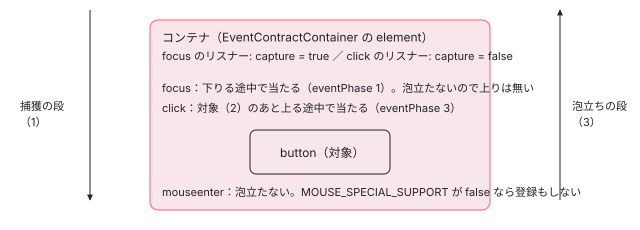

[目次](../README.md) › [イベント配送（event-dispatch）と jsaction の内側](README.md) › 第 4 回 / 全 12 回

# イベントの種類：泡立つもの・捕まえるもの・早期のもの

> event\_type.ts の EventType の一覧、BUBBLE\_EVENT\_TYPES と CAPTURE\_EVENT\_TYPES（focus・blur・load・error などを捕獲の段で付ける理由）、MOUSE\_SPECIAL\_EVENT\_TYPES、EARLY\_EVENT\_TYPES と isEarlyEventType、event.ts の getBrowserEventType・addEventListener・removeEventListener が passive と capture を決める行。

angular/angular · 読了 約 12 分 · 中核 · [サイトで読む（デモが動きます）](https://angular-deep-dive-cyan.vercel.app/chapter/jsaction-event-types)

---

JSAction はイベントのリスナーを要素ごとに付けず、コンテナ（ふつうは `<body>`）に種類ごとに 1 つだけ付けます。だから「コンテナまで届かないイベント」をどう受けるかが最初の問題になります。この章では、`event_type.ts` の名前の表と 4 つの並び（泡立つもの・捕獲の段で受けるもの・作り直しが要るもの・早期に記録できるもの）を読み、`event.ts` の `getBrowserEventType`・`addEventListener`・`removeEventListener` が「どの名前で」「capture か bubble か」「passive を付けるか」を決める行を 1 つずつ追います。最後に、このページの上で本物の `EventContract` に focus・click・mouseenter を登録して、どれが届くかを確かめます。

読む対象は `packages/core/primitives/event-dispatch/src/` の `event_type.ts`・`event.ts`（1〜102 行目）・`event_handler.ts`・`event_contract_defines.ts` です。

1. [1. 全体像](01-jsaction-overview.md)
2. [2. jsaction 属性](02-jsaction-attribute.md)
3. [3. EventInfo](03-jsaction-event-info.md)
4. **4. イベントの種類**（この章）
5. [5. 早期の契約](05-jsaction-early-contract.md)
6. [6. EventContract](06-jsaction-contract.md)
7. [7. 行き先を探す](07-jsaction-resolver.md)
8. [8. a11y の click](08-jsaction-a11y-click.md)
9. [9. mouseenter とタッチ](09-jsaction-mouse-touch.md)
10. [10. Dispatcher](10-jsaction-dispatcher.md)
11. [11. Angular の側](11-jsaction-angular.md)
12. [12. spec と issue](12-jsaction-tests-issues.md)

> [!TIP]
> **新卒エンジニアへ**
>
> **用語を 3 つ。**DOM のイベントは、`window` から対象の要素へ下りる**捕獲の段**（capture。`eventPhase` が 1）、対象そのもの（2）、対象から親へ上る**泡立ちの段**（bubble。3）の順に配られます。`addEventListener` の第 3 引数で `capture: true` にすると捕獲の段で、指定しないと泡立ちの段で呼ばれます。泡立たないイベント（focus など）は 3 の段が無いので、親で受けるには捕獲の段で聞くしかありません。**passive** は「このリスナーは `preventDefault()` を呼ばない」という約束で、ブラウザはスクロールを待たずに進められます。

## 1. EventType：JSAction が特別に扱う名前の表

`EventType` はただの定数の表で、表の上のコメント（event\_type.ts の冒頭）のとおり「使えるイベントの全部」ではありません。表に無い名前でも `addEvent()` と jsaction 属性に書けます。ここに載っているのは、JSAction が何か特別なことをする名前です。

📄 `angular/packages/core/primitives/event-dispatch/src/event_type.ts` L31–64 （▶ の行: 32–34, 37, 41–42, 45, 49–50, 52, 60–61, 64）

```ts
31 │   /**
32 ▶    * The click event. In addEvent() refers to all click events, in the
33 ▶    * jsaction attribute it refers to the unmodified click and Enter/Space
34 ▶    * keypress events.  In the latter case, a jsaction click will be triggered,
35 │    * for accessibility reasons.  See clickmod and clickonly, below.
36 │    */
37 ▶   CLICK: 'click',
38 │ 
39 │   /**
40 │    * Specifies the jsaction for a modified click event (i.e. a mouse
41 ▶    * click with the modifier key Cmd/Ctrl pressed). This event isn't
42 ▶    * separately enabled in addEvent(), because in the DOM, it's just a
43 │    * click event.
44 │    */
45 ▶   CLICKMOD: 'clickmod',
46 │ 
47 │   /**
48 │    * Specifies the jsaction for a click-only event.  Click-only doesn't take
49 ▶    * into account the case where an element with focus receives an Enter/Space
50 ▶    * keypress.  This event isn't separately enabled in addEvent().
51 │    */
52 ▶   CLICKONLY: 'clickonly',
53 │ 
54 │   /**
55 │    * The dblclick event.
56 │    */
57 │   DBLCLICK: 'dblclick',
58 │ 
59 │   /**
60 ▶    * Focus doesn't bubble, but you can use it in addEvent() and
61 ▶    * jsaction anyway. EventContract does the right thing under the
62 │    * hood.
63 │    */
64 ▶   FOCUS: 'focus',
```

1. **32〜37 行目：click は場所によって意味が違う**

   `addEvent('click')` では DOM の click の全部を指します。jsaction 属性の `click:` では「修飾キーの無いクリック」と「Enter・Space のキー」を指します。キーを click として扱う仕組みは[第 8 回](08-jsaction-a11y-click.md)です。
2. **45・52 行目：clickmod と clickonly は jsaction 属性だけの名前**

   41〜43 行目と 49〜50 行目のとおり、どちらも `addEvent()` では別に登録しません。DOM では click の 1 種類だからです。修飾キー付きのクリックをどちらの名前で探すかは[第 7 回](07-jsaction-resolver.md)で読みます。
3. **60〜64 行目：focus は泡立たないが、そのまま使える**

   「EventContract が裏で正しく扱う」と書いてあります。その「正しく」の中身が、4 節の `addEventListener` の 67〜69 行目（捕獲の段で付ける）です。

📄 `angular/packages/core/primitives/event-dispatch/src/event_type.ts` L83–90 （▶ の行: 84–85, 90）

```ts
83 │   /**
84 ▶    * Submit doesn't bubble, so it cannot be used with event
85 ▶    * contract. However, the browser helpfully fires a click event on
86 │    * the submit button of a form (even if the form is not submitted by
87 │    * a click on the submit button). So you should handle click on the
88 │    * submit button instead.
89 │    */
90 ▶   SUBMIT: 'submit',
```

84〜85 行目のコメントは「submit は泡立たないので契約では使えない」と書いています。ところが、2 節の `BUBBLE_EVENT_TYPES` には `EventType.SUBMIT` が入っています（305 行目。[event-replay の章](../platform/14-event-replay.md)の 1 節の引用の中です）。コメントと一覧が食い違っています。このページの Chrome（ヘッドレス、2026-11-06）で、`<form>` の親に泡立ちの段のリスナーを付けて `requestSubmit()` を呼ぶと、親のリスナーが `eventPhase = 3` で呼ばれました。いまのブラウザでは submit は泡立つので、一覧の側が実物に合っています。

📄 `angular/packages/core/primitives/event-dispatch/src/event_type.ts` L140–150 （▶ の行: 141–142, 144, 150）

```ts
140 │   /**
141 ▶    * The mouseenter event. Does not bubble and fires individually on each
142 ▶    * element being entered within a DOM tree.
143 │    */
144 ▶   MOUSEENTER: 'mouseenter',
145 │ 
146 │   /**
147 │    * The mouseleave event. Does not bubble and fires individually on each
148 │    * element being entered within a DOM tree.
149 │    */
150 ▶   MOUSELEAVE: 'mouseleave',
```

📄 `angular/packages/core/primitives/event-dispatch/src/event_type.ts` L221–233 （▶ の行: 222–223, 226, 229–230, 233）

```ts
221 │   /**
222 ▶    * The error event. The error event doesn't bubble, but you can use it in
223 ▶    * addEvent() and jsaction anyway. EventContract does the right thing under
224 │    * the hood (except in IE8 which does not use error events).
225 │    */
226 ▶   ERROR: 'error',
227 │ 
228 │   /**
229 ▶    * The load event. The load event doesn't bubble, but you can use it in
230 ▶    * addEvent() and jsaction anyway. EventContract does the right thing
231 │    * under the hood.
232 │    */
233 ▶   LOAD: 'load',
```

mouseenter・mouseleave は 141〜142 行目のとおり泡立たず、入った要素ごとに 1 回ずつ起きます。error と load も泡立ちません。ただし扱いは別々です。error・load は捕獲の段で受け（2 節の `CAPTURE_EVENT_TYPES`）、mouseenter は捕獲の段の一覧にも入っていません。3 節の event.ts 17〜21 行目のコメントのとおり、JSAction は mouseenter を「コンテナの境目では見えないもの」として扱い、泡立つ mouseover から作り直します（[第 9 回](09-jsaction-mouse-touch.md)）。

## 2. 4 つの並び：BUBBLE・CAPTURE・MOUSE\_SPECIAL・EARLY

📄 `angular/packages/core/primitives/event-dispatch/src/event_type.ts` L285–294 （▶ の行: 286–291, 294）

```ts
285 │ 
286 ▶ /** All event types that do not bubble or capture and need a polyfill. */
287 ▶ export const MOUSE_SPECIAL_EVENT_TYPES = [
288 ▶   EventType.MOUSEENTER,
289 ▶   EventType.MOUSELEAVE,
290 ▶   'pointerenter',
291 ▶   'pointerleave',
292 │ ];
293 │ 
294 ▶ /** All event types that are registered in the bubble phase. */
```

📄 `angular/packages/core/primitives/event-dispatch/src/event_contract_defines.ts` L9–14 （▶ の行: 13–14）

```ts
 9 │ /**
10 │  * @define Support for the non-bubbling mouseenter and mouseleave events.  This
11 │  * flag can be overridden in a build rule.
12 │  */
13 ▶ // g3-only export const MOUSE_SPECIAL_SUPPORT = goog.define('jsaction.EventContract.MOUSE_SPECIAL_SUPPORT', false,);
14 ▶ export const MOUSE_SPECIAL_SUPPORT = false; // 3p-only
```

286 行目のコメントは「泡立ちも捕獲もせず、作り直し（polyfill）が要る種類」です。この 4 つを受けるかどうかは `MOUSE_SPECIAL_SUPPORT` が決め、Angular の配布物では 14 行目のとおり `false` です。13 行目は Google の中のビルド（g3）だけで有効になる行で、`// g3-only` と 14 行目の `// 3p-only` の印は 4f9ee3c056a（2026-05-21、refactor: add g3-only and 3p-only markers…）で付きました。`git show` で読むと、それまで同期のたびに当てていたファイルごとの差分を、コメントの印で置き換える変更です。false のとき何が起きるかは [第 6 回](06-jsaction-contract.md)の `addEvent` の 157〜158 行目で読みます。

泡立つ種類の一覧 `BUBBLE_EVENT_TYPES` の前半（295〜318 行目。click・focusin・keydown・mouseover・submit・touch・input など）は [event-replay の章](../platform/14-event-replay.md)の 1 節で読みました。この章では後半を読みます。

📄 `angular/packages/core/primitives/event-dispatch/src/event_type.ts` L320–355 （▶ の行: 320, 323, 325, 328, 335, 341, 345, 349, 351, 354）

```ts
320 ▶   'copy',
321 │   'cut',
322 │   'paste',
323 ▶   'mousedown',
324 │   'mouseup',
325 ▶   'wheel',
326 │   'contextmenu',
327 │ 
328 ▶   'dragover',
329 │   'dragenter',
330 │   'dragleave',
331 │   'drop',
332 │   'dragstart',
333 │   'dragend',
334 │ 
335 ▶   'pointerdown',
336 │   'pointermove',
337 │   'pointerup',
338 │   'pointercancel',
339 │   'pointerover',
340 │   'pointerout',
341 ▶   'gotpointercapture',
342 │   'lostpointercapture',
343 │ 
344 │   // Video events.
345 ▶   'ended',
346 │   'loadedmetadata',
347 │ 
348 │   // Page visibility events.
349 ▶   'pagehide',
350 │   'pageshow',
351 ▶   'visibilitychange',
352 │ 
353 │   // Content visibility events.
354 ▶   'beforematch',
355 │ ];
```

320 行目からは、クリップボード（copy・cut・paste）、323〜326 行目のマウスのボタンとホイール、328〜333 行目のドラッグ、335〜342 行目のポインター、345〜346 行目の動画の 2 つ、349〜351 行目のページの表示（pagehide・pageshow・visibilitychange）、354 行目の `beforematch`（`hidden="until-found"` の要素がページ内検索で見つかったとき）です。数えると、一覧は全部で 49 個です。

📄 `angular/packages/core/primitives/event-dispatch/src/event_type.ts` L358–364 （▶ の行: 358–363）

```ts
358 ▶ export const CAPTURE_EVENT_TYPES = [
359 ▶   EventType.FOCUS,
360 ▶   EventType.BLUR,
361 ▶   EventType.ERROR,
362 ▶   EventType.LOAD,
363 ▶   EventType.TOGGLE,
364 │ ];
```

📄 `angular/packages/core/primitives/event-dispatch/src/event_type.ts` L366–372 （▶ の行: 371–372）

```ts
366 │ /**
367 │  * Whether or not an event type should be registered in the capture phase.
368 │  * @param eventType
369 │  * @returns bool
370 │  */
371 ▶ export const isCaptureEventType = (eventType: string) =>
372 ▶   CAPTURE_EVENT_TYPES.indexOf(eventType) >= 0;
```

📄 `angular/packages/core/primitives/event-dispatch/src/event_type.ts` L374–380 （▶ の行: 375, 380）

```ts
374 │ /** All event types that are registered early.  */
375 ▶ const EARLY_EVENT_TYPES = BUBBLE_EVENT_TYPES.concat(CAPTURE_EVENT_TYPES);
376 │ 
377 │ /**
378 │  * Whether or not an event type is registered in the early contract.
379 │  */
380 ▶ export const isEarlyEventType = (eventType: string) => EARLY_EVENT_TYPES.indexOf(eventType) >= 0;
```

1. **358〜364 行目：捕獲の段で受ける 5 つ**

   focus・blur・error・load・toggle。どれも泡立たないイベントです。focusin・focusout は泡立つので、こちらではなく `BUBBLE_EVENT_TYPES` にあります。
2. **371〜372 行目：`isCaptureEventType` は一覧に入っているかだけを見る**

   `indexOf(eventType) >= 0` です。名前の大文字小文字は直しません。
3. **375・380 行目：`EARLY_EVENT_TYPES` は 2 つの一覧をつないだもの**

   49 + 5 = 54 個です。375 行目の定数は `export` されず、外から使えるのは 380 行目の `isEarlyEventType` だけです。`MOUSE_SPECIAL_EVENT_TYPES` はつながれていないので、mouseenter は「早期に記録できる種類」ではありません。

| 並び | 行 | 数 | 使う所 |
| --- | --- | --- | --- |
| `BUBBLE_EVENT_TYPES` | 295〜355 | 49 | 375 行目でつながれるだけ。event-dispatch の中で直接は使わない |
| `CAPTURE_EVENT_TYPES` | 358〜364 | 5 | `isCaptureEventType` を通して、event.ts 67 行目（4 節）・event\_dispatcher.ts 91 行目（捕獲の種類は担当の要素が対象そのものの時だけ配る。[event-replay の章](../platform/14-event-replay.md)の 7 節・[第 10 回](10-jsaction-dispatcher.md)）・core の hydration/event\_replay.ts 251 行目 |
| `MOUSE_SPECIAL_EVENT_TYPES` | 287〜292 | 4 | eventcontract.ts 157 行目（[第 6 回](06-jsaction-contract.md)）と、作り直しの判定（[第 9 回](09-jsaction-mouse-touch.md)） |
| `EARLY_EVENT_TYPES` | 375 | 54 | `isEarlyEventType` を通して、core の hydration/event\_replay.ts 248 行目だけ。サーバーがテンプレートのリスナーから「記録する種類」を集めるときに、ここに無い種類を飛ばします（[event-replay の章](../platform/14-event-replay.md)の 2 節） |

つまり、一覧の 2 つは別々の所で効きます。`CAPTURE_EVENT_TYPES` は「ブラウザにどの段でリスナーを付けるか」に効き、`EARLY_EVENT_TYPES` は「サーバーが HTML の契約の 1 行に書く種類」に効きます。テンプレートに `(mouseenter)` や `(scroll)` しか無いページには、契約のスクリプトが入りません（下のテストの節の it）。

## 3. getBrowserEventType：ブラウザに登録する名前を差し替える

📄 `angular/packages/core/primitives/event-dispatch/src/event.ts` L13–32 （▶ の行: 16, 19–20, 22–29, 31）

```ts
13 │ /**
14 │  * Gets a browser event type, if it would differ from the JSAction event type.
15 │  */
16 ▶ export function getBrowserEventType(eventType: string) {
17 │   // Mouseenter and mouseleave events are not handled directly because they
18 │   // are not available everywhere. In browsers where they are available, they
19 ▶   // don't bubble and aren't visible at the container boundary. Instead, we
20 ▶   // synthesize the mouseenter and mouseleave events from mouseover and
21 │   // mouseout events, respectively. Cf. eventcontract.js.
22 ▶   if (eventType === EventType.MOUSEENTER) {
23 ▶     return EventType.MOUSEOVER;
24 ▶   } else if (eventType === EventType.MOUSELEAVE) {
25 ▶     return EventType.MOUSEOUT;
26 ▶   } else if (eventType === EventType.POINTERENTER) {
27 ▶     return EventType.POINTEROVER;
28 ▶   } else if (eventType === EventType.POINTERLEAVE) {
29 ▶     return EventType.POINTEROUT;
30 │   }
31 ▶   return eventType;
32 │ }
```

1. **22〜29 行目：4 つの名前だけを、泡立つ名前に替える**

   mouseenter → mouseover、mouseleave → mouseout、pointerenter → pointerover、pointerleave → pointerout。17〜21 行目のコメントのとおり、泡立たない 4 つはコンテナでは見えないので、泡立つ相手の名前でリスナーを付け、あとで作り直します。
2. **31 行目：ほかの名前はそのまま返す**

   focus も click もここでは変わりません。focus を受けられるかどうかは名前ではなく、次の節の「段」で決まります。

呼ぶのは `EventContract.addEvent` の 168 行目だけです（[第 6 回](06-jsaction-contract.md)）。その前の 157 行目で、`MOUSE_SPECIAL_SUPPORT` が `false` なら 4 つの名前は戻されるので、Angular の配布物のふつうの使い方では 22〜29 行目に入りません。下のデモで「MOUSE\_SPECIAL\_SUPPORT を一時的に true にする」を選ぶと、ここを通る様子が見えます。

## 4. addEventListener：capture と passive を決めて付ける

📄 `angular/packages/core/primitives/event-dispatch/src/event.ts` L45–75 （▶ の行: 49, 51–52, 54–55, 63–65, 67–68, 71–72, 74）

```ts
45 │ export function addEventListener(
46 │   element: Element,
47 │   eventType: string,
48 │   handler: (event: Event) => void,
49 ▶   passive?: boolean,
50 │ ): EventHandlerInfo {
51 ▶   // All event handlers are registered in the bubbling
52 ▶   // phase.
53 │   //
54 ▶   // All browsers support focus and blur, but these events only are propagated
55 ▶   // in the capture phase. Very legacy browsers do not support focusin or
56 │   // focusout.
57 │   //
58 │   // It would be a bad idea to register all event handlers in the
59 │   // capture phase because then regular onclick handlers would not be
60 │   // executed at all on events that trigger a jsaction. That's not
61 │   // entirely what we want, at least for now.
62 │   //
63 ▶   // Error and load events (i.e. on images) do not bubble so they are also
64 ▶   // handled in the capture phase.
65 ▶   let capture = false;
66 │ 
67 ▶   if (isCaptureEventType(eventType)) {
68 ▶     capture = true;
69 │   }
70 │ 
71 ▶   const options = typeof passive === 'boolean' ? {capture, passive} : capture;
72 ▶   element.addEventListener(eventType, handler, options);
73 │ 
74 ▶   return {eventType, handler, capture, passive};
75 │ }
```

📄 `angular/packages/core/primitives/event-dispatch/src/event_handler.ts` L9–22 （▶ の行: 14–15, 17, 19, 21）

```ts
 9 │ /**
10 │  *
11 │  * Information about a registered event handler, which can be used to
12 │  * deregister the event handler.
13 │  */
14 ▶ export interface EventHandlerInfo {
15 ▶   eventType: string;
16 │ 
17 ▶   handler: (event: Event) => void;
18 │ 
19 ▶   capture: boolean;
20 │ 
21 ▶   passive?: boolean;
22 │ }
```

1. **65 行目：まず泡立ちの段（capture = false）**

   51〜52 行目のコメントのとおり、原則は泡立ちの段です。58〜61 行目は理由で、全部を捕獲の段で付けると、ページのふつうの `onclick` より先に JSAction が動いてしまうからです。
2. **67〜69 行目：捕獲の 5 つだけ capture = true**

   2 節の 371 行目の判定です。54〜55 行目と 63〜64 行目のコメントが、focus・blur と error・load を捕獲の段で付ける理由です。
3. **71 行目：passive が真偽値のときだけ、オブジェクトで渡す**

   `passive` が `true` か `false` なら `{capture, passive}`、省いたら（`undefined`）真偽値の `capture` だけを渡します。だから「passive を省く」と「passive: false」は、ブラウザに渡る形が違います。省いたときは、ブラウザが決める既定の passive のままです。
4. **72・74 行目：付けて、外すための控えを返す**

   返す `EventHandlerInfo`（event\_handler.ts 14〜22 行目）は、種類・付けた関数・capture・passive の 4 つです。`EventContractContainer` はこれを配列に貯めておき、片付けのときに使います（[第 6 回](06-jsaction-contract.md)）。

📄 `angular/packages/core/primitives/event-dispatch/src/event.ts` L77–97 （▶ の行: 86, 90–91, 93, 95）

```ts
77 │ /**
78 │  * Removes the event handler for the given event from the element.
79 │  * the given event type.
80 │  *
81 │  * @param element The element.
82 │  * @param info The information needed to deregister the handler, as returned by
83 │  *     addEventListener(), above.
84 │  */
85 │ export function removeEventListener(element: Element, info: EventHandlerInfo) {
86 ▶   if (element.removeEventListener) {
87 │     // It's worth noting that some browser releases have been inconsistent on this, and unless
88 │     // you have specific reasons otherwise, it's probably wise to use the same values used for
89 │     // the call to addEventListener() when calling removeEventListener().
90 ▶     const options = typeof info.passive === 'boolean' ? {capture: info.capture} : info.capture;
91 ▶     element.removeEventListener(info.eventType, info.handler as EventListener, options);
92 │     // `detachEvent` is an old DOM API.
93 ▶   } else if ((element as any).detachEvent) {
94 │     // `detachEvent` is an old DOM API.
95 ▶     (element as any).detachEvent(`on${info.eventType}`, info.handler);
96 │   }
97 │ }
```

外すときは、90 行目で `passive` を渡しません。ブラウザがリスナーを見分けるのは「種類・関数・capture」の 3 つだからです。passive を付けて登録したときだけオブジェクトの形 `{capture}` にして、付けたときの形に揃えています（87〜89 行目のコメント）。93〜96 行目の `detachEvent` は古い IE の API で、いまのブラウザでは通りません。

passive を渡す人は誰でしょうか。`EventContract.addEvent(eventType, prefixedEventType, passive)` の第 3 引数が、そのまま 71 行目に届きます。Angular の `initEventReplay` は `addEvent(et)` と 1 つの引数で呼ぶので（[event-replay の章](../platform/14-event-replay.md)の 6 節の 212・215 行目）、Angular が `<body>` に付けるリスナーはいつも真偽値の形です。早期の契約は、この関数を通らずに `addEventListener(eventType, h, capture)` を直接呼びます（[第 5 回](05-jsaction-early-contract.md)）。



*同じコンテナで focus と click を受けるとき。focus は捕獲の段（下りる途中）でコンテナのリスナーに当たり、click は泡立ちの段（上る途中）で当たる。*

## 5. DEMO：同じコンテナで focus・click・mouseenter を受ける（ライブ）

> **🧪 DEMO — EventContractContainer が付けたリスナーと、届いた EventInfo**
>
> これはライブです。このページが読み込んだ本物の `@angular/core/primitives/event-dispatch`（22.1.6）の `EventContract` と `EventContractContainer` を、「契約を作る」を押したときだけ、下の点線の箱に作ります。`addEvent('focus')`・`addEvent('click')`・`addEvent('mouseenter')` を呼び、dispatcher には届いた `EventInfo` をそのまま表に足す関数を登録します（Angular の `EventDispatcher` は通さないので、jsaction 属性は読まれません。[第 7 回](07-jsaction-resolver.md)）。「付けたリスナー」の表は、`EventContractContainer` の private の配列 `handlerInfos`（event\_contract\_container.ts 37 行目）を読んだものです。比べるために、箱には素の `focus` のリスナーを泡立ちの段でも 1 つ付けます。
>
> ▶ [このデモはサイトで動かせます](https://angular-deep-dive-cyan.vercel.app/chapter/jsaction-event-types)

ヘッドレスの Chrome（本番ビルド）で、CDP の `Input` で本物のクリック・Tab・マウスの移動を送って確かめた結果です。

1. **付いたリスナーは 2 つだけ**

   `focus`（capture = true）と `click`（capture = false）です。`addEvent('mouseenter')` は eventcontract.ts の 157〜158 行目で戻り、何も付きません。passive の列は「省いた」です（4 節の 71 行目で真偽値の形）。
2. **focus は eventPhase 1、click は 3 で届く**

   入力欄をクリックすると、まずフォーカスが移って `focus` の EventInfo が「1 捕獲の段」で届き、次に `click` が「3 泡立ちの段」で届きます。ボタンも同じで、Chrome はクリックでボタンにフォーカスを移すので `focus`（1）→ `click`（3）の順です。`getTargetElement()` は押した要素、`getContainer()` はどちらも箱（`div#jsa-et-box`）です。
3. **素の focus のリスナー（泡立ちの段）は 0 回のまま**

   focus は泡立たないので、捕獲の段で聞かない限りコンテナには来ません。67〜69 行目が無ければ、契約は focus を 1 つも受けられません。
4. **マウスを乗せても何も届かない**

   mouseenter のリスナーが無く、mouseover も登録していないからです。
5. **MOUSE\_SPECIAL\_SUPPORT を true にすると、mouseover のリスナーが増える**

   表に `mouseover`（capture = false）が足されます。3 節の 22〜23 行目で名前が替わったからです。マウスを動かすと、`getEventType()` が `mouseenter`、`event.type` が `mouseover` の EventInfo が、箱の中で要素をまたぐたびに届きます（箱そのものに入ったときは対象が箱なので「2 対象そのもの」）。本物の mouseenter として 1 回に絞るのは、この先の Dispatcher の仕事です（[第 9 回](09-jsaction-mouse-touch.md)）。
6. **片付けのあとは、表が空になり、何も届かない**

   event.ts 85〜97 行目の `removeEventListener` が、控えの 1 つずつに呼ばれた結果です（[第 6 回](06-jsaction-contract.md)の `cleanUp`）。

> [!NOTE]
> **ポイント**
>
> このページ自身も、`<body>` に Angular の契約（click だけ）を置いています（[第 5 回](05-jsaction-early-contract.md)の 6 節）。デモの箱の中のクリックはそちらにも届きますが、Angular の配り役は jsaction の要素に預けたリスナー（`__jsaction_fns`）が無ければ何もしません（[event-replay の章](../platform/14-event-replay.md)の 7 節）。デモは箱の上の契約だけを見ています。

## ここまでの呼び出し

- 👤 `contract.addEvent('focus')` — デモ・Angular の initEventReplay
  - `MOUSE_SPECIAL_EVENT_TYPES.indexOf(eventType)` — eventcontract.ts 157 — *mouseenter ならここで戻る*
  - `getBrowserEventType(eventType)` — event.ts 16 — *4 つの名前だけ替える*
  - `EventContractContainer.addEventListener` — event\_contract\_container.ts 49 — *第 6 回*
    - `addEventListener(element, eventType, handler, passive)` — event.ts 45
      - `isCaptureEventType(eventType)` — event\_type.ts 371 — *focus・blur・error・load・toggle なら capture*
      - `element.addEventListener(eventType, handler, options)` — event.ts 72 — *options は 71 行目*
- 👤 `ユーザーの focus / click` — コンテナのリスナー — *focus は 1、click は 3 の段*
- `EventContract.cleanUp()` → `removeEventListener(element, info)` — event.ts 85 — *passive は渡さない（90 行目）*

## テストと直し方

### spec と describe

| spec | describe / it | この章のどこ |
| --- | --- | --- |
| packages/core/primitives/event-dispatch/test/event\_test.ts | describe `event test.ts`（66 行目）の it `add event listener click w3 c`（73 行目）・`… focus w3 c`（83）・`… blur w3 c`（93）・`… error w3 c`（103）・`… load w3 c`（113）・`… toggle w3 c`（123）・`… touchstart w3 c`（133）・`… with passive:false`（143）・`… with passive:true`（156）、`remove event listener touchstart w3 c` の 3 つ（169・177・187） | 4 節。focus など 5 つは `toHaveBeenCalledOnceWith('focus', handler, true)`（87 行目など）で第 3 引数が `true`、click は `false`（77 行目）であることを確かめています |
| packages/core/primitives/event-dispatch/test/eventcontract\_test.ts | describe `EventContract`（156 行目）の it `adds event listener without passive option`（196）・`adds event listener for passive:false event`（211）・`adds event listener for passive:true event`（225） | 4 節の 71 行目を、`EventContract` を通して |
| packages/platform-server/test/event\_replay\_spec.ts | describe `event dispatch script`（643 行目）の it `should not replay mouse events`（687 行目） | 2 節の `EARLY_EVENT_TYPES`。`(mouseenter)` だけのテンプレートでは jsaction も契約のスクリプトも出ない |

📄 `angular/packages/core/primitives/event-dispatch/test/eventcontract_test.ts` L211–237 （▶ の行: 217, 219–221, 231, 233–235）

```ts
211 │   it('adds event listener for passive:false event', () => {
212 │     const container = getRequiredElementById('container');
213 │     const addEventListenerSpy = spyOn(container, 'addEventListener');
214 │ 
215 │     const eventContractContainerManager = new EventContractContainer(container);
216 │     const eventContract = createEventContract({eventContractContainerManager, eventTypes: []});
217 ▶     eventContract.addEvent('touchstart', '', false);
218 │ 
219 ▶     expect(addEventListenerSpy).toHaveBeenCalledOnceWith('touchstart', jasmine.any(Function), {
220 ▶       capture: false,
221 ▶       passive: false,
222 │     });
223 │   });
224 │ 
225 │   it('adds event listener for passive:true event', () => {
226 │     const container = getRequiredElementById('container');
227 │     const addEventListenerSpy = spyOn(container, 'addEventListener');
228 │ 
229 │     const eventContractContainerManager = new EventContractContainer(container);
230 │     const eventContract = createEventContract({eventContractContainerManager, eventTypes: []});
231 ▶     eventContract.addEvent('touchstart', '', true);
232 │ 
233 ▶     expect(addEventListenerSpy).toHaveBeenCalledOnceWith('touchstart', jasmine.any(Function), {
234 ▶       capture: false,
235 ▶       passive: true,
236 │     });
237 │   });
```

217 行目は第 2 引数（`prefixedEventType`）に空文字を渡しています。空文字は偽なので、eventcontract.ts 168 行目の `prefixedEventType || eventType` で `touchstart` に戻ります。219〜222 行目で、passive が真偽値のときはオブジェクトの形 `{capture: false, passive: false}` で渡ることを確かめています。196 行目の it は passive を省いたときに第 3 引数が `false`（真偽値）になることを見ます。

### 手元で走らせた結果

📄 `ターミナル（../angular で）`

```
cd ~/angular-research/angular
pnpm bazel test //packages/core/primitives/event-dispatch/test:browser_test_chromium \
  //packages/core/primitives/event-dispatch/test:browser_test_firefox \
  //packages/core/primitives/event-dispatch:tsec_test \
  --nocache_test_results --test_output=all

# 名前で絞れるかを試す（効かない。下の結果）
pnpm bazel test //packages/core/primitives/event-dispatch/test:browser_test_chromium \
  '--test_arg=--filter=EventContract' --nocache_test_results --test_output=all

# サーバー側の「mouseenter は記録しない」の it だけ
pnpm bazel test //packages/platform-server/test:event_replay_test \
  '--test_arg=--filter=should not replay mouse events' --nocache_test_results --test_output=all
```

📄 `出力（2026-11-06 に実行。抜粋。ログは scratchpad/jsa-logs/b-base.log・b-filter.log・b-server.log）`

```
Chromium: |██████████| 1/1 test files | 111 passed, 0 failed
Firefox:  |██████████| 1/1 test files | 111 passed, 0 failed
INFO: Elapsed time: 2.746s
//packages/core/primitives/event-dispatch:tsec_test                      PASSED in 0.6s
//packages/core/primitives/event-dispatch/test:browser_test_chromium     PASSED in 1.0s
//packages/core/primitives/event-dispatch/test:browser_test_firefox      PASSED in 2.0s

# --test_arg=--filter=EventContract を付けても
Chromium: |██████████| 1/1 test files | 111 passed, 0 failed
//packages/core/primitives/event-dispatch/test:browser_test_chromium     PASSED in 0.8s

# event_replay_test（Node の jasmine）
Ran 1 of 23 specs
//packages/platform-server/test:event_replay_test                        PASSED in 0.6s
```

- event-dispatch の spec はブラウザの中（Web Test Runner と jasmine）で、4 つの spec ファイルを 1 つに束ねて走ります。`--test_arg=--filter=…` を付けても 111 件のままだったので、名前の絞り込みは効きません。いつもターゲット全体（111 件）を走らせます。
- platform-server の `event_replay_test` は Node の jasmine なので、絞り込みが効きます（「Ran 1 of 23 specs」）。

### 直すとしたら

- 「この種類も記録してほしい」という直しは、event\_type.ts の一覧に名前を足すことになります。`BUBBLE_EVENT_TYPES` か `CAPTURE_EVENT_TYPES` に足せば、そのまま `isEarlyEventType` に入り、サーバーが HTML の契約の 1 行に書くようになります（core の event\_replay.ts 248 行目）。spec は event\_test.ts の `add event listener … w3 c` の形（capture の真偽値を見る）と、event\_replay\_spec.ts の `event dispatch script` の describe に足します。
- 捕獲の段で受ける `load` については、開いている #59260（2024-12-20、The `load` event on image elements is triggered twice with event replay）が「`(load)` が再生と本物のリスナーで 2 回呼ばれる」と報告しています。付いた PR #68131（失敗する spec を足す）と #68178（直し）は、どちらもマージされずに閉じられています。読むときは、この章の 362 行目（load が早期に記録できる種類であること）と、Angular の側の二重呼び出しの守り（[第 11 回](11-jsaction-angular.md)）を合わせて見ます。
- 1 節の submit のコメント（84〜85 行目）と一覧（305 行目）の食い違いは、コメントだけの話で、動きには影響しません。
- 本家に PR を出すことは勧めません。issue を読むときに、その種類がどの並びにあるか（捕獲か、泡立ちか、作り直しか）を最初に確かめる手がかりにします（[第 12 回](12-jsaction-tests-issues.md)）。

## 聞かれそうな質問

**Q. focus は泡立たないのに、なぜ `<body>` の 1 つのリスナーで受けられるのですか？**

event.ts の 67〜69 行目で、focus（と blur・error・load・toggle）は `capture = true`、つまり捕獲の段で付けるからです。捕獲の段は `window` から対象へ下りる途中なので、泡立たないイベントでも親のリスナーに当たります。デモでも focus は `eventPhase` 1 で届き、泡立ちの段に付けた素のリスナーは 0 回でした。

**Q. `addEvent('mouseenter')` を呼ぶと何が起きますか？**

Angular の配布物では何も起きません。`MOUSE_SPECIAL_SUPPORT` が event\_contract\_defines.ts の 14 行目で `false` なので、eventcontract.ts の 157〜158 行目で戻り、リスナーも付きません。true にすると、event.ts の 22〜23 行目で mouseover に名前を替えて付けます。

**Q. focusin と focus は、どちらの一覧にありますか？**

focusin・focusout は泡立つので `BUBBLE_EVENT_TYPES`（event-replay の章の 1 節の引用の 298〜299 行目）、focus・blur は泡立たないので `CAPTURE_EVENT_TYPES`（359〜360 行目）です。同じ「フォーカス」でも、付ける段が違います。

**Q. passive を指定しないのと `passive: false` は同じですか？**

ブラウザに渡る形が違います。event.ts の 71 行目は、passive が真偽値のときだけ `{capture, passive}` を渡し、省いたときは真偽値の `capture` だけを渡します。省いたときの passive は、ブラウザの既定のままです。eventcontract\_test.ts の 196・211・225 行目の 3 つの it がこの違いを確かめています。

**Q. `(scroll)` のリスナーは、JS が届く前に記録されますか？**

されません。scroll は `BUBBLE_EVENT_TYPES` にも `CAPTURE_EVENT_TYPES` にも無いので、380 行目の `isEarlyEventType` が偽を返し、サーバーは契約の 1 行に書きません（core の event\_replay.ts 248 行目）。mouseenter も同じで、event\_replay\_spec.ts の 687 行目の it が確かめています。

## 読み終えて

- `EventType` は「特別に扱う名前」の表で、使える名前の全部ではありません。clickmod・clickonly は jsaction 属性だけの名前です。
- 泡立つ 49 個、捕獲の段で受ける 5 個、作り直しが要る 4 個。早期に記録できるのは前の 2 つをつないだ 54 個です。
- `CAPTURE_EVENT_TYPES` はブラウザに付ける段に、`EARLY_EVENT_TYPES` はサーバーが契約に書く種類に効きます。
- `getBrowserEventType` は mouseenter などの 4 つを泡立つ名前に替えるだけで、Angular の配布物ではその前の行で 4 つとも戻されます。
- `addEventListener` は passive が真偽値のときだけオブジェクトで渡し、外すときは passive を渡しません。

---

← 前: [EventInfo：イベントを運ぶ入れ物の形](03-jsaction-event-info.md)  
次: [早期の契約：JS が来る前のイベントを貯める](05-jsaction-early-contract.md) →
