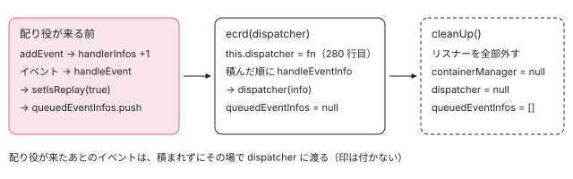

[目次](../README.md) › [イベント配送（event-dispatch）と jsaction の内側](README.md) › 第 6 回 / 全 12 回

# EventContract と EventContractContainer：コンテナにリスナーを付ける

> EventContract の欄と、addEvent が種類ごとに EventContractContainer へリスナーを 1 つ付ける行（重複・mouseenter の戻り、ブラウザの名前が違うときの browserEventTypeToExtraEventTypes）、handleEvent が EventInfo を作り、dispatcher が無ければ再生の印を付けて queue に貯め、あれば渡す行、getEventTypesForBrowserEventType（replayEarlyEventInfos が使う）と handler、registerDispatcher（ecrd）と実行時には読まれない Restriction、cleanUp。

angular/angular · 読了 約 13 分 · 中核 · [サイトで読む（デモが動きます）](https://angular-deep-dive-cyan.vercel.app/chapter/jsaction-contract)

---

`EventContract` は JSAction の受け口です。コンテナに種類ごとに 1 つのリスナーを付け、イベントが来たら `EventInfo` にまとめ、配り役（dispatcher）がいれば渡し、いなければ積んでおきます。リスナーを実際に付け外しするのは、相棒の `EventContractContainer` です。この章では、2 つのクラスの欄と、`addEvent`・`handleEvent`・`handleEventInfo`・`getEventTypesForBrowserEventType`・`handler`・`cleanUp`・`registerDispatcher`（`ecrd`）と、`Restriction` という 1 つしか値の無い enum を、行で 1 つずつ読みます。最後に、このページの上で `addEvent` を 1 つずつ呼んでリスナーが増える様子と、dispatcher を登録する前後で積んだものが渡る様子を動かします。

読む対象は `packages/core/primitives/event-dispatch/src/` の `eventcontract.ts`・`event_contract_container.ts`・`restriction.ts` です。

1. [1. 全体像](01-jsaction-overview.md)
2. [2. jsaction 属性](02-jsaction-attribute.md)
3. [3. EventInfo](03-jsaction-event-info.md)
4. [4. イベントの種類](04-jsaction-event-types.md)
5. [5. 早期の契約](05-jsaction-early-contract.md)
6. **6. EventContract**（この章）
7. [7. 行き先を探す](07-jsaction-resolver.md)
8. [8. a11y の click](08-jsaction-a11y-click.md)
9. [9. mouseenter とタッチ](09-jsaction-mouse-touch.md)
10. [10. Dispatcher](10-jsaction-dispatcher.md)
11. [11. Angular の側](11-jsaction-angular.md)
12. [12. spec と issue](12-jsaction-tests-issues.md)

> [!NOTE]
> **ポイント**
>
> すでに引用した行があります。`addEvent` の全体（152〜185 行目）と `handleEvent`（108〜125 行目）は [defer-hydrate-events の章](../defer/18-defer-hydrate-events.md)の 1〜2 節、`handleEventInfo`（126〜134 行目）・`replayEarlyEventInfos`（211〜223 行目）・`ecrd`（270〜288 行目）は [event-replay の章](../platform/14-event-replay.md)の 6 節で読みました。この章では、その間の行と、7 行以下の短い引用で要の行だけを見ます。

## 1. 型と欄：EventContract が持っているもの

📄 `angular/packages/core/primitives/event-dispatch/src/eventcontract.ts` L41–61 （▶ の行: 44, 46, 50, 55–56, 61）

```ts
41 │ /**
42 │  * The API of an EventContract that is safe to call from any compilation unit.
43 │  */
44 ▶ export declare interface UnrenamedEventContract {
45 │   // Alias for Jsction EventContract registerDispatcher.
46 ▶   ecrd(dispatcher: Dispatcher, restriction: Restriction): void;
47 │ }
48 │ 
49 │ /** A function that is called to handle events captured by the EventContract. */
50 ▶ export type Dispatcher = (eventInfo: eventInfoLib.EventInfo, globalDispatch?: boolean) => void;
51 │ 
52 │ /**
53 │  * A function that handles an event dispatched from the browser.
54 │  *
55 ▶  * eventType: May differ from `event.type` if JSAction uses a
56 ▶  * short-hand name or is patching over an non-bubbling event with a bubbling
57 │  * variant.
58 │  * event: The native browser event.
59 │  * container: The container for this dispatch.
60 │  */
61 ▶ type EventHandler = (eventType: string, event: Event, container: Element) => void;
```

1. **50 行目：`Dispatcher` は「EventInfo を受ける関数」**

   クラスではなく関数の型です。Angular が渡すのは、`EventDispatcher` の `dispatch` を呼ぶ関数です（[第 10 回](10-jsaction-dispatcher.md)）。第 2 引数 `globalDispatch` は、event-dispatch の中でも core の中でも渡す所がありません。
2. **61 行目：`EventHandler` は「種類・イベント・コンテナ」を受ける関数**

   55〜57 行目のとおり、第 1 引数の種類は `event.type` と違うことがあります（mouseover で受けた mouseenter など。4 節）。
3. **44〜47 行目：`ecrd` だけは名前を変えない**

   6 節の `ecrd` の上のコメントは「契約と配り役を別々のコンパイル単位に分けるコードベースのため」と書いています。93〜99 行目のコメントも、配り役は別の JS から渡されるので、メソッドの名前を難読化から外さずに済むよう関数で受ける、と書いています。

📄 `angular/packages/core/primitives/event-dispatch/src/eventcontract.ts` L77–110 （▶ の行: 78, 80, 89, 91, 100, 106, 108–109）

```ts
 77 │ export class EventContract implements UnrenamedEventContract {
 78 ▶   static MOUSE_SPECIAL_SUPPORT = MOUSE_SPECIAL_SUPPORT;
 79 │ 
 80 ▶   private containerManager: EventContractContainerManager | null;
 81 │ 
 82 │   /**
 83 │    * The DOM events which this contract covers. Used to prevent double
 84 │    * registration of event types. The value of the map is the
 85 │    * internally created DOM event handler function that handles the
 86 │    * DOM events. See addEvent().
 87 │    *
 88 │    */
 89 ▶   private eventHandlers: {[key: string]: EventHandler} = {};
 90 │ 
 91 ▶   private browserEventTypeToExtraEventTypes: {[key: string]: string[]} = {};
 92 │ 
 93 │   /**
 94 │    * The dispatcher function. Events are passed to this function for
 95 │    * handling once it was set using the registerDispatcher() method. This is
 96 │    * done because the function is passed from another jsbinary, so passing the
 97 │    * instance and invoking the method here would require to leave the method
 98 │    * unobfuscated.
 99 │    */
100 ▶   private dispatcher: Dispatcher | null = null;
101 │ 
102 │   /**
103 │    * The list of suspended `EventInfo` that will be dispatched
104 │    * as soon as the `Dispatcher` is registered.
105 │    */
106 ▶   private queuedEventInfos: eventInfoLib.EventInfo[] | null = [];
107 │ 
108 ▶   constructor(containerManager: EventContractContainerManager) {
109 ▶     this.containerManager = containerManager;
110 │   }
```

| 欄 | 行 | 中身 | 変わる所 |
| --- | --- | --- | --- |
| `containerManager` | 80 | リスナーを付け外しする相手（2 節） | 109 行目で入り、`cleanUp` の 254 行目で `null` |
| `eventHandlers` | 89 | JSAction の種類 → 受け手の関数。二重の登録よけ | `addEvent` の 166 行目 |
| `browserEventTypeToExtraEventTypes` | 91 | ブラウザの種類 → それで受ける別の JSAction の種類 | `addEvent` の 170〜174 行目 |
| `dispatcher` | 100 | 配り役。最初は `null` | `ecrd` の 280 行目 |
| `queuedEventInfos` | 106 | 配り役が来る前の EventInfo。最初は空の配列 | `handleEventInfo` の 130 行目で積み、`ecrd` の 286 行目（event-replay の章の 6 節）で `null` |

78 行目の `MOUSE_SPECIAL_SUPPORT` は static で、書き換えられます（eventcontract\_test.ts の `beforeEach` は毎回 `false` に戻しています）。中身は [第 4 回](04-jsaction-event-types.md)の event\_contract\_defines.ts 14 行目の値です。

## 2. EventContractContainer：付けたリスナーを覚えておく

📄 `angular/packages/core/primitives/event-dispatch/src/event_contract_container.ts` L12–42 （▶ の行: 16–17, 19–20, 23, 31, 37, 42）

```ts
12 │ /**
13 │  * An `EventContractContainerManager` provides the common interface for managing
14 │  * containers.
15 │  */
16 ▶ export interface EventContractContainerManager {
17 ▶   addEventListener(
18 │     eventType: string,
19 ▶     getHandler: (element: Element) => (event: Event) => void,
20 ▶     passive?: boolean,
21 │   ): void;
22 │ 
23 ▶   cleanUp(): void;
24 │ }
25 │ 
26 │ /**
27 │  * A class representing a container node and all the event handlers
28 │  * installed on it. Used so that handlers can be cleaned up if the
29 │  * container is removed from the contract.
30 │  */
31 ▶ export class EventContractContainer implements EventContractContainerManager {
32 │   /**
33 │    * Array of event handlers and their corresponding event types that are
34 │    * installed on this container.
35 │    *
36 │    */
37 ▶   private handlerInfos: EventHandlerInfo[] = [];
38 │ 
39 │   /**
40 │    * @param element The container Element.
41 │    */
42 ▶   constructor(readonly element: Element) {}
```

📄 `angular/packages/core/primitives/event-dispatch/src/event_contract_container.ts` L44–69 （▶ の行: 49, 54–55, 62–64, 67）

```ts
44 │   /**
45 │    * Installs the provided installer on the element owned by this container,
46 │    * and maintains a reference to resulting handler in order to remove it
47 │    * later if desired.
48 │    */
49 ▶   addEventListener(
50 │     eventType: string,
51 │     getHandler: (element: Element) => (event: Event) => void,
52 │     passive?: boolean,
53 │   ) {
54 ▶     this.handlerInfos.push(
55 ▶       eventLib.addEventListener(this.element, eventType, getHandler(this.element), passive),
56 │     );
57 │   }
58 │ 
59 │   /**
60 │    * Removes all the handlers installed on this container.
61 │    */
62 ▶   cleanUp() {
63 ▶     for (let i = 0; i < this.handlerInfos.length; i++) {
64 ▶       eventLib.removeEventListener(this.element, this.handlerInfos[i]);
65 │     }
66 │ 
67 ▶     this.handlerInfos = [];
68 │   }
69 │ }
```

1. **16〜24 行目：契約が知っているのは、2 つのメソッドだけ**

   `EventContract` の欄の型（80 行目）はこの interface です。packages の中の実装は 31 行目の `EventContractContainer` 1 つだけですが、型の上では別の入れ物に差し替えられる形です。
2. **19 行目：受け手ではなく「受け手を作る関数」を受け取る**

   `getHandler(element)` は、要素を渡すと、その要素用の受け手を返します。55 行目で、自分の要素（42 行目の `element`）を渡して受け手を作り、[第 4 回](04-jsaction-event-types.md)の `addEventListener`（event.ts 45 行目）に渡します。こうすると、受け手が「どのコンテナで受けたか」を覚えられます（4 節の 180 行目）。
3. **54 行目：返ってきた `EventHandlerInfo` を 37 行目の配列に積む**

   種類・関数・capture・passive の 4 つです。付けたリスナーの数は、この配列の長さです。
4. **62〜67 行目：片付けは、積んだ控えを 1 つずつ外して空にする**

   外し方は event.ts の `removeEventListener`（[第 4 回](04-jsaction-event-types.md)の 4 節）です。

## 3. イベントが来たら：handleEvent と handleEventInfo

📄 `angular/packages/core/primitives/event-dispatch/src/eventcontract.ts` L112–118 （▶ の行: 112–113, 116–118）

```ts
112 ▶   private handleEvent(eventType: string, event: Event, container: Element) {
113 ▶     const eventInfo = eventInfoLib.createEventInfoFromParameters(
114 │       /* eventType= */ eventType,
115 │       /* event= */ event,
116 ▶       /* targetElement= */ event.target as Element,
117 ▶       /* container= */ container,
118 ▶       /* timestamp= */ Date.now(),
```

📄 `angular/packages/core/primitives/event-dispatch/src/eventcontract.ts` L126–132 （▶ の行: 127, 129–131）

```ts
126 │   private handleEventInfo(eventInfo: eventInfoLib.EventInfo) {
127 ▶     if (!this.dispatcher) {
128 │       // All events are queued when the dispatcher isn't yet loaded.
129 ▶       eventInfoLib.setIsReplay(eventInfo, true);
130 ▶       this.queuedEventInfos?.push(eventInfo);
131 ▶       return;
132 │     }
```

1. **113〜118 行目：種類・イベント・target・コンテナ・時刻を 1 つにまとめる**

   116 行目の `event.target` は、この時点で控えます。ブラウザは配り終えたイベントの `target` を消すことがあるので、あとで再生するときに要ります（[第 5 回](05-jsaction-early-contract.md)の spec の `when target is cleared`）。`EventInfo` の形は[第 3 回](03-jsaction-event-info.md)です。
2. **127〜131 行目：配り役がいなければ「再生」の印を付けて積む**

   129 行目の `setIsReplay(eventInfo, true)` は、「この EventInfo はあとで渡し直す」という印です。配り役はこの印を見て、イベントの欄を貼り替えます（[event-replay の章](../platform/14-event-replay.md)の 7 節）。130 行目の `?.` は、欄の型が `EventInfo[] | null`（106 行目）だからです。

## 4. addEvent：種類を 1 つ足すと、リスナーが 1 つ増える

📄 `angular/packages/core/primitives/event-dispatch/src/eventcontract.ts` L152–158 （▶ の行: 152–154, 157）

```ts
152 ▶   addEvent(eventType: string, prefixedEventType?: string, passive?: boolean) {
153 ▶     if (eventType in this.eventHandlers || !this.containerManager) {
154 ▶       return;
155 │     }
156 │ 
157 ▶     if (!EventContract.MOUSE_SPECIAL_SUPPORT && MOUSE_SPECIAL_EVENT_TYPES.indexOf(eventType) >= 0) {
158 │       return;
```

📄 `angular/packages/core/primitives/event-dispatch/src/eventcontract.ts` L168–174 （▶ の行: 168, 170–173）

```ts
168 ▶     const browserEventType = eventLib.getBrowserEventType(prefixedEventType || eventType);
169 │ 
170 ▶     if (browserEventType !== eventType) {
171 ▶       const eventTypes = this.browserEventTypeToExtraEventTypes[browserEventType] || [];
172 ▶       eventTypes.push(eventType);
173 ▶       this.browserEventTypeToExtraEventTypes[browserEventType] = eventTypes;
174 │     }
```

📄 `angular/packages/core/primitives/event-dispatch/src/eventcontract.ts` L177–183 （▶ の行: 177–180, 183）

```ts
177 ▶       browserEventType,
178 ▶       (element: Element) => {
179 ▶         return (event: Event) => {
180 ▶           eventHandler(eventType, event, element);
181 │         };
182 │       },
183 ▶       passive,
```

1. **153〜155 行目：もう登録した種類と、片付けたあとの契約は何もしない**

   `eventType in this.eventHandlers` なので、同じ種類を 2 回足してもリスナーは 1 つです。`cleanUp` のあとは `containerManager` が `null` なので、足しても何も付きません。
2. **157〜158 行目：mouseenter など 4 つは、MOUSE\_SPECIAL\_SUPPORT が偽なら戻る**

   Angular の配布物では偽です（[第 4 回](04-jsaction-event-types.md)）。この戻りは 166 行目より前なので、`eventHandlers` にも残りません。
3. **161〜166 行目：受け手を作って控える**

   この 6 行は [defer-hydrate-events の章](../defer/18-defer-hydrate-events.md)の 1 節の引用にあります。受け手は `handleEvent` を呼ぶだけで、控えは 1 節の 89 行目の `eventHandlers` です。
4. **168〜174 行目：ブラウザに付ける名前を決め、違えば「別の種類」として覚える**

   第 2 引数 `prefixedEventType` があればそれを、無ければ種類そのものを `getBrowserEventType` に渡します。返ってきた名前が JSAction の種類と違うとき（`addEvent('animationend', 'webkitanimationend')` や、MOUSE\_SPECIAL\_SUPPORT が真のときの mouseenter）だけ、171〜173 行目で `browserEventTypeToExtraEventTypes` に足します。
5. **177〜183 行目：コンテナに付ける**

   ブラウザの名前で、2 節の `getHandler` の形の関数を渡します。180 行目で受け手に渡すのは**JSAction の種類**（`eventType`）なので、`webkitanimationend` で受けても `EventInfo` の種類は `animationend` になります。183 行目の `passive` は第 4 回の 71 行目に届きます。

## 5. 早期の分を渡す道：getEventTypesForBrowserEventType と handler

📄 `angular/packages/core/primitives/event-dispatch/src/eventcontract.ts` L224–245 （▶ の行: 229, 231–232, 234–235, 237, 243–244）

```ts
224 │ 
225 │   /**
226 │    * Returns all JSAction event types that have been registered for a given
227 │    * browser event type.
228 │    */
229 ▶   private getEventTypesForBrowserEventType(browserEventType: string) {
230 │     const eventTypes = [];
231 ▶     if (this.eventHandlers[browserEventType]) {
232 ▶       eventTypes.push(browserEventType);
233 │     }
234 ▶     if (this.browserEventTypeToExtraEventTypes[browserEventType]) {
235 ▶       eventTypes.push(...this.browserEventTypeToExtraEventTypes[browserEventType]);
236 │     }
237 ▶     return eventTypes;
238 │   }
239 │ 
240 │   /**
241 │    * Returns the event handler function for a given event type.
242 │    */
243 ▶   handler(eventType: string): EventHandler | undefined {
244 ▶     return this.eventHandlers[eventType];
245 │   }
```

`replayEarlyEventInfos`（event-replay の章の 6 節の 211〜223 行目）は、早期の契約の `EventInfo` 1 つごとにこの関数を呼び、返ってきた種類の数だけ複製して `handleEventInfo` に入れます。早期の契約の `EventInfo` の種類は `event.type`、つまりブラウザの名前だからです（[第 5 回](05-jsaction-early-contract.md)）。

1. **231〜233 行目：ブラウザの名前そのものが登録されていれば、それを入れる**
2. **234〜236 行目：その名前で受ける別の種類があれば、それも入れる**

   mouseout と mouseleave を両方登録していれば、早期の mouseout 1 つが 2 つの `EventInfo` になります（spec の 515 行目の it は `dispatcher` が 2 回呼ばれることを確かめています）。どちらも無ければ空の配列で、その早期のイベントは捨てられます。
3. **243〜245 行目：`handler(eventType)` は控えた受け手を返すだけ**

   外から受け手を直接呼ぶための入口です。core の中では使われていません（spec の 342 行目の it が使います）。

## 6. registerDispatcher（ecrd）と Restriction

📄 `angular/packages/core/primitives/event-dispatch/src/eventcontract.ts` L261–272 （▶ の行: 262–265, 268, 270–271）

```ts
261 │   /**
262 ▶    * Register a dispatcher function. Event info of each event mapped to
263 ▶    * a jsaction is passed for handling to this callback. The queued
264 ▶    * events are passed as well to the dispatcher for later replaying
265 ▶    * once the dispatcher is registered. Clears the event queue to null.
266 │    *
267 │    * @param dispatcher The dispatcher function.
268 ▶    * @param restriction
269 │    */
270 ▶   registerDispatcher(dispatcher: Dispatcher, restriction: Restriction) {
271 ▶     this.ecrd(dispatcher, restriction);
272 │   }
```

📄 `angular/packages/core/primitives/event-dispatch/src/eventcontract.ts` L279–285 （▶ の行: 280, 282–284）

```ts
279 │   ecrd(dispatcher: Dispatcher, restriction: Restriction) {
280 ▶     this.dispatcher = dispatcher;
281 │ 
282 ▶     if (this.queuedEventInfos?.length) {
283 ▶       for (let i = 0; i < this.queuedEventInfos.length; i++) {
284 ▶         this.handleEventInfo(this.queuedEventInfos[i]);
285 │       }
```

1. **271 行目：`registerDispatcher` は `ecrd` を呼ぶだけ**

   名前の固定は 1 節の 44〜47 行目のとおりです。
2. **280 行目 → 282〜285 行目：配り役を入れてから、積んだ順に渡す**

   284 行目は `handleEventInfo` をもう一度呼び、今度は 127 行目の条件に入らずに、配り役に渡ります（その 1 行は event-replay の章の 6 節の 133 行目）。積んだときに付けた「再生」の印は付いたままです。積み終えると、同じ章の引用の 286 行目で `null` にします。
3. **第 2 引数 `restriction` は、どこでも読まれない**

   279 行目で受け取った `restriction` を使う行が、`ecrd` の中にありません（286〜288 行目まで含めた全体は event-replay の章の 6 節）。値の確かめは実行時には無く、型だけの仕掛けです（下の restriction.ts）。

📄 `angular/packages/core/primitives/event-dispatch/src/restriction.ts` L9–15 （▶ の行: 10, 13–14）

```ts
 9 │ /**
10 ▶  * @fileoverview An enum to control who can call certain jsaction APIs.
11 │  */
12 │ 
13 ▶ export enum Restriction {
14 ▶   I_AM_THE_JSACTION_FRAMEWORK,
15 │ }
```

10 行目のとおり「誰が呼べるかを決める enum」で、値は 14 行目の 1 つだけです。index.ts（入口）はこの enum を出していないので、配布物を使う人は `Restriction.I_AM_THE_JSACTION_FRAMEWORK` と書けず、ふつうは event\_dispatcher.ts の `registerDispatcher(eventContract, dispatcher)`（中で `Restriction.I_AM_THE_JSACTION_FRAMEWORK` を付けて `ecrd` を呼ぶ。[第 10 回](10-jsaction-dispatcher.md)）を通します。Angular の `initEventReplay` もこちらです。下の DEMO は、生の `EventInfo` を見るために `EventContract.registerDispatcher` を直接呼び、第 2 引数には型を合わせた `0` を渡しています。

d072791f131（2026-01-17、refactor(core): remove unused restriction parameter、PR #66625）を `git show` で読むと、消したのは早期の契約の側の 2 つの関数（bootstrap\_app\_scoped.ts の `registerAppScopedDispatcher` と bootstrap\_global.ts の `registerGlobalDispatcher`）の第 1 引数 `restriction` と、それぞれの `import {Restriction}` の行、それに公開 API の記録（goldens の index.api.md）の 1 行です。`EventContract` の 270・279 行目の `restriction` は残っています。この commit は v21.2.0-next.2 から入っていて（`git tag --contains`）、このサイトの 22.1.6 の型（`registerAppScopedDispatcher(appId, dispatcher, dataContainer?)`）もその形です。

## 7. cleanUp：契約をはじめの状態に戻す

📄 `angular/packages/core/primitives/event-dispatch/src/eventcontract.ts` L246–259 （▶ の行: 249–250, 253–258）

```ts
246 │ 
247 │   /**
248 │    * Cleans up the event contract. This resets all of the `EventContract`'s
249 ▶    * internal state. Users are responsible for not using this `EventContract`
250 ▶    * after it has been cleaned up.
251 │    */
252 │   cleanUp() {
253 ▶     this.containerManager?.cleanUp();
254 ▶     this.containerManager = null;
255 ▶     this.eventHandlers = {};
256 ▶     this.browserEventTypeToExtraEventTypes = {};
257 ▶     this.dispatcher = null;
258 ▶     this.queuedEventInfos = [];
259 │   }
```

1. **253 行目：コンテナのリスナーを全部外す**

   2 節の 62〜67 行目です。
2. **254〜257 行目：入れ物・受け手の控え・別の種類・配り役を消す**

   254 行目で `containerManager` が `null` になるので、そのあとの `addEvent` は 4 節の 153 行目で戻ります。
3. **258 行目：`queuedEventInfos` は `null` ではなく空の配列に戻る**

   はじめ（106 行目）と同じ形です。ただし 249〜250 行目のコメントのとおり、片付けたあとの契約を使い続けないのは使う人の責任です。Angular は、インクリメンタルハイドレーションが無いなら再生のすぐあと、あるならアプリが壊れるときか、眠っている塊が無くなったときに呼びます（[defer-hydrate-events の章](../defer/18-defer-hydrate-events.md)の 1 節）。



*EventContract の 3 つの時期。配り役が来る前は queuedEventInfos に積み、ecrd で積んだ順に渡して null にし、cleanUp で全部を外して空の配列に戻す。*

## 8. DEMO：addEvent を 1 つずつ足し、dispatcher の前後を見る（ライブ）

> **🧪 DEMO — handlerInfos・eventHandlers・queuedEventInfos**
>
> これはライブです。このページが読み込んだ本物の `@angular/core/primitives/event-dispatch`（22.1.6）の `EventContract` と `EventContractContainer` を、ボタンを押したときだけ下の点線の箱に作ります。表は、`EventContractContainer` の private の `handlerInfos`（37 行目）と、`EventContract` の private の `eventHandlers`（89 行目）・`browserEventTypeToExtraEventTypes`（91 行目）・`queuedEventInfos`（106 行目）を、操作のたびと箱の上のイベントのたびに読み直したものです。番号はイベント（`Event`）ごとに振っています。
>
> ▶ [このデモはサイトで動かせます](https://angular-deep-dive-cyan.vercel.app/chapter/jsaction-contract)

ヘッドレスの Chrome（本番ビルド）で、ボタンを上から順に押し、CDP の `Input` で本物のクリック・キーを送って確かめた結果です。

1. **click・keydown・focus・mouseover で 1 つずつ増え、mouseenter と 2 回目の click では増えない**

   handlerInfos は 0 → 1 → 2 → 3 → 4 と増え、`focus` だけ capture: true です。mouseenter は 157 行目、2 回目の click は 153 行目で戻ります。
2. **`addEvent('animationend', 'webkitanimationend')` は、ブラウザの名前でリスナーが付く**

   handlerInfos に `webkitanimationend` が足され、`eventHandlers` の鍵は `animationend`、別の種類の表は `{"webkitanimationend":["animationend"]}` になります。
3. **dispatcher の前のクリックは queuedEventInfos に積まれ、isReplay が true**

   ボタンを押すと focus と click が 1 つずつ積まれます（Chrome はクリックでボタンにフォーカスを移すので）。マウスを乗せると mouseover も積まれます。
4. **registerDispatcher を押すと、積んだ分が積んだ順に届き、queuedEventInfos は null になる**

   届いた分の isReplay は true のままです。そのあとのクリックは、その場で届き、isReplay は「無し」です。
5. **cleanUp のあと：handlerInfos は 0、queuedEventInfos は \[\] に戻り、addEvent を押しても増えない**

   箱をクリックしても、もう何も届きません。

## ここまでの呼び出し

- 👤 `new EventContract(new EventContractContainer(el))` — eventcontract.ts 108・event\_contract\_container.ts 42
- 👤 `contract.addEvent(eventType, prefixedEventType?, passive?)` — eventcontract.ts 152 — *重複と mouseenter はここで戻る*
  - `getBrowserEventType(prefixedEventType || eventType)` — eventcontract.ts 168・event.ts 16
  - `EventContractContainer.addEventListener(browserEventType, getHandler, passive)` — event\_contract\_container.ts 49 — *handlerInfos に積む*
- 👤 `ユーザーのイベント` — コンテナのリスナー
  - `eventHandler(eventType, event, element)` → `handleEvent` — eventcontract.ts 180・112
    - `handleEventInfo(eventInfo)` — eventcontract.ts 126 — *配り役が無ければ setIsReplay して積む*
- `registerDispatcher(dispatcher, restriction)` → `ecrd` — eventcontract.ts 270・279 — *restriction は読まれない*
  - `handleEventInfo(queuedEventInfos[i])` → `dispatcher(eventInfo)` — eventcontract.ts 284 — *第 10 回の Dispatcher へ*
- `cleanUp()` → `EventContractContainer.cleanUp()` → `removeEventListener` — eventcontract.ts 252・event\_contract\_container.ts 62

## テストと直し方

### spec と describe

| spec | describe / it | この章のどこ |
| --- | --- | --- |
| packages/core/primitives/event-dispatch/test/eventcontract\_test.ts | describe `EventContract`（156 行目）の it `adds event listener to added containers`（165）・`adds event listener for aliased event`（182） | 2 節・4 節 |
| it `queues events until dispatcher is registered`（239）・`dispatches event`（264） | 3 節・6 節 |   |
| it ``dispatches event for `webkitanimationend` alias event type``（287） | 4 節の 180 行目（288〜291 行目で、`window.onwebkitanimationend` が無いブラウザでは何も確かめずに戻る） |   |
| it `cleanUp removes all event listeners and containers`（316）・`` exposes event handlers with `handler()` ``（342）・``has no event handlers with `handler()` for unregistered event type``（370） | 5 節・7 節 |   |
| it `does not prevent default for click on anchor without dispatcher`（381） | 3 節。配り役が無い間は、契約は `preventDefault()` しない |   |

📄 `angular/packages/core/primitives/event-dispatch/test/eventcontract_test.ts` L165–194 （▶ の行: 167, 169–170, 172, 174, 179, 188, 193）

```ts
165 │   it('adds event listener to added containers', () => {
166 │     const container = getRequiredElementById('container');
167 ▶     const addEventListenerSpy = spyOn(container, 'addEventListener');
168 │ 
169 ▶     const eventContractContainerManager = new EventContractContainer(container);
170 ▶     const eventContract = createEventContract({eventContractContainerManager, eventTypes: []});
171 │ 
172 ▶     expect(addEventListenerSpy).not.toHaveBeenCalled();
173 │ 
174 ▶     eventContract.addEvent('click');
175 │ 
176 │     const registeredEventTypes = addEventListenerSpy.calls
177 │       .allArgs()
178 │       .map(([eventType]) => eventType);
179 ▶     expect(registeredEventTypes).toEqual(['click']);
180 │   });
181 │ 
182 │   it('adds event listener for aliased event', () => {
183 │     const container = getRequiredElementById('container');
184 │     const addEventListenerSpy = spyOn(container, 'addEventListener');
185 │ 
186 │     const eventContractContainerManager = new EventContractContainer(container);
187 │     const eventContract = createEventContract({eventContractContainerManager, eventTypes: []});
188 ▶     eventContract.addEvent('animationend', 'webkitanimationend');
189 │ 
190 │     const registeredEventTypes = addEventListenerSpy.calls
191 │       .allArgs()
192 │       .map(([eventType]) => eventType);
193 ▶     expect(registeredEventTypes).toEqual(['webkitanimationend']);
194 │   });
```

165 行目の it は、172 行目で「`addEvent` を呼ぶまでは何も付かない」、174〜179 行目で「1 つ呼ぶと `click` が 1 つ付く」を確かめます。182 行目の it は 188 行目の 2 つの引数で、193 行目のとおりブラウザには `webkitanimationend` の名前で付くことを確かめます（4 節の 168〜174 行目）。

📄 `angular/packages/core/primitives/event-dispatch/test/eventcontract_test.ts` L239–262 （▶ の行: 243, 248, 251, 253, 260–261）

```ts
239 │   it('queues events until dispatcher is registered', () => {
240 │     const container = getRequiredElementById('click-container');
241 │     const targetElement = getRequiredElementById('click-target-element');
242 │ 
243 ▶     const eventContract = createEventContract({
244 │       eventContractContainerManager: new EventContractContainer(container),
245 │       eventTypes: ['click'],
246 │     });
247 │ 
248 ▶     const clickEvent = dispatchMouseEvent(targetElement);
249 │ 
250 │     const dispatcher = createDispatcherSpy();
251 ▶     eventContract.registerDispatcher(dispatcher, Restriction.I_AM_THE_JSACTION_FRAMEWORK);
252 │ 
253 ▶     expect(dispatcher).toHaveBeenCalledTimes(1);
254 │ 
255 │     expect(dispatcher).toHaveBeenCalledTimes(1);
256 │     const eventInfoWrapper = getLastDispatchedEventInfoWrapper(dispatcher);
257 │     expect(eventInfoWrapper.getEventType()).toBe(EventType.CLICK);
258 │     expect(eventInfoWrapper.getEvent()).toBe(clickEvent);
259 │     expect(eventInfoWrapper.getTargetElement()).toBe(targetElement);
260 ▶     expect(eventInfoWrapper.getAction()).toBeUndefined();
261 ▶     expect(eventInfoWrapper.getIsReplay()).toBe(true);
262 │   });
```

📄 `angular/packages/core/primitives/event-dispatch/test/eventcontract_test.ts` L316–340 （▶ の行: 330, 332, 334, 336–339）

```ts
316 │   it('cleanUp removes all event listeners and containers', () => {
317 │     const container = getRequiredElementById('click-container');
318 │     const removeEventListenerSpy = spyOn(container, 'removeEventListener').and.callThrough();
319 │     const actionElement = getRequiredElementById('click-action-element');
320 │ 
321 │     const dispatcher = createDispatcherSpy();
322 │     const eventContractContainerManager = new EventContractContainer(container);
323 │     const cleanUpSpy = spyOn(eventContractContainerManager, 'cleanUp').and.callThrough();
324 │     const eventContract = createEventContract({
325 │       eventContractContainerManager,
326 │       eventTypes: ['click'],
327 │       dispatcher,
328 │     });
329 │ 
330 ▶     eventContract.cleanUp();
331 │     // Should not add the click listener back.
332 ▶     eventContract.addEvent('click');
333 │ 
334 ▶     actionElement.click();
335 │ 
336 ▶     expect(dispatcher).toHaveBeenCalledTimes(0);
337 ▶     expect(eventContract.handler('click')).toBeUndefined();
338 ▶     expect(removeEventListenerSpy).toHaveBeenCalledTimes(1);
339 ▶     expect(cleanUpSpy).toHaveBeenCalledTimes(1);
340 │   });
```

239 行目の it は DEMO の 3〜4 段目と同じ順です。248 行目で配り役の前にクリックし、251 行目で登録すると 253 行目で 1 回呼ばれ、261 行目で「再生」の印が付いていることを確かめます。316 行目の it は、330 行目の `cleanUp()` のあとの 332 行目の `addEvent('click')` で何も付かないこと（338 行目で `removeEventListener` が 1 回だけ）を確かめます（7 節の 254 行目と 4 節の 153 行目）。

無い it もあります。`addEvent` を同じ種類で 2 回呼んでもリスナーが 1 つ、mouseenter（`MOUSE_SPECIAL_SUPPORT` が偽）でリスナーが付かない、を直接確かめる it は eventcontract\_test.ts にありません。`cleanUp` のあとに `queuedEventInfos` が空の配列に戻ることも確かめていません。

### 手元で走らせた結果

📄 `ターミナル（../angular で）`

```
cd ~/angular-research/angular
pnpm bazel test //packages/core/primitives/event-dispatch/test:browser_test_chromium \
  //packages/core/primitives/event-dispatch/test:browser_test_firefox \
  //packages/core/primitives/event-dispatch:tsec_test \
  --nocache_test_results --test_output=all
```

📄 `出力（2026-11-06 に実行。抜粋。ログは scratchpad/jsa-logs/b-base.log）`

```
Chromium: |██████████| 1/1 test files | 111 passed, 0 failed
Firefox:  |██████████| 1/1 test files | 111 passed, 0 failed
INFO: Elapsed time: 2.746s
//packages/core/primitives/event-dispatch:tsec_test                      PASSED in 0.6s
//packages/core/primitives/event-dispatch/test:browser_test_chromium     PASSED in 1.0s
//packages/core/primitives/event-dispatch/test:browser_test_firefox      PASSED in 2.0s
Executed 3 out of 3 tests: 3 tests pass.
```

- 名前の絞り込みは効かないので（[第 4 回](04-jsaction-event-types.md)のテストの節）、ターゲット全体の 111 件を Chromium と Firefox で走らせました。`tsec_test` は、event-dispatch のソースが安全でない DOM の使い方（`innerHTML` への代入など）をしていないかの検査です。

### 直すとしたら

- 契約の受け口の振る舞い（積む・渡す・片付ける）を直すなら、eventcontract.ts の `handleEventInfo`・`ecrd`・`cleanUp` です。spec は eventcontract\_test.ts の `describe('EventContract')` に、上の「無い it」の形で足せます。リスナーの付け外しだけなら event\_contract\_container.ts で、`spyOn(container, 'addEventListener')` の形（167 行目）で確かめます。
- `Restriction` の引数は、早期の契約の側からは d072791f131 で消えましたが、`EventContract` の側には残っています。消すと公開 API の記録（goldens/public-api/core/primitives/event-dispatch/index.api.md）が変わるので、公開 API の変更として扱われます。
- 配り役が来る前に積まれたイベントが、あとで二重に呼ばれる、という不具合の例が d5fd51e9569（2026-04-25、fix(core): prevent event replay double-invocation when element hydrates before app stability、#67328）です。`git show` で読むと、ハイドレーションのあと・安定する前のクリックは、まだ `EventContract` が無いので早期の契約の q に入り（[第 5 回](05-jsaction-early-contract.md)）、安定したときに `replayEarlyEventInfos` → `ecrd` で渡され、本物の DOM のリスナーと合わせて 2 回呼ばれていました。直しは core の event\_delegation\_utils.ts に「もう配った (event, 要素) の組」を覚える `WeakMap` を足し、`invokeListeners` で飛ばす形で、この章の行は変えていません（spec は event\_replay\_spec.ts に 47 行）。契約の段では、DEMO と同じように queuedEventInfos に何件積まれ、ecrd で何件渡ったかを数えて、数が合っていることを先に確かめます（[第 11 回](11-jsaction-angular.md)）。
- 本家に PR を出すことは勧めません。issue を読む手がかりにします（[第 12 回](12-jsaction-tests-issues.md)）。

## 聞かれそうな質問

**Q. 同じ種類を 2 回 `addEvent` すると、リスナーは 2 つ付きますか？**

付きません。eventcontract.ts の 153 行目で、`eventHandlers` にもうある種類は何もせずに戻ります。DEMO で 2 回目の click を押しても handlerInfos は増えません。

**Q. dispatcher を登録する前に起きたイベントはどうなりますか？**

127〜131 行目で「再生」の印（`setIsReplay(true)`）を付けて `queuedEventInfos` に積まれます。`registerDispatcher` → `ecrd` の 282〜285 行目で積んだ順に渡され、そのあと `queuedEventInfos` は `null` になります（286 行目。event-replay の章の 6 節）。

**Q. `EventContract` と `EventContractContainer` を分けているのはなぜですか？**

契約は「どの種類を、誰に渡すか」だけを持ち、DOM のリスナーの付け外しは `EventContractContainerManager`（event\_contract\_container.ts 16〜24 行目）に任せる作りです。契約の欄の型はこの interface なので、型の上では別の入れ物に差し替えられます。実際に付けた控え（`handlerInfos`）はコンテナの側にあり、`cleanUp` もコンテナの側の 62〜67 行目が外します。

**Q. `Restriction.I_AM_THE_JSACTION_FRAMEWORK` は実行時に確かめられますか？**

確かめられません。`ecrd`（279 行目から）は `restriction` を読みません。enum が入口（index.ts）から出ていないので、配布物を使う人が書けない、という型だけの仕掛けです。ふつうは event\_dispatcher.ts の `registerDispatcher` を通します。

**Q. `cleanUp` のあとに、同じ契約をもう一度使えますか？**

使えません。254 行目で `containerManager` が `null` になるので、`addEvent` は 153 行目で戻り、リスナーは付きません。249〜250 行目のコメントも、片付けたあとに使わないのは使う人の責任だと書いています。もう一度受けたいなら、新しい `EventContract` を作ります。

## 読み終えて

- `EventContract` は種類ごとの受け手を `eventHandlers` に控え、リスナーの付け外しは `EventContractContainer` の `handlerInfos` で行います。
- `addEvent` は重複と mouseenter などを最初に戻し、ブラウザの名前が違えば「別の種類」として覚えてから、コンテナに 1 つ付けます。
- 配り役の前のイベントは「再生」の印を付けて積まれ、`ecrd` で積んだ順に渡され、積み場は `null` になります。
- `Restriction` は値が 1 つの、型だけの仕掛けで、実行時には読まれません。
- `cleanUp` は全部を外して空に戻し、その契約はもう使いません。

---

← 前: [早期の契約：JS が来る前のイベントを貯める](05-jsaction-early-contract.md)  
次: [ActionResolver：対象から親へたどって行き先を探す](07-jsaction-resolver.md) →
