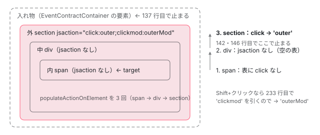

[目次](../README.md) › [イベント配送（event-dispatch）と jsaction の内側](README.md) › 第 7 回 / 全 12 回

# ActionResolver：対象から親へたどって行き先を探す

> resolveEventType・resolveAction・resolveParentAction が、イベントの対象の要素から親へ（入れ物の手前まで。\_\_owner と shadow root の host を通って）たどり、jsaction 属性にそのイベントの種類がある最初の要素を行き先にする populateAction・getParentNode・populateActionOnElement の行。修飾キーや中ボタンのクリックを clickmod に分ける isModifiedClickEvent・isMiddleClick と、それが Angular のイベントの再生で Shift・Cmd のクリックを渡し直さない理由。

angular/angular · 読了 約 13 分 · 発展 · [サイトで読む（デモが動きます）](https://angular-deep-dive-cyan.vercel.app/chapter/jsaction-resolver)

---

`EventContract` が受けたイベントは、`EventInfo`（種類・イベント・対象の要素・入れ物）の形で配り役に渡されます。配り役は、そのイベントを「どの要素の、どの処理名（action）へ」渡すかを、`ActionResolver` に決めさせます。この章では、その決め方を行で追います。イベントの対象から親へ 1 つずつ上り、`jsaction` 属性にそのイベントの種類がある最初の要素で止まること、入れ物（コンテナ）で止まること、shadow root と `__owner` の上り方、修飾キーを押したクリックが `click` ではなく `clickmod` になること、そして `EventDispatcher` が親へ泡立たせるときに使う `resolveParentAction` です。

読む対象は `packages/core/primitives/event-dispatch/src/action_resolver.ts`（1〜250 行目）と、`src/event.ts` の `isModifiedClickEvent`・`isMiddleClick` です。

1. [1. 全体像](01-jsaction-overview.md)
2. [2. jsaction 属性](02-jsaction-attribute.md)
3. [3. EventInfo](03-jsaction-event-info.md)
4. [4. イベントの種類](04-jsaction-event-types.md)
5. [5. 早期の契約](05-jsaction-early-contract.md)
6. [6. EventContract](06-jsaction-contract.md)
7. **7. 行き先を探す**（この章）
8. [8. a11y の click](08-jsaction-a11y-click.md)
9. [9. mouseenter とタッチ](09-jsaction-mouse-touch.md)
10. [10. Dispatcher](10-jsaction-dispatcher.md)
11. [11. Angular の側](11-jsaction-angular.md)
12. [12. spec と issue](12-jsaction-tests-issues.md)

## 1. ActionResolver の 2 つの設定と、それを決める人

📄 `angular/packages/core/primitives/event-dispatch/src/action_resolver.ts` L47–57 （▶ の行: 49–50, 55–56）

```ts
47 │ 
48 │   constructor({
49 ▶     syntheticMouseEventSupport = false,
50 ▶     clickModSupport = true,
51 │   }: {
52 │     syntheticMouseEventSupport?: boolean;
53 │     clickModSupport?: boolean;
54 │   } = {}) {
55 ▶     this.syntheticMouseEventSupport = syntheticMouseEventSupport;
56 ▶     this.clickModSupport = clickModSupport;
57 │   }
```

constructor が受けるのは 2 つだけです。49 行目の `syntheticMouseEventSupport`（泡立たない mouseenter などを作り直すか。既定は `false`。[第 9 回](09-jsaction-mouse-touch.md)）と、50 行目の `clickModSupport`（修飾キー付きのクリックを `clickmod` に分けるか。既定は `true`）。55〜56 行目でそのまま欄に入れます。もう 1 つの設定の a11y の click は constructor では受けず、あとから関数を差し込みます（[第 8 回](08-jsaction-a11y-click.md)）。

この `ActionResolver` を作るのは、配布物の入口から使える範囲では `EventDispatcher` の constructor だけで、渡すのは `clickModSupport` だけです（[第 10 回](10-jsaction-dispatcher.md)）。Angular がイベントの再生で作るのは `new EventDispatcher(fn)` で、第 2 引数を省いています（[event-replay の章](../platform/14-event-replay.md)の 6 節）。だから **Angular の中の `ActionResolver` は、clickmod あり・mouseenter の作り直しなし・a11y の click なし**で動きます。

配り役の `Dispatcher.dispatch` は、イベントごとに `resolveEventType(eventInfo)`、続けて `resolveAction(eventInfo)` を呼びます（dispatcher.ts。event-replay の章の 7 節）。この順に読みます。

## 2. resolveEventType：修飾キー付きのクリックを clickmod に書き換える

📄 `angular/packages/core/primitives/event-dispatch/src/action_resolver.ts` L78–98 （▶ の行: 81, 83–84, 87, 94–96, 98）

```ts
78 │     // In order to also invoke a jsaction handler for a modifier click,
79 │     // 'clickmod' needs to be used:
80 │     //
81 ▶     //   <a href="someurl" jsaction="clickmod:gna.fu">
82 │     //
83 ▶     // EventContract invokes the jsaction 'gna.fu' for modified
84 ▶     // clicks. Unmodified clicks are left to the browser.
85 │     //
86 │     // In order to set up the event contract to handle both clickonly and
87 ▶     // clickmod, only addEvent(EventType.CLICK) is necessary.
88 │     //
89 │     // In order to set up the event contract to handle click,
90 │     // addEvent() is necessary for CLICK, KEYDOWN, and KEYPRESS event types.  If
91 │     // a11y click support is enabled, addEvent() will set up the appropriate key
92 │     // event handler automatically.
93 │     if (
94 ▶       this.clickModSupport &&
95 ▶       eventInfoLib.getEventType(eventInfo) === EventType.CLICK &&
96 ▶       eventLib.isModifiedClickEvent(eventInfoLib.getEvent(eventInfo))
97 │     ) {
98 ▶       eventInfoLib.setEventType(eventInfo, EventType.CLICKMOD);
```

1. **94〜96 行目：3 つの条件がそろったとき**

   `clickModSupport` が真で、`EventInfo` の種類が `click` で、イベントが `isModifiedClickEvent`（下）で真のとき。
2. **98 行目：EventInfo の種類を clickmod に書き換える**

   書き換えるのは `EventInfo` の欄（`eventType`）だけで、ブラウザのイベント（`event.type`）は `click` のままです。このあと行き先を探すときに引く名前が `clickmod` になります。
3. **81〜84 行目：clickmod は別の名前として書く**

   修飾キー付きのクリックで処理を呼びたいときは `jsaction="clickmod:…"` と書き、ふつうのクリックはブラウザに任せない、という使い分けです。87 行目のとおり、契約に登録する種類は `click` だけで足ります（登録の名前と、行き先を探す名前が違う）。

📄 `angular/packages/core/primitives/event-dispatch/src/event.ts` L134–173 （▶ の行: 137, 148, 150, 152, 158–159, 166, 168–169, 171）

```ts
134 │ /**
135 │  * Whether we are on a Mac. Not pulling in useragent just for this.
136 │  */
137 ▶ let isMac: boolean = typeof navigator !== 'undefined' && /Macintosh/.test(navigator.userAgent);
138 │ 
139 │ /**
140 │  * Determines and returns whether the given event (which is assumed to be a
141 │  * click event) is a middle click.
142 │  * NOTE: There is not a consistent way to identify middle click
143 │  * http://www.unixpapa.com/js/mouse.html
144 │  */
145 │ function isMiddleClick(e: Event): boolean {
146 │   return (
147 │     // `which` is an old DOM API.
148 ▶     (e as any).which === 2 ||
149 │     // `which` is an old DOM API.
150 ▶     ((e as any).which == null &&
151 │       // `button` is an old DOM API.
152 ▶       (e as any).button === 4) // middle click for IE
153 │   );
154 │ }
155 │ 
156 │ /**
157 │  * Determines and returns whether the given event (which is assumed
158 ▶  * to be a click event) is modified. A middle click is considered a modified
159 ▶  * click to retain the default browser action, which opens a link in a new tab.
160 │  * @param e The event.
161 │  * @return Whether the given event is modified.
162 │  */
163 │ export function isModifiedClickEvent(e: Event): boolean {
164 │   return (
165 │     // `metaKey` is an old DOM API.
166 ▶     (isMac && (e as any).metaKey) ||
167 │     // `ctrlKey` is an old DOM API.
168 ▶     (!isMac && (e as any).ctrlKey) ||
169 ▶     isMiddleClick(e) ||
170 │     // `shiftKey` is an old DOM API.
171 ▶     (e as any).shiftKey
172 │   );
173 │ }
```

1. **137 行目：Mac かどうかを最初に 1 回だけ決める**

   `navigator.userAgent` に `Macintosh` があれば Mac です。モジュールを読んだときに決まり、あとから変わりません（テストだけが変えられます。下の 686〜691 行目）。
2. **166・168 行目：Mac なら metaKey（Cmd）、それ以外なら ctrlKey**

   Mac で Ctrl を押しながらのクリックは、ここでは修飾ではありません。ただし Chrome（macOS）では Ctrl を押しながら押すと、`click` そのものが来ません（8 節の記録）。
3. **169 行目・148〜152 行目：中ボタン**

   `which === 2`、または `which` が無いときの `button === 4`（古い IE）です。158〜159 行目のコメントのとおり、リンクを新しいタブで開く既定の動きを残すためです。ただし Chrome 156 で中ボタンを押すと、ブラウザが出すのは `auxclick` で、`click` は出ません（下のデモと記録）。
4. **171 行目：Shift はどの OS でも修飾**

   Alt（Option）は数えません。Alt を押しながらのクリックは `click` のままです。

📄 `angular/packages/core/primitives/event-dispatch/src/event.ts` L686–691 （▶ の行: 688–689）

```ts
686 │ /** Exported for testing. */
687 │ export const testing = {
688 ▶   setIsMac(value: boolean) {
689 ▶     isMac = value;
690 │   },
691 │ };
```

137 行目の `let isMac` を外から変えられるのは、688〜689 行目の `testing.setIsMac` だけです。spec はこれで Mac とそれ以外の両方を確かめます（「テストと直し方」）。

## 3. resolveAction：1 つの EventInfo につき 1 回だけ探す

📄 `angular/packages/core/primitives/event-dispatch/src/action_resolver.ts` L104–110 （▶ の行: 105, 108–109）

```ts
104 │   resolveAction(eventInfo: eventInfoLib.EventInfo) {
105 ▶     if (eventInfoLib.getResolved(eventInfo)) {
106 │       return;
107 │     }
108 ▶     this.populateAction(eventInfo, eventInfoLib.getTargetElement(eventInfo));
109 ▶     eventInfoLib.setResolved(eventInfo, true);
110 │   }
```

105 行目で、すでに解いた印（`eir`）があれば何もしません。108 行目で、`EventInfo` の対象の要素（`targetElement`）から探し、109 行目で印を立てます。早期の契約から渡し直されたイベントのように、同じ `EventInfo` が 2 回 `dispatch` に来ても、探すのは 1 回です（印の欄は [第 3 回](03-jsaction-event-info.md)）。

## 4. populateAction：対象から親へ上り、最初に見つかった要素で止まる

📄 `angular/packages/core/primitives/event-dispatch/src/action_resolver.ts` L137–143 （▶ の行: 137–139, 142）

```ts
137 ▶     while (actionElement && actionElement !== eventInfoLib.getContainer(eventInfo)) {
138 ▶       if (actionElement.nodeType === Node.ELEMENT_NODE) {
139 ▶         this.populateActionOnElement(actionElement, eventInfo);
140 │       }
141 │ 
142 ▶       if (eventInfoLib.getAction(eventInfo)) {
143 │         // An event is handled by at most one jsaction. Thus we stop at the
```

📄 `angular/packages/core/primitives/event-dispatch/src/action_resolver.ts` L146–152 （▶ の行: 146, 148, 151–152）

```ts
146 ▶         break;
147 │       }
148 ▶       actionElement = this.getParentNode(actionElement);
149 │     }
150 │ 
151 ▶     const action = eventInfoLib.getAction(eventInfo);
152 ▶     if (!action) {
```

ループ全体は [event-replay の章](../platform/14-event-replay.md)の 7 節でも読みました。ここでは止まる条件を 1 つずつ確かめます。

1. **137 行目：入れ物（コンテナ）に着いたら止まる**

   `EventInfo` の入れ物は、イベントを受けた `EventContractContainer` の要素です。入れ物そのものの `jsaction` は見ません。入れ物より上の要素も見ません。
2. **138〜139 行目：要素のときだけ jsaction を読む**

   上る途中で `document` のような要素でないものに着いたら、読まずに次へ進みます。
3. **142 行目と 146 行目：行き先が決まったら、そこで止まる**

   142 行目の下のコメントのとおり、`ActionResolver` が 1 回に決める行き先は 1 つだけです。親の要素にも同じ種類の `jsaction` があっても、ここでは見ません（親へ渡すのは 6 節の `resolveParentAction` の役目です）。
4. **148 行目：次は getParentNode で決めた親**

   `parentNode` をそのまま使わず、5 節の関数を通します。
5. **151〜152 行目：最後まで見つからなければ何もしない**

   `action` は空のままです。`EventDispatcher` は行き先の無いイベントを誰にも渡しません（第 10 回）。

📄 `angular/packages/core/primitives/event-dispatch/src/action_resolver.ts` L230–236 （▶ の行: 231, 233–235）

```ts
230 │   private populateActionOnElement(actionElement: Element, eventInfo: eventInfoLib.EventInfo) {
231 ▶     const actionMap = this.parseActions(actionElement);
232 │ 
233 ▶     const actionName = actionMap[eventInfoLib.getEventType(eventInfo)];
234 ▶     if (actionName !== undefined) {
235 ▶       eventInfoLib.setAction(eventInfo, actionName, actionElement);
236 │     }
```

1 つの要素で見るのは 233 行目の 1 回の表引きです。231 行目の `parseActions`（`jsaction` 属性を読んで、種類 → 処理名の表にして要素に控える。[第 2 回](02-jsaction-attribute.md)）の表を、**2 節で書き換えたあとの種類**で引きます。修飾キー付きのクリックなら `clickmod` で引くので、`jsaction="click:x"` しか無い要素は行き先になりません。234 行目は `!== undefined` なので、処理名が空（`click:;`）でも行き先になります（[defer-hydrate-events の章](../defer/18-defer-hydrate-events.md)の 2 節）。



*外の section をクリックしたつもりで、中の span を押したとき。span から親へ 1 つずつ上り、jsaction にその種類がある最初の要素（外）で止まる。入れ物（点線の箱）とその上は見ない。*

## 5. getParentNode：親の決め方は 3 通り

📄 `angular/packages/core/primitives/event-dispatch/src/action_resolver.ts` L202–217 （▶ の行: 208–210, 212–214, 216）

```ts
202 │   /**
203 │    * Walk to the parent node, unless the node has a different owner in
204 │    * which case we walk to the owner. Attempt to walk to host of a
205 │    * shadow root if needed.
206 │    */
207 │   private getParentNode(element: Element): Element | null {
208 ▶     const owner = element[Property.OWNER];
209 ▶     if (owner) {
210 ▶       return owner as Element;
211 │     }
212 ▶     const parentNode = element.parentNode;
213 ▶     if (parentNode?.nodeName === '#document-fragment') {
214 ▶       return (parentNode as ShadowRoot | null)?.host ?? null;
215 │     }
216 ▶     return parentNode as Element | null;
217 │   }
```

1. **208〜210 行目：要素に \_\_owner があれば、それが親**

   `Property.OWNER` は `'__owner'` という名前のプロパティです（property.ts）。ポップアップを `<body>` の直下に置いたときのように、DOM の位置と「どの部品の一部か」が違うとき、論理上の持ち主を指しておくと、そこから上ります。
2. **212〜214 行目：親が shadow root（#document-fragment）なら、その host へ跳ぶ**

   shadow root そのものは要素ではないので、飛ばして host の要素へ進みます。
3. **216 行目：それ以外は parentNode**

   ふつうの DOM の親です。

> [!NOTE]
> **さらに深く**
>
> 212〜214 行目を通るのは、上り始めの要素が shadow root の中にあるときだけです。ところがブラウザは、shadow root の外のリスナーに届くイベントの `target` を host に付け替えます（retarget）。入れ物が shadow root の外にあると、`EventInfo` の対象は最初から host なので、この行は通りません。通るのは、入れ物が shadow root そのものか、shadow root の中にあって対象がさらにその上の shadow root の中にあるときです。下のデモの「コンテナ = shadow root」で確かめられます。そのとき 137 行目の「入れ物に着いたら止まる」は、shadow root が 213〜214 行目で飛ばされるので成り立たず、host から先、`document` まで上り続けます。

📄 `angular/packages/core/primitives/event-dispatch/test/dispatcher_test.ts` L408–414 （▶ の行: 408, 412）

```ts
408 ▶   it('dispatch event through owner', () => {
409 │     const container = getRequiredElementById('owner-click-container');
410 │     const actionElement = getRequiredElementById('owner-click-action-element');
411 │     const targetElement = getRequiredElementById('owner-click-target-element');
412 ▶     targetElement[Property.OWNER] = actionElement;
413 │ 
414 │     const eventContract = createEventContract({
```

\_\_owner の道を確かめる it です。412 行目で、DOM では兄弟の要素の `__owner` に行き先の要素を入れ、そこを押すと行き先になることを確かめます。

## 6. resolveParentAction：行き先の親から、次の行き先を探す

📄 `angular/packages/core/primitives/event-dispatch/src/action_resolver.ts` L112–118 （▶ の行: 113–117）

```ts
112 │   resolveParentAction(eventInfo: eventInfoLib.EventInfo) {
113 ▶     const action = eventInfoLib.getAction(eventInfo);
114 ▶     const actionElement = action && eventInfoLib.getActionElement(action);
115 ▶     eventInfoLib.unsetAction(eventInfo);
116 ▶     const parentNode = actionElement && this.getParentNode(actionElement);
117 ▶     if (!parentNode) {
118 │       return;
```

1. **113〜114 行目：いまの行き先の要素を取り出す**

   4 節で決めた（または前回のこの関数で決めた）行き先の要素です。
2. **115 行目：行き先を消す**

   このあと親から探して見つからなければ、`action` は空のままになります。
3. **116〜117 行目：getParentNode で親を取り、無ければ終わり**

   親があれば、そのすぐ下の行で `populateAction(eventInfo, parentNode)` を呼び、4 節と同じ上り方で次の行き先を探します（その行は [defer-hydrate-events の章](../defer/18-defer-hydrate-events.md)の 3 節に引用しました）。種類は 2 節で書き換えたままなので、`clickmod` で始まったイベントは親でも `clickmod` を探します。

この関数を呼ぶのは `EventDispatcher.dispatchToDelegate` のループで、1 つの行き先に渡し、`stopPropagation` されていなければ、この関数で次の行き先へ進みます。ブラウザの泡立ちの真似です（[第 10 回](10-jsaction-dispatcher.md)）。下のデモで「内」を押すと、内と外の 2 か所に渡されるのはこのためです。

## 7. DEMO：押した所ごとの行き先（ライブ）

> **🧪 DEMO — ActionResolver が決めた行き先（ライブ）**
>
> 「契約を作る」を押すと、下の点線の箱の中に要素を描き、本物の `EventContract`（`click` と `auxclick` を登録）と `EventDispatcher` を作ります。箱の中をふつうに、Shift・Ctrl・Cmd（Meta）・Alt を押しながら、中ボタンで押してください。Tab で移ってから Enter でも押せます。`EventDispatcher.dispatch` の前と後の `EventInfo` の種類と、渡された先を表にします。
>
> 「契約を作る」を押すまで、要素も契約も作りません。
>
> ▶ [このデモはサイトで動かせます](https://angular-deep-dive-cyan.vercel.app/chapter/jsaction-resolver)

Chrome 156（macOS）で試すと、次のようになりました。

- **中の span を押す**：対象は span、行き先は外 section の `outer` だけです（4 節の図）。
- **内の button を押す**：内の `inner` → 外の `outer` の順に 2 回渡されます。1 回目は 4 節の `populateAction`、2 回目は 6 節の `resolveParentAction` です。
- **Shift か Cmd を押しながら内を押す**：種類が `click` → `clickmod` に変わり、内には `clickmod` が無いので、外の `outerMod` だけに渡されます。clickModSupport のチェックを外して作り直すと、種類は `click` のままで、内 → 外の `outer` に渡されます。
- **Ctrl を押しながら（macOS）・中ボタン**：Ctrl では `click` が来ません。中ボタンでは `auxclick` が届き、どの要素の jsaction にも `auxclick` が無いので行き先なしです。
- **keydown だけの button を押す**：その button の表に `click` が無いので上り、外の `outer` に渡されます。
- **\_\_owner の要素を押す**：DOM では外の兄弟ですが、5 節の 208〜210 行目で外 section に上り、`outer` に渡されます。
- **shadow root の中のボタンを押す**：コンテナが点線の箱なら、対象は host（retarget のため）で、host の `host` → 外の `outer`。コンテナを shadow root にすると、対象は shadow の中のボタンになり、213〜214 行目で host へ跳んで `host` → 外の `outer` と、コンテナの外まで上ります。そのとき箱の中のほかの要素を押しても、shadow root の契約には届きません。

## 8. 記録：Shift や Cmd を押したクリックは、再生では渡し直されない

1 節のとおり、Angular がイベントの再生で作る `EventDispatcher` は clickmod ありです。サーバーが付ける `jsaction` は `click:;` だけなので、2 節の書き換えのあと 233 行目で `clickmod` を引いても見つからず、行き先なしになります。これを 2 つの記録で確かめました（**これは記録です**。2026-11-06、HeadlessChrome 156.0.0.0（macOS））。

1 つ目は、../angular のソースを束ねた記録のページで、`click:;` のボタンに本物のクリック（CDP の `Input.dispatchMouseEvent`）を送ったものです。「貯めてから登録」は、配り役を登録する前に押し、あとで登録した形（早期の契約から渡し直す形と同じ道）です。

| EventDispatcher | 押し方 | ブラウザが出したイベント | dispatchDelegate に渡された回数 |
| --- | --- | --- | --- |
| new EventDispatcher(fn) | ふつうのクリック | click@c-btn related=null | 1 |
| new EventDispatcher(fn) | Shift+クリック | click@c-btn related=null | 0 |
| new EventDispatcher(fn) | Cmd（Meta）+クリック | click@c-btn related=null | 0 |
| new EventDispatcher(fn) | Ctrl+クリック（Mac） | （click も auxclick も無い） | 0 |
| new EventDispatcher(fn) | 中ボタンのクリック | auxclick@c-btn related=null | 0 |
| new EventDispatcher(fn, false) | ふつうのクリック | click@c-btn related=null | 1 |
| new EventDispatcher(fn, false) | Shift+クリック | click@c-btn related=null | 1 |
| new EventDispatcher(fn, false) | Cmd（Meta）+クリック | click@c-btn related=null | 1 |
| new EventDispatcher(fn, false) | Ctrl+クリック（Mac） | （click も auxclick も無い） | 0 |
| new EventDispatcher(fn, false) | 中ボタンのクリック | auxclick@c-btn related=null | 0 |
| 既定 ＋ 貯めてから登録 | ふつうのクリック | click@c-btn related=null | 1 |
| 既定 ＋ 貯めてから登録 | Shift+クリック | click@c-btn related=null | 0 |
| 既定 ＋ 貯めてから登録 | Cmd（Meta）+クリック | click@c-btn related=null | 0 |
| 既定 ＋ 貯めてから登録 | Ctrl+クリック（Mac） | （click も auxclick も無い） | 0 |
| 既定 ＋ 貯めてから登録 | 中ボタンのクリック | auxclick@c-btn related=null | 0 |

2 つ目は、このサイトの本番の prerender の `zoneless-default` の章のページで、main の JS を止めている間（ハイドレーションの前）にデモのボタンを押し、JS を流したあとで、そのボタンの `(click)` が渡し直されたか（表に ✎ が出たか）を見たものです。

| 押し方 | ボタンの jsaction | 早期の契約に貯まったもの | ハイドレーションのあと、(click) が動いたか |
| --- | --- | --- | --- |
| ふつうのクリック | `click:;` | click shift=false meta=false | 動いた（✎ が出た） |
| Shift+クリック | `click:;` | click shift=true meta=false | 動かなかった |
| Cmd（Meta）+クリック | `click:;` | click shift=false meta=true | 動かなかった |

Shift と Cmd のクリックも早期の契約には貯まりますが、渡し直されませんでした。ハイドレーションのあとに同じように押せば、Angular がボタンに直接付けたリスナーが動くので、違いが出るのはハイドレーションの前に押したときだけです。同じ理由で、incremental hydration の眠っている塊の中を Shift を押しながら押しても、行き先が決まらないので `invokeRegisteredReplayListeners` は呼ばれません（コードから読んだことで、記録はしていません）。

📄 `記録のスクリプト（scratchpad/jsa-demo/c/。build.mjs で束ね、rec-run.mjs と e2e-clickmod.mjs がヘッドレスの Chrome を動かす）`

```
// ===== build.mjs =====
// 使い方: node build.mjs <記録のページの入口.ts> <出力.js>
// ../angular の event-dispatch のソース（読むだけ）と記録のページの入口を、ブラウザで読む 1 つの IIFE に束ねる。
// 束ね方は defer-demo/_shared/build.mjs と同じ esbuild。domino には KeyboardEvent・TouchEvent が無く、
// 本物の入力（CDP の Input.dispatch*）で確かめたいので、Node ではなくヘッドレスの Chrome の白紙のページで動かす。
import { build } from '~/angular-research/angular-deep-dive/node_modules/esbuild/lib/main.js';
const [entry, out] = process.argv.slice(2);
await build({ entryPoints: [entry], outfile: out, bundle: true, platform: 'browser', format: 'iife', target: 'es2022',
  logLevel: 'warning', define: { ngDevMode: 'true' } });

// ===== rec-entry.ts =====
// 記録のページの入口。../angular（8576f161ae4）の event-dispatch のソースを、公開の入口を通さずに直接読み込む。
// - a11y: ActionResolver に addA11yClickSupport で a11y_click.ts の 3 つの関数を差し込んだ形（dispatcher_test.ts の createDispatcher と同じ組み方）と、差し込まない形
// - mouse: EventContract.MOUSE_SPECIAL_SUPPORT を true にして mouseenter・mouseleave を登録し、ActionResolver({syntheticMouseEventSupport: true}) で解く形
// - touch: touchend を受けて、event.ts の recreateTouchEventAsClick を呼んだ結果を写す（ライブラリの中でこの関数を呼ぶ所は無い）
// - clickmod: Angular の event_replay.ts と同じ new EventDispatcher(fn)（clickModSupport は既定の true）と、false にした形
// Dispatcher はイベントごとに delegate を呼ぶ（行き先が無くても呼ぶ）ので、その引数の EventInfoWrapper を写す。
const SRC = '~/angular-research/angular/packages/core/primitives/event-dispatch/src';
import {EventContract} from '~/angular-research/angular/packages/core/primitives/event-dispatch/src/eventcontract';
import {EventContractContainer} from '~/angular-research/angular/packages/core/primitives/event-dispatch/src/event_contract_container';
import {ActionResolver} from '~/angular-research/angular/packages/core/primitives/event-dispatch/src/action_resolver';
import {Dispatcher, registerDispatcher} from '~/angular-research/angular/packages/core/primitives/event-dispatch/src/dispatcher';
import {EventDispatcher, registerDispatcher as registerEventDispatcher} from '~/angular-research/angular/packages/core/primitives/event-dispatch/src/event_dispatcher';
import {EventInfoWrapper} from '~/angular-research/angular/packages/core/primitives/event-dispatch/src/event_info';
import {populateClickOnlyAction, preventDefaultForA11yClick, updateEventInfoForA11yClick} from '~/angular-research/angular/packages/core/primitives/event-dispatch/src/a11y_click';
import {recreateTouchEventAsClick} from '~/angular-research/angular/packages/core/primitives/event-dispatch/src/event';
void SRC;

const w = window as any;
const log: any[] = [];
const native: string[] = [];
let contract: EventContract | null = null;
const name = (n: any) => (n && n.nodeType === 1 ? (n.id || n.tagName.toLowerCase()) : n ? n.nodeName : null);

function stage(html: string) {
  contract?.cleanUp();
  // 毎回 #stage を作り直す（前の場面の記録用リスナーを残さない）
  const old = document.getElementById('stage')!;
  const s = document.createElement('div');
  s.id = 'stage';
  old.replaceWith(s);
  s.innerHTML = html;
  log.length = 0;
  native.length = 0;
  return s;
}
function watchNative(s: Element, types: string[]) {
  for (const t of types) s.addEventListener(t, (e: any) => native.push(`${e.type}@${name(e.target)}${e.relatedTarget !== undefined ? ` related=${name(e.relatedTarget)}` : ''}`), true);
}
function record(wr: EventInfoWrapper) {
  const e: any = wr.getEvent();
  const a = wr.getAction();
  log.push({
    eventType: wr.getEventType(),
    nativeType: e.type,
    action: a ? a.name : null,
    actionElement: a ? name(a.element) : null,
    targetElement: name(wr.getTargetElement()),
    eventTarget: name(e.target),
    relatedTarget: e.relatedTarget === undefined ? undefined : name(e.relatedTarget),
    a11yClickKey: wr.eventInfo.eiack ?? false,
    defaultPrevented: e.defaultPrevented,
    copied: e instanceof Event ? false : true,
    bubbles: e.bubbles,
    originalType: e._originalEvent ? e._originalEvent.type : undefined,
  });
}

const A11Y_HTML = `
<div id="k-div" jsaction="click:x">div（tabindex なし）</div>
<div id="k-divtab" tabindex="0" jsaction="click:x">div tabindex=0</div>
<div id="k-rolebtn" role="button" tabindex="0" jsaction="click:x">div role=button tabindex=0</div>
<button id="k-button" type="button" jsaction="click:x">button</button>
<a id="k-a" href="#k" jsaction="click:x">a href</a>
<span id="k-rolelink" role="link" tabindex="0" jsaction="click:x">span role=link tabindex=0</span>
<input id="k-text" type="text" jsaction="click:x" aria-label="text">
<input id="k-check" type="checkbox" jsaction="click:x" aria-label="checkbox">
<div id="k-rolecheck" role="checkbox" tabindex="0" jsaction="click:x">div role=checkbox tabindex=0</div>
<div id="k-keyonly" tabindex="0" jsaction="keydown:k">div tabindex=0 jsaction="keydown:k"</div>`;

w.REC = {
  log, native,
  a11y(enable: boolean) {
    const s = stage(A11Y_HTML);
    watchNative(s, ['keydown', 'keypress', 'keyup', 'click']);
    contract = new EventContract(new EventContractContainer(s));
    contract.addEvent('click');
    contract.addEvent('keydown');
    const resolver = new ActionResolver();
    if (enable) resolver.addA11yClickSupport(updateEventInfoForA11yClick, preventDefaultForA11yClick, populateClickOnlyAction);
    registerDispatcher(contract, new Dispatcher((wr) => record(wr), {actionResolver: resolver}));
  },
  mouse() {
    const s = stage(`<div id="m-outer" jsaction="mouseenter:enter;mouseleave:leave;mouseover:over" style="margin:40px;padding:40px;width:400px;height:240px;background:#eee">外（outer）
      <div id="m-child" style="padding:30px;background:#ccc;height:120px">子（child）<div id="m-grand" style="padding:20px;background:#999">孫（grand）</div></div></div>`);
    watchNative(s, ['mouseover', 'mouseout']);
    const saved = EventContract.MOUSE_SPECIAL_SUPPORT;
    EventContract.MOUSE_SPECIAL_SUPPORT = true;
    try {
      contract = new EventContract(new EventContractContainer(s));
      contract.addEvent('mouseenter');
      contract.addEvent('mouseleave');
      contract.addEvent('mouseover');
    } finally {
      EventContract.MOUSE_SPECIAL_SUPPORT = saved;
    }
    registerDispatcher(contract, new Dispatcher((wr) => record(wr), {actionResolver: new ActionResolver({syntheticMouseEventSupport: true})}));
  },
  touch() {
    const s = stage(`<div id="t-box" jsaction="touchend:te;click:ck" style="margin:40px;width:300px;height:160px;background:#eee">タッチする箱<span id="t-in" style="display:inline-block;margin:20px;padding:10px;background:#ccc">中の span</span></div>`);
    watchNative(s, ['touchstart', 'touchend', 'mousedown', 'mouseup', 'click']);
    contract = new EventContract(new EventContractContainer(s));
    contract.addEvent('touchend');
    contract.addEvent('click');
    registerDispatcher(contract, new Dispatcher((wr) => record(wr), {actionResolver: new ActionResolver()}));
    s.addEventListener('touchend', (e: any) => {
      const c: any = recreateTouchEventAsClick(e);
      const t = e.changedTouches[0];
      const r: any = {
        type: c.type, originalEventType: c.originalEventType, target: name(c.target), currentTarget: name(c.currentTarget),
        clientX: c.clientX, clientY: c.clientY, touchClientX: t.clientX, touchClientY: t.clientY, screenX: c.screenX, screenY: c.screenY,
        timeStampIsDateNow: Math.abs(c.timeStamp - Date.now()) < 1000, originalTimeStamp: Math.round(e.timeStamp),
        isEvent: c instanceof Event, hasComposedPath: typeof c.composedPath, bubbles: c.bubbles,
        defaultPreventedBefore: c.defaultPrevented, propagationStoppedBefore: c._propagationStopped,
      };
      c.preventDefault();
      c.stopPropagation();
      r.defaultPreventedAfter = c.defaultPrevented;
      r.originalDefaultPrevented = e.defaultPrevented;
      r.propagationStoppedAfter = c._propagationStopped;
      w.REC.touchCopy = r;
    });
  },
  clickmod(mode: 'default' | 'off' | 'queued') {
    const s = stage(`<button id="c-btn" type="button" jsaction="click:;" style="margin:40px;padding:20px">click:; のボタン（Angular がサーバーで付ける形）</button>`);
    watchNative(s, ['click', 'auxclick']);
    contract = new EventContract(new EventContractContainer(s));
    contract.addEvent('click');
    const calls: any[] = (w.REC.calls = []);
    const ed = mode === 'off' ? new EventDispatcher((e: any, n) => calls.push({type: e.type, action: n, shift: e.shiftKey, meta: e.metaKey, ctrl: e.ctrlKey}), false)
      : new EventDispatcher((e: any, n) => calls.push({type: e.type, action: n, shift: e.shiftKey, meta: e.metaKey, ctrl: e.ctrlKey}));
    if (mode === 'queued') {
      w.REC.register = () => registerEventDispatcher(contract!, ed);
    } else {
      registerEventDispatcher(contract, ed);
    }
  },
};

// ===== cdp-lib.mjs =====
// ヘッドレスの Chrome（--remote-debugging-port=9447）を CDP で動かす小さな部品。
// 入力は Input.dispatchMouseEvent・dispatchKeyEvent・dispatchTouchEvent（ブラウザが本物の入力として扱う。isTrusted が true）。
export async function openTab(url, port = 9447) {
  const t = await (await fetch(`http://127.0.0.1:${port}/json/new?about:blank`, { method: 'PUT' })).json();
  const ws = new WebSocket(t.webSocketDebuggerUrl);
  await new Promise((r) => (ws.onopen = r));
  let id = 0; const pending = new Map(); const logs = []; const handlers = new Map();
  ws.onmessage = (m) => {
    const msg = JSON.parse(m.data);
    if (msg.id && pending.has(msg.id)) { pending.get(msg.id)(msg); pending.delete(msg.id); }
    else if (msg.method && handlers.has(msg.method)) handlers.get(msg.method)(msg.params);
    else if (msg.method === 'Runtime.consoleAPICalled') logs.push(`console.${msg.params.type}: ${msg.params.args.map((a) => a.value ?? a.description).join(' ')}`);
    else if (msg.method === 'Runtime.exceptionThrown') logs.push(`exception: ${msg.params.exceptionDetails.exception?.description ?? msg.params.exceptionDetails.text}`);
    else if (msg.method === 'Log.entryAdded') logs.push(`log.${msg.params.entry.level}: ${msg.params.entry.text}`);
  };
  const send = (method, params = {}) => new Promise((r) => { const i = ++id; pending.set(i, r); ws.send(JSON.stringify({ id: i, method, params })); });
  await send('Runtime.enable'); await send('Log.enable'); await send('Page.enable');
  const sleep = (ms) => new Promise((r) => setTimeout(r, ms));
  const tab = {
    send, logs, sleep,
    on(method, fn) { handlers.set(method, fn); },
    async go(u, wait = 1500) { await send('Page.navigate', { url: u }); await sleep(wait); },
    async ev(expr) {
      const r = await send('Runtime.evaluate', { expression: expr, awaitPromise: true, returnByValue: true });
      if (r.result?.exceptionDetails) throw new Error(JSON.stringify(r.result.exceptionDetails).slice(0, 600));
      return r.result?.result?.value;
    },
    async center(sel) {
      return tab.ev(`(() => { const el = document.querySelector(${JSON.stringify(sel)}); if (!el) return null; el.scrollIntoView({block: 'center'}); const r = el.getBoundingClientRect(); return {x: Math.round(r.left + Math.min(12, r.width / 2)), y: Math.round(r.top + Math.min(10, r.height / 2))}; })()`);
    },
    async move(x, y) { await send('Input.dispatchMouseEvent', { type: 'mouseMoved', x, y }); await sleep(60); },
    async click(x, y, { button = 'left', modifiers = 0 } = {}) {
      const buttons = { left: 1, right: 2, middle: 4 }[button];
      await send('Input.dispatchMouseEvent', { type: 'mouseMoved', x, y, modifiers });
      await send('Input.dispatchMouseEvent', { type: 'mousePressed', x, y, button, buttons, clickCount: 1, modifiers });
      await send('Input.dispatchMouseEvent', { type: 'mouseReleased', x, y, button, buttons: 0, clickCount: 1, modifiers });
      await sleep(80);
    },
    async key(k) {
      const d = k === 'Enter' ? { key: 'Enter', code: 'Enter', windowsVirtualKeyCode: 13, nativeVirtualKeyCode: 13, text: '\r' }
        : { key: ' ', code: 'Space', windowsVirtualKeyCode: 32, nativeVirtualKeyCode: 32, text: ' ' };
      await send('Input.dispatchKeyEvent', { type: 'keyDown', ...d });
      await send('Input.dispatchKeyEvent', { type: 'keyUp', key: d.key, code: d.code, windowsVirtualKeyCode: d.windowsVirtualKeyCode, nativeVirtualKeyCode: d.nativeVirtualKeyCode });
      await sleep(80);
    },
    async tap(x, y) {
      await send('Input.dispatchTouchEvent', { type: 'touchStart', touchPoints: [{ x, y }] });
      await sleep(40);
      await send('Input.dispatchTouchEvent', { type: 'touchEnd', touchPoints: [] });
      await sleep(400);
    },
    async close() { ws.close(); await fetch(`http://127.0.0.1:${port}/json/close/${t.id}`); },
  };
  return tab;
}
// 修飾キーの CDP の値（Alt=1, Ctrl=2, Meta=4, Shift=8）
export const MOD = { alt: 1, ctrl: 2, meta: 4, shift: 8 };

// ===== rec-run.mjs =====
// 使い方: node rec-run.mjs > rec.json   （先に node build.mjs rec-entry.ts rec/rec.js）
import { openTab, MOD } from './cdp-lib.mjs';
const PAGE = 'file://' + new URL('./rec/index.html', import.meta.url).pathname;
const tab = await openTab(PAGE);
await tab.go(PAGE);
const out = { chrome: await tab.ev('navigator.userAgent'), date: new Date().toISOString().slice(0, 10) };

// 1. a11y: 10 の要素 × Enter・Space、a11y の click を差し込む / 差し込まない
const ELS = ['k-div', 'k-divtab', 'k-rolebtn', 'k-button', 'k-a', 'k-rolelink', 'k-text', 'k-check', 'k-rolecheck', 'k-keyonly'];
out.a11y = {};
for (const enable of [false, true]) {
  const rows = [];
  for (const id of ELS) for (const k of ['Enter', 'Space']) {
    await tab.ev(`REC.a11y(${enable})`);
    const focused = await tab.ev(`(() => { const el = document.getElementById('${id}'); el.focus(); return document.activeElement === el; })()`);
    await tab.ev(`REC.log.length = 0; REC.native.length = 0`);
    await tab.key(k === 'Space' ? ' ' : 'Enter');
    const checked = await tab.ev(`document.getElementById('k-check').checked`);
    rows.push({ id, key: k, focused, native: await tab.ev('REC.native.slice()'), log: await tab.ev('REC.log.slice()'), checked });
  }
  out.a11y[enable ? 'on' : 'off'] = rows;
}

// 2. mouse: 外 → 外の余白 → 子 → 孫 → 子 → 外の余白 → 外へ
await tab.ev('REC.mouse()');
const box = await tab.ev(`(() => { const g = (id) => { const r = document.getElementById(id).getBoundingClientRect(); return {l: r.left, t: r.top, r: r.right, b: r.bottom}; }; return {outer: g('m-outer'), child: g('m-child'), grand: g('m-grand')}; })()`);
const pts = [
  ['ページの外側（outer の外）', 5, 5],
  ['outer の余白に入る', box.outer.l + 10, box.outer.t + 10],
  ['child に入る', box.child.l + 5, box.child.t + 5],
  ['grand に入る', box.grand.l + 5, box.grand.t + 5],
  ['child に戻る', box.child.r - 5, box.child.b - 5],
  ['outer の余白に戻る', box.outer.r - 5, box.outer.b - 5],
  ['outer の外へ出る', box.outer.r + 30, box.outer.b + 30],
];
out.mouse = [];
await tab.move(pts[0][1], pts[0][2]);
for (const [label, x, y] of pts.slice(1)) {
  await tab.ev(`REC.log.length = 0; REC.native.length = 0`);
  await tab.move(Math.round(x), Math.round(y));
  out.mouse.push({ step: label, native: await tab.ev('REC.native.slice()'), log: await tab.ev('REC.log.slice()') });
}

// 3. touch: タッチを有効にして中の span をタップ
await tab.send('Emulation.setTouchEmulationEnabled', { enabled: true, maxTouchPoints: 1 });
await tab.ev('REC.touch()');
const tp = await tab.center('#t-in');
await tab.tap(tp.x, tp.y);
out.touch = { native: await tab.ev('REC.native.slice()'), log: await tab.ev('REC.log.slice()'), copy: await tab.ev('REC.touchCopy') };
await tab.send('Emulation.setTouchEmulationEnabled', { enabled: false });

// 4. clickmod: Angular と同じ new EventDispatcher(fn)（既定）と false、貯めてから登録
out.clickmod = [];
const isMac = /Macintosh/.test(out.chrome);
const tries = [['ふつうのクリック', {}], ['Shift+クリック', { modifiers: MOD.shift }], [isMac ? 'Cmd（Meta）+クリック' : 'Ctrl+クリック', { modifiers: isMac ? MOD.meta : MOD.ctrl }], [isMac ? 'Ctrl+クリック（Mac）' : 'Meta+クリック', { modifiers: isMac ? MOD.ctrl : MOD.meta }], ['中ボタンのクリック', { button: 'middle' }]];
for (const mode of ['default', 'off', 'queued']) {
  for (const [label, opt] of tries) {
    await tab.ev(`REC.clickmod('${mode}')`);
    const p = await tab.center('#c-btn');
    await tab.click(p.x, p.y, opt);
    if (mode === 'queued') await tab.ev('REC.register()');
    await tab.sleep(50);
    out.clickmod.push({ mode, label, native: await tab.ev('REC.native.slice()'), calls: await tab.ev('REC.calls.slice()') });
  }
}
out.consoleLogs = tab.logs;
await tab.close();
console.log(JSON.stringify(out, null, 1));

// ===== serve.mjs =====
// 使い方: node serve.mjs <dir> <port>  … 静的ファイルを返すだけの小さなサーバー（prerender の HTML を開く用）
import { createServer } from 'node:http';
import { readFile, stat } from 'node:fs/promises';
import { join, extname } from 'node:path';
const [dir, port] = process.argv.slice(2);
const types = { '.html': 'text/html; charset=utf-8', '.js': 'text/javascript', '.css': 'text/css', '.json': 'application/json', '.svg': 'image/svg+xml', '.ico': 'image/x-icon', '.woff2': 'font/woff2', '.png': 'image/png' };
createServer(async (req, res) => {
  let p = join(dir, decodeURIComponent(new URL(req.url, 'http://x').pathname));
  try { if ((await stat(p)).isDirectory()) p = join(p, 'index.html'); } catch { p = join(dir, 'index.csr.html'); }
  try { const b = await readFile(p); res.writeHead(200, { 'content-type': types[extname(p)] ?? 'application/octet-stream' }); res.end(b); }
  catch { res.writeHead(404); res.end('not found'); }
}).listen(Number(port), '127.0.0.1');

// ===== e2e-clickmod.mjs =====
// 使い方: node e2e-clickmod.mjs <base-url> > e2e-clickmod.json
// 本番の prerender の章のページ（zoneless-default）を開き、main の JS を Fetch.enable で止めている間（ハイドレーションの前）に、
// デモのボタン「provideZoneChangeDetection() を足す」を、ふつうに・Shift を押しながら・Cmd（Meta）を押しながら押す。
// そのあと JS を流してハイドレーションを待ち、(click) が渡し直されたか（表に ✎ が出たか）を見る。
import { openTab, MOD } from './cdp-lib.mjs';
const base = process.argv[2];
const url = `${base}/chapter/zoneless-default`;
const out = [];
for (const [label, modifiers] of [['ふつうのクリック', 0], ['Shift+クリック', MOD.shift], ['Cmd（Meta）+クリック', MOD.meta]]) {
  const tab = await openTab('about:blank');
  const paused = [];
  tab.on('Fetch.requestPaused', (p) => paused.push(p));
  await tab.send('Fetch.enable', { patterns: [{ urlPattern: '*main-*.js', requestStage: 'Request' }] });
  await tab.go(url, 2000);
  const before = await tab.ev(`({ hydrated: !!window.ng || document.querySelector('[ng-version]') !== null, ejsas: !!window._ejsas?.ng, mark: [...document.querySelectorAll('td')].some(td => td.textContent.includes('✎')) })`);
  const btn = await tab.ev(`(() => { const b = [...document.querySelectorAll('button')].find(b => b.textContent.includes('provideZoneChangeDetection() を足す')); b.scrollIntoView({block: 'center'}); const r = b.getBoundingClientRect(); return {x: Math.round(r.left + 10), y: Math.round(r.top + r.height / 2), jsaction: b.getAttribute('jsaction')}; })()`);
  await tab.click(btn.x, btn.y, { modifiers });
  const queued = await tab.ev(`(window._ejsas?.ng?.q ?? []).map(e => e.eventType + ' shift=' + e.event.shiftKey + ' meta=' + e.event.metaKey)`);
  for (const p of paused) await tab.send('Fetch.continueRequest', { requestId: p.requestId });
  await tab.send('Fetch.disable');
  await tab.sleep(3000);
  const after = await tab.ev(`({ mark: [...document.querySelectorAll('td')].some(td => td.textContent.includes('✎')), ejsas: !!window._ejsas?.ng })`);
  out.push({ label, pausedMain: paused.map((p) => p.request.url.replace(base, '')), before, button: btn, queued, after, logs: tab.logs.slice() });
  await tab.close();
}
console.log(JSON.stringify(out, null, 1));

```

## ここまでの呼び出し

- 👤 `ユーザーのクリック` — 入れ物の要素のリスナー — *第 6 回*
  - `EventContract.handleEvent` → `createEventInfoFromParameters` — eventcontract.ts 112 — *種類 click・対象 event.target・入れ物*
    - `Dispatcher.dispatch(eventInfo)` — dispatcher.ts 78
      - `ActionResolver.resolveEventType` → `isModifiedClickEvent` — action\_resolver.ts 93・event.ts 163 — *修飾なら click → clickmod（98 行目）*
      - `ActionResolver.resolveAction` → `populateAction` — action\_resolver.ts 104・135 — *対象から親へ、入れ物まで*
        - `populateActionOnElement` × 上った数 — action\_resolver.ts 230 — *表を種類で引く*
        - `getParentNode` — action\_resolver.ts 207 — *\_\_owner → shadow root の host → parentNode*
      - `EventDispatcher.dispatchToDelegate` — event\_dispatcher.ts 82 — *第 10 回*
        - `ActionResolver.resolveParentAction` — action\_resolver.ts 112 — *行き先の親から次の行き先*

## テストと直し方

### spec と describe / it

| spec | it（行） | この章のどこ |
| --- | --- | --- |
| test/event\_test.ts（describe `event test.ts`、66 行目） | `is modified click event mac meta key`（197）・`… non mac ctrl key`（203）・`… middle click`（209）・`… middle click IE`（214）・`… shift key`（219） | 2 節 |
| test/dispatcher\_test.ts（describe `Dispatcher`、332 行目） | `dispatches event`（340）・`dispatches event when targetElement is actionElement`（363）・`dispatch event to child and ignore parent`（385） | 4 節 |
| 同じ | `dispatch event through owner`（408）・`dispatches event from shadow dom`（619） | 5 節 |
| 同じ | `dispatches modified click event`（432）・`prevents default for modified click on anchor child`（714）・`does not prevent default for modified click on non-anchor child`（740） | 2 節 |
| test/event\_dispatcher\_test.ts（describe `bubbling`、111 行目） | `dispatches to multiple elements`（112）ほか | 6 節（[第 10 回](10-jsaction-dispatcher.md)） |

📄 `angular/packages/core/primitives/event-dispatch/test/event_test.ts` L197–222 （▶ の行: 199, 205, 210, 215, 220）

```ts
197 │   it('is modified click event mac meta key', () => {
198 │     const event = {metaKey: true} as unknown as Event;
199 ▶     jsactionEvent.testing.setIsMac(true);
200 │     expect(jsactionEvent.isModifiedClickEvent(event)).toBe(true);
201 │   });
202 │ 
203 │   it('is modified click event non mac ctrl key', () => {
204 │     const event = {ctrlKey: true} as unknown as Event;
205 ▶     jsactionEvent.testing.setIsMac(false);
206 │     expect(jsactionEvent.isModifiedClickEvent(event)).toBe(true);
207 │   });
208 │ 
209 │   it('is modified click event middle click', () => {
210 ▶     const event = {which: 2} as unknown as Event;
211 │     expect(jsactionEvent.isModifiedClickEvent(event)).toBe(true);
212 │   });
213 │ 
214 │   it('is modified click event middle click IE', () => {
215 ▶     const event = {button: 4} as unknown as Event;
216 │     expect(jsactionEvent.isModifiedClickEvent(event)).toBe(true);
217 │   });
218 │ 
219 │   it('is modified click event shift key', () => {
220 ▶     const event = {shiftKey: true} as unknown as Event;
221 │     expect(jsactionEvent.isModifiedClickEvent(event)).toBe(true);
222 │   });
```

199・205 行目で `testing.setIsMac` を切り替えて、Mac の metaKey とそれ以外の ctrlKey を確かめます。210・215 行目は中ボタンの 2 つの判定、220 行目は Shift です。どれもイベントの代わりのただのオブジェクトを渡していて、ブラウザが中ボタンで `click` を出すかどうかは確かめていません（7 節のとおり、Chrome は出しません）。

### 手元で走らせた結果

📄 `ターミナル（../angular で）`

```
cd ~/angular-research/angular
pnpm bazel test //packages/core/primitives/event-dispatch/test:browser_test_chromium \
  //packages/core/primitives/event-dispatch/test:browser_test_firefox \
  --nocache_test_results --test_output=all

# 名前で絞れるかを試す
pnpm bazel test //packages/core/primitives/event-dispatch/test:browser_test_chromium \
  '--test_arg=--filter=is action key' --nocache_test_results --test_output=all
```

📄 `出力（2026-11-06 に実行。抜粋。ログは scratchpad/jsa-logs/c-all.log・c-filter.log）`

```
Chromium: |██████████| 1/1 test files | 111 passed, 0 failed
Finished running tests in 0.3s, all tests passed!
Firefox:  |██████████| 1/1 test files | 111 passed, 0 failed
Finished running tests in 1.2s, all tests passed!
INFO: Elapsed time: 2.565s, Critical Path: 1.95s
//packages/core/primitives/event-dispatch/test:browser_test_chromium     PASSED in 0.8s
//packages/core/primitives/event-dispatch/test:browser_test_firefox      PASSED in 1.9s

# --test_arg=--filter=is action key を付けても（絞り込みは効かない）
Chromium: |██████████| 1/1 test files | 111 passed, 0 failed
INFO: Elapsed time: 1.457s
//packages/core/primitives/event-dispatch/test:browser_test_chromium     PASSED in 0.8s
```

- 4 つの spec は 1 つのファイルに束ねられてブラウザで走るので、Chromium・Firefox とも 111 件がまとめて走ります（event\_test 57・dispatcher\_test 30・eventcontract\_test 17・event\_dispatcher\_test 7）。
- `--test_arg=--filter=…` を付けても 111 件が走りました。名前の絞り込みは効かないので、ターゲット全体を走らせて確かめます。

### 直すとしたら

- **8 節の「修飾キー付きのクリックが渡し直されない」**：入口は core の `hydration/event_replay.ts` の `initEventReplay` の `new EventDispatcher(fn)` です（[event-replay の章](../platform/14-event-replay.md)の 6 節）。2a915d1912d（2024-07、refactor(core): Remove clickmod support from Angular.、#57201）を `git show` で読むと、この commit が `EventDispatcher` に第 2 引数の `clickModSupport` を足し、当時の `event_delegation_utils.ts` の `initGlobalEventDelegation` には `false` を渡していました。commit の説明は「shift + click を clickmod にするのは Angular には意味が無い」です。イベントの再生の側には渡しておらず、いまのソースにも main（2026-11-05）にも `initGlobalEventDelegation` はありません。spec を足すなら、packages/platform-server/test/event\_replay\_spec.ts に「Shift を押した click が再生される」を、event\_dispatcher\_test.ts に `clickModSupport` を `false` にした形を足す形になります。`gh search issues` で `clickmod`・`event replay shift click`・`event replay modifier` などを探しても、同じ報告は見つかりませんでした（2026-11-06）。
- **5 節の 213〜214 行目**は、どの spec も通りません（`dispatches event from shadow dom` は入れ物が shadow root の外なので、対象が最初から host です）。確かめるなら、dispatcher\_test.ts に、入れ物を shadow root の中に置く it を足します。
- 8576f161ae4 より新しい main の 8d8859cb211（2026-09-22、fix(core): don't use plain objects as maps for jsaction data）は、jsaction の無い要素に控える空の表（`EMPTY_ACTION_MAP`）と `parseActions` が作る表を `Object.create(null)` にしています。233 行目の表引きで `toString` のような名前が `Object.prototype` から見つかるのを防ぐ直しです（第 2 回）。
- 本家に PR を出すことは勧めません。issue を読むときは、7 節のデモのように「dispatch の前後の種類」と「渡された先」を並べて、どの行で行き先が決まったか（決まらなかったか）を確かめます（[第 12 回](12-jsaction-tests-issues.md)）。

## 聞かれそうな質問

**Q. 入れ子の要素に両方 jsaction="click:…" があると、どちらが呼ばれますか？**

まず対象に近いほう（内）です。populateAction は 142・146 行目で最初に見つかった要素で止まります。`EventDispatcher` はそのあと resolveParentAction（112〜118 行目）で親から次を探すので、`stopPropagation` しなければ外にも渡されます。デモで内を押すと 2 回渡されます。

**Q. Shift を押しながらクリックすると、jsaction="click:x" の処理は呼ばれますか？**

clickModSupport が真なら呼ばれません。resolveEventType の 94〜98 行目で種類が `clickmod` に書き換わり、233 行目は `clickmod` で表を引くからです。`jsaction="clickmod:y"` があればそちらが呼ばれます。Angular のイベントの再生はこの設定なので、ハイドレーションの前の Shift・Cmd（Mac 以外は Ctrl）のクリックは渡し直されません（8 節の記録）。

**Q. Mac で Ctrl を押しながらクリックすると clickmod になりますか？**

なりません。event.ts の 166・168 行目で、Mac（137 行目の判定）では metaKey だけを見ます。Chrome（macOS）では Ctrl を押しながら押すと click そのものが出ません。

**Q. 入れ物（コンテナ）の要素自身に jsaction があると、行き先になりますか？**

なりません。137 行目の `actionElement !== getContainer(eventInfo)` で、入れ物に着いた時点でループを抜けます。入れ物より上の要素も見ません。例外は入れ物が shadow root のときで、213〜214 行目で shadow root が飛ばされるため、host から先まで上ります。

**Q. DOM の外に置いたポップアップのクリックを、元の部品の jsaction で受けられますか？**

受けられます。ポップアップの要素の `__owner` に部品の要素を入れておくと、getParentNode の 208〜210 行目で parentNode の代わりにそちらへ上ります。spec では dispatcher\_test.ts の 412 行目がこれを確かめています。

## 読み終えて

- 行き先探しは、resolveEventType で種類を決め直し（修飾キー付きの click は clickmod）、resolveAction で対象から親へ上り、jsaction にその種類がある最初の要素で止まる、の 2 段です。
- 上るのは入れ物の手前までで、親は \_\_owner → shadow root の host → parentNode の順に決めます。
- 親への泡立ちは ActionResolver ではなく EventDispatcher のループが、resolveParentAction を呼んで続けます。
- Angular の EventDispatcher は clickmod ありなので、ハイドレーションの前の Shift・Cmd のクリックは、サーバーの `click:;` に当たらず、渡し直されません。

---

← 前: [EventContract と EventContractContainer：コンテナにリスナーを付ける](06-jsaction-contract.md)  
次: [a11y の click：Enter と Space を click として扱う](08-jsaction-a11y-click.md) →
