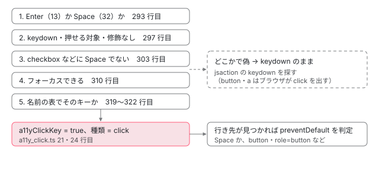

[目次](../README.md) › [イベント配送（event-dispatch）と jsaction の内側](README.md) › 第 8 回 / 全 12 回

# a11y の click：Enter と Space を click として扱う

> a11y\_click.ts が ActionResolver に差し込む 3 つの関数（keydown の種類を click に書き換える updateEventInfoForA11yClick、preventDefaultForA11yClick、populateClickOnlyAction）と、event.ts の isActionKeyEvent・isValidActionKeyTarget・isSpaceKeyEvent・shouldCallPreventDefaultOnNativeHtmlControl・isNativeHTMLControl・isFocusable・IDENTIFIER\_TO\_KEY\_TRIGGER\_MAPPING が、div・button・a・input・role の要素と Enter・Space でどう分かれるか、key\_code.ts。Angular の配布物ではこの仕組みが使われていないこと。

angular/angular · 読了 約 13 分 · 発展 · [サイトで読む（デモが動きます）](https://angular-deep-dive-cyan.vercel.app/chapter/jsaction-a11y-click)

---

`<div role="button" tabindex="0">` のような「ボタンのふりをした要素」は、マウスで押すと `click` が出ますが、キーボードの Enter や Space では `click` が出ません。JSAction の a11y の click（a11y はアクセシビリティ）は、その `keydown` を `click` の行き先へ回す仕組みです。この章では、`a11y_click.ts` が `ActionResolver` に差し込む 3 つの関数と、`event.ts` の判定の関数が、要素の種類（div・button・a・input・role）とキー（Enter・Space）でどう分かれるかを行で追い、Angular の配布物ではこれが使われていないことを確かめます。

読む対象は `packages/core/primitives/event-dispatch/src/a11y_click.ts`・`src/key_code.ts`・`src/event.ts`（175〜684 行目のキーと要素の判定）と、`src/action_resolver.ts` の差し込み口です。

1. [1. 全体像](01-jsaction-overview.md)
2. [2. jsaction 属性](02-jsaction-attribute.md)
3. [3. EventInfo](03-jsaction-event-info.md)
4. [4. イベントの種類](04-jsaction-event-types.md)
5. [5. 早期の契約](05-jsaction-early-contract.md)
6. [6. EventContract](06-jsaction-contract.md)
7. [7. 行き先を探す](07-jsaction-resolver.md)
8. **8. a11y の click**（この章）
9. [9. mouseenter とタッチ](09-jsaction-mouse-touch.md)
10. [10. Dispatcher](10-jsaction-dispatcher.md)
11. [11. Angular の側](11-jsaction-angular.md)
12. [12. spec と issue](12-jsaction-tests-issues.md)

## 1. ActionResolver の 3 つの差し込み口

📄 `angular/packages/core/primitives/event-dispatch/src/action_resolver.ts` L32–46 （▶ の行: 34, 38, 40, 42）

```ts
32 │ /** Resolves actions for Events. */
33 │ export class ActionResolver {
34 ▶   private a11yClickSupport: boolean = false;
35 │   private clickModSupport: boolean = true;
36 │   private readonly syntheticMouseEventSupport: boolean;
37 │ 
38 ▶   private updateEventInfoForA11yClick?: (eventInfo: eventInfoLib.EventInfo) => void = undefined;
39 │ 
40 ▶   private preventDefaultForA11yClick?: (eventInfo: eventInfoLib.EventInfo) => void = undefined;
41 │ 
42 ▶   private populateClickOnlyAction?: (
43 │     actionElement: Element,
44 │     eventInfo: eventInfoLib.EventInfo,
45 │     actionMap: {[key: string]: string | undefined},
46 │   ) => void = undefined;
```

34 行目の `a11yClickSupport` は最初 `false` で、38・40・42 行目の 3 つの関数の欄も `undefined` です。constructor（[第 7 回](07-jsaction-resolver.md)の 1 節）はこれらに触りません。3 つを埋めて `a11yClickSupport` を `true` にするのは `addA11yClickSupport` というメソッドで（`parseActions` の下。[第 2 回](02-jsaction-attribute.md)）、引数は a11y\_click.ts の 3 つの関数そのものです。spec はこう呼びます。

📄 `angular/packages/core/primitives/event-dispatch/test/dispatcher_test.ts` L317–323 （▶ の行: 319–322）

```ts
317 │   const actionResolver = new ActionResolver({syntheticMouseEventSupport});
318 │   if (a11yClickSupport) {
319 ▶     actionResolver.addA11yClickSupport(
320 ▶       updateEventInfoForA11yClick,
321 ▶       preventDefaultForA11yClick,
322 ▶       populateClickOnlyAction,
323 │     );
```

3 つの関数が、行き先探しの 3 か所で呼ばれます。

📄 `angular/packages/core/primitives/event-dispatch/src/action_resolver.ts` L93–102 （▶ の行: 99–100）

```ts
 93 │     if (
 94 │       this.clickModSupport &&
 95 │       eventInfoLib.getEventType(eventInfo) === EventType.CLICK &&
 96 │       eventLib.isModifiedClickEvent(eventInfoLib.getEvent(eventInfo))
 97 │     ) {
 98 │       eventInfoLib.setEventType(eventInfo, EventType.CLICKMOD);
 99 ▶     } else if (this.a11yClickSupport) {
100 ▶       this.updateEventInfoForA11yClick!(eventInfo);
101 │     }
102 │   }
```

📄 `angular/packages/core/primitives/event-dispatch/src/action_resolver.ts` L151–160 （▶ の行: 152, 157–158）

```ts
151 │     const action = eventInfoLib.getAction(eventInfo);
152 ▶     if (!action) {
153 │       // No action found.
154 │       return;
155 │     }
156 │ 
157 ▶     if (this.a11yClickSupport) {
158 ▶       this.preventDefaultForA11yClick!(eventInfo);
159 │     }
160 │ 
```

📄 `angular/packages/core/primitives/event-dispatch/src/action_resolver.ts` L236–245 （▶ の行: 238–239）

```ts
236 │     }
237 │ 
238 ▶     if (this.a11yClickSupport) {
239 ▶       this.populateClickOnlyAction!(actionElement, eventInfo, actionMap);
240 │     }
241 │   }
242 │ 
243 │   /**
244 │    * Parses and caches an element's jsaction element into a map.
245 │    *
```

1. **99〜100 行目：種類を決め直すとき（resolveEventType）**

   修飾キー付きのクリック（第 7 回の 2 節）でなければ、`updateEventInfoForA11yClick` を呼びます。行き先を探す**前**です。
2. **238〜239 行目：要素を 1 つ見るたび（populateActionOnElement）**

   その要素の表（`actionMap`）を引いたあとで、`populateClickOnlyAction` を呼びます。
3. **157〜158 行目：行き先が決まったあと（populateAction）**

   152 行目で行き先が無ければ戻るので、`preventDefaultForA11yClick` は行き先が見つかったときだけ呼ばれます。

## 2. a11y\_click.ts の 3 つの関数

📄 `angular/packages/core/primitives/event-dispatch/src/a11y_click.ts` L13–25 （▶ の行: 18, 21, 24）

```ts
13 │ /**
14 │  * Update `EventInfo` to be `eventType = 'click'` and sets `a11yClickKey` if it
15 │  * is a a11y click.
16 │  */
17 │ export function updateEventInfoForA11yClick(eventInfo: eventInfoLib.EventInfo) {
18 ▶   if (!eventLib.isActionKeyEvent(eventInfoLib.getEvent(eventInfo))) {
19 │     return;
20 │   }
21 ▶   eventInfoLib.setA11yClickKey(eventInfo, true);
22 │   // A 'click' triggered by a DOM keypress should be mapped to the 'click'
23 │   // jsaction.
24 ▶   eventInfoLib.setEventType(eventInfo, EventType.CLICK);
25 │ }
```

18 行目で `isActionKeyEvent`（4 節）が偽なら何もしません。真なら 21 行目で `EventInfo` に `a11yClickKey`（欄の名前は `eiack`。[第 3 回](03-jsaction-event-info.md)）を立て、24 行目で種類を `click` に書き換えます。ブラウザのイベントは `keydown` のままで、種類だけが `click` になります。だから、このあと行き先を探すときは `click` で表を引きます。

> [!WARNING]
> **ハマりどころ**
>
> 種類を書き換えるので、Enter（や、要素によっては Space）の keydown は、`jsaction="keydown:…"` の行き先には届かなくなります。記録の表（7 節）の「div tabindex=0 jsaction=keydown:k」の Enter がこれで、a11y の click を差し込むと `k` に届かず、click の行き先も無いので、どこにも渡されません。

📄 `angular/packages/core/primitives/event-dispatch/src/a11y_click.ts` L27–40 （▶ の行: 33–35, 39）

```ts
27 │ /**
28 │  * Call `preventDefault` on an a11y click if it is space key or to prevent the
29 │  * browser's default action for native HTML controls.
30 │  */
31 │ export function preventDefaultForA11yClick(eventInfo: eventInfoLib.EventInfo) {
32 │   if (
33 ▶     !eventInfoLib.getA11yClickKey(eventInfo) ||
34 ▶     (!eventLib.isSpaceKeyEvent(eventInfoLib.getEvent(eventInfo)) &&
35 ▶       !eventLib.shouldCallPreventDefaultOnNativeHtmlControl(eventInfoLib.getEvent(eventInfo)))
36 │   ) {
37 │     return;
38 │   }
39 ▶   eventLib.preventDefault(eventInfoLib.getEvent(eventInfo));
40 │ }
```

a11y の click で（33 行目）、しかも Space のキー（34 行目の `isSpaceKeyEvent`）か、ブラウザが自分で動きを持っている部品（35 行目の `shouldCallPreventDefaultOnNativeHtmlControl`）のときだけ、39 行目で keydown の `preventDefault()` を呼びます。Space で画面が下へ動くのを止めるためと、ブラウザ自身が click を出して 2 回になるのを止めるためです（5 節）。

📄 `angular/packages/core/primitives/event-dispatch/src/a11y_click.ts` L42–64 （▶ の行: 53, 55, 57–58, 62–63）

```ts
42 │ /**
43 │  * Sets the `action` to `clickonly` for a click event that is not an a11y click
44 │  * and if there is not already a click action.
45 │  */
46 │ export function populateClickOnlyAction(
47 │   actionElement: Element,
48 │   eventInfo: eventInfoLib.EventInfo,
49 │   actionMap: {[key: string]: string | undefined},
50 │ ) {
51 │   if (
52 │     // If there's already an action, don't attempt to set a CLICKONLY
53 ▶     eventInfoLib.getAction(eventInfo) ||
54 │     // Only attempt CLICKONLY if the type is CLICK
55 ▶     eventInfoLib.getEventType(eventInfo) !== EventType.CLICK ||
56 │     // a11y clicks are never CLICKONLY
57 ▶     eventInfoLib.getA11yClickKey(eventInfo) ||
58 ▶     actionMap[EventType.CLICKONLY] === undefined
59 │   ) {
60 │     return;
61 │   }
62 ▶   eventInfoLib.setEventType(eventInfo, EventType.CLICKONLY);
63 ▶   eventInfoLib.setAction(eventInfo, actionMap[EventType.CLICKONLY]!, actionElement);
64 │ }
```

`clickonly` は「マウスのクリックだけで、キーボードの a11y の click では呼ばない」処理名です。まだ行き先が無く（53 行目）、種類が `click` で（55 行目）、a11y の click ではなく（57 行目）、要素に `clickonly` があるとき（58 行目）、62〜63 行目で種類を `clickonly` にしてその要素を行き先にします。`click` と `clickonly` の両方を書いた要素では、先に `populateActionOnElement` の表引きで `click` が見つかるので、53 行目で戻ります。

## 3. key\_code.ts：キーの番号は 3 つだけ

📄 `angular/packages/core/primitives/event-dispatch/src/key_code.ts` L9–22 （▶ の行: 13, 16, 19）

```ts
 9 │ /**
10 │  * If on a Macintosh with an extended keyboard, the Enter key located in the
11 │  * numeric pad has a different ASCII code.
12 │  */
13 ▶ export const MAC_ENTER = 3;
14 │ 
15 │ /** The Enter key. */
16 ▶ export const ENTER = 13;
17 │ 
18 │ /** The Space key. */
19 ▶ export const SPACE = 32;
20 │ 
21 │ /** Special keycodes used by jsaction for the generic click action. */
22 │ export const KeyCode = {MAC_ENTER, ENTER, SPACE};
```

13 行目の `MAC_ENTER = 3` は、Mac の拡張キーボードのテンキーの Enter が出す番号です（10〜11 行目のコメント）。16 行目の Enter（13）と 19 行目の Space（32）が、a11y の click のきっかけになる 2 つのキーです。

## 4. isActionKeyEvent：このキーは click の代わりか

📄 `angular/packages/core/primitives/event-dispatch/src/event.ts` L272–299 （▶ の行: 282, 284, 286–288, 290–291, 293, 296–297）

```ts
272 │ /**
273 │  * Determines and returns whether the given event acts like a regular DOM click,
274 │  * and should be handled instead of the click.  If this returns true, the caller
275 │  * will call preventDefault() to prevent a possible duplicate event.
276 │  * This is represented by a keypress (keydown on Gecko browsers) on Enter or
277 │  * Space key.
278 │  * @param e The event.
279 │  * @return True, if the event emulates a DOM click.
280 │  */
281 │ export function isActionKeyEvent(e: Event): boolean {
282 ▶   let key =
283 │     // `which` is an old DOM API.
284 ▶     (e as any).which ||
285 │     // `keyCode` is an old DOM API.
286 ▶     (e as any).keyCode;
287 ▶   if (!key && (e as KeyboardEvent).key) {
288 ▶     key = ACTION_KEY_TO_KEYCODE[(e as KeyboardEvent).key];
289 │   }
290 ▶   if (isWebKit && key === KeyCode.MAC_ENTER) {
291 ▶     key = KeyCode.ENTER;
292 │   }
293 ▶   if (key !== KeyCode.ENTER && key !== KeyCode.SPACE) {
294 │     return false;
295 │   }
296 ▶   const el = getTarget(e);
297 ▶   if (e.type !== EventType.KEYDOWN || !isValidActionKeyTarget(el) || hasModifierKey(e)) {
298 │     return false;
299 │   }
```

📄 `angular/packages/core/primitives/event-dispatch/src/event.ts` L175–190 （▶ の行: 176–179）

```ts
175 │ /** Whether we are on WebKit (e.g., Chrome). */
176 ▶ export const isWebKit: boolean =
177 ▶   typeof navigator !== 'undefined' &&
178 ▶   !/Opera/.test(navigator.userAgent) &&
179 ▶   /WebKit/.test(navigator.userAgent);
180 │ 
181 │ /** Whether we are on IE. */
182 │ export const isIe: boolean =
183 │   typeof navigator !== 'undefined' &&
184 │   (/MSIE/.test(navigator.userAgent) || /Trident/.test(navigator.userAgent));
185 │ 
186 │ /** Whether we are on Gecko (e.g., Firefox). */
187 │ export const isGecko: boolean =
188 │   typeof navigator !== 'undefined' &&
189 │   !/Opera|WebKit/.test(navigator.userAgent) &&
190 │   /Gecko/.test(navigator.product);
```

📄 `angular/packages/core/primitives/event-dispatch/src/event.ts` L300–323 （▶ の行: 303, 310, 314–317, 319–322）

```ts
300 │ 
301 │   // For <input type="checkbox">, we must only handle the browser's native click
302 │   // event, so that the browser can toggle the checkbox.
303 ▶   if (processSpace(el) && key === KeyCode.SPACE) {
304 │     return false;
305 │   }
306 │ 
307 │   // If this element is non-focusable, ignore stray keystrokes (b/18337209)
308 │   // Sscreen readers can move without tab focus, so any tabIndex is focusable.
309 │   // See B/21809604
310 ▶   if (!isFocusable(el)) {
311 │     return false;
312 │   }
313 │ 
314 ▶   const type = (
315 ▶     el.getAttribute('role') ||
316 ▶     (el as HTMLInputElement).type ||
317 ▶     el.tagName
318 │   ).toUpperCase();
319 ▶   const isSpecificTriggerKey = IDENTIFIER_TO_KEY_TRIGGER_MAPPING[type] % key === 0;
320 ▶   const isDefaultTriggerKey = !(type in IDENTIFIER_TO_KEY_TRIGGER_MAPPING) && key === KeyCode.ENTER;
321 ▶   const hasType = el.tagName.toUpperCase() !== 'INPUT' || !!(el as HTMLInputElement).type;
322 ▶   return (isSpecificTriggerKey || isDefaultTriggerKey) && hasType;
323 │ }
```

1. **282〜289 行目：キーの番号を取る**

   古い `which`、次に `keyCode`、どちらも無ければ 287〜288 行目で `key` の文字（`'Enter'`・`' '`）を 7 節の表で番号にします。本物のキーボードの keydown には `keyCode` があります。spec のように `key` だけを持つイベントを作ると、287〜288 行目を通ります。
2. **290〜292 行目：WebKit では 3 を Enter とみなす**

   `isWebKit` は 176〜179 行目のとおり、UA に WebKit があり Opera でないことです（Chrome も Safari も真）。
3. **293〜295 行目：Enter と Space 以外は偽**
4. **296〜297 行目：keydown で、押せる対象で、修飾キーが無いこと**

   `getTarget`（[第 9 回](09-jsaction-mouse-touch.md)）で対象を取り、種類が `keydown` でなければ偽です（keypress や keyup では a11y の click になりません）。`isValidActionKeyTarget` と `hasModifierKey` は 5 節で読みます。
5. **303 行目：checkbox などに Space は渡さない**

   `processSpace`（5 節）が真の要素（checkbox・file・option・radio）で Space なら偽です。302 行目のコメントのとおり、checkbox の切り替えはブラウザ自身の click に任せます。
6. **310 行目：フォーカスできない要素は偽**

   tabindex の無い div のように、フォーカスの当たらない要素に来たキーは、たまたま押されたものとして無視します（`isFocusable`。5 節）。
7. **314〜322 行目：要素の「種類の名前」で、どのキーで押すかを決める**

   名前は `role`、無ければ `type`、無ければタグ名の大文字です。319 行目は 7 節の表の値で割った余りが 0 か、つまり表の値が押したキーと同じか、0（Enter・Space のどちらでも）か。320 行目は、表に名前が無い要素（tabindex を付けた div など）なら Enter だけ。321 行目は、`input` なら `type` を持つこと。

## 5. 要素の判定：押せる対象か、ブラウザに任せるか

📄 `angular/packages/core/primitives/event-dispatch/src/event.ts` L192–214 （▶ の行: 199, 202, 205, 209）

```ts
192 │ /**
193 │  * Determines and returns whether the given element is a valid target for
194 │  * keypress/keydown DOM events that act like regular DOM clicks.
195 │  * @param el The element.
196 │  * @return Whether the given element is a valid action key target.
197 │  */
198 │ export function isValidActionKeyTarget(el: Element): boolean {
199 ▶   if (!('getAttribute' in el)) {
200 │     return false;
201 │   }
202 ▶   if (isTextControl(el)) {
203 │     return false;
204 │   }
205 ▶   if (isNativelyActivatable(el)) {
206 │     return false;
207 │   }
208 │   // `isContentEditable` is an old DOM API.
209 ▶   if ((el as any).isContentEditable) {
210 │     return false;
211 │   }
212 │ 
213 │   return true;
214 │ }
```

a11y の click の対象になれない要素は 4 種類です。`getAttribute` が無いもの（199 行目）、文字を入れる部品（202 行目の `isTextControl`）、ブラウザが自分で click を出す部品（205 行目の `isNativelyActivatable`）、`contenteditable` の要素（209 行目）。

📄 `angular/packages/core/primitives/event-dispatch/src/event.ts` L216–232 （▶ の行: 224, 226, 228, 230）

```ts
216 │ /**
217 │  * Whether an event has a modifier key activated.
218 │  * @param e The event.
219 │  * @return True, if a modifier key is activated.
220 │  */
221 │ function hasModifierKey(e: Event): boolean {
222 │   return (
223 │     // `ctrlKey` is an old DOM API.
224 ▶     (e as any).ctrlKey ||
225 │     // `shiftKey` is an old DOM API.
226 ▶     (e as any).shiftKey ||
227 │     // `altKey` is an old DOM API.
228 ▶     (e as any).altKey ||
229 │     // `metaKey` is an old DOM API.
230 ▶     (e as any).metaKey
231 │   );
232 │ }
```

Ctrl・Shift・Alt・Meta のどれかが押されていれば、a11y の click にしません。クリックの修飾（第 7 回の 2 節）と違い、Alt も数え、OS も区別しません。

📄 `angular/packages/core/primitives/event-dispatch/src/event.ts` L591–619 （▶ の行: 598–599, 608–609, 618）

```ts
591 │ /**
592 │  * Returns whether or not to process space based on the type of the element;
593 │  * checks to make sure that type is not null.
594 │  * @param element The element.
595 │  * @return Whether or not to process space based on type.
596 │  */
597 │ function processSpace(element: Element): boolean {
598 ▶   const type = (element.getAttribute('type') || element.tagName).toUpperCase();
599 ▶   return type in PROCESS_SPACE;
600 │ }
601 │ 
602 │ /**
603 │  * Returns whether or not the given element is a text control.
604 │  * @param el The element.
605 │  * @return Whether or not the given element is a text control.
606 │  */
607 │ function isTextControl(el: Element): boolean {
608 ▶   const type = (el.getAttribute('type') || el.tagName).toUpperCase();
609 ▶   return type in TEXT_CONTROLS;
610 │ }
611 │ 
612 │ /**
613 │  * Returns if the given element is a native HTML control.
614 │  * @param el The element.
615 │  * @return If the given element is a native HTML control.
616 │  */
617 │ export function isNativeHTMLControl(el: Element): boolean {
618 ▶   return el.tagName.toUpperCase() in NATIVE_HTML_CONTROLS;
619 │ }
```

📄 `angular/packages/core/primitives/event-dispatch/src/event.ts` L620–647 （▶ の行: 630–631, 643–646）

```ts
620 │ 
621 │ /**
622 │  * Returns if the given element is natively activatable. Browsers emit click
623 │  * events for natively activatable elements, even when activated via keyboard.
624 │  * For these elements, we don't need to raise a11y click events.
625 │  * @param el The element.
626 │  * @return If the given element is a native HTML control.
627 │  */
628 │ function isNativelyActivatable(el: Element): boolean {
629 │   return (
630 ▶     el.tagName.toUpperCase() === 'BUTTON' ||
631 ▶     (!!(el as HTMLInputElement).type && (el as HTMLInputElement).type.toUpperCase() === 'FILE')
632 │   );
633 │ }
634 │ 
635 │ /**
636 │  * HTML <input> types (not ARIA roles) which will auto-trigger a click event for
637 │  * the Space key, with side-effects. We will not call preventDefault if space is
638 │  * pressed, nor will we raise a11y click events.  For all other elements, we can
639 │  * suppress the default event (which has no desired side-effects) and handle the
640 │  * keydown ourselves.
641 │  */
642 │ const PROCESS_SPACE: {[key: string]: boolean} = {
643 ▶   'CHECKBOX': true,
644 ▶   'FILE': true,
645 ▶   'OPTION': true,
646 ▶   'RADIO': true,
647 │ };
```

📄 `angular/packages/core/primitives/event-dispatch/src/event.ts` L648–684 （▶ の行: 650, 662–663, 670–671, 673, 676）

```ts
648 │ 
649 │ /** TagNames and Input types for which to not process enter/space as click. */
650 ▶ const TEXT_CONTROLS: {[key: string]: boolean} = {
651 │   'COLOR': true,
652 │   'DATE': true,
653 │   'DATETIME': true,
654 │   'DATETIME-LOCAL': true,
655 │   'EMAIL': true,
656 │   'MONTH': true,
657 │   'NUMBER': true,
658 │   'PASSWORD': true,
659 │   'RANGE': true,
660 │   'SEARCH': true,
661 │   'TEL': true,
662 ▶   'TEXT': true,
663 ▶   'TEXTAREA': true,
664 │   'TIME': true,
665 │   'URL': true,
666 │   'WEEK': true,
667 │ };
668 │ 
669 │ /** TagNames that are native HTML controls. */
670 ▶ const NATIVE_HTML_CONTROLS: {[key: string]: boolean} = {
671 ▶   'A': true,
672 │   'AREA': true,
673 ▶   'BUTTON': true,
674 │   'DIALOG': true,
675 │   'IMG': true,
676 ▶   'INPUT': true,
677 │   'LINK': true,
678 │   'MENU': true,
679 │   'OPTGROUP': true,
680 │   'OPTION': true,
681 │   'PROGRESS': true,
682 │   'SELECT': true,
683 │   'TEXTAREA': true,
684 │ };
```

- **processSpace（597〜600 行目）**：`type` 属性（無ければタグ名）が 642〜647 行目の checkbox・file・option・radio のどれか。
- **isTextControl（607〜610 行目）**：同じ名前の決め方で、650〜667 行目の表（text・email・password・number・textarea など）にあるか。
- **isNativeHTMLControl（617〜619 行目）**：タグ名が 670〜684 行目の表（a・button・input・select・textarea など）にあるか。
- **isNativelyActivatable（628〜633 行目）**：`<button>` か、`type` が file の要素。625 行目のコメントのとおり、ブラウザがキーボードでも click を出すので、a11y の click は要らない、という判定です。

📄 `angular/packages/core/primitives/event-dispatch/src/event.ts` L325–356 （▶ の行: 332–333, 345–346）

```ts
325 │ /**
326 │  * Checks whether a DOM element can receive keyboard focus.
327 │  * This code is based on goog.dom.isFocusable, but simplified since we shouldn't
328 │  * care about visibility if we're already handling a keyboard event.
329 │  */
330 │ function isFocusable(el: Element): boolean {
331 │   return (
332 ▶     (el.tagName in NATIVELY_FOCUSABLE_ELEMENTS || hasSpecifiedTabIndex(el)) &&
333 ▶     !(el as HTMLInputElement).disabled
334 │   );
335 │ }
336 │ 
337 │ /**
338 │  * @param element Element to check.
339 │  * @return Whether the element has a specified tab index.
340 │  */
341 │ function hasSpecifiedTabIndex(element: Element): boolean {
342 │   // IE returns 0 for an unset tabIndex, so we must use getAttributeNode(),
343 │   // which returns an object with a 'specified' property if tabIndex is
344 │   // specified.  This works on other browsers, too.
345 ▶   const attrNode = element.getAttributeNode('tabindex'); // Must be lowercase!
346 ▶   return attrNode != null && attrNode.specified;
347 │ }
348 │ 
349 │ /** Element tagnames that are focusable by default. */
350 │ const NATIVELY_FOCUSABLE_ELEMENTS: {[key: string]: number} = {
351 │   'A': 1,
352 │   'INPUT': 1,
353 │   'TEXTAREA': 1,
354 │   'SELECT': 1,
355 │   'BUTTON': 1,
356 │ };
```

フォーカスできるかは、タグ名が 350〜356 行目の 5 つ（A・INPUT・TEXTAREA・SELECT・BUTTON）か、`tabindex` 属性を書いてあるか（345〜346 行目）、そして `disabled` でないか（333 行目）で決めます。tabindex の値は見ないので、`tabindex="-1"` も「フォーカスできる」になります。

📄 `angular/packages/core/primitives/event-dispatch/src/event.ts` L358–368 （▶ の行: 362, 364, 366–367）

```ts
358 │ /** @return True, if the Space key was pressed. */
359 │ export function isSpaceKeyEvent(e: Event): boolean {
360 │   const key =
361 │     // `which` is an old DOM API.
362 ▶     (e as any).which ||
363 │     // `keyCode` is an old DOM API.
364 ▶     (e as any).keyCode;
365 │   const el = getTarget(e);
366 ▶   const elementName = ((el as HTMLInputElement).type || el.tagName).toUpperCase();
367 ▶   return key === KeyCode.SPACE && elementName !== 'CHECKBOX';
368 │ }
```

Space かどうかは `which`・`keyCode` だけで見て（362・364 行目）、`key` の文字は見ません（4 節の 287〜288 行目と違う）。対象の `type`（無ければタグ名）が CHECKBOX なら偽です（366〜367 行目）。

📄 `angular/packages/core/primitives/event-dispatch/src/event.ts` L234–270 （▶ の行: 246–247, 249, 252, 260, 263, 266, 269）

```ts
234 │ /**
235 │  * Determines and returns whether the given event has a target that already
236 │  * has event handlers attached because it is a native HTML control. Used to
237 │  * determine if preventDefault should be called when isActionKeyEvent is true.
238 │  * @param e The event.
239 │  * @return If preventDefault should be called.
240 │  */
241 │ export function shouldCallPreventDefaultOnNativeHtmlControl(e: Event): boolean {
242 │   const el = getTarget(e);
243 │   const tagName = el.tagName.toUpperCase();
244 │   const role = (el.getAttribute('role') || '').toUpperCase();
245 │ 
246 ▶   if (tagName === 'BUTTON' || role === 'BUTTON') {
247 ▶     return true;
248 │   }
249 ▶   if (!isNativeHTMLControl(el)) {
250 │     return false;
251 │   }
252 ▶   if (tagName === 'A') {
253 │     return false;
254 │   }
255 │   /**
256 │    * Fix for physical d-pads on feature phone platforms; the native event
257 │    * (ie. isTrusted: true) needs to fire to show the OPTION list. See
258 │    * b/135288469 for more info.
259 │    */
260 ▶   if (tagName === 'SELECT') {
261 │     return false;
262 │   }
263 ▶   if (processSpace(el)) {
264 │     return false;
265 │   }
266 ▶   if (isTextControl(el)) {
267 │     return false;
268 │   }
269 ▶   return true;
270 │ }
```

1. **246〜247 行目：button タグか role=button なら真**

   a11y の click にしたうえで、ブラウザの動き（role=button の要素では何もしないが、keypress などの既定の動き）を止めます。
2. **249 行目：ブラウザの部品でなければ偽**

   tabindex を付けた div や role=link の span は、ここで偽になります。Enter では `preventDefault` しません（Space なら 2 節の 34 行目で別に止めます）。
3. **252・260 行目：a と select は偽**

   リンクの既定の動き（Enter で click を出す）と、select の一覧を開く動きはブラウザに任せます（256〜258 行目のコメント）。
4. **263・266 行目：checkbox などと文字を入れる部品も偽**
5. **269 行目：残り（input type=button など）は真**

## 6. どの要素がどのキーで押せるか

📄 `angular/packages/core/primitives/event-dispatch/src/event.ts` L552–589 （▶ の行: 557–558, 567–569, 573, 581, 585）

```ts
552 │ /**
553 │  * Mapping of KeyboardEvent.key values to
554 │  * KeyCode values.
555 │  */
556 │ const ACTION_KEY_TO_KEYCODE: {[key: string]: number} = {
557 ▶   'Enter': KeyCode.ENTER,
558 ▶   ' ': KeyCode.SPACE,
559 │ };
560 │ 
561 │ /**
562 │  * Mapping of HTML element identifiers (ARIA role, type, or tagName) to the
563 │  * keys (enter and/or space) that should activate them. A value of zero means
564 │  * that both should activate them.
565 │  */
566 │ export const IDENTIFIER_TO_KEY_TRIGGER_MAPPING: {[key: string]: number} = {
567 ▶   'A': KeyCode.ENTER,
568 ▶   'BUTTON': 0,
569 ▶   'CHECKBOX': KeyCode.SPACE,
570 │   'COMBOBOX': KeyCode.ENTER,
571 │   'FILE': 0,
572 │   'GRIDCELL': KeyCode.ENTER,
573 ▶   'LINK': KeyCode.ENTER,
574 │   'LISTBOX': KeyCode.ENTER,
575 │   'MENU': 0,
576 │   'MENUBAR': 0,
577 │   'MENUITEM': 0,
578 │   'MENUITEMCHECKBOX': 0,
579 │   'MENUITEMRADIO': 0,
580 │   'OPTION': 0,
581 ▶   'RADIO': KeyCode.SPACE,
582 │   'RADIOGROUP': KeyCode.SPACE,
583 │   'RESET': 0,
584 │   'SUBMIT': 0,
585 ▶   'SWITCH': KeyCode.SPACE,
586 │   'TAB': 0,
587 │   'TREE': KeyCode.ENTER,
588 │   'TREEITEM': KeyCode.ENTER,
589 │ };
```

556〜559 行目は 4 節の 287〜288 行目で使う、`key` の文字から番号への表です。566〜589 行目は、4 節の 314〜318 行目で決めた名前から、押せるキーへの表です。`A`・`LINK` のようなリンクは Enter だけ、`CHECKBOX`・`RADIO`・`SWITCH` は Space だけ、`BUTTON`・`MENUITEM`・`TAB` などの 0 はどちらでも、です。WAI-ARIA の作法（ボタンは Enter と Space、リンクは Enter）と同じ分け方です。



*keydown が a11y の click になるまで。上から順に判定し、どこかで偽になれば keydown のまま（keydown の行き先を探す）。*

## 7. DEMO：Enter と Space で click の行き先に届くか（ライブと記録）

> **🧪 DEMO — キーボードで押す（ライブ。a11y の click なし）**
>
> 「契約を作る」を押すと、`jsaction="click:x"` を付けた 9 つの要素と、`jsaction="keydown:k"` だけの要素を描き、本物の `EventContract`（`click` と `keydown` を登録）と `EventDispatcher` を作ります。Tab で要素に移り、Enter と Space を押してください（tabindex の無い div にはフォーカスが当たりません）。配布物の入口の `EventDispatcher` は a11y の click を差し込めないので、ここで見えるのは「差し込まない」形です。
>
> 「契約を作る」を押すまで、要素も契約も作りません。
>
> ▶ [このデモはサイトで動かせます](https://angular-deep-dive-cyan.vercel.app/chapter/jsaction-a11y-click)

Chrome 156（macOS）で試すと、click の行き先に届くのは button（Enter と Space）・a（Enter）・checkbox（Space）だけで、どれも**ブラウザ自身が出した click**（`detail` が 0）です。tabindex を付けた div・role=button・role=link・role=checkbox の要素は、Enter でも Space でも keydown が来るだけで、`jsaction="click:x"` には届きません。`a11yClickKey` はいつも `false` です。

差し込んだ形は、配布物の入口からは作れません（8 節）。そこで、../angular のソースを束ねたページをヘッドレスの Chrome で開き、同じ 10 の要素に本物のキー入力（CDP の `Input.dispatchKeyEvent`）を送りました。左が差し込まない形（ライブと同じ）、右が `addA11yClickSupport` で差し込んだ形です（**これは記録です**。2026-11-06、HeadlessChrome 156.0.0.0（macOS）、../angular 8576f161ae4（22.2.0-next.7））。

| 要素 | キー | 差し込まない（Angular の配布物と同じ） | addA11yClickSupport で差し込む |
| --- | --- | --- | --- |
| div（tabindex なし） | Enter | フォーカスが当たらない（キーは body へ） | フォーカスが当たらない（キーは body へ） |
| div（tabindex なし） | Space | フォーカスが当たらない（キーは body へ） | フォーカスが当たらない（キーは body へ） |
| div tabindex=0 | Enter | click の行き先に届かない | ✎ keydown を click として届ける（a11yClickKey: true） |
| div tabindex=0 | Space | click の行き先に届かない | click の行き先に届かない |
| div role=button tabindex=0 | Enter | click の行き先に届かない | ✎ keydown を click として届ける（a11yClickKey: true、preventDefault した） |
| div role=button tabindex=0 | Space | click の行き先に届かない | ✎ keydown を click として届ける（a11yClickKey: true、preventDefault した） |
| button | Enter | ブラウザが出した click が届く | ブラウザが出した click が届く |
| button | Space | ブラウザが出した click が届く | ブラウザが出した click が届く |
| a href | Enter | ブラウザが出した click が届く（preventDefault した） | ✎ keydown を click として届ける（a11yClickKey: true、preventDefault した） |
| a href | Space | click の行き先に届かない | click の行き先に届かない |
| span role=link tabindex=0 | Enter | click の行き先に届かない | ✎ keydown を click として届ける（a11yClickKey: true） |
| span role=link tabindex=0 | Space | click の行き先に届かない | click の行き先に届かない |
| input type=text | Enter | click の行き先に届かない | click の行き先に届かない |
| input type=text | Space | click の行き先に届かない | click の行き先に届かない |
| input type=checkbox | Enter | click の行き先に届かない | click の行き先に届かない |
| input type=checkbox | Space | ブラウザが出した click が届く | ブラウザが出した click が届く |
| div role=checkbox tabindex=0 | Enter | click の行き先に届かない | click の行き先に届かない |
| div role=checkbox tabindex=0 | Space | click の行き先に届かない | ✎ keydown を click として届ける（a11yClickKey: true、preventDefault した） |
| div tabindex=0 jsaction=keydown:k | Enter | keydown のまま keydown の行き先（k）に届く | ✎ keydown を click に変えたが、click の行き先が無い（keydown の行き先にも届かない） |
| div tabindex=0 jsaction=keydown:k | Space | keydown のまま keydown の行き先（k）に届く | keydown のまま keydown の行き先（k）に届く |

- **tabindex=0 の div・role=link**：Enter だけが a11y の click になります（4 節の 320 行目と、6 節の LINK の Enter）。`preventDefault` はしません（5 節の 249 行目）。
- **role=button**：Enter も Space も a11y の click になり、`preventDefault` します（5 節の 246〜247 行目）。
- **role=checkbox**：Space だけです（6 節の CHECKBOX）。Space なので `preventDefault` します（2 節の 34 行目）。
- **a href の Enter**：keydown が a11y の click になり、そのまま `<a>` の click として配る前に `preventDefault` されるので（第 10 回の、行き先が a で種類が click のときの止め方）、ブラウザ自身の click は出ません。差し込まない形では、ブラウザの click が届きます。どちらの形でも、行き先に届くのは 1 回です。
- **button・checkbox・input type=text**：差し込んでも変わりません（5 節の 202・205 行目と、4 節の 303 行目）。
- **keydown:k だけの要素**：Enter が click に書き換わるので、`k` に届かなくなります（2 節の注意）。

📄 `記録のスクリプト（scratchpad/jsa-demo/c/。build.mjs で束ね、rec-run.mjs がヘッドレスの Chrome を動かす）`

```
// ===== build.mjs =====
// 使い方: node build.mjs <記録のページの入口.ts> <出力.js>
// ../angular の event-dispatch のソース（読むだけ）と記録のページの入口を、ブラウザで読む 1 つの IIFE に束ねる。
// 束ね方は defer-demo/_shared/build.mjs と同じ esbuild。domino には KeyboardEvent・TouchEvent が無く、
// 本物の入力（CDP の Input.dispatch*）で確かめたいので、Node ではなくヘッドレスの Chrome の白紙のページで動かす。
import { build } from '~/angular-research/angular-deep-dive/node_modules/esbuild/lib/main.js';
const [entry, out] = process.argv.slice(2);
await build({ entryPoints: [entry], outfile: out, bundle: true, platform: 'browser', format: 'iife', target: 'es2022',
  logLevel: 'warning', define: { ngDevMode: 'true' } });

// ===== rec-entry.ts =====
// 記録のページの入口。../angular（8576f161ae4）の event-dispatch のソースを、公開の入口を通さずに直接読み込む。
// - a11y: ActionResolver に addA11yClickSupport で a11y_click.ts の 3 つの関数を差し込んだ形（dispatcher_test.ts の createDispatcher と同じ組み方）と、差し込まない形
// - mouse: EventContract.MOUSE_SPECIAL_SUPPORT を true にして mouseenter・mouseleave を登録し、ActionResolver({syntheticMouseEventSupport: true}) で解く形
// - touch: touchend を受けて、event.ts の recreateTouchEventAsClick を呼んだ結果を写す（ライブラリの中でこの関数を呼ぶ所は無い）
// - clickmod: Angular の event_replay.ts と同じ new EventDispatcher(fn)（clickModSupport は既定の true）と、false にした形
// Dispatcher はイベントごとに delegate を呼ぶ（行き先が無くても呼ぶ）ので、その引数の EventInfoWrapper を写す。
const SRC = '~/angular-research/angular/packages/core/primitives/event-dispatch/src';
import {EventContract} from '~/angular-research/angular/packages/core/primitives/event-dispatch/src/eventcontract';
import {EventContractContainer} from '~/angular-research/angular/packages/core/primitives/event-dispatch/src/event_contract_container';
import {ActionResolver} from '~/angular-research/angular/packages/core/primitives/event-dispatch/src/action_resolver';
import {Dispatcher, registerDispatcher} from '~/angular-research/angular/packages/core/primitives/event-dispatch/src/dispatcher';
import {EventDispatcher, registerDispatcher as registerEventDispatcher} from '~/angular-research/angular/packages/core/primitives/event-dispatch/src/event_dispatcher';
import {EventInfoWrapper} from '~/angular-research/angular/packages/core/primitives/event-dispatch/src/event_info';
import {populateClickOnlyAction, preventDefaultForA11yClick, updateEventInfoForA11yClick} from '~/angular-research/angular/packages/core/primitives/event-dispatch/src/a11y_click';
import {recreateTouchEventAsClick} from '~/angular-research/angular/packages/core/primitives/event-dispatch/src/event';
void SRC;

const w = window as any;
const log: any[] = [];
const native: string[] = [];
let contract: EventContract | null = null;
const name = (n: any) => (n && n.nodeType === 1 ? (n.id || n.tagName.toLowerCase()) : n ? n.nodeName : null);

function stage(html: string) {
  contract?.cleanUp();
  // 毎回 #stage を作り直す（前の場面の記録用リスナーを残さない）
  const old = document.getElementById('stage')!;
  const s = document.createElement('div');
  s.id = 'stage';
  old.replaceWith(s);
  s.innerHTML = html;
  log.length = 0;
  native.length = 0;
  return s;
}
function watchNative(s: Element, types: string[]) {
  for (const t of types) s.addEventListener(t, (e: any) => native.push(`${e.type}@${name(e.target)}${e.relatedTarget !== undefined ? ` related=${name(e.relatedTarget)}` : ''}`), true);
}
function record(wr: EventInfoWrapper) {
  const e: any = wr.getEvent();
  const a = wr.getAction();
  log.push({
    eventType: wr.getEventType(),
    nativeType: e.type,
    action: a ? a.name : null,
    actionElement: a ? name(a.element) : null,
    targetElement: name(wr.getTargetElement()),
    eventTarget: name(e.target),
    relatedTarget: e.relatedTarget === undefined ? undefined : name(e.relatedTarget),
    a11yClickKey: wr.eventInfo.eiack ?? false,
    defaultPrevented: e.defaultPrevented,
    copied: e instanceof Event ? false : true,
    bubbles: e.bubbles,
    originalType: e._originalEvent ? e._originalEvent.type : undefined,
  });
}

const A11Y_HTML = `
<div id="k-div" jsaction="click:x">div（tabindex なし）</div>
<div id="k-divtab" tabindex="0" jsaction="click:x">div tabindex=0</div>
<div id="k-rolebtn" role="button" tabindex="0" jsaction="click:x">div role=button tabindex=0</div>
<button id="k-button" type="button" jsaction="click:x">button</button>
<a id="k-a" href="#k" jsaction="click:x">a href</a>
<span id="k-rolelink" role="link" tabindex="0" jsaction="click:x">span role=link tabindex=0</span>
<input id="k-text" type="text" jsaction="click:x" aria-label="text">
<input id="k-check" type="checkbox" jsaction="click:x" aria-label="checkbox">
<div id="k-rolecheck" role="checkbox" tabindex="0" jsaction="click:x">div role=checkbox tabindex=0</div>
<div id="k-keyonly" tabindex="0" jsaction="keydown:k">div tabindex=0 jsaction="keydown:k"</div>`;

w.REC = {
  log, native,
  a11y(enable: boolean) {
    const s = stage(A11Y_HTML);
    watchNative(s, ['keydown', 'keypress', 'keyup', 'click']);
    contract = new EventContract(new EventContractContainer(s));
    contract.addEvent('click');
    contract.addEvent('keydown');
    const resolver = new ActionResolver();
    if (enable) resolver.addA11yClickSupport(updateEventInfoForA11yClick, preventDefaultForA11yClick, populateClickOnlyAction);
    registerDispatcher(contract, new Dispatcher((wr) => record(wr), {actionResolver: resolver}));
  },
  mouse() {
    const s = stage(`<div id="m-outer" jsaction="mouseenter:enter;mouseleave:leave;mouseover:over" style="margin:40px;padding:40px;width:400px;height:240px;background:#eee">外（outer）
      <div id="m-child" style="padding:30px;background:#ccc;height:120px">子（child）<div id="m-grand" style="padding:20px;background:#999">孫（grand）</div></div></div>`);
    watchNative(s, ['mouseover', 'mouseout']);
    const saved = EventContract.MOUSE_SPECIAL_SUPPORT;
    EventContract.MOUSE_SPECIAL_SUPPORT = true;
    try {
      contract = new EventContract(new EventContractContainer(s));
      contract.addEvent('mouseenter');
      contract.addEvent('mouseleave');
      contract.addEvent('mouseover');
    } finally {
      EventContract.MOUSE_SPECIAL_SUPPORT = saved;
    }
    registerDispatcher(contract, new Dispatcher((wr) => record(wr), {actionResolver: new ActionResolver({syntheticMouseEventSupport: true})}));
  },
  touch() {
    const s = stage(`<div id="t-box" jsaction="touchend:te;click:ck" style="margin:40px;width:300px;height:160px;background:#eee">タッチする箱<span id="t-in" style="display:inline-block;margin:20px;padding:10px;background:#ccc">中の span</span></div>`);
    watchNative(s, ['touchstart', 'touchend', 'mousedown', 'mouseup', 'click']);
    contract = new EventContract(new EventContractContainer(s));
    contract.addEvent('touchend');
    contract.addEvent('click');
    registerDispatcher(contract, new Dispatcher((wr) => record(wr), {actionResolver: new ActionResolver()}));
    s.addEventListener('touchend', (e: any) => {
      const c: any = recreateTouchEventAsClick(e);
      const t = e.changedTouches[0];
      const r: any = {
        type: c.type, originalEventType: c.originalEventType, target: name(c.target), currentTarget: name(c.currentTarget),
        clientX: c.clientX, clientY: c.clientY, touchClientX: t.clientX, touchClientY: t.clientY, screenX: c.screenX, screenY: c.screenY,
        timeStampIsDateNow: Math.abs(c.timeStamp - Date.now()) < 1000, originalTimeStamp: Math.round(e.timeStamp),
        isEvent: c instanceof Event, hasComposedPath: typeof c.composedPath, bubbles: c.bubbles,
        defaultPreventedBefore: c.defaultPrevented, propagationStoppedBefore: c._propagationStopped,
      };
      c.preventDefault();
      c.stopPropagation();
      r.defaultPreventedAfter = c.defaultPrevented;
      r.originalDefaultPrevented = e.defaultPrevented;
      r.propagationStoppedAfter = c._propagationStopped;
      w.REC.touchCopy = r;
    });
  },
  clickmod(mode: 'default' | 'off' | 'queued') {
    const s = stage(`<button id="c-btn" type="button" jsaction="click:;" style="margin:40px;padding:20px">click:; のボタン（Angular がサーバーで付ける形）</button>`);
    watchNative(s, ['click', 'auxclick']);
    contract = new EventContract(new EventContractContainer(s));
    contract.addEvent('click');
    const calls: any[] = (w.REC.calls = []);
    const ed = mode === 'off' ? new EventDispatcher((e: any, n) => calls.push({type: e.type, action: n, shift: e.shiftKey, meta: e.metaKey, ctrl: e.ctrlKey}), false)
      : new EventDispatcher((e: any, n) => calls.push({type: e.type, action: n, shift: e.shiftKey, meta: e.metaKey, ctrl: e.ctrlKey}));
    if (mode === 'queued') {
      w.REC.register = () => registerEventDispatcher(contract!, ed);
    } else {
      registerEventDispatcher(contract, ed);
    }
  },
};

// ===== cdp-lib.mjs =====
// ヘッドレスの Chrome（--remote-debugging-port=9447）を CDP で動かす小さな部品。
// 入力は Input.dispatchMouseEvent・dispatchKeyEvent・dispatchTouchEvent（ブラウザが本物の入力として扱う。isTrusted が true）。
export async function openTab(url, port = 9447) {
  const t = await (await fetch(`http://127.0.0.1:${port}/json/new?about:blank`, { method: 'PUT' })).json();
  const ws = new WebSocket(t.webSocketDebuggerUrl);
  await new Promise((r) => (ws.onopen = r));
  let id = 0; const pending = new Map(); const logs = []; const handlers = new Map();
  ws.onmessage = (m) => {
    const msg = JSON.parse(m.data);
    if (msg.id && pending.has(msg.id)) { pending.get(msg.id)(msg); pending.delete(msg.id); }
    else if (msg.method && handlers.has(msg.method)) handlers.get(msg.method)(msg.params);
    else if (msg.method === 'Runtime.consoleAPICalled') logs.push(`console.${msg.params.type}: ${msg.params.args.map((a) => a.value ?? a.description).join(' ')}`);
    else if (msg.method === 'Runtime.exceptionThrown') logs.push(`exception: ${msg.params.exceptionDetails.exception?.description ?? msg.params.exceptionDetails.text}`);
    else if (msg.method === 'Log.entryAdded') logs.push(`log.${msg.params.entry.level}: ${msg.params.entry.text}`);
  };
  const send = (method, params = {}) => new Promise((r) => { const i = ++id; pending.set(i, r); ws.send(JSON.stringify({ id: i, method, params })); });
  await send('Runtime.enable'); await send('Log.enable'); await send('Page.enable');
  const sleep = (ms) => new Promise((r) => setTimeout(r, ms));
  const tab = {
    send, logs, sleep,
    on(method, fn) { handlers.set(method, fn); },
    async go(u, wait = 1500) { await send('Page.navigate', { url: u }); await sleep(wait); },
    async ev(expr) {
      const r = await send('Runtime.evaluate', { expression: expr, awaitPromise: true, returnByValue: true });
      if (r.result?.exceptionDetails) throw new Error(JSON.stringify(r.result.exceptionDetails).slice(0, 600));
      return r.result?.result?.value;
    },
    async center(sel) {
      return tab.ev(`(() => { const el = document.querySelector(${JSON.stringify(sel)}); if (!el) return null; el.scrollIntoView({block: 'center'}); const r = el.getBoundingClientRect(); return {x: Math.round(r.left + Math.min(12, r.width / 2)), y: Math.round(r.top + Math.min(10, r.height / 2))}; })()`);
    },
    async move(x, y) { await send('Input.dispatchMouseEvent', { type: 'mouseMoved', x, y }); await sleep(60); },
    async click(x, y, { button = 'left', modifiers = 0 } = {}) {
      const buttons = { left: 1, right: 2, middle: 4 }[button];
      await send('Input.dispatchMouseEvent', { type: 'mouseMoved', x, y, modifiers });
      await send('Input.dispatchMouseEvent', { type: 'mousePressed', x, y, button, buttons, clickCount: 1, modifiers });
      await send('Input.dispatchMouseEvent', { type: 'mouseReleased', x, y, button, buttons: 0, clickCount: 1, modifiers });
      await sleep(80);
    },
    async key(k) {
      const d = k === 'Enter' ? { key: 'Enter', code: 'Enter', windowsVirtualKeyCode: 13, nativeVirtualKeyCode: 13, text: '\r' }
        : { key: ' ', code: 'Space', windowsVirtualKeyCode: 32, nativeVirtualKeyCode: 32, text: ' ' };
      await send('Input.dispatchKeyEvent', { type: 'keyDown', ...d });
      await send('Input.dispatchKeyEvent', { type: 'keyUp', key: d.key, code: d.code, windowsVirtualKeyCode: d.windowsVirtualKeyCode, nativeVirtualKeyCode: d.nativeVirtualKeyCode });
      await sleep(80);
    },
    async tap(x, y) {
      await send('Input.dispatchTouchEvent', { type: 'touchStart', touchPoints: [{ x, y }] });
      await sleep(40);
      await send('Input.dispatchTouchEvent', { type: 'touchEnd', touchPoints: [] });
      await sleep(400);
    },
    async close() { ws.close(); await fetch(`http://127.0.0.1:${port}/json/close/${t.id}`); },
  };
  return tab;
}
// 修飾キーの CDP の値（Alt=1, Ctrl=2, Meta=4, Shift=8）
export const MOD = { alt: 1, ctrl: 2, meta: 4, shift: 8 };

// ===== rec-run.mjs =====
// 使い方: node rec-run.mjs > rec.json   （先に node build.mjs rec-entry.ts rec/rec.js）
import { openTab, MOD } from './cdp-lib.mjs';
const PAGE = 'file://' + new URL('./rec/index.html', import.meta.url).pathname;
const tab = await openTab(PAGE);
await tab.go(PAGE);
const out = { chrome: await tab.ev('navigator.userAgent'), date: new Date().toISOString().slice(0, 10) };

// 1. a11y: 10 の要素 × Enter・Space、a11y の click を差し込む / 差し込まない
const ELS = ['k-div', 'k-divtab', 'k-rolebtn', 'k-button', 'k-a', 'k-rolelink', 'k-text', 'k-check', 'k-rolecheck', 'k-keyonly'];
out.a11y = {};
for (const enable of [false, true]) {
  const rows = [];
  for (const id of ELS) for (const k of ['Enter', 'Space']) {
    await tab.ev(`REC.a11y(${enable})`);
    const focused = await tab.ev(`(() => { const el = document.getElementById('${id}'); el.focus(); return document.activeElement === el; })()`);
    await tab.ev(`REC.log.length = 0; REC.native.length = 0`);
    await tab.key(k === 'Space' ? ' ' : 'Enter');
    const checked = await tab.ev(`document.getElementById('k-check').checked`);
    rows.push({ id, key: k, focused, native: await tab.ev('REC.native.slice()'), log: await tab.ev('REC.log.slice()'), checked });
  }
  out.a11y[enable ? 'on' : 'off'] = rows;
}

// 2. mouse: 外 → 外の余白 → 子 → 孫 → 子 → 外の余白 → 外へ
await tab.ev('REC.mouse()');
const box = await tab.ev(`(() => { const g = (id) => { const r = document.getElementById(id).getBoundingClientRect(); return {l: r.left, t: r.top, r: r.right, b: r.bottom}; }; return {outer: g('m-outer'), child: g('m-child'), grand: g('m-grand')}; })()`);
const pts = [
  ['ページの外側（outer の外）', 5, 5],
  ['outer の余白に入る', box.outer.l + 10, box.outer.t + 10],
  ['child に入る', box.child.l + 5, box.child.t + 5],
  ['grand に入る', box.grand.l + 5, box.grand.t + 5],
  ['child に戻る', box.child.r - 5, box.child.b - 5],
  ['outer の余白に戻る', box.outer.r - 5, box.outer.b - 5],
  ['outer の外へ出る', box.outer.r + 30, box.outer.b + 30],
];
out.mouse = [];
await tab.move(pts[0][1], pts[0][2]);
for (const [label, x, y] of pts.slice(1)) {
  await tab.ev(`REC.log.length = 0; REC.native.length = 0`);
  await tab.move(Math.round(x), Math.round(y));
  out.mouse.push({ step: label, native: await tab.ev('REC.native.slice()'), log: await tab.ev('REC.log.slice()') });
}

// 3. touch: タッチを有効にして中の span をタップ
await tab.send('Emulation.setTouchEmulationEnabled', { enabled: true, maxTouchPoints: 1 });
await tab.ev('REC.touch()');
const tp = await tab.center('#t-in');
await tab.tap(tp.x, tp.y);
out.touch = { native: await tab.ev('REC.native.slice()'), log: await tab.ev('REC.log.slice()'), copy: await tab.ev('REC.touchCopy') };
await tab.send('Emulation.setTouchEmulationEnabled', { enabled: false });

// 4. clickmod: Angular と同じ new EventDispatcher(fn)（既定）と false、貯めてから登録
out.clickmod = [];
const isMac = /Macintosh/.test(out.chrome);
const tries = [['ふつうのクリック', {}], ['Shift+クリック', { modifiers: MOD.shift }], [isMac ? 'Cmd（Meta）+クリック' : 'Ctrl+クリック', { modifiers: isMac ? MOD.meta : MOD.ctrl }], [isMac ? 'Ctrl+クリック（Mac）' : 'Meta+クリック', { modifiers: isMac ? MOD.ctrl : MOD.meta }], ['中ボタンのクリック', { button: 'middle' }]];
for (const mode of ['default', 'off', 'queued']) {
  for (const [label, opt] of tries) {
    await tab.ev(`REC.clickmod('${mode}')`);
    const p = await tab.center('#c-btn');
    await tab.click(p.x, p.y, opt);
    if (mode === 'queued') await tab.ev('REC.register()');
    await tab.sleep(50);
    out.clickmod.push({ mode, label, native: await tab.ev('REC.native.slice()'), calls: await tab.ev('REC.calls.slice()') });
  }
}
out.consoleLogs = tab.logs;
await tab.close();
console.log(JSON.stringify(out, null, 1));

```

## 8. Angular は a11y の click を使っているか

使っていません。`ActionResolver` の `addA11yClickSupport` を呼ぶ所は、../angular の packages の中で `test/dispatcher_test.ts` の `createDispatcher`（1 節の 319 行目）だけです。Angular がイベントの再生で作るのは `new EventDispatcher(fn)` で（[event-replay の章](../platform/14-event-replay.md)の 6 節、[第 11 回](11-jsaction-angular.md)）、その constructor が作る `ActionResolver` には a11y の関数を渡しません（[第 10 回](10-jsaction-dispatcher.md)）。

このサイトが使う配布物（@angular/core 22.1.6 の `fesm2022/primitives-event-dispatch.mjs`、766 行）を `grep` すると、`addA11yClickSupport` のメソッドは残っていますが、`isActionKeyEvent`・`updateEventInfoForA11yClick` などの a11y\_click.ts と event.ts の判定の関数は 1 つも入っていません。どこからも呼ばれないので、束ねるときに落とされています。だから**配布物の入口だけでは、a11y の click を有効にできません**。

> [!NOTE]
> **ポイント**
>
> Angular のアプリで `<div role="button" (click)="…">` を書いても、Enter で `(click)` が呼ばれないのは、JSAction とは関係なく、ブラウザが div に click を出さないからです。Angular のリスナーは要素に直接付くので（[domr-listen の章](../domr/14-domr-listen.md)）、`(keydown.enter)` などを自分で足すことになります。

## ここまでの呼び出し

- 👤 `ユーザーの keydown（Enter / Space）` — 入れ物のリスナー — *keydown を登録した契約*
  - `Dispatcher.dispatch` → `ActionResolver.resolveEventType` — dispatcher.ts 80・action\_resolver.ts 99
    - `updateEventInfoForA11yClick` → `isActionKeyEvent` — a11y\_click.ts 17・event.ts 281 — *真なら a11yClickKey と種類 click*
      - `isValidActionKeyTarget` / `hasModifierKey` / `processSpace` / `isFocusable` — event.ts 198・221・597・330
  - `ActionResolver.resolveAction` → `populateAction` — action\_resolver.ts 104・135 — *click で表を引く*
    - `populateActionOnElement` → `populateClickOnlyAction` — action\_resolver.ts 239・a11y\_click.ts 46 — *a11y の click は clickonly にならない*
    - `preventDefaultForA11yClick` — action\_resolver.ts 158・a11y\_click.ts 31 — *isSpaceKeyEvent / shouldCallPreventDefaultOnNativeHtmlControl*

## テストと直し方

### spec と describe / it

| spec | it（行） | この章のどこ |
| --- | --- | --- |
| test/event\_test.ts（describe `event test.ts`、66 行目） | `is valid action key target`（224） | 5 節 |
| 同じ | `is action key event fails on click`（261）・`… fails on invalid key`（266）・`… enter`（271）・`… space`（276）・`is action key real check box`（281）・`… fake check box`（290）・`… mac enter`（300）・`… non control`（307）・`… disabled control`（313）・`… non tabbable control`（320）・`… natively activatable control`（329）・`… file input`（338）・`… event not in map`（348） | 4・6 節 |
| 同じ | `is space key event`（750）・`should call prevent default on native html control`（765） | 5 節 |
| test/dispatcher\_test.ts（describe `a11y click`、765 行目） | `dispatches keydown as click event`（766）・`dispatches keydown event`（789）・`dispatches clickonly event`（812）・`dispatches click event to click handler rather than clickonly`（835）・`prevents default for enter key on anchor child`（858） | 1・2 節 |

📄 `angular/packages/core/primitives/event-dispatch/test/event_test.ts` L40–64 （▶ の行: 47–51, 57, 60）

```ts
40 │ function baseIsActionKeyEvent(
41 │   keyCodeOrKey: string | number,
42 │   target?: HTMLElement,
43 │   originalTarget?: HTMLElement,
44 │ ): boolean {
45 │   const key = typeof keyCodeOrKey === 'string' ? keyCodeOrKey : undefined;
46 │   const keyCode = typeof keyCodeOrKey === 'number' ? keyCodeOrKey : undefined;
47 ▶   const event = {
48 ▶     type: EventType.KEYDOWN,
49 ▶     which: keyCode,
50 ▶     key,
51 ▶     target: target ?? validTarget(),
52 │     originalTarget: originalTarget ?? target ?? validTarget(),
53 │   };
54 │ 
55 │   try {
56 │     // isFocusable() in IE calls getBoundingClientRect(), which fails on orphans
57 ▶     document.body.appendChild(event.target);
58 │     event.target.style.height = '4px'; // Make sure we don't report as hidden.
59 │     event.target.style.width = '4px';
60 ▶     return jsactionEvent.isActionKeyEvent(event as unknown as Event);
61 │   } finally {
62 │     document.body.removeChild(event.target);
63 │   }
64 │ }
```

event\_test.ts の多くの it が使う helper です。47〜53 行目で、本物のイベントではなく `type`・`which`・`key`・`target` だけのオブジェクトを作り、57 行目で対象を本当に `document.body` に入れてから、60 行目で `isActionKeyEvent` に渡します。

📄 `angular/packages/core/primitives/event-dispatch/test/event_test.ts` L261–279 （▶ の行: 262–263, 277–278）

```ts
261 │   it('is action key event fails on click', () => {
262 ▶     const event = {type: 'click', target: validTarget} as unknown as Event;
263 ▶     expect(jsactionEvent.isActionKeyEvent(event)).toBe(false);
264 │   });
265 │ 
266 │   it('is action key event fails on invalid key', () => {
267 │     expect(baseIsActionKeyEvent(64)).toBe(false);
268 │     expect(baseIsActionKeyEvent('@')).toBe(false);
269 │   });
270 │ 
271 │   it('is action key event enter', () => {
272 │     expect(baseIsActionKeyEvent(KeyCode.ENTER)).toBe(true);
273 │     expect(baseIsActionKeyEvent('Enter')).toBe(true);
274 │   });
275 │ 
276 │   it('is action key event space', () => {
277 ▶     expect(baseIsActionKeyEvent(KeyCode.SPACE)).toBe(true);
278 ▶     expect(baseIsActionKeyEvent('Enter')).toBe(true);
279 │   });
```

- 262 行目の `target: validTarget` は、関数を呼ばずに関数そのものを渡しています。それでも通るのは、このイベントにはキーの番号も `key` も無く、4 節の 293 行目（Enter でも Space でもない）で先に偽になるからです。「click では偽」という 297 行目の判定は、この it では通りません。
- 276〜279 行目の `is action key event space` の 2 つ目の `expect` は `'Enter'` で、`' '`（Space の文字）を確かめていません。Space の文字は 290 行目の `fake check box` の it が確かめます。

📄 `angular/packages/core/primitives/event-dispatch/test/event_test.ts` L320–355 （▶ の行: 324–325, 331, 333, 351, 353）

```ts
320 │   it('is action key non tabbable control', () => {
321 │     const control = document.createElement('div');
322 │     // Adding role=button will make jsaction treat the div (normally not
323 │     // interactable) as a control, although it will remain non-tabbable.
324 ▶     control.setAttribute('role', 'button');
325 ▶     expect(baseIsActionKeyEvent(KeyCode.ENTER, control)).toBe(false);
326 │     expect(baseIsActionKeyEvent('Enter', control)).toBe(false);
327 │   });
328 │ 
329 │   it('is action key natively activatable control', () => {
330 │     const control = document.createElement('button');
331 ▶     expect(baseIsActionKeyEvent(KeyCode.SPACE, control)).toBe(false);
332 │     expect(baseIsActionKeyEvent(' ', control)).toBe(false);
333 ▶     expect(baseIsActionKeyEvent(KeyCode.ENTER, control)).toBe(false);
334 │     expect(baseIsActionKeyEvent('Enter', control)).toBe(false);
335 │     expect(baseIsActionKeyEvent(KeyCode.MAC_ENTER, control)).toBe(false);
336 │   });
337 │ 
338 │   it('is action key file input', () => {
339 │     const control = document.createElement('input');
340 │     control.type = 'file';
341 │     expect(baseIsActionKeyEvent(KeyCode.SPACE, control)).toBe(false);
342 │     expect(baseIsActionKeyEvent(' ', control)).toBe(false);
343 │     expect(baseIsActionKeyEvent(KeyCode.ENTER, control)).toBe(false);
344 │     expect(baseIsActionKeyEvent('Enter', control)).toBe(false);
345 │     expect(baseIsActionKeyEvent(KeyCode.MAC_ENTER, control)).toBe(false);
346 │   });
347 │ 
348 │   it('is action key event not in map', () => {
349 │     const control = document.createElement('div');
350 │     control.setAttribute('tabIndex', '0');
351 ▶     expect(baseIsActionKeyEvent(KeyCode.ENTER, control)).toBe(true);
352 │     expect(baseIsActionKeyEvent('Enter', control)).toBe(true);
353 ▶     expect(baseIsActionKeyEvent(KeyCode.SPACE, control)).toBe(false);
354 │     expect(baseIsActionKeyEvent(' ', control)).toBe(false);
355 │   });
```

324〜325 行目は role=button でも tabindex が無ければ偽（4 節の 310 行目）、331〜333 行目は button は偽（5 節の 205 行目）、351〜353 行目は tabindex の div は Enter だけ（4 節の 320 行目）を確かめます。

📄 `angular/packages/core/primitives/event-dispatch/test/event_test.ts` L765–799 （▶ の行: 768, 772, 776, 787, 793, 799）

```ts
765 │   it('should call prevent default on native html control', () => {
766 │     let event = {target: validTarget()} as unknown as Event;
767 │ 
768 ▶     expect(jsactionEvent.shouldCallPreventDefaultOnNativeHtmlControl(event)).toBe(true);
769 │ 
770 │     event = {target: invalidTarget()} as unknown as Event;
771 │ 
772 ▶     expect(jsactionEvent.shouldCallPreventDefaultOnNativeHtmlControl(event)).toBe(false);
773 │ 
774 │     event = {target: roleTarget()} as unknown as Event;
775 │ 
776 ▶     expect(jsactionEvent.shouldCallPreventDefaultOnNativeHtmlControl(event)).toBe(false);
777 │ 
778 │     const button = document.createElement('button');
779 │     event = {target: button} as unknown as Event;
780 │ 
781 │     expect(jsactionEvent.shouldCallPreventDefaultOnNativeHtmlControl(event)).toBe(true);
782 │ 
783 │     const divWithButtonRole = document.createElement('div');
784 │     divWithButtonRole.setAttribute('role', 'button');
785 │     event = {target: divWithButtonRole} as unknown as Event;
786 │ 
787 ▶     expect(jsactionEvent.shouldCallPreventDefaultOnNativeHtmlControl(event)).toBe(true);
788 │ 
789 │     const input = document.createElement('input');
790 │     input.type = 'button';
791 │     event = {target: input} as unknown as Event;
792 │ 
793 ▶     expect(jsactionEvent.shouldCallPreventDefaultOnNativeHtmlControl(event)).toBe(true);
794 │ 
795 │     const checkbox = document.createElement('input');
796 │     checkbox.type = 'checkbox';
797 │     event = {target: checkbox} as unknown as Event;
798 │ 
799 ▶     expect(jsactionEvent.shouldCallPreventDefaultOnNativeHtmlControl(event)).toBe(false);
```

📄 `angular/packages/core/primitives/event-dispatch/test/dispatcher_test.ts` L778–784 （▶ の行: 778, 782–783）

```ts
778 ▶       const keydownEvent = dispatchKeyboardEvent(targetElement, {key: 'Enter'});
779 │ 
780 │       expect(dispatchDelegate).toHaveBeenCalledTimes(1);
781 │       const eventInfoWrapper = dispatchDelegate.calls.mostRecent().args[0];
782 ▶       expect(eventInfoWrapper.getEventType()).toBe('click');
783 ▶       expect(eventInfoWrapper.getEvent()).toBe(keydownEvent);
784 │       expect(eventInfoWrapper.getTargetElement()).toBe(targetElement);
```

dispatcher\_test.ts の a11y の it は、778 行目で `key: 'Enter'` だけの keydown を送り、782〜783 行目で種類が click で、イベントは keydown のままであることを確かめます。

### 手元で走らせた結果

📄 `ターミナル（../angular で）`

```
cd ~/angular-research/angular
pnpm bazel test //packages/core/primitives/event-dispatch/test:browser_test_chromium \
  //packages/core/primitives/event-dispatch/test:browser_test_firefox \
  --nocache_test_results --test_output=all
```

📄 `出力（2026-11-06 に実行。抜粋。ログは scratchpad/jsa-logs/c-all.log）`

```
Chromium: |██████████| 1/1 test files | 111 passed, 0 failed
Finished running tests in 0.3s, all tests passed!
Firefox:  |██████████| 1/1 test files | 111 passed, 0 failed
Finished running tests in 1.2s, all tests passed!
INFO: Elapsed time: 2.565s, Critical Path: 1.95s
//packages/core/primitives/event-dispatch/test:browser_test_chromium     PASSED in 0.8s
//packages/core/primitives/event-dispatch/test:browser_test_firefox      PASSED in 1.9s
```

- 名前の絞り込み（`--test_arg=--filter=…`）は効かず、いつも 111 件が走ります（[第 7 回](07-jsaction-resolver.md)で確かめました）。a11y の it もその中に入っています。
- 記録の表の「keydown:k の要素の Enter が届かなくなる」「a href の Enter でブラウザの click が出ない」を確かめる it はありません。

### 直すとしたら

- 判定を直すなら `event.ts` の `isActionKeyEvent`・`shouldCallPreventDefaultOnNativeHtmlControl`・`isSpaceKeyEvent` と 6 節の表、組み込み方を直すなら `a11y_click.ts` です。spec は event\_test.ts（関数ごと）と dispatcher\_test.ts の describe `a11y click`（行き先まで通す形）に足します。
- ただし Angular の配布物はこの仕組みを使っていないので（8 節）、ここを直しても Angular のアプリの動きは変わりません。2025 年 11 月以降、a11y\_click.ts・key\_code.ts・event.ts・action\_resolver.ts を変えた commit は 8576f161ae4 までにありません（`git log --since=2025-11-01`。test/event\_test.ts は 667219230ac、2026-03-10、test: remove duplicate tests で、重複した it が 1 つにまとめられただけです）。
- 本家に PR を出すことは勧めません。issue を読むときは、7 節の記録のように「キー・要素・a11yClickKey・preventDefault」を並べると、どの判定で分かれたかが分かります（[第 12 回](12-jsaction-tests-issues.md)）。

## 聞かれそうな質問

**Q. a11y の click を有効にすると、role="button" の div を Enter で押せますか？**

押せます（tabindex があれば）。isActionKeyEvent が 310 行目のフォーカスの判定と、319 行目の BUTTON（表の値 0）で真になり、a11y\_click.ts の 24 行目で種類が click になります。shouldCallPreventDefaultOnNativeHtmlControl の 246〜247 行目で role=button は真なので、keydown の `preventDefault()` もします。tabindex が無いと 310 行目で偽です（spec の 320 行目の it）。

**Q. &lt;button&gt; は a11y の click の対象ですか？**

対象ではありません。isValidActionKeyTarget の 205 行目（isNativelyActivatable の 630 行目）で偽になります。ブラウザ自身が Enter と Space で click を出すので、その click が jsaction の click の行き先に届きます。デモでもそうなりました。

**Q. Space で a11y の click になった要素は、画面がスクロールしますか？**

しません。preventDefaultForA11yClick の 34 行目で isSpaceKeyEvent が真なので、39 行目で keydown の `preventDefault()` を呼びます。ただし isSpaceKeyEvent は `keyCode`・`which` だけを見るので（362・364 行目）、`key` だけを持つ作ったイベントでは偽になります。

**Q. Angular の event replay は a11y の click を使っていますか？**

使っていません。Angular が作る `new EventDispatcher(fn)` は a11y の関数を差し込まず、配布物には a11y\_click.ts の関数自体が入っていません（8 節）。

**Q. clickonly はどう使いますか？**

マウスのクリックだけで呼び、キーボードの a11y の click では呼ばない処理に使います。a11y\_click.ts の 57 行目で a11y の click を除き、62〜63 行目で種類を clickonly にします。同じ要素に click もあれば、そちらが先に見つかるので clickonly は使われません（dispatcher\_test.ts の 835 行目の it）。

## 読み終えて

- a11y の click は、ActionResolver に 3 つの関数を差し込む形で、keydown の種類を行き先探しの前に click へ書き換え、行き先が見つかったあとで必要なら preventDefault します。
- keydown が click の代わりになるのは、Enter か Space で、修飾なし、フォーカスできて、ブラウザが自分で click を出さない要素のときで、どのキーかは role・type・タグ名の表で決まります。
- button・a・checkbox はブラウザ自身の click に任せ、tabindex の div・role の要素だけが a11y の click の出番です。
- Angular の配布物はこの仕組みを使わず、関数も入っていません。

---

← 前: [ActionResolver：対象から親へたどって行き先を探す](07-jsaction-resolver.md)  
次: [mouseenter とタッチ：委譲では来ないイベントを作り直す](09-jsaction-mouse-touch.md) →
