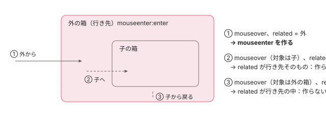

[目次](../README.md) › [イベント配送（event-dispatch）と jsaction の内側](README.md) › 第 9 回 / 全 12 回

# mouseenter とタッチ：委譲では来ないイベントを作り直す

> mouseenter・mouseleave・pointerenter・pointerleave は泡立たないので、mouseover・mouseout から作り直す isMouseSpecialEvent・createMouseSpecialEvent の行（ActionResolver の syntheticMouseEventSupport）、タッチの touchend を click の形に作り直す getTouchData・recreateTouchEventAsClick、作り直したイベントの preventDefault・stopPropagation、getTarget。Angular の配布物ではどちらの作り直しも動いていないことをページの上で確かめる（isModifiedClickEvent・isMiddleClick は第 7 回）。

angular/angular · 読了 約 12 分 · 発展 · [サイトで読む（デモが動きます）](https://angular-deep-dive-cyan.vercel.app/chapter/jsaction-mouse-touch)

---

JSAction は、要素ごとにリスナーを付けず、入れ物（コンテナ）の 1 つのリスナーでイベントを受けます。ところが `mouseenter`・`mouseleave`・`pointerenter`・`pointerleave` は泡立たない（親の要素へ伝わらない）ので、入れ物のリスナーには届きません。この章では、JSAction がそれを `mouseover`・`mouseout` から作り直す行（`isMouseSpecialEvent`・`createMouseSpecialEvent`）と、タッチの `touchend` を `click` の形に作り直す行（`getTouchData`・`recreateTouchEventAsClick`）、作り直したイベントの `preventDefault`・`stopPropagation` を読みます。そのうえで、**Angular の配布物ではどちらの作り直しも動いていない**ことを、ページの上で確かめます。

読む対象は `packages/core/primitives/event-dispatch/src/action_resolver.ts`（161〜200 行目）と `src/event.ts`（103〜132 行目と 370〜550 行目）です。

1. [1. 全体像](01-jsaction-overview.md)
2. [2. jsaction 属性](02-jsaction-attribute.md)
3. [3. EventInfo](03-jsaction-event-info.md)
4. [4. イベントの種類](04-jsaction-event-types.md)
5. [5. 早期の契約](05-jsaction-early-contract.md)
6. [6. EventContract](06-jsaction-contract.md)
7. [7. 行き先を探す](07-jsaction-resolver.md)
8. [8. a11y の click](08-jsaction-a11y-click.md)
9. **9. mouseenter とタッチ**（この章）
10. [10. Dispatcher](10-jsaction-dispatcher.md)
11. [11. Angular の側](11-jsaction-angular.md)
12. [12. spec と issue](12-jsaction-tests-issues.md)

## 1. 前提：mouseenter は 2 か所で止められている

作り直しには 2 つのスイッチが要ります。1 つ目は契約の側で、`addEvent('mouseenter')` は `EventContract.MOUSE_SPECIAL_SUPPORT` が真のときだけ、ブラウザの `mouseover` のリスナーを `mouseenter` の名前で付けます。この static の欄の初めの値は event\_contract\_defines.ts の `MOUSE_SPECIAL_SUPPORT` で、配布物では `false` です（[defer-hydrate-events の章](../defer/18-defer-hydrate-events.md)の 1 節、[第 4 回](04-jsaction-event-types.md)・[第 6 回](06-jsaction-contract.md)）。2 つ目が、この章の 2 節の `ActionResolver` の `syntheticMouseEventSupport` で、配布物の `EventDispatcher` は渡さないので `false` です（[第 7 回](07-jsaction-resolver.md)の 1 節）。

## 2. ActionResolver：行き先が決まったあとで、本当に「入った」かを確かめる

📄 `angular/packages/core/primitives/event-dispatch/src/action_resolver.ts` L161–200 （▶ の行: 164, 166–169, 175–178, 186–188, 190, 194, 196）

```ts
161 │     // We attempt to handle the mouseenter/mouseleave events here by
162 │     // detecting whether the mouseover/mouseout events correspond to
163 │     // entering/leaving an element.
164 ▶     if (this.syntheticMouseEventSupport) {
165 │       if (
166 ▶         eventInfoLib.getEventType(eventInfo) === EventType.MOUSEENTER ||
167 ▶         eventInfoLib.getEventType(eventInfo) === EventType.MOUSELEAVE ||
168 ▶         eventInfoLib.getEventType(eventInfo) === EventType.POINTERENTER ||
169 ▶         eventInfoLib.getEventType(eventInfo) === EventType.POINTERLEAVE
170 │       ) {
171 │         // We attempt to handle the mouseenter/mouseleave events here by
172 │         // detecting whether the mouseover/mouseout events correspond to
173 │         // entering/leaving an element.
174 │         if (
175 ▶           eventLib.isMouseSpecialEvent(
176 ▶             eventInfoLib.getEvent(eventInfo),
177 ▶             eventInfoLib.getEventType(eventInfo),
178 ▶             eventInfoLib.getActionElement(action),
179 │           )
180 │         ) {
181 │           // If both mouseover/mouseout and mouseenter/mouseleave events are
182 │           // enabled, two separate handlers for mouseover/mouseout are
183 │           // registered. Both handlers will see the same event instance
184 │           // so we create a copy to avoid interfering with the dispatching of
185 │           // the mouseover/mouseout event.
186 ▶           const copiedEvent = eventLib.createMouseSpecialEvent(
187 ▶             eventInfoLib.getEvent(eventInfo),
188 ▶             eventInfoLib.getActionElement(action),
189 │           );
190 ▶           eventInfoLib.setEvent(eventInfo, copiedEvent);
191 │           // Since the mouseenter/mouseleave events do not bubble, the target
192 │           // of the event is technically the `actionElement` (the node with the
193 │           // `jsaction` attribute)
194 ▶           eventInfoLib.setTargetElement(eventInfo, eventInfoLib.getActionElement(action));
195 │         } else {
196 ▶           eventInfoLib.unsetAction(eventInfo);
197 │         }
198 │       }
199 │     }
200 │   }
```

1. **164〜170 行目：作り直しが有効で、種類が 4 つのどれかのとき**

   ここは `populateAction` の最後で、行き先（`jsaction` に `mouseenter` がある要素）はもう決まっています（[第 7 回](07-jsaction-resolver.md)の 4 節）。ブラウザのイベントは `mouseover` なので、子の要素の間を動くたびに来ます。それが行き先の要素に「入った」ときのものかを、ここで確かめます。
2. **175〜178 行目：isMouseSpecialEvent（3 節）に、イベント・種類・行き先の要素を渡す**
3. **186〜190 行目：入ったのなら、イベントを写して差し替える**

   `createMouseSpecialEvent`（4 節）の写しを `EventInfo` のイベントにします。181〜185 行目のコメントのとおり、`mouseover` にも別の処理が付いているとき、2 つの受け手が同じイベントの実体を見るので、元を書き換えずに写します。
4. **194 行目：対象の要素も、行き先の要素にする**

   本物の mouseenter は泡立たないので、対象はいつも `jsaction` のある要素そのものです（191〜193 行目のコメント）。
5. **196 行目：入ったのでなければ、行き先を消す**

   子から子へ動いただけの `mouseover` は、行き先なしになります。

## 3. isMouseSpecialEvent：relatedTarget が外から来たか

📄 `angular/packages/core/primitives/event-dispatch/src/event.ts` L370–399 （▶ の行: 375–376, 379–380, 390, 393–397）

```ts
370 │ /**
371 │  * Determines whether the event corresponds to a non-bubbling mouse
372 │  * event type (mouseenter, mouseleave, pointerenter, and pointerleave).
373 │  *
374 │  * During mouseover (mouseenter) and pointerover (pointerenter), the
375 ▶  * relatedTarget is the element being entered from. During mouseout (mouseleave)
376 ▶  * and pointerout (pointerleave), the relatedTarget is the element being exited
377 │  * to.
378 │  *
379 ▶  * In both cases, if relatedTarget is outside target, then the corresponding
380 ▶  * special event has occurred, otherwise it hasn't.
381 │  *
382 │  * @param e The mouseover/mouseout event.
383 │  * @param type The type of the mouse special event.
384 │  * @param element The element on which the jsaction for the
385 │  *     mouseenter/mouseleave event is defined.
386 │  * @return True if the event is a mouseenter/mouseleave event.
387 │  */
388 │ export function isMouseSpecialEvent(e: Event, type: string, element: Element): boolean {
389 │   // `relatedTarget` is an old DOM API.
390 ▶   const related = (e as any).relatedTarget as Node;
391 │ 
392 │   return (
393 ▶     ((e.type === EventType.MOUSEOVER && type === EventType.MOUSEENTER) ||
394 ▶       (e.type === EventType.MOUSEOUT && type === EventType.MOUSELEAVE) ||
395 ▶       (e.type === EventType.POINTEROVER && type === EventType.POINTERENTER) ||
396 ▶       (e.type === EventType.POINTEROUT && type === EventType.POINTERLEAVE)) &&
397 ▶     (!related || (related !== element && !element.contains(related)))
398 │   );
399 │ }
```

`mouseover` の `relatedTarget` はポインターが「どこから来たか」、`mouseout` の `relatedTarget` は「どこへ行くか」です（375〜377 行目）。393〜396 行目で、ブラウザのイベントと作りたい種類の組（mouseover と mouseenter など 4 組）が合っているかを見て、397 行目で、`relatedTarget` が無い（ウィンドウの外から来た）か、行き先の要素そのものでも、その中でもないとき、真にします。379〜380 行目のコメントの「外から来たら入った、中から来たら入っていない」がこの 1 行です。



*外の箱（jsaction="mouseenter:enter"）に子の箱がある。ブラウザの mouseover は 3 回とも来るが、relatedTarget が外の箱の外にあるのは 1 回目だけ。*

## 4. createMouseSpecialEvent：イベントの形をしたただのオブジェクト

📄 `angular/packages/core/primitives/event-dispatch/src/event.ts` L410–449 （▶ の行: 421–423, 429–430, 434, 436–437, 445–447）

```ts
410 │ export function createMouseSpecialEvent(e: Event, target: Element): Event {
411 │   // We have to create a copy of the event object because we need to mutate
412 │   // its fields. We do this for the special mouse events because the event
413 │   // target needs to be retargeted to the action element rather than the real
414 │   // element (since we are simulating the special mouse events with mouseover/
415 │   // mouseout).
416 │   //
417 │   // Since we're making a copy anyways, we might as well attempt to convert
418 │   // this event into a pseudo-real mouseenter/mouseleave event by adjusting
419 │   // its type.
420 │   //
421 ▶   const copy: {-readonly [P in keyof Event]?: Event[P]} & {'_originalEvent'?: Event} = {};
422 ▶   for (const property in e) {
423 ▶     if (property === 'srcElement' || property === 'target') {
424 │       continue;
425 │     }
426 │     const key = property as keyof Event;
427 │     // Making a copy requires iterating through all properties of `Event`.
428 │     const value = e[key];
429 ▶     if (typeof value === 'function') {
430 ▶       continue;
431 │     }
432 │     // Value should be the expected type, but the value of `key` is not known
433 │     // statically.
434 ▶     copy[key] = value as any;
435 │   }
436 ▶   if (e.type === EventType.MOUSEOVER) {
437 ▶     copy['type'] = EventType.MOUSEENTER;
438 │   } else if (e.type === EventType.MOUSEOUT) {
439 │     copy['type'] = EventType.MOUSELEAVE;
440 │   } else if (e.type === EventType.POINTEROVER) {
441 │     copy['type'] = EventType.POINTERENTER;
442 │   } else {
443 │     copy['type'] = EventType.POINTERLEAVE;
444 │   }
445 ▶   copy['target'] = copy['srcElement'] = target;
446 ▶   copy['bubbles'] = false;
447 ▶   copy['_originalEvent'] = e;
448 │   return copy as Event;
449 │ }
```

1. **421〜435 行目：for…in で欄を 1 つずつ写す**

   写し先は 421 行目の空のオブジェクト（`{}`）で、`Event` ではありません。423 行目で `target` と `srcElement` を飛ばし、429〜431 行目で**関数は写しません**。だから写しには `preventDefault` も `stopPropagation` もありません。
2. **436〜444 行目：type を作りたい種類に変える**

   mouseover → mouseenter、mouseout → mouseleave、pointerover → pointerenter、それ以外は pointerleave。
3. **445〜447 行目：target を行き先の要素に、bubbles を false に、元のイベントを \_originalEvent に**

   447 行目は af9d74710c4（2025-01、#59690）で足された行です。`git show` で読むと、変わったのはこの 1 行と型の注記だけで、commit の説明は「内部の不具合を直す」だけです。

この写しが渡る先は、2 節のとおり作り直しが有効な `ActionResolver` を使う配り役です。spec（dispatcher\_test.ts）は `Dispatcher` を使っていて、`EventDispatcher` ではありません。`EventDispatcher` は渡す前にイベントの `stopPropagation` を包み直すので（[第 10 回](10-jsaction-dispatcher.md)）、関数を持たない写しとは組み合わせられない形です（配布物では 1 節のとおり組み合わさりません）。

## 5. タッチ：touchend を click の形に作り直す関数

📄 `angular/packages/core/primitives/event-dispatch/src/event.ts` L451–474 （▶ の行: 463–466, 468–472）

```ts
451 │ /**
452 │  * Returns touch data extracted from the touch event: clientX, clientY, screenX
453 │  * and screenY. If the event has no touch information at all, the returned
454 │  * value is null.
455 │  *
456 │  * The fields of this Object are unquoted.
457 │  *
458 │  * @param event A touch event.
459 │  */
460 │ export function getTouchData(
461 │   event: TouchEvent,
462 │ ): {clientX: number; clientY: number; screenX: number; screenY: number} | null {
463 ▶   const touch =
464 ▶     (event.changedTouches && event.changedTouches[0]) || (event.touches && event.touches[0]);
465 ▶   if (!touch) {
466 ▶     return null;
467 │   }
468 ▶   return {
469 ▶     clientX: touch.clientX,
470 ▶     clientY: touch.clientY,
471 ▶     screenX: touch.screenX,
472 ▶     screenY: touch.screenY,
473 │   };
474 │ }
```

463〜464 行目で、指が離れた点（`changedTouches` の 1 つ目）、無ければいま触れている点（`touches` の 1 つ目）を取り、465〜466 行目でどちらも無ければ `null` です。468〜473 行目で、座標の 4 つだけを返します。

📄 `angular/packages/core/primitives/event-dispatch/src/event.ts` L476–513 （▶ の行: 485, 496, 498–501, 507–508, 512）

```ts
476 │ declare interface SyntheticMouseEvent extends Event {
477 │   // Redeclared from Event to indicate that it is not readonly.
478 │   defaultPrevented: boolean;
479 │   originalEventType: string;
480 │   _propagationStopped?: boolean;
481 │ }
482 │ 
483 │ /**
484 │  * Creates a new EventLike object for a "click" event that's derived from the
485 ▶  * original corresponding "touchend" event for a fast-click implementation.
486 │  *
487 │  * It takes a touch event, adds common fields found in a click event and
488 │  * changes the type to 'click', so that the resulting event looks more like
489 │  * a real click event.
490 │  *
491 │  * @param event A touch event.
492 │  * @return A modified event-like object copied from the event object passed into
493 │  *     this function.
494 │  */
495 │ export function recreateTouchEventAsClick(event: TouchEvent): MouseEvent {
496 ▶   const click: {-readonly [P in keyof MouseEvent]?: MouseEvent[P]} & Partial<SyntheticMouseEvent> =
497 │     {};
498 ▶   click['originalEventType'] = event.type;
499 ▶   click['type'] = EventType.CLICK;
500 ▶   for (const property in event) {
501 ▶     if (property === 'type' || property === 'srcElement') {
502 │       continue;
503 │     }
504 │     const key = property as keyof TouchEvent;
505 │     // Making a copy requires iterating through all properties of `TouchEvent`.
506 │     const value = event[key];
507 ▶     if (typeof value === 'function') {
508 ▶       continue;
509 │     }
510 │     // Value should be the expected type, but the value of `key` is not known
511 │     // statically.
512 ▶     click[key as keyof MouseEvent] = value as any;
513 │   }
```

📄 `angular/packages/core/primitives/event-dispatch/src/event.ts` L514–550 （▶ の行: 517, 520–523, 526, 528, 540–541, 548–549）

```ts
514 │ 
515 │   // Ensure that the event has the most recent timestamp. This timestamp
516 │   // may be used in the future to validate or cancel subsequent click events.
517 ▶   click['timeStamp'] = Date.now();
518 │ 
519 │   // Emulate preventDefault and stopPropagation behavior
520 ▶   click['defaultPrevented'] = false;
521 ▶   click['preventDefault'] = syntheticPreventDefault;
522 ▶   click['_propagationStopped'] = false;
523 ▶   click['stopPropagation'] = syntheticStopPropagation;
524 │ 
525 │   // Emulate click coordinates using touch info
526 ▶   const touch = getTouchData(event);
527 │   if (touch) {
528 ▶     click['clientX'] = touch.clientX;
529 │     click['clientY'] = touch.clientY;
530 │     click['screenX'] = touch.screenX;
531 │     click['screenY'] = touch.screenY;
532 │   }
533 │   return click as MouseEvent;
534 │ }
535 │ 
536 │ /**
537 │  * An implementation of "preventDefault" for a synthesized event. Simply
538 │  * sets "defaultPrevented" property to true.
539 │  */
540 ▶ function syntheticPreventDefault(this: Event) {
541 ▶   (this as SyntheticMouseEvent).defaultPrevented = true;
542 │ }
543 │ 
544 │ /**
545 │  * An implementation of "stopPropagation" for a synthesized event. It simply
546 │  * sets a synthetic non-standard "_propagationStopped" property to true.
547 │  */
548 ▶ function syntheticStopPropagation(this: Event) {
549 ▶   (this as SyntheticMouseEvent)._propagationStopped = true;
550 │ }
```

1. **498〜499 行目：元の種類を残し、type を click にする**

   `originalEventType` は標準に無い欄です。485 行目のコメントのとおり、touchend のすぐあとに click として扱う「fast-click」のための作り直しです。
2. **500〜513 行目：関数でない欄を写す**

   4 節と同じく、写し先はただのオブジェクトです。`type` と `srcElement` は写しません（501 行目）。`target` は写すので、タッチした要素のままです。
3. **517 行目：時刻を Date.now() にする**

   元の `timeStamp`（ページを開いてからのミリ秒）ではなく、1970 年からのミリ秒になります。515〜516 行目のコメントのとおり、あとの click と比べるためです。
4. **520〜523 行目：preventDefault と stopPropagation を、欄を立てるだけの関数にする**

   540〜541 行目の `syntheticPreventDefault` は `defaultPrevented` を `true` に、548〜549 行目の `syntheticStopPropagation` は標準に無い `_propagationStopped` を `true` にするだけです。**元の touchend の既定の動きも、伝わり方も変わりません**。
5. **526〜532 行目：座標を、指の座標で上書きする**

ところが、`recreateTouchEventAsClick` と `getTouchData` を呼ぶ所は、../angular の packages の中に spec（event\_test.ts）しかありません。このサイトが使う配布物（@angular/core 22.1.6 の `fesm2022/primitives-event-dispatch.mjs`）を `grep` すると、この 2 つも 520〜523 行目の 2 つの関数も入っていません。**配布物の JSAction は、タッチを click に作り直しません**。`touchend` は `touchend` のまま、ブラウザが続けて出す `click` は `click` のまま届きます（7 節の記録）。

> [!NOTE]
> **ポイント**
>
> タッチに関係する最近の修正は a24179e1251（2026-03-30、fix(core): remove obsolete iOS cursor pointer hack in event delegation）です。`git show` で読むと、event\_contract\_container.ts から、iOS の UA のときに入れ物の要素へ `style.cursor = 'pointer'` を書く 14 行と、`isIos` の判定を消しています。commit の説明は「iOS 13 の WebKit から、div や body でも click が泡立つようになったので、この回避策は要らない」です。入れ物の扱いは [第 6 回](06-jsaction-contract.md)の持ち場です。

## 6. 作り直しを支える小さな関数：getTarget・preventDefault・stopPropagation

📄 `angular/packages/core/primitives/event-dispatch/src/event.ts` L115–132 （▶ の行: 123, 127–128, 131）

```ts
115 │ /**
116 │  * Gets the target Element of the event. In Firefox, a text node may appear as
117 │  * the target of the event, in which case we return the parent element of the
118 │  * text node.
119 │  * @param e The event to get the target of.
120 │  * @return The target element.
121 │  */
122 │ export function getTarget(e: Event): Element {
123 ▶   let el = e.target as Element;
124 │ 
125 │   // In Firefox, the event may have a text node as its target. We always
126 │   // want the parent Element the text node belongs to, however.
127 ▶   if (!el.getAttribute && el.parentNode) {
128 ▶     el = el.parentNode as Element;
129 │   }
130 │ 
131 ▶   return el;
132 │ }
```

127〜128 行目で、`target` に `getAttribute` が無い（文字のノード）なら親の要素にします。125〜126 行目のコメントのとおり Firefox の古い動きのためです。呼ぶのは event.ts の中の 3 か所（`shouldCallPreventDefaultOnNativeHtmlControl`・`isActionKeyEvent`・`isSpaceKeyEvent`。[第 8 回](08-jsaction-a11y-click.md)）だけで、`EventContract` が `EventInfo` を作るときは `event.target` をそのまま使います（eventcontract.ts。[defer-hydrate-events の章](../defer/18-defer-hydrate-events.md)の 2 節）。

📄 `angular/packages/core/primitives/event-dispatch/src/event.ts` L103–113 （▶ の行: 104, 112）

```ts
103 │ export function stopPropagation(e: Event) {
104 ▶   e.stopPropagation ? e.stopPropagation() : (e.cancelBubble = true);
105 │ }
106 │ 
107 │ /**
108 │  * Prevents the default action of an event.
109 │  * @param e The event to prevent the default action for.
110 │  */
111 │ export function preventDefault(e: Event) {
112 ▶   e.preventDefault ? e.preventDefault() : (e.returnValue = false);
113 │ }
```

104・112 行目は、メソッドが無い古い IE のイベントのために `cancelBubble`・`returnValue` へ落とす形です。`preventDefault` を呼ぶのは dispatcher.ts（行き先が `<a>` の click。第 10 回）と a11y\_click.ts（第 8 回）で、`stopPropagation` を呼ぶ所は src の中にありません。修飾キーと中ボタンの `isModifiedClickEvent`・`isMiddleClick` は [第 7 回](07-jsaction-resolver.md)の 2 節で読みました。

## 7. DEMO：マウスを乗せる・子へ動かす・外へ出す（ライブと記録）

> **🧪 DEMO — mouseenter は届くか（ライブ）**
>
> 「契約を作る」を押すと、外の箱（`jsaction="mouseenter:enter;mouseleave:leave;mouseover:over"`。中に子・孫の箱）と、タッチの箱（`jsaction="touchend:te;click:ck"`）を描き、本物の `EventContract` に `mouseenter`・`mouseleave`・`mouseover`・`touchend`・`click` を `addEvent` し、`EventDispatcher` を作ります。マウスを外の箱に乗せ、子・孫へ動かし、外へ出してください。比べるために、外の箱にはふつうの `mouseenter`・`mouseleave` のリスナーも付けて、ブラウザ自身が出した回数を数えます。
>
> 「契約を作る」を押すまで、要素も契約も作りません。
>
> ▶ [このデモはサイトで動かせます](https://angular-deep-dive-cyan.vercel.app/chapter/jsaction-mouse-touch)

Chrome 156（macOS）で試すと、次のようになりました。

- **Angular と同じ形**：addEvent の結果は「mouseenter・mouseleave は登録されない」です。外の箱に乗せても子へ動かしても、届くのは `mouseover` だけで、毎回 `over` に渡されます。`enter`・`leave` には一度も渡されません。一方、ブラウザ自身の mouseenter は、外から入ったときだけ 1 回数えられます。
- **MOUSE\_SPECIAL\_SUPPORT を true にした形**：mouseenter・mouseleave が登録され、外の箱の中で動くたびに、子へ動いたときも、`mouseenter` の種類で `enter` に渡されます。渡されるのはブラウザの `mouseover` そのもの（bubbles true）です。`EventDispatcher` の `ActionResolver` は作り直しが無効なので、2 節の 164〜199 行目を通らないからです。同じ `mouseover` が続けて `mouseover` の種類でも配られると、2 回目は「例外：Cannot redefine property: stopPropagation」になり、`over` に渡されません。`EventDispatcher` が渡す前に、イベントの実体の `stopPropagation` を定義し直せない形で包むので（第 10 回）、同じイベントを 2 回配れないためです。181〜185 行目のコメントが写しを作る理由に挙げているのが、この「2 つの受け手が同じイベントを見る」場面です。
- **タッチの箱**：開発者ツールでタッチを真似て押すと、`touchend` が `te` に、続けてブラウザが出す `click` が `ck` に、別々に届きます。5 節の作り直しは起きません。

作り直しが有効な形（`ActionResolver({ syntheticMouseEventSupport: true })` を `Dispatcher` に渡す。dispatcher\_test.ts の `createDispatcher` と同じ組み方）は、配布物の入口からは作れません。そこで、../angular のソースを束ねたページをヘッドレスの Chrome で開き、本物のマウスの移動（CDP の `Input.dispatchMouseEvent`）を送りました（**これは記録です**。2026-11-06、HeadlessChrome 156.0.0.0（macOS）、../angular 8576f161ae4（22.2.0-next.7））。

| 動き | ブラウザが出したイベント | 行き先に渡されたもの | 行き先なし（2 節の 196 行目） |
| --- | --- | --- | --- |
| outer の余白に入る | mouseover@m-outer related=html | mouseenter → enter（作り直したイベント：type mouseenter、target m-outer、bubbles false、\_originalEvent は mouseover）／ mouseover → over（ブラウザの mouseover そのまま、target m-outer） | — |
| child に入る | mouseout@m-outer related=m-child ／ mouseover@m-child related=m-outer | mouseover → over（ブラウザの mouseover そのまま、target m-child） | mouseleave（mouseout の target m-outer、related m-child）／ mouseenter（mouseover の target m-child、related m-outer） |
| grand に入る | mouseout@m-child related=m-grand ／ mouseover@m-grand related=m-child | mouseover → over（ブラウザの mouseover そのまま、target m-grand） | mouseleave（mouseout の target m-child、related m-grand）／ mouseenter（mouseover の target m-grand、related m-child） |
| child に戻る | mouseout@m-grand related=m-child ／ mouseover@m-child related=m-grand | mouseover → over（ブラウザの mouseover そのまま、target m-child） | mouseleave（mouseout の target m-grand、related m-child）／ mouseenter（mouseover の target m-child、related m-grand） |
| outer の余白に戻る | mouseout@m-child related=m-outer ／ mouseover@m-outer related=m-child | mouseover → over（ブラウザの mouseover そのまま、target m-outer） | mouseleave（mouseout の target m-child、related m-outer）／ mouseenter（mouseover の target m-outer、related m-child） |
| outer の外へ出る | mouseout@m-outer related=html | mouseleave → leave（作り直したイベント：type mouseleave、target m-outer、bubbles false、\_originalEvent は mouseout） | — |

外から入ったときと外へ出たときだけ、作り直した `mouseenter`・`mouseleave`（target は外の箱、bubbles は false、`_originalEvent` は元の mouseover・mouseout）が渡されました。子・孫へ動いたときは、`mouseenter`・`mouseleave` の種類の `EventInfo` は来ても、行き先は消されました。`mouseover:over` は、どの動きでも元の `mouseover` のまま渡されています（2 節の 181〜185 行目の「写すので元を書き換えない」）。

同じページで、タッチを有効にして（CDP の `Emulation.setTouchEmulationEnabled`）タッチの箱の中の span をタップし、touchend を受けたリスナーで `recreateTouchEventAsClick` を呼んだ結果です。

| 見たもの | 値 |
| --- | --- |
| ブラウザが出したイベント | touchstart@t-in ／ touchend@t-in ／ mousedown@t-in related=null ／ mouseup@t-in related=null ／ click@t-in related=null |
| 契約が配ったもの | touchend → te（t-box）／ click → ck（t-box） |
| 写しの type ／ originalEventType | click ／ touchend |
| 写しの target | t-in |
| 写しの clientX・clientY ／ 指の clientX・clientY | 164・70 ／ 164・70 |
| 写しの timeStamp は Date.now() か ／ 元の timeStamp | true ／ 5606 |
| 写しは Event か ／ composedPath の型 | false ／ undefined |
| 写しの preventDefault() の前 → 後の defaultPrevented | false → true |
| そのときの元の touchend の defaultPrevented | false |
| 写しの stopPropagation() の前 → 後の \_propagationStopped | false → true |

写しの `preventDefault()` は写しの欄を変えるだけで、元の touchend は `defaultPrevented` が `false` のままでした（5 節の 540〜541 行目）。写しは `Event` ではなく、`composedPath` も持ちません（500〜513 行目で関数を写さない）。

📄 `記録のスクリプト（scratchpad/jsa-demo/c/。build.mjs で束ね、rec-run.mjs がヘッドレスの Chrome を動かす）`

```
// ===== build.mjs =====
// 使い方: node build.mjs <記録のページの入口.ts> <出力.js>
// ../angular の event-dispatch のソース（読むだけ）と記録のページの入口を、ブラウザで読む 1 つの IIFE に束ねる。
// 束ね方は defer-demo/_shared/build.mjs と同じ esbuild。domino には KeyboardEvent・TouchEvent が無く、
// 本物の入力（CDP の Input.dispatch*）で確かめたいので、Node ではなくヘッドレスの Chrome の白紙のページで動かす。
import { build } from '~/angular-research/angular-deep-dive/node_modules/esbuild/lib/main.js';
const [entry, out] = process.argv.slice(2);
await build({ entryPoints: [entry], outfile: out, bundle: true, platform: 'browser', format: 'iife', target: 'es2022',
  logLevel: 'warning', define: { ngDevMode: 'true' } });

// ===== rec-entry.ts =====
// 記録のページの入口。../angular（8576f161ae4）の event-dispatch のソースを、公開の入口を通さずに直接読み込む。
// - a11y: ActionResolver に addA11yClickSupport で a11y_click.ts の 3 つの関数を差し込んだ形（dispatcher_test.ts の createDispatcher と同じ組み方）と、差し込まない形
// - mouse: EventContract.MOUSE_SPECIAL_SUPPORT を true にして mouseenter・mouseleave を登録し、ActionResolver({syntheticMouseEventSupport: true}) で解く形
// - touch: touchend を受けて、event.ts の recreateTouchEventAsClick を呼んだ結果を写す（ライブラリの中でこの関数を呼ぶ所は無い）
// - clickmod: Angular の event_replay.ts と同じ new EventDispatcher(fn)（clickModSupport は既定の true）と、false にした形
// Dispatcher はイベントごとに delegate を呼ぶ（行き先が無くても呼ぶ）ので、その引数の EventInfoWrapper を写す。
const SRC = '~/angular-research/angular/packages/core/primitives/event-dispatch/src';
import {EventContract} from '~/angular-research/angular/packages/core/primitives/event-dispatch/src/eventcontract';
import {EventContractContainer} from '~/angular-research/angular/packages/core/primitives/event-dispatch/src/event_contract_container';
import {ActionResolver} from '~/angular-research/angular/packages/core/primitives/event-dispatch/src/action_resolver';
import {Dispatcher, registerDispatcher} from '~/angular-research/angular/packages/core/primitives/event-dispatch/src/dispatcher';
import {EventDispatcher, registerDispatcher as registerEventDispatcher} from '~/angular-research/angular/packages/core/primitives/event-dispatch/src/event_dispatcher';
import {EventInfoWrapper} from '~/angular-research/angular/packages/core/primitives/event-dispatch/src/event_info';
import {populateClickOnlyAction, preventDefaultForA11yClick, updateEventInfoForA11yClick} from '~/angular-research/angular/packages/core/primitives/event-dispatch/src/a11y_click';
import {recreateTouchEventAsClick} from '~/angular-research/angular/packages/core/primitives/event-dispatch/src/event';
void SRC;

const w = window as any;
const log: any[] = [];
const native: string[] = [];
let contract: EventContract | null = null;
const name = (n: any) => (n && n.nodeType === 1 ? (n.id || n.tagName.toLowerCase()) : n ? n.nodeName : null);

function stage(html: string) {
  contract?.cleanUp();
  // 毎回 #stage を作り直す（前の場面の記録用リスナーを残さない）
  const old = document.getElementById('stage')!;
  const s = document.createElement('div');
  s.id = 'stage';
  old.replaceWith(s);
  s.innerHTML = html;
  log.length = 0;
  native.length = 0;
  return s;
}
function watchNative(s: Element, types: string[]) {
  for (const t of types) s.addEventListener(t, (e: any) => native.push(`${e.type}@${name(e.target)}${e.relatedTarget !== undefined ? ` related=${name(e.relatedTarget)}` : ''}`), true);
}
function record(wr: EventInfoWrapper) {
  const e: any = wr.getEvent();
  const a = wr.getAction();
  log.push({
    eventType: wr.getEventType(),
    nativeType: e.type,
    action: a ? a.name : null,
    actionElement: a ? name(a.element) : null,
    targetElement: name(wr.getTargetElement()),
    eventTarget: name(e.target),
    relatedTarget: e.relatedTarget === undefined ? undefined : name(e.relatedTarget),
    a11yClickKey: wr.eventInfo.eiack ?? false,
    defaultPrevented: e.defaultPrevented,
    copied: e instanceof Event ? false : true,
    bubbles: e.bubbles,
    originalType: e._originalEvent ? e._originalEvent.type : undefined,
  });
}

const A11Y_HTML = `
<div id="k-div" jsaction="click:x">div（tabindex なし）</div>
<div id="k-divtab" tabindex="0" jsaction="click:x">div tabindex=0</div>
<div id="k-rolebtn" role="button" tabindex="0" jsaction="click:x">div role=button tabindex=0</div>
<button id="k-button" type="button" jsaction="click:x">button</button>
<a id="k-a" href="#k" jsaction="click:x">a href</a>
<span id="k-rolelink" role="link" tabindex="0" jsaction="click:x">span role=link tabindex=0</span>
<input id="k-text" type="text" jsaction="click:x" aria-label="text">
<input id="k-check" type="checkbox" jsaction="click:x" aria-label="checkbox">
<div id="k-rolecheck" role="checkbox" tabindex="0" jsaction="click:x">div role=checkbox tabindex=0</div>
<div id="k-keyonly" tabindex="0" jsaction="keydown:k">div tabindex=0 jsaction="keydown:k"</div>`;

w.REC = {
  log, native,
  a11y(enable: boolean) {
    const s = stage(A11Y_HTML);
    watchNative(s, ['keydown', 'keypress', 'keyup', 'click']);
    contract = new EventContract(new EventContractContainer(s));
    contract.addEvent('click');
    contract.addEvent('keydown');
    const resolver = new ActionResolver();
    if (enable) resolver.addA11yClickSupport(updateEventInfoForA11yClick, preventDefaultForA11yClick, populateClickOnlyAction);
    registerDispatcher(contract, new Dispatcher((wr) => record(wr), {actionResolver: resolver}));
  },
  mouse() {
    const s = stage(`<div id="m-outer" jsaction="mouseenter:enter;mouseleave:leave;mouseover:over" style="margin:40px;padding:40px;width:400px;height:240px;background:#eee">外（outer）
      <div id="m-child" style="padding:30px;background:#ccc;height:120px">子（child）<div id="m-grand" style="padding:20px;background:#999">孫（grand）</div></div></div>`);
    watchNative(s, ['mouseover', 'mouseout']);
    const saved = EventContract.MOUSE_SPECIAL_SUPPORT;
    EventContract.MOUSE_SPECIAL_SUPPORT = true;
    try {
      contract = new EventContract(new EventContractContainer(s));
      contract.addEvent('mouseenter');
      contract.addEvent('mouseleave');
      contract.addEvent('mouseover');
    } finally {
      EventContract.MOUSE_SPECIAL_SUPPORT = saved;
    }
    registerDispatcher(contract, new Dispatcher((wr) => record(wr), {actionResolver: new ActionResolver({syntheticMouseEventSupport: true})}));
  },
  touch() {
    const s = stage(`<div id="t-box" jsaction="touchend:te;click:ck" style="margin:40px;width:300px;height:160px;background:#eee">タッチする箱<span id="t-in" style="display:inline-block;margin:20px;padding:10px;background:#ccc">中の span</span></div>`);
    watchNative(s, ['touchstart', 'touchend', 'mousedown', 'mouseup', 'click']);
    contract = new EventContract(new EventContractContainer(s));
    contract.addEvent('touchend');
    contract.addEvent('click');
    registerDispatcher(contract, new Dispatcher((wr) => record(wr), {actionResolver: new ActionResolver()}));
    s.addEventListener('touchend', (e: any) => {
      const c: any = recreateTouchEventAsClick(e);
      const t = e.changedTouches[0];
      const r: any = {
        type: c.type, originalEventType: c.originalEventType, target: name(c.target), currentTarget: name(c.currentTarget),
        clientX: c.clientX, clientY: c.clientY, touchClientX: t.clientX, touchClientY: t.clientY, screenX: c.screenX, screenY: c.screenY,
        timeStampIsDateNow: Math.abs(c.timeStamp - Date.now()) < 1000, originalTimeStamp: Math.round(e.timeStamp),
        isEvent: c instanceof Event, hasComposedPath: typeof c.composedPath, bubbles: c.bubbles,
        defaultPreventedBefore: c.defaultPrevented, propagationStoppedBefore: c._propagationStopped,
      };
      c.preventDefault();
      c.stopPropagation();
      r.defaultPreventedAfter = c.defaultPrevented;
      r.originalDefaultPrevented = e.defaultPrevented;
      r.propagationStoppedAfter = c._propagationStopped;
      w.REC.touchCopy = r;
    });
  },
  clickmod(mode: 'default' | 'off' | 'queued') {
    const s = stage(`<button id="c-btn" type="button" jsaction="click:;" style="margin:40px;padding:20px">click:; のボタン（Angular がサーバーで付ける形）</button>`);
    watchNative(s, ['click', 'auxclick']);
    contract = new EventContract(new EventContractContainer(s));
    contract.addEvent('click');
    const calls: any[] = (w.REC.calls = []);
    const ed = mode === 'off' ? new EventDispatcher((e: any, n) => calls.push({type: e.type, action: n, shift: e.shiftKey, meta: e.metaKey, ctrl: e.ctrlKey}), false)
      : new EventDispatcher((e: any, n) => calls.push({type: e.type, action: n, shift: e.shiftKey, meta: e.metaKey, ctrl: e.ctrlKey}));
    if (mode === 'queued') {
      w.REC.register = () => registerEventDispatcher(contract!, ed);
    } else {
      registerEventDispatcher(contract, ed);
    }
  },
};

// ===== cdp-lib.mjs =====
// ヘッドレスの Chrome（--remote-debugging-port=9447）を CDP で動かす小さな部品。
// 入力は Input.dispatchMouseEvent・dispatchKeyEvent・dispatchTouchEvent（ブラウザが本物の入力として扱う。isTrusted が true）。
export async function openTab(url, port = 9447) {
  const t = await (await fetch(`http://127.0.0.1:${port}/json/new?about:blank`, { method: 'PUT' })).json();
  const ws = new WebSocket(t.webSocketDebuggerUrl);
  await new Promise((r) => (ws.onopen = r));
  let id = 0; const pending = new Map(); const logs = []; const handlers = new Map();
  ws.onmessage = (m) => {
    const msg = JSON.parse(m.data);
    if (msg.id && pending.has(msg.id)) { pending.get(msg.id)(msg); pending.delete(msg.id); }
    else if (msg.method && handlers.has(msg.method)) handlers.get(msg.method)(msg.params);
    else if (msg.method === 'Runtime.consoleAPICalled') logs.push(`console.${msg.params.type}: ${msg.params.args.map((a) => a.value ?? a.description).join(' ')}`);
    else if (msg.method === 'Runtime.exceptionThrown') logs.push(`exception: ${msg.params.exceptionDetails.exception?.description ?? msg.params.exceptionDetails.text}`);
    else if (msg.method === 'Log.entryAdded') logs.push(`log.${msg.params.entry.level}: ${msg.params.entry.text}`);
  };
  const send = (method, params = {}) => new Promise((r) => { const i = ++id; pending.set(i, r); ws.send(JSON.stringify({ id: i, method, params })); });
  await send('Runtime.enable'); await send('Log.enable'); await send('Page.enable');
  const sleep = (ms) => new Promise((r) => setTimeout(r, ms));
  const tab = {
    send, logs, sleep,
    on(method, fn) { handlers.set(method, fn); },
    async go(u, wait = 1500) { await send('Page.navigate', { url: u }); await sleep(wait); },
    async ev(expr) {
      const r = await send('Runtime.evaluate', { expression: expr, awaitPromise: true, returnByValue: true });
      if (r.result?.exceptionDetails) throw new Error(JSON.stringify(r.result.exceptionDetails).slice(0, 600));
      return r.result?.result?.value;
    },
    async center(sel) {
      return tab.ev(`(() => { const el = document.querySelector(${JSON.stringify(sel)}); if (!el) return null; el.scrollIntoView({block: 'center'}); const r = el.getBoundingClientRect(); return {x: Math.round(r.left + Math.min(12, r.width / 2)), y: Math.round(r.top + Math.min(10, r.height / 2))}; })()`);
    },
    async move(x, y) { await send('Input.dispatchMouseEvent', { type: 'mouseMoved', x, y }); await sleep(60); },
    async click(x, y, { button = 'left', modifiers = 0 } = {}) {
      const buttons = { left: 1, right: 2, middle: 4 }[button];
      await send('Input.dispatchMouseEvent', { type: 'mouseMoved', x, y, modifiers });
      await send('Input.dispatchMouseEvent', { type: 'mousePressed', x, y, button, buttons, clickCount: 1, modifiers });
      await send('Input.dispatchMouseEvent', { type: 'mouseReleased', x, y, button, buttons: 0, clickCount: 1, modifiers });
      await sleep(80);
    },
    async key(k) {
      const d = k === 'Enter' ? { key: 'Enter', code: 'Enter', windowsVirtualKeyCode: 13, nativeVirtualKeyCode: 13, text: '\r' }
        : { key: ' ', code: 'Space', windowsVirtualKeyCode: 32, nativeVirtualKeyCode: 32, text: ' ' };
      await send('Input.dispatchKeyEvent', { type: 'keyDown', ...d });
      await send('Input.dispatchKeyEvent', { type: 'keyUp', key: d.key, code: d.code, windowsVirtualKeyCode: d.windowsVirtualKeyCode, nativeVirtualKeyCode: d.nativeVirtualKeyCode });
      await sleep(80);
    },
    async tap(x, y) {
      await send('Input.dispatchTouchEvent', { type: 'touchStart', touchPoints: [{ x, y }] });
      await sleep(40);
      await send('Input.dispatchTouchEvent', { type: 'touchEnd', touchPoints: [] });
      await sleep(400);
    },
    async close() { ws.close(); await fetch(`http://127.0.0.1:${port}/json/close/${t.id}`); },
  };
  return tab;
}
// 修飾キーの CDP の値（Alt=1, Ctrl=2, Meta=4, Shift=8）
export const MOD = { alt: 1, ctrl: 2, meta: 4, shift: 8 };

// ===== rec-run.mjs =====
// 使い方: node rec-run.mjs > rec.json   （先に node build.mjs rec-entry.ts rec/rec.js）
import { openTab, MOD } from './cdp-lib.mjs';
const PAGE = 'file://' + new URL('./rec/index.html', import.meta.url).pathname;
const tab = await openTab(PAGE);
await tab.go(PAGE);
const out = { chrome: await tab.ev('navigator.userAgent'), date: new Date().toISOString().slice(0, 10) };

// 1. a11y: 10 の要素 × Enter・Space、a11y の click を差し込む / 差し込まない
const ELS = ['k-div', 'k-divtab', 'k-rolebtn', 'k-button', 'k-a', 'k-rolelink', 'k-text', 'k-check', 'k-rolecheck', 'k-keyonly'];
out.a11y = {};
for (const enable of [false, true]) {
  const rows = [];
  for (const id of ELS) for (const k of ['Enter', 'Space']) {
    await tab.ev(`REC.a11y(${enable})`);
    const focused = await tab.ev(`(() => { const el = document.getElementById('${id}'); el.focus(); return document.activeElement === el; })()`);
    await tab.ev(`REC.log.length = 0; REC.native.length = 0`);
    await tab.key(k === 'Space' ? ' ' : 'Enter');
    const checked = await tab.ev(`document.getElementById('k-check').checked`);
    rows.push({ id, key: k, focused, native: await tab.ev('REC.native.slice()'), log: await tab.ev('REC.log.slice()'), checked });
  }
  out.a11y[enable ? 'on' : 'off'] = rows;
}

// 2. mouse: 外 → 外の余白 → 子 → 孫 → 子 → 外の余白 → 外へ
await tab.ev('REC.mouse()');
const box = await tab.ev(`(() => { const g = (id) => { const r = document.getElementById(id).getBoundingClientRect(); return {l: r.left, t: r.top, r: r.right, b: r.bottom}; }; return {outer: g('m-outer'), child: g('m-child'), grand: g('m-grand')}; })()`);
const pts = [
  ['ページの外側（outer の外）', 5, 5],
  ['outer の余白に入る', box.outer.l + 10, box.outer.t + 10],
  ['child に入る', box.child.l + 5, box.child.t + 5],
  ['grand に入る', box.grand.l + 5, box.grand.t + 5],
  ['child に戻る', box.child.r - 5, box.child.b - 5],
  ['outer の余白に戻る', box.outer.r - 5, box.outer.b - 5],
  ['outer の外へ出る', box.outer.r + 30, box.outer.b + 30],
];
out.mouse = [];
await tab.move(pts[0][1], pts[0][2]);
for (const [label, x, y] of pts.slice(1)) {
  await tab.ev(`REC.log.length = 0; REC.native.length = 0`);
  await tab.move(Math.round(x), Math.round(y));
  out.mouse.push({ step: label, native: await tab.ev('REC.native.slice()'), log: await tab.ev('REC.log.slice()') });
}

// 3. touch: タッチを有効にして中の span をタップ
await tab.send('Emulation.setTouchEmulationEnabled', { enabled: true, maxTouchPoints: 1 });
await tab.ev('REC.touch()');
const tp = await tab.center('#t-in');
await tab.tap(tp.x, tp.y);
out.touch = { native: await tab.ev('REC.native.slice()'), log: await tab.ev('REC.log.slice()'), copy: await tab.ev('REC.touchCopy') };
await tab.send('Emulation.setTouchEmulationEnabled', { enabled: false });

// 4. clickmod: Angular と同じ new EventDispatcher(fn)（既定）と false、貯めてから登録
out.clickmod = [];
const isMac = /Macintosh/.test(out.chrome);
const tries = [['ふつうのクリック', {}], ['Shift+クリック', { modifiers: MOD.shift }], [isMac ? 'Cmd（Meta）+クリック' : 'Ctrl+クリック', { modifiers: isMac ? MOD.meta : MOD.ctrl }], [isMac ? 'Ctrl+クリック（Mac）' : 'Meta+クリック', { modifiers: isMac ? MOD.ctrl : MOD.meta }], ['中ボタンのクリック', { button: 'middle' }]];
for (const mode of ['default', 'off', 'queued']) {
  for (const [label, opt] of tries) {
    await tab.ev(`REC.clickmod('${mode}')`);
    const p = await tab.center('#c-btn');
    await tab.click(p.x, p.y, opt);
    if (mode === 'queued') await tab.ev('REC.register()');
    await tab.sleep(50);
    out.clickmod.push({ mode, label, native: await tab.ev('REC.native.slice()'), calls: await tab.ev('REC.calls.slice()') });
  }
}
out.consoleLogs = tab.logs;
await tab.close();
console.log(JSON.stringify(out, null, 1));

```

## ここまでの呼び出し

- `EventContract.addEvent('mouseenter')` — eventcontract.ts 152 — *MOUSE\_SPECIAL\_SUPPORT が偽なら何もしない（配布物）*
  - `getBrowserEventType('mouseenter')` → `'mouseover'` — event.ts 16 — *真なら mouseover のリスナーを mouseenter の名前で（第 4 回）*
- 👤 `ユーザーがマウスを動かす（mouseover）` — 入れ物のリスナー
  - `Dispatcher.dispatch` → `ActionResolver.resolveAction` → `populateAction` — dispatcher.ts 78・action\_resolver.ts 104・135 — *jsaction の mouseenter で行き先が決まる*
    - `isMouseSpecialEvent(event, 'mouseenter', 行き先)` — action\_resolver.ts 175・event.ts 388 — *syntheticMouseEventSupport が真のときだけ*
      - `createMouseSpecialEvent` → `setEvent`・`setTargetElement` — event.ts 410・action\_resolver.ts 190・194 — *偽なら unsetAction（196）*
- `recreateTouchEventAsClick(touchend)` → `getTouchData` — event.ts 495・460 — *呼ぶ所は spec だけ。配布物に無い*

## テストと直し方

### spec と describe / it

| spec | it（行） | この章のどこ |
| --- | --- | --- |
| test/event\_test.ts（describe `event test.ts`、66 行目） | `is mouse special event mouseenter`（357）・`… not mouseenter`（371）・`… mouseover`（386）・`… mouseleave`（404）・`… not mouseleave`（418）・`… mouseout`（433）・`… not mouse`（451）、pointer の同じ 6 つ（490〜565） | 3 節 |
| 同じ | `create mouse special event mouseenter`（468）・`… mouseleave`（479）・`… pointerenter`（582）・`… pointerleave`（595） | 4 節 |
| 同じ | `recreate touch event with touches as click`（608）・`… with changed touches as click`（626）・`… with empty changedTouches and touches as click`（652）・`… as click, has touch data`（666）・`… no touch data`（691）・`… behavior`（712）・`… time stamp`（735） | 5 節 |
| test/dispatcher\_test.ts（describe `non-bubbling mouse events`、884 行目） | `dispatches matching mouseover as mouseenter event`（892）・`does not dispatch non-matching mouseover event as mouseenter`（922）と、mouseleave・pointerenter・pointerleave の同じ組（952〜1102） | 2 節 |
| test/eventcontract\_test.ts（describe `non-bubbling mouse events`、507 行目） | `early mouseout dispatched as mouseleave and mouseout`（515）・`early mouseout dispatched as only mouseleave`（561） | 1 節（[第 5 回](05-jsaction-early-contract.md)） |

📄 `angular/packages/core/primitives/event-dispatch/test/event_test.ts` L357–384 （▶ の行: 363–364, 368, 377, 382–383）

```ts
357 │   it('is mouse special event mouseenter', () => {
358 │     const root = document.createElement('div');
359 │     const child = document.createElement('div');
360 │     root.appendChild(child);
361 │ 
362 │     const event = {
363 ▶       relatedTarget: root,
364 ▶       type: EventType.MOUSEOVER,
365 │       target: child,
366 │     } as unknown as Event;
367 │ 
368 ▶     expect(jsactionEvent.isMouseSpecialEvent(event, EventType.MOUSEENTER, child)).toBe(true);
369 │   });
370 │ 
371 │   it('is mouse special event not mouseenter', () => {
372 │     const root = document.createElement('div');
373 │     const child = document.createElement('div');
374 │     root.appendChild(child);
375 │ 
376 │     const event = {
377 ▶       relatedTarget: child,
378 │       type: EventType.MOUSEOVER,
379 │       target: root,
380 │     } as unknown as Event;
381 │ 
382 ▶     expect(jsactionEvent.isMouseSpecialEvent(event, EventType.MOUSEENTER, root)).toBe(false);
383 ▶     expect(jsactionEvent.isMouseSpecialEvent(event, EventType.MOUSEENTER, child)).toBe(false);
384 │   });
```

📄 `angular/packages/core/primitives/event-dispatch/test/event_test.ts` L386–402 （▶ の行: 394, 396, 399–401）

```ts
386 │   it('is mouse special event mouseover', () => {
387 │     const root = document.createElement('div');
388 │     const child = document.createElement('div');
389 │     root.appendChild(child);
390 │     const subchild = document.createElement('div');
391 │     child.appendChild(subchild);
392 │ 
393 │     const event = {
394 ▶       relatedTarget: child,
395 │       type: EventType.MOUSEOVER,
396 ▶       target: subchild,
397 │     } as unknown as Event;
398 │ 
399 ▶     expect(jsactionEvent.isMouseSpecialEvent(event, EventType.MOUSEENTER, root)).toBe(false);
400 ▶     expect(jsactionEvent.isMouseSpecialEvent(event, EventType.MOUSEENTER, child)).toBe(false);
401 ▶     expect(jsactionEvent.isMouseSpecialEvent(event, EventType.MOUSEENTER, subchild)).toBe(true);
402 │   });
```

3 節の 397 行目を、`relatedTarget` が外（363 行目の root）なら真（368 行目）、行き先の中（377 行目の child）なら偽（382〜383 行目）、と確かめます。386〜402 行目は 3 段の入れ子で、孫へ入った `mouseover` は root・child にとっては偽、孫にとってだけ真（399〜401 行目）です。イベントはどれも `relatedTarget`・`type`・`target` の 3 つの欄だけのオブジェクトです。

📄 `angular/packages/core/primitives/event-dispatch/test/event_test.ts` L468–488 （▶ の行: 473–476）

```ts
468 │   it('create mouse special event mouseenter', () => {
469 │     const div = document.createElement('div');
470 │     const event = document.createEvent('MouseEvent');
471 │     event.initEvent('mouseover', false, false);
472 │     div.dispatchEvent(event);
473 ▶     const copiedEvent = jsactionEvent.createMouseSpecialEvent(event, div);
474 ▶     expect(copiedEvent.type).toBe(EventType.MOUSEENTER);
475 ▶     expect(copiedEvent.target).toBe(div);
476 ▶     expect(copiedEvent.bubbles).toBe(false);
477 │   });
478 │ 
479 │   it('create mouse special event mouseleave', () => {
480 │     const div = document.createElement('div');
481 │     const event = document.createEvent('MouseEvent');
482 │     event.initEvent('mouseout', false, false);
483 │     div.dispatchEvent(event);
484 │     const copiedEvent = jsactionEvent.createMouseSpecialEvent(event, div);
485 │     expect(copiedEvent.type).toBe(EventType.MOUSELEAVE);
486 │     expect(copiedEvent.target).toBe(div);
487 │     expect(copiedEvent.bubbles).toBe(false);
488 │   });
```

📄 `angular/packages/core/primitives/event-dispatch/test/event_test.ts` L666–689 （▶ の行: 671–672, 677, 683–685）

```ts
666 │   it('recreate touch event as click, has touch data', () => {
667 │     const div = document.createElement('div');
668 │     const originalEvent = document.createEvent('UIEvent') as TouchEvent;
669 │     originalEvent.initEvent('touchend', false, false);
670 │     // touches is readonly.
671 ▶     (originalEvent as any).touches = [
672 ▶       {'clientX': 101, 'clientY': 102, 'screenX': 201, 'screenY': 202},
673 │     ];
674 │ 
675 │     let event!: MouseEvent;
676 │     div.addEventListener('touchend', (originalEvent) => {
677 ▶       event = jsactionEvent.recreateTouchEventAsClick(originalEvent);
678 │     });
679 │     div.dispatchEvent(originalEvent);
680 │ 
681 │     expect(event.type).toBe(EventType.CLICK);
682 │     // originalEventType is a non-standard added property.
683 ▶     expect((event as any).originalEventType).toBe(EventType.TOUCHEND);
684 ▶     expect(event.target).toBe(div);
685 ▶     expect(event.clientX).toBe(101);
686 │     expect(event.clientY).toBe(102);
687 │     expect(event.screenX).toBe(201);
688 │     expect(event.screenY).toBe(202);
689 │   });
```

📄 `angular/packages/core/primitives/event-dispatch/test/event_test.ts` L712–733 （▶ の行: 724–726, 729–730, 732）

```ts
712 │   it('recreate touch event as click, behavior', () => {
713 │     const originalEvent = document.createEvent('UIEvent') as TouchEvent;
714 │     originalEvent.initEvent('touchend', false, false);
715 │     // touches is readonly.
716 │     (originalEvent as any).touches = [
717 │       {clientX: 1, clientY: 2, screenX: 3, screenY: 4, pageX: 5, pageY: 6},
718 │       {},
719 │     ];
720 │ 
721 │     const event = jsactionEvent.recreateTouchEventAsClick(originalEvent);
722 │ 
723 │     expect(event.type).toBe('click');
724 ▶     expect(event.defaultPrevented).toBe(false);
725 ▶     event.preventDefault();
726 ▶     expect(event.defaultPrevented).toBe(true);
727 │ 
728 │     // _propagationStopped is a non-standard added property.
729 ▶     expect((event as any)['_propagationStopped']).toBe(false);
730 ▶     event.stopPropagation();
731 │     // _propagationStopped is a non-standard added property.
732 ▶     expect((event as any)['_propagationStopped']).toBe(true);
733 │   });
```

touchend の it は、`document.createEvent('UIEvent')` で作ったイベントに `touches` を後から書き込みます（671〜673 行目）。724〜726 行目は写しの `preventDefault()` で写しの `defaultPrevented` が変わることを確かめますが、元のイベントが変わらないことは確かめていません（7 節の記録はそれを見ました）。

📄 `angular/packages/core/primitives/event-dispatch/test/dispatcher_test.ts` L884–890 （▶ の行: 886, 889）

```ts
884 │   describe('non-bubbling mouse events', () => {
885 │     beforeEach(() => {
886 ▶       EventContract.MOUSE_SPECIAL_SUPPORT = true;
887 │     });
888 │     afterEach(() => {
889 ▶       EventContract.MOUSE_SPECIAL_SUPPORT = false;
890 │     });
```

📄 `angular/packages/core/primitives/event-dispatch/test/dispatcher_test.ts` L941–947 （▶ の行: 941–942, 944, 946）

```ts
941 ▶       // For failed `mouseenter` events, a global event is still dispatched without an action.
942 ▶       expect(dispatchDelegate).toHaveBeenCalledTimes(1);
943 │       const eventInfoWrapper = dispatchDelegate.calls.mostRecent().args[0];
944 ▶       expect(eventInfoWrapper.getEventType()).toBe('mouseenter');
945 │       const mouseEvent = eventInfoWrapper.getEvent();
946 ▶       expect(mouseEvent.type).toBe('mouseover');
947 │       expect(mouseEvent.target).toBe(targetElement);
```

dispatcher\_test.ts の describe は、886 行目で static の `MOUSE_SPECIAL_SUPPORT` を真にし、889 行目で戻します（デモの「addEvent の間だけ真」と同じ考え）。941〜946 行目は、入っていない `mouseover` でも `Dispatcher` の受け手は 1 回呼ばれ、種類は `mouseenter`、イベントは元の `mouseover` のまま、行き先なし、であることを確かめます。

### 手元で走らせた結果

📄 `ターミナル（../angular で）`

```
cd ~/angular-research/angular
pnpm bazel test //packages/core/primitives/event-dispatch/test:browser_test_chromium \
  //packages/core/primitives/event-dispatch/test:browser_test_firefox \
  --nocache_test_results --test_output=all
git show a24179e1251 --stat
```

📄 `出力（2026-11-06 に実行。抜粋。ログは scratchpad/jsa-logs/c-all.log）`

```
Chromium: |██████████| 1/1 test files | 111 passed, 0 failed
Firefox:  |██████████| 1/1 test files | 111 passed, 0 failed
INFO: Elapsed time: 2.565s, Critical Path: 1.95s
//packages/core/primitives/event-dispatch/test:browser_test_chromium     PASSED in 0.8s
//packages/core/primitives/event-dispatch/test:browser_test_firefox      PASSED in 1.9s

commit a24179e125147b2b608a291e8f93da79668f68ec
    fix(core): remove obsolete iOS cursor pointer hack in event delegation
 .../event-dispatch/src/event_contract_container.ts | 19 -------------------
```

- 名前の絞り込みは効かないので、ターゲット全体（111 件）を走らせました（[第 7 回](07-jsaction-resolver.md)）。
- event\_test.ts の 451 行目の `is mouse special event not mouse` は、667219230ac（2026-03-10、test: remove duplicate tests）で、同じ名前の it が 2 つあったのを 1 つにまとめたものです。`git show` で読むと、まとめた結果、同じ `expect` が 2 回ずつ並んでいます（POINTERLEAVE と MOUSELEAVE がそれぞれ 2 回）。
- `EventDispatcher` で同じイベントを 2 回配ると例外になること（7 節）を確かめる it はありません。

### 直すとしたら

- mouseenter の判定を直すなら `event.ts` の `isMouseSpecialEvent` と `createMouseSpecialEvent`、組み込みを直すなら `action_resolver.ts` の `populateAction` の 164〜199 行目です。spec は event\_test.ts（関数ごと）と dispatcher\_test.ts の describe `non-bubbling mouse events` に足します。
- ただし配布物では 1 節の 2 つのスイッチが両方とも偽で、5 節のタッチの関数は入ってもいないので、ここを直しても Angular のアプリの動きは変わりません。Angular の `hydrate on hover` が mouseenter ではなく mouseover と focusin で起きるのも、1 節の 1 つ目のスイッチのためです（[defer-hydrate-events の章](../defer/18-defer-hydrate-events.md)）。
- 7 節の「同じイベントを 2 回配ると例外」は、`MOUSE_SPECIAL_SUPPORT` を真にしたときだけ起きる形で、Angular の配布物の動きでは起きません。本家の不具合としては扱いません。
- 本家に PR を出すことは勧めません。issue を読むときは、7 節の記録のように、ブラウザが出したイベントの `relatedTarget` と、`EventInfo` の種類と、行き先を並べると、2 節のどの行で分かれたかが分かります（[第 12 回](12-jsaction-tests-issues.md)）。

## 聞かれそうな質問

**Q. jsaction="mouseenter:x" を書けば、Angular の配布物の JSAction でも mouseenter を受けられますか？**

受けられません。`addEvent('mouseenter')` は `MOUSE_SPECIAL_SUPPORT` が偽なので何もせず（デモの「登録されない」）、無理に真にしても、`EventDispatcher` の `ActionResolver` は作り直しが無効なので、2 節の 164〜199 行目を通らず、子へ動くたびの mouseover がそのまま渡されます。

**Q. 子の要素へマウスを動かしたとき、作り直した mouseenter が来ないのはなぜですか？**

そのときの mouseover の `relatedTarget` は、行き先の要素そのものかその中の要素だからです。isMouseSpecialEvent の 397 行目が偽になり、action\_resolver.ts の 196 行目で行き先が消されます。記録の「child に入る」「child に戻る」がこれです。

**Q. 作り直した mouseenter のイベントで preventDefault() を呼べますか？**

呼べません。createMouseSpecialEvent は 429〜431 行目で関数を写さないので、写しに `preventDefault` がありません。元のイベントは 447 行目の `_originalEvent` に残っているので、必要ならそちらを使います。

**Q. スマホでタップすると、JSAction は touchend を click に変えますか？**

Angular の配布物では変えません。`recreateTouchEventAsClick` を呼ぶ所は spec だけで、配布物には入っていません。touchend は touchend、ブラウザがあとで出す click は click として、それぞれの jsaction に届きます（記録とデモ）。

**Q. recreateTouchEventAsClick の写しで preventDefault() を呼ぶと、元の touchend も止まりますか？**

止まりません。540〜541 行目の `syntheticPreventDefault` は写しの `defaultPrevented` を立てるだけです。記録でも、元の touchend の `defaultPrevented` は `false` のままでした。

## 読み終えて

- 泡立たない mouseenter などは、mouseover・mouseout を受けて、行き先が決まったあとで relatedTarget が外から来たかを見て作り直します（isMouseSpecialEvent・createMouseSpecialEvent）。
- 作り直したイベントも、タッチから作った click も、関数を写さない（または欄を立てるだけの関数に替えた）ただのオブジェクトです。
- 配布物では、契約の MOUSE\_SPECIAL\_SUPPORT と ActionResolver の syntheticMouseEventSupport が両方偽で、タッチの作り直しの関数は入っていません。Angular のアプリではどちらも動きません。
- EventDispatcher は 1 つのイベントの実体を 1 回しか配れない形で包むので、写しを作らない形で 2 つの種類に配ると例外になります。

---

← 前: [a11y の click：Enter と Space を click として扱う](08-jsaction-a11y-click.md)  
次: [Dispatcher と EventDispatcher：渡し直しと stopPropagation の真似](10-jsaction-dispatcher.md) →
