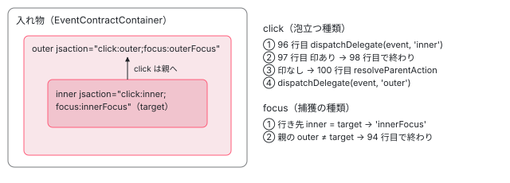

[目次](../README.md) › [イベント配送（event-dispatch）と jsaction の内側](README.md) › 第 10 回 / 全 12 回

# Dispatcher と EventDispatcher：渡し直しと stopPropagation の真似

> dispatcher.ts の Dispatcher（再生の予定を立てる scheduleEventInfoWrapperReplay・createEventReplayer。配列を空にしないので 2 回目の予定で前のイベントが再び渡る）と、Angular が使う event\_dispatcher.ts の EventDispatcher が、行き先を解決して dispatchDelegate に渡し、親へ泡立たせながら（捕獲の種類は対象の要素だけ）、イベントの stopPropagation・preventDefault・composedPath・currentTarget を差し替える（patchEventInstance、EventPhase、PROPAGATION\_STOPPED\_SYMBOL）行。書き換えられない形で貼るので、同じ Event を 2 つの EventDispatcher が配ると TypeError になること。

angular/angular · 読了 約 13 分 · 発展 · [サイトで読む（デモが動きます）](https://angular-deep-dive-cyan.vercel.app/chapter/jsaction-dispatcher)

---

`EventContract` がイベントを受け、`ActionResolver` が行き先（jsaction を持つ要素と処理名）を決めたあと、その結果を「だれに、どの順で、どんな形の `Event` として」渡すかを決めるのが配り役です。event-dispatch には配り役が 2 つあります。素の `Dispatcher` と、ブラウザの泡立ち・`stopPropagation`・`currentTarget` を真似る `EventDispatcher` です。Angular が使うのは後者です。この章では、2 つの違いを constructor から読み、`EventDispatcher` がイベントのプロパティを貼り替える `patchEventInstance` の行と、その貼り方が生む落とし穴を、ページの上の本物の `EventDispatcher` で確かめます。

読む対象は `packages/core/primitives/event-dispatch/src/dispatcher.ts`（150 行）と `src/event_dispatcher.ts`（195 行）、spec は `test/event_dispatcher_test.ts` と `test/dispatcher_test.ts` の一部です。

1. [1. 全体像](01-jsaction-overview.md)
2. [2. jsaction 属性](02-jsaction-attribute.md)
3. [3. EventInfo](03-jsaction-event-info.md)
4. [4. イベントの種類](04-jsaction-event-types.md)
5. [5. 早期の契約](05-jsaction-early-contract.md)
6. [6. EventContract](06-jsaction-contract.md)
7. [7. 行き先を探す](07-jsaction-resolver.md)
8. [8. a11y の click](08-jsaction-a11y-click.md)
9. [9. mouseenter とタッチ](09-jsaction-mouse-touch.md)
10. **10. Dispatcher**（この章）
11. [11. Angular の側](11-jsaction-angular.md)
12. [12. spec と issue](12-jsaction-tests-issues.md)

> [!NOTE]
> **ポイント**
>
> [event-replay の章](../platform/14-event-replay.md)の 7 節で、`Dispatcher.dispatch`（dispatcher.ts 78〜91 行目）と `EventDispatcher.dispatchToDelegate`（event\_dispatcher.ts 77〜103 行目）・`prepareEventForReplay`（121〜138 行目）の全体を読みました。[defer-hydrate-events の章](../defer/18-defer-hydrate-events.md)では `prepareEventForDispatch`（140〜149 行目）と `<a>` の既定の動きを止める `shouldPreventDefaultBeforeDispatching`（dispatcher.ts 123〜140 行目）を読みました。この章はその残り（2 つの配り役の作り・再生の予定・泡立ちの真似・貼り替えの仕方）を読みます。

## 1. 2 つの配り役：渡すものの形が違う

まず素の `Dispatcher` の欄と constructor です。

📄 `angular/packages/core/primitives/event-dispatch/src/dispatcher.ts` L22–56 （▶ の行: 29, 32, 35, 38, 48, 50–52）

```ts
22 │ /**
23 │  * Receives a DOM event, determines the jsaction associated with the source
24 │  * element of the DOM event, and invokes the handler associated with the
25 │  * jsaction.
26 │  */
27 │ export class Dispatcher {
28 │   // The ActionResolver to use to resolve actions.
29 ▶   private actionResolver?: ActionResolver;
30 │ 
31 │   /** The replayer function to be called when there are queued events. */
32 ▶   private eventReplayer?: Replayer;
33 │ 
34 │   /** Whether the event replay is scheduled. */
35 ▶   private eventReplayScheduled = false;
36 │ 
37 │   /** The queue of events. */
38 ▶   private readonly replayEventInfoWrappers: EventInfoWrapper[] = [];
39 │ 
40 │   /**
41 │    * Options are:
42 │    *   - `eventReplayer`: When the event contract dispatches replay events
43 │    *      to the Dispatcher, the Dispatcher collects them and in the next tick
44 │    *      dispatches them to the `eventReplayer`. Defaults to dispatching to `dispatchDelegate`.
45 │    * @param dispatchDelegate A function that should handle dispatching an `EventInfoWrapper` to handlers.
46 │    */
47 │   constructor(
48 ▶     private readonly dispatchDelegate: (eventInfoWrapper: EventInfoWrapper) => void,
49 │     {
50 ▶       actionResolver,
51 ▶       eventReplayer,
52 ▶     }: {actionResolver?: ActionResolver; eventReplayer?: Replayer} = {},
53 │   ) {
54 │     this.actionResolver = actionResolver;
55 │     this.eventReplayer = eventReplayer;
56 │   }
```

- 48 行目：受け手（`dispatchDelegate`）は `EventInfoWrapper` を 1 つ受け取ります。`EventInfoWrapper` は `EventInfo` を getter で読む包みです（[第 3 回](03-jsaction-event-info.md)）。どの `Event` を、どの要素の、どの処理名に渡すかを決めるのは受け手の仕事です。
- 50〜52 行目：`actionResolver` と `eventReplayer` はどちらも省けます。29 行目と 32 行目の欄に入るだけです。
- 35 行目と 38 行目：再生の予定が立っているかの印と、再生を待つ包みの配列です（2 節）。

次に `EventDispatcher` です。

📄 `angular/packages/core/primitives/event-dispatch/src/event_dispatcher.ts` L50–79 （▶ の行: 60–61, 63–66, 68–70, 77–78）

```ts
50 │ /**
51 │  * A dispatcher that uses browser-based `Event` semantics, for example bubbling, `stopPropagation`,
52 │  * `currentTarget`, etc.
53 │  */
54 │ export class EventDispatcher {
55 │   private readonly actionResolver: ActionResolver;
56 │ 
57 │   private readonly dispatcher: Dispatcher;
58 │ 
59 │   constructor(
60 ▶     private readonly dispatchDelegate: (event: Event, actionName: string) => void,
61 ▶     private readonly clickModSupport = true,
62 │   ) {
63 ▶     this.actionResolver = new ActionResolver({clickModSupport});
64 ▶     this.dispatcher = new Dispatcher(
65 ▶       (eventInfoWrapper: EventInfoWrapper) => {
66 ▶         this.dispatchToDelegate(eventInfoWrapper);
67 │       },
68 ▶       {
69 ▶         actionResolver: this.actionResolver,
70 ▶       },
71 │     );
72 │   }
73 │ 
74 │   /**
75 │    * The entrypoint for the `EventContract` dispatch.
76 │    */
77 ▶   dispatch(eventInfo: EventInfo): void {
78 ▶     this.dispatcher.dispatch(eventInfo);
79 │   }
```

1. **60 行目：受け手は (event, actionName) の 2 つを受け取る**

   包みではなく、ブラウザの `Event` そのものと処理名です。ふつうのイベントリスナーと同じ形で受け取れるように、`Event` の側を貼り替えて渡します（3〜5 節）。
2. **61・63 行目：ActionResolver を自分で作る**

   修飾キーのクリックを `clickmod` として扱うか（既定は真）だけを渡して作ります（[第 7 回](07-jsaction-resolver.md)）。a11y の click は足していません（[第 8 回](08-jsaction-a11y-click.md)）。
3. **64〜71 行目：中に素の Dispatcher を 1 つ持つ**

   受け手として 66 行目の `dispatchToDelegate` を渡し、68〜70 行目のオプションは `actionResolver` だけです。**`eventReplayer` を渡していない**ので、2 節の再生の予定は `EventDispatcher` では一度も立ちません。
4. **77〜79 行目：入口は中の Dispatcher へ渡すだけ**

   行き先の解決と `<a>` の preventDefault は、中の `Dispatcher.dispatch`（event-replay の章の 7 節）がします。

|   | `Dispatcher`（dispatcher.ts） | `EventDispatcher`（event\_dispatcher.ts） |
| --- | --- | --- |
| 受け手が受け取るもの | `EventInfoWrapper`（48 行目） | `Event` と処理名（60 行目） |
| ActionResolver | 渡されたら使う（50 行目） | 自分で作る（63 行目） |
| 再生のイベント | `eventReplayer` があれば microtask でまとめて渡す（2 節） | その場で渡す。`Event` を再生の形に貼り替える（event-replay の章の 7 節） |
| 泡立ち | しない（1 回だけ渡す） | 親の jsaction へ順に渡す（3 節） |
| 公開の入口（index.ts） | 出していない | 出している（`registerDispatcher` もこちらの版） |
| 使っているところ | dispatcher\_test.ts と、`EventDispatcher` の中 | Angular の `initEventReplay`（[第 11 回](11-jsaction-angular.md)） |

> [!WARNING]
> **ハマりどころ**
>
> README の「4. Register your application with JSAction」は `import {Dispatcher, registerDispatcher} from '@angular/core/primitives/event-dispatch'` と書き、`new Dispatcher(handleEvent, {eventReplayer})` を作っています。ところが入口（index.ts）が出しているのは `EventDispatcher` と、`EventDispatcher` を受け取る版の `registerDispatcher`（5 節）だけです。README のとおりに書くと `Dispatcher` は import できません。2026-11-06 に main の README と index.ts も読みましたが同じでした（[第 1 回](01-jsaction-overview.md)）。

## 2. 素の Dispatcher の再生の予定

📄 `angular/packages/core/primitives/event-dispatch/src/dispatcher.ts` L84–90 （▶ の行: 86–88, 90）

```ts
84 │       eventLib.preventDefault(eventInfoWrapper.getEvent());
85 │     }
86 ▶     if (this.eventReplayer && eventInfoWrapper.getIsReplay()) {
87 ▶       this.scheduleEventInfoWrapperReplay(eventInfoWrapper);
88 ▶       return;
89 │     }
90 ▶     this.dispatchDelegate(eventInfoWrapper);
```

`dispatch` の後ろ半分です。86 行目で、`eventReplayer` があり、かつ包みが「再生」の印を持っていれば、87 行目で予定に回して 88 行目で戻ります。それ以外は 90 行目でその場で受け手に渡します。「再生」の印は、配り役が登録される前に `EventContract` が積んだイベントに付きます（[第 6 回](06-jsaction-contract.md)）。

📄 `angular/packages/core/primitives/event-dispatch/src/dispatcher.ts` L93–121 （▶ の行: 99–100, 103–106, 115, 117–118）

```ts
 93 │   /**
 94 │    * Schedules an `EventInfoWrapper` for replay. The replaying will happen in its own
 95 │    * stack once the current flow cedes control. This is done to mimic
 96 │    * browser event handling.
 97 │    */
 98 │   private scheduleEventInfoWrapperReplay(eventInfoWrapper: EventInfoWrapper) {
 99 ▶     this.replayEventInfoWrappers.push(eventInfoWrapper);
100 ▶     if (this.eventReplayScheduled) {
101 │       return;
102 │     }
103 ▶     this.eventReplayScheduled = true;
104 ▶     Promise.resolve().then(() => {
105 ▶       this.eventReplayScheduled = false;
106 ▶       this.eventReplayer!(this.replayEventInfoWrappers);
107 │     });
108 │   }
109 │ }
110 │ 
111 │ /**
112 │  * Creates an `EventReplayer` that calls the `replay` function for every `eventInfoWrapper` in
113 │  * the queue.
114 │  */
115 ▶ export function createEventReplayer(replay: (eventInfoWrapper: EventInfoWrapper) => void) {
116 │   return (eventInfoWrappers: EventInfoWrapper[]) => {
117 ▶     for (const eventInfoWrapper of eventInfoWrappers) {
118 ▶       replay(eventInfoWrapper);
119 │     }
120 │   };
121 │ }
```

1. **99 行目：包みを配列に足す**

   配列は 1 節の 38 行目の `replayEventInfoWrappers` で、`Dispatcher` ごとに 1 つです。
2. **100〜104 行目：予定は 1 つだけ立てる**

   同じ同期の流れで何件来ても、`Promise.resolve().then` は 1 回です。95〜96 行目のコメントのとおり、「いまの流れが手を離したあと、別のスタックで」渡すためで、ブラウザがイベントを 1 つずつ別のタスクで配るのを真似ています。
3. **105〜106 行目：配列をそのまま eventReplayer に渡す**

   渡すのは 38 行目の配列そのものです。**この関数の中では配列を空にしていません**。
4. **115〜121 行目：createEventReplayer は配列を順に回すだけ**

   包み 1 つずつに `replay` を呼ぶ関数を作ります。この関数も配列を空にしません。リポジトリの中で `createEventReplayer` を呼んでいる所はなく、入口（index.ts）からも出していません。

> [!NOTE]
> **さらに深く**
>
> 配列を空にするのは誰か。最初の版（666d6465758、2024-03-27）の `setEventReplayer` のコメントには「The event replayer is also responsible for dequeuing events」とあり、例の中で `queue.length = 0` をしていました。その後の整理でコメントは消え、いまの 115〜121 行目の `createEventReplayer` と README の `eventReplayer` の例は、どちらも配列を空にしません。手元で、../angular のソースを esbuild で束ねて Node で動かすと（scratchpad/jsa-demo/d/replayer-twice.ts）、再生のイベント A を渡して microtask を待ち、次に B を渡すと、2 回目の `eventReplayer` には A と B の両方が入り、A が 2 回再生されました。Angular は `eventReplayer` を渡さない `EventDispatcher` だけを使うので（1 節の 68〜70 行目）、この形は Angular のアプリでは起きません。

📄 `記録：replayer-twice.mjs の出力（2026-11-06）`

```
replay A
--- 1 回目の microtask の後
replay A
replay B
--- 2 回目の microtask の後
```

## 3. EventDispatcher の泡立ちの真似：捕獲の種類は対象だけ

`dispatchToDelegate` の流れ（再生なら貼り替え → 泡立ちの準備 → 行き先がある間まわる）は event-replay の章の 7 節で読みました。ここでは、ループの中の 2 つの出口を見ます。

📄 `angular/packages/core/primitives/event-dispatch/src/event_dispatcher.ts` L89–95 （▶ の行: 89–92, 94）

```ts
89 ▶       // If this is a capture event, ONLY dispatch if the action element is the target.
90 ▶       if (
91 ▶         isCaptureEventType(eventInfoWrapper.getEventType()) &&
92 ▶         eventInfoWrapper.getAction()!.element !== eventInfoWrapper.getTargetElement()
93 │       ) {
94 ▶         return;
95 │       }
```

1 つ目の出口です。90 行目の `isCaptureEventType` は、focus・blur・load・error・toggle のような泡立たない種類なら真を返します（[第 4 回](04-jsaction-event-types.md)）。そのとき 92 行目で、いまの行き先の要素がイベントの対象（`target`）でなければ、94 行目で配るのをやめます。ブラウザでは泡立たないイベントは対象の要素のリスナーにしか届かないので、それに合わせています。だから、親が `jsaction="focus:…"` を持っていても、子のボタンにフォーカスが来たときには親へは渡りません（下のデモの `focus` の行）。

📄 `angular/packages/core/primitives/event-dispatch/src/event_dispatcher.ts` L96–102 （▶ の行: 96–98, 100）

```ts
 96 ▶       this.dispatchDelegate(eventInfoWrapper.getEvent(), eventInfoWrapper.getAction()!.name);
 97 ▶       if (propagationStopped(eventInfoWrapper)) {
 98 ▶         return;
 99 │       }
100 ▶       this.actionResolver.resolveParentAction(eventInfoWrapper.eventInfo);
101 │     }
102 │   }
```

2 つ目の出口です。96 行目で受け手を呼んだあと、97 行目で受け手が `stopPropagation` を呼んだかを見て、呼んでいれば 98 行目で終わります。呼んでいなければ 100 行目で親の方へ次の行き先を探します（`resolveParentAction`。[第 7 回](07-jsaction-resolver.md)）。「呼んだか」は次の節の印で分かります。



*dispatchToDelegate のループ。click は inner → outer と親へ進み、受け手が stopPropagation を呼ぶか行き先が尽きると終わる。focus のような捕獲の種類は、行き先が対象でなくなった時点で終わる。*

## 4. stopPropagation を印付きの関数に差し替える

📄 `angular/packages/core/primitives/event-dispatch/src/event_dispatcher.ts` L16–48 （▶ の行: 25–26, 29–30, 44–46）

```ts
16 │ // Necessary to make the `ngDevMode` global types available.
17 │ import '../../../src/util/ng_dev_mode'; // 3p-only
18 │ 
19 │ /**
20 │  * A replayer is a function that is called when there are queued events, from the `EventContract`.
21 │  */
22 │ export type Replayer = (eventInfoWrappers: Event[]) => void;
23 │ 
24 │ /** An internal symbol used to indicate whether propagation should be stopped or not. */
25 ▶ export const PROPAGATION_STOPPED_SYMBOL: unique symbol =
26 ▶   /* @__PURE__ */ Symbol.for('propagationStopped');
27 │ 
28 │ /** Extra event phases beyond what the browser provides. */
29 ▶ export const EventPhase = {
30 ▶   REPLAY: 101,
31 │ };
32 │ 
33 │ const PREVENT_DEFAULT_ERROR_MESSAGE_DETAILS =
34 │   ' Because event replay occurs after browser dispatch, `preventDefault` would have no ' +
35 │   'effect. You can check whether an event is being replayed by accessing the event phase: ' +
36 │   '`event.eventPhase === EventPhase.REPLAY`.';
37 │ const PREVENT_DEFAULT_ERROR_MESSAGE = `\`preventDefault\` called during event replay.`;
38 │ const COMPOSED_PATH_ERROR_MESSAGE_DETAILS =
39 │   ' Because event replay occurs after browser ' +
40 │   'dispatch, `composedPath()` will be empty. Iterate parent nodes from `event.target` or ' +
41 │   '`event.currentTarget` if you need to check elements in the event path.';
42 │ const COMPOSED_PATH_ERROR_MESSAGE = `\`composedPath\` called during event replay.`;
43 │ 
44 ▶ declare global {
45 ▶   interface Event {
46 ▶     [PROPAGATION_STOPPED_SYMBOL]?: boolean;
47 │   }
48 │ }
```

📄 `angular/packages/core/primitives/event-dispatch/src/event_dispatcher.ts` L104–120 （▶ の行: 107–110, 112–113, 116, 118）

```ts
104 │ 
105 │ function prepareEventForBubbling(eventInfoWrapper: EventInfoWrapper) {
106 │   const event = eventInfoWrapper.getEvent();
107 ▶   const originalStopPropagation = eventInfoWrapper.getEvent().stopPropagation.bind(event);
108 ▶   const stopPropagation = () => {
109 ▶     event[PROPAGATION_STOPPED_SYMBOL] = true;
110 ▶     originalStopPropagation();
111 │   };
112 ▶   patchEventInstance(event, 'stopPropagation', stopPropagation);
113 ▶   patchEventInstance(event, 'stopImmediatePropagation', stopPropagation);
114 │ }
115 │ 
116 ▶ function propagationStopped(eventInfoWrapper: EventInfoWrapper) {
117 │   const event = eventInfoWrapper.getEvent();
118 ▶   return !!event[PROPAGATION_STOPPED_SYMBOL];
119 │ }
120 │ 
```

1. **25〜26 行目：印は Symbol.for('propagationStopped')**

   `Symbol.for` はグローバルの登録簿から同じ名前の symbol を返すので、別々に束ねたコード（たとえば別のバンドルに入った event-dispatch）どうしでも同じ印になります。44〜48 行目は、`Event` の型にこの印の欄を足す宣言です。
2. **107 行目：本物の stopPropagation を控える**

   `bind(event)` で、あとから呼んでもこの `Event` に効くようにします。
3. **108〜111 行目：印を立ててから本物を呼ぶ**

   109 行目で `event[PROPAGATION_STOPPED_SYMBOL] = true`、110 行目で本物の `stopPropagation`。本物を呼ぶので、契約の入れ物より外のブラウザのリスナーにも届かなくなります（デモの「枠に届いた回数」）。
4. **112〜113 行目：stopImmediatePropagation も同じ関数**

   jsaction では、1 つの要素の 1 つの種類に行き先は 1 つなので、「同じ要素のほかのリスナーも止める」と「親へ行かない」を分けていません。
5. **116〜118 行目：3 節の 97 行目はこの印を読む**

   印が立っていれば、ループを抜けます。

29〜31 行目の `EventPhase.REPLAY`（101）は、再生のときに `eventPhase` に貼る値です。ブラウザの `eventPhase` は 0〜3 なので、101 なら「ブラウザが配っているのではなく、あとから渡し直している」と分かります。33〜42 行目は、再生のときに `preventDefault` と `composedPath` を呼ぶと投げる例外の文です（event-replay の章の 7 節の 127〜137 行目）。`ngDevMode` のときだけ、説明の後半が付きます。

## 5. registerDispatcher が 2 つある

📄 `angular/packages/core/primitives/event-dispatch/src/dispatcher.ts` L142–150 （▶ の行: 146–149）

```ts
142 │ /**
143 │  * Registers deferred functionality for an EventContract and a Jsaction
144 │  * Dispatcher.
145 │  */
146 ▶ export function registerDispatcher(eventContract: UnrenamedEventContract, dispatcher: Dispatcher) {
147 ▶   eventContract.ecrd((eventInfo: EventInfo) => {
148 ▶     dispatcher.dispatch(eventInfo);
149 ▶   }, Restriction.I_AM_THE_JSACTION_FRAMEWORK);
150 │ }
```

📄 `angular/packages/core/primitives/event-dispatch/src/event_dispatcher.ts` L181–195 （▶ の行: 185–187, 189–191）

```ts
181 │ /**
182 │  * Registers deferred functionality for an EventContract and a Jsaction
183 │  * Dispatcher.
184 │  */
185 ▶ export function registerDispatcher(
186 ▶   eventContract: UnrenamedEventContract,
187 ▶   dispatcher: EventDispatcher,
188 │ ) {
189 ▶   eventContract.ecrd((eventInfo: EventInfo) => {
190 ▶     dispatcher.dispatch(eventInfo);
191 ▶   }, Restriction.I_AM_THE_JSACTION_FRAMEWORK);
192 │ }
193 │ 
194 │ // This fixes the RollupError: Exported variable "global" is not defined.
195 │ export {};
```

中身は同じで、受け取る配り役の型だけが違います（146 行目は `Dispatcher`、187 行目は `EventDispatcher`）。どちらも契約の `ecrd` に「`EventInfo` を受けたら `dispatch` を呼ぶ関数」を渡し、2 つ目の引数に `Restriction.I_AM_THE_JSACTION_FRAMEWORK` を付けます。`ecrd` が積んでおいたイベントを渡す順番と、`Restriction` の意味は[第 6 回](06-jsaction-contract.md)で読みます（d072791f131 が消したのは `registerAppScopedDispatcher` と `registerGlobalDispatcher` の `restriction` の引数で、この 2 つの関数の 149・191 行目はそのままです）。

## 6. patchEventInstance：書き換えられない形で貼る

📄 `angular/packages/core/primitives/event-dispatch/src/event_dispatcher.ts` L150–179 （▶ の行: 155–156, 158–159, 164, 172, 176, 178）

```ts
150 │ 
151 │ /**
152 │  * Patch `Event` instance during non-standard `Event` dispatch. This patches just the `Event`
153 │  * instance that the browser created, it does not patch global properties or methods.
154 │  *
155 ▶  * This is necessary because dispatching an `Event` outside of browser dispatch results in
156 ▶  * incorrect properties and methods that need to be polyfilled or do not work.
157 │  *
158 ▶  * JSAction dispatch adds two extra "phases" to event dispatch:
159 ▶  * 1. Event delegation - the event is being dispatched by a delegating event handler on a container
160 │  *    (typically `window.document.documentElement`), to a delegated event handler on some child
161 │  *    element. Certain `Event` properties will be unintuitive, such as `currentTarget`, which would
162 │  *    be the container rather than the child element. Bubbling would also not work. In order to
163 │  *    emulate the browser, these properties and methods on the `Event` are patched.
164 ▶  * 2. Event replay - the event is being dispatched by the framework once the handlers have been
165 │  *    loaded (during hydration, or late-loaded). Certain `Event` properties can be unset by the
166 │  *    browser because the `Event` is no longer actively being dispatched, such as `target`. Other
167 │  *    methods have no effect because the `Event` has already been dispatched, such as
168 │  *    `preventDefault`. Bubbling would also not work. These properties and methods are patched,
169 │  *    either to fill in information that the browser may have removed, or to throw errors in methods
170 │  *    that no longer behave as expected.
171 │  */
172 ▶ function patchEventInstance<T>(
173 │   event: Event,
174 │   property: string,
175 │   value: T,
176 ▶   {configurable = false}: {configurable?: boolean} = {},
177 │ ) {
178 ▶   Object.defineProperty(event, property, {value, configurable});
179 │ }
```

1. **158〜170 行目：貼り替える理由は 2 つの「段」**

   1 つは委譲（入れ物のリスナーが子の要素へ渡す）で、`currentTarget` は入れ物のままになり、泡立ちも起きないので貼り替えます。もう 1 つは再生で、ブラウザが配り終えたあとの `Event` は `target` が消えていることがあり、`preventDefault` は効かないので、埋めるか、例外を投げる関数にします。
2. **178 行目：Object.defineProperty でインスタンスに貼る**

   155〜156 行目のとおり、`Event.prototype` ではなく、ブラウザが作ったその 1 つの `Event` だけに貼ります。
3. **176 行目：configurable の既定は false**

   `writable` も指定していないので false です。`currentTarget` だけは、泡立ちの真似で次の行き先に進むたびに貼り直すので `configurable: true` で貼ります（defer-hydrate-events の章の 2 節の 144〜147 行目）。**`stopPropagation`・`stopImmediatePropagation`（4 節の 112〜113 行目）と、再生の `target`・`eventPhase`・`preventDefault`・`composedPath` は、一度貼ると貼り直せません**。

同じ `Event` を 2 つの `EventDispatcher` が配ると、2 つ目の 4 節の 112 行目で `Object.defineProperty` が `TypeError: Cannot redefine property: stopPropagation` を投げます。入れ子の入れ物に 2 つの契約を置いた、配布物の公開の入口だけを使う確かめです。

📄 `scratchpad/jsa-demo/d/two-dispatchers.ts（esbuild で束ね、ヘッドレスの Chrome で実行）`

```
// scratchpad/jsa-demo/d/two-dispatchers.ts（配布物 @angular/core 22.1.6 の公開の入口だけを使う）
import { EventContract, EventContractContainer, EventDispatcher, registerDispatcher } from '@angular/core/primitives/event-dispatch';
const out: string[] = [];
document.body.innerHTML = '<div id="outer-c"><div id="inner-c"><button id="b" jsaction="click:x">b</button></div></div>';
const mk = (id: string) => {
  const c = new EventContract(new EventContractContainer(document.getElementById(id)!));
  c.addEvent('click');
  registerDispatcher(c, new EventDispatcher((e, name) => out.push(`${id}: ${name} currentTarget=${(e.currentTarget as Element)?.id}`)));
  return c;
};
mk('inner-c');
mk('outer-c');
window.addEventListener('error', (e) => out.push('window error: ' + e.message));
document.getElementById('b')!.click();
out.push('done');
```

📄 `出力`

```
inner-c: x currentTarget=b
window error: Uncaught TypeError: Cannot redefine property: stopPropagation
done
（HeadlessChrome/155.0.8043.0、2026-11-06）
```

内側の契約は行き先 `x` に渡し、外側の契約の配り役が 112 行目で例外を投げています（外側の受け手は呼ばれません）。**このサイトでもこの形になります**。このサイトはインクリメンタルハイドレーションを使うので、`<body>` の Angular の `EventContract` はアプリが壊れるまで残り（[第 11 回](11-jsaction-angular.md)）、ページの click をすべて `EventDispatcher` に渡します。`dispatchToDelegate` は行き先があってもなくても先に泡立ちの準備（event-replay の章の 7 節の 86 行目）をするので、`<body>` の契約も、届いた click の `stopPropagation` を必ず貼ります。2026-11-06 の本番ビルドの `/chapter/event-replay/` をヘッドレスの Chrome で開き、ハイドレーションのあとに、上の確かめと同じ配布物の束で `<body>` の中に自分の入れ物と `EventContract`・`EventDispatcher` を 1 組だけ置いて押すと、自分の受け手は呼ばれ、そのあと `<body>` の契約の側で `ERROR TypeError: Cannot redefine property: stopPropagation` がコンソールに出ました（scratchpad/jsa-demo/d/one-in-site.ts・run-one-in-site.mjs）。だから下のデモは、デモの枠のリスナーで本物の `stopPropagation` を呼び、click を `<body>` まで届けないようにしています。

## 7. DEMO：本物の EventDispatcher で泡立ちと stopPropagation を見る

> **🧪 DEMO — EventContract ＋ EventDispatcher（ライブ。@angular/core/primitives/event-dispatch の配布物）**
>
> 「契約を作る」を押すと、下の赤い枠を入れ物にして `new EventContract(new EventContractContainer(…))` を作り、`addEvent('click')` と `addEvent('focus')` をして、外（outer）と内（inner）に jsaction を付けます。表の 1 行は、`EventDispatcher` が受け手を 1 回呼んだことを表します。受け手の中で見た `currentTarget`・`target`・`eventPhase` をそのまま書きます。Tab でフォーカスを移すと focus の行が出ます。
>
> ▶ [このデモはサイトで動かせます](https://angular-deep-dive-cyan.vercel.app/chapter/jsaction-dispatcher)

試すと分かることです（本番ビルドをヘッドレスの Chrome で動かして確かめた結果は、章末の「テストと直し方」の最後にあります）。

1. **inner を押す：同じ Event が inner → outer の順に 2 回渡り、currentTarget だけが変わる**

   マウスで押すと、先にボタンにフォーカスが来るので、1 行目に focus（innerFocus）が出ます。その下の、「Event」の番号が同じ 2 行が click です。`target` はどちらも inner、`currentTarget` は 1 行目が inner、2 行目が outer です（貼り替えは defer-hydrate-events の章の 2 節）。`eventPhase` はどちらも 3（泡立ち）です。入れ物のリスナーは泡立ちの段で呼ばれ、`EventDispatcher` は委譲のときは `eventPhase` を貼り替えないからです。枠に届いた回数が 1 増えます。
2. **stopPropagation にチェックして inner を押す：outer の行が出ず、枠にも届かない**

   4 節の 109 行目の印で 3 節の 98 行目から抜け、110 行目の本物の `stopPropagation` で、入れ物より外のリスナー（枠）にも届きません。
3. **Tab で inner へフォーカス：innerFocus だけが出る**

   focus は捕獲の種類なので、入れ物のリスナーは捕獲の段（`eventPhase` 1）で呼ばれます。outer も `focus:outerFocus` を持っていますが、3 節の 92 行目で対象ではないので渡りません。outer そのもの（`tabindex="0"`）にフォーカスすると outerFocus が出ます。
4. **「あとで登録」にして何回か押し、配り役を登録する：eventPhase が 101 になる**

   押したときは表に何も出ず、枠の回数だけが増えます（ブラウザの配りはその場で終わっています）。登録すると積んだ順に行が出て、`eventPhase` は `EventPhase.REPLAY`（101）です。stopPropagation にチェックしていれば、再生でも outer の行は出ません（印は 4 節と同じ）。preventDefault にチェックしていると、再生の行では「例外」になります（event-replay の章の 7 節の 127〜132 行目）。

## ここまでの呼び出し

- `registerDispatcher(eventContract, eventDispatcher)` — event\_dispatcher.ts 185 — *契約の ecrd に dispatch を渡す*
- 👤 `ユーザーの click` — 入れ物のリスナー
  - `EventContract.handleEvent` → `handleEventInfo` — eventcontract.ts 112・126 — *第 6 回*
    - `EventDispatcher.dispatch` → `Dispatcher.dispatch` — event\_dispatcher.ts 77・dispatcher.ts 78 — *行き先を解決（第 7 回）*
      - `EventDispatcher.dispatchToDelegate` — event\_dispatcher.ts 82
        - `prepareEventForBubbling` → `patchEventInstance('stopPropagation')` — event\_dispatcher.ts 105・172 — *書き換えられない形*
        - `prepareEventForDispatch` — event\_dispatcher.ts 140 — *currentTarget を貼る*
        - `捕獲の種類で対象でなければ return` — event\_dispatcher.ts 90〜95
        - 👤 `dispatchDelegate(event, actionName)` — event\_dispatcher.ts 96 — *受け手。Angular なら invokeRegisteredReplayListeners*
        - `propagationStopped` → `ActionResolver.resolveParentAction` — event\_dispatcher.ts 116・100 — *親の jsaction へ*

## テストと直し方

### spec と describe

| spec | describe / it | この章のどこ |
| --- | --- | --- |
| test/event\_dispatcher\_test.ts（7 件） | describe `EventDispatcher`（68 行目）の it `dispatches to dispatchDelegate`（73）・`replays to dispatchDelegate`（87）、describe `bubbling`（111）の it `dispatches to multiple elements`（112）・`… in replay`（150）・``stops dispatch if `stopPropagation` is called``（194）・`… in replay`（219）・``stops dispatch if `stopImmediatePropagation` is called``（250） | 1・3・4 節 |
| test/dispatcher\_test.ts | describe `Dispatcher`（332 行目）の it `replays to dispatchDelegate`（650）・`replays to event replayer`（669）・`prevents default for click on anchor child`（689）・`prevents default for modified click on anchor child`（714）・`does not prevent default for modified click on non-anchor child`（740） | 2 節・defer-hydrate-events の章の 7 節 |

📄 `angular/packages/core/primitives/event-dispatch/test/event_dispatcher_test.ts` L194–217 （▶ の行: 195–196, 202, 205, 207, 209）

```ts
194 │     it('stops dispatch if `stopPropagation` is called', () => {
195 ▶       const container = getRequiredElementById('bubbling-container');
196 ▶       const targetElement = getRequiredElementById('bubbling-target-element');
197 │       const currentTarget = jasmine.createSpy('currentTarget');
198 │       const dispatchDelegate = jasmine
199 │         .createSpy<(event: Event, actionName: string) => void>('dispatchDelegate')
200 │         .and.callFake((event) => {
201 │           currentTarget(event.currentTarget);
202 ▶           event.stopPropagation();
203 │         });
204 │       const dispatcher = new EventDispatcher(dispatchDelegate);
205 ▶       const eventInfoWrapper = createTestEventInfoWrapper({container, targetElement});
206 │ 
207 ▶       dispatcher.dispatch(eventInfoWrapper.eventInfo);
208 │ 
209 ▶       expect(dispatchDelegate).toHaveBeenCalledTimes(1);
210 │       expect(dispatchDelegate).toHaveBeenCalledWith(
211 │         eventInfoWrapper.getEvent(),
212 │         'firstHandleClick',
213 │       );
214 │       expect(currentTarget).toHaveBeenCalledWith(
215 │         getRequiredElementById('bubbling-first-action-element'),
216 │       );
217 │     });
```

3 段に入れ子の jsaction（spec の先頭の HTML の `bubbling-third/second/first-action-element`）のいちばん内側で `stopPropagation` を呼ぶと、202 行目のあと受け手は 1 回だけ（209 行目）です。`EventInfo` は `createEventInfo` で手で作り、207 行目で `dispatcher.dispatch` に直接渡しています。`EventContract` もブラウザの配りも通らないので、4 節の 110 行目の「本物の `stopPropagation` も呼ぶ」は、この it では確かめていません。

📄 `angular/packages/core/primitives/event-dispatch/test/event_dispatcher_test.ts` L87–109 （▶ の行: 91–93, 95, 98, 102, 106）

```ts
 87 │   it('replays to dispatchDelegate', async () => {
 88 │     const dispatchDelegate = jasmine
 89 │       .createSpy<(event: Event, actionName: string) => void>('dispatchDelegate')
 90 │       .and.callFake((event) => {
 91 ▶         expect(event.currentTarget).toBe(getRequiredElementById('click-action-element'));
 92 ▶         expect(event.target).toBe(getRequiredElementById('click-target-element'));
 93 ▶         expect(event.eventPhase).toBe(EventPhase.REPLAY);
 94 │         expect(() => {
 95 ▶           event.preventDefault();
 96 │         }).toThrow();
 97 │         expect(() => {
 98 ▶           event.composedPath();
 99 │         }).toThrow();
100 │       });
101 │     const dispatcher = new EventDispatcher(dispatchDelegate);
102 ▶     const eventInfoWrapper = createTestEventInfoWrapper({isReplay: true});
103 │ 
104 │     dispatcher.dispatch(eventInfoWrapper.eventInfo);
105 │ 
106 ▶     await Promise.resolve();
107 │ 
108 │     expect(dispatchDelegate).toHaveBeenCalledWith(eventInfoWrapper.getEvent(), 'handleClick');
109 │   });
```

再生の形の it です。93 行目で `eventPhase` が `EventPhase.REPLAY`、94〜99 行目で `preventDefault` と `composedPath` が例外を投げることを確かめます。106 行目で `await Promise.resolve()` を待っていますが、1 節のとおり `EventDispatcher` は `eventReplayer` を渡さないので、受け手は 104 行目の `dispatch` の中で同期に呼ばれ終わっています。

📄 `angular/packages/core/primitives/event-dispatch/test/dispatcher_test.ts` L669–687 （▶ の行: 671–672, 679–680, 683, 685–686）

```ts
669 │   it('replays to event replayer', async () => {
670 │     const dispatchDelegate = createDispatchDelegateSpy();
671 ▶     const eventReplayer = jasmine.createSpy<Replayer>('eventReplayer');
672 ▶     const dispatcher = createDispatcher({dispatchDelegate, eventReplayer});
673 │     const eventInfoWrappers = [
674 │       createTestEventInfoWrapper({isReplay: true}),
675 │       createTestEventInfoWrapper({isReplay: true}),
676 │       createTestEventInfoWrapper({isReplay: true}),
677 │     ];
678 │ 
679 ▶     for (const eventInfoWrapper of eventInfoWrappers) {
680 ▶       dispatcher.dispatch(eventInfoWrapper.eventInfo);
681 │     }
682 │ 
683 ▶     await Promise.resolve();
684 │ 
685 ▶     expect(dispatchDelegate).toHaveBeenCalledTimes(0);
686 ▶     expect(eventReplayer).toHaveBeenCalledWith(eventInfoWrappers);
687 │   });
```

素の `Dispatcher` に `eventReplayer` を渡す it です。3 件を同じ同期の流れで渡し、683 行目の microtask のあと、685 行目で受け手は 0 回、686 行目で `eventReplayer` が 3 件をまとめて受けたことを確かめます。**2 回目の予定（microtask を待ってからもう 1 件渡す）の it はありません**。2 節の deep の箱の形は、この it の 683 行目のあとに 1 件足して、`eventReplayer` の 2 回目の引数を見る形で確かめられます。

📄 `angular/packages/core/primitives/event-dispatch/test/dispatcher_test.ts` L689–712 （▶ の行: 694, 699, 701, 709, 711）

```ts
689 │   it('prevents default for click on anchor child', () => {
690 │     const container = getRequiredElementById('anchor-click-container');
691 │     const actionElement = getRequiredElementById('anchor-click-action-element');
692 │     const targetElement = getRequiredElementById('anchor-click-target-element');
693 │ 
694 ▶     const eventContract = createEventContract({
695 │       container,
696 │       eventTypes: ['click'],
697 │     });
698 │     const dispatchDelegate = createDispatchDelegateSpy();
699 ▶     createDispatcher({dispatchDelegate, eventContract});
700 │ 
701 ▶     const clickEvent = dispatchMouseEvent(targetElement);
702 │ 
703 │     expect(dispatchDelegate).toHaveBeenCalledTimes(1);
704 │     const eventInfoWrapper = dispatchDelegate.calls.mostRecent().args[0];
705 │     expect(eventInfoWrapper.getEventType()).toBe('click');
706 │     expect(eventInfoWrapper.getEvent()).toBe(clickEvent);
707 │     expect(eventInfoWrapper.getTargetElement()).toBe(targetElement);
708 │     expect(eventInfoWrapper.getAction()?.name).toBe('handleClick');
709 ▶     expect(eventInfoWrapper.getAction()?.element).toBe(actionElement);
710 │ 
711 ▶     expect(clickEvent.preventDefault).toHaveBeenCalled();
712 │   });
```

`<a>` の子を押すと、行き先の要素（709 行目の `actionElement` は `<a>`）で判定して、711 行目で `preventDefault` が呼ばれています（`shouldPreventDefaultBeforeDispatching`。defer-hydrate-events の章の 7 節）。`preventDefault` は、イベントを作る helper（`dispatchMouseEvent`）が spy にしてあります。

### 手元で走らせた結果

📄 `ターミナル（../angular で）`

```
cd ~/angular-research/angular
pnpm bazel test //packages/core/primitives/event-dispatch/test:browser_test_chromium \
  //packages/core/primitives/event-dispatch/test:browser_test_firefox \
  --nocache_test_results --test_output=all

# 名前の絞り込みを試した（効かない）
pnpm bazel test //packages/core/primitives/event-dispatch/test:browser_test_chromium \
  '--test_arg=--filter=EventDispatcher' --nocache_test_results --test_output=all
```

📄 `出力（2026-11-06 に実行。抜粋。ログは scratchpad/jsa-logs/d-all.log・d-filter-browser.log）`

```
Chromium: |██████████| 1/1 test files | 111 passed, 0 failed
Firefox:  |██████████| 1/1 test files | 111 passed, 0 failed
//packages/core/primitives/event-dispatch/test:browser_test_chromium   PASSED in 0.9s
//packages/core/primitives/event-dispatch/test:browser_test_firefox    PASSED in 2.0s

# --test_arg=--filter=EventDispatcher を付けても
Chromium: |██████████| 1/1 test files | 111 passed, 0 failed
//packages/core/primitives/event-dispatch/test:browser_test_chromium   PASSED in 0.8s
```

- 4 つの spec は 1 つのバンドル（`browser_test_bundle.spec.js`）になって、Web Test Runner の上の Jasmine で走ります（[第 12 回](12-jsaction-tests-issues.md)）。`--test_arg=--filter=EventDispatcher` を付けても 111 件すべて走ったので、**名前の絞り込みは効きません**。ターゲット全体でも 1〜2 秒です。
- 3 節の「捕獲の種類は対象だけ」（90〜95 行目）を確かめる it は、event\_dispatcher\_test.ts にはありません（describe `bubbling` は click だけです）。足すなら、`jsaction="focus:…"` の親と子を用意し、子を対象にした focus の `EventInfo` を渡して、受け手が 1 回だけ呼ばれることを見る形です。

### 直すとしたら

- 2 つの `EventDispatcher` が同じ `Event` を配ると `TypeError`（6 節）：入口は event\_dispatcher.ts の `prepareEventForBubbling`（105〜114 行目）と `patchEventInstance`（172〜179 行目）です。spec は event\_dispatcher\_test.ts に、入れ子の 2 つの入れ物それぞれに `EventContract` と `EventDispatcher` を置いて押す it を足す形になります。2026-11-06 に `gh search issues` で「Cannot redefine property」「stopPropagation event replay」「EventDispatcher」を探しましたが、この形の issue はありませんでした。Angular のアプリで同じ形が起きるのは、1 つのページに、イベントの再生を使う 2 つのアプリがあって、2 つの契約がどちらも `<body>` にいるときです（2 つのアプリで確かめてはいません）。
- 素の `Dispatcher` の 2 回目の再生（2 節）：入口は dispatcher.ts の `scheduleEventInfoWrapperReplay`（98〜108 行目）か、`createEventReplayer`（115〜121 行目）と README の例です。Angular のアプリには影響しません。
- 2025-11 以降の 25 件の修正のうち、dispatcher.ts に触れたものは 0 件、event\_dispatcher.ts に触れたものは 2 件で、どちらも動きを変えません（bb628d8b508 が 194〜195 行目の `export {}` を足し、4f9ee3c056a が 17 行目の import に `// 3p-only` の印を付けた。どちらも束ね方のための変更）。表は[第 12 回](12-jsaction-tests-issues.md)にあります。
- 本家に PR を出すことは勧めません。見つけた形は、手元で spec の形にして確かめ、issue を読むときの手がかりにします。

**本番ビルドでデモを動かした結果（2026-11-06）。**ヘッドレスの Chrome（HeadlessChrome/155）で本番ビルドのこのページを開き、playwright で操作しました。inner を押すと focus（innerFocus・eventPhase 1）、click inner、click outer（どちらも eventPhase 3。currentTarget はそれぞれ inner と outer、target はどちらも inner）の 3 行が出て、枠に届いた click は 1 回でした。stopPropagation にすると click は inner の 1 行だけで、枠は 0 回でした。outer にフォーカスすると outerFocus の 1 行だけ、そこから Tab で inner に移ると innerFocus だけが出ました。「あとで登録」にして inner を押すと、表は空のまま枠だけが 1 回になり、登録すると focus・click inner・click outer の 3 行がどれも eventPhase 101 で出て、preventDefault は「\`preventDefault\` called during event replay.」の例外でした。片付けのあとは outer と inner の jsaction が消え、コンソールの警告とエラーは 0 件でした（scratchpad/jsa-demo/d/verify-demos.mjs、2026-11-06）。

## 聞かれそうな質問

**Q. Angular は Dispatcher と EventDispatcher のどちらを使っていますか？**

`EventDispatcher` です。`initEventReplay` が `new EventDispatcher(...)` を作り、event\_dispatcher.ts 185 行目の `registerDispatcher` で契約に登録します（第 11 回）。`EventDispatcher` は中に素の `Dispatcher` を持ちますが、64〜71 行目で `eventReplayer` を渡さないので、dispatcher.ts 86 行目の再生の予定の分かれ道には入りません。

**Q. 再生のときに stopPropagation を呼ぶと、親のリスナーはどうなりますか？**

呼ばれません。event\_dispatcher.ts 112 行目で `stopPropagation` は 109 行目の印を立てる関数に差し替わっていて、97〜98 行目でループを抜けます。再生ではブラウザの配りは終わっているので、110 行目で呼ぶ本物の `stopPropagation` には効き目がありません。止まるのは jsaction の泡立ちの真似だけです。

**Q. focus や load のような泡立たないイベントも、親の jsaction へ渡りますか？**

渡りません。event\_dispatcher.ts 90〜92 行目で、捕獲の種類（`isCaptureEventType`）なら、行き先の要素が対象（`target`）のときだけ渡し、そうでなければ 94 行目で終わります。

**Q. なぜ Event.prototype を書き換えず、インスタンスに貼るのですか？**

event\_dispatcher.ts 152〜153 行目のコメントのとおり、ブラウザが作ったその `Event` 1 つだけを直し、ほかのイベントやグローバルに影響させないためです。178 行目の `Object.defineProperty` は既定で書き換えられない形（176 行目）なので、同じ `Event` を 2 つの `EventDispatcher` が配ると 2 つ目が `TypeError` を投げます（6 節）。

**Q. README の例のとおりに Dispatcher を import できますか？**

できません。入口の index.ts が出しているのは `EventDispatcher`・`EventPhase`・event\_dispatcher.ts 版の `registerDispatcher` だけで、`Dispatcher` はありません（2026-11-06 の main でも同じ）。

## 読み終えて

- 配り役は 2 つ。素の `Dispatcher` は包みを 1 回渡すだけで、`EventDispatcher` は `Event` を貼り替えて、親の jsaction へ泡立ちを真似ます。Angular は後者だけを使います。
- `stopPropagation` は「印を立ててから本物を呼ぶ」関数に差し替わり、印でループを抜けます。泡立たない種類は対象の要素にだけ渡ります。
- 貼り替えは `Object.defineProperty` の書き換えられない形なので、同じ `Event` を 2 つの `EventDispatcher` が配ると例外になります。このサイトでも `<body>` の契約がすべての click を配っています。
- 素の `Dispatcher` の再生の配列は空にされず、`createEventReplayer` では 2 回目の予定で前のイベントが再び渡ります（Angular には影響なし）。

---

← 前: [mouseenter とタッチ：委譲では来ないイベントを作り直す](09-jsaction-mouse-touch.md)  
次: [Angular の側：イベントの記録と再生・hydrate の道とのつながり](11-jsaction-angular.md) →
