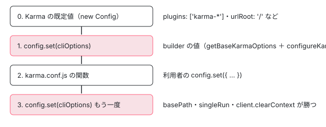

[目次](../README.md) › [Karma の builder の内側：esbuild で束ねたテストを Karma に配るまで](README.md) › 第 1 回 / 全 5 回

# 入口と Karma の設定：options の正規化・テストを探す・Karma の設定を作る

> builders/karma の index.ts・options.ts・find-tests.ts・karma-config.ts が、builder の options を正規化し、include / exclude からテストのファイルを探し（先頭の「/」を落とす古い書き方と、絶対パスが見つからないこと）、karmaConfig が無ければ既定の設定から、あれば空から Karma の設定を作るまで。既定の設定の frameworks・plugins・reporters・browsers と、karma.conf.js を読んだあとに builder の値（basePath・singleRun・clearContext・CLI の browsers と reporters）がもう一度上書きする順（#30956）。

angular/angular-cli · 読了 約 12 分 · 中核 · [サイトで読む（デモが動きます）](https://angular-deep-dive-cyan.vercel.app/chapter/kar-entry)

---

この章で分かること: `ng test` が `@angular/build:karma` を起動したとき、builder が angular.json の options をどう整え、どのテストのファイルを探し出し、Karma に渡す設定をどう作るかです。`karmaConfig` を書かないときに使われる既定の設定の中身と、`karma.conf.js` を書いたときに builder の値と利用者の値のどちらが勝つかを、行の順に追います。最後に本物の `ng test` を 10 通りで走らせ、見つかったテストと、Karma に渡った最終の設定（frameworks・plugins・reporters・browsers・files）を記録で並べます。

読む対象は `packages/angular/build/src/builders/karma/` の `index.ts`・`options.ts`・`find-tests.ts`・`karma-config.ts`・`schema.json` と、`utils.ts` の `collectEntrypoints` です。テストのファイルを探す本体（`unit-test/test-discovery.ts` の `findTests`）は[Vitest のシリーズの「テストを探す」の章](../vit/01-vit-discovery.md)、unit-test builder から runner として呼ばれる道は[第 4 回](04-kar-runner.md)で読みます。

1. **1. 入口と Karma の設定**（この章）
2. [2. テストを束ねる](02-kar-build.md)
3. [3. Karma に配る](03-kar-serve.md)
4. [4. unit-test の karma runner](04-kar-runner.md)
5. [5. spec と issue](05-kar-tests-issues.md)

> [!TIP]
> **新卒エンジニアへ**
>
> **Karma** は、テストを実際のブラウザで走らせるための Node のサーバーです。ブラウザを起動（**launcher**）し、決まった HTML にテストのスクリプトを並べて読み込ませ、結果を **reporter** で端末に出します。**framework**（ここでは jasmine）は、`describe` や `it` をブラウザに用意する Karma の plugin です。Karma の設定は `karma.conf.js` に書くのが普通ですが、この builder は書かなくても動くように、自分で既定の設定を作ります。

## 1. 入口：index.ts は application\_builder.ts を遅れて読み込むだけ

📄 `angular-cli/packages/angular/build/src/builders/karma/index.ts` L19–40 （▶ の行: 20, 26, 29, 31, 33, 38）

```ts
19 │ export interface KarmaBuilderTransformsOptions {
20 ▶   karmaOptions?: (options: ConfigOptions) => ConfigOptions | Promise<ConfigOptions>;
21 │ }
22 │ 
23 │ /**
24 │  * @experimental Direct usage of this function is considered experimental.
25 │  */
26 ▶ export async function* execute(
27 │   options: KarmaBuilderOptions,
28 │   context: BuilderContext,
29 ▶   transforms?: KarmaBuilderTransformsOptions,
30 │ ): AsyncIterable<BuilderOutput> {
31 ▶   const { execute } = await import('./application_builder');
32 │ 
33 ▶   yield* execute(options, context, transforms);
34 │ }
35 │ 
36 │ export type { KarmaBuilderOptions };
37 │ 
38 ▶ const builder: Builder<KarmaBuilderOptions> = createBuilder<KarmaBuilderOptions>(execute);
39 │ 
40 │ export default builder;
```

1. **38 行目: architect の builder として登録する**

   `createBuilder` に `execute` を渡します。`ng test` が angular.json の `"builder": "@angular/build:karma"` を見て、この default export を呼びます。
2. **31 行目: 本体は呼ばれたときに読み込む**

   `await import('./application_builder')` なので、karma や esbuild を読み込む重い module は、`execute` が呼ばれたときに初めて読み込まれます。
3. **33 行目: 結果は AsyncIterable のまま流す**

   `yield*` で、本体の `execute` が返す結果（`{ success }`）をそのまま architect に渡します。watch のときは 1 回の実行で何度も結果が流れます（[第 3 回](03-kar-serve.md)）。
4. **20・29 行目: transforms.karmaOptions**

   3 つ目の引数 `transforms` は、Karma に渡す直前の設定を差し替える関数です。angular.json からは渡せず、`execute` を直に呼ぶプログラム（26 行目の上の `@experimental` のとおり実験的な API）だけが使います。呼ばれる場所は `configureKarma` の中の `parseConfig` の直前です（[第 3 回](03-kar-serve.md)）。

`application_builder.ts` の `execute` は、最初に `normalizeOptions`（2 節）と `getBaseKarmaOptions`（4 節）を呼び、そのあと `initializeApplication` でビルドと Karma の設定の仕上げに進みます（[第 2 回](02-kar-build.md)・[第 3 回](03-kar-serve.md)）。webpack を使う古い `@angular-devkit/build-angular:karma` は別の builder で、違いは[第 4 回](04-kar-runner.md)で並べます。

## 2. options の正規化：options.ts

まず、builder に届く options の既定値を schema で見ます。

📄 `angular-cli/packages/angular/build/src/builders/karma/schema.json` L179–194 （▶ の行: 184–185, 192–193）

```json
179 │     "include": {
180 │       "type": "array",
181 │       "items": {
182 │         "type": "string"
183 │       },
184 ▶       "default": ["**/*.spec.ts"],
185 ▶       "description": "Globs of files to include, relative to project root. \nThere are 2 special cases:\n - when a path to directory is provided, all spec files ending \".spec.@(ts|tsx)\" will be included\n - when a path to a file is provided, and a matching spec file exists it will be included instead."
186 │     },
187 │     "exclude": {
188 │       "type": "array",
189 │       "items": {
190 │         "type": "string"
191 │       },
192 ▶       "default": [],
193 ▶       "description": "Globs of files to exclude, relative to the project root."
194 │     },
```

📄 `angular-cli/packages/angular/build/src/builders/karma/schema.json` L225–256 （▶ の行: 228, 233, 236, 241, 247, 251）

```json
225 │     "progress": {
226 │       "type": "boolean",
227 │       "description": "Log progress to the console while building.",
228 ▶       "default": true
229 │     },
230 │     "watch": {
231 │       "type": "boolean",
232 │       "description": "Re-run tests when source files change.",
233 ▶       "default": true
234 │     },
235 │     "poll": {
236 ▶       "type": "number",
237 │       "description": "Enable and define the file watching poll time period in milliseconds."
238 │     },
239 │     "preserveSymlinks": {
240 │       "type": "boolean",
241 ▶       "description": "Do not use the real path when resolving modules. If unset then will default to `true` if NodeJS option --preserve-symlinks is set."
242 │     },
243 │     "browsers": {
244 │       "description": "Override which browsers tests are run against. Set to `false` to not use any browser.",
245 │       "oneOf": [
246 │         {
247 ▶           "type": "string",
248 │           "description": "A comma seperate list of browsers to run tests against."
249 │         },
250 │         {
251 ▶           "const": false,
252 │           "type": "boolean",
253 │           "description": "Does use run tests against a browser."
254 │         }
255 │       ]
256 │     },
```

📄 `angular-cli/packages/angular/build/src/builders/karma/schema.json` L257–284 （▶ の行: 260, 278–281）

```json
257 │     "codeCoverage": {
258 │       "type": "boolean",
259 │       "description": "Output a code coverage report.",
260 ▶       "default": false
261 │     },
262 │     "codeCoverageExclude": {
263 │       "type": "array",
264 │       "description": "Globs to exclude from code coverage.",
265 │       "items": {
266 │         "type": "string"
267 │       },
268 │       "default": []
269 │     },
270 │     "fileReplacements": {
271 │       "description": "Replace compilation source files with other compilation source files in the build.",
272 │       "type": "array",
273 │       "items": {
274 │         "$ref": "#/definitions/fileReplacement"
275 │       },
276 │       "default": []
277 │     },
278 ▶     "reporters": {
279 ▶       "type": "array",
280 ▶       "description": "Karma reporters to use. Directly passed to the karma runner.",
281 ▶       "items": {
282 │         "type": "string"
283 │       }
284 │     },
```

184 行目のとおり `include` の既定は `['**/*.spec.ts']` で、`.test.ts` は既定では探しません。185 行目の説明は「project root からの相対」「フォルダなら `.spec.@(ts|tsx)`」と書いていますが、実際はどちらも違い、origin/main で 2 回直されました（7 節の記録で `src/app/feature` を include すると `counter.test.ts` も見つかります）。`browsers` は 247 行目の文字列か 251 行目の `false` のどちらかで、`reporters` は 279 行目の配列です。

📄 `angular-cli/packages/angular/build/src/builders/karma/options.ts` L15–37 （▶ の行: 20–24, 28–31, 35–37）

```ts
15 │ export function normalizeOptions(context: BuilderContext, options: KarmaBuilderOptions) {
16 │   const {
17 │     sourceMap,
18 │     karmaConfig,
19 │     browsers,
20 ▶     watch = true,
21 ▶     include = [],
22 ▶     exclude = [],
23 ▶     reporters = [],
24 ▶     ...rest
25 │   } = options;
26 │ 
27 │   let normalizedBrowsers: string[] | undefined;
28 ▶   if (typeof options.browsers === 'string' && options.browsers) {
29 ▶     normalizedBrowsers = options.browsers.split(',').map((browser) => browser.trim());
30 ▶   } else if (options.browsers === false) {
31 ▶     normalizedBrowsers = [];
32 │   }
33 │ 
34 │   // Split along commas to make it more natural, and remove empty strings.
35 ▶   const normalizedReporters = reporters
36 ▶     .reduce<string[]>((acc, curr) => acc.concat(curr.split(',')), [])
37 ▶     .filter((x) => !!x);
```

📄 `angular-cli/packages/angular/build/src/builders/karma/options.ts` L39–58 （▶ の行: 40–44, 46, 49, 51–53）

```ts
39 │   // Sourcemaps are always needed when code coverage is enabled.
40 ▶   const normalizedSourceMap = options.codeCoverage
41 ▶     ? {
42 ▶         scripts: true,
43 ▶         styles: true,
44 ▶         vendor: true,
45 │       }
46 ▶     : sourceMap;
47 │ 
48 │   return {
49 ▶     ...rest,
50 │     sourceMap: normalizedSourceMap,
51 ▶     karmaConfig: karmaConfig ? resolve(context.workspaceRoot, karmaConfig) : undefined,
52 ▶     reporters: normalizedReporters.length ? normalizedReporters : undefined,
53 ▶     browsers: normalizedBrowsers,
54 │     watch,
55 │     include,
56 │     exclude,
57 │   };
58 │ }
```

1. **20〜23 行目: 既定値をもう一度入れる**

   `watch = true`・`include = []`・`exclude = []`・`reporters = []`。schema の既定が先に入るので、`ng test` から来るときは `include` は 184 行目の `['**/*.spec.ts']` のままです。`execute` を直に呼ぶプログラムのための守りです。
2. **28〜31 行目: browsers を配列にする**

   文字列ならカンマで割って前後の空白を落とし、`false` なら空の配列にします。それ以外（書かない）は `undefined` のままで、4 節の 39 行目で「上書きしない」に効きます。
3. **35〜37 行目: reporters をカンマでも割る**

   `--reporters progress,dots` と `--reporters progress --reporters dots` を同じにし、空の文字列を落とします。52 行目で、1 つも無ければ `undefined` にします。
4. **40〜46 行目: coverage のときは source map をすべて出す**

   `codeCoverage` が真なら、`sourceMap` の値を見ずに `scripts`・`styles`・`vendor` をすべて真にします。coverage の数値を元の `.ts` の行に戻すのに要るからです。
5. **51 行目: karmaConfig を絶対パスにする**

   ワークスペースの root から解決します。書かなければ `undefined` で、これが 4 節の 25 行目の分かれ道になります。
6. **49 行目: 残りはそのまま**

   `...rest` に `progress`・`poll`・`aot`・`polyfills` などが入って次へ渡ります。ただし 44129f66a3 では、このうち `progress` と `poll` を application builder に渡す行がありません（[第 2 回](02-kar-build.md)）。

## 3. テストを探す：find-tests.ts は先頭の「/」を落とすだけ

📄 `angular-cli/packages/angular/build/src/builders/karma/find-tests.ts` L9–32 （▶ の行: 9, 13, 15–17, 25–28）

```ts
 9 ▶ import { findTests as findTestsBase } from '../unit-test/test-discovery';
10 │ 
11 │ // This file is a compatibility layer that re-exports the test discovery logic from its new location.
12 │ // This is necessary to avoid breaking the Karma builder, which still depends on this file.
13 ▶ export { getTestEntrypoints } from '../unit-test/test-discovery';
14 │ 
15 ▶ const removeLeadingSlash = (path: string): string => {
16 ▶   return path.startsWith('/') ? path.substring(1) : path;
17 ▶ };
18 │ 
19 │ export async function findTests(
20 │   include: string[],
21 │   exclude: string[],
22 │   workspaceRoot: string,
23 │   projectSourceRoot: string,
24 │ ): Promise<string[]> {
25 ▶   // Karma has legacy support for workspace "root-relative" file paths
26 ▶   return findTestsBase(
27 ▶     include.map(removeLeadingSlash),
28 ▶     exclude.map(removeLeadingSlash),
29 │     workspaceRoot,
30 │     projectSourceRoot,
31 │   );
32 │ }
```

📄 `angular-cli/packages/angular/build/src/builders/karma/utils.ts` L49–63 （▶ の行: 55–59, 62）

```ts
49 │ export async function collectEntrypoints(
50 │   options: NormalizedKarmaBuilderOptions,
51 │   context: BuilderContext,
52 │   projectSourceRoot: string,
53 │ ): Promise<Map<string, string>> {
54 │   // Glob for files to test.
55 ▶   const testFiles = await findTests(
56 ▶     options.include,
57 ▶     options.exclude,
58 ▶     context.workspaceRoot,
59 ▶     projectSourceRoot,
60 │   );
61 │ 
62 ▶   return getTestEntrypoints(testFiles, { projectSourceRoot, workspaceRoot: context.workspaceRoot });
63 │ }
```

1. **utils.ts 55〜60 行目: include と exclude で探す**

   2 節で正規化した `include`・`exclude` と、ワークスペースの root・project の source root（`src`）を渡します。
2. **find-tests.ts 27・28 行目: 先頭の「/」を落としてから本体へ**

   15〜17 行目の `removeLeadingSlash` を include と exclude の全部にかけ、9 行目で読み込んだ unit-test の `findTests` を呼びます。本体は「フォルダなら中の spec、spec でないファイルなら隣の spec、それ以外は glob」と探します（[Vitest のシリーズの章](../vit/01-vit-discovery.md)）。
3. **utils.ts 62 行目: entry の名前を付ける**

   13 行目で読み直した `getTestEntrypoints` が `src/app/greet.spec.ts` を `spec-app-greet.spec` のような名前にします。Vitest の runner と違い `removeTestExtension` を渡さないので、名前に `.spec` が残ります（記録の「テストを探す」の段）。

25 行目のコメントの「workspace の root からのパス」とは、`/src/app/greet.spec.ts` のように「/」で始めてワークスペースの root から書く、Karma の builder の昔からの書き方です。このラッパーは 683d0e09e5（2025-11-06）で作られました。同じコミットで unit-test の側は「絶対パスはそのまま glob に渡す」ように直され、Karma の側だけ「/」を落とす動きを残しています。

📄 `683d0e09e5 で何が動いたか`

```
$ git show 683d0e09e5 -- …/builders/unit-test/test-discovery.ts   # 2025-11-06（抜粋）
+  // Do not modify absolute paths. The globber will handle them correctly.
+  if (isAbsolute(posixPattern)) {
+    return posixPattern;
+  }
 ...
-/** Removes a leading slash from a path. */
-const removeLeadingSlash = (path: string): string => {
$ git show 683d0e09e5 -- …/builders/karma/find-tests.ts             # 同じコミット（抜粋）
-export { findTests, getTestEntrypoints } from '../unit-test/test-discovery';
+export { getTestEntrypoints } from '../unit-test/test-discovery';
+const removeLeadingSlash = (path: string): string => {
+  return path.startsWith('/') ? path.substring(1) : path;
+};
 ...
+  // Karma has legacy support for workspace "root-relative" file paths
+  return findTestsBase(
+    include.map(removeLeadingSlash),
```

> [!WARNING]
> **ハマりどころ**
>
> その結果、POSIX（macOS・Linux）で `--include` に絶対パスを渡すと、先頭の「/」が落ちて相対パスになり、何も見つかりません。記録の「--include 絶対パス」では、unit-test の `findTests` に届いた値が `<app から先頭の / を落としたもの>/src/app/greet.spec.ts` になり、結果は空、Karma は `spec-*.js` が無いと警告して 0 件で終わり、終了コードは 1 でした。`tests/options/include_spec.ts` の 59 行目は `'/**/*test.service.spec.ts'`（「/」で始まる glob）で、これが通るのはこの行のおかげです。絶対パスの it はありません。Windows の絶対パス（`C:\…`）は「/」で始まらないので、この行には当たりません。

## 4. Karma に渡す設定の土台：getBaseKarmaOptions

📄 `angular-cli/packages/angular/build/src/builders/karma/karma-config.ts` L15–48 （▶ の行: 20–22, 25–27, 29–30, 32–36, 39–40, 43–45）

```ts
15 │ export function getBaseKarmaOptions(
16 │   options: NormalizedKarmaBuilderOptions,
17 │   context: BuilderContext,
18 │ ): ConfigOptions {
19 │   // Determine project name from builder context target
20 ▶   const projectName = context.target?.project;
21 ▶   if (!projectName) {
22 ▶     throw new Error(`The 'karma' builder requires a target to be specified.`);
23 │   }
24 │ 
25 ▶   const karmaOptions: ConfigOptions = options.karmaConfig
26 ▶     ? {}
27 ▶     : getBuiltInKarmaConfig(context.workspaceRoot, projectName);
28 │ 
29 ▶   const singleRun = !options.watch;
30 ▶   karmaOptions.singleRun = singleRun;
31 │ 
32 ▶   // Workaround https://github.com/angular/angular-cli/issues/28271, by clearing context by default
33 ▶   // for single run executions. Not clearing context for multi-run (watched) builds allows the
34 ▶   // Jasmine Spec Runner to be visible in the browser after test execution.
35 ▶   karmaOptions.client ??= {};
36 ▶   karmaOptions.client.clearContext ??= singleRun;
37 │ 
38 │   // Convert browsers from a string to an array
39 ▶   if (options.browsers) {
40 ▶     karmaOptions.browsers = options.browsers;
41 │   }
42 │ 
43 ▶   if (options.reporters) {
44 ▶     karmaOptions.reporters = options.reporters;
45 ▶   }
46 │ 
47 │   return karmaOptions;
48 │ }
```

1. **20〜22 行目: target が要る**

   project の名前を `context.target` から取ります。既定の設定の coverage の置き場（5 節の 54 行目）に使うからです。
2. **25〜27 行目: 分かれ道**

   `karmaConfig` があれば空のオブジェクトから、無ければ 5 節の既定の設定から始めます。**karmaConfig を書くと、既定の設定は 1 項目も使われません。**plugins も frameworks も、自分の `karma.conf.js` に並べる必要があります。
3. **29・30 行目: singleRun は watch の逆**

   `--watch=false` なら `singleRun: true` で、テストが 1 回終わると Karma が止まります。
4. **35・36 行目: clearContext**

   32〜34 行目のコメントのとおり #28271（Chrome の更新で「Some of your tests did a full page reload!」が出た件）の回り道で、1 回だけ走らせるときはテストのあとに iframe を空にします。watch のときは Jasmine の結果の画面をブラウザに残します。
5. **39〜45 行目: コマンドラインの browsers と reporters**

   2 節で配列にした値があれば、それで置き換えます。足すのではなく置き換えです。

## 5. karmaConfig を書かないときの既定の設定：getBuiltInKarmaConfig

📄 `angular-cli/packages/angular/build/src/builders/karma/karma-config.ts` L50–76 （▶ の行: 54–55, 57, 59, 62–68, 70, 73, 75）

```ts
50 │ function getBuiltInKarmaConfig(
51 │   workspaceRoot: string,
52 │   projectName: string,
53 │ ): ConfigOptions & Record<string, unknown> {
54 ▶   let coverageFolderName = projectName.charAt(0) === '@' ? projectName.slice(1) : projectName;
55 ▶   coverageFolderName = coverageFolderName.toLowerCase();
56 │ 
57 ▶   const workspaceRootRequire = createRequire(workspaceRoot + '/');
58 │ 
59 ▶   // Any changes to the config here need to be synced to: packages/schematics/angular/config/files/karma.conf.js.template
60 │   return {
61 │     basePath: '',
62 ▶     frameworks: ['jasmine'],
63 ▶     plugins: [
64 ▶       'karma-jasmine',
65 ▶       'karma-chrome-launcher',
66 ▶       'karma-jasmine-html-reporter',
67 ▶       'karma-coverage',
68 ▶     ].map((p) => workspaceRootRequire(p)),
69 │     jasmineHtmlReporter: {
70 ▶       suppressAll: true, // removes the duplicated traces
71 │     },
72 │     coverageReporter: {
73 ▶       dir: path.join(workspaceRoot, 'coverage', coverageFolderName),
74 │       subdir: '.',
75 ▶       reporters: [{ type: 'html' }, { type: 'text-summary' }],
76 │     },
```

📄 `angular-cli/packages/angular/build/src/builders/karma/karma-config.ts` L77–93 （▶ の行: 77–78, 86–89, 91）

```ts
77 ▶     reporters: ['progress', 'kjhtml'],
78 ▶     browsers: ['Chrome'],
79 │     customLaunchers: {
80 │       // Chrome configured to run in a bazel sandbox.
81 │       // Disable the use of the gpu and `/dev/shm` because it causes Chrome to
82 │       // crash on some environments.
83 │       // See:
84 │       //   https://github.com/puppeteer/puppeteer/blob/v1.0.0/docs/troubleshooting.md#tips
85 │       //   https://stackoverflow.com/questions/50642308/webdriverexception-unknown-error-devtoolsactiveport-file-doesnt-exist-while-t
86 ▶       ChromeHeadlessNoSandbox: {
87 ▶         base: 'ChromeHeadless',
88 ▶         flags: ['--no-sandbox', '--headless', '--disable-gpu', '--disable-dev-shm-usage'],
89 ▶       },
90 │     },
91 ▶     restartOnFileChange: true,
92 │   };
93 │ }
```

1. **62 行目: framework は jasmine だけ**

   webpack の builder の既定にあった `@angular-devkit/build-angular` の framework は入りません。古い `karma.conf.js` に残っていれば、`configureKarma` が警告して外します（[第 3 回](03-kar-serve.md)）。
2. **57・63〜68 行目: plugin はワークスペースから require する**

   `createRequire(workspaceRoot + '/')` で、`karma-jasmine`・`karma-chrome-launcher`・`karma-jasmine-html-reporter`・`karma-coverage` の 4 つを**利用者の node\_modules から**読み込みます。`@angular/build` の依存ではないので、どれか 1 つでも入っていないと、この行で `Cannot find module` になります。
3. **54・55・73 行目: coverage の置き場**

   project の名前から先頭の `@` を落として小文字にし、`coverage/<名前>` にします。75 行目で HTML と端末の要約の 2 つを出します。ただし coverage の reporter を足すのは `--code-coverage` のときだけです（[第 3 回](03-kar-serve.md)）。
4. **77・78 行目: reporters と browsers**

   `progress` と `kjhtml`（ブラウザの画面に Jasmine の結果を出す）、ブラウザは `Chrome`（画面のある Chrome）です。CI では `--browsers ChromeHeadless` などで 4 節の 39 行目に置き換えさせます。
5. **86〜89 行目: ChromeHeadlessNoSandbox**

   sandbox・GPU・`/dev/shm` を使わない headless の Chrome を、名前だけ用意しておきます。使うには `--browsers ChromeHeadlessNoSandbox` と指定します。
6. **59 行目: schematic の雛形と揃える約束**

   `ng generate config karma` が書き出す `karma.conf.js.template` と同じ中身にしておく、というコメントです。

## 6. karma.conf.js と組み合わさる順：builder の値が後で勝つ

4 節で作った設定は、`configureKarma` で一時の出力先などを書き足されてから、Karma の `config.parseConfig(karmaConfig のパス, 設定)` に渡ります（[第 3 回](03-kar-serve.md)）。Karma の側で、2 つ目の引数（cliOptions）がどう扱われるかを見ます。



*Karma の設定が重なる順。下の段ほど強く、builder の値が最後にもう一度入る*

📄 `karma 6.4.4 の parseConfig・Config#set・既定の plugins（記録のアプリの node_modules から抜粋）`

```
// karma 6.4.4 の lib/config.js（parseConfig の中、465〜476 行目から抜粋）
  // add the user's configuration in
  config.set(cliOptions)

  let configModuleReturn
  try {
    configModuleReturn = configModule(config)
  } catch (e) {
    return fail('Error in config file!\n', e)
  }
  function finalizeConfig (config) {
    // merge the config from config file and cliOptions (precedence)
    config.set(cliOptions)
// 同じファイルの 343〜350 行目（Config#set）
  set (newConfig) {
    _.mergeWith(this, newConfig, (obj, src) => {
      // Overwrite arrays to keep consistent with #283
      if (Array.isArray(src)) {
        return src
      }
    })
  }
// 同じファイルの 322 行目（Config の constructor の既定値）
    this.plugins = ['karma-*']
// lib/plugin.js の 34・38 行目（'karma-*' のような * を含む指定の読み込み）
      const pluginDirectory = path.normalize(path.join(__dirname, '/../..'))
      fs.readdirSync(pluginDirectory)
```

1. **1 回目の config.set(cliOptions)**

   builder の値を先に入れます。`karma.conf.js` の関数は、この値が入った `config` を受け取ります。
2. **configModule(config)**

   利用者の `karma.conf.js` が `config.set({ … })` で自分の値を重ねます。
3. **2 回目の config.set(cliOptions)**

   コメントのとおり、builder の値で**もう一度上書き**します。`set` は lodash の `mergeWith` で、配列は丸ごと置き換え、オブジェクトは中まで混ぜます。

なので、builder が cliOptions に入れた項目は、`karma.conf.js` に何を書いても builder の値になります。記録の「conf で basePath などを上書き」では、`karma.conf.js` に `basePath: 'src'`・`singleRun: false`・`client.clearContext: false` を書きましたが、Karma に渡った値は `<out>`（一時の出力先）・`true`・`true` でした。一方、`client.jasmine.random: false` のように builder が触らない項目は、オブジェクトが混ぜられて残ります。

> [!NOTE]
> **さらに深く**
>
> **#30956（karma.conf.js の上書きが効かない、開いている）**: 報告は「`coverageReporter.check` の file ごとの `overrides` が効かない」です。issue の中の調べでは、`basePath` が一時の出力先（`dist/test-out/<uuid>`）になっているため、karma-coverage が `src/app/app.ts` を `../../../src/app/app.ts` と比べていました。上の 2 回目の `config.set` と、`configureKarma` が `basePath` を出力先に書き換える行（[第 3 回](03-kar-serve.md)）が重なった結果で、記録の `basePath` もすべての場合で `<out>` です。
>
> **#22132（urlRoot を「/」以外にできない、開いている）**: 2021 年の webpack の builder の報告で、原因は builder が使っていた独自の context の HTML の `<base href="/">` でした。この builder は独自の context の HTML を使いません。記録の「urlRoot: '/karma/'」では Karma が `http://localhost:9876/karma/` で起動し、5 件が走り切りました（1 件はわざと落ちる spec）。
>
> **clearContext**: 35・36 行目の `??=` は「無ければ入れる」ですが、`karmaConfig` があるとき `karmaOptions` は 26 行目の空のオブジェクトなので、利用者の値はこの時点では見えません。結果として、`--watch=false` では `karma.conf.js` の `clearContext: false` も `true` になります（記録の「conf で basePath などを上書き」）。

## 7. 本物の ng test で、Karma に渡った設定を覗く

> **🧪 DEMO — 10 通りの ng test と、見つかったテスト・Karma に渡った設定（記録の再生）**
>
> `<scratchpad>/kar-demo/a/record.mjs` が、@angular/build 22.2.7・karma 6.4.4・karma-jasmine 5.1.0・karma-chrome-launcher 3.2.0 の `ng test --watch=false` を Node v24.22.1 で走らせた記録です。アプリは spec が 5 本（`greet.spec.ts`・`app.spec.ts`・`feature/counter.spec.ts`・`feature/counter.test.ts`・わざと落ちる `broken.spec.ts`）の小さなもので、ブラウザは bazel のキャッシュにある chrome-headless-shell を `CHROME_BIN` で渡しました。`hook.cjs` が `normalizeOptions`・`findTests`・`getBaseKarmaOptions`、karma の `parseConfig` と `Server` を包み、引数と戻り値を書き出しています。パスは `<app>`（アプリ）・`<out>`（`<app>/dist/test-out/<uuid>`）・`<site>`・`<pnpm>` に縮めています。記録した 22.2.7 は 44129f66a3 より後の版で、違いは[第 2 回](02-kar-build.md)の `progress`・`poll` の 2 行だけです（この章の行は同じ）。
>
> karmaConfig を書かない（builder の既定の設定）
>
> ▶ [このデモはサイトで動かせます](https://angular-deep-dive-cyan.vercel.app/chapter/kar-entry)

記録から読めることを並べます。

- **karmaConfig なし**: plugins は 5 節の 4 つ、reporters は `progress`・`kjhtml`、browsers は `Chrome` です。Server に渡るまでに plugins は 4 つから 7 つになります。Karma の `parseConfig` が `customLaunchers` から launcher の plugin を 1 つ作り、`configureKarma` が assets の middleware と polyfills の reporter の 2 つを足します。reporters には `angular-polyfills` が足されます。
- **karma.conf.js あり**: `getBaseKarmaOptions` の戻り値は `singleRun` と `client.clearContext` の 2 つだけで、plugins・reporters・browsers は `karma.conf.js` の値です。コマンドラインの `--reporters progress,dots` を足すと、`karma.conf.js` の `dots` は置き換えられて `progress`・`dots` になります。
- **include**: フォルダは `.spec.ts` と `.test.ts` の両方、spec でないファイルは隣の spec、`/src/…` は「/」を落として見つかり、絶対パスは何も見つかりません（3 節）。
- **--code-coverage**: `sourceMap` が 3 つとも真になり、reporters の最後に `coverage` が足されて端末に Coverage summary が出ます。
- **basePath**: すべての場合で一時の出力先です。走り終えると、その出力先は消えていました（`testOutLeft` が空）。

> **🧪 DEMO — browsers・reporters・include の正規化をページの上で**
>
> `options.ts` の 27〜37 行目と 52 行目、`find-tests.ts` の 15〜17 行目を写した関数です（写した中身は変えていません）。reporters は、空白で区切ったものを `--reporters` を何回か書いたときの配列とみなします。
>
> ▶ [このデモはサイトで動かせます](https://angular-deep-dive-cyan.vercel.app/chapter/kar-entry)

## 8. origin/main での違い

📄 `44129f66a3 から origin/main（8b26efa1ba）まで`

```
$ git log --format='%h %ad %s' --date=short 44129f66a3..origin/main -- packages/angular/build/src/builders/karma
0edb6c646f 2026-11-04 fix(@angular/build): forward the poll and progress options to the karma build setup
b1e814c5ab 2026-10-20 docs: correct `inlineStyle` and Karma `include` option descriptions
405839b160 2026-10-19 docs: fix typos in option descriptions and the `ng run` long description   # browsers の説明の綴り（"comma seperate" など）
4951994f64 2026-10-13 refactor(@angular/build): unify and deduplicate emitFilesToDisk across builders
462c7a756b 2026-09-29 docs: clarify test builders include and exclude schema descriptions
$ git show b1e814c5ab -- …/builders/karma/schema.json   # include の説明（抜粋）
-      "description": "Globs of files to include, relative to the project source root. \nThere are 2 special cases:\n - when a path to a directory is provided, all spec files ending \".spec.@(ts|tsx)\" will be included …
+      "description": "Globs of files to include, relative to the project source root. \nThere are 2 special cases:\n - when a path to a directory is provided, all test files ending \".@(spec|test).@(ts|tsx)\" will be included …
```

この章の行（`options.ts`・`find-tests.ts`・`karma-config.ts`・`index.ts`）は origin/main でも変わっていません。変わったのは schema の説明の文と、`progress`・`poll` を application builder に渡す 2 行（0edb6c646f、[第 2 回](02-kar-build.md)）です。0edb6c646f の本文には「schema に書いてあるのに、`--no-progress` でもビルドの進み具合が出て、`poll` も効かない。webpack の builder は両方を守っていた」とあります。

## テストと直し方

この章の行を固めている spec は次のとおりです（44129f66a3 で `grep -n` したもの。パスは `packages/angular/build/src/builders/karma/tests/` から）。

| spec | describe / it（行） | 固めていること |
| --- | --- | --- |
| `options/include_spec.ts` | `Option: "include"`（13）の it（18）と、8 通りを回す it（62） | 一致しない include で失敗すること。ワークスペースからのパス・project からのパス・フォルダ・glob・「/」で始まる glob（59）で見つかること（3 節） |
| `options/exclude_spec.ts` | `Option: "exclude"`（13）の 4 つの it（29・38・47・57） | exclude が無ければわざと落ちる spec も走ること、glob・project からのパス・「/」で始まるパスで外せること |
| `options/browsers_spec.ts` | `Option: "browsers"`（13）の it（14） | browsers に `jsdom` を足すと警告して外すこと（2 節の 28・29 行目のカンマ区切りを通る） |
| `options/main_spec.ts`・`options/aot_spec.ts` | `Option: "main"`（13）の it（41）・`Option: "aot"`（13）の it（14） | `...rest` で残った options が次の段に届くこと（[第 2 回](02-kar-build.md)） |
| `behavior/specs_spec.ts` | `Behavior: "Specs"`（13）の it（18） | 同じ basename の spec が 2 つあっても両方走ること（utils.ts 62 行目の名前付け） |

📄 `走らせたコマンド（第 2 回の Errors・fakeAsync・jasmine.clock も一緒に）`

```
cd ~/angular-research/angular-cli-fix   # 44129f66a3（../angular-cli と同じ版）
pnpm bazel test //packages/angular/build:karma_integration_tests --nocache_test_results --test_output=all \
  '--test_arg=--filter=Option: "(include|exclude|browsers|main|aot)"|Behavior: "(Specs|Errors|fakeAsync|jasmine\.clock\(\))"'
```

📄 `結果（出力から抜き出したもの）`

```
（10 の shard）Ran 1 of 21 specs ×3、Ran 2 of 22 specs ×4、Ran 3 of 23 specs ×2、Ran 4 of 24 specs ×1 — どれも 0 failures（合わせて 21 specs）
//packages/angular/build:karma_integration_tests                         PASSED in 13.8s
（途中の「Error spec should error FAILED」は、exclude_spec.ts 29 行目の it がわざと落ちる spec を走らせたときの、内側の Karma の出力）
```

target は `packages/angular/build/BUILD.bazel` の `jasmine_test(name = "karma_integration_tests")` で、10 の shard に分かれます。これらの spec はすべて `tests/setup.ts` の `BASE_OPTIONS`（40 行目の `karmaConfig: 'karma.conf.js'`）を使うので、**5 節の `getBuiltInKarmaConfig` を通る it はこの target にはありません**。`karma-config.ts` と `options.ts` を直に見る unit の spec もありません。

直すとしたら、次の場所になります。

- **絶対パスの include**: `find-tests.ts` の `removeLeadingSlash`（15〜17 行目）。ワークスペースの root の下に実在しない「/」で始まるパスだけを落とす形が考えられます。spec は `include_spec.ts` の 28〜60 行目の表に、`harness` のワークスペースの絶対パスで書いた input を足す形です。
- **clearContext**: `karma-config.ts` の 35・36 行目。`karma.conf.js` の値はこの時点で見えないので、直すなら `parseConfig` のあと（`configureKarma`）で見ることになります。
- **既定の設定**: `getBuiltInKarmaConfig`（50〜93 行目）を通る it が無いので、`tests/options/` に `karmaConfig` を外した `BASE_OPTIONS` で走らせる spec を足すのが先になります（59 行目のコメントの雛形と揃っているかも、ここで見られます）。

## ここまでの呼び出し

- 👤 `ng test` — 利用者
  - `builder（createBuilder(execute)）` — karma/index.ts 38
    - `import('./application_builder')` — karma/index.ts 31
      - `normalizeOptions()` — karma/options.ts 15 — *browsers・reporters・sourceMap・karmaConfig*
      - `getBaseKarmaOptions()` — karma/karma-config.ts 15
        - `getBuiltInKarmaConfig()`（karmaConfig が無いとき） — karma-config.ts 50 — *plugins を workspace から require*
      - `initializeApplication()` — application\_builder.ts 111 — *第 2 回*
        - `collectEntrypoints()` — karma/utils.ts 49
          - `findTests()` — karma/find-tests.ts 19 — *先頭の「/」を落とす*
            - `findTests()` — unit-test/test-discovery.ts
          - `getTestEntrypoints()` — unit-test/test-discovery.ts — *spec-app-greet.spec など*
        - `configureKarma()` → `karma.config.parseConfig()` — application\_builder.ts — *第 3 回。builder の値が後で勝つ*

## 聞かれそうな質問

**Q. karma.conf.js を消しても ng test が動くのはなぜですか？**

`karmaConfig` が無いと、`getBaseKarmaOptions` の 25〜27 行目で `getBuiltInKarmaConfig` の既定の設定から始まるからです。jasmine の framework、4 つの plugin（63〜68 行目、ワークスペースの node\_modules から require）、`progress`・`kjhtml` の reporter、`Chrome` が入っています。

**Q. karma.conf.js を書いたら、plugins も書かないといけませんか？**

builder は 4 つの plugin を足しません（26 行目で空のオブジェクトから始まる）。書かなければ Karma 自身の既定 `plugins: ['karma-*']`（karma 6.4.4 の `lib/config.js` 322 行目）が効き、karma が入っているフォルダの隣にある `karma-*` の package を読み込みます（`lib/plugin.js` 34・38 行目）。npm の平らな node\_modules ならそれで見つかりますが、隣に無い置き方（記録のアプリのような pnpm の実体への symlink など）では見つからないので、`require('karma-jasmine')` などを並べます。

**Q. karma.conf.js の basePath や singleRun が効きません。**

builder が cliOptions に入れた項目は、Karma の `parseConfig` が `karma.conf.js` の**あと**にもう一度 `config.set(cliOptions)` するので、builder の値が勝ちます。`singleRun` は 30 行目で watch の逆、`basePath` は一時の出力先です。#30956 の coverage の `overrides` が効かないのもこのためです。

**Q. --browsers と karma.conf.js の browsers は足されますか？**

足されません。`options.ts` の 28・29 行目で配列にした値が、`karma-config.ts` の 39・40 行目で `browsers` を置き換え、Karma の `set` も配列は丸ごと置き換えます。reporters も同じです（43・44 行目）。

**Q. --include にフルパスを渡すと 0 件になります。**

POSIX では `find-tests.ts` の 15〜17 行目と 27 行目で先頭の「/」が落とされ、source root からの相対パスとして探されるからです。ワークスペースからのパス（`src/app/…`）か、「/」で始まるワークスペースからのパス（`/src/app/…`）で書けば見つかります。

**Q. --code-coverage のとき sourceMap: false が効かないのはなぜですか？**

`options.ts` の 40〜46 行目で、`codeCoverage` が真なら `sourceMap` の値を見ずに 3 つとも真にするからです。coverage の結果を元の TypeScript の行に戻すのに要ります。

## 読み終えて

- `index.ts` は本体を遅れて読み込むだけで、`transforms.karmaOptions` は API から呼ぶときだけの差し込み口。
- `options.ts` は browsers と reporters をカンマで割り、coverage のとき source map をすべて出し、karmaConfig を絶対パスにする。
- テストを探す本体は unit-test と同じで、Karma の側は先頭の「/」を落とす古い書き方だけを残している（絶対パスは見つからない）。
- karmaConfig を書かなければ `getBuiltInKarmaConfig` の既定、書けばそれだけ。どちらでも builder の値（singleRun・clearContext・basePath・CLI の browsers と reporters）が最後に勝つ。

---

← 前: [spec と issue を読む：unit-test builder を固めているテスト](../vit/05-vit-tests-issues.md)  
次: [テストを束ねる：application builder でテストを esbuild にかける](02-kar-build.md) →
