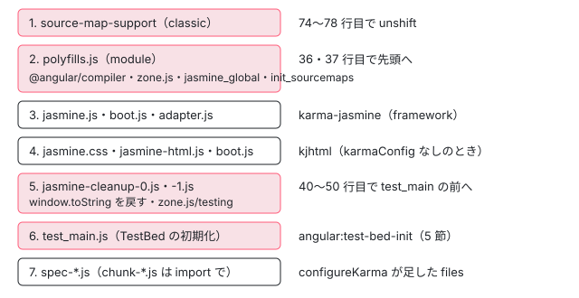

[目次](../README.md) › [Karma の builder の内側：esbuild で束ねたテストを Karma に配るまで](README.md) › 第 2 回 / 全 5 回

# テストを束ねる：application builder でテストを esbuild にかける

> application\_builder.ts の initializeApplication・setupBuildOptions・runEsbuild と utils.ts・polyfills-plugin.ts・polyfills/ が、テストのファイルを entry にした application builder の options（index なし・hash なし・aot の既定が偽で JIT）を作り、polyfills を jasmine の前と後（zone.js/testing・jasmine の大域の後片付け）に分け、Karma の files をほぼすべて module にして並べ替え、TestBed を初期化する仮想のファイルを作って一時ディレクトリに書き出す行。preserveSymlinks（95d16dc521・41bd100dd8）、localize（75c1dce387・0010b922f8）、届いていなかった progress と poll（0edb6c646f）。

angular/angular-cli · 読了 約 13 分 · 発展 · [サイトで読む（デモが動きます）](https://angular-deep-dive-cyan.vercel.app/chapter/kar-build)

---

この章で分かること: Karma の builder が、前の章で見つけたテストのファイルを entry にして application builder（esbuild）に束ねさせるまでです。`initializeApplication` と `setupBuildOptions` が application builder の options をどう作るか、jasmine の大域・その後片付け・source map の初期化という 3 つの小さなファイルを polyfills としてどこに差し込むか、TestBed を初期化する仮想のファイルに何を書くかを、行の順に追います。最後に本物の `ng test` を zoneless・zone.js あり・@angular/localize なし・coverage・ビルドの失敗の 5 通りで走らせ、渡った options と仮想のファイルの中身、出力のファイルの一覧を記録で並べます。

読む対象は `packages/angular/build/src/builders/karma/` の `application_builder.ts`（111〜264 行目）・`utils.ts`・`polyfills-plugin.ts`・`polyfills/` の 3 つのファイルです。esbuild でのビルドそのものは[application builder の章](../boot/04-boot-application-build.md)、Vitest の runner が同じことをどうしているかは[Vitest のシリーズの「テスト用のビルド」の章](../vit/02-vit-build.md)にあります。ビルドの結果を Karma に配る側（`configureKarma`・middleware・watch）は[第 3 回](03-kar-serve.md)です。

1. [1. 入口と Karma の設定](01-kar-entry.md)
2. **2. テストを束ねる**（この章）
3. [3. Karma に配る](03-kar-serve.md)
4. [4. unit-test の karma runner](04-kar-runner.md)
5. [5. spec と issue](05-kar-tests-issues.md)

> [!TIP]
> **新卒エンジニアへ**
>
> **entry（entry point）**は、esbuild が束ね始める元のファイルで、entry 1 つにつき出力の JS が 1 つできます。ここでは spec のファイル 1 つずつと、TestBed を初期化する `test_main`、jasmine の後片付けの `jasmine-cleanup-N` です。**仮想のファイル**は、ディスクに置かずに文字列で中身を作り、esbuild の plugin が「このパスの中身はこれ」と答えるファイルです（`angular:test-bed-init` と、application builder が作る `angular:polyfills`）。

## 1. 全体の流れ：initializeApplication

📄 `angular-cli/packages/angular/build/src/builders/karma/application_builder.ts` L111–138 （▶ の行: 119–120, 123–124, 126–129, 131, 138）

```ts
111 │ async function initializeApplication(
112 │   options: NormalizedKarmaBuilderOptions,
113 │   context: BuilderContext,
114 │   karmaOptions: ConfigOptions,
115 │   transforms?: KarmaBuilderTransformsOptions,
116 │ ): Promise<
117 │   [typeof import('karma'), Config & ConfigOptions, BuildOptions, AsyncIterator<Result> | null]
118 │ > {
119 ▶   const karma = await import('karma');
120 ▶   const projectSourceRoot = await getProjectSourceRoot(context);
121 │ 
122 │   // Setup temporary output path and ensure it is empty
123 ▶   const outputPath = path.join(context.workspaceRoot, 'dist/test-out', randomUUID());
124 ▶   await fs.rm(outputPath, { recursive: true, force: true });
125 │   // Setup exit cleanup for temporary directory
126 ▶   const handleProcessExit = () => rmSync(outputPath, { recursive: true, force: true });
127 ▶   process.once('exit', handleProcessExit);
128 ▶   process.once('SIGINT', handleProcessExit);
129 ▶   process.once('uncaughtException', handleProcessExit);
130 │ 
131 ▶   const { buildOptions, mainName } = await setupBuildOptions(
132 │     options,
133 │     context,
134 │     projectSourceRoot,
135 │     outputPath,
136 │   );
137 │ 
138 ▶   const [buildOutput, buildIterator] = await runEsbuild(buildOptions, context, projectSourceRoot);
```

📄 `angular-cli/packages/angular/build/src/builders/karma/application_builder.ts` L139–152 （▶ の行: 140, 151）

```ts
139 │ 
140 ▶   const karmaConfig = await configureKarma(
141 │     karma,
142 │     context,
143 │     karmaOptions,
144 │     options,
145 │     buildOptions,
146 │     buildOutput,
147 │     mainName,
148 │     transforms,
149 │   );
150 │ 
151 ▶   return [karma, karmaConfig, buildOptions, buildIterator];
152 │ }
```

📄 `angular-cli/packages/angular/build/src/builders/karma/utils.ts` L18–29 （▶ の行: 19–23, 25–26）

```ts
18 │ export async function getProjectSourceRoot(context: BuilderContext): Promise<string> {
19 ▶   // We have already validated that the project name is set before calling this function.
20 ▶   const projectName = context.target?.project;
21 ▶   if (!projectName) {
22 ▶     return context.workspaceRoot;
23 ▶   }
24 │ 
25 ▶   const projectMetadata = await context.getProjectMetadata(projectName);
26 ▶   const { projectSourceRoot } = getProjectRootPaths(context.workspaceRoot, projectMetadata);
27 │ 
28 │   return projectSourceRoot;
29 │ }
```

1. **119 行目: karma をここで読み込む**

   karma は `@angular/build` の依存ではなく、利用者が入れる package です。`import('karma')` は利用者の node\_modules から解決されます。
2. **120 行目と utils.ts 25・26 行目: project の source root**

   angular.json の project の `sourceRoot`（無ければ `root/src`）を絶対パスにします。テストを探す起点と、仮想のファイルの import を解決する起点（5 節の 242 行目）になります。target が無いときは 20〜23 行目でワークスペースの root を返しますが、前の章の `getBaseKarmaOptions` がその前に target を要求しているので、この道は通りません（19 行目のコメント）。
3. **123・124 行目: 出力先は毎回新しい一時ディレクトリ**

   `dist/test-out/<randomUUID>` です。並べて走らせても出力が混ざりません。
4. **126〜129 行目: process が終わるときに消す**

   `exit`・`SIGINT`・`uncaughtException` のどれかで、同期の `rmSync` で出力先を消します（1c2d49ec73。詳しくは[第 3 回](03-kar-serve.md)）。記録の 5 通りすべてで、走り終えたあと `dist/test-out` の中は空でした。
5. **131・138・140 行目: 3 つの段**

   options を作る（2 節）→ esbuild で束ねる（5 節）→ Karma の設定を仕上げる（[第 3 回](03-kar-serve.md)）。151 行目で、karma・設定・ビルドの options・watch のときだけの iterator の 4 つを返します。

## 2. application builder の options を作る：setupBuildOptions

📄 `angular-cli/packages/angular/build/src/builders/karma/application_builder.ts` L154–180 （▶ の行: 160, 162–166, 169–170, 176–179）

```ts
154 │ async function setupBuildOptions(
155 │   options: NormalizedKarmaBuilderOptions,
156 │   context: BuilderContext,
157 │   projectSourceRoot: string,
158 │   outputPath: string,
159 │ ): Promise<{ buildOptions: BuildOptions; mainName: string }> {
160 ▶   const entryPoints = await collectEntrypoints(options, context, projectSourceRoot);
161 │ 
162 ▶   const mainName = 'test_main';
163 ▶   if (options.main) {
164 ▶     entryPoints.set(mainName, options.main);
165 ▶   } else {
166 ▶     entryPoints.set(mainName, 'angular:test-bed-init');
167 │   }
168 │ 
169 ▶   const instrumentForCoverage = options.codeCoverage
170 ▶     ? createInstrumentationFilter(
171 │         projectSourceRoot,
172 │         getInstrumentationExcludedPaths(context.workspaceRoot, options.codeCoverageExclude ?? []),
173 │       )
174 │     : undefined;
175 │ 
176 ▶   const [polyfills, jasmineCleanup] = normalizePolyfills(options.polyfills);
177 ▶   for (let idx = 0; idx < jasmineCleanup.length; ++idx) {
178 ▶     entryPoints.set(`jasmine-cleanup-${idx}`, jasmineCleanup[idx]);
179 ▶   }
180 │ 
```

1. **160 行目: spec ごとの entry**

   前の章の `collectEntrypoints` の戻り値（`spec-app-greet.spec` → `src/app/greet.spec.ts` など）から始めます。
2. **162〜166 行目: test\_main**

   entry の名前は `test_main` に決め打ちで、中身は `main` option があればそのファイル、無ければ仮想のファイル `angular:test-bed-init` です（5 節）。`main` を書くと TestBed の初期化を自分で書くことになります。この名前は[第 3 回](03-kar-serve.md)の files の `test_main.js` と、4 節の 45 行目で使われます。
3. **169・170 行目: coverage のときだけ計測の印を付ける関数**

   どのファイルを計測するかを決める関数を作ります（`coverage.ts`、[第 3 回](03-kar-serve.md)）。
4. **176〜178 行目: polyfills を 2 つに分ける**

   `normalizePolyfills`（3 節）が、ほかのコードより先に読む polyfills と、jasmine のあとに読む後片付けの一覧を返します。後片付けの方は `jasmine-cleanup-0`・`jasmine-cleanup-1` … という名前の entry になります。

📄 `angular-cli/packages/angular/build/src/builders/karma/application_builder.ts` L181–207 （▶ の行: 181, 183, 185–191, 195, 197, 204, 206）

```ts
181 ▶   const buildOptions: BuildOptions = {
182 │     assets: options.assets,
183 ▶     entryPoints,
184 │     tsConfig: options.tsConfig,
185 ▶     outputPath,
186 ▶     preserveSymlinks: options.preserveSymlinks,
187 ▶     aot: options.aot,
188 ▶     index: false,
189 ▶     outputHashing: OutputHashing.None,
190 ▶     optimization: false,
191 ▶     sourceMap: options.sourceMap,
192 │     instrumentForCoverage,
193 │     styles: options.styles,
194 │     scripts: options.scripts,
195 ▶     polyfills,
196 │     webWorkerTsConfig: options.webWorkerTsConfig,
197 ▶     watch: options.watch,
198 │     stylePreprocessorOptions: options.stylePreprocessorOptions,
199 │     inlineStyleLanguage: options.inlineStyleLanguage,
200 │     fileReplacements: options.fileReplacements,
201 │     define: options.define,
202 │     loader: options.loader,
203 │     externalDependencies: options.externalDependencies,
204 ▶   };
205 │ 
206 ▶   return { buildOptions, mainName };
207 │ }
```

📄 `angular-cli/packages/angular/build/src/builders/karma/schema.json` L285–296 （▶ の行: 289, 292）

```json
285 │     "webWorkerTsConfig": {
286 │       "type": "string",
287 │       "description": "TypeScript configuration for Web Worker modules."
288 │     },
289 ▶     "aot": {
290 │       "type": "boolean",
291 │       "description": "Run tests using Ahead of Time compilation.",
292 ▶       "default": false
293 │     }
294 │   },
295 │   "additionalProperties": false,
296 │   "required": ["tsConfig"],
```

1. **188〜190 行目: テストのための固定の値**

   `index: false`（index.html を作らない。HTML は Karma の context.html）、`outputHashing: none`（名前に hash を付けない。Karma の files は `spec-*.js` のような名前で探す）、`optimization: false`（minify しない）。
2. **187 行目と schema の 292 行目: aot の既定は false**

   Karma の builder の `aot` の既定は `false` なので、application builder は JIT で束ねます。application builder は JIT のとき polyfills の先頭に `@angular/compiler` を足すので（`tools/esbuild/application-code-bundle.ts`）、記録の仮想の polyfills の 1 行目はどの場合も `import "@angular/compiler";` で、`polyfills.js` は 1 MB 近くあります。Vitest の runner は build の target の `aot`（新しいアプリでは真）を使うので、ここが違います。
3. **186 行目: preserveSymlinks**

   95d16dc521（2025-04-16）で足された行です。unit-test builder の karma runner から来るときは、2026-07-08 の 41bd100dd8 から build の target の値も引き継ぐようになりました（[第 4 回](04-kar-runner.md)）。
4. **191・195・197 行目: 前の段の値**

   `sourceMap` は前の章で coverage のときにすべて真にした値、`polyfills` は 176 行目で分けた片方、`watch` は既定で真です。
5. **書かれていないもの: progress と poll**

   schema にある `progress` と `poll` は、44129f66a3 ではこの表に無く、application builder に届きません（`--no-progress` でもビルドの進み具合が出る）。origin/main の 0edb6c646f（2026-11-04）で 197 行目の下に 2 行足されました。記録に使った 22.2.7 にはこの 2 行が入っています。

📄 `186 行目のまわりの変更`

```
$ git show 95d16dc521 -- …/builders/karma/application_builder.ts   # 2025-04-16（抜粋）
     tsConfig: options.tsConfig,
     outputPath,
+    preserveSymlinks: options.preserveSymlinks,
     aot: options.aot,
$ git show 41bd100dd8 -- …/unit-test/runners/karma/executor.ts   # 2026-07-08（抜粋）
-      preserveSymlinks: unitTestOptions.preserveSymlinks,
+      preserveSymlinks: unitTestOptions.preserveSymlinks ?? buildTargetOptions.preserveSymlinks,
$ git show 0edb6c646f -- …/builders/karma/application_builder.ts   # origin/main、2026-11-04（抜粋）
     watch: options.watch,
+    poll: options.poll,
+    progress: options.progress,
```

## 3. polyfills を 2 つに分ける：normalizePolyfills

📄 `angular-cli/packages/angular/build/src/builders/karma/utils.ts` L31–47 （▶ の行: 34–36, 38–39, 42–45）

```ts
31 │ export function normalizePolyfills(
32 │   polyfills: string[] = [],
33 │ ): [polyfills: string[], jasmineCleanup: string[]] {
34 ▶   const jasmineGlobalEntryPoint = localResolve('./polyfills/jasmine_global.js');
35 ▶   const jasmineGlobalCleanupEntrypoint = localResolve('./polyfills/jasmine_global_cleanup.js');
36 ▶   const sourcemapEntrypoint = localResolve('./polyfills/init_sourcemaps.js');
37 │ 
38 ▶   const zoneTestingEntryPoint = 'zone.js/testing';
39 ▶   const polyfillsExludingZoneTesting = polyfills.filter((p) => p !== zoneTestingEntryPoint);
40 │ 
41 │   return [
42 ▶     polyfillsExludingZoneTesting.concat([jasmineGlobalEntryPoint, sourcemapEntrypoint]),
43 ▶     polyfillsExludingZoneTesting.length === polyfills.length
44 ▶       ? [jasmineGlobalCleanupEntrypoint]
45 ▶       : [jasmineGlobalCleanupEntrypoint, zoneTestingEntryPoint],
46 │   ];
47 │ }
```

1. **39 行目: zone.js/testing を抜き出す**

   利用者の polyfills から `zone.js/testing` だけを外します。`zone.js/testing` は大域の `jasmine` を書き換えるので、jasmine より後に読む必要があるからです（4 節の 32〜35 行目のコメント）。
2. **42 行目: 先に読む方**

   残りの polyfills の後ろに、`jasmine_global.js` と `init_sourcemaps.js` を足します（34・36 行目でこの package の中のファイルを絶対パスにしたもの）。
3. **43〜45 行目: 後で読む方**

   いつも `jasmine_global_cleanup.js`、`zone.js/testing` が書いてあればその後ろに `zone.js/testing`。2 節の 177〜179 行目で `jasmine-cleanup-0`・`jasmine-cleanup-1` の entry になります。

## 4. 3 つの小さなファイルと、読み込む順を決める plugin

📄 `angular-cli/packages/angular/build/src/builders/karma/polyfills/jasmine_global.js` L9–18 （▶ の行: 9, 15–16）

```js
 9 ▶ // See: https://github.com/jasmine/jasmine/issues/2015
10 │ (function () {
11 │   'use strict';
12 │ 
13 │   // jasmine will ignore `window` unless it returns this specific (but uncommon)
14 │   // value from toString().
15 ▶   window.toString = function () {
16 ▶     return '[object GjsGlobal]';
17 │   };
18 │ })();
```

📄 `angular-cli/packages/angular/build/src/builders/karma/polyfills/jasmine_global_cleanup.js` L9–14 （▶ の行: 13）

```js
 9 │ // See: https://github.com/jasmine/jasmine/issues/2015
10 │ (function () {
11 │   'use strict';
12 │ 
13 ▶   delete window.toString;
14 │ })();
```

📄 `angular-cli/packages/angular/build/src/builders/karma/polyfills/init_sourcemaps.js` L9–10 （▶ の行: 10）

```js
 9 │ // eslint-disable-next-line no-undef
10 ▶ globalThis.sourceMapSupport?.install();
```

1. **jasmine\_global.js 15・16 行目: window を jasmine の大域と思わせる**

   この builder はすべてを ES module として読み込みます（下の 65・66 行目）。jasmine-core 4 の `jasmine.js` は `(function(jasmineGlobal) { … })(this)` の形で、module の中では `this` が `undefined` になり、大域が見つかりません。jasmine-core 4 には「`window.toString()` が `'[object GjsGlobal]'` を返すなら `window` を大域にする」という分岐があるので、それに合わせて `toString` を差し替えます（9 行目の jasmine の issue #2015）。a9a3470147（2024-12-10「jasmine.clock with app builder」）で入りました。
2. **jasmine\_global\_cleanup.js 13 行目: 戻す**

   jasmine が読み込まれたあとに差し替えを消します。記録のテストの中で `String(window)` は `[object Window]` でした。
3. **init\_sourcemaps.js 10 行目: stack trace を元のファイルに戻す**

   下の 74〜78 行目で先に読ませる `source-map-support` の browser 版が `globalThis.sourceMapSupport` を置くので、それを有効にします。記録の失敗の行が `src/app/broken.spec.ts:4:19` になっているのはこのためです（a5fcf80442）。

> [!NOTE]
> **ポイント**
>
> 記録のアプリでは、`karma-jasmine` 5.1.0 が自分の依存の jasmine-core 4.6.1 の `jasmine.js` を読み込み、`karma-jasmine-html-reporter` は jasmine-core 6.3.0 の `jasmine-html.js` を読み込みました（「ブラウザに読み込まれる順」の段）。jasmine-core 6 の `jasmine.js` は `globalThis` を使うので、この差し替えが要るのは 4 までです。

📄 `angular-cli/packages/angular/build/src/builders/karma/polyfills-plugin.ts` L12–51 （▶ の行: 15, 17, 25–29, 31–37, 40, 45–50）

```ts
12 │ const localResolve = createRequire(__filename).resolve;
13 │ 
14 │ export class AngularPolyfillsPlugin {
15 ▶   static readonly $inject = ['config.files'];
16 │ 
17 ▶   static readonly NAME = 'angular-polyfills';
18 │ 
19 │   static createPlugin(
20 │     polyfillsFile: FilePattern,
21 │     jasmineCleanupFiles: FilePattern,
22 │     scriptsFiles: FilePattern[],
23 │   ): InlinePluginDef {
24 │     return {
25 ▶       // This has to be a "reporter" because reporters run _after_ frameworks
26 ▶       // and karma-jasmine-html-reporter injects additional scripts that may
27 ▶       // depend on Jasmine but aren't modules - which means that they would run
28 ▶       // _before_ all module code (including jasmine).
29 ▶       [`reporter:${AngularPolyfillsPlugin.NAME}`]: [
30 │         'factory',
31 ▶         Object.assign((files: (string | FilePattern)[]) => {
32 ▶           // The correct order is zone.js -> jasmine -> zone.js/testing.
33 ▶           // Jasmine has to see the patched version of the global `setTimeout`
34 ▶           // function so it doesn't cache the unpatched version. And /testing
35 ▶           // needs to see the global `jasmine` object so it can patch it.
36 ▶           const polyfillsIndex = 0;
37 ▶           files.splice(polyfillsIndex, 0, polyfillsFile);
38 │ 
39 │           // Insert just before test_main.js.
40 ▶           const zoneTestingIndex = files.findIndex((f) => {
41 │             if (typeof f === 'string') {
42 │               return false;
43 │             }
44 │ 
45 ▶             return f.pattern.endsWith('/test_main.js');
46 ▶           });
47 ▶           if (zoneTestingIndex === -1) {
48 ▶             throw new Error('Could not find test entrypoint file.');
49 ▶           }
50 ▶           files.splice(zoneTestingIndex, 0, jasmineCleanupFiles);
51 │ 
```

📄 `angular-cli/packages/angular/build/src/builders/karma/polyfills-plugin.ts` L52–86 （▶ の行: 56–57, 60, 65–67, 71, 74–78, 81）

```ts
52 │           // We need to ensure that all files are served as modules, otherwise
53 │           // the order in the files list gets really confusing: Karma doesn't
54 │           // set defer on scripts, so all scripts with type=js will run first,
55 │           // even if type=module files appeared earlier in `files`.
56 ▶           for (const f of files) {
57 ▶             if (typeof f === 'string') {
58 │               throw new Error(`Unexpected string-based file: "${f}"`);
59 │             }
60 ▶             if (f.included === false) {
61 │               // Don't worry about files that aren't included on the initial
62 │               // page load. `type` won't affect them.
63 │               continue;
64 │             }
65 ▶             if (f.pattern.endsWith('.js') && 'js' === (f.type ?? 'js')) {
66 ▶               f.type = 'module';
67 ▶             }
68 │           }
69 │ 
70 │           // Add "scripts" option files as classic scripts
71 ▶           files.unshift(...scriptsFiles);
72 │ 
73 │           // Add browser sourcemap support as a classic script
74 ▶           files.unshift({
75 ▶             pattern: localResolve('source-map-support/browser-source-map-support.js'),
76 ▶             included: true,
77 ▶             watched: false,
78 ▶           });
79 │ 
80 │           // Karma needs a return value for a factory and Karma's multi-reporter expects an `adapters` array
81 ▶           return { adapters: [] };
82 │         }, AngularPolyfillsPlugin),
83 │       ],
84 │     };
85 │   }
86 │ }
```

1. **15・29・31 行目: Karma の reporter として登録する**

   Karma の DI で `config.files`（files の配列そのもの）を受け取る factory です。25〜28 行目のコメントのとおり、reporter は framework より後に作られるので、karma-jasmine や kjhtml が files の先頭に自分のファイルを入れ終えた配列を並べ替えられます。登録は `configureKarma` です（[第 3 回](03-kar-serve.md)）。
2. **36・37 行目: polyfills.js をいちばん前へ**

   zone.js が `setTimeout` を書き換えたあとで jasmine が読み込まれるようにします（32〜35 行目のコメント。jasmine が書き換え前の `setTimeout` を覚えてしまわないように）。
3. **40〜50 行目: 後片付けを test\_main.js の直前へ**

   パスが `/test_main.js` で終わる file を探し、その前に `jasmine-cleanup-*.js` を入れます。見つからなければ 48 行目で投げます。
4. **56〜68 行目: すべて module にする**

   Karma は `type: 'js'` の script に defer を付けないので、classic の script は files の順に関係なく module より先に走ります。順を守るため、読み込む `.js` をすべて `type: 'module'` にします（60 行目の `included: false` は除く）。jasmine-core の `jasmine.js` も module になります。開いている #31470（jasmine-core を ES module として読む）はこの行の話です。
5. **71・74・75 行目: 例外の 2 つは classic のまま先頭へ**

   `scripts` option の出力と、`source-map-support` の browser 版です。classic の script なので、module より先に走ります。
6. **81 行目: adapters**

   reporter の factory は値を返さないといけない（4b49a207a1）うえ、Karma の multi-reporter は `adapters` の配列を見る（2cb04d5e2f）ので、空の配列を返します。



*ブラウザに読み込まれる順（記録の zone.js ありの場合）。赤は builder が差し込んだもの*

## 5. esbuild にかける：runEsbuild と TestBed の初期化

📄 `angular-cli/packages/angular/build/src/builders/karma/application_builder.ts` L209–245 （▶ の行: 214, 216–220, 222–223, 225–226, 228, 231, 233–237, 242）

```ts
209 │ async function runEsbuild(
210 │   buildOptions: BuildOptions,
211 │   context: BuilderContext,
212 │   projectSourceRoot: string,
213 │ ): Promise<[Result & { kind: ResultKind.Full }, AsyncIterator<Result> | null]> {
214 ▶   const usesZoneJS = buildOptions.polyfills?.includes('zone.js');
215 │   let hasLocalize = false;
216 ▶   try {
217 ▶     const projectResolve = createProjectResolver(projectSourceRoot);
218 ▶     projectResolve('@angular/localize');
219 ▶     hasLocalize = true;
220 ▶   } catch {}
221 │ 
222 ▶   const virtualTestBedInit = createVirtualModulePlugin({
223 ▶     namespace: 'angular:test-bed-init',
224 │     loadContent: async () => {
225 ▶       const contents: string[] = [
226 ▶         ...(hasLocalize ? [`import '@angular/localize/init';`] : []),
227 │         // Initialize the Angular testing environment
228 ▶         `import { NgModule${usesZoneJS ? ', provideZoneChangeDetection' : ''} } from '@angular/core';`,
229 │         `import { getTestBed } from '@angular/core/testing';`,
230 │         `import { BrowserTestingModule, platformBrowserTesting } from '@angular/platform-browser/testing';`,
231 ▶         `@NgModule({ providers: [${usesZoneJS ? 'provideZoneChangeDetection(), ' : ''}], })`,
232 │         `export class TestModule {}`,
233 ▶         `getTestBed().initTestEnvironment([BrowserTestingModule, TestModule], platformBrowserTesting(), {`,
234 ▶         `  errorOnUnknownElements: true,`,
235 ▶         `  errorOnUnknownProperties: true,`,
236 ▶         `});`,
237 ▶       ];
238 │ 
239 │       return {
240 │         contents: contents.join('\n'),
241 │         loader: 'js',
242 ▶         resolveDir: projectSourceRoot,
243 │       };
244 │     },
245 │   });
```

1. **214 行目: zone.js を使うか**

   3 節で作った polyfills の配列に、ちょうど `'zone.js'` という文字列があるかだけを見ます。Vitest の runner のように「node\_modules から解決できるか」は見ません（[Vitest の章](../vit/02-vit-build.md)の 4 節と違うところ）。
2. **215〜220 行目: @angular/localize があるか**

   project の source root から `@angular/localize` が解決できれば、226 行目で仮想のファイルの先頭に `import '@angular/localize/init';` を入れます。library のテストで `$localize is not defined` になるのを防ぐ 75c1dce387（2026-06-24）の行で、5 日後の 0010b922f8 で、pnpm の仮想ストアの中から親をたどって見つけてしまわないよう `createProjectResolver`（`paths` を project に絞る）に替わりました。
3. **222〜245 行目: 仮想のファイル angular:test-bed-init**

   228 行目と 231 行目で、zone.js を使うときだけ `provideZoneChangeDetection()` を providers に入れます。233〜236 行目で `initTestEnvironment` を呼び、知らない要素と知らない property をエラーにします（[testing シリーズの章](../testing/02-testing-init-environment.md)）。242 行目の `resolveDir` が project の source root なので、この中の import は利用者の node\_modules から解決され、テストのコードと同じ `@angular/core` を使います（566de64cbe の目的）。

📄 `215〜220 行目の 2 つの変更`

```
$ git show 75c1dce387 -- …/builders/karma/application_builder.ts   # 2026-06-24（抜粋）
+  let hasLocalize = false;
+  try {
+    const projectRequire = createRequire(path.join(projectSourceRoot, 'package.json'));
+    projectRequire.resolve('@angular/localize');
+    hasLocalize = true;
+  } catch {}
 ...
+        ...(hasLocalize ? [`import '@angular/localize/init';`] : []),
$ git show 0010b922f8 -- …/builders/karma/application_builder.ts   # 2026-06-29（抜粋）
-    const projectRequire = createRequire(path.join(projectSourceRoot, 'package.json'));
-    projectRequire.resolve('@angular/localize');
+    const projectResolve = createProjectResolver(projectSourceRoot);
+    projectResolve('@angular/localize');
$ git show 0010b922f8 -- …/utils/resolve-project.ts   # 新しいファイル（抜粋）
+export function createProjectResolver(projectRoot: string): (packageName: string) => string {
+  const projectRequire = createRequire(join(projectRoot, 'package.json'));
+
+  return (packageName: string) => projectRequire.resolve(packageName, { paths: [projectRoot] });
+}
```

📄 `angular-cli/packages/angular/build/src/builders/karma/application_builder.ts` L246–264 （▶ の行: 248–258, 261）

```ts
246 │ 
247 │   // Build tests with `application` builder, using test files as entry points.
248 ▶   const [buildOutput, buildIterator] = await first(
249 ▶     buildApplicationInternal(buildOptions, context, { codePlugins: [virtualTestBedInit] }),
250 ▶     { cancel: !buildOptions.watch },
251 ▶   );
252 ▶   if (buildOutput.kind === ResultKind.Failure) {
253 ▶     throw new ApplicationBuildError('Build failed');
254 ▶   } else if (buildOutput.kind !== ResultKind.Full) {
255 ▶     throw new ApplicationBuildError(
256 ▶       'A full build result is required from the application builder.',
257 ▶     );
258 ▶   }
259 │ 
260 │   // Write test files
261 ▶   await writeTestFiles(buildOutput.files, buildOptions.outputPath);
262 │ 
263 │   return [buildOutput, buildIterator];
264 │ }
```

1. **249 行目: 仮想のファイルを code plugin として渡す**

   application builder の `buildApplicationInternal` に、2 節の options と `codePlugins` を渡します。記録では `codePlugins` は `angular-test-bed-init` の 1 つでした。
2. **248・250 行目: 最初の結果だけを待つ**

   `first` は最初の 1 回の結果を受け取ります。`watch` が偽なら `cancel: true` でビルドをそこで止め、真なら 2 回目以降のための iterator を返します（[第 3 回](03-kar-serve.md)）。
3. **252〜258 行目: 失敗なら Karma を起動しない**

   `ApplicationBuildError` を投げ、`execute` がそれを受けて `{ success: false }` を流して閉じます（[第 3 回](03-kar-serve.md)）。記録の「ビルドが失敗する」では、esbuild のエラーが 3 つ出て、Karma の設定の記録は 1 つも残りませんでした。
4. **261 行目: 出力をディスクに書く**

   出力は application builder のメモリの上にあるので、Karma が読めるように一時の出力先へ書き出します。701bde4818（2026-08-26）で `files` が「パス → ファイル」のオブジェクトから `ResultFile[]`（各ファイルが自分の `path` を持つ）に替わり、`writeTestFiles` もその配列を受け取るようになりました。

📄 `仮想のファイルと出力の形の変更`

```
$ git show 566de64cbe -- …/builders/karma/application_builder.ts   # 2025-04-22（抜粋）
-    entryPoints.set(mainName, localResolve('./polyfills/init_test_bed.js'));
+    entryPoints.set(mainName, 'angular:test-bed-init');
 ...
-    buildApplicationInternal(buildOptions, context),
+    buildApplicationInternal(buildOptions, context, { codePlugins: [virtualTestBedInit] }),
$ git show 701bde4818 --stat   # 2026-08-26「preserve duplicate bundle filenames across output file types」（抜粋）
 .../build/src/builders/application/results.ts      |   5 +-
 .../src/builders/karma/application_builder.ts      |   2 +-
 packages/angular/build/src/utils/test-files.ts     |  11 +--
```

## 6. 本物の ng test で、渡った options と仮想のファイルを覗く

> **🧪 DEMO — 5 通りの ng test と、application builder の options・polyfills・出力（記録の再生）**
>
> `<scratchpad>/kar-demo/a/record.mjs` が、@angular/build 22.2.7・karma 6.4.4 の `ng test --watch=false` を Node v24.22.1 で走らせた記録です（前の章と同じアプリ）。zone.js（0.16.2）・@angular/localize・istanbul-lib-instrument は、アプリの node\_modules に symlink を足すか外すかで出し入れしました。`hook.cjs` が `buildApplicationInternal`・`normalizePolyfills`・`createVirtualModulePlugin` を包んでいます。記録した 22.2.7 には 2 節の `progress`・`poll` の 2 行が入っているので、options の表に `progress` が出ます（`poll` は書いていないので出ません）。
>
> karmaConfig を書かない（builder の既定の設定）
>
> ▶ [このデモはサイトで動かせます](https://angular-deep-dive-cyan.vercel.app/chapter/kar-build)

記録から読めることを並べます。

- **zone.js あり**: `zone.js/testing` は polyfills から抜かれて `jasmine-cleanup-1` の entry（約 70 KB）になり、仮想の polyfills に `import "zone.js";`、仮想の init に `provideZoneChangeDetection()` が入ります。
- **zone.js ありで落ちたテスト**: `app.spec.ts` は zoneless では通り、zone.js ありでは `Expected '' to be '1'` で落ちました。zone.js の変更検知では `ComponentFixture` の autoDetect が既定で偽になり、`detectChanges()` を呼ばないこの spec では描画されないからです（[testing シリーズの autoDetect の章](../testing/10-testing-auto-detect.md)）。builder の 231 行目の 1 つの provider で、同じ spec の結果が変わります。
- **@angular/localize なし**: 仮想の init の 1 行目の `import '@angular/localize/init';` が無くなり、`test_main.js` が約 1.7 KB 小さくなりました。
- **--code-coverage**: options に `instrumentForCoverage`（関数）が入り、`sourceMap` が 3 つとも真、spec の JS は計測のコードで数倍に大きくなります。istanbul-lib-instrument が無いと、ビルドが失敗し Karma は起動しません（「ビルドが失敗する」）。
- **どの場合も**: `aot: false` で、仮想の polyfills の 1 行目は `import "@angular/compiler";` です。

> **🧪 DEMO — normalizePolyfills をページの上で**
>
> `utils.ts` の 31〜47 行目を写した関数です。`localResolve` の結果（絶対パス）だけ `<build>/karma/polyfills/…` に置き換えています。
>
> （ボタンを押すと結果が出ます）
>
> ▶ [このデモはサイトで動かせます](https://angular-deep-dive-cyan.vercel.app/chapter/kar-build)

## テストと直し方

この章の行を固めている spec は次のとおりです（44129f66a3 で `grep -n` したもの。パスは `packages/angular/build/src/builders/karma/tests/` から）。

| spec | describe / it（行） | 固めていること |
| --- | --- | --- |
| `behavior/fake-async_spec.ts` | `Behavior: "fakeAsync"`（13）の it（18） | `zone.js/testing` が jasmine の後に読まれて `fakeAsync` と `tick` が効くこと（3 節の 39・45 行目、4 節の 50 行目） |
| `behavior/jasmine-clock_spec.ts` | `Behavior: "jasmine.clock()"`（13）の it（18） | `jasmine.clock().install()` が動くこと（`jasmine_global.js` を入れた a9a3470147 と同時に足された spec） |
| `options/main_spec.ts` | `Option: "main"`（13）の it（41） | `main` を書くと 164 行目でそのファイルが `test_main` になること |
| `options/aot_spec.ts` | `Option: "aot"`（13）の it（14） | `aot: true` で JIT の命令が出ないこと（187 行目） |
| `behavior/errors_spec.ts` | `Behavior: "Errors"`（13）の 2 つの it（18・32） | TypeScript のエラーで失敗すること（252・253 行目）、watch でも閉じた stream で落ちないこと |

📄 `走らせたコマンド（前の章の include などと一緒に）`

```
cd ~/angular-research/angular-cli-fix   # 44129f66a3（../angular-cli と同じ版）
pnpm bazel test //packages/angular/build:karma_integration_tests --nocache_test_results --test_output=all \
  '--test_arg=--filter=Option: "(include|exclude|browsers|main|aot)"|Behavior: "(Specs|Errors|fakeAsync|jasmine\.clock\(\))"'
```

📄 `結果（出力から抜き出したもの）`

```
（10 の shard）Ran 1 of 21 specs ×3、Ran 2 of 22 specs ×4、Ran 3 of 23 specs ×2、Ran 4 of 24 specs ×1 — どれも 0 failures（合わせて 21 specs。うちこの章に関わるのは main・aot・Errors の 2 つ・fakeAsync・jasmine.clock の 6 specs）
//packages/angular/build:karma_integration_tests                         PASSED in 13.8s
```

target は `packages/angular/build/BUILD.bazel` の `jasmine_test(name = "karma_integration_tests")` です。`tests/setup.ts` の `BASE_OPTIONS` は `polyfills: ['./src/polyfills', 'zone.js/testing']` なので、すべての it が zone.js の道（`jasmine-cleanup-1` がある形）を通ります。zoneless（`polyfills` が空）で `provideZoneChangeDetection` が入らないことを見る it と、`@angular/localize` の有無で仮想のファイルが変わることを見る it はこの target にありません。`normalizePolyfills` と `AngularPolyfillsPlugin` を直に見る unit の spec もありません。

直すとしたら、次の場所になります。

- **progress と poll**: 44129f66a3 の `setupBuildOptions`（181〜204 行目）。origin/main の 0edb6c646f が 197 行目の下に 2 行足した形で、本文のとおり spec は足されていません。足すなら `tests/options/` に `progress: false` で進み具合のログが出ないことを見る it です。
- **zone.js を使うかの判定**: 214 行目。`'zone.js'` の文字列ちょうどだけを見るので、たとえば `zone.js/dist/zone` と書いた polyfills では `provideZoneChangeDetection` が入りません。直すなら 3 節の `normalizePolyfills` と合わせて判定を 1 か所にし、spec は `behavior/` に zoneless と zone.js の 2 通りの it を足す形です。
- **仮想の init**: 225〜237 行目の文字列。中身を変えたら、`Behavior: "fakeAsync"` と `Option: "main"` の it を走らせます。

## ここまでの呼び出し

- 👤 `ng test` — 利用者
  - `execute()` — karma/application\_builder.ts 51 — *前の章の normalizeOptions・getBaseKarmaOptions*
    - `initializeApplication()` — application\_builder.ts 111
      - `import('karma')`・`getProjectSourceRoot()` — 119・120、utils.ts 18
      - `process.once('exit', handleProcessExit)` — 127 — *一時の出力先を消す*
      - `setupBuildOptions()` — application\_builder.ts 154
        - `collectEntrypoints()` — utils.ts 49 — *前の章*
        - `normalizePolyfills()` — utils.ts 31 — *先に読む方と jasmine-cleanup-N*
      - `runEsbuild()` — application\_builder.ts 209
        - `createProjectResolver()('@angular/localize')` — 217・218
        - `createVirtualModulePlugin({ namespace: 'angular:test-bed-init' })` — 222
        - `first(buildApplicationInternal(…))` — 248 — *application builder（esbuild）*
        - `writeTestFiles()` — 261 — *dist/test-out/&lt;uuid&gt; へ*
      - `configureKarma()` — 140 — *第 3 回。AngularPolyfillsPlugin を登録*
    - `AngularPolyfillsPlugin` の factory — polyfills-plugin.ts 31 — *Karma の起動中に files を並べ替える*

## 聞かれそうな質問

**Q. Karma の builder でも test.ts（TestBed の初期化のファイル）は要りますか？**

要りません。`main` を書かなければ、166 行目で `test_main` の entry が仮想のファイル `angular:test-bed-init` になり、233〜236 行目で `initTestEnvironment` が呼ばれます。`main` を書くと 164 行目でそのファイルに替わり、初期化は自分で書くことになります。

**Q. polyfills に zone.js/testing を書いたのに、polyfills.js に入っていません。**

`normalizePolyfills` の 39 行目で抜き出され、45 行目で後片付けの側に回され、`jasmine-cleanup-1.js` という別の出力になるからです。`zone.js/testing` は jasmine を書き換えるので、jasmine より後に読む必要があります。

**Q. テストの polyfills.js が 1 MB 近くあるのはなぜですか？**

Karma の builder の `aot` の既定が `false`（schema の 292 行目）で、application builder が JIT のときに polyfills の先頭に `@angular/compiler` を足すからです。`aot: true` にすると入りません。

**Q. zone.js を polyfills に入れると、zoneless では通っていた spec が落ちました。**

231 行目で `provideZoneChangeDetection()` が TestBed の環境に入り、`ComponentFixture` の autoDetect が既定で偽になるからです。`fixture.detectChanges()` を呼ぶか、`autoDetectChanges()` を使います。記録の `app.spec.ts` がこの例です。

**Q. なぜ window.toString を書き換えるのですか？**

すべてを module として読むので、jasmine-core 4 の `jasmine.js` の `this` が `undefined` になり、大域が見つからないからです。jasmine-core 4 が特別に見る `'[object GjsGlobal]'` を返させて `window` を大域にさせ（jasmine\_global.js 15・16 行目）、jasmine を読んだあとで消します（cleanup の 13 行目）。

**Q. テストの出力はどこにありますか？**

実行のたびに `dist/test-out/<uuid>`（123 行目）に書き出され（261 行目）、process が終わるときに消されます（126〜129 行目）。Karma はそこを `basePath` にして配ります（[第 3 回](03-kar-serve.md)）。

## 読み終えて

- application builder の options は 181〜204 行目の 1 つの表で、テストのための固定の値（index なし・hash なし・minify なし）と、Karma の builder の options の写しでできている。`aot` の既定が偽なので JIT で束ねる。
- polyfills は「先に読む方」と「jasmine の後に読む方（jasmine-cleanup-N）」に分けられ、`zone.js/testing` は後ろに回る。
- 読み込む順は Karma の reporter として登録した `AngularPolyfillsPlugin` が files を並べ替えて決め、ほとんどすべてを module にする。そのために jasmine 4 の大域を `window.toString` でごまかしている。
- TestBed の初期化は仮想のファイルで、zone.js の有無で `provideZoneChangeDetection`、@angular/localize の有無で `localize/init` が入る。
- 出力は一時ディレクトリに書かれ、process の終わりに消える。`progress`・`poll` は 44129f66a3 では届かず、origin/main で直った。

---

← 前: [入口と Karma の設定：options の正規化・テストを探す・Karma の設定を作る](01-kar-entry.md)  
次: [Karma に配る：一時のフォルダ・middleware・reporter・coverage](03-kar-serve.md) →
