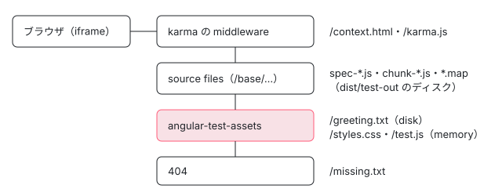

[目次](../README.md) › [Karma の builder の内側：esbuild で束ねたテストを Karma に配るまで](README.md) › 第 3 回 / 全 5 回

# Karma に配る：一時のフォルダ・middleware・reporter・coverage

> application\_builder.ts の execute と configureKarma・utils.ts・assets-middleware.ts・progress-reporter.ts・coverage.ts が、ビルドの出力を一時のフォルダに書いて Karma の files（basePath と 5 つのパターン）と独自の middleware で配り、テストの結果を ReadableStream で architect に返し、watch のときだけ足す reporter でビルドし直した出力を Karma に知らせ、coverage を Istanbul で計る行。stream controller が閉じたあとの守り（5914877e28）と、一時ディレクトリの後片付け（1c2d49ec73）。

angular/angular-cli · 読了 約 13 分 · 発展 · [サイトで読む（デモが動きます）](https://angular-deep-dive-cyan.vercel.app/chapter/kar-serve)

---

この章で分かること: `@angular/build:karma` が、ビルドの出力を Karma のサーバーにどう配るか（`files` の並び・`basePath`・独自の middleware）、ビルドの成否とテストの結果をどの関数がどの順で architect に返すか（`ReadableStream` の controller と、watch のときだけ足す reporter）、coverage を付けたとき何を計るかです。2026 年の 2 つの修正（閉じた controller を守る 5914877e28、一時のフォルダを消す 1c2d49ec73）を、行と記録で確かめます。

読む対象は angular-cli（44129f66a3）の `packages/angular/build/src/builders/karma/` の `application_builder.ts`（`execute` と `configureKarma`）・`utils.ts` の後半・`assets-middleware.ts`・`progress-reporter.ts`・`coverage.ts` と、`src/utils/test-files.ts` です。options の正規化と既定の Karma の設定は[第 1 回](01-kar-entry.md)、テストを entry にした application builder の options と、polyfills を `files` の先頭に差し込む `AngularPolyfillsPlugin` は[第 2 回](02-kar-build.md)にあるので、ここでは繰り返しません。

1. [1. 入口と Karma の設定](01-kar-entry.md)
2. [2. テストを束ねる](02-kar-build.md)
3. **3. Karma に配る**（この章）
4. [4. unit-test の karma runner](04-kar-runner.md)
5. [5. spec と issue](05-kar-tests-issues.md)

> [!TIP]
> **新卒エンジニアへ**
>
> **Karma** は、Node の上で HTTP のサーバーを立て、ブラウザを起動してページを開かせ、そのページの中でテストを走らせるテストランナーです。**files** は「ページに読み込むファイルと、サーバーが配ってよいファイル」の一覧で、`included: true` は `<script>` でページに入れるもの、`included: false` は配るだけのもの（import されたときに取りに来る）です。**middleware** は、HTTP の request を順に受け取って、答えるか次に回すかを決める関数、**reporter** はテストの出来事（始まった・1 本終わった・全部終わった）を受け取るオブジェクトです。Karma の plugin は、名前と「作り方」（`'factory'` なら関数を呼んで作る、`'value'` ならその値を使う）の組で、Karma の DI（依存の注入）が `$inject` に書いた名前の値を渡して作ります。

## 1. execute：ReadableStream で結果を返す

📄 `angular-cli/packages/angular/build/src/builders/karma/application_builder.ts` L44–82 （▶ の行: 44, 61–62, 65, 67–68, 70–71, 77, 80）

```ts
44 ▶ class ApplicationBuildError extends Error {
45 │   constructor(message: string) {
46 │     super(message);
47 │     this.name = 'ApplicationBuildError';
48 │   }
49 │ }
50 │ 
51 │ export function execute(
52 │   options: KarmaBuilderOptions,
53 │   context: BuilderContext,
54 │   transforms?: KarmaBuilderTransformsOptions,
55 │ ): AsyncIterable<BuilderOutput> {
56 │   const normalizedOptions = normalizeOptions(context, options);
57 │   const karmaOptions = getBaseKarmaOptions(normalizedOptions, context);
58 │ 
59 │   let karmaServer: Server;
60 │ 
61 ▶   return new ReadableStream({
62 ▶     async start(controller) {
63 │       let init;
64 │       try {
65 ▶         init = await initializeApplication(normalizedOptions, context, karmaOptions, transforms);
66 │       } catch (err) {
67 ▶         if (err instanceof ApplicationBuildError) {
68 ▶           if (controller.desiredSize !== null) {
69 │             try {
70 ▶               controller.enqueue({ success: false, message: err.message });
71 ▶               controller.close();
72 │             } catch {
73 │               // Stream controller may already be closed or cancelled
74 │             }
75 │           }
76 │ 
77 ▶           return;
78 │         }
79 │ 
80 ▶         throw err;
81 │       }
82 │ 
```

builder の結果（architect の `BuilderOutput`、`{ success, message? }`）は、61 行目の `ReadableStream` から 1 つずつ取り出されます。`ReadableStream` は async iterable なので、`index.ts` の `yield*` がそのまま architect に流します。62 行目の `start(controller)` がストリームの中身を作る関数で、`controller.enqueue(値)` で 1 つ流し、`controller.close()` で終わりにします。

65 行目の `initializeApplication`（[第 2 回](02-kar-build.md)）が最初のビルドまで済ませます。ビルドが `Failure` なら、その中で 44 行目の `ApplicationBuildError` が投げられ、67 行目で受けて、70 行目で `{ success: false, message: 'Build failed' }` を流し、71 行目で閉じ、77 行目で `start` を抜けます。Karma のサーバーは立ちません（記録の「ビルドが壊れている」）。それ以外の例外（たとえば `karma.conf.js` の読み込みの失敗）は 80 行目でそのまま投げ直し、ストリームのエラーになります。

📄 `angular-cli/packages/angular/build/src/builders/karma/application_builder.ts` L83–109 （▶ の行: 83, 87–88, 92–93, 95–96, 103, 105–106）

```ts
 83 ▶       const [karma, karmaConfig, buildOptions, buildIterator] = init;
 84 │ 
 85 │       // If `--watch` is explicitly enabled or if we are keeping the Karma
 86 │       // process running, we should hook Karma into the build.
 87 ▶       if (buildIterator) {
 88 ▶         injectKarmaReporter(buildOptions, buildIterator, karmaConfig, controller);
 89 │       }
 90 │ 
 91 │       // Close the stream once the Karma server returns.
 92 ▶       karmaServer = new karma.Server(karmaConfig as Config, (exitCode) => {
 93 ▶         if (controller.desiredSize !== null) {
 94 │           try {
 95 ▶             controller.enqueue({ success: exitCode === 0 });
 96 ▶             controller.close();
 97 │           } catch {
 98 │             // Stream controller may already be closed or cancelled
 99 │           }
100 │         }
101 │       });
102 │ 
103 ▶       await karmaServer.start();
104 │     },
105 ▶     async cancel() {
106 ▶       await karmaServer?.stop();
107 │     },
108 │   });
109 │ }
```

83 行目の 4 つ目、`buildIterator` はビルドの続き（watch のときの 2 回目からの結果）を取り出す iterator で、`--watch=false` のときは `null` です（次の引用の `first`）。87 行目で、あるときだけ 88 行目で reporter を足します（6 節）。92 行目で Karma の `Server` を作り、2 つ目の引数に「サーバーが終わったときの関数」を渡します。Karma は終わるとき、この関数に終了コードを渡して呼びます（既定では `process.exit` するところを、builder が受け取る）。95 行目で `exitCode === 0` を `success` にして流し、96 行目で閉じます。103 行目の `start()` が HTTP のサーバーを立ててブラウザを起動します。architect が途中でストリームを捨てたとき（watch を止める、spec の harness が 1 つ目で読むのをやめる）は、105 行目の `cancel` が呼ばれ、106 行目で Karma を止めます。

📄 `angular-cli/packages/angular/build/src/builders/karma/utils.ts` L65–91 （▶ の行: 72, 76–78, 83, 86–87）

```ts
65 │ export function hasChunkOrWorkerFiles(files: readonly ResultFile[]): boolean {
66 │   return files.some((file) => {
67 │     return /(?:^|\/)(?:worker|chunk)[^/]+\.js$/.test(file.path);
68 │   });
69 │ }
70 │ 
71 │ /** Returns the first item yielded by the given generator and cancels the execution. */
72 ▶ export async function first<T>(
73 │   generator: AsyncIterable<T>,
74 │   { cancel }: { cancel: boolean },
75 │ ): Promise<[T, AsyncIterator<T> | null]> {
76 ▶   if (!cancel) {
77 ▶     const iterator: AsyncIterator<T> = generator[Symbol.asyncIterator]();
78 ▶     const firstValue = await iterator.next();
79 │     if (firstValue.done) {
80 │       throw new Error('Expected generator to emit at least once.');
81 │     }
82 │ 
83 ▶     return [firstValue.value, iterator];
84 │   }
85 │ 
86 ▶   for await (const value of generator) {
87 ▶     return [value, null];
88 │   }
89 │ 
90 │   throw new Error('Expected generator to emit at least once.');
91 │ }
```

application builder はビルドの結果を 1 つずつ返す async generator です。`first` は 76 行目で `cancel` を見て分かれます。`runEsbuild` は `{ cancel: !buildOptions.watch }` で呼ぶので、watch なら 77〜78 行目で iterator を作って 1 つ目だけ取り、83 行目で iterator ごと返します（続きは reporter が読む）。watch でなければ 86 行目の `for await` で 1 つ目を受け、87 行目の `return` で抜けます。`for await` を途中で抜けると generator の `return()` が呼ばれ、application builder はファイルの監視を始めずに終わります。

### 閉じた controller を守る（5914877e28）

📄 `git show 5914877e28（抜粋）`

```
$ git show 5914877e28 -- …/karma/application_builder.ts   # 2026-07-25（PR #33660、抜粋）
       karmaServer = new karma.Server(karmaConfig as Config, (exitCode) => {
-        controller.enqueue({ success: exitCode === 0 });
-        controller.close();
+        if (controller.desiredSize !== null) {
+          try {
+            controller.enqueue({ success: exitCode === 0 });
+            controller.close();
+          } catch {
+            // Stream controller may already be closed or cancelled
+          }
+        }
       });
（同じ形を 69〜74 行目のビルドの失敗と、progress-reporter.ts の 67〜73・96〜102 行目にも入れ、
 tests/behavior/errors_spec.ts に 'handles stream cancellation gracefully in watch mode' を足した）
```

WHATWG の Streams の仕様では、閉じた（または cancel された）controller の `desiredSize` は `null` になり、そこに `enqueue` や `close` を呼ぶと `TypeError [ERR_INVALID_STATE]` が投げられます。93 行目の `desiredSize !== null` と try / catch は、すでに閉じたあとで Karma が終わったときに、この例外で Node のプロセスが落ちないようにするものです。記録でも、2 回呼ばれる場合が出ました。[次の章](04-kar-runner.md)の「@angular/build:karma に polyfills: \['zone.js'\]」の記録では、`afterAll` のエラーのあと Karma が `run_complete` を 2 回出し、終わりの関数も 2 回（どちらも 1）呼ばれました。builder の出力は 1 つ（`{ success: false }`）だけで、2 回目は 93 行目で捨てられています。

## 2. files を組む：basePath と 5 つのパターン

`configureKarma` は、ビルドの出力（`buildOutput.files`）が一時のフォルダ `dist/test-out/<uuid>` に書き出された後に呼ばれます（[第 2 回](02-kar-build.md)の `runEsbuild`）。

📄 `angular-cli/packages/angular/build/src/builders/karma/application_builder.ts` L276–297 （▶ の行: 276, 281–282, 285, 288–289, 296）

```ts
276 ▶   const outputPath = buildOptions.outputPath;
277 │ 
278 │   // We need to add this to the beginning *after* the testing framework has
279 │   // prepended its files. The output path is required for each since they are
280 │   // added later in the test process via a plugin.
281 ▶   const polyfillsFile: FilePattern = {
282 ▶     pattern: `${outputPath}/polyfills.js`,
283 │     included: true,
284 │     served: true,
285 ▶     type: 'module',
286 │     watched: false,
287 │   };
288 ▶   const jasmineCleanupFiles: FilePattern = {
289 ▶     pattern: `${outputPath}/jasmine-cleanup-*.js`,
290 │     included: true,
291 │     served: true,
292 │     type: 'module',
293 │     watched: false,
294 │   };
295 │ 
296 ▶   karmaOptions.basePath = outputPath;
297 │ 
```

281〜294 行目の 2 つは、ここでは作るだけで `files` には入れません。Jasmine などの framework が `files` の先頭に自分のファイルを足した後で、`AngularPolyfillsPlugin`（[第 2 回](02-kar-build.md)）が polyfills を先頭へ、jasmine の後片付けを `test_main.js` の前へ差し込むためです（278〜280 行目のコメント）。296 行目で Karma の `basePath` を一時のフォルダにします。`files` の相対のパターンは `basePath` から解決され、Karma はそこにあるファイルを `/base/…` の URL で配ります。

📄 `angular-cli/packages/angular/build/src/builders/karma/application_builder.ts` L298–318 （▶ の行: 302–303, 305, 307, 314–315）

```ts
298 │   const scriptsFiles: FilePattern[] = [];
299 │   if (options.scripts?.length) {
300 │     const outputScripts = new Set<string>();
301 │     for (const scriptEntry of options.scripts) {
302 ▶       const outputName =
303 ▶         typeof scriptEntry === 'string'
304 │           ? 'scripts.js'
305 ▶           : `${scriptEntry.bundleName ?? 'scripts'}.js`;
306 │ 
307 ▶       if (outputScripts.has(outputName)) {
308 │         continue;
309 │       }
310 │       outputScripts.add(outputName);
311 │       scriptsFiles.push({
312 │         pattern: `${outputPath}/${outputName}`,
313 │         watched: false,
314 ▶         included: typeof scriptEntry === 'string' ? true : scriptEntry.inject !== false,
315 ▶         type: 'js',
316 │       });
317 │     }
318 │   }
```

`scripts` の option（グローバルな `<script>`）は、bundle の名前ごとに 1 つのファイルになるので、302〜305 行目で出力の名前を作り、307 行目で同じ名前を 1 度だけにします。314 行目、`inject: false` のものは `included: false`（配るだけ）、315 行目で `type: 'js'`（module でない普通の script）です。これらは `AngularPolyfillsPlugin` が最後に `files` の先頭に入れます。

📄 `angular-cli/packages/angular/build/src/builders/karma/application_builder.ts` L320–345 （▶ の行: 320, 323, 325, 327, 330, 334, 336, 342, 344）

```ts
320 ▶   karmaOptions.files ??= [];
321 │   karmaOptions.files.push(
322 │     // Serve global setup script.
323 ▶     { pattern: `${mainName}.js`, type: 'module', watched: false },
324 │     // Serve all source maps.
325 ▶     { pattern: `*.map`, included: false, watched: false },
326 │     // These are the test entrypoints.
327 ▶     { pattern: `spec-*.js`, type: 'module', watched: false },
328 │   );
329 │ 
330 ▶   if (hasChunkOrWorkerFiles(buildOutput.files)) {
331 │     karmaOptions.files.push(
332 │       // Allow loading of chunk-* files but don't include them all on load.
333 │       {
334 ▶         pattern: `{chunk,worker}-*.js`,
335 │         type: 'module',
336 ▶         included: false,
337 │         watched: false,
338 │       },
339 │     );
340 │   }
341 │ 
342 ▶   if (options.styles?.length) {
343 │     // Serve CSS outputs on page load, these are the global styles.
344 ▶     karmaOptions.files.push({ pattern: `*.css`, type: 'css', watched: false });
345 │   }
```

320 行目、利用者の `karma.conf.js` の `files` の後ろに足します。323 行目の `test_main.js`（TestBed の初期化）、325 行目の source map（配るだけ）、327 行目のテストの入口 `spec-*.js` は、どれも `type: 'module'` で `watched: false` です（ファイルの監視は application builder がするので、Karma には見させない）。330 行目、出力に `chunk-` か `worker-` で始まる `.js` があれば、334 行目のパターンを `included: false` で足します（1 つ前の引用の 67 行目の正規表現）。共有のチャンクは spec が `import` したときに `/base/chunk-….js` を取りに来るので、ページには入れず、配れるようにだけしておきます。342〜344 行目、`styles` があれば `*.css` をページに入れます。

下の記録の表のとおり、Karma の `Server` に渡った `files` は 5 つのパターンで、ブラウザに読み込まれた順（`file_list_modified` の `included`）は 15 個でした。先頭の source-map-support・polyfills・Jasmine の 4 つ・jasmine の後片付け・`test_main.js` の並びが `AngularPolyfillsPlugin` の仕事、`spec-*.js` と `styles.css` がここで足したものです。記録のアプリでは spec が 4 本あり、その間で共有する `@angular/core` などが `chunk-GTBCZ54J.js`（2.30 MB）に入るので、330 行目は真になりました。

## 3. 利用者の設定と合わせる：parseConfig のあと

📄 `angular-cli/packages/angular/build/src/builders/karma/application_builder.ts` L347–362 （▶ の行: 347–350, 355, 357–358）

```ts
347 ▶   const parsedKarmaConfig: Config & ConfigOptions = await karma.config.parseConfig(
348 ▶     options.karmaConfig,
349 ▶     transforms?.karmaOptions ? await transforms.karmaOptions(karmaOptions) : karmaOptions,
350 ▶     { promiseConfig: true, throwErrors: true },
351 │   );
352 │ 
353 │   // Check for jsdom which does not support executing ESM scripts.
354 │   // If present, remove jsdom and issue a warning.
355 ▶   const updatedBrowsers = parsedKarmaConfig.browsers?.filter((browser) => browser !== 'jsdom');
356 │   if (parsedKarmaConfig.browsers?.length !== updatedBrowsers?.length) {
357 ▶     parsedKarmaConfig.browsers = updatedBrowsers;
358 ▶     context.logger.warn(
359 │       `'jsdom' does not support ESM code execution and cannot be used for karma testing.` +
360 │         ` The 'jsdom' entry has been removed from the 'browsers' option.`,
361 │     );
362 │   }
```

347 行目の `karma.config.parseConfig` は Karma 自身の関数で、348 行目の `karma.conf.js`（無ければ `undefined`）を読み、349 行目の builder の値を上から重ねます。unit-test の runner から来たときは、ここで `transforms.karmaOptions` が値を書き換えます（[次の章](04-kar-runner.md)）。350 行目の `promiseConfig: true` は Promise で返す形、`throwErrors: true` は設定の誤りで `process.exit` せずに例外を投げる形です。355 行目、`browsers` から `jsdom` を除き、358 行目で警告します。出力は ES module なので、ES module を実行できない jsdom の launcher では走らないからです。

📄 `angular-cli/packages/angular/build/src/builders/karma/application_builder.ts` L364–397 （▶ の行: 369, 372, 375, 379, 383–384, 389, 391, 393–394, 397）

```ts
364 │   // Remove the webpack plugin/framework:
365 │   // Alternative would be to make the Karma plugin "smart" but that's a tall order
366 │   // with managing unneeded imports etc..
367 │   parsedKarmaConfig.plugins ??= [];
368 │   const pluginLengthBefore = parsedKarmaConfig.plugins.length;
369 ▶   parsedKarmaConfig.plugins = parsedKarmaConfig.plugins.filter(
370 │     (plugin: string | InlinePluginDef) => {
371 │       if (typeof plugin === 'string') {
372 ▶         return plugin !== 'framework:@angular-devkit/build-angular';
373 │       }
374 │ 
375 ▶       return !plugin['framework:@angular-devkit/build-angular'];
376 │     },
377 │   );
378 │   parsedKarmaConfig.frameworks ??= [];
379 ▶   parsedKarmaConfig.frameworks = parsedKarmaConfig.frameworks.filter(
380 │     (framework: string) => framework !== '@angular-devkit/build-angular',
381 │   );
382 │   const pluginLengthAfter = parsedKarmaConfig.plugins.length;
383 ▶   if (pluginLengthBefore !== pluginLengthAfter) {
384 ▶     context.logger.warn(
385 │       `Ignoring framework "@angular-devkit/build-angular" from karma config file because it's not compatible with the application builder.`,
386 │     );
387 │   }
388 │ 
389 ▶   parsedKarmaConfig.plugins.push(AngularAssetsMiddleware.createPlugin(buildOutput.files));
390 │   parsedKarmaConfig.middleware ??= [];
391 ▶   parsedKarmaConfig.middleware.push(AngularAssetsMiddleware.NAME);
392 │ 
393 ▶   parsedKarmaConfig.plugins.push(
394 ▶     AngularPolyfillsPlugin.createPlugin(polyfillsFile, jasmineCleanupFiles, scriptsFiles),
395 │   );
396 │   parsedKarmaConfig.reporters ??= [];
397 ▶   parsedKarmaConfig.reporters.push(AngularPolyfillsPlugin.NAME);
```

369〜381 行目は webpack 版の builder（`@angular-devkit/build-angular:karma`）から移ってきた `karma.conf.js` のための後始末で、webpack の Karma の plugin と framework を外し、383 行目で 1 度だけ警告します。389 行目で middleware の plugin（5 節）を、最初のビルドの出力の一覧から作って足し、391 行目で `middleware` に名前を足します。393〜397 行目で `AngularPolyfillsPlugin` を足し、`reporters` に名前を足します（reporter として作られるのは、framework より後に作られるため。[第 2 回](02-kar-build.md)）。

📄 `angular-cli/packages/angular/build/src/builders/karma/application_builder.ts` L399–426 （▶ の行: 403, 409–410, 413, 415, 422–423）

```ts
399 │   // Adjust karma junit reporter outDir location to maintain previous (devkit) behavior
400 │   // The base path for the reporter was previously the workspace root.
401 │   // To keep the files in the same location, the reporter's output directory is adjusted
402 │   // to be relative to the workspace root when using junit.
403 ▶   if (parsedKarmaConfig.reporters?.some((reporter) => reporter === 'junit')) {
404 │     if ('junitReporter' in parsedKarmaConfig) {
405 │       // eslint-disable-next-line @typescript-eslint/no-explicit-any
406 │       const junitReporterOptions = (parsedKarmaConfig as any)['junitReporter'] as {
407 │         outputDir?: unknown;
408 │       };
409 ▶       if (junitReporterOptions.outputDir == undefined) {
410 ▶         junitReporterOptions.outputDir = context.workspaceRoot;
411 │       } else if (
412 │         typeof junitReporterOptions.outputDir === 'string' &&
413 ▶         !path.isAbsolute(junitReporterOptions.outputDir)
414 │       ) {
415 ▶         junitReporterOptions.outputDir = path.join(
416 │           context.workspaceRoot,
417 │           junitReporterOptions.outputDir,
418 │         );
419 │       }
420 │     } else {
421 │       // eslint-disable-next-line @typescript-eslint/no-explicit-any
422 ▶       (parsedKarmaConfig as any)['junitReporter'] = {
423 ▶         outputDir: context.workspaceRoot,
424 │       };
425 │     }
426 │   }
```

296 行目で `basePath` を一時のフォルダにしたので、karma-junit-reporter の `outputDir` の相対のパスは、そのままだと一時のフォルダの中（終わると消える）になります。403 行目で `junit` の reporter があれば、409〜410 行目で `outputDir` が無いときに workspace の root を、413〜415 行目で相対のときに workspace の root からのパスを入れ、422 行目で設定ごと無いときも root にします（webpack 版の builder と同じ場所に出す）。

📄 `angular-cli/packages/angular/build/src/builders/karma/application_builder.ts` L428–438 （▶ の行: 431–432, 434）

```ts
428 │   // When using code-coverage, auto-add karma-coverage.
429 │   // This was done as part of the karma plugin for webpack.
430 │   if (
431 ▶     options.codeCoverage &&
432 ▶     !parsedKarmaConfig.reporters?.some((r: string) => r === 'coverage' || r === 'coverage-istanbul')
433 │   ) {
434 ▶     parsedKarmaConfig.reporters = (parsedKarmaConfig.reporters ?? []).concat(['coverage']);
435 │   }
436 │ 
437 │   return parsedKarmaConfig;
438 │ }
```

coverage を有効にして、`reporters` に `coverage` も `coverage-istanbul` も無ければ、434 行目で `coverage`（karma-coverage）を足します。記録の `--code-coverage` では、`reporters` が `[progress, kjhtml, angular-polyfills, coverage]` になりました。

## 4. ディスクに書く：writeTestFiles と一時のフォルダ

📄 `angular-cli/packages/angular/build/src/utils/test-files.ts` L23–47 （▶ の行: 27, 31, 36, 40, 42, 45）

```ts
23 │ export async function writeTestFiles(files: readonly ResultFile[], testDir: string): Promise<void> {
24 │   const directoryExists = new Set<string>();
25 │   // Writes the test related output files to disk and ensures the containing directories are present
26 │   await emitFilesToDisk(files, async (file) => {
27 ▶     if (file.type !== BuildOutputFileType.Browser && file.type !== BuildOutputFileType.Media) {
28 │       return;
29 │     }
30 │ 
31 ▶     const fullFilePath = path.join(testDir, file.path);
32 │ 
33 │     // Ensure output subdirectories exist
34 │     const fileBasePath = path.dirname(fullFilePath);
35 │     if (fileBasePath && !directoryExists.has(fileBasePath)) {
36 ▶       await fs.mkdir(fileBasePath, { recursive: true });
37 │       directoryExists.add(fileBasePath);
38 │     }
39 │ 
40 ▶     if (file.origin === 'memory') {
41 │       // Write file contents
42 ▶       await fs.writeFile(fullFilePath, file.contents);
43 │     } else {
44 │       // Copy file contents
45 ▶       await fs.copyFile(file.inputPath, fullFilePath, fs.constants.COPYFILE_FICLONE);
46 │     }
47 │   });
```

application builder の出力は、ふつうはメモリの上にあります（`origin: 'memory'`）。Karma の `files` はディスクのファイルを glob で探すので、27 行目でブラウザ向けとメディアのファイルだけを選び、40〜42 行目でメモリのものは書き出し、45 行目でディスクのもの（assets）はコピーします。記録では、最初のビルドの 23 個（js と map と css と assets の `greeting.txt`）が全部書き出されました。

📄 `git show 1c2d49ec73（抜粋。行は第 2 回の initializeApplication の中）`

```
$ git show 1c2d49ec73   # 2025-10-06（PR #31401、#30713）
   const outputPath = path.join(context.workspaceRoot, 'dist/test-out', randomUUID());
   await fs.rm(outputPath, { recursive: true, force: true });
+  // Setup exit cleanup for temporary directory
+  const handleProcessExit = () => rmSync(outputPath, { recursive: true, force: true });
+  process.once('exit', handleProcessExit);
+  process.once('SIGINT', handleProcessExit);
+  process.once('uncaughtException', handleProcessExit);
```

一時のフォルダは `randomUUID()` の名前で、走らせるたびに増えていました（#30713）。1c2d49ec73 は、Node のプロセスの `exit`・`SIGINT`・`uncaughtException` で `rmSync` するようにしました。記録では、どの場合も終わったあとの `dist/test-out` は空でした。ビルドが壊れている場合は、書き出す前に止まるので `dist/test-out` 自体ができていません。

## 5. AngularAssetsMiddleware：/base の外の request に答える



*ブラウザからの request は Karma の middleware を順に通る。/base/… は files から Karma が、それ以外で出力の Map にあるものは builder の middleware が答え、どちらでもなければ 404*

📄 `karma 6.4.4 の lib/web-server.js（抜粋）`

```
// karma 6.4.4 の lib/web-server.js（抜粋）。上から順に request を渡す
  handler.use(injector.invoke(runnerMiddleware.create))
  handler.use(injector.invoke(stopperMiddleware.create))
  handler.use(injector.invoke(karmaMiddleware.create))       // /, /context.html, /karma.js …
  handler.use(injector.invoke(sourceFilesMiddleware.create)) // /base/… と /absolute/…（files の served）
  handler.use(proxyMiddlewareInstance)
  handler.use(injector.invoke(createCustomHandler))
  if (config.middleware) {
    config.middleware.forEach((middleware) => handler.use(injector.get('middleware:' + middleware)))
  }
  handler.use((request, response) => common.serve404(response, request.url))
```

Karma は、自分の middleware（ページ、`/base/…` の source files、proxy）の**後ろ**に、設定の `middleware` を並べます。`files` にあるものは `/base/…` で Karma が答えるので、builder の middleware に届くのは、それ以外の URL、たとえば assets を `fetch('/greeting.txt')` で取りに来たものや、`inject: false` の script を `/test.js` で読み込むものです。

📄 `angular-cli/packages/angular/build/src/builders/karma/assets-middleware.ts` L27–57 （▶ の行: 31, 34, 36, 44, 47–49, 52–54）

```ts
27 │ export interface LatestBuildFiles {
28 │   files: Map<string, ResultFile>;
29 │ }
30 │ 
31 ▶ const LATEST_BUILD_FILES_TOKEN = 'angularLatestBuildFiles';
32 │ 
33 │ export class AngularAssetsMiddleware {
34 ▶   static readonly $inject = ['serveFile', LATEST_BUILD_FILES_TOKEN];
35 │ 
36 ▶   static readonly NAME = 'angular-test-assets';
37 │ 
38 │   constructor(
39 │     private readonly serveFile: ServeFileFunction,
40 │     private readonly latestBuildFiles: LatestBuildFiles,
41 │   ) {}
42 │ 
43 │   handle(req: IncomingMessage, res: ServerResponse, next: (err?: unknown) => unknown): void {
44 ▶     const url = new URL(`http://${req.headers['host'] ?? ''}${req.url ?? ''}`);
45 │     // Remove the leading slash from the URL path and convert to platform specific.
46 │     // The latest build files will use the platform path separator.
47 ▶     let pathname = url.pathname.slice(1);
48 ▶     if (isWindows) {
49 ▶       pathname = pathname.replaceAll(path.posix.sep, path.win32.sep);
50 │     }
51 │ 
52 ▶     const file = this.latestBuildFiles.files.get(pathname);
53 ▶     if (!file) {
54 ▶       next();
55 │ 
56 │       return;
57 │     }
```

34 行目の `$inject` で、Karma の DI から `serveFile`（Karma の内部の「ファイルを返す関数」）と、31 行目の名前で登録した「最新のビルドの出力」を受け取ります。44 行目で URL を作り、47 行目で先頭の `/` を外した path を、52 行目で出力の Map から引きます。無ければ 53〜54 行目で `next()` を呼び、次の middleware（最後は Karma の 404）に回します。48〜50 行目は Windows の区切り文字への置き換えです。

📄 `angular-cli/packages/angular/build/src/builders/karma/assets-middleware.ts` L59–95 （▶ の行: 61–63, 65, 68, 72–73, 79, 81, 83, 86, 89, 91）

```ts
59 │     // Implementation of serverFile can be found here:
60 │     // https://github.com/karma-runner/karma/blob/84f85e7016efc2266fa6b3465f494a3fa151c85c/lib/middleware/common.js#L10
61 ▶     switch (file.origin) {
62 ▶       case 'disk':
63 ▶         this.serveFile(file.inputPath, undefined, res, undefined, undefined, /* doNotCache */ true);
64 │         break;
65 ▶       case 'memory':
66 │         // Include pathname to help with Content-Type headers.
67 │         this.serveFile(
68 ▶           `/unused/${url.pathname}`,
69 │           undefined,
70 │           res,
71 │           undefined,
72 ▶           file.contents,
73 ▶           /* doNotCache */ false,
74 │         );
75 │         break;
76 │     }
77 │   }
78 │ 
79 ▶   static createPlugin(initialFiles: readonly ResultFile[]): InlinePluginDef {
80 │     return {
81 ▶       [LATEST_BUILD_FILES_TOKEN]: [
82 │         'value',
83 ▶         { files: new Map(initialFiles.map((file) => [file.path, file])) },
84 │       ],
85 │ 
86 ▶       [`middleware:${AngularAssetsMiddleware.NAME}`]: [
87 │         'factory',
88 │         Object.assign((...args: ConstructorParameters<typeof AngularAssetsMiddleware>) => {
89 ▶           const inst = new AngularAssetsMiddleware(...args);
90 │ 
91 ▶           return inst.handle.bind(inst);
92 │         }, AngularAssetsMiddleware),
93 │       ],
94 │     };
95 │   }
```

📄 `karma 6.4.4 の lib/middleware/common.js（抜粋）`

```
// karma 6.4.4 の lib/middleware/common.js の createServeFile が返す関数（抜粋）
  return function (filepath, rangeHeader, response, transform, content, doNotCache) {
    …
    if (content && !doNotCache) {
      response.setHeader('Content-Type', mime.getType(filepath, 'text/plain'))
      responseData = (transform && transform(content)) || content
      response.writeHead(rangeHeader ? convertForRangeRequest() : 200)
      return response.end(responseData)
    }
    return fs.readFile(filepath, function (error, data) {
      if (error) { return serve404(response, filepath) }
      if (!doNotCache) { cache[filepath] = data.toString() }
      response.setHeader('Content-Type', mime.getType(filepath, 'text/plain'))
      …
```

61 行目で出力の `origin` で分けます。ディスクのもの（assets）は 63 行目で元のファイルのパスを渡し、最後の引数 `doNotCache` を `true` にします。Karma の `serveFile` は、`content` が無ければ `fs.readFile` で読み、`doNotCache` が `false` なら中身を自分の cache に残すので、`true` で毎回読ませます（HTTP の cache の header ではなく、Karma の中の cache です）。メモリのものは 72 行目で中身を直に渡します。`content` があれば `serveFile` は読みに行かず、68 行目のパスは `mime.getType` で Content-Type を決めるためだけに使われます（66 行目のコメント）。79〜94 行目の `createPlugin` は、83 行目で最初の出力の一覧を Map にした `'value'` と、86〜93 行目の `'factory'` の 2 つを登録します。89 行目でインスタンスを作り、91 行目で `handle` を `this` に結んだ関数を middleware として返します。この Map は 6 節の reporter が watch のたびに入れ替えます。

記録では、`/greeting.txt` は Map にあり（disk）200 で `text/plain`、`/styles.css` は Map にあり（memory）200 で `text/css`、`/missing.txt` は Map に無く `next()` から Karma の 404 でした。Karma の `files` にあるチャンクは `/base/chunk-….js` で取りに来るので、この middleware には 1 度も来ていません。

## 6. watch のときだけの reporter：progress-reporter.ts

📄 `angular-cli/packages/angular/build/src/builders/karma/progress-reporter.ts` L25–52 （▶ の行: 31, 42, 44, 50）

```ts
25 │ export function injectKarmaReporter(
26 │   buildOptions: BuildOptions,
27 │   buildIterator: AsyncIterator<Result>,
28 │   karmaConfig: Config & ConfigOptions,
29 │   controller: ReadableStreamController<BuilderOutput>,
30 │ ): void {
31 ▶   const reporterName = 'angular-progress-notifier';
32 │ 
33 │   interface RunCompleteInfo {
34 │     exitCode: number;
35 │   }
36 │ 
37 │   interface KarmaEmitter {
38 │     refreshFiles(): void;
39 │   }
40 │ 
41 │   class ProgressNotifierReporter {
42 ▶     static $inject = ['emitter', LATEST_BUILD_FILES_TOKEN];
43 │     // Needed for the karma reporter interface, see https://github.com/angular/angular-cli/issues/31629
44 ▶     adapters = [];
45 │ 
46 │     constructor(
47 │       private readonly emitter: KarmaEmitter,
48 │       private readonly latestBuildFiles: LatestBuildFiles,
49 │     ) {
50 ▶       this.startWatchingBuild();
51 │     }
52 │ 
```

`injectKarmaReporter` は、1 節の 88 行目から watch のときだけ呼ばれます。42 行目の `$inject` で Karma の `emitter`（`Server` 自身）と、5 節の middleware と同じ「最新のビルドの出力」を受け取ります。44 行目の `adapters = []` は、Karma の `MultiReporter` が全部の reporter の `adapters` に push するための空の配列です（無いと `karma run` で落ちた、#31629）。50 行目、作られた時点でビルドの続きを読み始めます。

📄 `angular-cli/packages/angular/build/src/builders/karma/progress-reporter.ts` L53–92 （▶ の行: 57, 62, 66, 69, 74–76, 79, 81, 85–86, 88–89）

```ts
53 │     private startWatchingBuild() {
54 │       void (async () => {
55 │         // This is effectively "for await of but skip what's already consumed".
56 │         while (true) {
57 ▶           const { done, value: buildOutput } = await buildIterator.next();
58 │           if (done) {
59 │             break;
60 │           }
61 │ 
62 ▶           if (controller.desiredSize === null) {
63 │             break;
64 │           }
65 │ 
66 ▶           if (buildOutput.kind === ResultKind.Failure) {
67 │             if (controller.desiredSize !== null) {
68 │               try {
69 ▶                 controller.enqueue({ success: false, message: 'Build failed' });
70 │               } catch {
71 │                 // Stream controller may already be closed or cancelled
72 │               }
73 │             }
74 ▶           } else if (
75 ▶             buildOutput.kind === ResultKind.Incremental ||
76 ▶             buildOutput.kind === ResultKind.Full
77 │           ) {
78 │             if (buildOutput.kind === ResultKind.Full) {
79 ▶               this.latestBuildFiles.files.clear();
80 │             } else {
81 ▶               for (const { path } of buildOutput.removed) {
82 │                 this.latestBuildFiles.files.delete(path);
83 │               }
84 │             }
85 ▶             for (const file of buildOutput.files) {
86 ▶               this.latestBuildFiles.files.set(file.path, file);
87 │             }
88 ▶             await writeTestFiles(buildOutput.files, buildOptions.outputPath);
89 ▶             this.emitter.refreshFiles();
90 │           }
91 │         }
92 │       })();
```

1. **次の結果を待つ**

   57 行目の `buildIterator.next()` は、ファイルが変わって application builder がビルドし直すまで返りません。
2. **閉じていれば抜ける**

   62 行目、ストリームがもう閉じていれば（Karma が終わった後）読むのをやめます。
3. **失敗なら知らせるだけ**

   66〜69 行目、`Failure` なら `{ success: false, message: 'Build failed' }` を流します。Karma の `files` も Map もそのままなので、ブラウザは前のビルドのままです。
4. **Map を入れ替える**

   78〜79 行目で `Full` なら Map を空にし、81〜83 行目で `Incremental` なら消えたファイルだけ消し、85〜86 行目で新しいファイルを入れます。
5. **ディスクに書いて Karma に知らせる**

   88 行目で一時のフォルダに書き、89 行目の `refreshFiles()` で Karma にファイルの一覧を作り直させます。Karma は `autoWatch` のとき、一覧が変わると走り直します。

記録の watch では、書き換えるたびに来た結果は 3 回とも `Full`（23 個）でした。karma の builder は application builder に `incrementalResults` を渡さないので、application builder は差分ではなく全部を返します（その分かれ目は[キャッシュと watch の章](../cli/10-cli-cache-watch.md)の `build-action.ts`）。81〜83 行目の `Incremental` の道は、この記録では通りませんでした。

📄 `angular-cli/packages/angular/build/src/builders/karma/progress-reporter.ts` L95–119 （▶ の行: 95–96, 98, 106–107, 110–111）

```ts
 95 ▶     onRunComplete = function (_browsers: unknown, results: RunCompleteInfo): void {
 96 ▶       if (controller.desiredSize !== null) {
 97 │         try {
 98 ▶           controller.enqueue({ success: results.exitCode === 0 });
 99 │         } catch {
100 │           // Stream controller may already be closed or cancelled
101 │         }
102 │       }
103 │     };
104 │   }
105 │ 
106 ▶   karmaConfig.reporters ??= [];
107 ▶   karmaConfig.reporters.push(reporterName);
108 │ 
109 │   karmaConfig.plugins ??= [];
110 ▶   karmaConfig.plugins.push({
111 ▶     [`reporter:${reporterName}`]: [
112 │       'factory',
113 │       Object.assign(
114 │         (...args: ConstructorParameters<typeof ProgressNotifierReporter>) =>
115 │           new ProgressNotifierReporter(...args),
116 │         ProgressNotifierReporter,
117 │       ),
118 │     ],
119 │   });
```

95 行目の `onRunComplete` は Karma の reporter の約束の 1 つで、テストを全部走らせ終わるたびに呼ばれます。98 行目で `exitCode === 0` を流します。watch では Karma のサーバーは終わらないので、1 回ごとの結果はここから出ます（記録の watch の `BuilderOutput {"success":false}` が 3 回）。106〜107 行目で `reporters` に名前を足し、110〜118 行目で plugin を登録します。記録の watch の `Server` の `reporters` の最後に `angular-progress-notifier` があり、`singleRun: false`・`autoWatch: true` でした。

## 7. coverage：何を計るか

📄 `angular-cli/packages/angular/build/src/builders/karma/coverage.ts` L12–34 （▶ の行: 13, 15–17, 28–30）

```ts
12 │ export function createInstrumentationFilter(includedBasePath: string, excludedPaths: Set<string>) {
13 ▶   return (request: string): boolean => {
14 │     return (
15 ▶       !excludedPaths.has(request) &&
16 ▶       !/\.(e2e|spec)\.tsx?$|[\\/]node_modules[\\/]|[\\/]\.angular[\\/]/.test(request) &&
17 ▶       request.startsWith(includedBasePath)
18 │     );
19 │   };
20 │ }
21 │ 
22 │ export function getInstrumentationExcludedPaths(
23 │   root: string,
24 │   excludedPaths: string[],
25 │ ): Set<string> {
26 │   const excluded = new Set<string>();
27 │ 
28 ▶   for (const excludeGlob of excludedPaths) {
29 ▶     const excludePath = excludeGlob[0] === '/' ? excludeGlob.slice(1) : excludeGlob;
30 ▶     globSync(excludePath, { cwd: root }).forEach((p) => excluded.add(path.join(root, p)));
31 │   }
32 │ 
33 │   return excluded;
34 │ }
```

coverage を有効にすると、application builder の options の `instrumentForCoverage` に 13 行目の関数が入り（[第 2 回](02-kar-build.md)）、application builder はファイルを 1 つ変換するたびにこの関数を呼んで、true なら Istanbul の計測のコード（`istanbul-lib-instrument`）を入れます。15 行目で `codeCoverageExclude` の glob から作った集合にあるものを除き、16 行目で `.spec.ts`・`.e2e.ts`・`node_modules`・`.angular` を除き、17 行目で project の sourceRoot の下だけにします。29 行目、glob の先頭の `/` は外してから、30 行目で workspace の root から探します。

計測のコードは、テストを走らせたブラウザの `window.__coverage__` に数を貯め、karma-coverage の reporter がそれを受け取って `coverageReporter` の設定どおりに書きます。記録では、7 つの request のうち spec の 4 つは false、`greet.ts`・`app.ts`・`lazy.ts` は true で、`coverage/demo/` に html の report と、端末に text-summary が出ました。`main.ts` はテストから import されないので、変換も計測もされません（読み込まれたファイルだけが入る。#1735 はこれを全部のファイルにしたいという要望です）。

## 8. 記録：ng test の出来事を起きた順に

> **🧪 DEMO — @angular/build:karma の 1 回（記録の再生）**
>
> `<scratchpad>/kar-demo/b/record.mjs` が、@angular/build 22.2.7・karma 6.4.4・karma-jasmine 5.1.0・karma-coverage 2.2.1 の `ng test` を Node v24.22.1 で起動した記録です（ブラウザは Chrome Headless 155.0.8043.0 (Mac OS 10.15.7)）。`hook.cjs` が `@angular/build` の `execute`・`buildApplicationInternal`・`writeTestFiles`・`AngularAssetsMiddleware`・`injectKarmaReporter` と、karma の `Server` を包み、出来事を 1 行ずつ書きました。ms は最初の記録からの時間です。記録の版は 22.2.7 で、引用の 44129f66a3 との違いは `poll` と `progress` を application builder に渡す 1 か所（[次の章](04-kar-runner.md)の 0edb6c646f）だけです。`<out>` は `dist/test-out/<uuid>`、`node_modules/` は symlink の先を短くしたものです。
>
> `ng test --watch=false` — @angular/build:karma を 1 回だけ。終了コード 1
>
> plugins: framework:jasmine + reporter:karma-jasmine / launcher:Chrome + launcher:ChromeHeadless + launcher:ChromeCanary + launcher:ChromeCanaryHeadless + launcher:Chromium + launcher:ChromiumHeadless + launcher:Dartium + test / reporter:kjhtml / preprocessor:coverage + reporter:coverage / launcher:ChromeHeadlessNoSandbox / angularLatestBuildFiles + middleware:angular-test-assets / reporter:angular-polyfills。reporters: progress, kjhtml, angular-polyfills。middleware: angular-test-assets。singleRun: true、autoWatch: false。
>
> reporters: progress, kjhtml, angular-polyfills, coverage。端末: Statements : 100% ( 6/6 ) ／ Branches : 100% ( 0/0 ) ／ Functions : 100% ( 2/2 ) ／ Lines : 100% ( 5/5 )。書かれたファイル: 11 個（demo/app.ts.html など）。
>
> ▶ [このデモはサイトで動かせます](https://angular-deep-dive-cyan.vercel.app/chapter/kar-serve)

記録から読めることを並べます。

- **--watch=false**: ビルド → `writeTestFiles` → middleware の plugin → `new karma.Server` → ブラウザ → spec → `run_complete` → 終わりの関数（`exitCode=1`）→ `{ success: false }` の 1 つで終わりました。`injectKarmaReporter` は呼ばれていません。
- **ビルドが壊れている**: `Failure` → `{ success: false, message: 'Build failed' }` で終わり、Karma は作られていません（1 節の 67〜77 行目）。
- **--code-coverage**: `coverage` の reporter が足され、spec でない 3 つのファイルだけが計測されました。テストが 1 本落ちているので、終了コードは 1 です。
- **watch**: 書き換え → `Full` → `writeTestFiles` → `refreshFiles()` → 走り直し、型の誤り → `Failure` → `'Build failed'` だけ（走り直さない）、元に戻す → また走り直し、の順でした。

> [!WARNING]
> **ハマりどころ**
>
> watch の記録では、1 回目の SIGINT で Karma は止まり（ブラウザが切れ、終わりの関数が `exitCode=0` で呼ばれ、`{ success: true }` が流れて builder の出力が終わる）、一時のフォルダも消えましたが、`ng` のプロセスは 10 秒たっても終わりませんでした。2 回目の SIGINT で終わりました。疑似端末の上で Ctrl+C を書き込んだ場合（`sigint-pty.py`）も同じで、1 回目では 15 秒たっても終わらず、2 回目ですぐ終わりました。コードの上では、1 節の 105〜107 行目の `cancel` は Karma を止めるだけで、reporter が持つ `buildIterator` の `return()` を呼ぶ行は builders/karma のどこにもありません。

> **🧪 DEMO — 出力の名前をふるい分ける 2 つの正規表現**
>
> `utils.ts` の 67 行目（チャンクか worker か）と、`coverage.ts` の 16 行目（計測から外すか）の正規表現を写したものです。ページの上だけで判定します。
>
> 試す例: `chunk-5OLDK6QL.js`、`media/chunk-a.js`、`worker-x.js.map`、`/w/src/app/app.spec.ts`、`/w/node_modules/x/index.js`
>
> ▶ [このデモはサイトで動かせます](https://angular-deep-dive-cyan.vercel.app/chapter/kar-serve)

## テストと直し方

この章の行を固めている spec は `builders/karma/tests/` の次のものです（44129f66a3 で `grep -n` したもの。地図の全体は[第 5 回](05-kar-tests-issues.md)）。

| spec | describe / it（行） | 固めていること |
| --- | --- | --- |
| `behavior/errors_spec.ts` | `Behavior: "Errors"`（13）の it（18・32） | 型の誤りで `success: false`（1 節の 67〜71 行目）、watch で harness が 1 つ目で読むのをやめても落ちない（5914877e28） |
| `behavior/rebuilds_spec.ts` | `Behavior: "Rebuilds"`（14）の it（19・52） | watch で壊す → 直すと結果が false → true（6 節）、watch で binary の assets を正しく配る（5 節の disk） |
| `options/scripts_spec.ts` | `Option: "scripts"`（13）の it（18） | `inject: false` の script を `/test.js` で読める（2 節の 314 行目と 5 節の memory） |
| `options/styles_spec.ts` | `Option: "styles"`（13）の it（18・57・127） | グローバルな css が効く（2 節の 342〜344 行目） |
| `options/browsers_spec.ts` | `Option: "browsers"`（13）の it（14） | jsdom の警告（3 節の 355〜361 行目） |
| `options/code-coverage_spec.ts`・`code-coverage-exclude_spec.ts`・`behavior/code-coverage_spec.ts` | `Option: "codeCoverage"`（23）の 4 つ、`Option: "codeCoverageExclude"`（22）の 3 つ、`Behavior: "codeCoverage"`（24）の 3 つ | `coverage/lcov.info` ができる・できない、sourceRoot の外を計らない、exclude の glob（先頭の `/` も）、threshold で失敗、元のソースへの対応（7 節） |
| `options/web-worker-tsconfig_spec.ts` | `Option: "webWorkerTsConfig"`（13）の it（75・114） | worker のファイルを配れる（2 節の 330〜340 行目） |

📄 `走らせたコマンド`

```
cd ~/angular-research/angular-cli-fix   # 44129f66a3
pnpm bazel test //packages/angular/build:karma_integration_tests --nocache_test_results --test_output=all
```

📄 `結果`

```
//packages/angular/build:karma_integration_tests   PASSED in 26.9s（10 shard。9 つが 4 specs、1 つが 5 specs、合わせて 41 specs、0 failures）
```

作業木で行を変えて走らせると、5 節の memory の道を `next()` に変えたときは `scripts_spec.ts` の it が `Expected false to be true.` で落ちました。一方、3 節の webpack の plugin を外す行・junit の `outputDir`・2 節の scripts の重なりの除去・6 節の `files.clear()`・7 節の 16 行目の spec の除外・1c2d49ec73 の後片付けを一度に外しても、41 specs は全部通りました（詳しくは[第 5 回](05-kar-tests-issues.md)）。

直すとしたら、次の場所になります。

- **SIGINT の 1 回目で ng が終わらない**: 1 節の `cancel` と、Karma の終わりの関数（92 行目）。どちらからも `buildIterator`（application builder の watch）を閉じる道がありません。spec にするなら `behavior/rebuilds_spec.ts` の形で watch を始め、harness がストリームを閉じた後に application builder の watcher が閉じたことを確かめることになります。
- **webpack の framework の警告・junit の場所**: 3 節。harness は `karma.conf.js` から webpack の plugin を最初に消すので（[第 5 回](05-kar-tests-issues.md)）、383 行目の警告を見る spec を書くには、消さない `karma.conf.js` を用意する必要があります。
- **coverage の spec の除外**: 7 節の 16 行目。`coverage-exclude` の spec と同じ形で、`lcov.info` に `.spec.ts` が無いことを確かめる it が足せます。

## ここまでの呼び出し

- 👤 `ng test` — 利用者
  - `execute()` — application\_builder.ts 51 — *ReadableStream（61）*
    - `initializeApplication()` — 111 — *第 2 回。first() で 1 つ目のビルド*
      - `writeTestFiles(files, outputPath)` — utils/test-files.ts 23
      - `configureKarma()` — 266 — *basePath・files・parseConfig・plugins・reporters*
        - `AngularAssetsMiddleware.createPlugin(files)` — assets-middleware.ts 79
    - `injectKarmaReporter()` — progress-reporter.ts 25 — *watch のときだけ*
    - `new karma.Server(config, done)` → `start()` — 92・103
      - `AngularAssetsMiddleware.handle()` — assets-middleware.ts 43 — */base の外の request*
      - `ProgressNotifierReporter.startWatchingBuild()` — progress-reporter.ts 53 — *refreshFiles（89）*
      - `onRunComplete()` / `done(exitCode)` — 95 / 92 — *controller.enqueue*

## 聞かれそうな質問

**Q. テストのファイルはメモリから配られるのですか、ディスクからですか？**

Karma の `files` にあるもの（spec・チャンク・polyfills・css）は、一時のフォルダに書き出したディスクのファイルを Karma が `/base/…` で配ります（4 節の writeTestFiles と 2 節の 296 行目）。builder の middleware がメモリから配るのは、`/base` の外の URL で来た出力（`inject: false` の script など）だけです（5 節の 72 行目）。

**Q. `--watch=false` のとき、テストの結果はどこから返りますか？**

Karma の `Server` の終わりの関数です（1 節の 92〜100 行目）。`buildIterator` が `null` なので reporter は足されず（87 行目）、`onRunComplete` は使われません。記録でも `BuilderOutput` は 1 つでした。

**Q. watch でビルドが壊れたとき、Karma はどうなりますか？**

何もしません。reporter は 69 行目で `'Build failed'` を流すだけで、Map もディスクも `refreshFiles` もそのままです。直すと次の `Full` で 79〜89 行目が走り、テストが走り直します（記録の watch）。

**Q. assets を `fetch('/x.txt')` で取れるのはなぜですか？**

assets も application builder の出力（`origin: 'disk'`）として Map に入り（5 節の 83 行目）、Karma の middleware の後ろに置いた `handle` が、path で Map を引いて元のファイルを返すからです（63 行目）。Map に無ければ `next()` で Karma の 404 になります。

**Q. coverage の数字に `.spec.ts` や `node_modules` が入らないのはなぜですか？**

7 節の 16 行目の正規表現で計測しないからです。ほかに、`codeCoverageExclude` の glob（15 行目）と、sourceRoot の下だけにする 17 行目があります。テストから import されないファイルは、変換されないので数に入りません。

**Q. 5914877e28 の try / catch が無いと何が起きますか？**

ストリームが閉じた後に Karma が終わると、`enqueue` が `TypeError [ERR_INVALID_STATE]` を投げます。Karma の終わりの関数の中なので、Node のプロセスの uncaught の例外になります。93 行目の `desiredSize` の確かめで、閉じていれば何もしません。

## 読み終えて

- builder の結果は `ReadableStream` の controller から流れ、`--watch=false` は Karma の終わりの関数から 1 つ、watch は reporter の `onRunComplete` から 1 回ごとに出る。
- Karma に渡す `files` は、`basePath` を一時のフォルダにした 5 つのパターンで、ページに入れる順は `AngularPolyfillsPlugin` が並べ替える。チャンクは配るだけ。
- builder の middleware は Karma の後ろにいて、`/base` の外の URL を出力の Map から、disk は毎回読み直し、memory は中身を直に返す。
- watch の reporter は、ビルドの結果ごとに Map とディスクを入れ替えて `refreshFiles` を呼ぶ。karma の builder には毎回 `Full` が来る。
- coverage は spec・node\_modules・sourceRoot の外を除いて Istanbul で計り、`coverage` の reporter は builder が足す。

---

← 前: [テストを束ねる：application builder でテストを esbuild にかける](02-kar-build.md)  
次: [unit-test の karma runner：ng test から Karma の builder を呼ぶ](04-kar-runner.md) →
