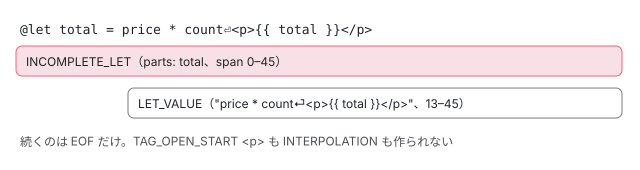

[目次](../README.md) › [@let の内側：字句から LView の枠まで](README.md) › 第 1 回 / 全 6 回

# 字句と構文：@let が 3 つのトークンと 1 つのノードになるまで

> lexer が @let を LET\_START・LET\_VALUE・LET\_END の 3 トークンに切る行（62c5b66b411、名前の $ は 341a116d611）、値の終わりは引用符の外の最初の ; で括弧は数えないこと、; を忘れるとテンプレートの残りが値に飲まれること、html の AST の LetDeclaration と 3 つの span（1ae06e4fc61、span の修正 6bd17216627）、ngNonBindable の中で組み立て直すテキスト（9eef041211e）。tokenizeLet だけを切ると \_isTextEnd のせいで lexer が止まらない組み合わせを、Node の記録で示す。ページの上で本物の @angular/compiler を動的 import し、AST とエラーを、Node で記録したトークンと並べる。

angular/angular · 読了 約 12 分 · 中核 · [サイトで読む（デモが動きます）](https://angular-deep-dive-cyan.vercel.app/chapter/letd-syntax)

---

テンプレートに書いた `@let total = price * count;` が、lexer（文字の列をトークンという部品の列に切る段）で 3 つのトークンになり、html の AST（木）の `LetDeclaration` 1 つにまとまり、R3 AST の `t.LetDeclaration` になるまでを読みます。名前に使える文字、値の終わり（`;` と、文字列・括弧の中の `;`）、`;` を忘れたとき、span（ソースの範囲）の修正、そして `tokenizeLet` を切ったときに lexer が止まらなくなる組み合わせを、本物の `@angular/compiler` で確かめます。

読む対象は compiler の `ml_parser/lexer.ts`・`ml_parser/parser.ts`・`ml_parser/xml_parser.ts`・`render3/r3_template_transform.ts` と、`test/ml_parser/lexer_spec.ts`・`html_parser_spec.ts`・`test/render3/r3_template_transform_spec.ts` です。lexer の全体（メインループ・`_consumeLetDeclaration` の本体・ブロックとの見分け）は[HTML lexer の章](../compiler/03-compiler-html-lexer.md)の 3 節と 7 節、`visitLetDeclaration` が値を `parseBinding` に渡す行は[制御フローのブロックの章](../compiler/08-compiler-control-flow-blocks.md)の 7 節で引用したので、ここではリンクします。

1. **1. 字句と構文**（この章）
2. [2. スコープと binder](02-letd-scope.md)
3. [3. テンプレートのパイプライン](03-letd-pipeline.md)
4. [4. 実行時とハイドレーション](04-letd-runtime.md)
5. [5. 型チェックと診断](05-letd-typecheck.md)
6. [6. spec と issue](06-letd-tests-issues.md)

## 1. 歩み：構文の側のコミット

@let は Kristiyan Kostadinov さんが PR #55848 で 3 つのコミットに分けて入れ、#56715 で既定で有効にしました。テンプレートの文法を 1 つ足す変更は、「lexer → html の AST → R3 AST」の順に、1 段ずつ別のコミットにして spec を足しています。

| 日付 | コミット | 変わったこと | この章 |
| --- | --- | --- | --- |
| 2024-04-30 | 62c5b66b411 | lexer に `LET_START`・`LET_VALUE`・`LET_END`・`INCOMPLETE_LET` の 4 つのトークンと `tokenizeLet`（既定は false）。lexer\_spec に 258 行 | 2〜5 節 |
| 2024-04-30 | 1ae06e4fc61 | html の AST に `LetDeclaration`、`_TreeBuilder` に `_consumeLet`・`_consumeIncompleteLet` | 6 節 |
| 2024-05-20 | 9eef041211e | R3 AST に `t.LetDeclaration`。`visitLetDeclaration` の `throw new Error('TODO…')` を本物に | 7 節 |
| 2024-06-26 | 0a48d584f2f | `tokenizeLet` の既定を true に（feat(core): add support for let syntax） | 2 節 |
| 2024-06-28 | 341a116d611 | 名前に `$` を許す | 3 節 |
| 2024-09-14 | e5adf929659 | 安定版に。変わったのは adev の文書 2 つだけで、コンパイラのコードは変わっていない | — |
| 2025-07-15 | 18a675081f9 | `@` を、知っているブロック名か `@let` が続くときだけ特別扱いに（`_isBlockStart`・`_isLetStart`） | 2 節 |
| 2026-04-27 | 6bd17216627 | 宣言の span が終わりの `;` を含んでいなかったのを直す | 6 節 |
| 2026-07-15 | 68ac2040746 | 値を読むループを `_attemptUntilIgnoreQuotes` に切り出す（処理命令 `<? … ?>` を無視する修正のついで） | 4 節 |

このサイトの `@angular/compiler` は 22.1.6 で、上のコミットはすべて入っています（`git tag --contains` で、いちばん新しい 68ac2040746 も v22.1.0 から）。../angular（22.2.0-next.7）と v22.1.6 の間で、この章の行（`ml_parser/` の @let の部分と `visitLetDeclaration`）は変わっていません。

## 2. tokenizeLet：今はどこで決まるか

📄 `angular/packages/compiler/src/ml_parser/lexer.ts` L92–104 （▶ の行: 100–101, 103）

```ts
 92 │ 
 93 │   /**
 94 │    * Whether to tokenize @ block syntax. Otherwise considered text,
 95 │    * or ICU tokens if `tokenizeExpansionForms` is enabled.
 96 │    */
 97 │   tokenizeBlocks?: boolean;
 98 │ 
 99 │   /**
100 ▶    * Whether to tokenize the `@let` syntax. Otherwise will be considered either
101 ▶    * text or an incomplete block, depending on whether `tokenizeBlocks` is enabled.
102 │    */
103 ▶   tokenizeLet?: boolean;
104 │ 
```

lexer の選択肢 `TokenizeOptions` の 103 行目です。62c5b66b411 で入ったときの既定は `options.tokenizeLet || false`（下の差分の `TODO(crisbeto): eventually set this to true.`）で、0a48d584f2f が `?? true` に変えました。今は「渡さなければ有効」です。

📄 `0a48d584f2f の差分（lexer.ts）`

```
# 0a48d584f2f 2024-06-26 feat(core): add support for let syntax (#56715)
# packages/compiler/src/ml_parser/lexer.ts
@@ -192,8 +192,7 @@ class _Tokenizer {
     this._preserveLineEndings = options.preserveLineEndings || false;
     this._i18nNormalizeLineEndingsInICUs = options.i18nNormalizeLineEndingsInICUs || false;
     this._tokenizeBlocks = options.tokenizeBlocks ?? true;
-    // TODO(crisbeto): eventually set this to true.
-    this._tokenizeLet = options.tokenizeLet || false;
+    this._tokenizeLet = options.tokenizeLet ?? true;
     try {
       this._cursor.init();
     } catch (e) {
```

false を渡す呼び手は、../angular の `grep -rn "tokenizeLet\|enableLetSyntax"` で次の 4 か所です。

- `parseTemplate(template, url, options)` — compiler/src/render3/view/template.ts — *`tokenizeLet: options.enableLetSyntax ?? true` で lexer に渡す*
  - `NgCompiler` のコンストラクタ — compiler-cli/src/ngtsc/core/src/compiler.ts — *`@angular/core` の版が分からないか 18.1.0 以上なら true*
  - `PartialComponentLinkerVersion1` — compiler-cli/linker/…/partial\_component\_linker\_1.ts — *部分コンパイルの宣言の `version` が 18.1 以上（か 0.0.0-PLACEHOLDER）なら true。ブロックは 17 以上で true*
- `XmlParser.parse` — compiler/src/ml\_parser/xml\_parser.ts — *ブロックも @let も false（下の引用）*

📄 `angular/packages/compiler/src/ml_parser/xml_parser.ts` L15–28 （▶ の行: 19, 22–23）

```ts
15 │     super(getXmlTagDefinition);
16 │   }
17 │ 
18 │   override parse(source: string, url: string, options: TokenizeOptions = {}): ParseTreeResult {
19 ▶     // Blocks and let declarations aren't supported in an XML context.
20 │     return super.parse(source, url, {
21 │       ...options,
22 ▶       tokenizeBlocks: false,
23 ▶       tokenizeLet: false,
24 │       selectorlessEnabled: false,
25 │     });
26 │   }
27 │ }
28 │ 
```

XML（i18n の翻訳ファイルを読む側）は 22〜23 行目で両方を切ります。言語サービスの `api.ts` にも `enableLetSyntax?: false` という選択肢が宣言されていますが、language-service の中でこの名前を読む行は `grep` で 0 件でした。

### tokenizeLet だけを切ると、lexer が止まらない

101 行目のコメントは「（切ったときは）`tokenizeBlocks` に応じて、テキストか不完全なブロックになる」と書いています。これは 18a675081f9 の前の動きです。18a675081f9 はメインループの `@` の判定を `_isBlockStart()`（知っているブロック名で始まるか）に変え、テキストの終わりを決める `_isTextEnd` には `_isLetStart()` を足しました。

📄 `18a675081f9 の差分のうち @let に関わる 3 か所（lexer.ts）`

```
# 18a675081f9 2025-07-15 fix(compiler): more permissive parsing of @ characters (#62644)
# packages/compiler/src/ml_parser/lexer.ts
@@ -234,10 +248,10 @@ class _Tokenizer {
           // don't want to advance in case it's not `@let`.
           this._cursor.peek() === chars.$AT &&
           !this._inInterpolation &&
-          this._attemptStr('@let')
+          this._isLetStart()
         ) {
           this._consumeLetDeclaration(start);
-        } else if (this._tokenizeBlocks && this._attemptCharCode(chars.$AT)) {
+        } else if (this._tokenizeBlocks && this._isBlockStart()) {
           this._consumeBlockStart(start);
         } else if (
           this._tokenizeBlocks &&
…
@@ -363,6 +378,7 @@ class _Tokenizer {
   }
 
   private _consumeLetDeclaration(start: CharacterCursor) {
+    this._requireStr('@let');
     this._beginToken(TokenType.LET_START, start);
 
     // Require at least one white space after the `@let`.
…
@@ -628,6 +644,32 @@ class _Tokenizer {
     return char;
   }
 
+  private _peekStr(chars: string): boolean {
+    const len = chars.length;
+    if (this._cursor.charsLeft() < len) {
+      return false;
+    }
+    const cursor = this._cursor.clone();
+    for (let i = 0; i < len; i++) {
+      if (cursor.peek() !== chars.charCodeAt(i)) {
+        return false;
+      }
+      cursor.advance();
+    }
+    return true;
+  }
+
+  private _isBlockStart(): boolean {
+    return (
+      this._cursor.peek() === chars.$AT &&
+      SUPPORTED_BLOCKS.some((blockName) => this._peekStr(blockName))
+    );
+  }
+
+  private _isLetStart(): boolean {
+    return this._cursor.peek() === chars.$AT && this._peekStr('@let');
+  }
+
   private _consumeEntity(textTokenType: TokenType): void {
     this._beginToken(TokenType.ENCODED_ENTITY);
     const start = this._cursor.clone();
…
@@ -1261,7 +1303,7 @@ class _Tokenizer {
       this._tokenizeBlocks &&
       !this._inInterpolation &&
       !this._isInExpansion() &&
-      (this._cursor.peek() === chars.$AT || this._cursor.peek() === chars.$RBRACE)
+      (this._isBlockStart() || this._isLetStart() || this._cursor.peek() === chars.$RBRACE)
     ) {
       return true;
     }
```

最後の hunk の `_isTextEnd` は `this._tokenizeBlocks` だけを見て、`_tokenizeLet` を見ません。`tokenizeLet: false` で `tokenizeBlocks: true` のとき、`@let` の位置で次のことが繰り返されます。

1. **メインループ**

   `_tokenizeLet` が false なので @let の枝に入らず、`_isBlockStart()` も false（`@let` はブロック名の一覧に無い）なので、テキストの枝 `_consumeWithInterpolation(TEXT, …)` に入る。
2. **テキストはすぐ終わる**

   テキストの終わりの判定 `_isTextEnd()` が、1 文字も進まないうちに `_isLetStart()` で true を返す。中身の空の TEXT トークンができ、カーソルは同じ `@` の上のまま。
3. **1 に戻る**

   カーソルが動かないので、空の TEXT トークンを積み続ける。

Node の記録です。`parseTemplate`（公開 API）を、heap の上限 64 MB の Worker の中で呼びました（記録のスクリプトはデモの下）。

| テンプレート | enableLetSyntax / enableBlockSyntax | 結果 |
| --- | --- | --- |
| `@let x = 1;` | （既定）/ （既定） | LetDeclaration x |
| `@let x = 1;` | false / false | Text "@let x = 1;" |
| `@let x = 1;` | false / true | ERR\_WORKER\_OUT\_OF\_MEMORY（200 ms で heap が尽きた） |
| `<span ngNonBindable>@let</span>` | false / true | ERR\_WORKER\_OUT\_OF\_MEMORY（200 ms で heap が尽きた） |
| `mail: a@letter.example` | false / true | ERR\_WORKER\_OUT\_OF\_MEMORY（300 ms で heap が尽きた） |

`a@letter.example` のようなメールアドレスでも、`@let` で始まる部分があれば同じです。この組み合わせを作る呼び手は、2 節の trace のリンカーです。部分コンパイルの宣言の `version` が 18.0.x だと、ブロックは true、@let は false になります。サイトの `@angular/compiler-cli` 22.1.6 のリンカー（Babel のプラグイン）に、`version` だけを変えた `ɵɵngDeclareComponent` を渡した記録です（heap の上限 96 MB の Worker）。

| 宣言の version | テンプレート | 結果 |
| --- | --- | --- |
| 18.0.0 | `<span ngNonBindable>@let</span>` | ERR\_WORKER\_OUT\_OF\_MEMORY |
| 18.0.0 | `a@letter.example` | ERR\_WORKER\_OUT\_OF\_MEMORY |
| 18.1.0 | `<span ngNonBindable>@let</span>` | Incomplete @let declaration "@let". |
| 18.1.0 | `a@letter.example` | Incomplete @let declaration "@let". |

18.1.0 なら 6 節の「Incomplete @let declaration」のエラーで終わり、18.0.0 では heap が尽きるまで止まりません。22.2.6 の compiler（`parseTemplate`）でも同じでした。18.0.x のコンパイラが、この形のテンプレートを部分コンパイルの宣言として書き出せたかどうかは、この章では確かめていません。

## 3. 名前：英字・`$`・`_`、2 文字目からは数字

`_consumeLetDeclaration` は、`@let` の後ろに空白が 1 つ以上あることを確かめてから、名前を読みます （本体は[HTML lexer の章](../compiler/03-compiler-html-lexer.md)の 7 節で引用しました）。名前を読むのがこの関数です。

📄 `angular/packages/compiler/src/ml_parser/lexer.ts` L452–478 （▶ の行: 456, 458–460, 462, 464, 467, 470）

```ts
452 │   private _getLetDeclarationName(): string {
453 │     const nameCursor = this._cursor.clone();
454 │     let allowDigit = false;
455 │ 
456 ▶     this._attemptCharCodeUntilFn((code) => {
457 │       if (
458 ▶         chars.isAsciiLetter(code) ||
459 ▶         code === chars.$$ ||
460 ▶         code === chars.$_ ||
461 │         // `@let` names can't start with a digit, but digits are valid anywhere else in the name.
462 ▶         (allowDigit && chars.isDigit(code))
463 │       ) {
464 ▶         allowDigit = true;
465 │         return false;
466 │       }
467 ▶       return true;
468 │     });
469 │ 
470 ▶     return this._cursor.getChars(nameCursor).trim();
471 │   }
472 │ 
473 │   private _consumeLetDeclarationValue(): void {
474 │     const start = this._cursor.clone();
475 │     this._beginToken(TokenType.LET_VALUE, start);
476 │     this._attemptUntilIgnoreQuotes((char) => char === chars.$SEMICOLON); // `@let` declarations terminate with a semicolon.
477 │     this._endToken([this._cursor.getChars(start)]);
478 │   }
```

1. **456 行目：条件に合わない文字まで進む**

   `_attemptCharCodeUntilFn` は、渡した関数が true を返すまでカーソルを進めます。467 行目の `return true` が「ここで止まる」です。
2. **458〜460 行目：使える文字**

   ASCII の英字・`$`・`_`。`chars.isAsciiLetter` は a〜z と A〜Z だけなので、`合計` のような文字は 1 文字目で止まります。
3. **462・464 行目：数字は 2 文字目から**

   `allowDigit` は、1 文字でも名前の文字を読んだら 464 行目で true になります。`@let 1st` は 1 文字目の `1` で止まり、名前は空です。
4. **470 行目：読んだ範囲がそのまま名前**

   名前が空でも、この関数はエラーを出しません。空の名前は、呼び手の `=` の確かめで `INCOMPLETE_LET` になります（DEMO の「名前の文字」）。

📄 `341a116d611 の差分（lexer.ts）`

```
# 341a116d611 2024-06-28 fix(compiler): allow more characters in let declaration name (#56764)
# packages/compiler/src/ml_parser/lexer.ts
@@ -407,8 +407,13 @@ class _Tokenizer {
     let allowDigit = false;
 
     this._attemptCharCodeUntilFn((code) => {
-      // `@let` names can't start with a digit, but digits are valid anywhere else in the name.
-      if (chars.isAsciiLetter(code) || code === chars.$_ || (allowDigit && chars.isDigit(code))) {
+      if (
+        chars.isAsciiLetter(code) ||
+        code == chars.$$ ||
+        code === chars.$_ ||
+        // `@let` names can't start with a digit, but digits are valid anywhere else in the name.
+        (allowDigit && chars.isDigit(code))
+      ) {
         allowDigit = true;
         return false;
       }
```

`$` は最初は入っていませんでした。341a116d611 の本文は「JS の識別子は $ を許すのに、@let は許していなかった」です。分割代入（`@let {a, b} = obj;`）は、名前の 1 文字目の `{` で止まるので、この段で `INCOMPLETE_LET` になります。要望の issue #57923 は[第 6 回](06-letd-tests-issues.md)の表にあります。

## 4. 値の終わり：最初の `;`。ただし引用符の中は飛ばす

📄 `angular/packages/compiler/src/ml_parser/lexer.ts` L452–478 （▶ の行: 473, 475–477）

```ts
452 │   private _getLetDeclarationName(): string {
453 │     const nameCursor = this._cursor.clone();
454 │     let allowDigit = false;
455 │ 
456 │     this._attemptCharCodeUntilFn((code) => {
457 │       if (
458 │         chars.isAsciiLetter(code) ||
459 │         code === chars.$$ ||
460 │         code === chars.$_ ||
461 │         // `@let` names can't start with a digit, but digits are valid anywhere else in the name.
462 │         (allowDigit && chars.isDigit(code))
463 │       ) {
464 │         allowDigit = true;
465 │         return false;
466 │       }
467 │       return true;
468 │     });
469 │ 
470 │     return this._cursor.getChars(nameCursor).trim();
471 │   }
472 │ 
473 ▶   private _consumeLetDeclarationValue(): void {
474 │     const start = this._cursor.clone();
475 ▶     this._beginToken(TokenType.LET_VALUE, start);
476 ▶     this._attemptUntilIgnoreQuotes((char) => char === chars.$SEMICOLON); // `@let` declarations terminate with a semicolon.
477 ▶     this._endToken([this._cursor.getChars(start)]);
478 │   }
```
*同じ引用の後半。473 行目からが値*

476 行目、値は「`;` が来るまで、ただし引用符の中は無視して」読みます。この 1 行は 68ac2040746 で、それまでの `while` ループを切り出した形です（下の差分）。ループの中身は変わっていません。

📄 `angular/packages/compiler/src/ml_parser/lexer.ts` L648–669 （▶ の行: 649, 652, 656–660, 663, 667）

```ts
648 │   private _attemptUntilIgnoreQuotes(predicate: (code: number) => boolean) {
649 ▶     while (this._cursor.peek() !== chars.$EOF) {
650 │       const char = this._cursor.peek();
651 │ 
652 ▶       if (predicate(char)) {
653 │         break;
654 │       }
655 │ 
656 ▶       if (chars.isQuote(char)) {
657 ▶         this._cursor.advance();
658 ▶         this._attemptCharCodeUntilFn((inner) => {
659 ▶           if (inner === chars.$BACKSLASH) {
660 ▶             this._cursor.advance();
661 │             return false;
662 │           }
663 ▶           return inner === char;
664 │         });
665 │       }
666 │ 
667 ▶       this._cursor.advance();
668 │     }
669 │   }
```

1. **652 行目：終わりの文字なら止まる**

   @let では `;`。カーソルは `;` の上で止まり、`;` は値に入りません。
2. **656〜664 行目：引用符なら、同じ引用符まで飛ばす**

   `chars.isQuote` は `'`・`"`・`` ` `` の 3 つです。659〜661 行目、`\` の次の 1 文字は見ずに進むので、`'\';'` の `;` も飛ばされます。
3. **667 行目：1 文字進む**

   括弧（`( [ {`）は数えていません。`@let box = {a: 1;` は `{a: 1` までが値で、括弧の閉じ忘れは、この先の式のパーサが「Missing expected }」で見つけます。

📄 `68ac2040746 の差分のうち @let の部分（lexer.ts）`

```
# 68ac2040746 2026-07-15 fix(core): ignore processing instruction syntax in templates
# packages/compiler/src/ml_parser/lexer.ts
@@ -470,30 +472,7 @@ class _Tokenizer {
   private _consumeLetDeclarationValue(): void {
     const start = this._cursor.clone();
     this._beginToken(TokenType.LET_VALUE, start);
-
-    while (this._cursor.peek() !== chars.$EOF) {
-      const char = this._cursor.peek();
-
-      // `@let` declarations terminate with a semicolon.
-      if (char === chars.$SEMICOLON) {
-        break;
-      }
-
-      // If we hit a quote, skip over its content since we don't care what's inside.
-      if (chars.isQuote(char)) {
-        this._cursor.advance();
-        this._attemptCharCodeUntilFn((inner) => {
-          if (inner === chars.$BACKSLASH) {
-            this._cursor.advance();
-            return false;
-          }
-          return inner === char;
-        });
-      }
-
-      this._cursor.advance();
-    }
-
+    this._attemptUntilIgnoreQuotes((char) => char === chars.$SEMICOLON); // `@let` declarations terminate with a semicolon.
     this._endToken([this._cursor.getChars(start)]);
   }
 
```

引用符の入れ子も数えません。テンプレートリテラルの `${…}` の中に `` `;` `` を書くと（DEMO の「テンプレートリテラルの入れ子」）、2 つ目の `` ` `` で文字列が閉じたとみなされ、その直後の `;` で値が終わります。残りの `` `}b`; `` はテキストとして読まれ、`}` が「Unexpected closing block」のエラーになります。

`;` が来ないまま入力が終わると、引用符の外なら 649 行目の `while` を抜けるだけです。引用符の中で終わると、658 行目の `_attemptCharCodeUntilFn` が EOF の上で `advance()` を呼び、カーソルが「Unexpected character "EOF"」を投げます（lexer\_spec の 1640〜1642 行目）。

## 5. `;` を忘れると、テンプレートの残りが値に入る

値が `;` で終わらなかったときは、`_consumeLetDeclaration` の最後の `else` で、最初のトークン `LET_START` の種類を `INCOMPLETE_LET` に書き換え、その span を今のカーソルまで伸ばします （下の 6bd17216627 の差分の、変わっていない 3 行）。DEMO の「; を忘れる」の記録はこうなります。



*; を忘れたとき（DEMO の no-semi の記録）。LET\_VALUE がテンプレートの最後まで伸び、その後ろの &lt;p&gt; はトークンにならない*

値はテンプレートの最後まで（次の `;` があればそこまで）伸び、後ろの要素はトークンになりません。次の節のとおり、木を作る側は `INCOMPLETE_LET` に続く `LET_VALUE` を読み飛ばすので、`<p>` は木からも消え、エラーは「Incomplete @let declaration "total"」の 1 つだけです。

## 6. html の AST：\_consumeLet と \_consumeIncompleteLet

📄 `angular/packages/compiler/src/ml_parser/parser.ts` L832–862 （▶ の行: 837, 842, 847, 851, 856, 861）

```ts
832 │   private _consumeLet(startToken: LetStartToken) {
833 │     const name = startToken.parts[0];
834 │     let valueToken: LetValueToken;
835 │     let endToken: LetEndToken;
836 │ 
837 ▶     if (this._peek.type !== TokenType.LET_VALUE) {
838 │       this.errors.push(
839 │         TreeError.create(
840 │           startToken.parts[0],
841 │           startToken.sourceSpan,
842 ▶           `Invalid @let declaration "${name}". Declaration must have a value.`,
843 │         ),
844 │       );
845 │       return;
846 │     } else {
847 ▶       valueToken = this._advance();
848 │     }
849 │ 
850 │     // Type cast is necessary here since TS narrowed the type of `peek` above.
851 ▶     if ((this._peek as Token).type !== TokenType.LET_END) {
852 │       this.errors.push(
853 │         TreeError.create(
854 │           startToken.parts[0],
855 │           startToken.sourceSpan,
856 ▶           `Unterminated @let declaration "${name}". Declaration must be terminated with a semicolon.`,
857 │         ),
858 │       );
859 │       return;
860 │     } else {
861 ▶       endToken = this._advance();
862 │     }
```

`_TreeBuilder`（トークンの列から木を作るクラス）は、`LET_START` を見ると `_consumeLet` を呼びます。837 行目、次が `LET_VALUE` でなければ 842 行目のエラー。851 行目、その次が `LET_END` でなければ 856 行目のエラーです。

この 2 つのエラーは、lexer がどんなトークンの列を出すかで決まります。5 節のとおり、lexer は `;` が無いと最初のトークンを `INCOMPLETE_LET` に書き換えるので、`LET_START` と `LET_VALUE` の後ろに `LET_END` が無い列はできません。DEMO の 11 の例でも 856 行目の「Unterminated」は出ず、`;` を忘れたときのエラーは次の `_consumeIncompleteLet` のものでした。842 行目の「Declaration must have a value」は出ます。引用符を閉じないと lexer が値の途中で例外を投げ、`LET_START` の次が `EOF` になるからです（DEMO の「閉じない引用符」）。

📄 `angular/packages/compiler/src/ml_parser/parser.ts` L863–885 （▶ の行: 864–867, 873, 875, 881, 884）

```ts
863 │ 
864 ▶     const end = endToken.sourceSpan.end;
865 ▶     const span = new ParseSourceSpan(
866 ▶       startToken.sourceSpan.start,
867 ▶       end,
868 │       startToken.sourceSpan.fullStart,
869 │     );
870 │ 
871 │     // The start token usually captures the `@let`. Construct a name span by
872 │     // offsetting the start by the length of any text before the name.
873 ▶     const startOffset = startToken.sourceSpan.toString().lastIndexOf(name);
874 │     const nameStart = startToken.sourceSpan.start.moveBy(startOffset);
875 ▶     const nameSpan = new ParseSourceSpan(nameStart, startToken.sourceSpan.end);
876 │     const node = new html.LetDeclaration(
877 │       name,
878 │       valueToken.parts[0],
879 │       span,
880 │       nameSpan,
881 ▶       valueToken.sourceSpan,
882 │     );
883 │ 
884 ▶     this._addToParent(node);
885 │   }
```

1. **864〜869 行目：宣言全体の span**

   `@let` の始まりから `LET_END` の終わりまで。864 行目は 6bd17216627 で `fullStart` から `end` に変わりました。
2. **873〜875 行目：名前の span**

   `LET_START` の範囲は `@let total` なので、その文字列の中で名前を `lastIndexOf` で探し、そこから終わりまでを名前の span にします。
3. **881 行目：値の span は LET\_VALUE の span そのもの**

   この span が、7 節で値の式を解析するときの位置の基準になります。

📄 `6bd17216627 の差分（lexer.ts と parser.ts）`

```
# 6bd17216627 2026-04-27 fix(compiler): let declaration span not including end character
# packages/compiler/src/ml_parser/lexer.ts
@@ -423,8 +423,8 @@ class _Tokenizer {
     const endChar = this._cursor.peek();
     if (endChar === chars.$SEMICOLON) {
       this._beginToken(TokenType.LET_END);
-      this._endToken([]);
       this._cursor.advance();
+      this._endToken([]);
     } else {
       startToken.type = TokenType.INCOMPLETE_LET;
       startToken.sourceSpan = this._cursor.getSpan(start);

# 6bd17216627 2026-04-27 fix(compiler): let declaration span not including end character
# packages/compiler/src/ml_parser/parser.ts
@@ -843,7 +843,7 @@ class _TreeBuilder {
       endToken = this._advance();
     }
 
-    const end = endToken.sourceSpan.fullStart;
+    const end = endToken.sourceSpan.end;
     const span = new ParseSourceSpan(
       startToken.sourceSpan.start,
       end,
```

span の修正は 2 か所でした。lexer の側で `LET_END` の `_endToken` を `advance()` の前に呼んでいたので、`LET_END` の span は長さ 0 でした。それを後ろに回し、木の側は `endToken.sourceSpan.fullStart`（`;` の手前）から `end`（`;` の後ろ）に変えています。spec は html\_parser\_spec・r3\_ast\_spans\_spec に加え、拡張診断（使われない @let の NG8112）と言語サービスの spec で、期待する範囲に `;` が 1 文字ずつ足されました。言語サービスの側は[第 5 回](05-letd-typecheck.md)です。

📄 `angular/packages/compiler/src/ml_parser/parser.ts` L887–912 （▶ の行: 889, 893, 896–899, 901, 909）

```ts
887 │   private _consumeIncompleteLet(token: IncompleteLetToken) {
888 │     // Incomplete `@let` declaration may end up with an empty name.
889 ▶     const name = token.parts[0] ?? '';
890 │     const nameString = name ? ` "${name}"` : '';
891 │ 
892 │     // If there's at least a name, we can salvage an AST node that can be used for completions.
893 ▶     if (name.length > 0) {
894 │       const startOffset = token.sourceSpan.toString().lastIndexOf(name);
895 │       const nameStart = token.sourceSpan.start.moveBy(startOffset);
896 ▶       const nameSpan = new ParseSourceSpan(nameStart, token.sourceSpan.end);
897 ▶       const valueSpan = new ParseSourceSpan(
898 ▶         token.sourceSpan.start,
899 ▶         token.sourceSpan.start.moveBy(0),
900 │       );
901 ▶       const node = new html.LetDeclaration(name, '', token.sourceSpan, nameSpan, valueSpan);
902 │       this._addToParent(node);
903 │     }
904 │ 
905 │     this.errors.push(
906 │       TreeError.create(
907 │         token.parts[0],
908 │         token.sourceSpan,
909 ▶         `Incomplete @let declaration${nameString}. ` +
910 │           `@let declarations must be written as \`@let <name> = <value>;\``,
911 │       ),
912 │     );
```

`INCOMPLETE_LET` のとき、893 行目、名前が 1 文字以上あれば値の空の `LetDeclaration` を木に足します（892 行目のコメントのとおり、補完のため）。896 行目の名前の span はトークンの終わりまでなので、`@let foo =` では `foo =` が名前の span です（html\_parser\_spec の 1308 行目がこの形を期待しています）。897〜899 行目、値の span は宣言の先頭の長さ 0 の範囲です。

894 行目は名前を `lastIndexOf` で探します。5 節のように `;` を忘れてトークンが後ろまで伸びると、トークンの文字列の中に同じ名前がもう一度出ることがあり、そのときは後ろの方が見つかります。DEMO の「; を忘れる」では、名前の span が 33–45（飲み込んだ `{{ total }}` の `total` から最後まで）になりました。完全な宣言の 873 行目も同じ書き方ですが、そちらのトークンは `@let 名前` で終わるので、後ろの名前は宣言の名前そのものです。

名前の欄はトークンの `parts[0]` です。`@letter` のように `@let` の直後に空白が無いと、lexer はトークンの文字列 `@let` そのものを parts に入れるので、889 行目の名前は `"@let"` になり、木には名前 `@let` の `LetDeclaration` が入り、エラーは「Incomplete @let declaration "@let"」です。`@letter` が @let に当たること自体は[HTML lexer の章](../compiler/03-compiler-html-lexer.md)の 7 節（前方一致）です。

## 7. R3 AST：値の式を解析する。ngNonBindable の中では文字に戻す

`HtmlAstToIvyAst.visitLetDeclaration` は値の文字列を `BindingParser.parseBinding` で式にし、空なら「@let declaration value cannot be empty」を足して `t.LetDeclaration` を作ります （[制御フローのブロックの章](../compiler/08-compiler-control-flow-blocks.md)の 7 節で引用）。9eef041211e の差分が、その形が最初に入ったところです。

📄 `9eef041211e の差分のうち @let の部分（r3_template_transform.ts）`

```
# 9eef041211e 2024-05-20 refactor(compiler): implement let declarations in render3 ast (#55848)
# packages/compiler/src/render3/r3_template_transform.ts
@@ -390,7 +390,18 @@ class HtmlAstToIvyAst implements html.Visitor {
   }
 
   visitLetDeclaration(decl: html.LetDeclaration, context: any) {
-    throw new Error('TODO: implement R3 LetDeclaration');
+    const value = this.bindingParser.parseBinding(
+      decl.value,
+      false,
+      decl.valueSpan,
+      decl.valueSpan.start.offset,
+    );
+
+    if (value.errors.length === 0 && value.ast instanceof EmptyExpr) {
+      this.reportError('@let declaration value cannot be empty', decl.valueSpan);
+    }
+
+    return new t.LetDeclaration(decl.name, value, decl.sourceSpan, decl.nameSpan, decl.valueSpan);
   }
 
   visitBlockParameter() {
…
@@ -899,7 +910,7 @@ class NonBindableVisitor implements html.Visitor {
   }
 
   visitLetDeclaration(decl: html.LetDeclaration, context: any) {
-    throw new Error('TODO: implement R3 LetDeclaration');
+    return new t.Text(`@let ${decl.name} = ${decl.value};`, decl.sourceSpan);
   }
 }
 
```

差分の 2 つ目、`NonBindableVisitor`（`ngNonBindable` の付いた要素の中を、束縛なしの文字として扱う visitor）の方は、今もこの形です。

📄 `angular/packages/compiler/src/render3/r3_template_transform.ts` L1249–1270 （▶ の行: 1253, 1258, 1268–1269）

```ts
1249 │   visitBlock(block: html.Block, context: any) {
1250 │     const nodes = [
1251 │       // In an ngNonBindable context we treat the opening/closing tags of block as plain text.
1252 │       // This is the as if the `tokenizeBlocks` option was disabled.
1253 ▶       new t.Text(block.startSourceSpan.toString(), block.startSourceSpan),
1254 │       ...html.visitAll(this, block.children),
1255 │     ];
1256 │ 
1257 │     if (block.endSourceSpan !== null) {
1258 ▶       nodes.push(new t.Text(block.endSourceSpan.toString(), block.endSourceSpan));
1259 │     }
1260 │ 
1261 │     return nodes;
1262 │   }
1263 │ 
1264 │   visitBlockParameter(parameter: html.BlockParameter, context: any) {
1265 │     return null;
1266 │   }
1267 │ 
1268 ▶   visitLetDeclaration(decl: html.LetDeclaration, context: any) {
1269 ▶     return new t.Text(`@let ${decl.name} = ${decl.value};`, decl.sourceSpan);
1270 │   }
```

ブロックの開き・閉じは 1253・1258 行目でソースの文字列（`startSourceSpan.toString()`）をそのまま使います。@let は 1269 行目で `` `@let ${decl.name} = ${decl.value};` `` と**組み立て直す**ので、書いた空白は残りません。DEMO の「ngNonBindable の中」の `@let x=1;` は、`t.Text "@let x = 1;"` になります。lexer は ngNonBindable を知らないので（記録のトークンに `LET_START` が出ます）、@let の構文に合わない文字列は、ngNonBindable の中でも 6 節のエラーになります。

## 8. DEMO：本物の lexer と parseTemplate にかける

> **🧪 DEMO — トークン・html の AST・R3 AST・エラーを並べる**
>
> ボタンを押すと `@angular/compiler`（22.1.6）を読み込み、入力を `new HtmlParser().parse(src, 'demo.html', {tokenizeExpansionForms: true, tokenizeBlocks: true, tokenizeLet: true})` と `parseTemplate(src, 'demo.html', {})` にかけます。前者は `parseTemplate` が中で lexer に渡す選択肢と同じです。`tokenize()` は公開されていないので、トークンの列は「例のどれかと同じ入力のとき」だけ、Node で同じ版の `tokenize()` を呼んだ記録を出します。
>
> ▶ [このデモはサイトで動かせます](https://angular-deep-dive-cyan.vercel.app/chapter/letd-syntax)

確かめたこと（2026-11-16、headless Chrome で本番ビルドを開いて全部の例を押した結果と同じ）: 「基本」「文字列の中の ;」「括弧の中の ;」は、宣言・値・終わりの span がすべて記録のトークンと一致します。「名前の文字」は `$user_1` だけが宣言になり、`1st` と `合計` は名前の無い `INCOMPLETE_LET` と、後ろのテキストです。「補間の中」は、前後の空の `TEXT` にはさまれた `INTERPOLATION` 1 つで、@let として読まれません（メインループの `!this._inInterpolation`）。中身は式のパーサが `@` の所でエラーにします。「; を忘れる」の `nameSpan` は 33–45 の `total }}</p>` で、宣言の名前ではなく、飲み込んだ補間の中の `total` を指しています（6 節）。

## ここまでの呼び出し

- `parseTemplate(src, url, options)` — render3/view/template.ts — *`tokenizeLet: options.enableLetSyntax ?? true`*
  - `HtmlParser.parse()` → `tokenize()` — ml\_parser/lexer.ts
    - `_isLetStart()` → `_consumeLetDeclaration(start)` — lexer.ts — *空白・名前・`=`・値・`;`。合わなければ `INCOMPLETE_LET`*
      - `_getLetDeclarationName()` — lexer.ts L452 — *英字・$・\_、2 文字目から数字*
      - `_consumeLetDeclarationValue()` → `_attemptUntilIgnoreQuotes(;)` — lexer.ts L473 / L648 — *引用符の中は飛ばす。括弧は数えない*
  - `_TreeBuilder.build()` — ml\_parser/parser.ts
    - `_consumeLet()` / `_consumeIncompleteLet()` — parser.ts L832 / L887 — *`html.LetDeclaration`（名前・値の文字列・3 つの span）*
  - `HtmlAstToIvyAst.visitLetDeclaration()` — render3/r3\_template\_transform.ts — *`parseBinding` で式に → `t.LetDeclaration`*
  - `NonBindableVisitor.visitLetDeclaration()` — r3\_template\_transform.ts L1268 — *ngNonBindable の中では組み立て直した `t.Text`*

## テストと直し方

### spec と it

| ファイル | describe / it | 行 | この章のどこ |
| --- | --- | --- | --- |
| compiler/test/ml\_parser/lexer\_spec.ts | `@let declarations` の 18 の it | 1489〜1743 | 3〜5 節 |
| compiler/test/ml\_parser/html\_parser\_spec.ts | `let declaration` の 5 つ（入れ子・span・不完全なときのエラーと span） | 1265〜1310 | 6 節 |
| compiler/test/render3/r3\_template\_transform\_spec.ts | `@let declarations` の 4 つ（式の構文エラー・値が空・ngNonBindable） | 2790〜2812 | 7 節 |
| compiler/test/render3/r3\_ast\_spans\_spec.ts | `@let declaration` の `is correct for a let declaration` | 993〜999 | 6 節（span） |

📄 `angular/packages/compiler/test/ml_parser/lexer_spec.ts` L1639–1675 （▶ の行: 1640–1641, 1644, 1646, 1666, 1670–1672）

```ts
1639 │     it('should handle @let declaration with invalid syntax in the value', () => {
1640 ▶       expect(tokenizeAndHumanizeErrors(`@let foo = ";`)).toEqual([
1641 ▶         ['Unexpected character "EOF"', '0:13'],
1642 │       ]);
1643 │ 
1644 ▶       expect(tokenizeAndHumanizeParts(`@let foo = {a: 1,;`)).toEqual([
1645 │         [TokenType.LET_START, 'foo'],
1646 ▶         [TokenType.LET_VALUE, '{a: 1,'],
1647 │         [TokenType.LET_END],
1648 │         [TokenType.EOF],
1649 │       ]);
1650 │ 
1651 │       expect(tokenizeAndHumanizeParts(`@let foo = [1, ;`)).toEqual([
1652 │         [TokenType.LET_START, 'foo'],
1653 │         [TokenType.LET_VALUE, '[1, '],
1654 │         [TokenType.LET_END],
1655 │         [TokenType.EOF],
1656 │       ]);
1657 │ 
1658 │       expect(tokenizeAndHumanizeParts(`@let foo = fn(;`)).toEqual([
1659 │         [TokenType.LET_START, 'foo'],
1660 │         [TokenType.LET_VALUE, 'fn('],
1661 │         [TokenType.LET_END],
1662 │         [TokenType.EOF],
1663 │       ]);
1664 │     });
1665 │ 
1666 ▶     // This case is a bit odd since an `@let` without a value is invalid,
1667 │     // but it will be validated further down in the parsing pipeline.
1668 │     it('should parse a @let declaration without a value', () => {
1669 │       expect(tokenizeAndHumanizeParts('@let foo =;')).toEqual([
1670 ▶         [TokenType.LET_START, 'foo'],
1671 ▶         [TokenType.LET_VALUE, ''],
1672 ▶         [TokenType.LET_END],
1673 │         [TokenType.EOF],
1674 │       ]);
1675 │     });
```
*値の中の構文の誤りは lexer では見ない。見るのは引用符だけ*

📄 `angular/packages/compiler/test/ml_parser/lexer_spec.ts` L1677–1716 （▶ の行: 1679, 1688, 1693, 1698, 1711）

```ts
1677 │     it('should handle no space after @let', () => {
1678 │       expect(tokenizeAndHumanizeParts('@letFoo = 123;')).toEqual([
1679 ▶         [TokenType.INCOMPLETE_LET, '@let'],
1680 │         [TokenType.TEXT, 'Foo = 123;'],
1681 │         [TokenType.EOF],
1682 │       ]);
1683 │     });
1684 │ 
1685 │     it('should handle unsupported characters in the name of @let', () => {
1686 │       expect(tokenizeAndHumanizeParts('@let foo\\bar = 123;')).toEqual([
1687 │         [TokenType.INCOMPLETE_LET, 'foo'],
1688 ▶         [TokenType.TEXT, '\\bar = 123;'],
1689 │         [TokenType.EOF],
1690 │       ]);
1691 │       expect(tokenizeAndHumanizeParts('@let #foo = 123;')).toEqual([
1692 │         [TokenType.INCOMPLETE_LET, ''],
1693 ▶         [TokenType.TEXT, '#foo = 123;'],
1694 │         [TokenType.EOF],
1695 │       ]);
1696 │       expect(tokenizeAndHumanizeParts('@let foo\nbar = 123;')).toEqual([
1697 │         [TokenType.INCOMPLETE_LET, 'foo'],
1698 ▶         [TokenType.TEXT, 'bar = 123;'],
1699 │         [TokenType.EOF],
1700 │       ]);
1701 │     });
1702 │ 
1703 │     it('should handle digits in the name of an @let', () => {
1704 │       expect(tokenizeAndHumanizeParts('@let a123 = foo;')).toEqual([
1705 │         [TokenType.LET_START, 'a123'],
1706 │         [TokenType.LET_VALUE, 'foo'],
1707 │         [TokenType.LET_END],
1708 │         [TokenType.EOF],
1709 │       ]);
1710 │       expect(tokenizeAndHumanizeParts('@let 123a = 123;')).toEqual([
1711 ▶         [TokenType.INCOMPLETE_LET, ''],
1712 │         [TokenType.TEXT, '123a = 123;'],
1713 │         [TokenType.EOF],
1714 │       ]);
1715 │     });
1716 │ 
```

📄 `angular/packages/compiler/test/ml_parser/lexer_spec.ts` L1717–1743 （▶ の行: 1719–1720, 1729, 1736, 1738）

```ts
1717 │     it('should handle an @let declaration without an ending token', () => {
1718 │       expect(tokenizeAndHumanizeParts('@let foo = 123 + 456')).toEqual([
1719 ▶         [TokenType.INCOMPLETE_LET, 'foo'],
1720 ▶         [TokenType.LET_VALUE, '123 + 456'],
1721 │         [TokenType.EOF],
1722 │       ]);
1723 │       expect(tokenizeAndHumanizeParts('@let foo = 123 + 456                  ')).toEqual([
1724 │         [TokenType.INCOMPLETE_LET, 'foo'],
1725 │         [TokenType.LET_VALUE, '123 + 456                  '],
1726 │         [TokenType.EOF],
1727 │       ]);
1728 │       expect(tokenizeAndHumanizeParts('@let foo = 123, bar = 456')).toEqual([
1729 ▶         [TokenType.INCOMPLETE_LET, 'foo'],
1730 │         [TokenType.LET_VALUE, '123, bar = 456'],
1731 │         [TokenType.EOF],
1732 │       ]);
1733 │     });
1734 │ 
1735 │     it('should not parse @let inside an interpolation', () => {
1736 ▶       expect(tokenizeAndHumanizeParts('{{ @let foo = 123; }}')).toEqual([
1737 │         [TokenType.TEXT, ''],
1738 ▶         [TokenType.INTERPOLATION, '{{', ' @let foo = 123; ', '}}'],
1739 │         [TokenType.TEXT, ''],
1740 │         [TokenType.EOF],
1741 │       ]);
1742 │     });
1743 │   });
```
*; が無いと INCOMPLETE\_LET と LET\_VALUE。5 節の記録と同じ形*

📄 `angular/packages/compiler/test/ml_parser/html_parser_spec.ts` L1284–1310 （▶ の行: 1286, 1291, 1294, 1308）

```ts
1284 │       it('should store the source location of a @let declaration', () => {
1285 │         expect(humanizeDomSourceSpans(parser.parse('@let foo = 123 + 456;', 'TestCmp'))).toEqual([
1286 ▶           [html.LetDeclaration, 'foo', '123 + 456', '@let foo = 123 + 456;', 'foo', '123 + 456'],
1287 │         ]);
1288 │       });
1289 │ 
1290 │       it('should report an error for an incomplete let declaration', () => {
1291 ▶         expect(humanizeErrors(parser.parse('@let foo =', 'TestCmp').errors)).toEqual([
1292 │           [
1293 │             'foo',
1294 ▶             'Incomplete @let declaration "foo". @let declarations must be written as `@let <name> = <value>;`',
1295 │             '0:0',
1296 │           ],
1297 │         ]);
1298 │       });
1299 │ 
1300 │       it('should store the locations of an incomplete let declaration', () => {
1301 │         const parseResult = parser.parse('@let foo =', 'TestCmp');
1302 │ 
1303 │         // It's expected that errors will be reported for the incomplete declaration,
1304 │         // but we still want to check the spans since they're important even for broken templates.
1305 │         parseResult.errors = [];
1306 │ 
1307 │         expect(humanizeDomSourceSpans(parseResult)).toEqual([
1308 ▶           [html.LetDeclaration, 'foo', '', '@let foo =', 'foo =', ''],
1309 │         ]);
1310 │       });
```

📄 `angular/packages/compiler/test/render3/r3_template_transform_spec.ts` L2790–2812 （▶ の行: 2796, 2802, 2806, 2809）

```ts
2790 │   describe('@let declarations', () => {
2791 │     it('should parse a let declaration', () => {
2792 │       expectFromHtml('@let foo = 123 + 456;').toEqual([['LetDeclaration', 'foo', '123 + 456']]);
2793 │     });
2794 │ 
2795 │     it('should report syntax errors in the let declaration value', () => {
2796 ▶       expect(() => parse('@let foo = {one: 1;')).toThrowError(
2797 │         /Parser Error: Missing expected } at the end of the expression \[\{one: 1]/,
2798 │       );
2799 │     });
2800 │ 
2801 │     it('should report a let declaration with no value', () => {
2802 ▶       expect(() => parse('@let foo =  ;')).toThrowError(/@let declaration value cannot be empty/);
2803 │     });
2804 │ 
2805 │     it('should produce a text node when @let is used inside ngNonBindable', () => {
2806 ▶       expectFromHtml('<div ngNonBindable>@let foo = 123;</div>').toEqual([
2807 │         ['Element', 'div'],
2808 │         ['TextAttribute', 'ngNonBindable', ''],
2809 ▶         ['Text', '@let foo = 123;'],
2810 │       ]);
2811 │     });
2812 │   });
```

### 手元で走らせた結果

📄 `走らせたコマンド`

```
cd ~/angular-research/angular
pnpm bazel test //packages/compiler/test/ml_parser:ml_parser --nocache_test_results --test_output=all \
  "--test_arg=--filter=@let|let declaration"
pnpm bazel test //packages/compiler/test/render3:test --nocache_test_results --test_output=all \
  "--test_arg=--filter=@let|let declaration"
```

📄 `結果（2026-11-16）`

```
//packages/compiler/test/ml_parser:ml_parser
Ran 23 of 437 specs
23 specs, 0 failures                                                      PASSED in 1.1s
//packages/compiler/test/render3:test
Ran 10 of 499 specs
10 specs, 0 failures                                                      PASSED in 0.7s
```

ml\_parser の 23 は、lexer\_spec の 18（1489〜1743 行目の範囲で `grep -c "it('"` した数）と html\_parser\_spec の 5 です。render3 の 10 のうち、この章のものは r3\_template\_transform\_spec の 4 と r3\_ast\_spans\_spec の 1 で、残りの 5 は binding\_spec（[第 2 回](02-letd-scope.md)）です。絞り込みは jasmine の `--filter`（describe と it の名前をつないだ文字列への正規表現）です。

### 直すとしたら

- 2 節の止まらない組み合わせは、`_Tokenizer._isTextEnd`（lexer.ts の末尾の方、[HTML lexer の章](../compiler/03-compiler-html-lexer.md)で引用した範囲）の `this._isLetStart()` を、`_tokenizeLet` が true のときだけ見る形にするのが最小です。spec は lexer\_spec.ts の `@let declarations` に「`tokenizeLet: false` では `@let x = 1;` が 1 つの TEXT になる」を足し、101 行目のコメントも今の動きに合わせます。
- 6 節の 856 行目のエラーに届く入力が無いことは、lexer が `INCOMPLETE_LET` に書き換える限り変わりません。消すか残すかを決めるなら、html\_parser\_spec の `let declaration` に「`;` が無いときに出るメッセージ」を固定する it を足すのが先です（今は 1291 行目の `@let foo =` だけ）。
- 4 節のテンプレートリテラルの入れ子は、`_attemptUntilIgnoreQuotes` が引用符を 1 段しか見ないことから来ます。同じ関数を処理命令（`<? … ?>`）も使うので、直すなら @let の値だけ `${` の深さを数える形になり、spec は lexer\_spec の `should parse @let declaration using escaped quotes in a string`（1569 行目）の隣です。

## 聞かれそうな質問

**Q. @let の値の中に `;` を書けますか？**

文字列の中なら書けます。lexer.ts の 656〜664 行目が引用符の中を飛ばすので、`@let s = 'a; b';` の値は `'a; b'` です。括弧の中は数えないので、`@let o = {a: 1; b: 2};` は最初の `;` で切れ、式のパーサのエラーになります。

**Q. `;` を忘れるとどうなりますか？**

値が次の `;` かテンプレートの最後まで伸び、最初のトークンが `INCOMPLETE_LET` になります（5 節の記録）。木を作る側は `_consumeIncompleteLet` で値の空の宣言を足し、parser.ts の 909 行目の「Incomplete @let declaration」を 1 つ出します。間にあった要素は消えます。

**Q. 名前に日本語や数字の始まりは使えますか？**

使えません。lexer.ts の 458〜462 行目のとおり、ASCII の英字・`$`・`_` と、2 文字目からの数字だけです。名前が空になり、`=` の確かめで `INCOMPLETE_LET` になります。

**Q. @let の span には `;` が入りますか？**

22.0.0 から入ります。6bd17216627 が parser.ts の 864 行目を `endToken.sourceSpan.end` にし、lexer の `LET_END` の span も `;` の 1 文字分になりました。html\_parser\_spec の 1286 行目が `'@let foo = 123 + 456;'` を期待しています。

**Q. ngNonBindable の中の @let はどう表示されますか？**

r3\_template\_transform.ts の 1269 行目で `@let 名前 = 値;` に組み立て直したテキストです。書いた空白は残りません。lexer は ngNonBindable を知らないので、@let の構文として正しくない文字列はその中でもエラーになります。

## 読み終えて

- @let は lexer で `LET_START`（名前）・`LET_VALUE`（値の文字列）・`LET_END` の 3 トークン。合わなければ最初のトークンを `INCOMPLETE_LET` に書き換える
- 値は「引用符の外の最初の `;`」まで。括弧も、テンプレートリテラルの入れ子も数えない。`;` を忘れると後ろが値に飲まれる
- html の AST は名前・値の文字列・3 つの span を持つだけで、式にするのは R3 への変換（`parseBinding`）。ngNonBindable の中では組み立て直したテキスト
- `tokenizeLet` の既定は true。false にする呼び手はリンカー（18.1 未満の宣言）と XML。ブロックだけ有効で @let を切ると、`_isTextEnd` のせいで lexer が止まらない

---

← 前: [spec と PR を読む：foreign component を固めているテスト](../fgn/06-fgn-tests-issues.md)  
次: [スコープと binder：どこから読めて、何に結び付くか](02-letd-scope.md) →
