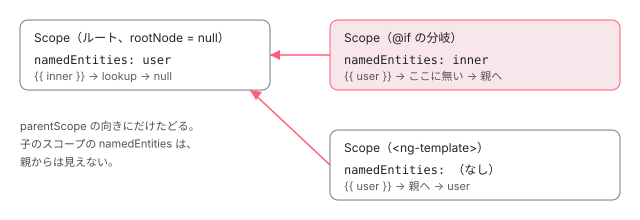

[目次](../README.md) › [@let の内側：字句から LView の枠まで](README.md) › 第 2 回 / 全 6 回

# スコープと binder：どこから読めて、何に結び付くか

> t2\_binder の Scope が @let を maybeDeclare で登録する行（b7fc7fdba94）、スコープを作るのは制御フローのブロックと ng-template で要素は作らないこと、lookup が親の方へだけたどるので子からは読めて親からは読めないこと、スコープを先に全部作るので宣言より前の読みも同じ宣言に結び付くこと、同じスコープの #ref・@for の変数とは先勝ちで子は親に勝つこと（パイプラインの側の修正 2a1291e942a と compliance の shadowed\_let）、this. の読み（09f589f0006・fa7cb4b87af）と代入の左辺。ページの上で本物の R3TargetBinder を動かし、名前がどの宣言に結び付くかを表にする。

angular/angular · 読了 約 13 分 · 発展 · [サイトで読む（デモが動きます）](https://angular-deep-dive-cyan.vercel.app/chapter/letd-scope)

---

`@let` の名前が、テンプレートのどこから読めるかを決めているのは、R3 AST の上で名前の範囲（スコープ）の木を作る `t2_binder.ts` です。この章では、`Scope` に @let を足した行、子のビュー（`@if`・`@for`・`ng-template`）から親を読める理由と、親から子を読めない理由、宣言より前の読みや同じ名前の `#ref`・`@for` の変数・`this.`・イベントでの代入に対して、binder が何を返すかを、本物の `R3TargetBinder` で確かめます。

読む対象は compiler の `render3/view/t2_binder.ts` と `test/render3/view/binding_spec.ts`、パイプラインの側の名前の解決を直した 2a1291e942a と compliance の `shadowed_let` です。`Scope` と `TemplateBinder` の全体（`ingest`・`maybeDeclare`・`lookup`・`maybeMap`）は[binder の章](../compiler/09-compiler-binder.md)の 7 節と 9 節で引用したので、ここではリンクします。binder の結果を使って診断を出すのは型チェックで、[第 5 回](05-letd-typecheck.md)の話です。この章は binder が返すところまでです。

1. [1. 字句と構文](01-letd-syntax.md)
2. **2. スコープと binder**（この章）
3. [3. テンプレートのパイプライン](03-letd-pipeline.md)
4. [4. 実行時とハイドレーション](04-letd-runtime.md)
5. [5. 型チェックと診断](05-letd-typecheck.md)
6. [6. spec と issue](06-letd-tests-issues.md)

## 1. 歩み：スコープに関わるコミット

| 日付 | コミット | 変わったこと | この章 |
| --- | --- | --- | --- |
| 2024-05-02 | b7fc7fdba94 | `TemplateEntity = Reference \| Variable \| LetDeclaration`。`Scope` に @let を登録し、`this.` の読みは @let に結び付けない | 2・3・6 節 |
| 2024-05-03 | 695126453e5 | 型チェックのブロックに @let（[第 5 回](05-letd-typecheck.md)） | — |
| 2024-06-28 | 4d18c5bfd54 | @let と同じ範囲の `#ref`・テンプレート変数の衝突も診断に（第 5 回） | 5 節 |
| 2024-06-29 | 2a1291e942a | パイプラインの名前の解決で、同じビューの @let を親のものより優先（issue #56737） | 5 節 |
| 2024-10-08 | 09f589f0006 | `this.a` はいつもクラスのプロパティを指す（#55115、v19 の破壊的変更）。@let だけの枝を、すべてのテンプレートの名前に広げる。作者の日付は 2024-04-02、本流に入ったのがこの日 | 6 節 |
| 2025-12-22 | fa7cb4b87af | `ThisReceiver` が `ImplicitReceiver` を継承するのをやめる。binder の `this.` の特別扱いが不要に | 6 節 |

22.1.6 と ../angular（22.2.0-next.7）の `t2_binder.ts` の違いは `@boundary` と `@defer` の pipe の記録で、@let の行は同じです。

## 2. Scope に @let を登録する

📄 `b7fc7fdba94 の差分のうち @let の 3 か所（t2_binder.ts）`

```
# b7fc7fdba94 2024-05-02 refactor(compiler): integrate let declarations into the template binder (#56199)
# packages/compiler/src/render3/view/t2_binder.ts
@@ -275,7 +278,7 @@ class Scope implements Visitor {
   }
 
   visitLetDeclaration(decl: LetDeclaration) {
-    // TODO(crisbeto): needs further integration
+    this.maybeDeclare(decl);
   }
 
   // Unused visitors.
…
@@ -803,8 +803,11 @@ class TemplateBinder extends RecursiveAstVisitor implements Visitor {
   }
 
   visitLetDeclaration(decl: LetDeclaration) {
-    // TODO(crisbeto): needs further integration
     decl.value.visit(this);
+
+    if (this.rootNode !== null) {
+      this.symbols.set(decl, this.rootNode);
+    }
   }
 
   override visitPipe(ast: BindingPipe, context: any): any {
…
@@ -858,7 +861,15 @@ class TemplateBinder extends RecursiveAstVisitor implements Visitor {
 
     // Check whether the name exists in the current scope. If so, map it. Otherwise, the name is
     // probably a property on the top-level component context.
-    let target = this.scope.lookup(name);
+    const target = this.scope.lookup(name);
+
+    // It's not allowed to read template entities via `this`, however it previously worked by
+    // accident (see #55115). Since `@let` declarations are new, we can fix it from the beginning,
+    // whereas pre-existing template entities will be fixed in #55115.
+    if (target instanceof TmplAstLetDeclaration && ast.receiver instanceof ThisReceiver) {
+      return;
+    }
+
     if (target !== null) {
       this.bindings.set(ast, target);
     }
```

1 つ目の hunk が、名前の範囲を作る `Scope` の `visitLetDeclaration` に `maybeDeclare` を入れたところです。9eef041211e（[第 1 回](01-letd-syntax.md)）で置いた「TODO」の空の visitor を、ここで埋めています。今の形がこれです。

📄 `angular/packages/compiler/src/render3/view/t2_binder.ts` L441–470 （▶ の行: 443, 448, 452, 456, 460, 464, 467–468）

```ts
441 │ 
442 │   visitForLoopBlock(block: ForLoopBlock) {
443 ▶     this.ingestScopedNode(block);
444 │     block.empty?.visit(this);
445 │   }
446 │ 
447 │   visitForLoopBlockEmpty(block: ForLoopBlockEmpty) {
448 ▶     this.ingestScopedNode(block);
449 │   }
450 │ 
451 │   visitIfBlock(block: IfBlock) {
452 ▶     block.branches.forEach((node) => node.visit(this));
453 │   }
454 │ 
455 │   visitIfBlockBranch(block: IfBlockBranch) {
456 ▶     this.ingestScopedNode(block);
457 │   }
458 │ 
459 │   visitContent(content: Content) {
460 ▶     this.ingestScopedNode(content);
461 │   }
462 │ 
463 │   visitContentBlock(block: ContentBlock) {
464 ▶     this.ingestScopedNode(block);
465 │   }
466 │ 
467 ▶   visitLetDeclaration(decl: LetDeclaration) {
468 ▶     this.maybeDeclare(decl);
469 │   }
470 │ 
```

1. **467〜468 行目：@let は今のスコープに名前を足すだけ**

   `#ref`（`visitReference`）や `let-x`（`visitVariable`）と同じ `maybeDeclare` です。`maybeDeclare` は「その名前がまだ無ければ入れる」なので、同じスコープでは先に登録した方が残ります（binder の章の 7 節）。
2. **443・448・456・460・464 行目：新しいスコープを作るノード**

   `ingestScopedNode` が子の `Scope` を作り、中身をそちらで歩きます。`@for` の本体・`@empty`・`@if` の各分岐・`<ng-content>`・`@content` です（この範囲の外に `ng-template`・`@defer` の各ブロック・`@case` の本体・`@boundary`）。
3. **452 行目：`@if` そのものはスコープを作らない**

   分岐ごとに作ります。`@else` の中から `@if` の分岐の @let は読めません。

要素（`<div>`）はこの一覧に入りません。要素の子は同じスコープで歩かれるので、`<div>@let inDiv = 1;</div>` の `inDiv` は、`</div>` の後ろからも読めます（DEMO の「要素の中の @let」）。@let の範囲は「要素」ではなく「ビュー」（実行時に 1 つの LView になる単位）です。

## 3. 子からは読めて、親からは読めない：lookup の向き



*DEMO の「子のビューから親を読む」「親から子を読む」の Scope の木。lookup は今のスコープから親の方へだけたどる*

式の中の名前の読みは、`TemplateBinder.maybeMap` が `this.scope.lookup(name)` を呼んで結び付けます。`lookup` は「今のスコープの `namedEntities` に無ければ `parentScope.lookup`」です （どちらも binder の章の 7 節と 9 節）。子のスコープの名前は親の `namedEntities` に入らないので、親からの `lookup` は最後に `null` を返し、`{{ inner }}` は**エラーではなく**コンポーネントのプロパティ `inner` の読みになります。それが無いことを知らせるのは型チェック（TS2339）です。

どのスコープの `TemplateBinder` で式を歩くかは、`TemplateBinder.ingest` が決めます。

📄 `angular/packages/compiler/src/render3/view/t2_binder.ts` L1064–1090 （▶ の行: 1068–1069, 1075, 1077, 1080–1083）

```ts
1064 │   private ingest(nodeOrNodes: ScopedNode | Node[]): void {
1065 │     if (nodeOrNodes instanceof Template) {
1066 │       // For <ng-template>s, process only variables and child nodes. Inputs, outputs, templateAttrs,
1067 │       // and references were all processed in the scope of the containing template.
1068 ▶       nodeOrNodes.variables.forEach(this.visitNode);
1069 ▶       nodeOrNodes.children.forEach(this.visitNode);
1070 │ 
1071 │       // Set the nesting level.
1072 │       this.nestingLevel.set(nodeOrNodes, this.level);
1073 │     } else if (nodeOrNodes instanceof IfBlockBranch) {
1074 │       if (nodeOrNodes.expressionAlias !== null) {
1075 ▶         this.visitNode(nodeOrNodes.expressionAlias);
1076 │       }
1077 ▶       nodeOrNodes.children.forEach(this.visitNode);
1078 │       this.nestingLevel.set(nodeOrNodes, this.level);
1079 │     } else if (nodeOrNodes instanceof ForLoopBlock) {
1080 ▶       this.visitNode(nodeOrNodes.item);
1081 ▶       nodeOrNodes.contextVariables.forEach((v) => this.visitNode(v));
1082 ▶       nodeOrNodes.trackBy?.visit(this);
1083 ▶       nodeOrNodes.children.forEach(this.visitNode);
1084 │       this.nestingLevel.set(nodeOrNodes, this.level);
1085 │     } else if (nodeOrNodes instanceof DeferredBlock) {
1086 │       if (this.scope.rootNode !== nodeOrNodes) {
1087 │         throw new Error(
1088 │           `Assertion error: resolved incorrect scope for deferred block ${nodeOrNodes}`,
1089 │         );
1090 │       }
```

`ng-template` は 1068 行目で変数、1069 行目で子。`@if` の分岐は 1075 行目の `as` の別名、1077 行目で子。`@for` は 1080〜1083 行目で item・`$index` などの変数・`track`・子です。子のノードの中の @let は、この順に `visitNode` されたときに、差分の 2 つ目の hunk（`this.symbols.set(decl, this.rootNode)`）で「どのスコープで宣言されたか」を記録します。これが `getDefinitionNodeOfSymbol` の返す値で、ルートで宣言した @let は `rootNode` が `null` なので記録されません（DEMO の「宣言のビュー」の列が「ルート」）。

## 4. 宣言より前の読みも、同じ @let に結び付く

`R3TargetBinder.bind` は、先に `Scope.apply` でテンプレート全体のスコープの木を作り終えてから、`TemplateBinder` で式を歩きます（binder の章の 6 節の「3 回の走査」）。`Scope` を作る段は式を見ないので、`namedEntities` には書いた位置に関係なく、そのスコープのすべての @let が入っています。

そのため DEMO の「宣言より前に読む」では、1 行目の `{{ total }}`（位置 3）も、宣言の後ろの読みと同じ `@let total` に結び付きます。「自分の値で自分を読む」（`@let n = n + 1;`）の右辺の `n` も、宣言そのものに結び付きます。binder は位置を比べません。「宣言より前の読み」を NG8016 にするのは型チェックで、読みの位置と宣言の位置を比べる行は [第 5 回](05-letd-typecheck.md)です。型チェックを走らせない JIT のために、パイプラインはこの読みを消します（[第 3 回](03-letd-pipeline.md)の `remove_illegal_let_references`）。

## 5. 同じ名前：先に登録した方が残る。子は親に勝つ

DEMO の 3 つの例で、binder の答えはこうなります。

| 例 | 読み | binder の結び付け先 | 理由 |
| --- | --- | --- | --- |
| #ref と同じ名前 | `<input #a> @let a = 1; {{ a }}` | `#a` | 同じスコープで `#a` を先に `maybeDeclare`。後の `@let a` は捨てられる |
| #ref と同じ名前 | `@let b = 2; <input #b> {{ b }}` | `@let b` | 今度は @let が先 |
| @for の変数と同じ名前 | `@for (item …) { @let item = 2; {{ item }} }` | 変数 `item = $implicit` | `Scope.ingest` は `@for` の item を子より先に登録する |
| 子で同じ名前 | 分岐の中の `{{ value }}` | 分岐の `@let value` | `lookup` は今のスコープを先に見る |

はじめの 3 つは、どちらの名前も同じスコープにあるので、binder は黙って片方を選びます。4d18c5bfd54 が、型チェックの側でこれを「衝突」として報告するようにしました（診断は第 5 回）。4 つ目は衝突ではなく、子が親を隠す（シャドーイング）正しい書き方です。binder は最初からこれを正しく扱っていましたが、テンプレートの関数を作るパイプラインの側には別の名前の解決があり、そちらが間違っていました。

📄 `2a1291e942a の差分（resolve_names.ts と generate_local_let_references.ts）`

```
# 2a1291e942a 2024-06-29 fix(compiler): give precedence to local let declarations over parent ones (#56752)
# packages/compiler/src/template/pipeline/src/phases/resolve_names.ts
@@ -36,6 +36,9 @@ function processLexicalScope(
   // identifiers from parent templates) only local variables need be considered here.
   const scope = new Map<string, ir.XrefId>();
 
+  // Symbols defined within the current scope. They take precedence over ones defined outside.
+  const localDefinitions = new Map<string, ir.XrefId>();
+
   // First, step through the operations list and:
   // 1) build up the `scope` mapping
   // 2) recurse into any listener functions
…
@@ -44,6 +47,16 @@ function processLexicalScope(
       case ir.OpKind.Variable:
         switch (op.variable.kind) {
           case ir.SemanticVariableKind.Identifier:
+            if (op.variable.local) {
+              if (localDefinitions.has(op.variable.identifier)) {
+                continue;
+              }
+              localDefinitions.set(op.variable.identifier, op.xref);
+            } else if (scope.has(op.variable.identifier)) {
+              continue;
+            }
+            scope.set(op.variable.identifier, op.xref);
+            break;
           case ir.SemanticVariableKind.Alias:
             // This variable represents some kind of identifier which can be used in the template.
             if (scope.has(op.variable.identifier)) {
…
@@ -85,7 +98,9 @@ function processLexicalScope(
           // `expr` is a read of a name within the lexical scope of this view.
           // Either that name is defined within the current view, or it represents a property from the
           // main component context.
-          if (scope.has(expr.name)) {
+          if (localDefinitions.has(expr.name)) {
+            return new ir.ReadVariableExpr(localDefinitions.get(expr.name)!);
+          } else if (scope.has(expr.name)) {
             // This was a defined variable in the current scope.
             return new ir.ReadVariableExpr(scope.get(expr.name)!);
           } else {

# 2a1291e942a 2024-06-29 fix(compiler): give precedence to local let declarations over parent ones (#56752)
# packages/compiler/src/template/pipeline/src/phases/generate_local_let_references.ts
@@ -25,6 +25,7 @@ export function generateLocalLetReferences(job: ComponentCompilationJob): void {
         kind: ir.SemanticVariableKind.Identifier,
         name: null,
         identifier: op.declaredName,
+        local: true,
       };
 
       ir.OpList.replace<ir.UpdateOp>(
```

コミットの本文によると、パイプラインは名前を「変数が定義された順」に探していました。親のビューの @let は子の関数の先頭にまとめて宣言され（[変数の章](../compiler/13-compiler-variables.md)の 4 節の `generateVariables`）、子のビューの @let はその場で宣言されるので、先に見つかるのはいつも親のものでした。2a1291e942a は変数に `local` の印を足し（下の差分）、`resolve_names` で `localDefinitions` を先に引くようにしています。これを固めたのが compliance の `shadowed_let` です。

📄 `angular/packages/compiler-cli/test/compliance/test_cases/r3_view_compiler_let/shadowed_let.ts` L1–13 （▶ の行: 5, 8–9）

```ts
 1 │ import {Component} from '@angular/core';
 2 │ 
 3 │ @Component({
 4 │   template: `
 5 ▶     @let value = 'parent';
 6 │ 
 7 │     @if (true) {
 8 ▶       @let value = 'local';
 9 ▶       The value comes from {{value}}
10 │     }
11 │   `,
12 │ })
13 │ export class MyApp {}
```

📄 `angular/packages/compiler-cli/test/compliance/test_cases/r3_view_compiler_let/shadowed_let_template.js` L1–27 （▶ の行: 6–7, 22）

```js
 1 │ function MyApp_Conditional_0_Template(rf, ctx) {
 2 │   if (rf & 1) {
 3 │     $r3$.ɵɵtext(0);
 4 │   }
 5 │   if (rf & 2) {
 6 ▶     const $value_r1$ = "local";
 7 ▶     $r3$.ɵɵtextInterpolate1(" The value comes from ", $value_r1$, " ");
 8 │   }
 9 │ }
10 │ 
11 │ …
12 │ 
13 │ $r3$.ɵɵdefineComponent({
14 │   …
15 │   decls: 1,
16 │   vars: 1,
17 │   template: function MyApp_Template(rf, ctx) {
18 │     if (rf & 1) {
19 │       $r3$.ɵɵconditionalCreate(0, MyApp_Conditional_0_Template, 1, 1);
20 │     }
21 │     if (rf & 2) {
22 ▶       "parent";
23 │       $r3$.ɵɵconditional(true ? 0 : -1);
24 │     }
25 │   },
26 │   …
27 │ });
```

子の関数の 6〜7 行目で、`value` は `"local"` です。親の 22 行目に残る `"parent";` は、どこからも読まれない @let の値の式が文として残ったもので、理由は[第 3 回](03-letd-pipeline.md)の 5 節です。

## 6. `this.` で読むと、@let には結び付かない

📄 `fa7cb4b87af の差分のうち maybeMap（t2_binder.ts）`

```
# fa7cb4b87af 2025-12-22 fix(compiler): stop ThisReceiver inheritance from ImplicitReceiver
# packages/compiler/src/render3/view/t2_binder.ts
@@ -1004,7 +1003,7 @@ class TemplateBinder extends CombinedRecursiveAstVisitor {
   private maybeMap(ast: PropertyRead | SafePropertyRead, name: string): void {
     // If the receiver of the expression isn't the `ImplicitReceiver`, this isn't the root of an
     // `AST` expression that maps to a `Variable` or `Reference`.
-    if (!(ast.receiver instanceof ImplicitReceiver) || ast.receiver instanceof ThisReceiver) {
+    if (!(ast.receiver instanceof ImplicitReceiver)) {
       return;
     }
 
```

b7fc7fdba94（2 節の差分の 3 つ目の hunk）は、`this.value` のように `this` を通した読みを @let に結び付けない枝を足しました。コメントにあるとおり、`#ref` やテンプレート変数を `this.` で読めてしまうのは偶然の動きで、#55115 で直す予定、@let は新しいので最初から正しくする、という判断です。09f589f0006（#55115 の修正。本流に入ったのは 2024-10-08）が、この @let だけの枝を消し、`maybeMap` の先頭で「受け手が `ThisReceiver` なら結び付けない」を、すべての名前に広げました。そのあと fa7cb4b87af が `ThisReceiver` を `ImplicitReceiver` の子クラスでなくしたので、今の `maybeMap` は「受け手が `ImplicitReceiver` か」だけを見ます。DEMO の「this. で読む」では、`{{ this.value }}` は `null`（コンポーネントのプロパティ）です。

## 7. イベントでの代入：binder は左辺も @let に結び付ける

DEMO の「イベントで代入」では、`(click)="count = count + 1"` の左辺の `count`（「書き込み」の列が ✓）も右辺も、`@let count` に結び付きます。代入の式は `Binary`（演算子 `=`）で、その左辺はふつうの `PropertyRead` だからです。binder は読みと書きを区別しません。これを「@let には代入できない」（NG8015）として止めるのは型チェックで、binder が返した結び付け先が `LetDeclaration` かどうかを見ます（第 5 回）。

## 8. getEntitiesInScope：親と自分を合わせた表

📄 `angular/packages/compiler/src/render3/view/t2_binder.ts` L1514–1545 （▶ の行: 1522, 1525–1526, 1528, 1531, 1545）

```ts
1514 │ function extractScopedNodeEntities(rootScope: Scope, templateEntities: ScopedNodeEntities): void {
1515 │   const entityMap = new Map<ScopedNode | null, Map<string, TemplateEntity>>();
1516 │ 
1517 │   function extractScopeEntities(scope: Scope): Map<string, TemplateEntity> {
1518 │     if (entityMap.has(scope.rootNode)) {
1519 │       return entityMap.get(scope.rootNode)!;
1520 │     }
1521 │ 
1522 ▶     const currentEntities = scope.namedEntities;
1523 │ 
1524 │     let entities: Map<string, TemplateEntity>;
1525 ▶     if (scope.parentScope !== null) {
1526 ▶       entities = new Map([...extractScopeEntities(scope.parentScope), ...currentEntities]);
1527 │     } else {
1528 ▶       entities = new Map(currentEntities);
1529 │     }
1530 │ 
1531 ▶     entityMap.set(scope.rootNode, entities);
1532 │     return entities;
1533 │   }
1534 │ 
1535 │   const scopesToProcess: Scope[] = [rootScope];
1536 │   while (scopesToProcess.length > 0) {
1537 │     const scope = scopesToProcess.pop()!;
1538 │     for (const childScope of scope.childScopes.values()) {
1539 │       scopesToProcess.push(childScope);
1540 │     }
1541 │     extractScopeEntities(scope);
1542 │   }
1543 │ 
1544 │   for (const [template, entities] of entityMap) {
1545 ▶     templateEntities.set(template, new Set(entities.values()));
```

言語サービスの補完などが使う `getEntitiesInScope(node)` の表は、bind の最後にこの関数で作ります。1526 行目、親の表を先に、自分の `namedEntities` を後ろに広げて 1 つの `Map` にするので、同じ名前なら自分の方が残ります（3 節の `lookup` と同じ向き）。1545 行目で値だけの `Set` にします。DEMO の下の表がこの結果です。

## 9. DEMO：名前の読みを、どの宣言に結び付いたかで並べる

> **🧪 DEMO — parseTemplate → R3TargetBinder.bind → getExpressionTarget**
>
> ボタンを押すと `@angular/compiler`（22.1.6）を読み込み、`new R3TargetBinder(null).bind({ template })` を呼びます（ディレクティブは照合しません）。式の中の受け手の無い読み（`PropertyRead` と `SafePropertyRead`）を `CombinedRecursiveAstVisitor` で集め、`getExpressionTarget` と `getDefinitionNodeOfSymbol` の答えを並べます。数字はテンプレートの中の位置です。
>
> ▶ [このデモはサイトで動かせます](https://angular-deep-dive-cyan.vercel.app/chapter/letd-scope)

> [!NOTE]
> **ポイント**
>
> 「宣言のビュー」は `getDefinitionNodeOfSymbol` の答えです。ルートで宣言した名前は記録されないので（3 節）、ルートの @let と `#ref` は「ルート」と出ます。`@if` の条件・`@case` の式・`@for` の `of` の式は外のビュー、`@for` の `track` は本体のビューで読んだ扱いにしています（`TemplateBinder.ingest` の 1082 行目）。

## ここまでの呼び出し

- `R3TargetBinder.bind({ template })` — render3/view/t2\_binder.ts
  - `Scope.apply(nodes)` → `ingest` — t2\_binder.ts — *スコープの木を先に作り終える*
    - `visitLetDeclaration(decl)` → `maybeDeclare(decl)` — t2\_binder.ts L467 — *名前がまだ無ければ登録。同じスコープでは先勝ち*
    - `ingestScopedNode(node)` — t2\_binder.ts — *`@if` の分岐・`@for`・`ng-template` などで子の Scope。要素では作らない*
  - `TemplateBinder.applyWithScope` → `ingest` — t2\_binder.ts L1064
    - `visitLetDeclaration(decl)` — t2\_binder.ts — *値の式を歩き、`symbols.set(decl, rootNode)`*
    - `visitPropertyRead` → `maybeMap` → `scope.lookup(name)` — t2\_binder.ts — *今のスコープから親へ。位置は比べない*
  - `extractScopedNodeEntities` — t2\_binder.ts L1514 — *親の表 ＋ 自分の表（自分が勝つ）*
- `getExpressionTarget(ast)` / `getDefinitionNodeOfSymbol(entity)` / `getEntitiesInScope(node)` — R3BoundTarget — *型チェック・言語サービス・インデクサが使う*

## テストと直し方

### spec と it

binder の @let の it は、binding\_spec.ts の `t2 binding` の中の 5 つです。

📄 `angular/packages/compiler/test/render3/view/binding_spec.ts` L272–286 （▶ の行: 272, 283, 285）

```ts
272 ▶   it('should get @let declarations when resolving entities at the root', () => {
273 │     const template = parseTemplate(
274 │       `
275 │         @let one = 1;
276 │         @let two = 2;
277 │         @let sum = one + two;
278 │       `,
279 │       '',
280 │     );
281 │     const binder = new R3TargetBinder(new SelectorMatcher<DirectiveMeta[]>());
282 │     const res = binder.bind({template: template.nodes});
283 ▶     const entities = Array.from(res.getEntitiesInScope(null));
284 │ 
285 ▶     expect(entities.map((entity) => entity.name)).toEqual(['one', 'two', 'sum']);
286 │   });
```

📄 `angular/packages/compiler/test/render3/view/binding_spec.ts` L288–316 （▶ の行: 288, 305, 307, 313–315）

```ts
288 ▶   it('should scope @let declarations to their current view', () => {
289 │     const template = parseTemplate(
290 │       `
291 │         @let one = 1;
292 │ 
293 │         @if (true) {
294 │           @let two = 2;
295 │         }
296 │ 
297 │         @if (true) {
298 │           @let three = 3;
299 │         }
300 │       `,
301 │       '',
302 │     );
303 │     const binder = new R3TargetBinder(new SelectorMatcher<DirectiveMeta[]>());
304 │     const res = binder.bind({template: template.nodes});
305 ▶     const rootEntities = Array.from(res.getEntitiesInScope(null));
306 │     const firstBranchEntities = Array.from(
307 ▶       res.getEntitiesInScope((template.nodes[1] as a.IfBlock).branches[0]),
308 │     );
309 │     const secondBranchEntities = Array.from(
310 │       res.getEntitiesInScope((template.nodes[2] as a.IfBlock).branches[0]),
311 │     );
312 │ 
313 ▶     expect(rootEntities.map((entity) => entity.name)).toEqual(['one']);
314 ▶     expect(firstBranchEntities.map((entity) => entity.name)).toEqual(['one', 'two']);
315 ▶     expect(secondBranchEntities.map((entity) => entity.name)).toEqual(['one', 'three']);
316 │   });
```
*2 つの分岐は互いの @let を見ない（2 節の 456 行目）*

📄 `angular/packages/compiler/test/render3/view/binding_spec.ts` L318–334 （▶ の行: 318, 330, 332–333）

```ts
318 ▶   it('should resolve expressions to an @let declaration', () => {
319 │     const template = parseTemplate(
320 │       `
321 │         @let value = 1;
322 │         {{value}}
323 │       `,
324 │       '',
325 │     );
326 │     const binder = new R3TargetBinder(new SelectorMatcher<DirectiveMeta[]>());
327 │     const res = binder.bind({template: template.nodes});
328 │     const interpolationWrapper = (template.nodes[1] as a.BoundText).value as e.ASTWithSource;
329 │     const propertyRead = (interpolationWrapper.ast as e.Interpolation).expressions[0];
330 ▶     const target = res.getExpressionTarget(propertyRead);
331 │ 
332 ▶     expect(target instanceof a.LetDeclaration).toBe(true);
333 ▶     expect((target as a.LetDeclaration)?.name).toBe('value');
334 │   });
```

📄 `angular/packages/compiler/test/render3/view/binding_spec.ts` L365–380 （▶ の行: 365, 377, 379）

```ts
365 ▶   it('should not resolve a `this` access to a `@let` declaration', () => {
366 │     const template = parseTemplate(
367 │       `
368 │         @let value = 1;
369 │         {{this.value}}
370 │       `,
371 │       '',
372 │     );
373 │     const binder = new R3TargetBinder(new SelectorMatcher<DirectiveMeta[]>());
374 │     const res = binder.bind({template: template.nodes});
375 │     const interpolationWrapper = (template.nodes[1] as a.BoundText).value as e.ASTWithSource;
376 │     const propertyRead = (interpolationWrapper.ast as e.Interpolation).expressions[0];
377 ▶     const target = res.getExpressionTarget(propertyRead);
378 │ 
379 ▶     expect(target).toBe(null);
380 │   });
```

📄 `angular/packages/compiler/test/render3/view/binding_spec.ts` L382–404 （▶ の行: 382, 402–403）

```ts
382 ▶   it('should resolve the definition node of let declarations', () => {
383 │     const template = parseTemplate(
384 │       `
385 │         @if (true) {
386 │           @let one = 1;
387 │         }
388 │ 
389 │         @if (true) {
390 │           @let two = 2;
391 │         }
392 │       `,
393 │       '',
394 │     );
395 │     const binder = new R3TargetBinder(new SelectorMatcher<DirectiveMeta[]>());
396 │     const res = binder.bind({template: template.nodes});
397 │     const firstBranch = (template.nodes[0] as a.IfBlock).branches[0];
398 │     const firstLet = firstBranch.children[0] as a.LetDeclaration;
399 │     const secondBranch = (template.nodes[1] as a.IfBlock).branches[0];
400 │     const secondLet = secondBranch.children[0] as a.LetDeclaration;
401 │ 
402 ▶     expect(res.getDefinitionNodeOfSymbol(firstLet)).toBe(firstBranch);
403 ▶     expect(res.getDefinitionNodeOfSymbol(secondLet)).toBe(secondBranch);
404 │   });
```

この 5 つには、4 節の「宣言より前の読み」、5 節の「同じスコープの #ref と @let」、7 節の「代入の左辺」、2 節の「要素の中の @let」の it がありません。どれも binder の今の答えは DEMO のとおりで、診断の側（型チェックの spec。第 5 回と[第 6 回](06-letd-tests-issues.md)）が固めています。

### 手元で走らせた結果

📄 `走らせたコマンド`

```
cd ~/angular-research/angular
pnpm bazel test //packages/compiler/test/render3:test --nocache_test_results --test_output=all \
  "--test_arg=--filter=t2 binding.*(@let|let declarations)"
pnpm bazel test //packages/compiler-cli/test/compliance/full:full --nocache_test_results --test_output=all \
  "--test_arg=--filter=precedence to local @let"
```

📄 `結果（2026-11-16）`

```
//packages/compiler/test/render3:test
Ran 5 of 499 specs
5 specs, 0 failures                                                       PASSED in 0.7s
//packages/compiler-cli/test/compliance/full:full（shard 2 つ）
Ran 0 of 616 specs / Ran 1 of 617 specs
1 spec, 0 failures                                                        PASSED in 1.2s
```

### 直すとしたら

- binder の答えを固めるなら、binding\_spec.ts の 382 行目の it の後ろに「宣言より前の読みも `LetDeclaration` を返す」「同じスコープの `#ref` が先なら `Reference` を返す」を足す形です。どちらも `getExpressionTarget` を見るだけで、上の 318 行目の it と同じ組み立てで書けます。
- 5 節の名前の選び方を変えるなら `Scope.maybeDeclare`（binder の章の 7 節）ですが、型チェックの衝突の診断（4d18c5bfd54）がこの「先勝ち」を前提にエラーを出しているので、第 5 回の `TcbScope` の側と一緒に読む必要があります。

## 聞かれそうな質問

**Q. @if の中で宣言した @let を、@if の外で読むとエラーですか？**

binder はエラーにしません。子のスコープの名前は親の `lookup` に出てこないので、外の読みは `null`（コンポーネントのプロパティ）になります。DEMO の「親から子を読む」がその形で、プロパティが無ければ型チェックの TS2339 です。

**Q. &lt;div&gt; の中の @let は、&lt;/div&gt; の後ろで読めますか？**

読めます。t2\_binder.ts の 441〜465 行目の一覧のとおり、新しいスコープを作るのは制御フローのブロックや `ng-template` などで、要素は作りません。@let の範囲はビューです。

**Q. 宣言より前で読むと、binder は何を返しますか？**

同じ `LetDeclaration` を返します。`Scope` を先に全部作ってから式を歩くので、位置を比べる場所がありません。エラーにするのは型チェック（第 5 回）、JIT で値を消すのはパイプライン（第 3 回）です。

**Q. 子のビューで親と同じ名前の @let を宣言してよいですか？**

よいです。binder は今のスコープを先に見ます。テンプレートの関数の側も 2a1291e942a 以降は同じ向きで、compliance の `shadowed_let_template.js` の 6〜7 行目で子の値が使われています。同じスコープの中で同じ名前を 2 回宣言するのは、型チェックで衝突になります。

**Q. `this.x` で @let を読めますか？**

読めません。`this.x` はいつもコンポーネントのプロパティです。binding\_spec.ts の 365〜380 行目の it が、`getExpressionTarget` が `null` を返すことを固めています。

## 読み終えて

- @let は `Scope.visitLetDeclaration` で今のスコープに `maybeDeclare` されるだけ。`#ref` やテンプレート変数と同じ表（`TemplateEntity`）に入る
- スコープを作るのは制御フローのブロック・`ng-template` など。要素は作らない。読みは今のスコープから親へだけたどる
- スコープを全部作ってから式を歩くので、宣言より前の読みも、自分を読む右辺も、同じ宣言に結び付く。位置を比べるのは型チェック
- 同じスコープの同じ名前は先勝ち、子と親なら子が勝つ。パイプラインの側の「子が勝つ」は 2a1291e942a で直った
- `this.` の読みは結び付けない。代入の左辺は結び付ける（止めるのは型チェック）

---

← 前: [字句と構文：@let が 3 つのトークンと 1 つのノードになるまで](01-letd-syntax.md)  
次: [テンプレートのパイプライン：declareLet・storeLet・readContextLet](03-letd-pipeline.md) →
