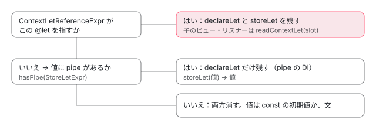

[目次](../README.md) › [@let の内側：字句から LView の枠まで](README.md) › 第 3 回 / 全 6 回

# テンプレートのパイプライン：declareLet・storeLet・readContextLet

> ingest が置く DeclareLetOp と StoreLetOp（64990a50ed9）、StoreLetExpr と ContextLetReferenceExpr、generate\_local\_let\_references と remove\_illegal\_let\_references の phase、ほかのビューから読まれず pipe も無い @let の storeLet と declareLet を消す store\_let\_optimization（a6b7b9b8c5e）と、読まれない @let の値の式が文として残る理由、i18n の phase の移動（8f2874e86d8）、@let を読まないリスナーの restore / reset view を消す修正（ce80136e7b9）、内容の写しの判定（c421ffdbfbf）、angular-main の ɵɵinvalid（9fe64d48d29）。ページの上で本物の compileComponentFromMetadata を動かし、出る命令を数える。

angular/angular · 読了 約 14 分 · 発展 · [サイトで読む（デモが動きます）](https://angular-deep-dive-cyan.vercel.app/chapter/letd-pipeline)

---

R3 AST の `t.LetDeclaration` が、テンプレートの関数の `ɵɵdeclareLet`（作成の段で LView に枠を取る）・`ɵɵstoreLet`（更新の段で値を枠に書く）・`ɵɵreadContextLet`（ほかのビューから枠を読む）になるまでを、ingest → phase（パイプラインの 1 段 1 段の変換）→ reify の順に読みます。どの条件で命令が省かれ、なぜ「読まれない @let の値の式」が文として残るのか、i18n の中とリスナーの中で何が直されたかを、本物の `compileComponentFromMetadata` で確かめます。

読む対象は compiler の `template/pipeline/` の `ir/src/ops/create.ts`・`ops/update.ts`・`ir/src/expression.ts`、`src/phases/` の `generate_local_let_references.ts`・`generate_variables.ts`・`remove_illegal_let_references.ts`・`store_let_optimization.ts`・`variable_optimization.ts`・`reify.ts`、`src/instruction.ts`、compliance の `r3_view_compiler_let/` です。ingest の `ingestLetDeclaration` は[ingest の章](../compiler/10-compiler-ingest.md)の 8 節、`store_let_optimization` の後半（pipe があると `declareLet` を残す行）は[pipe を書ける場所の章](../pipe/04-pipe-where-allowed.md)の 5 節、変数の生成と最適化の全体は[変数の章](../compiler/13-compiler-variables.md)で引用したので、ここではリンクします。命令が実行時に何をするかは[第 4 回](04-letd-runtime.md)です。

1. [1. 字句と構文](01-letd-syntax.md)
2. [2. スコープと binder](02-letd-scope.md)
3. **3. テンプレートのパイプライン**（この章）
4. [4. 実行時とハイドレーション](04-letd-runtime.md)
5. [5. 型チェックと診断](05-letd-typecheck.md)
6. [6. spec と issue](06-letd-tests-issues.md)

## 1. 歩み：パイプラインの側のコミット

| 日付 | コミット | 変わったこと | この章 |
| --- | --- | --- | --- |
| 2024-06-08 | 64990a50ed9 | ingest・ir・4 つの phase・reify・命令の 3 つ。compliance の `r3_view_compiler_let` に 16 の例（PR #56299） | 2〜6 節 |
| 2024-06-29 | 2a1291e942a | 同じビューの @let を親より優先（[第 2 回](02-letd-scope.md)の 5 節） | — |
| 2024-11-12 | c421ffdbfbf | 制御フローのブロックの根の @let が、内容の写し（content projection）の判定を邪魔していた | 9 節 |
| 2025-03-22 | a6b7b9b8c5e | 同じビューだけで使う @let は、pipe が無ければ `declareLet` も消す | 4 節 |
| 2025-05-09 | 8f2874e86d8 | i18n の phase を `optimizeStoreLet` の後ろへ（a6b7b9b8c5e で i18n の中の @let が壊れたため） | 7 節 |
| 2026-01-19 | ce80136e7b9 | @let を読まないリスナーの `restoreView` / `resetView` を消す（issue #66286） | 8 節 |
| 2026-10-28 | 9fe64d48d29（angular-main だけ） | 宣言より前の読みを `undefined` ではなく `ɵɵinvalid()` に | 3 節 |

a6b7b9b8c5e と 8f2874e86d8 は 20.1.0、ce80136e7b9 は 21.2.0 から入っています（`git tag --contains`）。どれもこのサイトの 22.2.6 に入っているので、DEMO の出力はこの章の今のコードの結果です。

## 2. ingest が置く 2 つの op

📄 `64990a50ed9 の差分（ingest.ts）`

```
# 64990a50ed9 2024-06-08 refactor(compiler): integrate let declarations into the template pipeline (#56299)
# packages/compiler/src/template/pipeline/src/ingest.ts
@@ -226,7 +226,7 @@ function ingestNodes(unit: ViewCompilationUnit, template: t.Node[]): void {
     } else if (node instanceof t.ForLoopBlock) {
       ingestForBlock(unit, node);
     } else if (node instanceof t.LetDeclaration) {
-      // TODO(crisbeto): needs further integration
+      ingestLetDeclaration(unit, node);
     } else {
       throw new Error(`Unsupported template node: ${node.constructor.name}`);
     }
…
@@ -926,6 +926,20 @@ function getComputedForLoopVariableExpression(
   }
 }
 
+function ingestLetDeclaration(unit: ViewCompilationUnit, node: t.LetDeclaration) {
+  const target = unit.job.allocateXrefId();
+
+  unit.create.push(ir.createDeclareLetOp(target, node.name, node.sourceSpan));
+  unit.update.push(
+    ir.createStoreLetOp(
+      target,
+      node.name,
+      convertAst(node.value, unit.job, node.valueSpan),
+      node.sourceSpan,
+    ),
+  );
+}
+
 /**
  * Convert a template AST expression into an output AST expression.
  */
```

1 つの @let から、作成の段（create）に `DeclareLetOp`、更新の段（update）に `StoreLetOp` を 1 つずつ置きます。値の式は `convertAst` で出力の式（`o.Expression`）にしたものです （ingest の章の 8 節）。2 つの op は同じ `target`（`XrefId`、パイプラインの中で op を指す番号）でつながっています。

📄 `angular/packages/compiler/src/template/pipeline/ir/src/ops/create.ts` L1706–1734 （▶ の行: 1709, 1711, 1713, 1729–1730）

```ts
1706 │ /**
1707 │  * Op that reserves a slot during creation time for a `@let` declaration.
1708 │  */
1709 ▶ export interface DeclareLetOp extends Op<CreateOp>, ConsumesSlotOpTrait {
1710 │   kind: OpKind.DeclareLet;
1711 ▶   xref: XrefId;
1712 │   sourceSpan: ParseSourceSpan;
1713 ▶   declaredName: string;
1714 │ }
1715 │ 
1716 │ /**
1717 │  * Creates a `DeclareLetOp`.
1718 │  */
1719 │ export function createDeclareLetOp(
1720 │   xref: XrefId,
1721 │   declaredName: string,
1722 │   sourceSpan: ParseSourceSpan,
1723 │ ): DeclareLetOp {
1724 │   return {
1725 │     kind: OpKind.DeclareLet,
1726 │     xref,
1727 │     declaredName,
1728 │     sourceSpan,
1729 ▶     handle: new SlotHandle(),
1730 ▶     ...TRAIT_CONSUMES_SLOT,
1731 │     ...NEW_OP,
1732 │   };
1733 │ }
1734 │ 
```

📄 `angular/packages/compiler/src/template/pipeline/ir/src/ops/update.ts` L1084–1120 （▶ の行: 1087, 1095, 1098, 1116–1117）

```ts
1084 │ /**
1085 │  * Op to store the current value of a `@let` declaration.
1086 │  */
1087 ▶ export interface StoreLetOp extends Op<UpdateOp>, ConsumesVarsTrait {
1088 │   kind: OpKind.StoreLet;
1089 │   sourceSpan: ParseSourceSpan;
1090 │ 
1091 │   /** Name that the user set when declaring the `@let`. */
1092 │   declaredName: string;
1093 │ 
1094 │   /** XrefId of the slot in which the call may write its value. */
1095 ▶   target: XrefId;
1096 │ 
1097 │   /** Value of the `@let` declaration. */
1098 ▶   value: o.Expression;
1099 │ }
1100 │ 
1101 │ /**
1102 │  * Creates a `StoreLetOp`.
1103 │  */
1104 │ export function createStoreLetOp(
1105 │   target: XrefId,
1106 │   declaredName: string,
1107 │   value: o.Expression,
1108 │   sourceSpan: ParseSourceSpan,
1109 │ ): StoreLetOp {
1110 │   return {
1111 │     kind: OpKind.StoreLet,
1112 │     target,
1113 │     declaredName,
1114 │     value,
1115 │     sourceSpan,
1116 ▶     ...TRAIT_DEPENDS_ON_SLOT_CONTEXT,
1117 ▶     ...TRAIT_CONSUMES_VARS,
1118 │     ...NEW_OP,
1119 │   };
1120 │ }
```

1. **1709・1730 行目：DeclareLetOp は slot を 1 つ使う**

   `ConsumesSlotOpTrait` の op は、`allocateSlots` で 1729 行目の `SlotHandle` に番号をもらいます（[slot と vars の章](../compiler/12-compiler-slots-vars.md)の 3 節）。この番号が `ɵɵdeclareLet(0)` の引数です。
2. **1087・1117 行目：StoreLetOp は binding の枠を 1 つ使う**

   `ConsumesVarsTrait` なので、`countVariables` が vars を 1 つ数えます。
3. **1116 行目：今の要素の位置が要る**

   `TRAIT_DEPENDS_ON_SLOT_CONTEXT` の op の前には、`generateAdvance` が `ɵɵadvance()` を入れて、カーソルを `target` の slot に合わせます（slot と vars の章の 5 節）。64990a50ed9 の本文の「必要な advance」がこれです。

## 3. 2 つの式と、宣言より前の読み

この 2 つの op は、phase の途中で式に置き換わります。

📄 `angular/packages/compiler/src/template/pipeline/ir/src/expression.ts` L225–263 （▶ の行: 227, 230–231, 234–235, 257）

```ts
225 │ export class StoreLetExpr
226 │   extends ExpressionBase
227 ▶   implements ConsumesVarsTrait, DependsOnSlotContextOpTrait
228 │ {
229 │   override readonly kind = ExpressionKind.StoreLet;
230 ▶   readonly [ConsumesVarsTrait] = true;
231 ▶   readonly [DependsOnSlotContext] = true;
232 │ 
233 │   constructor(
234 ▶     readonly target: XrefId,
235 ▶     public value: o.Expression,
236 │     override sourceSpan: ParseSourceSpan,
237 │   ) {
238 │     super();
239 │   }
240 │ 
241 │   override visitExpression(): void {}
242 │ 
243 │   override isEquivalent(e: o.Expression): boolean {
244 │     return (
245 │       e instanceof StoreLetExpr && e.target === this.target && e.value.isEquivalent(this.value)
246 │     );
247 │   }
248 │ 
249 │   override isConstant(): boolean {
250 │     return false;
251 │   }
252 │ 
253 │   override transformInternalExpressions(
254 │     transform: ExpressionTransform,
255 │     flags: VisitorContextFlag,
256 │   ): void {
257 ▶     this.value = transformExpressionsInExpression(this.value, transform, flags);
258 │   }
259 │ 
260 │   override clone(): StoreLetExpr {
261 │     return new StoreLetExpr(this.target, this.value, this.sourceSpan);
262 │   }
263 │ }
```

📄 `angular/packages/compiler/src/template/pipeline/ir/src/expression.ts` L265–289 （▶ の行: 265, 269–270, 285）

```ts
265 ▶ export class ContextLetReferenceExpr extends ExpressionBase {
266 │   override readonly kind = ExpressionKind.ContextLetReference;
267 │ 
268 │   constructor(
269 ▶     readonly target: XrefId,
270 ▶     readonly targetSlot: SlotHandle,
271 │   ) {
272 │     super();
273 │   }
274 │ 
275 │   override visitExpression(): void {}
276 │ 
277 │   override isEquivalent(e: o.Expression): boolean {
278 │     return e instanceof ContextLetReferenceExpr && e.target === this.target;
279 │   }
280 │ 
281 │   override isConstant(): boolean {
282 │     return false;
283 │   }
284 │ 
285 ▶   override transformInternalExpressions(): void {}
286 │ 
287 │   override clone(): ContextLetReferenceExpr {
288 │     return new ContextLetReferenceExpr(this.target, this.targetSlot);
289 │   }
```

`StoreLetExpr`（227〜231 行目）は op と同じ 2 つの性質（vars を使う・今の slot に依る）を、式のまま持ちます。257 行目、中の値の式も変換の対象です。`ContextLetReferenceExpr` は 270 行目の `targetSlot` で「どの slot を読むか」だけを持ち、中に式はありません（285 行目）。

📄 `angular/packages/compiler/src/template/pipeline/src/phases/generate_local_let_references.ts` L13–42 （▶ の行: 20, 24, 27–28, 31, 33, 36）

```ts
13 │ /**
14 │  * Replaces the `storeLet` ops with variables that can be
15 │  * used to reference the value within the same view.
16 │  */
17 │ export function generateLocalLetReferences(job: ComponentCompilationJob): void {
18 │   for (const unit of job.units) {
19 │     for (const op of unit.update) {
20 ▶       if (op.kind !== ir.OpKind.StoreLet) {
21 │         continue;
22 │       }
23 │ 
24 ▶       const variable: ir.IdentifierVariable = {
25 │         kind: ir.SemanticVariableKind.Identifier,
26 │         name: null,
27 ▶         identifier: op.declaredName,
28 ▶         local: true,
29 │       };
30 │ 
31 ▶       ir.OpList.replace<ir.UpdateOp>(
32 │         op,
33 ▶         ir.createVariableOp<ir.UpdateOp>(
34 │           job.allocateXrefId(),
35 │           variable,
36 ▶           new ir.StoreLetExpr(op.target, op.value, op.sourceSpan),
37 │           ir.VariableFlags.None,
38 │         ),
39 │       );
40 │     }
41 │   }
42 │ }
```

`generateLocalLetReferences`（phase の並びで `generateVariables` の直前）は、`StoreLetOp` を「`StoreLetExpr` を初期値に持つ変数の op」に置き換えます（31〜39 行目）。出力にすると `const total_r1 = ɵɵstoreLet(ctx.price * ctx.count);` の形で、同じビューの後ろの読みはこの変数を使います。28 行目の `local: true` が、第 2 回の 2a1291e942a で足した「同じビューの宣言」の印です。

ほかのビュー（子のビューと、リスナーなどの関数）から読むための変数は、`generateVariables` が作ります。集めるのはこの情報です。

📄 `angular/packages/compiler/src/template/pipeline/src/phases/generate_variables.ts` L150–162 （▶ の行: 155, 158, 161）

```ts
150 │ /**
151 │  * Information about `@let` declaration collected from a view.
152 │  */
153 │ interface LetDeclaration {
154 │   /** `XrefId` of the `@let` declaration that the reference is pointing to. */
155 ▶   targetId: ir.XrefId;
156 │ 
157 │   /** Slot in which the declaration is stored. */
158 ▶   targetSlot: ir.SlotHandle;
159 │ 
160 │   /** Variable referring to the declaration. */
161 ▶   variable: ir.IdentifierVariable;
162 │ }
```

`DeclareLetOp` ごとに 155 行目の `targetId` と 158 行目の slot を覚え、読む側のビューに「`ContextLetReferenceExpr` を初期値に持つ変数」を足します。同じビューの更新の段には足さず、子のビューか、関数（リスナー）のときだけです（変数の章の 4 節の `generateVariablesInScopeForView` の後半）。

📄 `angular/packages/compiler/src/template/pipeline/src/phases/remove_illegal_let_references.ts` L13–46 （▶ の行: 15, 18–19, 28, 34–35, 39, 42）

```ts
13 │ /**
14 │  * It's not allowed to access a `@let` declaration before it has been defined. This is enforced
15 ▶  * already via template type checking, however it can trip some of the assertions in the pipeline.
16 │  * E.g. the naming phase can fail because we resolved the variable here, but the variable doesn't
17 │  * exist anymore because the optimization phase removed it since it's invalid. To avoid surfacing
18 ▶  * confusing errors to users in the case where template type checking isn't running (e.g. in JIT
19 ▶  * mode) this phase detects illegal forward references and replaces them with `undefined`.
20 │  * Eventually users will see the proper error from the template type checker.
21 │  */
22 │ export function removeIllegalLetReferences(job: CompilationJob): void {
23 │   for (const unit of job.units) {
24 │     for (const op of unit.update) {
25 │       if (
26 │         op.kind !== ir.OpKind.Variable ||
27 │         op.variable.kind !== ir.SemanticVariableKind.Identifier ||
28 ▶         !(op.initializer instanceof ir.StoreLetExpr)
29 │       ) {
30 │         continue;
31 │       }
32 │ 
33 │       const name = op.variable.identifier;
34 ▶       let current: ir.UpdateOp | null = op;
35 ▶       while (current && current.kind !== ir.OpKind.ListEnd) {
36 │         ir.transformExpressionsInOp(
37 │           current,
38 │           (expr) =>
39 ▶             expr instanceof ir.LexicalReadExpr && expr.name === name ? o.literal(undefined) : expr,
40 │           ir.VisitorContextFlag.None,
41 │         );
42 ▶         current = current.prev;
43 │       }
44 │     }
45 │   }
46 │ }
```

1. **14〜20 行目：なぜこの phase があるか**

   宣言より前の読みは型チェックが止めますが（NG8016、[第 5 回](05-letd-typecheck.md)）、型チェックの無い JIT では、そのままだと後ろの phase の assertion（命名で変数が見つからない）に当たります。
2. **28 行目：`StoreLetExpr` を初期値に持つ変数を探す**

   つまり 3 節の `generateLocalLetReferences` が作った、同じビューの宣言です。
3. **34〜42 行目：その変数から前へ戻る**

   42 行目の `current.prev` で、更新の段の先頭まで戻りながら、同じ名前の読み（`LexicalReadExpr`）を 39 行目で `undefined` にします。34 行目で始めるのが変数の op そのものなので、`@let n = n + 1;` の右辺の `n` も `undefined` です。

戻るのは更新の段だけです。子のビューからの読み（`ContextLetReferenceExpr`）は名前の読みではないので、宣言の前にある `ng-template` の中で読んでも消されません （型チェックも、`ng-template` の中の読みは前でも許します）。angular-main の 9fe64d48d29 は、39 行目の `o.literal(undefined)` を `ir.InvalidExpr` に替えました。

📄 `9fe64d48d29 の差分（angular-main、remove_illegal_let_references.ts）`

```
# 9fe64d48d29 2026-10-28 fix(compiler): avoid producing type errors for invalid `@let` usages
# packages/compiler/src/template/pipeline/src/phases/remove_illegal_let_references.ts
@@ -36,7 +35,9 @@ export function removeIllegalLetReferences(job: CompilationJob): void {
         ir.transformExpressionsInOp(
           current,
           (expr) =>
-            expr instanceof ir.LexicalReadExpr && expr.name === name ? o.literal(undefined) : expr,
+            expr instanceof ir.LexicalReadExpr && expr.name === name
+              ? new ir.InvalidExpr(expr.sourceSpan)
+              : expr,
           ir.VisitorContextFlag.None,
         );
         current = current.prev;
```

コミットの本文は「`undefined` だと、生成したコードを型チェックしたときに型のエラーになる」です。compliance の期待も `undefined` から `i0.ɵɵinvalid()` に変わりました。

## 4. 同じビューだけで読むなら、storeLet も declareLet も要らない

📄 `angular/packages/compiler/src/template/pipeline/src/phases/store_let_optimization.ts` L12–35 （▶ の行: 16–17, 23, 25–26, 29–31）

```ts
12 │ /**
13 │  * Removes any `storeLet` calls that aren't referenced outside of the current view.
14 │  */
15 │ export function optimizeStoreLet(job: CompilationJob): void {
16 ▶   const letUsedExternally = new Set<ir.XrefId>();
17 ▶   const declareLetOps = new Map<ir.XrefId, ir.DeclareLetOp>();
18 │ 
19 │   // Since `@let` declarations can be referenced in child views, both in
20 │   // the creation block (via listeners) and in the update block, we have
21 │   // to look through all the ops to find the references.
22 │   for (const unit of job.units) {
23 ▶     for (const op of unit.ops()) {
24 │       // Take advantage that we're already looking through all the ops and track some more info.
25 ▶       if (op.kind === ir.OpKind.DeclareLet) {
26 ▶         declareLetOps.set(op.xref, op);
27 │       }
28 │ 
29 ▶       ir.visitExpressionsInOp(op, (expr) => {
30 ▶         if (expr instanceof ir.ContextLetReferenceExpr) {
31 ▶           letUsedExternally.add(expr.target);
32 │         }
33 │       });
34 │     }
35 │   }
```

`optimizeStoreLet` の前半です。23 行目、作成の段と更新の段の**すべての op**（リスナーの中を含む）を見て、30〜31 行目で `ContextLetReferenceExpr` が指す宣言、つまり「ほかのビューから読まれる @let」を集めます。25〜26 行目では、ついでに `DeclareLetOp` を `XrefId` で引ける表にしておきます。

後半（pipe を書ける場所の章の 5 節で引用した 36〜75 行目）は、ほかから読まれない @let の `StoreLetExpr` を中の値に置き換え、値に pipe が無ければ `DeclareLetOp` も消します。pipe があると残すのは、pipe の DI に `declareLet` が作る TNode（ノードごとの静的な情報）が要るからです。下が、その分岐を足した a6b7b9b8c5e の差分です。

📄 `a6b7b9b8c5e の差分（store_let_optimization.ts）`

```
# a6b7b9b8c5e 2025-03-22 perf(compiler): reduce allocations for let declarations only used in the same view (#60512)
# packages/compiler/src/template/pipeline/src/phases/store_let_optimization.ts
@@ -6,7 +6,6 @@
  * found in the LICENSE file at https://angular.dev/license
  */
 
-import * as o from '../../../../output/output_ast';
 import * as ir from '../../ir';
 import {CompilationJob} from '../compilation';
 
…
@@ -15,12 +14,18 @@ import {CompilationJob} from '../compilation';
  */
 export function optimizeStoreLet(job: CompilationJob): void {
   const letUsedExternally = new Set<ir.XrefId>();
+  const declareLetOps = new Map<ir.XrefId, ir.DeclareLetOp>();
 
   // Since `@let` declarations can be referenced in child views, both in
   // the creation block (via listeners) and in the update block, we have
   // to look through all the ops to find the references.
   for (const unit of job.units) {
     for (const op of unit.ops()) {
+      // Take advantage that we're already looking through all the ops and track some more info.
+      if (op.kind === ir.OpKind.DeclareLet) {
+        declareLetOps.set(op.xref, op);
+      }
+
       ir.visitExpressionsInOp(op, (expr) => {
         if (expr instanceof ir.ContextLetReferenceExpr) {
           letUsedExternally.add(expr.target);
…
@@ -29,17 +34,43 @@ export function optimizeStoreLet(job: CompilationJob): void {
     }
   }
 
-  // TODO(crisbeto): potentially remove the unused calls completely, pending discussion.
   for (const unit of job.units) {
     for (const op of unit.update) {
       ir.transformExpressionsInOp(
         op,
-        (expression) =>
-          expression instanceof ir.StoreLetExpr && !letUsedExternally.has(expression.target)
-            ? expression.value
-            : expression,
+        (expr) => {
+          // If a @let isn't used in other views, we don't have to store its value.
+          if (expr instanceof ir.StoreLetExpr && !letUsedExternally.has(expr.target)) {
+            // Furthermore, if the @let isn't using pipes, we can also drop its declareLet op.
+            // We need to keep the declareLet if there are pipes, because they can use DI which
+            // requires the TNode created by declareLet.
+            if (!hasPipe(expr)) {
+              ir.OpList.remove<ir.CreateOp>(declareLetOps.get(expr.target)!);
+            }
+            return expr.value;
+          }
+          return expr;
+        },
         ir.VisitorContextFlag.None,
       );
     }
   }
 }
+
+/** Determines if a `storeLet` expression contains a pipe. */
+function hasPipe(root: ir.StoreLetExpr): boolean {
+  let result = false;
+
+  ir.transformExpressionsInExpression(
+    root,
+    (expr) => {
+      if (expr instanceof ir.PipeBindingExpr || expr instanceof ir.PipeBindingVariadicExpr) {
+        result = true;
+      }
+      return expr;
+    },
+    ir.VisitorContextFlag.None,
+  );
+
+  return result;
+}
```



*optimizeStoreLet が 1 つの @let について決めること（a6b7b9b8c5e 以降）*

| DEMO の例 | ほかのビューから読む | pipe | declareLet | storeLet | 読む側 |
| --- | --- | --- | --- | --- | --- |
| 同じビューだけ | なし | なし | 消す | 消す（値だけ） | `const total_r1 = ctx.price * ctx.count` |
| pipe を使う | なし | あり | 残す | 消す | `const upper_r1 = ɵɵpipeBind1(1, 1, ctx.name)` |
| 子のビューで読む | @if の分岐 | なし | 残す | 残す | 子で `ɵɵnextContext(); ɵɵreadContextLet(0)` |
| リスナーで読む | リスナー | なし | 残す | 残す | リスナーの中で `ɵɵrestoreView(_r1); ɵɵreadContextLet(0)` |

リスナーは同じビューのテンプレートの中に書きますが、実行されるのはイベントのときで、更新の段の変数は見えません。そのため 3 節のとおり `ContextLetReferenceExpr` で読み、ここでは「ほかのビュー」と同じ扱いになります。

## 5. 読まれない @let の値の式は、文として残る

DEMO の「読まれない」（`@let unused = heavy();`）の出力は、更新の段が `ctx.heavy();` だけになります。`declareLet` も `storeLet` も無く、decls は &lt;p&gt; とテキストの 2 です。第 2 回の `shadowed_let` の親の `"parent";` も同じ形でした。phase の並びで、次の 2 つがこの順に動くからです。

1. **`optimizeVariables`：使われない変数を消す。ただし初期値に副作用があれば文として残す**

   3 節の `const unused_r1 = ɵɵstoreLet(ctx.heavy())` は読まれないので変数は消えますが、`StoreLetExpr` は「副作用がある」（`Fence.SideEffectful`）扱いなので、`ɵɵstoreLet(ctx.heavy());` という文が残ります（変数の章の 7 節）。
2. **`optimizeStoreLet`：ほかから読まれないので StoreLetExpr をはがす**

   文の中の `ɵɵstoreLet(…)` が中の値に置き換わり、`ctx.heavy();` が残ります。pipe が無いので `declareLet` も消えます。

この順なので、読まれない @let の値の式は変更検知のたびに評価されます。compliance の `let_single_optimization`・`let_invalid_forward_ref`（下の引用の 8 行目）の期待も、この文が残る形です。使われない @let を知らせる拡張診断 NG8112 は[第 5 回](05-letd-typecheck.md)です。

📄 `angular/packages/compiler-cli/test/compliance/test_cases/r3_view_compiler_let/let_invalid_forward_ref_template.js` L1–18 （▶ の行: 7–8）

```js
 1 │ function MyApp_ng_template_0_Template(rf, ctx) {
 2 │   if (rf & 1) {
 3 │     $r3$.ɵɵtext(0);
 4 │   }
 5 │   if (rf & 2) {
 6 │     const $ctx_r0$ = $r3$.ɵɵnextContext();
 7 ▶     $r3$.ɵɵtextInterpolate1(" ", undefined, " ");
 8 ▶     $ctx_r0$.value * 2;
 9 │   }
10 │ }
11 │ 
12 │ …
13 │ 
14 │ function MyApp_Template(rf, ctx) {
15 │   if (rf & 1) {
16 │     $r3$.ɵɵdomTemplate(0, MyApp_ng_template_0_Template, 1, 1, "ng-template");
17 │   }
18 │ }
```
*宣言より前の読みは 7 行目で undefined（3 節）。宣言そのものは 8 行目の文だけが残る（この節）*

## 6. reify：残った op と式を命令にする

📄 `angular/packages/compiler/src/template/pipeline/src/instruction.ts` L591–601 （▶ の行: 592, 596, 600）

```ts
591 │ export function declareLet(slot: number, sourceSpan: ParseSourceSpan): ir.CreateOp {
592 ▶   return call(Identifiers.declareLet, [o.literal(slot)], sourceSpan);
593 │ }
594 │ 
595 │ export function storeLet(value: o.Expression, sourceSpan: ParseSourceSpan): o.Expression {
596 ▶   return o.importExpr(Identifiers.storeLet).callFn([value], sourceSpan);
597 │ }
598 │ 
599 │ export function readContextLet(slot: number): o.Expression {
600 ▶   return o.importExpr(Identifiers.readContextLet).callFn([o.literal(slot)]);
601 │ }
```

3 つの命令を作る関数です。`declareLet`（592 行目）は作成の段の文、`storeLet`（596 行目）と `readContextLet`（600 行目）は式です。`reify` は `DeclareLetOp` を `declareLet(slot)` に、`StoreLetExpr` を `storeLet(value)` に、`ContextLetReferenceExpr` を `readContextLet(slot)` に替えます （式の置き換えの `switch` は[reify と emit の章](../compiler/16-compiler-reify-emit.md)で引用した範囲）。

📄 `angular/packages/compiler/src/template/pipeline/src/phases/reify.ts` L792–806 （▶ の行: 798–799）

```ts
792 │       case ir.OpKind.Repeater:
793 │         ir.OpList.replace(op, ng.repeater(op.collection, op.sourceSpan));
794 │         break;
795 │       case ir.OpKind.DeferWhen:
796 │         ir.OpList.replace(op, ng.deferWhen(op.modifier, op.expr, op.sourceSpan));
797 │         break;
798 ▶       case ir.OpKind.StoreLet:
799 ▶         throw new Error(`AssertionError: unexpected storeLet ${op.declaredName}`);
800 │       case ir.OpKind.Statement:
801 │         // Pass statement operations directly through.
802 │         break;
803 │       default:
804 │         throw new Error(
805 │           `AssertionError: Unsupported reification of update op ${ir.OpKind[op.kind]}`,
806 │         );
```

更新の段の op を命令にする `switch` で、`StoreLetOp` は 799 行目の assertion です。3 節の `generateLocalLetReferences` がすべての `StoreLetOp` を変数に替えているので、reify まで残ることはありません。`storeLet` が式なのは、この「変数の初期値になる」形のためです。`ɵɵstoreLet` は書いた値をそのまま返すので（[第 4 回](04-letd-runtime.md)）、`const total_r1 = ɵɵstoreLet(…)` で枠に書きつつ同じビューの読みに使えます。

## 7. i18n の中の @let（8f2874e86d8）

📄 `8f2874e86d8 の差分（emit.ts の phase の並び）`

```
# 8f2874e86d8 2025-05-09 fix(compiler): incorrectly handling let declarations inside i18n (#60512)
# packages/compiler/src/template/pipeline/src/emit.ts
@@ -116,11 +116,6 @@ const phases: Phase[] = [
   {kind: Kind.Tmpl, fn: generateConditionalExpressions},
   {kind: Kind.Tmpl, fn: createPipes},
   {kind: Kind.Tmpl, fn: configureDeferInstructions},
-  {kind: Kind.Tmpl, fn: convertI18nText},
-  {kind: Kind.Tmpl, fn: convertI18nBindings},
-  {kind: Kind.Tmpl, fn: removeUnusedI18nAttributesOps},
-  {kind: Kind.Tmpl, fn: assignI18nSlotDependencies},
-  {kind: Kind.Tmpl, fn: applyI18nExpressions},
   {kind: Kind.Tmpl, fn: createVariadicPipes},
   {kind: Kind.Both, fn: generatePureLiteralStructures},
   {kind: Kind.Tmpl, fn: generateProjectionDefs},
…
@@ -143,6 +138,11 @@ const phases: Phase[] = [
   {kind: Kind.Both, fn: generateTemporaryVariables},
   {kind: Kind.Both, fn: optimizeVariables},
   {kind: Kind.Both, fn: optimizeStoreLet},
+  {kind: Kind.Tmpl, fn: convertI18nText},
+  {kind: Kind.Tmpl, fn: convertI18nBindings},
+  {kind: Kind.Tmpl, fn: removeUnusedI18nAttributesOps},
+  {kind: Kind.Tmpl, fn: assignI18nSlotDependencies},
+  {kind: Kind.Tmpl, fn: applyI18nExpressions},
   {kind: Kind.Tmpl, fn: allocateSlots},
   {kind: Kind.Tmpl, fn: resolveI18nElementPlaceholders},
   {kind: Kind.Tmpl, fn: resolveI18nExpressionPlaceholders},
```

コミットの本文によると、`assignI18nSlotDependencies`（i18n の式がどの slot に依るかを決める phase。[i18n のパイプラインの章](../loc/05-loc-pipeline-phases.md)の 9 節）が、`optimizeStoreLet` より前に i18n の op の `target` を決めていました。a6b7b9b8c5e で `declareLet` が消えるようになると、その `target` が消えた op を指し、assertion に当たります。8f2874e86d8 は i18n の 5 つの phase を `optimizeStoreLet` の後ろへ移し、もう 1 つの差分で「式の中に別の slot に依るもの（`storeLet` など）があれば、そこで区切る」を足しました。

📄 `8f2874e86d8 の差分（assign_i18n_slot_dependencies.ts）`

```
# 8f2874e86d8 2025-05-09 fix(compiler): incorrectly handling let declarations inside i18n (#60512)
# packages/compiler/src/template/pipeline/src/phases/assign_i18n_slot_dependencies.ts
@@ -67,7 +67,26 @@ export function assignI18nSlotDependencies(job: CompilationJob) {
             continue;
           }
 
+          let hasDifferentTarget = false;
           if (ir.hasDependsOnSlotContextTrait(updateOp) && updateOp.target !== createOp.xref) {
+            hasDifferentTarget = true;
+          } else if (
+            // Some expressions may consume slots as well (e.g. `storeLet`).
+            updateOp.kind === ir.OpKind.Statement ||
+            updateOp.kind === ir.OpKind.Variable
+          ) {
+            ir.visitExpressionsInOp(updateOp, (expr) => {
+              if (
+                !hasDifferentTarget &&
+                ir.hasDependsOnSlotContextTrait(expr) &&
+                expr.target !== createOp.xref
+              ) {
+                hasDifferentTarget = true;
+              }
+            });
+          }
+
+          if (hasDifferentTarget) {
             break;
           }
 
```

📄 `angular/packages/compiler-cli/test/compliance/test_cases/r3_view_compiler_let/let_in_i18n_template.js` L23–35 （▶ の行: 26, 30, 32–33）

```js
23 │   template: function MyApp_Template(rf, ctx) {
24 │     if (rf & 1) {
25 │       $r3$.ɵɵdomElementStart(0, "div");
26 ▶       $r3$.ɵɵi18n(1, 0);
27 │       $r3$.ɵɵdomElementEnd();
28 │     }
29 │     if (rf & 2) {
30 ▶       const result_r1 = ctx.value * 2;
31 │       $r3$.ɵɵadvance();
32 ▶       $r3$.ɵɵi18nExp(result_r1);
33 ▶       $r3$.ɵɵi18nApply(1);
34 │     }
35 │   },
```
*compliance の let\_in\_i18n（should handle an @let used only directly inside i18n）*

i18n のブロックの中の @let も、同じビューだけで読むなら 4 節の表の 1 行目と同じで、30 行目の変数になり、`declareLet` はありません。DEMO の「i18n の中」も同じ形です。

## 8. リスナーの中：restoreView / resetView を消す（ce80136e7b9）

リスナーの関数は、ビューの変数を読むときに `ɵɵrestoreView(_r1)` で宣言したビューに戻り、`return ɵɵresetView(…)` で戻します（変数の章の 5 節）。issue #66286 は、@let を読まないリスナーにもこの 2 つが出ていた、という報告です。

📄 `angular/packages/compiler/src/template/pipeline/src/phases/variable_optimization.ts` L566–593 （▶ の行: 571, 578, 581, 584, 587, 589–590）

```ts
566 │ /**
567 │  * After variables have been optimized in nested ops (e.g. handlers or functions), we may end up
568 │  * with `saveView`/`restoreView` calls that aren't necessary since all the references to the view
569 │  * were optimized away. This function removes the ops related to the view restoration.
570 │  */
571 ▶ function optimizeSaveRestoreView(ops: ir.OpList<ir.UpdateOp>): void {
572 │   const head = ops.head.next;
573 │   const tail = ops.tail.prev;
574 │ 
575 │   // We can only optimize if we have two ops:
576 │   // 1. A call to `restoreView`.
577 │   // 2. A return statement with a `resetView` in it.
578 ▶   if (
579 │     head !== null &&
580 │     tail !== null &&
581 ▶     head.next === tail &&
582 │     head.kind === ir.OpKind.Statement &&
583 │     head.statement instanceof o.ExpressionStatement &&
584 ▶     head.statement.expr instanceof ir.RestoreViewExpr &&
585 │     tail.kind === ir.OpKind.Statement &&
586 │     tail.statement instanceof o.ReturnStatement &&
587 ▶     tail.statement.value instanceof ir.ResetViewExpr
588 │   ) {
589 ▶     ir.OpList.remove<ir.UpdateOp>(head);
590 ▶     tail.statement.value = tail.statement.value.expr;
591 │   }
592 │ }
593 │ 
```

1. **578〜588 行目：形を 1 つだけ見る**

   関数の op がちょうど 2 つ（581 行目の `head.next === tail`）で、1 つ目が `restoreView` の文、2 つ目が `return resetView(式)` のとき。
2. **589〜590 行目：restoreView を消し、resetView をはがす**

   残るのは `return 式;` です。

📄 `ce80136e7b9 の差分の一部（variable_optimization.ts の optimizeVariables）`

```
# ce80136e7b9 2026-01-19 fix(compiler): optimize away unnecessary restore/reset view calls
# packages/compiler/src/template/pipeline/src/phases/variable_optimization.ts
@@ -51,16 +51,9 @@ export function optimizeVariables(job: CompilationJob): void {
 
     for (const expr of unit.functions) {
       optimizeVariablesInOpList(expr.ops, job.compatibility, null);
+      optimizeSaveRestoreView(expr.ops);
     }
 
-    // Note that we skip over arrow function operations, because they are considered
-    // separate boundaries that should not influence the surrounding create/update
-    // operations. This is a side-effect of not being able to control which nested
-    // ops `visitExpressionsInOp` will visit. Without this logic, variable references
-    // inside the arrow function can throw off usage counting for things like view references.
-    optimizeVariablesInOpList(unit.create, job.compatibility, skipArrowFunctionOps);
-    optimizeVariablesInOpList(unit.update, job.compatibility, skipArrowFunctionOps);
-
     for (const op of unit.create) {
       if (
         op.kind === ir.OpKind.Listener ||
…
@@ -69,10 +62,19 @@ export function optimizeVariables(job: CompilationJob): void {
         op.kind === ir.OpKind.TwoWayListener
       ) {
         optimizeVariablesInOpList(op.handlerOps, job.compatibility, skipArrowFunctionOps);
+        optimizeSaveRestoreView(op.handlerOps);
       } else if (op.kind === ir.OpKind.RepeaterCreate && op.trackByOps !== null) {
         optimizeVariablesInOpList(op.trackByOps, job.compatibility, skipArrowFunctionOps);
       }
     }
+
+    // Note that we skip over arrow function operations, because they are considered
+    // separate boundaries that should not influence the surrounding create/update
+    // operations. This is a side-effect of not being able to control which nested
+    // ops `visitExpressionsInOp` will visit. Without this logic, variable references
+    // inside the arrow function can throw off usage counting for things like view references.
+    optimizeVariablesInOpList(unit.create, job.compatibility, skipArrowFunctionOps);
+    optimizeVariablesInOpList(unit.update, job.compatibility, skipArrowFunctionOps);
   }
 }
 
```

変数の最適化（`optimizeVariablesInOpList`）をリスナーの中で先に済ませ、使われない `readContextLet` の変数が消えたあとで、この関数を呼びます。本文によると、作成の段と更新の段の最適化をリスナーの後ろに回したことで、`getCurrentView` の変数（`_r1`）も消えるようになりました。compliance の期待はこうです。

📄 `angular/packages/compiler-cli/test/compliance/test_cases/r3_view_compiler_listener/listener_unused_let_template.js` L1–20 （▶ の行: 9, 14）

```js
 1 │ $r3$.ɵɵdefineComponent({
 2 │   …
 3 │   decls: 2,
 4 │   vars: 1,
 5 │   consts: [[3, "click"]],
 6 │   template: function TestCmp_Template(rf, ctx) {
 7 │     if (rf & 1) {
 8 │       $r3$.ɵɵdomElementStart(0, "button", 0);
 9 ▶       $r3$.ɵɵdomListener("click", function TestCmp_Template_button_click_0_listener() { return ctx.noop(); });
10 │       $r3$.ɵɵdomElementEnd();
11 │       $r3$.ɵɵtext(1);
12 │     }
13 │     if (rf & 2) {
14 ▶       const $foo_r1$ = 123;
15 │       $r3$.ɵɵadvance();
16 │       $r3$.ɵɵtextInterpolate1(" ", $foo_r1$, " ");
17 │     }
18 │   },
19 │   …
20 │ });
```

子のビューのリスナーで、親の @let を何段も上から読む形は `let_in_child_view_listener` です（64990a50ed9 で入った例）。

📄 `angular/packages/compiler-cli/test/compliance/test_cases/r3_view_compiler_let/let_in_child_view_listener.ts` L1–29 （▶ の行: 5, 8, 11, 15–16）

```ts
 1 │ import {Component} from '@angular/core';
 2 │ 
 3 │ @Component({
 4 │   template: `
 5 ▶     @let one = value + 1;
 6 │ 
 7 │     <ng-template>
 8 ▶       @let two = one + 1;
 9 │ 
10 │       @if (true) {
11 ▶         @let three = two + 1;
12 │ 
13 │         @switch (1) {
14 │           @case (1) {
15 ▶             @let four = three + 1;
16 ▶             <button (click)="callback(one, two, three, four)"></button>
17 │           }
18 │         }
19 │       }
20 │     </ng-template>
21 │   `,
22 │ })
23 │ export class MyApp {
24 │   value = 1;
25 │ 
26 │   callback(one: number, two: number, three: number, four: number) {
27 │     console.log(one, two, three, four);
28 │   }
29 │ }
```

📄 `angular/packages/compiler-cli/test/compliance/test_cases/r3_view_compiler_let/let_in_child_view_listener_template.js` L1–27 （▶ の行: 4, 9–12, 16–17, 24–25）

```js
 1 │ function MyApp_ng_template_1_Conditional_1_Case_1_Template(rf, ctx) {
 2 │   if (rf & 1) {
 3 │     const $_r1$ = $r3$.ɵɵgetCurrentView();
 4 ▶     $r3$.ɵɵdeclareLet(0);
 5 │     $r3$.ɵɵdomElementStart(1, "button", 0);
 6 │     $r3$.ɵɵdomListener(
 7 │       "click",
 8 │       function MyApp_ng_template_1_Conditional_1_Case_1_Template_button_click_1_listener() {
 9 ▶         $r3$.ɵɵrestoreView($_r1$);
10 ▶         const $four_1$ = $r3$.ɵɵreadContextLet(0);
11 ▶         $r3$.ɵɵnextContext();
12 ▶         const $three_2$ = $r3$.ɵɵreadContextLet(0);
13 │         $r3$.ɵɵnextContext();
14 │         const $two_3$ = $r3$.ɵɵreadContextLet(0);
15 │         const $ctx_r4$ = $r3$.ɵɵnextContext();
16 ▶         const $one_5$ = $r3$.ɵɵreadContextLet(0);
17 ▶         return $r3$.ɵɵresetView($ctx_r4$.callback($one_5$, $two_3$, $three_2$, $four_1$));
18 │       }
19 │     );
20 │     $r3$.ɵɵdomElementEnd();
21 │   }
22 │   if (rf & 2) {
23 │     $r3$.ɵɵnextContext();
24 ▶     const $three_2$ = $r3$.ɵɵreadContextLet(0);
25 ▶     $r3$.ɵɵstoreLet($three_2$ + 1);
26 │   }
27 │ }
```

📄 `angular/packages/compiler-cli/test/compliance/test_cases/r3_view_compiler_let/let_in_child_view_listener_template.js` L48–79 （▶ の行: 50, 55–56, 71, 75）

```js
48 │ function MyApp_ng_template_1_Template(rf, ctx) {
49 │   if (rf & 1) {
50 ▶     $r3$.ɵɵdeclareLet(0);
51 │     $r3$.ɵɵconditionalCreate(1, MyApp_ng_template_1_Conditional_1_Template, 2, 2);
52 │   }
53 │   if (rf & 2) {
54 │     $r3$.ɵɵnextContext();
55 ▶     const $one_5$ = $r3$.ɵɵreadContextLet(0);
56 ▶     $r3$.ɵɵstoreLet($one_5$ + 1);
57 │     $r3$.ɵɵadvance();
58 │     $r3$.ɵɵconditional(true ? 1 : -1);
59 │   }
60 │ }
61 │ 
62 │ …
63 │ 
64 │ $r3$.ɵɵdefineComponent({
65 │   …
66 │   decls: 2,
67 │   vars: 1,
68 │   …
69 │   template: function MyApp_Template(rf, ctx) {
70 │     if (rf & 1) {
71 ▶       $r3$.ɵɵdeclareLet(0);
72 │       $r3$.ɵɵdomTemplate(1, MyApp_ng_template_1_Template, 2, 2, "ng-template");
73 │     }
74 │     if (rf & 2) {
75 ▶       $r3$.ɵɵstoreLet(ctx.value + 1);
76 │     }
77 │   },
78 │   …
79 │ });
```

いちばん内側の `@case` のビューでは、作成の段の 4 行目に自分の `four` の `declareLet(0)`、リスナーの 9〜16 行目で、`restoreView` のあと `readContextLet(0)` と `nextContext()` を交互に呼んで `four`・`three`・`two`・`one` を順に読みます。どの @let も自分のビューの slot 0 にいるので、引数はいつも 0 です。更新の段の 24〜25 行目は、`four = three + 1` の値を求めるのに、1 つ上のビューの `three` を読んでいます。ルートの 71・75 行目が `one` の宣言と保存です。

## 9. 内容の写しの判定で @let を数えない（c421ffdbfbf）

📄 `c421ffdbfbf の差分（ingest.ts）`

```
# c421ffdbfbf 2024-11-12 fix(compiler): control flow nodes with root at the end projected incorrectly (#58607)
# packages/compiler/src/template/pipeline/src/ingest.ts
@@ -1746,8 +1746,9 @@ function ingestControlFlowInsertionPoint(
   let root: t.Element | t.Template | null = null;
 
   for (const child of node.children) {
-    // Skip over comment nodes.
-    if (child instanceof t.Comment) {
+    // Skip over comment nodes and @let declarations since
+    // it doesn't matter where they end up in the DOM.
+    if (child instanceof t.Comment || child instanceof t.LetDeclaration) {
       continue;
     }
 
```

`@if` などの中身を `<ng-content select>` のどの枠に写すかは、ブロックの根のノードが要素 1 つのときに、その要素で決めます（[投影のコンパイルの章](../proj/02-proj-compile.md)の 8 節）。この差分の前は @let も根のノードに数えたので、`@if (x) { @let a = 1; <div foo>…</div> }` の `<div foo>` が `[foo]` の枠に写りませんでした。@let は DOM を持たないので、どこにあっても写す先に関係しない、という扱いです。

## 10. DEMO：テンプレートを変えて、出る命令を並べる

> **🧪 DEMO — compileComponentFromMetadata の出力で @let の命令を数える**
>
> ボタンを押すと `@angular/compiler`（22.2.6）を読み込み、`parseTemplate` の結果から `R3ComponentMetadata` を作って `compileComponentFromMetadata` に通し、出てきた式を文字列にします（評価はしません）。ngtsc もテンプレートの関数は同じ関数で作る（compiler-cli の `annotations/component/src/handler.ts`）ので、Node で compiler-cli を動かす記録ではなく、ページの上の本物にしました。文字列は JIT の出力の書き方なので、compliance の期待（`const`）と違い `var` で出ます。pipe（`uppercase`）は宣言していないので、名前のまま `ɵɵpipe` に入ります。
>
> ▶ [このデモはサイトで動かせます](https://angular-deep-dive-cyan.vercel.app/chapter/letd-pipeline)

> [!TIP]
> **新卒エンジニアへ**
>
> 「子のビューのリスナー」は、8 節の compliance を 2 段にした形です。子のビューの `two` は同じビューのリスナーが読むので `storeLet` が残り、ルートの `one` は子の更新の段とリスナーの両方から `readContextLet` で読まれます。「@let を読まないリスナー」は 8 節の `listener_unused_let` と同じテンプレートで、リスナーは `return ctx.noop();` だけです。

## ここまでの呼び出し（phase の順）

- `ingestLetDeclaration` — pipeline/src/ingest.ts — *create に `DeclareLetOp`、update に `StoreLetOp`*
- `generateLocalLetReferences` — phases/generate\_local\_let\_references.ts — *`StoreLetOp` → 変数（`StoreLetExpr`、`local: true`）*
- `generateVariables` — phases/generate\_variables.ts — *子のビューとリスナーに `ContextLetReferenceExpr` の変数*
- `saveAndRestoreView` — phases/save\_restore\_view.ts — *@let を読みうるリスナーに `restoreView` / `resetView`*
- `removeIllegalLetReferences` — phases/remove\_illegal\_let\_references.ts — *宣言より前の同じビューの読みを `undefined` に*
- `resolveNames` — phases/resolve\_names.ts — *同じビューの宣言を先に（2a1291e942a）*
- `optimizeVariables` — phases/variable\_optimization.ts — *使われない変数を消す。`StoreLetExpr` は文として残す。リスナーの `restoreView` を消す（ce80136e7b9）*
- `optimizeStoreLet` — phases/store\_let\_optimization.ts — *ほかから読まれなければ値だけに。pipe が無ければ `DeclareLetOp` も消す*
- i18n の 5 つの phase — phases/convert\_i18n\_text.ts ほか — *8f2874e86d8 でここへ*
- `allocateSlots` / `countVariables` / `generateAdvance` — phases/ — *slot 番号・vars・advance*
- `reify` — phases/reify.ts — *`ɵɵdeclareLet(slot)`・`ɵɵstoreLet(value)`・`ɵɵreadContextLet(slot)`*

## テストと直し方

### spec

パイプラインの @let は、コンパイラの単体の spec ではなく、compliance（テンプレートを全部コンパイルし、出力を期待の .js と比べるテスト）で固めています。`r3_view_compiler_let/TEST_CASES.json` の 22 の項目と、`r3_view_compiler_listener` の `should not generate restore/reset view when listener does not use @let in the same scope`（ce80136e7b9）です。

| TEST\_CASES.json の項目（行） | この章のどこ |
| --- | --- |
| `should create a simple @let declaration`（5）・`should remove a single unused let declaration`（195）・`…a chain of unused…`（212）・`…from the middle of a chain…`（229） | 4・5 節 |
| `should not remove let declarations that are only used in an event listener`（246）・`…only used in a child view`（263） | 4 節の表 |
| `should not optimize away declareLet if expression is using a pipe`（297） | 4 節（pipe） |
| `should transform an invalid let reference to undefined`（175、`checkTemplateBodies: false`） | 3・5 節 |
| `should be able to use let declarations in event listeners inside child views`（107） | 8 節 |
| `should give precedence to local @let definition over one from a parent view`（280） | 第 2 回の 5 節 |
| `should handle an @let used only directly inside i18n`（314）ほか i18n の 4 つ（〜365） | 7 節 |

### 手元で走らせた結果

📄 `走らせたコマンド`

```
cd ~/angular-research/angular
pnpm bazel test //packages/compiler-cli/test/compliance/full:full --nocache_test_results --test_output=all \
  "--test_arg=--filter=r3_view_compiler_let"
pnpm bazel test //packages/compiler-cli/test/compliance/full:full --nocache_test_results --test_output=all \
  "--test_arg=--filter=does not use @let in the same scope"
```

📄 `結果（2026-11-16）`

```
//packages/compiler-cli/test/compliance/full:full（shard 2 つ、r3_view_compiler_let）
Ran 11 of 606 specs / Ran 11 of 606 specs
11 specs, 0 failures（2 つとも）                                          PASSED in 1.4s
//packages/compiler-cli/test/compliance/full:full（shard 2 つ、listener_unused_let）
Ran 0 of 616 specs / Ran 1 of 617 specs
1 spec, 0 failures                                                        PASSED in 1.1s
```

full のコンパイルの compliance は 2 つの shard に分かれ、`r3_view_compiler_let` の 22 の項目が 11 ずつに割れました。絞り込みの文字列は、test\_runner.ts の ``describe(`[${test.relativePath}]/…`)`` に入るディレクトリ名です。

### 直すとしたら

- 5 節の「読まれない @let の値の式が毎回評価される」を変えるなら、`optimizeStoreLet` の後半で、`StoreLetExpr` を値に置き換えた結果が文（`ExpressionStatement`）だけになるときの扱いです。ただし値に pipe や関数の呼び出しがあると副作用を消すことになるので、compliance の `let_single_optimization_template.js` などの期待を変える判断になります。
- 3 節の `removeIllegalLetReferences` は更新の段だけを戻ります。作成の段（リスナー）の中の宣言より前の読みは別の道（`ContextLetReferenceExpr`）なので対象外で、これを固める compliance は今ありません。足すなら `let_invalid_forward_ref` の隣に、`checkTemplateBodies: false` の項目として置きます。

## 聞かれそうな質問

**Q. @let は必ず LView に枠を取りますか？**

いいえ。ほかのビュー（子のビュー・リスナー）から読まれず、値に pipe が無ければ、`optimizeStoreLet` が `DeclareLetOp` を消すので、`ɵɵdeclareLet` も slot もありません（store\_let\_optimization.ts の 23〜31 行目で「ほかから読まれる」を集め、後半で消す）。値は更新の段のふつうの `const` です。

**Q. pipe を使った @let だけ `declareLet` が残るのはなぜですか？**

pipe の DI に、`declareLet` が作る TNode が要るからです（a6b7b9b8c5e の差分のコメント）。`storeLet` は消え、値は `ɵɵpipeBind1` の結果の変数になります。

**Q. 使っていない @let にも実行時のコストはありますか？**

値の式の評価が残ります。`optimizeVariables` が `StoreLetExpr` を副作用のある初期値として文に残し、そのあと `optimizeStoreLet` が中の値だけにするので、`@let unused = heavy();` は更新の段の `ctx.heavy();` になります（5 節）。

**Q. リスナーで @let を読むと、何が増えますか？**

`declareLet` と `storeLet` が残り、リスナーの中に `ɵɵrestoreView`・`ɵɵreadContextLet`・`ɵɵresetView` が入ります。リスナーが @let を読まなければ、ce80136e7b9 の `optimizeSaveRestoreView`（variable\_optimization.ts の 578〜590 行目）で消えます。

**Q. JIT で宣言より前に @let を読むと、どうなりますか？**

同じビューの更新の段の読みなら、remove\_illegal\_let\_references.ts の 39 行目で `undefined` になり、エラーにはなりません（angular-main では `ɵɵinvalid()`）。AOT では型チェックが NG8016 で止めます。

## 読み終えて

- ingest は 1 つの @let から `DeclareLetOp`（slot を使う）と `StoreLetOp`（vars を使い、advance が要る）を置く
- `StoreLetOp` はすぐに「`StoreLetExpr` を初期値に持つ変数」になり、ほかのビューとリスナーは `ContextLetReferenceExpr`（`readContextLet(slot)`）で読む
- ほかから読まれなければ `storeLet` は消え、pipe も無ければ `declareLet` も消える。値の式は、読まれなくても文として残る
- 宣言より前の同じビューの読みは JIT のために `undefined`（angular-main では `ɵɵinvalid()`）。i18n の phase は `optimizeStoreLet` の後ろ。@let を読まないリスナーは `restoreView` を持たない

---

← 前: [スコープと binder：どこから読めて、何に結び付くか](02-letd-scope.md)  
次: [実行時とハイドレーション：LView の 1 つの枠](04-letd-runtime.md) →
