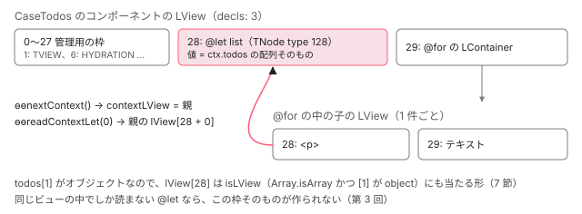

[目次](../README.md) › [@let の内側：字句から LView の枠まで](README.md) › 第 4 回 / 全 6 回

# 実行時とハイドレーション：LView の 1 つの枠

> let\_declaration.ts の 3 つの命令（ɵɵdeclareLet・ɵɵstoreLet・ɵɵreadContextLet）と UNINITIALIZED\_LET、NG0314（UNINITIALIZED\_LET\_ACCESS）が出る 2 つの道（リスナーと、作成の回の同期の detectChanges。#66824）、TNodeType.LetDeclaration を DOM をたどる 9 か所がどう飛ばすか、ハイドレーションでの @let（7dfe302f479・a752178f28b・4231e8f28ff）。利用者の値をそのまま LView の枠に入れるので、isLView・isLContainer に当たる配列が片付け（#59504・#71929）とサーバーの注釈（\['a', true\] で NG0502）で取り違えられることを、22.1.6・22.2.6 と手を入れた写しでサーバーの描画からハイドレーションまで動かして確かめる。ページの上で @let の値を変えて LView の枠を読む。

angular/angular · 読了 約 13 分 · 発展 · [サイトで読む（デモが動きます）](https://angular-deep-dive-cyan.vercel.app/chapter/letd-runtime)

---

`@let total = price * qty;` は、実行時には **LView（ビューごとのデータの配列）の 1 つの枠**になります。この章では、その枠を用意する `ɵɵdeclareLet`、値を書く `ɵɵstoreLet`、子のビューから読む `ɵɵreadContextLet` の 3 つの命令と、まだ値が無いことを表す `UNINITIALIZED_LET`・エラー NG0314、DOM を持たない `TNodeType.LetDeclaration` を DOM をたどる処理がどう飛ばすか、ハイドレーション（サーバーで描いた DOM を使い回して起動すること）での扱いを、コミットの差分 → 今の行 → spec → 実際に動かした記録の順に読みます。最後に、**利用者の値がそのまま LView の枠に入る**ことが、どの行で内部の配列と取り違えられるかを、サーバーで描いてからハイドレーションする記録で確かめます。

読む対象は `packages/core/src/render3/instructions/let_declaration.ts`（全 71 行）、`render3/interfaces/node.ts`・`collect_native_nodes.ts`・`node_manipulation.ts` の LetDeclaration の行、`hydration/annotate.ts`・`node_lookup_utils.ts`・`error_handling.ts`・`cleanup.ts`、`packages/core/test/acceptance/let_spec.ts` と `packages/platform-server/test/full_app_hydration_spec.ts` の `describe('@let')` です。どの `@let` が命令になり、どれがただの変数に消えるかは[第 3 回](03-letd-pipeline.md)で読みました。この章はその出力を受け取る側です。

1. [1. 字句と構文](01-letd-syntax.md)
2. [2. スコープと binder](02-letd-scope.md)
3. [3. テンプレートのパイプライン](03-letd-pipeline.md)
4. **4. 実行時とハイドレーション**（この章）
5. [5. 型チェックと診断](05-letd-typecheck.md)
6. [6. spec と issue](06-letd-tests-issues.md)

## 1. 歩み：空の命令から、ハイドレーションの直しまで

実行時の側を変えたコミットです（../angular の `git log`。日付は作者の日付で、どれもこのサイトの 22.2.6 に入っています）。

| 日付 | コミット | 変わったこと |
| --- | --- | --- |
| 2024-05-14 | bbe39c1738a（#56527） | 3 つの命令の中身、`TNodeType.LetDeclaration`、`UNINITIALIZED_LET_ACCESS = 314`、DOM をたどる 4 か所の読み飛ばし、let\_spec.ts（451 行） |
| 2024-06-21 | 7dfe302f479（#56527） | ハイドレーションの 3 ファイル（annotate.ts・node\_lookup\_utils.ts・error\_handling.ts）が `@let` を「DOM の無いノード」として扱う |
| 2024-06-26 | 0a48d584f2f（#56715） | `@let` を既定で有効にする（コンパイラの旗を外す。core の実行時のコードは変えていない） |
| 2024-07-29 | a752178f28b（#57173） | ビューの先頭が `@let` のとき `getFirstNativeNode` が開発モードの確かめで落ちた（#57160） |
| 2024-09-14 | 4231e8f28ff（#57816） | 配列を入れた `@let` を、サーバー側の注釈がコンポーネントの LView と取り違えた |
| 2024-09-14 | e5adf929659（#57813） | 安定版にする |
| 2025-11-25 | c994267f17d | 使われ方を数える `performanceMarkFeature('NgLet')` を `storeLet` から `declareLet` へ移す |

最初の bbe39c1738a の前は、命令は `// TODO(crisbeto): implement this` だけの空の関数でした。履歴の上では、コンパイラ側の 64990a50ed9（パイプラインの統合、#56299、作者の日付 06-08）が、出力が呼ぶ空の命令をこのファイルに先に足し、bbe39c1738a がそれを埋めています。差分をそのまま載せます。今の形との違いは、import の置き場（後の 76c4a77af7b・69984ef55d8 で `tnode_manipulation.ts` と `view_utils.ts` へ移った）と、次の c994267f17d だけです。

📄 `bbe39c1738a の let_declaration.ts`

```ts
diff --git a/packages/core/src/render3/instructions/let_declaration.ts b/packages/core/src/render3/instructions/let_declaration.ts
--- a/packages/core/src/render3/instructions/let_declaration.ts
+++ b/packages/core/src/render3/instructions/let_declaration.ts
@@ -6,36 +6,67 @@
  * found in the LICENSE file at https://angular.io/license
  */
 
+import {RuntimeError, RuntimeErrorCode} from '../../errors';
+import {performanceMarkFeature} from '../../util/performance';
+import {TNodeType} from '../interfaces/node';
+import {HEADER_OFFSET} from '../interfaces/view';
+import {getContextLView, getLView, getSelectedIndex, getTView, setCurrentTNode} from '../state';
+import {load} from '../util/view_utils';
+import {getOrCreateTNode} from './shared';
+import {store} from './storage';
+
+/** Object that indicates the value of a `@let` declaration that hasn't been initialized yet. */
+const UNINITIALIZED_LET = {};
+
 /**
- * Declares an `@let` at a specific data slot.
+ * Declares an `@let` at a specific data slot. Returns itself to allow chaining.
  *
  * @param index Index at which to declare the `@let`.
  *
  * @codeGenApi
  */
 export function ɵɵdeclareLet(index: number): typeof ɵɵdeclareLet {
-  // TODO(crisbeto): implement this
+  const tView = getTView();
+  const lView = getLView();
+  const adjustedIndex = index + HEADER_OFFSET;
+  const tNode = getOrCreateTNode(tView, adjustedIndex, TNodeType.LetDeclaration, null, null);
+  setCurrentTNode(tNode, false);
+  store(tView, lView, adjustedIndex, UNINITIALIZED_LET);
   return ɵɵdeclareLet;
 }
 
 /**
  * Instruction that stores the value of a `@let` declaration on the current view.
+ * Returns the value to allow usage inside variable initializers.
  *
  * @codeGenApi
  */
 export function ɵɵstoreLet<T>(value: T): T {
-  // TODO(crisbeto): implement this
+  performanceMarkFeature('NgLet');
+  const tView = getTView();
+  const lView = getLView();
+  const index = getSelectedIndex();
+  store(tView, lView, index, value);
   return value;
 }
 
 /**
- * Retrieves the value of a `@let` declaration defined within the same view.
+ * Retrieves the value of a `@let` declaration defined in a parent view.
  *
  * @param index Index of the declaration within the view.
  *
  * @codeGenApi
  */
 export function ɵɵreadContextLet<T>(index: number): T {
-  // TODO(crisbeto): implement this
-  return null as any;
+  const contextLView = getContextLView();
+  const value = load<T>(contextLView, HEADER_OFFSET + index);
+
+  if (value === UNINITIALIZED_LET) {
+    throw new RuntimeError(
+      RuntimeErrorCode.UNINITIALIZED_LET_ACCESS,
+      ngDevMode && 'Attempting to access a @let declaration whose value is not available yet',
+    );
+  }
+
+  return value;
 }
```

📄 `c994267f17d（「storeLet ほど頻繁に呼ばれる必要がないので declareLet へ」とコミット本文）`

```
diff --git a/packages/core/src/render3/instructions/let_declaration.ts b/packages/core/src/render3/instructions/let_declaration.ts
--- a/packages/core/src/render3/instructions/let_declaration.ts
+++ b/packages/core/src/render3/instructions/let_declaration.ts
@@ -25,6 +25,7 @@ const UNINITIALIZED_LET = {};
  * @codeGenApi
  */
 export function ɵɵdeclareLet(index: number): typeof ɵɵdeclareLet {
+  performanceMarkFeature('NgLet');
   const tView = getTView();
   const lView = getLView();
   const adjustedIndex = index + HEADER_OFFSET;
@@ -41,7 +42,6 @@ export function ɵɵdeclareLet(index: number): typeof ɵɵdeclareLet {
  * @codeGenApi
  */
 export function ɵɵstoreLet<T>(value: T): T {
-  performanceMarkFeature('NgLet');
   const tView = getTView();
   const lView = getLView();
   const index = getSelectedIndex();
```

## 2. 3 つの命令

### ɵɵdeclareLet：作成の回に枠と TNode を用意する

📄 `angular/packages/core/src/render3/instructions/let_declaration.ts` L17–36 （▶ の行: 18, 20, 28, 31–35）

```ts
17 │ /** Object that indicates the value of a `@let` declaration that hasn't been initialized yet. */
18 ▶ const UNINITIALIZED_LET = {};
19 │ 
20 ▶ /**
21 │  * Declares an `@let` at a specific data slot. Returns itself to allow chaining.
22 │  *
23 │  * @param index Index at which to declare the `@let`.
24 │  *
25 │  * @codeGenApi
26 │  */
27 │ export function ɵɵdeclareLet(index: number): typeof ɵɵdeclareLet {
28 ▶   performanceMarkFeature('NgLet');
29 │   const tView = getTView();
30 │   const lView = getLView();
31 ▶   const adjustedIndex = index + HEADER_OFFSET;
32 ▶   const tNode = getOrCreateTNode(tView, adjustedIndex, TNodeType.LetDeclaration, null, null);
33 ▶   setCurrentTNode(tNode, false);
34 ▶   store(tView, lView, adjustedIndex, UNINITIALIZED_LET);
35 ▶   return ɵɵdeclareLet;
36 │ }
```

1. **31 行目：添字に HEADER\_OFFSET を足す**

   コンパイラが渡す `index` はテンプレートの中の番号（0 から）で、LView の先頭の `HEADER_OFFSET` 個はビューの管理用の枠です（[LView の章](../ivy/06-ivy-lview.md)）。../angular（22.2.0-next.7）とこのサイトの 22.2.6 では 28 なので、`ɵɵdeclareLet(0)` の値は `lView[28]` に入ります。**22.1.x では 27**で、22.2.0 の f6afb807c1e（ErrorBoundary の `ON_ERROR` の枠を 27 番に足した）で 1 つ増えました。8 節のデモは、この数を版ごとに TView から求めています。
2. **32〜33 行目：LetDeclaration の TNode を作り、「親ではない」と覚える**

   `getOrCreateTNode` は最初の作成の回（firstCreatePass）だけ TNode を作り、2 回目からは `tView.data` にあるものを返します（[TNode の章](../ivy/04-ivy-tnode.md)）。33 行目の第 2 引数 `false` で、次のノードは子ではなく**兄弟**としてつながります。`@let` は子を持ちません（4 節の 840 行目 `child: null`）。
3. **34 行目：まだ値が無い印を書く**

   18 行目の `UNINITIALIZED_LET` はモジュールの中だけにある空のオブジェクトで、外からは同じものを作れません。値は更新の回の `ɵɵstoreLet` まで書かれないので、それまでに読まれたら 63 行目で見分けます（3 節）。
4. **28・35 行目：使われ方の印と、つなげて呼ぶための戻り値**

   28 行目は c994267f17d で移ってきた行です。35 行目で自分を返すので、出力を `ɵɵdeclareLet(0)(1)` のようにつなげられます（20 行目のコメント。8 節のデモのテンプレートの出力がこの形）。

### ɵɵstoreLet と ɵɵreadContextLet

📄 `angular/packages/core/src/render3/instructions/let_declaration.ts` L38–71 （▶ の行: 47–49, 60–61, 63–66）

```ts
38 │ /**
39 │  * Instruction that stores the value of a `@let` declaration on the current view.
40 │  * Returns the value to allow usage inside variable initializers.
41 │  *
42 │  * @codeGenApi
43 │  */
44 │ export function ɵɵstoreLet<T>(value: T): T {
45 │   const tView = getTView();
46 │   const lView = getLView();
47 ▶   const index = getSelectedIndex();
48 ▶   store(tView, lView, index, value);
49 ▶   return value;
50 │ }
51 │ 
52 │ /**
53 │  * Retrieves the value of a `@let` declaration defined in a parent view.
54 │  *
55 │  * @param index Index of the declaration within the view.
56 │  *
57 │  * @codeGenApi
58 │  */
59 │ export function ɵɵreadContextLet<T>(index: number): T {
60 ▶   const contextLView = getContextLView();
61 ▶   const value = load<T>(contextLView, HEADER_OFFSET + index);
62 │ 
63 ▶   if (value === UNINITIALIZED_LET) {
64 ▶     throw new RuntimeError(
65 ▶       RuntimeErrorCode.UNINITIALIZED_LET_ACCESS,
66 ▶       ngDevMode && 'Attempting to access a @let declaration whose value is not available yet',
67 │     );
68 │   }
69 │ 
70 │   return value;
71 │ }
```

📄 `angular/packages/core/src/render3/util/view_utils.ts` L136–150 （▶ の行: 138, 145, 149）

```ts
136 │ export function load<T>(view: LView | TData, index: number): T {
137 │   ngDevMode && assertIndexInRange(view, index);
138 ▶   return view[index];
139 │ }
140 │ 
141 │ /** Store a value in the `data` at a given `index`. */
142 │ export function store<T>(tView: TView, lView: LView, index: number, value: T): void {
143 │   // We don't store any static data for local variables, so the first time
144 │   // we see the template, we should store as null to avoid a sparse array
145 ▶   if (index >= tView.data.length) {
146 │     tView.data[index] = null;
147 │     tView.blueprint[index] = null;
148 │   }
149 ▶   lView[index] = value;
150 │ }
```

1. **47 行目：書く場所は「いま選ばれている添字」**

   `ɵɵstoreLet` は添字を引数に取りません。更新の回は `ɵɵadvance` で選ぶ添字を進めながら命令を並べる形で、テンプレート関数の更新の回の始めに添字は HEADER\_OFFSET（0 番）に合わせてあります（[テンプレート関数の章](../ivy/03-ivy-template-function.md)）。下の出力で、`ɵɵstoreLet(ctx.todos)` の前に `ɵɵadvance` が無いのはそのためです（`@let` が 0 番）。
2. **48〜49 行目：書いて、そのまま返す**

   `store`（view\_utils.ts 149 行目）は `lView[index] = value` だけです。145 行目の分岐は TNode の無い枠のためのもので、`@let` の枠には 32 行目の TNode があるので通りません。49 行目で値を返すので、同じビューの中の使い道は `const list_r4 = ɵɵstoreLet(ctx.todos)` のように、LView を読み直さずにその変数を使います。
3. **60〜61 行目：子のビューは「文脈のビュー」から読む**

   `getContextLView()` は、子のビューの関数の中で `ɵɵnextContext()` が宣言のビューへさかのぼって置いた LView です（[ctx と nextContext の章](../compiler/13-compiler-variables.md)）。61 行目の `load`（view\_utils.ts 138 行目）は添字で読むだけで、値をコピーしません。**子のビューの LView に `@let` の枠はできません**（8 節のデモの 2 つ目の表）。

実物の出力です。下の 7 節の記録で、`@let list = todos;` を `@for` の中で読むテンプレートを compiler-cli 22.1.6 でコンパイルしました。宣言のビューが `ɵɵdeclareLet(0)` と `ɵɵstoreLet`、`@for` の中の子のビューが `ɵɵnextContext()` のあとで `ɵɵreadContextLet(0)` を呼びます。

📄 `CaseTodos の出力（記録スクリプトの w-v216/out/cases.js の抜粋）`

```
function CaseTodos_For_2_Template(rf, ctx) { if (rf & 1) {
    i0.ɵɵdomElementStart(0, "p");
    i0.ɵɵtext(1);
    i0.ɵɵdomElementEnd();
} if (rf & 2) {
    const todo_r1 = ctx.$implicit;
    const $index_r2 = ctx.$index;
    i0.ɵɵnextContext();
    const list_r3 = i0.ɵɵreadContextLet(0);
    i0.ɵɵadvance();
    i0.ɵɵtextInterpolate3("", todo_r1.title, " (", $index_r2 + 1, " of ", list_r3.length, ")");
} }
…
export class CaseTodos {
    todos = Array.from({ length: 8 }, (_, i) => ({ id: i, title: 'todo ' + i }));
    static ɵfac = function CaseTodos_Factory(__ngFactoryType__) { return new (__ngFactoryType__ || CaseTodos)(); };
    static ɵcmp = /*@__PURE__*/ i0.ɵɵdefineComponent({ type: CaseTodos, selectors: [["case-todos"]], decls: 3, vars: 1, template: function CaseTodos_Template(rf, ctx) { if (rf & 1) {
            i0.ɵɵdeclareLet(0);
            i0.ɵɵrepeaterCreate(1, CaseTodos_For_2_Template, 2, 3, "p", null, _forTrack0);
        } if (rf & 2) {
            const list_r4 = i0.ɵɵstoreLet(ctx.todos);
            i0.ɵɵadvance();
            i0.ɵɵrepeater(list_r4);
        } }, encapsulation: 2 });
```



*CaseTodos の 2 つの LView（番号は ../angular の HEADER\_OFFSET = 28 で数えたもの。22.1.6 では 1 つずつ小さい）。@let の値は親の lView\[28\] に 1 つだけあり、@for の中の子のビューは ɵɵnextContext() のあと ɵɵreadContextLet(0) でそこを読む。子の LView に @let の枠は無い。*

## 3. UNINITIALIZED\_LET と NG0314

エラーの番号は bbe39c1738a が足した 1 行です。300 番台（テンプレートとコンパイルの番号）の最後で、**NG0314** です。

📄 `bbe39c1738a の errors.ts`

```ts
diff --git a/packages/core/src/errors.ts b/packages/core/src/errors.ts
--- a/packages/core/src/errors.ts
+++ b/packages/core/src/errors.ts
@@ -59,6 +59,7 @@ export const enum RuntimeErrorCode {
   HOST_DIRECTIVE_UNDEFINED_BINDING = 311,
   HOST_DIRECTIVE_CONFLICTING_ALIAS = 312,
   MULTIPLE_MATCHING_PIPES = 313,
+  UNINITIALIZED_LET_ACCESS = 314,
 
   // Bootstrap Errors
   MULTIPLE_PLATFORMS = 400,
```

コンパイラは、宣言より前で `@let` を読むテンプレートを、型チェック（NG8016、[第 5 回](05-letd-typecheck.md)）とパイプラインの phase（[第 3 回](03-letd-pipeline.md)）で止めます。それでも実行時に 63 行目へ来る道が 2 つあります。1 つ目は、**リスナーは後ろで宣言した `@let` を読んでよい**ことになっていて（[出力とイベントの章](../typecheck/11-typecheck-outputs-events.md)）、そのリスナーが `storeLet` より前に呼ばれる場合です。spec がその形を書いています。

📄 `angular/packages/core/test/acceptance/let_spec.ts` L164–196 （▶ の行: 167–168, 180–181, 192, 194）

```ts
164 │     @Component({
165 │       imports: [TestDirective],
166 │       template: `
167 ▶         <div dir (testEvent)="callback(value)"></div>
168 ▶         @let value = 1;
169 │       `,
170 │ 
171 │       changeDetection: ChangeDetectionStrategy.Eager,
172 │     })
173 │     class TestComponent {
174 │       callback(_value: number) {}
175 │     }
176 │ 
177 │     TestBed.configureTestingModule({
178 │       imports: [TestComponent],
179 │       providers: [
180 ▶         // We can't use `toThrow` in the tests, because errors in listeners
181 ▶         // are caught. Capture them using a custom ErrorHandler instead.
182 │         {
183 │           provide: ErrorHandler,
184 │           useValue: {
185 │             handleError: (error: Error) => errors.push(error.message),
186 │           },
187 │         },
188 │       ],
189 │     });
190 │     const fixture = TestBed.createComponent(TestComponent);
191 │     fixture.detectChanges();
192 ▶     expect(errors.length).toBe(1);
193 │     expect(errors[0]).toContain(
194 ▶       'Attempting to access a @let declaration whose value is not available yet',
195 │     );
196 │   });
```

1. **167 行目：ディレクティブの ngOnInit が出力を emit する**

   `ngOnInit` は、更新の回に `ɵɵadvance` がその要素を通り過ぎるときに走ります。このとき 168 行目の `@let value` の `storeLet` はまだです。
2. **リスナーの中で ɵɵreadContextLet → 63 行目で投げる**

   リスナーの関数は Angular の包みの中で呼ばれ、投げた例外は `handleUncaughtError` から `INTERNAL_APPLICATION_ERROR_HANDLER` へ渡ります（[ErrorHandler の章](../err/01-err-handler-core.md)）。180〜181 行目のコメントのとおり `toThrow` では受けられないので、spec は `ErrorHandler` を差し替えて 192 行目で 1 件、194 行目でメッセージを確かめています。

2 つ目は #66824（2026-01-29）の形で、**宣言のあとでも**起きます。`@let someVar = name;` のあとの `<ng-template>` を、ディレクティブが constructor の中で `createEmbeddedView` して `detectChanges()` すると、子のビューの更新（`readContextLet`）が親の**作成の回**の中で走ります。親の `storeLet` は更新の回なので、枠はまだ `UNINITIALIZED_LET` です。同じことを `ngOnInit`（更新の回の `ɵɵadvance` の中、`storeLet` のあと）でやると通ります。コンパイルの診断はどちらも 0 件でした。issue は alxhub さんが「明示の `.detectChanges()` が原因で、変更検知の順番を崩すとフレームワークの前提が壊れる」と書いて NOT\_PLANNED で閉じられています。

| 形 | 22.1.6 | 22.2.6 |
| --- | --- | --- |
| constructor で描いて detectChanges（CaseSync） | NG0314: Attempting to access a @let declaration whose value is not available yet | NG0314: Attempting to access a @let declaration whose value is not available yet |
| ngOnInit で描いて detectChanges（CaseOnInit） | &lt;case-oninit ng-version="22.1.6" ng-server-context="other"&gt;&lt;b&gt;Frodo&lt;/b&gt;&lt;!--container--&gt;&lt;/case-oninit&gt; | &lt;case-oninit ng-version="22.2.6" ng-server-context="other"&gt;&lt;b&gt;Frodo&lt;/b&gt;&lt;!--container--&gt;&lt;/case-oninit&gt; |

> [!NOTE]
> **ポイント**
>
> 66 行目のメッセージは `ngDevMode &&` 付きなので、本番のビルドでは `message` が `NG0314` だけになります。8 節のデモはこのサイトの本番のビルドで動くので、画面に出るのは code の 314 と `NG0314` です。

## 4. TNodeType.LetDeclaration：DOM の無い TNode

📄 `angular/packages/core/src/render3/interfaces/node.ts` L82–93 （▶ の行: 88）

```ts
82 │    */
83 │   Placeholder = 0b1000000,
84 │ 
85 │   /**
86 │    * The TNode contains information about a `@let` declaration.
87 │    */
88 ▶   LetDeclaration = 0b10000000,
89 │ 
90 │   /**
91 │    * The TNode contains a control directive's update function.
92 │    */
93 │   ControlDirective = 0b100000000,
```

📄 `angular/packages/core/src/render3/interfaces/node.ts` L833–845 （▶ の行: 834–836, 840–841, 844）

```ts
833 │ /**
834 ▶  * Static data for a `@let` declaration. This node is necessary, because the expression of a
835 ▶  * `@let` declaration can contain code that uses the node injector (e.g. pipes). In order for
836 ▶  * the node injector to work, it needs this `TNode`.
837 │  */
838 │ export interface TLetDeclarationNode extends TNode {
839 │   index: number;
840 ▶   child: null;
841 ▶   parent: TElementNode | TElementContainerNode | null;
842 │   tView: null;
843 │   projection: null;
844 ▶   value: null; // TODO(crisbeto): capture the name here? Might come in handy for the dev tools.
845 │ }
```

88 行目、型の値は 128（`0b10000000`）です。834〜836 行目のコメントが、なぜ DOM の無いものに TNode を作るかを書いています。**`@let` の式に pipe があると、pipe の `inject()` がノードの注入器を使い、ノードの注入器は TNode を起点に探す**からです。パイプラインが pipe を含む `@let` だけ `declareLet` を消さないのはこのためでした（[pipe の書ける場所の章](../pipe/04-pipe-where-allowed.md)）。844 行目、`value` は `null` で、`@let` の名前は TNode に残りません（同じ行の TODO は「DevTools で役に立つかも」）。DevTools で `@let` の値を見たいという #62221（2025-06）は開いたままです。

📄 `angular/packages/core/src/render3/tnode_manipulation.ts` L82–101 （▶ の行: 85–88）

```ts
 82 │ export function getOrCreateTNode(
 83 │   tView: TView,
 84 │   index: number,
 85 ▶   type: TNodeType.LetDeclaration,
 86 ▶   name: null,
 87 ▶   attrs: null,
 88 ▶ ): TLetDeclarationNode;
 89 │ export function getOrCreateTNode(
 90 │   tView: TView,
 91 │   index: number,
 92 │   type: TNodeType,
 93 │   name: string | null,
 94 │   attrs: TAttributes | null,
 95 │ ):
 96 │   | TElementNode
 97 │   | TContainerNode
 98 │   | TElementContainerNode
 99 │   | TProjectionNode
100 │   | TIcuContainerNode
101 │   | TLetDeclarationNode;
```

📄 `angular/packages/core/src/di/host_tag_name_token.ts` L82–92 （▶ の行: 87–88）

```ts
82 │ function getDevModeNodeName(tNode: TNode) {
83 │   if (tNode.type & TNodeType.ElementContainer) {
84 │     return 'an <ng-container>';
85 │   } else if (tNode.type & TNodeType.Container) {
86 │     return 'an <ng-template>';
87 ▶   } else if (tNode.type & TNodeType.LetDeclaration) {
88 ▶     return 'an @let declaration';
89 │   } else {
90 │     return 'a node';
91 │   }
92 │ }
```

`getOrCreateTNode` には LetDeclaration 用の重ね書き（85〜88 行目、名前も属性も `null`）があります。注入の側では、pipe が `ChangeDetectorRef` を注入したときの分岐（change\_detector\_ref.ts 146 行目、[ViewRef の章](../ivy/16-ivy-refs.md)で引用した関数）と、`HOST_TAG_NAME` を注入できない場所の開発用のメッセージ（87〜88 行目）が LetDeclaration を知っています。

## 5. DOM をたどる側は、どこで飛ばすか

TNode の連なり（`next`）をたどって DOM を扱う関数は、ノードに DOM があることを前提にしています。`@let` の TNode は兄弟として連なりに入るので、たどる関数ごとに「LetDeclaration なら次へ」を足しました。`grep -rn "LetDeclaration" packages/core/src` の結果を、役目ごとに並べます。

| 場所（22.2.0-next.7 の行） | 何をする関数か | @let のとき | 入れたコミット |
| --- | --- | --- | --- |
| collect\_native\_nodes.ts 52 | ビューの根の DOM ノードを集める | `next`（投影なら `projectionNext`）へ進む | bbe39c1738a |
| node\_manipulation.ts 798（`applyNodes`） | ビューの DOM を入れる・外す・壊す | `next` へ進む（[描画と再投影の章](../proj/04-proj-render.md)） | bbe39c1738a |
| node\_manipulation.ts 543（`getClosestRElement`） | DOM の親を探す | `<ng-container>`・ICU と同じく、さらに親へ（[DOM を組む命令の章](../ivy/09-ivy-create-instructions.md)） | bbe39c1738a |
| instructions/projection.ts 113（`ɵɵprojectionDef`） | ホストの子を `<ng-content>` の枠に振り分ける | どの枠にも入れない（[振り分けの章](../proj/03-proj-distribute.md)） | bbe39c1738a |
| node\_assert.ts 38 | TNode の型が単独の値かの確かめ（開発モード） | 正しい型に数える | bbe39c1738a |
| node\_manipulation.ts 728（`getFirstNativeNode`） | ビューの最初の DOM ノード | `next` から探し直す | a752178f28b |
| hydration/annotate.ts 686・707・715 | サーバーで DOM の形を書き出す | コンポーネントと取り違えない。次のノードに道順を書く | 7dfe302f479・4231e8f28ff |
| hydration/node\_lookup\_utils.ts 57 | DOM から外れたノードかの判定 | 判定しない | 7dfe302f479 |
| hydration/error\_handling.ts 48 | エラーの文に出す型の名前 | `'@let'` | 7dfe302f479 |

### collectNativeNodes と getFirstNativeNode

📄 `angular/packages/core/src/render3/collect_native_nodes.ts` L50–61 （▶ の行: 52–54, 57–61）

```ts
50 │   while (tNode !== null) {
51 │     // Let declarations don't have corresponding DOM nodes so we skip over them.
52 ▶     if (tNode.type === TNodeType.LetDeclaration) {
53 ▶       tNode = isProjection ? tNode.projectionNext : tNode.next;
54 ▶       continue;
55 │     }
56 │ 
57 ▶     ngDevMode &&
58 ▶       assertTNodeType(
59 ▶         tNode,
60 ▶         TNodeType.AnyRNode | TNodeType.AnyContainer | TNodeType.Projection | TNodeType.Icu,
61 ▶       );
```

53 行目だけ `isProjection` で進む先を変えています。`collectNativeNodes` は投影されたノードの連なり（`projectionNext`）もたどるからです。52 行目の確かめが無いと、57〜61 行目の開発モードの確かめが LetDeclaration を許していないので落ちます。

📄 `a752178f28b の node_manipulation.ts（#57160 の直し）`

```
diff --git a/packages/core/src/render3/node_manipulation.ts b/packages/core/src/render3/node_manipulation.ts
--- a/packages/core/src/render3/node_manipulation.ts
+++ b/packages/core/src/render3/node_manipulation.ts
@@ -864,7 +864,11 @@ export function getFirstNativeNode(lView: LView, tNode: TNode | null): RNode | n
     ngDevMode &&
       assertTNodeType(
         tNode,
-        TNodeType.AnyRNode | TNodeType.AnyContainer | TNodeType.Icu | TNodeType.Projection,
+        TNodeType.AnyRNode |
+          TNodeType.AnyContainer |
+          TNodeType.Icu |
+          TNodeType.Projection |
+          TNodeType.LetDeclaration,
       );
 
     const tNodeType = tNode.type;
@@ -884,6 +888,8 @@ export function getFirstNativeNode(lView: LView, tNode: TNode | null): RNode | n
           return unwrapRNode(rNodeOrLContainer);
         }
       }
+    } else if (tNodeType & TNodeType.LetDeclaration) {
+      return getFirstNativeNode(lView, tNode.next);
     } else if (tNodeType & TNodeType.Icu) {
       let nextRNode = icuContainerIterate(tNode as TIcuContainerNode, lView);
       let rNode: RNode | null = nextRNode();
```

📄 `angular/packages/core/src/render3/node_manipulation.ts` L717–734 （▶ の行: 728–729）

```ts
717 │       const elIcuContainerChild = tNode.child;
718 │       if (elIcuContainerChild !== null) {
719 │         return getFirstNativeNode(lView, elIcuContainerChild);
720 │       } else {
721 │         const rNodeOrLContainer = lView[tNode.index];
722 │         if (isLContainer(rNodeOrLContainer)) {
723 │           return getBeforeNodeForView(-1, rNodeOrLContainer);
724 │         } else {
725 │           return unwrapRNode(rNodeOrLContainer);
726 │         }
727 │       }
728 ▶     } else if (tNodeType & TNodeType.LetDeclaration) {
729 ▶       return getFirstNativeNode(lView, tNode.next);
730 │     } else if (tNodeType & TNodeType.Icu) {
731 │       let nextRNode = icuContainerIterate(tNode as TIcuContainerNode, lView);
732 │       let rNode: RNode | null = nextRNode();
733 │       // If the ICU container has no nodes, than we use the ICU anchor as the node.
734 │       return rNode || unwrapRNode(lView[tNode.index]);
```

`getFirstNativeNode` は「このノードの DOM はどれから始まるか」を返す関数で、ビューを入れる位置（`getBeforeNodeForView`、[LContainer の章](../ivy/11-ivy-lcontainer.md)で引用した関数）のほかに、サーバーで道順を書くときにも使います。コンテナに道順を書くなら、目印のコメントではなく中の最初の DOM を指すように、node\_lookup\_utils.ts 402 行目で `getFirstNativeNode(lView, tNode)` を呼ぶからです（[ノードの道順の章](../platform/09-hydration.md)で引用した `calcPathForNode`）。#57160 の形は `@let before = …; @if (true) { @let inside = …; … }` でした。`before` の次の `@if` に道順を書き（6 節）、その中のビューの最初の TNode が `inside`（LetDeclaration）だったので、bbe39c1738a のままでは開発モードの型の確かめ（上の差分の 1 つ目の hunk の、直す前の行）で落ちました。a752178f28b は型の確かめに LetDeclaration を足し、728〜729 行目で「`@let` なら次の兄弟から探し直す」を足して、spec を `full_app_hydration_spec.ts` に 2 つ（7907・7938 行目）足しています。

## 6. ハイドレーション：DOM の無いノードとして

サーバーの側（`annotateForHydration`）は、ノードごとに「クライアントがこのノードの DOM を見つける道順」を書き出します。ふつうは前の兄弟の `nextSibling` で見つかるので書きません。7dfe302f479 は、`<ng-content>` と同じく **`@let` の次のノードには道順を書く**ようにしました。前の兄弟（`@let`）に DOM が無いからです。今の 707〜721 行目の形と道順の文字（`n` の `"hf"` など）は[ノードの道順の章](../platform/09-hydration.md)で読みました。

📄 `7dfe302f479 の annotate.ts`

```ts
diff --git a/packages/core/src/hydration/annotate.ts b/packages/core/src/hydration/annotate.ts
--- a/packages/core/src/hydration/annotate.ts
+++ b/packages/core/src/hydration/annotate.ts
@@ -541,24 +541,25 @@ function serializeLView(lView: LView, context: HydrationContext): SerializedView
         // those nodes to reach a corresponding anchor node (comment node).
         ngh[ELEMENT_CONTAINERS] ??= {};
         ngh[ELEMENT_CONTAINERS][noOffsetIndex] = calcNumRootNodes(tView, lView, tNode.child);
-      } else if (tNode.type & TNodeType.Projection) {
-        // Current TNode represents an `<ng-content>` slot, thus it has no
-        // DOM elements associated with it, so the **next sibling** node would
-        // not be able to find an anchor. In this case, use full path instead.
+      } else if (tNode.type & (TNodeType.Projection | TNodeType.LetDeclaration)) {
+        // Current TNode represents an `<ng-content>` slot or `@let` declaration,
+        // thus it has no DOM elements associated with it, so the **next sibling**
+        // node would not be able to find an anchor. In this case, use full path instead.
         let nextTNode = tNode.next;
-        // Skip over all `<ng-content>` slots in a row.
-        while (nextTNode !== null && nextTNode.type & TNodeType.Projection) {
+        // Skip over all `<ng-content>` slots and `@let` declarations in a row.
+        while (
+          nextTNode !== null &&
+          nextTNode.type & (TNodeType.Projection | TNodeType.LetDeclaration)
+        ) {
           nextTNode = nextTNode.next;
         }
         if (nextTNode && !isInSkipHydrationBlock(nextTNode)) {
           // Handle a tNode after the `<ng-content>` slot.
           appendSerializedNodePath(ngh, nextTNode, lView, i18nChildren);
         }
-      } else {
-        if (tNode.type & TNodeType.Text) {
-          const rNode = unwrapRNode(lView[i]);
-          processTextNodeBeforeSerialization(context, rNode);
-        }
+      } else if (tNode.type & TNodeType.Text) {
+        const rNode = unwrapRNode(lView[i]);
+        processTextNodeBeforeSerialization(context, rNode);
       }
     }
   }
```

📄 `angular/packages/core/src/hydration/node_lookup_utils.ts` L52–61 （▶ の行: 57–59）

```ts
52 │ /**
53 │  * Check whether a given node exists, but is disconnected from the DOM.
54 │  */
55 │ export function isDisconnectedNode(tNode: TNode, lView: LView) {
56 │   return (
57 ▶     !(tNode.type & (TNodeType.Projection | TNodeType.LetDeclaration)) &&
58 ▶     !!lView[tNode.index] &&
59 ▶     isDisconnectedRNode(unwrapRNode(lView[tNode.index]))
60 │   );
61 │ }
```

📄 `angular/packages/core/src/hydration/error_handling.ts` L32–54 （▶ の行: 48–49）

```ts
32 │ function getFriendlyStringFromTNodeType(tNodeType: TNodeType): string {
33 │   switch (tNodeType) {
34 │     case TNodeType.Container:
35 │       return 'view container';
36 │     case TNodeType.Element:
37 │       return 'element';
38 │     case TNodeType.ElementContainer:
39 │       return 'ng-container';
40 │     case TNodeType.Icu:
41 │       return 'icu';
42 │     case TNodeType.Placeholder:
43 │       return 'i18n';
44 │     case TNodeType.Projection:
45 │       return 'projection';
46 │     case TNodeType.Text:
47 │       return 'text';
48 ▶     case TNodeType.LetDeclaration:
49 ▶       return '@let';
50 │     default:
51 │       // This should not happen as we cover all possible TNode types above.
52 │       return '<unknown>';
53 │   }
54 │ }
```

クライアント側の `isDisconnectedNode` は、59 行目で `lView[tNode.index]` を DOM ノードとして調べます。`@let` の枠には利用者の値が入っているので、57 行目で先に外します。error\_handling.ts の 48〜49 行目は、NG0500 番台の「ここに〜があるはずだった」の文に出す名前です。

### 4231e8f28ff：配列の値をコンポーネントと取り違えた

📄 `4231e8f28ff の annotate.ts`

```ts
diff --git a/packages/core/src/hydration/annotate.ts b/packages/core/src/hydration/annotate.ts
--- a/packages/core/src/hydration/annotate.ts
+++ b/packages/core/src/hydration/annotate.ts
@@ -14,7 +14,7 @@ import {assertTNode} from '../render3/assert';
 import {collectNativeNodes, collectNativeNodesInLContainer} from '../render3/collect_native_nodes';
 import {getComponentDef} from '../render3/definition';
 import {CONTAINER_HEADER_OFFSET, LContainer} from '../render3/interfaces/container';
-import {isTNodeShape, TNode, TNodeType} from '../render3/interfaces/node';
+import {isLetDeclaration, isTNodeShape, TNode, TNodeType} from '../render3/interfaces/node';
 import {RElement} from '../render3/interfaces/renderer_dom';
 import {
   hasI18n,
@@ -400,7 +400,7 @@ function serializeLView(lView: LView, context: HydrationContext): SerializedView
     : null;
   // Iterate over DOM element references in an LView.
   for (let i = HEADER_OFFSET; i < tView.bindingStartIndex; i++) {
-    const tNode = tView.data[i] as TNode;
+    const tNode = tView.data[i];
     const noOffsetIndex = i - HEADER_OFFSET;
 
     // Attempt to serialize any i18n data for the given slot. We do this first, as i18n
@@ -526,8 +526,10 @@ function serializeLView(lView: LView, context: HydrationContext): SerializedView
 
       ngh[CONTAINERS] ??= {};
       ngh[CONTAINERS][noOffsetIndex] = serializeLContainer(lView[i], context);
-    } else if (Array.isArray(lView[i])) {
+    } else if (Array.isArray(lView[i]) && !isLetDeclaration(tNode)) {
       // This is a component, annotate the host node with an `ngh` attribute.
+      // Note: Let declarations that return an array are also storing an array in the LView,
+      // we need to exclude them.
       const targetNode = unwrapRNode(lView[i][HOST]!);
       if (!(targetNode as HTMLElement).hasAttribute(SKIP_HYDRATION_ATTR_NAME)) {
         annotateHostElementForHydration(targetNode as RElement, lView[i], context);
```

LView の枠に配列が入っていれば、それはコンポーネントの LView（ホストの要素の枠）か、`LContainer` のどちらか、というのが `annotateForHydration` の前提でした。`@let foo = ['foo']` の枠も配列なので、注釈が `lView[i][HOST]`（= `'foo'`）を要素として `hasAttribute` を呼んで落ちました。直しは「コンポーネントの枝」に `!isLetDeclaration(tNode)` を足すもので、spec は次の 1 つです。

📄 `angular/packages/platform-server/test/full_app_hydration_spec.ts` L7971–7999 （▶ の行: 7975–7976, 7978, 7998）

```ts
7971 │       it('should handle let declaration with array inside of an embedded view', async () => {
7972 │         @Component({
7973 │           selector: 'app',
7974 │           template: `
7975 ▶             @let foo = ['foo'];
7976 ▶             @if (true) {
7977 │               {{ foo }}
7978 ▶             }
7979 │           `,
7980 │         })
7981 │         class SimpleComponent {}
7982 │ 
7983 │         const html = await ssr(SimpleComponent);
7984 │         const ssrContents = getAppContents(html);
7985 │ 
7986 │         expect(ssrContents).toContain('<app ngh');
7987 │         expect(ssrContents).toContain('foo');
7988 │ 
7989 │         resetTViewsFor(SimpleComponent);
7990 │ 
7991 │         const appRef = await prepareEnvironmentAndHydrate(doc, html, SimpleComponent);
7992 │         const compRef = getComponentRef<SimpleComponent>(appRef);
7993 │         appRef.tick();
7994 │ 
7995 │         const clientRootNode = compRef.location.nativeElement;
7996 │         verifyAllNodesClaimedForHydration(clientRootNode);
7997 │         verifyClientAndSSRContentsMatch(ssrContents, clientRootNode);
7998 ▶         expect(clientRootNode.textContent).toContain('foo');
7999 │       });
```

差分の文脈行（`ngh[CONTAINERS]` に書く 2 行）のとおり、**同じループの `isLContainer(lView[i])` の枝は、このときすでにコンポーネントの枝の前にありました**。直しはそちらには入っていません。今の annotate.ts でも 658 行目の `isLContainer` が先で、686 行目の `!isLetDeclaration` が後です（[annotateForHydration の章](../platform/08-hydration-annotate.md)で引用したループ）。spec の値 `['foo']` は長さ 1 で、どちらの形にも見えません。これが 7 節の最後の記録（`['a', true]`）につながります。

## 7. 利用者の値がそのまま枠に入る：#59504 と #71929

`ɵɵstoreLet` は値を包まずに `lView[index]` へ書きます（2 節の 48 行目）。一方、LView の枠を 1 つずつ見て中身の種類を決める関数は、値の形で判断します。

- `isLView(value)`：`Array.isArray(value) && typeof value[TYPE] === 'object'`。`TYPE` は 1 です（type\_checks.ts 19〜21 行目、[LContainer の章](../ivy/11-ivy-lcontainer.md)で引用）。
- `isLContainer(value)`：`Array.isArray(value) && value[TYPE] === true`（27〜29 行目）。

だから、**1 番目がオブジェクトの配列**（`[{id: 0}, {id: 1}, …]` のようなふつうの一覧）は LView に、**1 番目が `true` の配列**は LContainer に見えます。`grep -rn "i < tView.bindingStartIndex" packages/core/src` で LView の宣言の枠を順に見るループは 8 か所あり、そのうち枠の値をこの 2 つの関数で振り分けるのは 6 か所（hydration の cleanup.ts・annotate.ts、defer/discovery.ts、hmr.ts の 2 つ、util/control\_flow.ts）です。ハイドレーションの 2 つが次です。

| 関数 | どこで動くか | @let の枠を外しているか |
| --- | --- | --- |
| `cleanupLView`（cleanup.ts 110〜123 行目、[片付けの章](../platform/11-hydration-containers.md)で引用） | クライアント。安定したあと、使わなかった脱水されたビューを片付ける | 外していない。118 行目の `isLView` が真なら 120 行目で再帰し、111 行目の `cleanupI18nHydrationData` が `lView[HYDRATION]`（6 番）に `i18nNodes` と `dehydratedIcuData` を書く（i18n.ts 661〜662 行目） |
| `serializeLView` のループ（annotate.ts 658・686 行目） | サーバー | 686 行目のコンポーネントの枝だけ外す。658 行目の `isLContainer` の枝は外していない |

#59504（2025-01-13、Angular 19.0.5）は、凍らせた配列を `@let` に入れたら `Cannot add property i18nNodes, object is not extensible` になった、という報告です。JeanMeche さんが最小の形（`@let list = [0, {}, 0, 0, 0, 0, 1];` を `@if` の中で読む）を示し、AndrewKushnir さんが「値をそのまま LView に入れているので `isLView` が取り違える。`isLContainer` も同じ」と書きました。crisbeto さんの #59694（値を包む直し）は開いたままで、issue は 2025-10-27 に報告者が「その後の変更で直った」と書いて閉じました。2025-02-25 の #60100（`ng-template` の中の `@let` とハイドレーション）は #59504 の重複として閉じられました。2026-10-02 の #71138（入れ子のビューから読む `@let` の配列を片付けが書き換える）は #59504 と同じものとして 2026-11-11 に閉じられ、報告者の直し #71141 は 2026-10-21 に本人が閉じています。#71929（2026-11-10、22.2.5）は、凍らせていない配列の 7 つ目の要素に `i18nNodes: undefined` と `dehydratedIcuData: undefined` が足される、という報告で、開いています。2026-11-12 に #71990（`cleanupLView` で `@let` の枠を飛ばす）が出され、開いています。

📄 `#71990 の cleanup.ts（gh pr diff で読んだもの）`

```
diff --git a/packages/core/src/hydration/cleanup.ts b/packages/core/src/hydration/cleanup.ts
--- a/packages/core/src/hydration/cleanup.ts
+++ b/packages/core/src/hydration/cleanup.ts
@@ -14,6 +14,7 @@ import {
   DEHYDRATED_VIEWS,
   LContainer,
 } from '../render3/interfaces/container';
+import {isLetDeclaration, TNode} from '../render3/interfaces/node';
 import {Renderer} from '../render3/interfaces/renderer';
 import {RNode} from '../render3/interfaces/renderer_dom';
 import {isLContainer, isLView} from '../render3/interfaces/type_checks';
@@ -113,6 +114,12 @@ export function cleanupLView(lView: LView) {
 
   const tView = lView[TVIEW];
   for (let i = HEADER_OFFSET; i < tView.bindingStartIndex; i++) {
+    // Let declarations store their value directly in the LView, which can look like an LView.
+    const tNode = tView.data[i] as TNode | null;
+    if (tNode && isLetDeclaration(tNode)) {
+      continue;
+    }
+
     if (isLContainer(lView[i])) {
       const lContainer = lView[i];
       cleanupLContainer(lContainer);

```

### 記録：サーバーで描いてから、Node の上でハイドレーションする

5 つのテンプレートを compiler-cli でコンパイルし、platform-server の `renderApplication` で `provideClientHydration()` 付きで描いて HTML を書き、別の Node のプロセスでその HTML を domino の `document` に読んで `bootstrapApplication`（`provideClientHydration()` 付き）しました。最後に、コンポーネントの `todos[6]` のキーを読みます。ErrorHandler に届かず `process.on('unhandledRejection')` に来たものも記録します。写し A は 22.1.6 の `@angular/core` を scratchpad に写して #71990 と同じ 1 か所を足したもの、写し B はさらに annotate の 658 行目に当たる行で `@let` を外したものです（../angular は変えていません）。

| テンプレート | サーバーの ngh（\_\_nghData\_\_） | todos\[6\] のキー | クライアントで起きたこと |
| --- | --- | --- | --- |
| #71929 の形（@for の中で list.length） | `{"__nghData__":[{"n":{"2":"hf"},"t":{"2":"t4"},"c":{"2":[{"i":"t4","r":1,"x":8}]}}]}` | id, title, i18nNodes, dehydratedIcuData | なし（「todo 0 (1 of 8)todo 1 (2…」） |
| 同じ配列を Object.freeze | `{"__nghData__":[{"n":{"2":"hf"},"t":{"2":"t1"},"c":{"2":[{"i":"t1","r":1,"x":8}]}}]}` | id, title | unhandledRejection: Cannot add property i18nNodes, object is not extensible（cleanupI18nHydrationData ← cleanupLView ← cleanupLView） |
| 子のビューで読まない（対照） | `{"__nghData__":[{"t":{"3":"t2"},"c":{"3":[{"i":"t2","r":1,"x":8}]}}]}` | id, title | なし（「8todo 0todo 1todo 2todo …」） |
| #59504 の最小の形 \[0, {}, 0, 0, 0, 0, 1\] | `{"__nghData__":[{"n":{"1":"hf"},"t":{"1":"t3"},"c":{"1":[{"i":"t3","r":1}]}}]}` | （配列を持たない） | unhandledRejection: Cannot create property 'i18nNodes' on number '1'（cleanupI18nHydrationData ← cleanupLView ← cleanupLView） |
| 1 番目が true の配列 \['a', true\] | `{"__nghData__":[{"c":{"0":[],"1":[{"i":"t0","r":1}]},"t":{"1":"t0"}}]}` | （配列を持たない） | ErrorHandler: NG0502: During hydration, Angular expected an element to be present at this location. / bootstrap: NG0502: During hydration, Angular expected an element to be present at this location. |

1. **#71929 の形：凍らせていなければ黙って書き足す**

   22.1.6 と 22.2.6 の両方で、`todos[6]` のキーが `id, title, i18nNodes, dehydratedIcuData` になりました。`todos[1]` がオブジェクトなので `isLView(todos)` が真になり、`cleanupLView(todos)` が `todos[6]` を `lView[HYDRATION]` として書きます。`todos[TVIEW]`（= `todos[1]`）に `bindingStartIndex` が無いので、その先のループは 1 回も回りません。
2. **凍らせると投げるが、ErrorHandler には届かない**

   `Cannot add property i18nNodes, object is not extensible`。`cleanupDehydratedViews` は hydration/api.ts 278 行目の `whenStableWithTimeout(appRef).then(…)` の中（289 行目）で呼ばれるので（[provideClientHydration の章](../platform/07-hydration-provide.md)で引用した範囲）、投げた例外は Promise の拒否になり、この記録では `unhandledRejection` に来ました。画面の内容は描けたままです。
3. **子のビューで読まなければ起きない**

   対照の CaseLocal は `@let list` を同じビューでしか読まないので、`storeLet` も `declareLet` も消え（[第 3 回](03-letd-pipeline.md)）、配列は LView に入りません。#71929 が「`@for` の中で `list.length` を読むことが必要」と書いているのはこのためです。
4. **#59504 の最小の形は、今も投げる**

   `[0, {}, 0, 0, 0, 0, 1]` は 6 番が数の `1` なので、`Cannot create property 'i18nNodes' on number '1'`。crisbeto さんが #59694 のコメントに「テストは通るが、ログに飲み込まれたエラーが出ている」と貼ったものと同じ文です。issue は閉じていますが、22.1.6・22.2.6 の記録では出ています。
5. **1 番目が true の配列は、ハイドレーションそのものが失敗する**

   `@let pair = ['a', true];` を `@if` の中で読むと、サーバーの `__nghData__` に `"c":{"0":[]}`（0 番の枠をコンテナとして書いた）が出て、`@let` の次のノード（1 番の `@if`）の道順 `"n"` がありません。658 行目の `isLContainer` の枝に入り、707 行目の枝を通らなかったからです。クライアントは 1 番の位置を「前の兄弟の `nextSibling`」で探し（node\_lookup\_utils.ts 172 行目、[ノードの確保の章](../platform/10-hydration-claim.md)で引用した関数）、前の兄弟の DOM として `@let` の枠の配列を `unwrapRNode` した `'a'` を使うので、NG0502 で起動が止まりました。写し A では残り、写し B で消えます。

## 8. デモ：ページの上の @let と LView の枠

> **🧪 DEMO — @let の値を変えて、LView の枠を読む**
>
> 点線の枠の中の `letd-rt-stage` は、このサイトのビルド（AOT、compiler-cli 22.2.6）でコンパイルされた本物の `@let` です。テンプレートは次の 3 つを持ちます。`@let total = price() * qty();`（子のビューで読む）、`@let label = '個数 ' + qty();`（同じビューだけで読む）、`@let pair = [price(), mimic() ? {} : qty()];`（子のビューで読む）。「LView の枠を読む」は、`inject(ChangeDetectorRef)` の ViewRef が持つ `_lView` から、宣言の枠（`HEADER_OFFSET` 番から `bindingStartIndex` の手前まで）を読みます。`HEADER_OFFSET` は、TView の `data` で「添字と `index` が一致する最初の TNode」として求めます（22.2.6 では 28、22.1.x では 27）。`_lView` と TView の形は 22.2.6 の非公開の形で、確かめるためだけに読んでいます。
>
> ▶ [このデモはサイトで動かせます](https://angular-deep-dive-cyan.vercel.app/chapter/letd-runtime)

押してみると、次のことが分かります。

- 宣言の枠は 5 つ（`total`・`pair`・`<p>`・テキスト・`@if` のコンテナ）で、`LetDeclaration` は 2 つだけです。`label` は同じビューでしか読まないので、TNode も枠も作られていません（第 3 回の store\_let\_optimization）。このテンプレートの出力は `ɵɵdeclareLet(0)(1)` と、更新の回の `ɵɵstoreLet` 2 つです。
- 「price を +10」で `total` の枠の値が変わります。子のビューの表には `@let` の枠がありません。子は 2 節の 61 行目で親の枠を読むだけです。
- 「pair の 2 つ目を空のオブジェクトにする」で、`pair` の行の「isLView の条件」が `true` になります。7 節のとおり、この枠をハイドレーションの片付けが見れば LView として扱われる形です（このページはハイドレーションしていないので、何も起きません）。
- NG0314 の 2 つのボタンは、`<span letdRtFire (fire)="got(value)">` を `@let value = 42;` の前と後に置いたコンポーネントを作ります。前に置くと `got` は呼ばれず、code 314 を受けます。後に置くと `got(42)` が呼ばれます。エラーは `createComponent` に渡した注入器の `ɵINTERNAL_APPLICATION_ERROR_HANDLER` で受け、サイトの ErrorHandler には届けていません。

## ここまでの呼び出し

- 👤 `@let list = todos; @for (todo of list; …) { … list.length … }` — テンプレート（AOT）
  - `ɵɵdeclareLet(0)` — let\_declaration.ts L27 — *作成の回。TNode（type 128）と lView\[HEADER\_OFFSET\] = UNINITIALIZED\_LET*
  - `ɵɵstoreLet(ctx.todos)` — L44 — *更新の回。lView\[selectedIndex\] = 値（包まない）*
  - `CaseTodos_For_2_Template` — 子のビュー
    - `ɵɵnextContext()` — state.ts — *contextLView を宣言のビューへ*
    - `ɵɵreadContextLet(0)` — L59 — *UNINITIALIZED\_LET なら NG0314*
- 👤 サーバー: `renderApplication` — platform-server
  - `serializeLView()` — annotate.ts — *L658 isLContainer → L686 コンポーネント（@let は外す）→ L707 次のノードに道順*
- 👤 クライアント: `bootstrapApplication(…, provideClientHydration())` — platform-browser
  - `locateNextRNode()` — node\_lookup\_utils.ts L119 — *道順が無ければ前の兄弟の nextSibling（L172）*
  - `whenStableWithTimeout(appRef).then(…)` — hydration/api.ts L278
    - `cleanupDehydratedViews(appRef)` — cleanup.ts L129
      - `cleanupLView(lView)` — L110 — *L118 isLView(@let の配列) → L120 再帰*
        - `cleanupI18nHydrationData(配列)` — i18n.ts L650 — *配列\[6\].i18nNodes = undefined*

## テストと直し方

### spec と it

| ファイル | describe / it | 行 | この章のどこ |
| --- | --- | --- | --- |
| acceptance/let\_spec.ts | `@let declarations` › `should update the value of a @let declaration over time` | 31 | 2 節 |
| 同 | `should be able to access @let declarations through multiple levels of views`・`… from parent view before they are declared` | 90・120 | 2 節（readContextLet） |
| 同 | `should throw if a @let declaration is accessed before it is initialized` | 150 | 3 節 |
| 同 | `should be able to use pipes injecting ChangeDetectorRef in a let declaration` | 198 | 4 節（TNode が要る理由） |
| 同 | `should not be able to access @let declarations using a query`・`should not project let declarations` | 349・392 | 5 節 |
| acceptance/control\_flow\_if\_spec.ts・control\_flow\_for\_spec.ts | `should project an @if（@for）with a single root node and @let declarations into the root node slot` | 881・1258 | 5 節（c421ffdbfbf） |
| platform-server/test/full\_app\_hydration\_spec.ts | `@let` の 9 つ（7698〜8001） | 7697 | 6 節 |
| 同 | `should handle let declaration before and directly inside of an embedded view`・`… before, directly inside of and after …` | 7907・7938 | 5 節（a752178f28b） |
| 同 | `should handle let declaration with array inside of an embedded view` | 7971 | 6 節（4231e8f28ff。値は長さ 1） |

### 手元で走らせた結果

📄 `走らせたコマンド`

```
cd ~/angular-research/angular
pnpm bazel test //packages/core/test/acceptance:acceptance \
  "--test_arg=--filter=@let|let declaration" --nocache_test_results --test_output=all
pnpm bazel test //packages/platform-server/test:test \
  "--test_arg=--filter=@let" --nocache_test_results --test_output=all
```

📄 `結果（2026-11-16）`

```
//packages/core/test/acceptance:acceptance
Ran 18 of 2693 specs
18 specs, 0 failures
//packages/core/test/acceptance:acceptance                               PASSED in 1.3s

//packages/platform-server/test:test
Ran 9 of 399 specs
9 specs, 0 failures
//packages/platform-server/test:test                                     PASSED in 0.9s
```

acceptance の 18 は、let\_spec.ts の it 16 個と、control\_flow\_if・control\_flow\_for の名前に `@let` を含む 2 個です（`grep -c "^\s*it("` で let\_spec.ts は 16）。platform-server の 9 は `describe('@let')` の 9 個です。web の suite は走らせていません。

### 直すとしたら

- 7 節のクライアント側は `hydration/cleanup.ts` の `cleanupLView`（114 行目のループ）で、`tView.data[i]` が LetDeclaration の枠を飛ばす形が、#71990 と同じで、写し A の記録で `todos[6]` が書き換わらなくなりました。spec は `full_app_hydration_spec.ts` の `describe('@let')`（7697 行目）に、`whenStable` のあとで配列の要素のキーを比べる it を足す形です（#71990 の spec がこの形）。
- サーバー側の `['a', true]` は、`hydration/annotate.ts` の 658 行目の `isLContainer` の枝より前で LetDeclaration を外す形が、写し B で確かめた直し方です。spec は同じ describe に「1 番目が true の配列を子のビューで読む」it を足し、`verifyAllNodesClaimedForHydration` まで通ることを確かめる形になります。7971 行目の it は値が `['foo']` なので通ります。
- 値を包む（#59694 の形）と、`storeLet` と `readContextLet` が変わる代わりに、枠を形で振り分けるどのループも取り違えなくなります。どちらにするかは、7 節の 6 か所（defer/discovery.ts・hmr.ts・util/control\_flow.ts も）を読んで決めることになります。

## 聞かれそうな質問

**Q. @let の値はどこにありますか？**

宣言したビューの LView の、`HEADER_OFFSET + index` の枠です。`ɵɵdeclareLet` が 34 行目で `UNINITIALIZED_LET` を書き、更新のたびに `ɵɵstoreLet` が 48 行目で上書きします。子のビューは自分の LView に写さず、61 行目で宣言のビューの枠を読みます。ただし同じビューの中でしか読まれない `@let` は枠を持たず、テンプレート関数の中の `const` になります（デモの `label`）。

**Q. NG0314 はどんなときに出ますか？**

`ɵɵreadContextLet` が、まだ `storeLet` されていない枠を読んだときです（63〜68 行目）。1 つは、宣言より前の要素のリスナーが、その要素のディレクティブの `ngOnInit` などで同期に呼ばれる場合（spec の 167〜168 行目）。もう 1 つは、ディレクティブが親の作成の回（constructor）で子のビューを作って `detectChanges()` する場合で、宣言のあとでも起きます（#66824、3 節の記録）。どちらもコンパイルの診断は出ません。

**Q. DOM の無い @let に、なぜ TNode があるのですか？**

式の中の pipe が `inject()` を使うと、ノードの注入器が TNode を起点に探すからです（node.ts 834〜836 行目のコメント）。そのため、DOM をたどる関数は TNode の連なりで `@let` に出会い、5 節の表の 9 か所で飛ばしています。

**Q. @let に配列を入れると、ハイドレーションで何が起きますか？**

子のビューで読む `@let` に、1 番目がオブジェクトの配列を入れると、クライアントの片付け（`cleanupLView`）が LView と取り違え、6 番（7 つ目）の要素に `i18nNodes` と `dehydratedIcuData` を書きます。凍らせていれば TypeError です。1 番目が `true` なら、サーバーの注釈が LContainer と取り違えて次のノードの道順を書かず、NG0502 で起動が止まります。7 節の記録で、22.1.6 と 22.2.6 の両方で起きました。

**Q. 4231e8f28ff で直ったのではないのですか？**

直したのは、サーバーの注釈の「コンポーネントの枝」（今の 686 行目）だけです。同じループの `isLContainer` の枝（658 行目）と、クライアントの `cleanupLView` は、値の形だけで振り分けたままです。spec の値 `['foo']` は長さ 1 で、`isLView` にも `isLContainer` にも当たりません。

## 読み終えて

- `ɵɵdeclareLet` は作成の回に LetDeclaration の TNode（type 128）と `UNINITIALIZED_LET` を置き、`ɵɵstoreLet` は選ばれた添字に値を包まずに書き、`ɵɵreadContextLet` は文脈のビューの枠を読む
- NG0314 は「storeLet より先に子のビューやリスナーが枠を読んだ」ときの実行時の最後の確かめ。リスナー（spec の 150 行目）と、作成の回の同期の `detectChanges()`（#66824）の 2 つの道がある
- TNode があるのは pipe の DI のため。そのせいで DOM をたどる 9 か所が `@let` を飛ばす必要があり、a752178f28b と 4231e8f28ff はその飛ばし忘れの直し
- 枠の値は利用者の値そのものなので、形で振り分ける `isLView`・`isLContainer` に当たる配列は、ハイドレーションの片付け（#71929）とサーバーの注釈（`['a', true]` で NG0502）で取り違えられる

---

← 前: [テンプレートのパイプライン：declareLet・storeLet・readContextLet](03-letd-pipeline.md)  
次: [型チェックと診断：TCB と NG8015〜8017・NG8112](05-letd-typecheck.md) →
